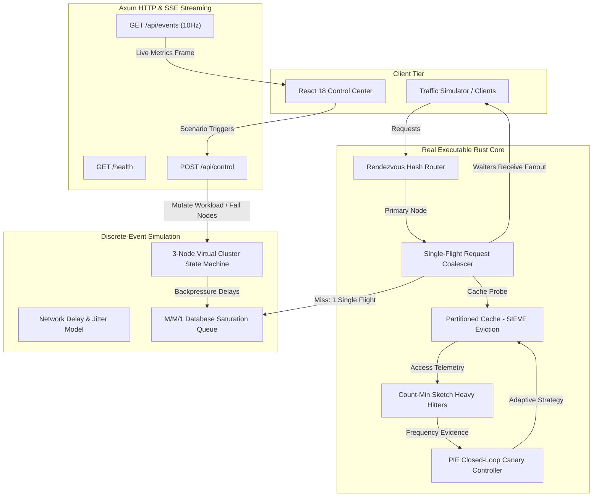

# PhantomCache

[](https://github.com/Satish8460/phantom-cache/actions/workflows/ci.yml)
[](LICENSE)
[](https://www.rust-lang.org/)
[](https://docs.rs/axum/latest/axum/)
[](https://react.dev/)

An intelligent in-memory distributed cache and request coalescing engine engineered for high-concurrency enterprise microservice tiers. Designed to mitigate database queue collapse, thundering herds, and cache stampedes during sudden traffic surges and flash crowds.

---

## 1. Problem Statement & Motivation

In modern cloud-native architectures, sudden traffic surges and flash crowds frequently trigger catastrophic **cache stampedes** (thundering herds). When a hot cache key expires or is evicted under heavy load, thousands of concurrent requests miss the cache simultaneously, bombarding downstream relational or document databases with redundant reads. This leads to connection pool starvation, thread pool saturation, exponential queuing latency, and cascading microservice collapse.

**PhantomCache** solves this problem through:
1. **Partitioned Sharded Concurrency:** Eliminates global cache lock contention using power-of-two sharding.
2. **Single-Flight Request Coalescing:** Synchronizes in-flight queries using asynchronous channels, ensuring that only one request hits the database for a given key, while concurrent duplicates wait and share the single result.
3. **Low-Overhead Eviction (SIEVE):** Implements visited-sweep eviction, outperforming traditional LRU with $O(1)$ operations and zero lock overhead on cache hits.
4. **Adaptive Intelligence (PIE):** Employs Count-Min Sketches to track key frequencies and uses a Policy Intelligence & Evaluation (PIE) closed-loop canary controller to safely test and deploy caching strategy shifts.

---

## 2. Real vs. Simulated Architectural Boundary

To ensure complete engineering transparency and academic rigor, the project clearly delineates between real executable code and discrete-event modeled infrastructure:

| Architectural Tier | Implementation Status | Technical Mechanism |
| :--- | :--- | :--- |
| **Partitioned Cache & Eviction** | **Real Executable Code** | Sharded mutex hash maps with visited-sweep (SIEVE) replacement in `src/core/cache.rs`. |
| **Request Coalescer** | **Real Executable Code** | Single-flight synchronization via Tokio `oneshot` rendezvous channels in `src/core/coalesce.rs`. |
| **Statistical Telemetry** | **Real Executable Code** | Lockless rolling observation circular buffer & Count-Min Sketch in `src/intel/`. |
| **Adaptive Policy Controller** | **Real Executable Code** | Multi-objective utility optimization with canary guardrails and rollback cooldowns in `src/control/pie.rs`. |
| **Distributed Router** | **Real Executable Code** | Highest Random Weight (Weighted Rendezvous Hashing) partition routing in `src/dist/router.rs`. |
| **HTTP & Telemetry API** | **Real Executable Code** | Axum REST endpoints and Server-Sent Events (SSE) streaming at 10Hz in `src/api/server.rs`. |
| **Operations Dashboard** | **Real Executable Code** | React 18 single-page application with SVG topology, sparklines, and control panel in `ui/`. |
| **Cluster Topology & Nodes** | **Modeled / Simulated** | In-process virtual node state machines (`Active`, `Degraded`, `Failed`) in `src/dist/node.rs`. |
| **Network Link & Jitter** | **Modeled / Simulated** | Queue-based delay model with configurable packet loss and latency distributions in `src/sim/network.rs`. |
| **Backend Database Queue** | **Modeled / Simulated** | M/M/1 queuing model with IOPS saturation limits and non-linear wait times in `src/sim/backend.rs`. |
| **Traffic Generator** | **Modeled / Simulated** | Poisson arrival process and Zipfian key popularity distribution in `src/sim/traffic.rs`. |
| **Cloud Cost Model** | **Derived Formulation** | Analytical cost estimation comparing raw queries against avoided compute operations. |

---

## 3. System Architecture



---

## 4. Technology Stack

* **Core Backend:** Rust (2021 Edition) — Memory-safe, zero-cost abstractions, multi-threaded concurrency.
* **Async Runtime:** Tokio 1.38 — Multi-threaded asynchronous work-stealing scheduler.
* **Web Framework:** Axum 0.7 — High-performance HTTP server with Server-Sent Events (SSE) support.
* **Serialization:** Serde 1.0 & Serde JSON.
* **Frontend UI:** React 18, Vite 5 — Modern, reactive single-page operations dashboard.
* **Build & DevOps:** Cargo, npm, GitHub Actions CI/CD.

---

## 5. Prerequisites

Verify installed tools before setting up the project:
* **Rust:** `cargo 1.75+` (verified on `1.98.0`)
* **Node.js:** `v18.0+` (verified on `v24.5.0` with `npm 11.5.1`)
* **Git:** `2.40+`

---

## 6. Installation & Execution

### 6.1 Backend Setup
```bash
# Clone the repository
git clone https://github.com/Satish8460/phantom-cache.git
cd phantom-cache

# Verify code and compile dependencies
cargo check

# Run automated tests
cargo test

# Start the backend server (runs on port 8085)
cargo run
```

### 6.2 Frontend Setup
```bash
# Navigate to UI directory
cd ui

# Install dependencies reproducibly
npm ci

# Start development server (runs on port 5173 / 3000)
npm run dev

# Or build optimized static bundle
npm run build
```

### 6.3 Automated One-Click Launcher (Windows)
```cmd
Start-Phantom-Demo.bat
```
The launcher performs pre-flight environment diagnostics, detects port conflicts on `8085` and `3000`, launches the backend and frontend in the background, tracks process IDs, and opens the default web browser.

### 6.4 Git Workflow & Repository Status
* **Remote Repository:** `https://github.com/Satish8460/phantom-cache`
* **Access Mode:** Authenticated access via Git Credential Manager / GitHub account `Satish8460`.
* **Branching Model:** The repository uses `main` as the primary integration branch, with features and enhancements developed on dedicated topic branches (e.g. `feat/publish-phantomcache-core`) and merged through Pull Requests.

---

## 7. API Reference

The Axum backend exposes the following REST and streaming endpoints:

### `GET /health`
* **Description:** Health check probe verifying server operational status.
* **Response:** `200 OK`
* **Body:** `"OK"`

### `POST /api/control`
* **Description:** Dispatches cluster scenario mutations and environmental perturbations.
* **Headers:** `Content-Type: application/json`
* **Payload Examples:**
  ```json
  { "event": "FLASH_CROWD" }
  ```
  ```json
  { "event": "NODE_FAILURE" }
  ```
  ```json
  { "event": "NORMAL" }
  ```
* **Response:** `200 OK`
  ```json
  { "status": "success", "triggered": "FLASH_CROWD" }
  ```

### `GET /api/events`
* **Description:** Server-Sent Events (SSE) stream publishing cluster state snapshots at $10\text{ Hz}$ ($100\text{ ms}$ intervals).
* **Headers:** `Content-Type: text/event-stream`, `Cache-Control: no-cache`
* **Data Frame Schema:**
  ```json
  {
    "version": "1.0",
    "timestamp_ms": 128400,
    "nodes": [
      {
        "node_id": 1,
        "state": "Active",
        "cpu_utilization": 28.4,
        "memory_used_bytes": 536870912
      }
    ],
    "metrics": {
      "throughput_req_sec": 12050.0,
      "p50_latency_ms": 10,
      "p95_latency_ms": 12,
      "p99_latency_ms": 15,
      "backend_load_ratio": 0.20,
      "avoided_compute_dollars": 14.50
    },
    "hot_keys": [
      { "key": "/availability/hotel/123", "req_sec": 9200.0, "hit_rate": 0.99 }
    ]
  }
  ```

---

## 8. Verification & Quality Assurance

### Code Quality & Static Analysis
```bash
# Verify formatting
cargo fmt --all -- --check

# Strict static analysis (zero warnings enforced)
cargo clippy --all-targets --all-features -- -D warnings
```

### Automated Testing Suites
```bash
# Run all 17 automated tests across 4 modular test files
cargo test
```

Test coverage includes:
* **WP1 Tests (4 tests):** Virtual monotonic clock, deterministic PRNG seed repeatability, partitioned sharded cache operations, and single-flight request coalescing.
* **WP2 Tests (5 tests):** Count-Min Sketch mathematical error bounds, lockless telemetry calculation, PIE insufficient evidence guards, PIE latency constraint violations, and PIE cooldown guardrail enforcement.
* **WP3 Tests (3 tests):** Highest Random Weight (Rendezvous) hash routing, primary and secondary replica election, and failed-node routing exclusion.
* **WP4 Tests (5 tests):** Server-Sent Events state projection, live HTTP `GET /health` endpoint, live HTTP `POST /api/control` scenario mutation, and `404 Not Found` error handling.

---

## 9. Academic Submission & Reports

* **Course Project Work Report:** [docs/PHASE_2_WORK_REPORT.md](docs/PHASE_2_WORK_REPORT.md)
* **Work Packages Specifications:** [docs/implementation/](docs/implementation/)
* **Runtime & Realism Audits:** [docs/testing/](docs/testing/)

---

## 10. License

This project is licensed under the [MIT License](LICENSE).
