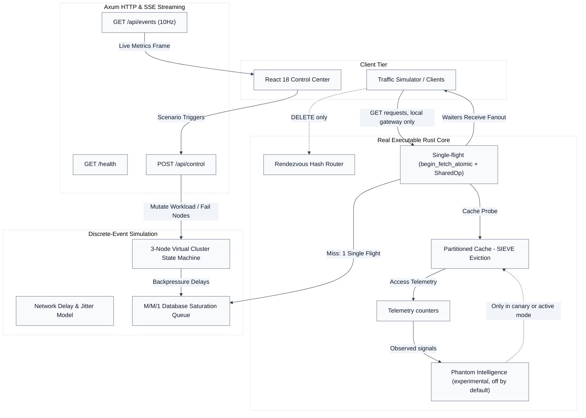

# PhantomCache

[](https://github.com/Satish8460/phantom-cache/actions/workflows/ci.yml)
[](LICENSE)
[](https://www.rust-lang.org/)
[](https://docs.rs/axum/latest/axum/)
[](https://react.dev/)

An in-memory caching gateway and request coalescing engine (research prototype) aimed at high-concurrency microservice tiers. Distributed operation is experimental. Designed to mitigate database queue collapse, thundering herds, and cache stampedes during sudden traffic surges and flash crowds.

---

## 1. Problem Statement & Motivation

In modern cloud-native architectures, sudden traffic surges and flash crowds frequently trigger catastrophic **cache stampedes** (thundering herds). When a hot cache key expires or is evicted under heavy load, thousands of concurrent requests miss the cache simultaneously, bombarding downstream relational or document databases with redundant reads. This leads to connection pool starvation, thread pool saturation, exponential queuing latency, and cascading microservice collapse.

**PhantomCache** solves this problem through:
1. **Partitioned Sharded Concurrency:** Eliminates global cache lock contention using power-of-two sharding.
2. **Single-Flight Request Coalescing:** Synchronizes in-flight queries using asynchronous channels, ensuring that only one request hits the database for a given key, while concurrent duplicates wait and share the single result.
3. **Eviction (SIEVE default, LRU and S3-FIFO selectable):** Per-shard eviction policies behind a common trait. Relative performance versus LRU has not been established by a release-grade measurement; see `docs/research/claims_ledger.md`.
4. **Phantom Intelligence (experimental, off by default):** observe/advisory/canary/active modes with audit records and an origin-concurrency cap. **A benefit from adaptive control has not been established**; the legacy `src/control/pie.rs` is a threshold stub and is not wired in. Do not rely on adaptive behavior for production capacity or latency.

---

## 2. Real vs. Simulated Architectural Boundary

To ensure complete engineering transparency and academic rigor, the project clearly delineates between real executable code and discrete-event modeled infrastructure:

| Architectural Tier | Implementation Status | Technical Mechanism |
| :--- | :--- | :--- |
| **Partitioned Cache & Eviction** | **Real Executable Code** | Sharded mutex hash maps with visited-sweep (SIEVE) replacement in `src/core/cache.rs`. |
| **Request Coalescer (single-flight)** | **Real Executable Code** | The HTTP serving path uses `PartitionedCache::begin_fetch_atomic` (`src/core/cache.rs`) with the `SharedOp` waiter list and Tokio `oneshot` channels (`src/core/coalesce.rs`). The older `Coalescer` type in the same file is legacy: it is constructed in `src/main.rs` and `src/dist/node.rs` but not used by the HTTP serving path. |
| **Statistical Telemetry** | **Real Executable Code** | Atomic counters and log-linear latency histogram in `src/intel/` (the Count-Min Sketch type exists but is not used by the serving path). |
| **Adaptive Policy Controller** | **Legacy stub, not active** | `src/control/pie.rs` is a threshold trigger (not wired in `main.rs`). The Phantom Intelligence modules live in `src/intelligence/`; their benefit is not established. |
| **Distributed Router** | **Real Executable Code** | Highest Random Weight (Weighted Rendezvous Hashing) routing in `src/dist/router.rs`. It is used by `DELETE` invalidation only; `GET` is always served from the local gateway cache and never goes through the router. |
| **HTTP & Telemetry API** | **Real Executable Code** | Axum REST endpoints and Server-Sent Events (SSE) streaming at 10Hz in `src/api/server.rs`. |
| **Dashboard values from `PHANTOM_SIMULATION=true`** | **Simulated (synthetic)** | The simulation loop generates synthetic throughput, latency and cost values. They are not measurements. |
| **Operations Dashboard** | **Real Executable Code** | React 18 single-page application with SVG topology, sparklines, and control panel in `ui/`. |
| **Cluster Topology & Nodes** | **Mixed: Modeled / Simulated and Real (experimental)** | The three demo nodes built when no cluster is configured are in-process virtual node state machines (`Active`, `Degraded`, `Failed`) in `src/dist/node.rs`, each with its own cache. In the mTLS cluster configuration (`src/main.rs`) the local node shares the gateway's HTTP serving cache (`VirtualNode::new_with_cache`) and the other members are address-only descriptors reached over mutual TLS; this path is experimental and tested on loopback only. |
| **Network Link & Jitter** | **Modeled / Simulated** | Queue-based delay model with configurable packet loss and latency distributions in `src/sim/network.rs`. |
| **Backend Database Queue** | **Modeled / Simulated** | M/M/1 queuing model with IOPS saturation limits and non-linear wait times in `src/sim/backend.rs`. |
| **Traffic Generator** | **Modeled / Simulated** | Poisson arrival process and Zipfian key popularity distribution in `src/sim/traffic.rs`. |
| **Cloud Cost Model** | **Derived Formulation** | Analytical cost estimation comparing raw queries against avoided compute operations. |

---

## 3. System Architecture



---

## 4. Technology Stack

* **Core Backend:** Rust (2021 Edition) — Memory-safe, zero-cost abstractions, multi-threaded concurrency.
* **Async Runtime:** Tokio (`Cargo.toml` requires 1.38 or newer; `Cargo.lock` pins 1.53.1) — Multi-threaded asynchronous work-stealing scheduler.
* **Web Framework:** Axum 0.7 — High-performance HTTP server with Server-Sent Events (SSE) support.
* **Serialization:** Serde 1.0 & Serde JSON.
* **Frontend UI:** React 18, Vite 5 — Modern, reactive single-page operations dashboard.
* **Build & DevOps:** Cargo, npm, GitHub Actions CI/CD.

---

## 5. Prerequisites

Verify installed tools before setting up the project:
* **Rust:** verified on `1.98.0`. The code probably needs about Rust 1.88 or newer (finding G4C F28, reported by an AI review and not re-derived); `Cargo.toml` declares no `rust-version`, so `1.75+` is not supported by evidence.
* **Node.js:** `v18.0+` (verified on `v24.5.0` with `npm 11.5.1`)
* **Git:** `2.40+`

---

## 6. Installation & Execution

### 6.1 Backend Setup
```bash
# Clone the repository
git clone https://github.com/Satish8460/phantom-cache.git
cd phantom-cache

# Verify code and compile dependencies
cargo check

# Run automated tests
cargo test --all-targets -j 1

# Start the backend server (runs on port 8085)
# The package has two binaries (phantom-cache-demo and phantom-lab), so name the one to run
cargo run --bin phantom-cache-demo
```

### 6.2 Frontend Setup
```bash
# Navigate to UI directory
cd ui

# Install dependencies reproducibly
npm ci

# Start development server (runs on port 3000, pinned in ui/vite.config.js)
npm run dev

# Or build optimized static bundle
npm run build
```

### 6.3 Automated One-Click Launcher (Windows)
```cmd
Start-Phantom-Demo.bat
```
The launcher performs pre-flight environment diagnostics, detects port conflicts on `8085` and `3000`, launches the backend and frontend in the background, tracks process IDs, and opens the default web browser.

### 6.4 Git Workflow & Repository Status
* **Remote Repository:** `https://github.com/Satish8460/phantom-cache`
* **Access Mode:** Authenticated access via Git Credential Manager / GitHub account `Satish8460`.
* **Branching Model:** The repository uses `main` as the primary integration branch, with features and enhancements developed on dedicated topic branches (e.g. `feat/publish-phantomcache-core`) and merged through Pull Requests.

---

## 6.5 Configuration and Operation

The binary validates its configuration at startup and fails fast with exit code 2 on invalid or conflicting settings.

```bash
cargo run --release --bin phantom-cache-demo -- --check-config                 # print the effective configuration (secrets redacted) and exit
cargo run --release --bin phantom-cache-demo -- --config packaging/phantom.example.conf --bind 127.0.0.1:8085
```

See [docs/user/](docs/user/README.md) (install, configure, run, operate, troubleshoot, security, limitations) and [docs/release/](docs/release/reproduction_guide.md) (reproduction guide, artifact manifest, release notes template).

### Evidence labels used in this project

* **Simulated:** produced by the in-process models or `PHANTOM_SIMULATION=true`; never a measurement.
* **Loopback:** measured on one host over the loopback interface; not representative of a network deployment.
* **Real:** measured on real hardware and networks with a recorded workload, seed and repetitions. No such result is claimed by this README.

Performance and adaptive-control claims require a release-build measurement with the conditions recorded; none are made here.

---

## 7. API Reference

The Axum backend exposes the following REST and streaming endpoints:

### `GET /health`
* **Description:** Health check probe verifying server operational status.
* **Response:** `200 OK`
* **Body:** `"OK"`

### `GET /health/live` and `GET /health/ready`
* **Description:** Liveness (`200` while the process serves requests) and readiness (`200` only when configuration is valid, the listener accepts connections and the process is not shutting down; otherwise `503` with the failing checks). `/health` is unchanged.

### `POST /api/control`
* **Description:** Dispatches cluster scenario mutations and environmental perturbations.
* **Headers:** `Content-Type: application/json`
* **Payload Examples:**
  ```json
  { "event": "FLASH_CROWD" }
  ```
  ```json
  { "event": "NODE_FAILURE" }
  ```
  ```json
  { "event": "NORMAL" }
  ```
* **Response:** `200 OK`
  ```json
  { "status": "success", "triggered": "FLASH_CROWD" }
  ```

### `GET /api/events`
* **Description:** Server-Sent Events (SSE) stream publishing cluster state snapshots at $10\text{ Hz}$ ($100\text{ ms}$ intervals).
* **Headers:** `Content-Type: text/event-stream`, `Cache-Control: no-cache`
* **Data Frame Schema:**
  ```json
  {
    "version": "1.0",
    "timestamp_ms": 128400,
    "nodes": [
      {
        "node_id": 1,
        "state": "Active",
        "cpu_utilization": 28.4,
        "memory_used_bytes": 536870912
      }
    ],
    "metrics": {
      "throughput_req_sec": 12050.0,
      "p50_latency_ms": 10,
      "p95_latency_ms": 12,
      "p99_latency_ms": 15,
      "backend_load_ratio": 0.20,
      "avoided_compute_dollars": 14.50
    },
    "hot_keys": [
      { "key": "/availability/hotel/123", "req_sec": 9200.0, "hit_rate": 0.99 }
    ]
  }
  ```

### Additional routes (registered in `src/api/server.rs` and `src/api/lab_api.rs`)
Authentication, roles and request/response details are in [docs/user/run.md](docs/user/run.md) and [docs/user/lab_api.md](docs/user/lab_api.md).

| Route | Methods |
|---|---|
| `/api/v1/cache/*key` | `GET`, `DELETE` |
| `/api/v1/cache` | `GET`, `DELETE` |
| `/api/v1/metrics` | `GET` |
| `/api/v1/diagnostics/summary`, `/api/v1/diagnostics/events` | `GET` |
| `/api/v1/intelligence/status`, `/api/v1/intelligence/audit` | `GET` |
| `/api/v1/lab/capabilities`, `/api/v1/lab/evidence`, `/api/v1/lab/evidence/:id` | `GET` |
| `/api/v1/lab/runs` | `POST`, `GET` |
| `/api/v1/lab/runs/:id`, `/api/v1/lab/runs/:id/events`, `/api/v1/lab/runs/:id/artifacts`, `/api/v1/lab/runs/:id/artifacts/:name` | `GET` |
| `/api/v1/lab/runs/:id/cancel` | `POST` |

The `/api/v1/lab/*` routes are registered only when the lab service is enabled.

---

## 8. Verification & Quality Assurance

### Code Quality & Static Analysis
```bash
# Verify formatting
cargo fmt --all -- --check

# Strict static analysis (zero warnings enforced)
cargo clippy --all-targets --all-features -- -D warnings
```

### Automated Testing Suites
```bash
# Run all automated tests sequentially
cargo test --all-targets -j 1
```

The suite covers the areas below. Test counts change as work lands; the current reproduced baseline (count, targets, profile, date, command) is recorded in [docs/STATUS.md](docs/STATUS.md), and the per-area counts below are historical. A passing test run does not by itself establish correctness or performance:
* **Core Unit Tests (`lib.rs`, `main.rs` - 32 tests):** Frame codecs, header serialization, error handling, session tracking.
* **WP1-WP4 Work Package Tests (18 tests):** Monotonic virtual clock, PRNG repeatability, partitioned sharded cache operations, 200k unique-key flood capacity, single-flight coalescing, Count-Min Sketch error bounds, PIE adaptive canary guardrails, Rendezvous hash routing, and live SSE control mutations.
* **Core HTTP & Engine Suites (`m1_http_tests`, `coalesce_tradeoffs_tests` - 37 tests):** Full HTTP lifecycle (MISS -> HIT -> DELETE -> MISS), stampede barriers, waiter bounds, body size limits, head-of-line blocking mitigation, and waiter fairness.
* **Traffic Simulation & Adaptive Eviction (`p3_traffic_tests`, `p4_pie_tests` - 11 tests):** Live workload pacing, Zipf distributions, SIEVE vs LRU vs S3-FIFO comparative benchmarks, and dynamic policy switching.
* **Phase 1 Zero-Trust Ingress (`security_phase1_tests` - 15 tests):** TLS 1.3, JWT key rotation, unknown kid rejection, tenant isolation, and RBAC endpoint gating.
* **Phase 2 Upstream Security (`security_phase2_upstream_tests` - 23 tests):** SSRF mitigation (cloud metadata, IPv4-mapped IPv6, DNS rebinding), TLS custom CA pinning, and strict chunked transfer encoding parsing.
* **Phase 3 Inter-Node Transport (`security_phase3_cluster_tests`, `security_phase3b_framing_tests`, `security_phase3c_pooling_tests` - 48 tests):** Mutual TLS 1.3, RFC 1035 SAN identity validation, CA rollover, quarantine, 28-byte binary framing, and bounded connection pooling with keepalives.
* **Phase 4 Distributed Consistency (`security_phase4a_invalidation_tests`, `security_phase4b_router_tests`, `security_phase4c_antientropy_tests` - 41 tests):** Wire invalidation codecs, O(1) tenant epochs, 10,000 tenant capacity bounds, rendezvous primary coordination, acting primary failover, fail-closed HTTP consistency contract, dual-bounded ring buffers (4,096 entries, 4 MB RAM), SHA-256 state digests, stream sequence gap detection, and deterministic partition cache flushing.


---

## 9. Academic Submission & Reports

* **Course Project Work Report:** [docs/PHASE_2_WORK_REPORT.md](docs/PHASE_2_WORK_REPORT.md)
* **Work Packages Specifications:** [docs/implementation/](docs/implementation/)
* **Runtime & Realism Audits:** [docs/testing/](docs/testing/)

---

## 10. License

This project is licensed under the [MIT License](LICENSE).
