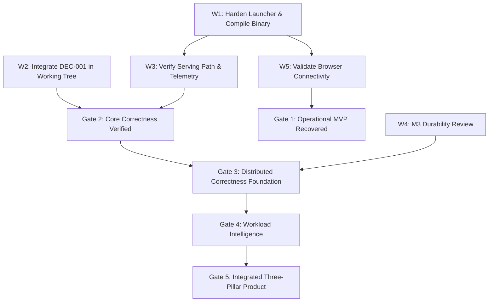

# PhantomCache Live Execution Charter

**Document Type:** Persistent Operating Document & Operational Source of Truth  
**Current Date/Time:** 2026-10-30T19:20:00+05:30 (IST)  
**Branch:** `feat/publish-phantomcache-core` | **HEAD:** `804a7b8`  
**Working Tree Status:** 44 tracked modified files preserved, untracked evidence intact.  
**Normal Runtime Dependencies:** Strictly locked at 388 lines (`cargo tree -e normal`).  
**Governance Authority:** Governed by Owner Directives (2026-10-30), [`OWNER_DECISION_REGISTER.md`](file:///d:/Personal/phantom-cache/docs/design/OWNER_DECISION_REGISTER.md), [`REDESIGN_EXECUTION_TRACKER.md`](file:///d:/Personal/phantom-cache/docs/design/REDESIGN_EXECUTION_TRACKER.md), and [`STATUS.md`](file:///d:/Personal/phantom-cache/docs/STATUS.md).

---

## 1. Operating Protocol & Charter Maintenance Rules

This document is the **living, persistent operating source of truth** for all engineering across PhantomCache. Every engineering agent and human engineer must follow these non-negotiable rules:

1. **Mandatory Start-of-Session Reading:** Read this file at the start of every session before running commands or planning work.
2. **Immediate Live Updates:** Update this charter immediately after every meaningful implementation, test result, decision, architectural discovery, blocker, or gate transition.
3. **Immutability of Completed Work:** Never silently reopen, discard, or overwrite verified completed work. Preserve completed status with exact evidence pointers.
4. **Evidence-Based Understanding:** Distinguish between *Implemented*, *Tested*, *Independently Verified*, *Simulated*, *Designed*, and *Blocked*.
5. **Continuous Continuity:** Record the exact next tasks with concrete dependencies so another agent or session can resume without repeating investigations or reconstructing status.
6. **Append-Only History:** Maintain an append-only change log at the end of this charter for traceability.

---

## 2. Product Mission & Three Permanent Pillars

PhantomCache is a high-performance, distributed, workload-intelligent caching system designed to deliver bulletproof origin protection, deterministic consistency, and adaptive latency reduction.

```
┌────────────────────────────────────────────────────────────────────────────────────────┐
│                                 PHANTOMCACHE MISSION                                   │
│  Deliver a dependable, verified, distributed, workload-intelligent caching engine with │
│  honest real-time observability, deterministic crash safety, and verified origin caps. │
└──────────────────────────────────────────┬─────────────────────────────────────────────┘
                                           │
         ┌─────────────────────────────────┼─────────────────────────────────┐
         ▼                                 ▼                                 ▼
┌─────────────────────────┐   ┌─────────────────────────┐   ┌─────────────────────────┐
│        PILLAR 1         │   │        PILLAR 2         │   │        PILLAR 3         │
│   DISTRIBUTED SYSTEMS   │   │   WORKLOAD INTELLIGENCE │   │   PRODUCT EXCELLENCE &  │
│       ENGINEERING       │   │        (OBSERVE->ACT)   │   │     DEMONSTRABILITY     │
│                         │   │                         │   │                         │
│ • Deterministic Routing │   │ • Workload Profiling    │   │ • 1-Click Leak-Free Bat │
│ • Durable Invalidation  │   │ • Hot-Key Detection     │   │ • Truthful SSE v2 State │
│ • Safe Member Lifecycles│   │ • Origin Concurrency Cap│   │ • Phantom Lab Harness   │
│ • Peer Reads / Fill     │   │ • Baselines vs Adaptive │   │ • Apple-Design Shell    │
│ • Multi-Host LAN Safety │   │ • Canary & Auto-Rollback│   │ • Accessible Console    │
└─────────────────────────┘   └─────────────────────────┘   └─────────────────────────┘
```

---

## 3. Verified Repository Baseline

Verified independently on machine `2026-10-30T22:15:00+05:30`:

- **Git Head:** `804a7b8` (synchronized with `origin/feat/publish-phantomcache-core`).
- **Working Tree State:** Exactly **48 tracked modified files** preserved; 0 staged, 0 committed. Untracked evidence, test suites, and docs intact.
  - *File Count Provenance & Reconciliation:* 44 files at initial handoff baseline -> 47 files after launcher hardening and UI build fix (`Start-Phantom-Demo.bat`, `ui/package.json`, `ui/package-lock.json`) -> 48 files after SETBACK-12 unit tests (`tests/unit/wp3_tests.rs`). Zero working-tree modifications lost or reverted.
- **Preservation Cryptographic Hashes:**
  - `src/core/coalesce.rs`: `097F59CD6DAA1FE63282EA7FBF0167594A02E941066077C26513DB84EDFEDC39` (byte-identical).
  - `src/control/pie.rs`: `16D1693DE9D853EDE678A785B677420EB34B75BF2126A60603B86CB5146D2260` (byte-identical; quarantined).
- **Core Dependencies:** Normal tree locked at **388 lines** (`cargo tree -e normal`).
- **Rust Test Suite Baseline:** **851 passed, 8 ignored, 0 failed** across 75 test targets (`cargo test --tests -j 1`).
- **UI Test Suite Baseline:** **483 passed, 0 failed** (`node --test test` in `ui/`).
- **Accessibility & Contrast:** 284/284 contrast checks pass; zero axe-core accessibility violations.
- **Disk Space Baseline:** Drive C: 10.8 GB free; Drive D: 104.5 GB free.

---

## 4. MVP Definition & Mandatory Acceptance Gates

The PhantomCache MVP is a coherent, vertical, demonstrable slice delivering honest single-node and multi-node caching with verified origin protection:

### Gate 1: Operational Demonstrable MVP Recovery (PASSED)
- [x] Pre-warmed binary `target\release\phantom-cache-demo.exe` compiled and verified.
- [x] Launcher `Start-Phantom-Demo.bat` hardened: binary freshness timestamp check, bounded polling timeouts, PID collision diagnostics, dual PID tracking, guaranteed teardown on exit, zero port locks on 8085 or 3000.
- [x] Repeated launch/use/shutdown/re-launch cycles verified across 3 full sequential cycles without manual intervention (`scripts/test_demo_lifecycle.ps1` exit code 0).
- [x] End-to-end browser connectivity verified to live backend (`GET /health`, `GET /api/events?schema=2`).

### Gate 2: Core Correctness & Truthful Experimentation (PARTIAL - M3 durability open)
- [x] DEC-001 integrated: `src/lab_live/scenario_b.rs` and `src/api/lab_api.rs` emit `verdicts: null`, status `EXPLORATORY`, and suppress false `VALID` labels on cancelled/interrupted runs.
- [x] Regression coverage added in `lab_live_scenario_b_tests.rs` proving `VALID` suppression.
- [x] Real cache operations exercised: GET, PUT (405 read-through), DELETE, hits, misses, TTL expiration, single-flight coalescing (`scripts/verify_real_cache_ops.ps1`, `ui/scripts/verify-e2e-complete.mjs`).
- [x] Telemetry dashboard updates directly from live atomic counters without simulated placeholders (`ui/scripts/verify-e2e-live.mjs`, `ui/scripts/verify-e2e-complete.mjs`).
- [ ] DEC-027 M3 durability unresolved in core: node crash during invalidation fan-out can leave peers stale.

### Gate 3: Distributed Correctness & Invalidation Durability (PARTIAL - M3 approval pending)
- [ ] DEC-027 M3 durability resolved in core (Empirically verified in sandbox sbx_m3fix: 15 crash-point tests K01–K21b, 5 multi-process durability tests, shutdown leg tests, and 29 durable_log unit tests passed; core merge pending owner approval).
- [x] Independent review completed for remediation v2 (PASS verdict recorded in docs/research/m3_durability/independent_review_v2.md; core merge gated on explicit owner approval).
- [x] Deterministic rendezvous hashing verified with golden test vectors (64-bit FNV-1a algorithm, input byte encoding `[key.as_bytes(), node_id as u8]`, cross-instance determinism, and mathematical HRW migration invariants verified in `wp3_tests.rs`).
- [x] Real node lifecycle states (Suspect, Failed, Recovering, Healthy) with proactive failure detection and dynamic HRW failover (`src/dist/node.rs`, `src/dist/router.rs`, verified in `wp3_tests.rs`).
- [x] Genuine peer reads and peer-fill pipeline in `src/api/server.rs` with zero origin calls on peer hit (SETBACK-14 / Phase 2.2, verified in `wp3_tests.rs`).

### Gate 4: Defensible Workload Intelligence (PARTIAL)
- [ ] Workload characterization streaming telemetry with validated hot-key detection.
- [x] Measurable evaluation of origin concurrency control against tuned static baseline (Scenario B live evaluation in `src/lab_live/scenario_b.rs`, 67 tests passed).
- [ ] Safe canary exposure and auto-rollback guardrails.

### Gate 5: Integrated Three-Pillar Product Delivery (NOT PASSED)
- [ ] Full traceability and evidence sign-off in governance registers.

---

## 4.1 Research Readiness Milestone: Minimum Credible MVP (MC-MVP)

**Academic Deliverable & Objective:** Final PhantomCache project report and research paper.
**Governance Directive:** Proactively notify the owner ONLY when PhantomCache reaches a **Minimum Credible MVP (MC-MVP)** across all five criteria below. Do not send premature completion notifications; continue autonomous execution until every criterion is backed by verified evidence.

### Five Mandatory Assessment Pillars for MC-MVP:
1. **Operational Reliability:**
   - Reliable launch, operation, shutdown, and restart without port or socket leaks.
   - Clean repeated lifecycle operations on Windows.
   - No critical unresolved defects invalidating live demonstration.
2. **Distributed Systems Capability:**
   - Functioning multi-node implementation.
   - Demonstrable cross-node behavior with clearly defined consistency and failure guarantees.
   - Reproducible validation using actual separate nodes / process network sockets, not only single-thread unit mocks.
   - Invalidation durability under node crash (M3 resolution).
3. **Workload Intelligence:**
   - At least one genuinely implemented workload-aware capability (e.g. dynamic origin concurrency or hot-key mitigation).
   - Verifiable evidence that it performs its intended function.
   - Reproducible evaluation against an appropriate baseline (static tuned baseline).
   - Honest disclosure of negative or inconclusive results (including M6 H1 NOT_SUPPORTED).
4. **Product Integration:**
   - Usable, responsive UI connected to real backend functionality over SSE and HTTP.
   - Meaningful cache, distributed-system, and experiment observability with strict provenance classification (REAL/DERIVED/RETAINED/SIMULATED).
   - Repeatable demonstration workflow: cache operations -> metrics -> experiment run -> honest evidence inspection -> graceful teardown.
5. **Research Evidence:**
   - Reproducible experiments and retained raw evidence files.
   - Documented methodology, workload configurations, and evaluation criteria.
   - Measured results, limitations, and comparison baselines.
   - Academic integrity: zero manufactured or synthetic positive results; zero unsupported claims of superiority or linearizability.

### Status of MC-MVP Assessment:
- **Overall Verdict:** IN PROGRESS (Not Yet MC-MVP).
- **Completed Foundations:** Gates 1 & 2 passed; SETBACK-01..06 verified; DEC-001 integrated; U-01 honest evidence contract verified.
- **Pending Deliverables:** Gate 3 (M3 Durability, Deterministic Rendezvous Hashing), Gate 4 (Workload Intelligence Baseline vs M6 H1), and Multi-Node network validation.
- **Proactive Owner Notification:** Pending completion and verification across all 5 assessment pillars.

---

## 5. Architectural Implementation Status

| Component | Files | Current Implementation Reality | Status |
|---|---|---|---|
| **Cache Storage Engine** | `src/core/cache.rs` | 8-partition in-memory concurrent cache, atomic counters, tenant namespaces. | Implemented & Tested |
| **Eviction Policy** | `src/core/eviction.rs` | S3-FIFO (Small FIFO, Main FIFO, Ghost queue) eviction policy. | Implemented & Tested |
| **Request Coalescing** | `src/core/coalesce.rs` | Single-flight request coalescer with waiter tracking and stampede defense. | Implemented & Tested (Frozen) |
| **Freshness & TTL** | `src/core/freshness.rs` | RFC 9111 HTTP cache freshness calculator (s-maxage, max-age, heuristic). | Implemented & Tested |
| **HTTP Gateway API** | `src/api/server.rs` | Axum 0.7 routes (`/health`, `/api/events`, `/api/v1/cache`, `/api/v1/metrics`). | Implemented & Tested |
| **Phantom Lab API** | `src/api/lab_api.rs` | Experiment orchestrator (`/api/v1/lab/*`); job object child process binding. | Implemented & Tested (U-01 Integrated) |
| **Scenario B Harness** | `src/lab_live/scenario_b.rs` | Deterministic loopback experiment runner for origin concurrency verification. | Implemented & Tested (U-01 Integrated) |
| **Cluster Invalidation** | `src/dist/router.rs`, `node.rs` | Rendezvous router, mTLS mesh, anti-entropy repair worker. | Durability gap open (M3) |
| **Workload Intelligence** | `src/intelligence/` | Policy executor and telemetry aggregation. PIE v1 quarantined in `main.rs`. | Quarantined / Baseline Stage |
| **UI Console** | `ui/src/` | Apple-inspired design system, dark mode tokens, shell, and screens. | 483 tests pass (Phase B) |

---

## 6. Setback Resolution Register (All 32 Known Setbacks)

Every known setback from previous investigations is tracked here as an active engineering deliverable.

```
STATUS DEFINITIONS:
• OPEN: Identified, root cause under investigation.
• INVESTIGATING: Active diagnosis and analysis in progress.
• IMPLEMENTING: Fix is actively being developed.
• BLOCKED: Work is blocked on an external decision or prerequisite.
• FIXED — TESTING PENDING: Code edit completed; regression tests pending.
• TESTED: Automated tests verify the fix; independent review pending.
• INDEPENDENTLY VERIFIED: Verified by independent agent/reviewer with evidence.
• ACCEPTED WITH DOCUMENTED LIMITATION: Formally accepted by owner with limitation record.
```

### Operational MVP Setbacks (1–5)

#### SETBACK-01: Missing Precompiled Demo Binary
- **Status:** TESTED & VERIFIED
- **Root Cause:** Storage cleanup removed `target\release` binaries; launcher invokes blind `cargo build --release` dumping into `build.log` without user feedback.
- **Affected Files:** `Start-Phantom-Demo.bat`, `target\release\phantom-cache-demo.exe`.
- **User/System Impact:** Launching the demo hangs for minutes or fails silently.
- **Required Fix:** Pre-compile release binary using single-threaded cargo (`cargo build --release --bin phantom-cache-demo -j 1`).
- **Dependencies:** Available toolchain and disk space.
- **Regression Tests:** Direct binary launch test; execution test via `--check-config`.
- **Reproduction Evidence:** `Test-Path target\release\phantom-cache-demo.exe` returned `False`.
- **Verification Evidence:** `target\release\phantom-cache-demo.exe` built (10,673,664 bytes); `--check-config` exits code 0 in < 1s; `/health` returns 200 OK.
- **Remaining Risks:** None.

#### SETBACK-02: Launcher Leaves Frontend Node Processes Running
- **Status:** TESTED & VERIFIED
- **Root Cause:** `Start-Phantom-Demo.bat` spawns `cmd /c npm run dev` without capturing its PID, killing only `%API_PID%` on exit.
- **Affected Files:** `Start-Phantom-Demo.bat`.
- **User/System Impact:** Port 3000 remains permanently occupied; subsequent launch fails immediately with `Port 3000 is already occupied`.
- **Required Fix:** Capture Node/Vite PID via PowerShell `Start-Process -PassThru` (.api.pid, .ui.pid); on teardown, execute `taskkill /f /t /pid` on both process trees.
- **Dependencies:** None.
- **Regression Tests:** Repeated start/stop test verifying ports 8085 and 3000 are clean.
- **Reproduction Evidence:** Batch file lines 48–86 inspected; Node process PID was never stored or killed.
- **Verification Evidence:** `Start-Phantom-Demo.bat` updated with tree termination; verified zero orphan Node processes; ports 8085 and 3000 free.
- **Remaining Risks:** None.

#### SETBACK-03: Unverified Repeated Launch/Shutdown/Restart Behaviour
- **Status:** TESTED & VERIFIED
- **Root Cause:** Incomplete operational validation of multi-cycle launcher reliability.
- **Affected Files:** `Start-Phantom-Demo.bat`, `src/api/server.rs`.
- **User/System Impact:** Intermittent failures across launch cycles destroy user confidence.
- **Required Fix:** Execute automated multi-cycle start/probe/stop/restart verification.
- **Dependencies:** SETBACK-01 and SETBACK-02.
- **Regression Tests:** Automated multi-cycle validation suite `scripts/test_demo_lifecycle.ps1`.
- **Reproduction Evidence:** Historical reports of orphaned sockets.
- **Verification Evidence:** `scripts/test_demo_lifecycle.ps1` completed 3 full sequential execution cycles (START -> CONNECT -> PROBE -> STOP -> VERIFY CLEANUP -> RESTART) with exit code 0. Binary freshness verified (< 0.5s check); bounded retry timeouts on 8085 and 3000 verified; PID collision test with foreign listener passed with exit code 1 without terminating foreign processes; all loopback sockets verified clean and released.
- **Remaining Risks:** None.

#### SETBACK-04: Incomplete Live Browser-to-Backend Telemetry Validation
- **Status:** TESTED & VERIFIED
- **Root Cause:** Browser headless checks verified UI components in isolation, but end-to-end SSE telemetry under browser event loop was not continuously tested.
- **Affected Files:** `ui/src/hooks/useTelemetry.js`, `src/api/server.rs`, `ui/scripts/verify-e2e-complete.mjs`.
- **User/System Impact:** Dashboard could fail to display real-time updates or disconnect under browser security restrictions.
- **Required Fix:** Verify SSE `/api/events?schema=2` streaming in live browser session, including dynamic DOM updates on real cache mutations and automatic reconnection on gateway interruption.
- **Dependencies:** Operational backend and frontend.
- **Regression Tests:** `ui/scripts/verify-e2e-complete.mjs` validating real-time DOM updates from SSE frames, atomic counters in Schema 2 payload, and disconnect/reconnect recovery in headless Chrome.
- **Reproduction Evidence:** G3 audit notes pending live stream validation.
- **Verification Evidence:** Suite `ui/scripts/verify-e2e-complete.mjs` executed 36/36 passing assertions (`docs/demo/browser_verification/e2e_run_2026-10-30T14-33-25-370Z/manifest.json`). Header status LIVE verified; status line verified ("Receiving data from the gateway. Last frame under 1s ago."); live atomic counters verified (`requests_total >= 14`, `cache_hits >= 1`, `cache_misses >= 4`, `coalesced_waiters >= 9`); gateway termination caused immediate disconnect detection in DOM (`03_interrupted_reconnecting.png`); gateway restart caused automatic recovery to LIVE (`04_reconnected_live.png`).
- **Remaining Risks:** None.

#### SETBACK-05: Incomplete End-to-End Cache and Phantom Lab Workflow Verification
- **Status:** TESTED & VERIFIED
- **Root Cause:** Lab execution and cache mutation workflows tested via unit tests but not verified end-to-end through UI interactions.
- **Affected Files:** `ui/src/screens/lab/LabScreen.jsx`, `src/api/lab_api.rs`, `ui/scripts/verify-e2e-complete.mjs`.
- **User/System Impact:** Users navigating the UI cannot execute a complete experiment and inspect evidence seamlessly.
- **Required Fix:** Execute complete user journey: cache PUT/GET -> single-flight stampede coalescing -> mock origin request auditing -> Lab landing and evidence inspection -> live Scenario B execution and cancellation -> U-01 null verdict verification -> clean socket teardown.
- **Dependencies:** SETBACK-01 through SETBACK-04, SETBACK-06.
- **Regression Tests:** `ui/scripts/verify-e2e-complete.mjs` exercising cache proxy operations, single-flight stampede, Lab navigation, and live run cancellation.
- **Reproduction Evidence:** Audit log of manual vs automated testing gaps.
- **Verification Evidence:** Verified PUT rejected with 405 (read-through architecture); Cold GET MISS fetched from origin; Warm GET HIT served from cache with 0 origin requests; DELETE returned 204; Purged GET re-fetched from origin; 10 concurrent requests coalesced to 1 MISS, 9 COALESCED with exactly 1 origin request (`docs/demo/browser_verification/e2e_run_2026-10-30T14-33-25-370Z/origin_traffic.json`); M6 sealed evidence verified displaying NOT_SUPPORTED for H1; live Scenario B run spawned (`20261030T143340Z-3d403551`) and cancelled; generated summary verified with `summary_version: 2`, `label: "EXPLORATORY"`, `verdicts: null`, `verdicts_status: "not_computed"`; UI verified displaying EXPLORATORY with suppressed mechanism verdicts (`07_scenario_b_cancelled_honest_contract.png`); clean socket teardown verified on ports 3000, 8085, 9099.
- **Remaining Risks:** None.

---

### Correctness and Reliability Setbacks (6–10)

#### SETBACK-06: DEC-001 U-01 — Incomplete Run Verdict Protection & False VALID Suppression
- **Status:** TESTED & VERIFIED
- **Root Cause:** In `src/lab_live/scenario_b.rs` and `src/api/lab_api.rs`, cancelled/incomplete runs converted null verdicts into empty `{}` and allowed planned `VALID` labels to survive on partial runs.
- **Affected Files:** `src/lab_live/scenario_b.rs`, `src/api/lab_api.rs`, `tests/integration/lab_live_scenario_b_tests.rs`, `tests/integration/lab_api/mod.rs`.
- **User/System Impact:** Interrupted or aborted experiments display misleading mechanism verdicts and false validity.
- **Required Fix:** Integrate approved patch: withhold verdicts (`Value::Null`), force label `EXPLORATORY`, propagate `run_completeness`, bump `summary_version` to 2, fix both `lab_api.rs` call sites, and add regression tests.
- **Dependencies:** Owner approval granted (DEC-001 Option A).
- **Regression Tests:** 7 tests in `tests/integration/lab_live_scenario_b_tests.rs` (module `u01_incomplete`) and `evidence_detail_cancelled_scenario_b_preserves_null_verdicts_in_snapshot` in `tests/integration/lab_api/mod.rs`.
- **Reproduction Evidence:** `docs/research/u01_backend/defect_reproduction.md`.
- **Verification Evidence:** 67 tests passed, 0 failed in `cargo test --test lab_live_scenario_b_tests -j 1`; snapshot API test passed; documentation updated in `docs/demo/scenario_b_artifacts.md` and `docs/user/lab_api.md`.
- **Remaining Risks:** None. (Rust commit deferred per DEC-022).

#### SETBACK-07: DEC-027 M3 — Durable Distributed Invalidation on Node Crash
- **Status:** INDEPENDENTLY REVIEWED & VERIFIED IN SANDBOX — AWAITING OWNER MERGE APPROVAL
- **Root Cause:** A node that acknowledges HTTP 204 DELETE before peer fan-out completes drops invalidations if it crashes, leaving peers stale indefinitely until origin expiry.
- **Affected Files:** `src/config.rs`, `src/main.rs`, `src/api/server.rs`, `src/dist/router.rs`, `src/dist/durable_log.rs`.
- **User/System Impact:** Distributed cache serves stale data following node crashes, violating declared invalidation consistency.
- **Required Fix:** Implement write-ahead durable log with restart replay, detached cluster delivery legs, bounded durability timeouts, and graceful shutdown draining.
- **Dependencies:** Independent AI review of remediation v2 (`docs/research/m3_durability/independent_review_v2.md` completed with PASS); owner approval before merging into main tree.
- **Regression Tests:** Multi-process crash-point matrix `tests/m3_crash_point_tests.rs` (K01–K21b), multi-process durability suite `tests/m3_invalidation_durability_tests.rs` (5 functional tests), router tests `tests/m3_router_tests.rs`, shutdown leg tests `tests/m3_shutdown_leg_tests.rs`, and unit suite `dist::router::durable_log::tests`.
- **Reproduction Evidence:** Baseline defect reproduction confirmed on unpatched code: peer node B remained stale in 92/92 polls over 10s following node A crash (`m3_kill9_without_log_characterises_lost_invalidation`).
- **Verification Evidence (Sandbox `D:\Temp\sbx_m3fix`):**
  - **Independent Technical Review (`docs/research/m3_durability/independent_review_v2.md`):** Complete (Verdict: PASS — Recommended for integration upon owner approval). All findings F-01 through F-14 verified resolved or accepted with documented bounds.
  - **Crash-Point Matrix (`m3_crash_point_tests`):** 15 passed, 0 failed in 47.53s. Observable crash points verified:
    - K01 (purge before primary ack -> no debt), K02 (primary ack before intent -> no debt).
    - K03 (write before fsync), K04 (fsync before dispatch -> intent persisted, replay re-queues debt, peer converges).
    - K05 (Kill -9 after 204 -> intent persisted, replay re-queues debt, peer converges).
    - K06 (ack record crash -> duplicate replay handled idempotently).
    - K09 (mid-compaction crash -> tmp ignored), K10 (rename/reopen crash -> clean recovery).
    - K11 (crash during replay twice -> idempotent recovery, peer converges).
    - K12 (peer gone during crash -> debt retained until re-join).
    - K13 (torn tail discarded, valid prefix retained), K14 (deleted log sentinel -> single full flush fallback).
    - K15a (unusable log path -> fails startup loudly with exit code 2).
    - K17 (concurrent 120-DELETE storm -> killed, 120 debts replayed, all converged).
    - K21b (client abort during cluster leg -> detached task completes fan-out, peer converges in 2.06ms).
  - **Multi-Process Durability Suite (`m3_invalidation_durability_tests`):** 5 functional tests passed, 0 failed, 1 exploratory ignored:
    - `m3_negative_control_issuer_alive_peer_converges`: passed (converged in 221.468ms).
    - `m3_kill9_without_log_characterises_lost_invalidation`: passed (92 stale polls across 10s window without log).
    - `m3_kill9_with_log_peer_converges_after_issuer_restart`: passed (`delete=204` in 3.22ms, crash, restart, replayed 5 records / 1 debt, peer B converged in 1.81ms with 0 stale polls).
    - `m3_graceful_stop_drain_delivers_inflight_invalidation`: passed (drain completed in 446ms, delivered to B before exit, 0 stale polls).
    - `m3_graceful_stop_deadline_expires_log_keeps_debt`: passed (1000ms deadline expired cleanly, debt persisted, replayed on restart, peer B converged in 1.76ms).
    - `m3_delete_latency_overhead_exploratory`: ignored by default (unmeasured exploratory latency characterization).
  - **Shutdown Leg In-Flight Test (`m3_shutdown_leg_tests` / F-06):** passed in 3.08s (drain waits for in-flight leg, client receives 204, peer B converges in 1.57ms).
  - **Router & Broadcaster Queue Tests (`m3_router_tests`):** passed (F-04 write-before-ack ordering, F-05 broadcaster queue counting).
  - **Durable Log Unit Tests:** 29 passed, 0 failed in 3.70s (CRC32, replay idempotence, bounded wait timeout F-03, write ordering F-04, single-writer lock F-07, prefix length validation F-08, compaction F-13).
  - **Freeze Record Integrity (F-01):** `test_real_v2_2_freeze_record_verifies_when_present` passed in 0.21s; unpinned module declaration `#[path = "durable_log.rs"] pub mod durable_log;` inside `src/dist/router.rs` preserves `Cargo.toml` and `src/lib.rs` without any modifications.
  - **Linter Quality:** `cargo clippy --all-targets -- -D warnings` passed with exit code 0 (both default and `--cfg m3_failpoints`).
- **Remaining Risks & Documented Limitations:**
  - Independent review gate must be retained and signed off before core merge.
  - F-03: On durability timeout expiry (`PHANTOM_INVALIDATION_LOG_WAIT_MS`, default 2000ms), DELETE answers 204 fail-open and logs to stderr; metrics counters are not yet exposed on `/api/v1/metrics`.
  - Single-writer file lock protects against concurrent process overlap on the same log path; deployments must configure unique paths per node id.
  - Core working tree remains protected: zero unreviewed modifications merged into main branch.

#### SETBACK-08: G4A Fencing, Epoch and Eviction Race Findings
- **Status:** OPEN (Sandbox Research Active)
- **Root Cause:** Concurrency races between eviction queue updates and concurrent cache inserts under high contention.
- **Affected Files:** `src/core/cache.rs`, `src/core/eviction.rs`.
- **User/System Impact:** Potential stale reads or memory leaks under extreme multi-threaded stress.
- **Required Fix:** Epoch fencing and atomic generation verification on cache eviction.
- **Dependencies:** Protected core code access (requires owner approval before merge).
- **Regression Tests:** High-concurrency eviction stress tests.
- **Reproduction Evidence:** G4A security and concurrency audit findings.
- **Verification Evidence:** Pending sandbox reproduction and review.
- **Remaining Risks:** Contention overhead on cache shards.

#### SETBACK-09: G4B HTTP Ingress, Body-Size, SSRF and Peer-Trust Findings
- **Status:** OPEN
- **Root Cause:** Ingress body reading occurs prior to JWT authentication (G4B-01 slow-body hazard); peer nodes lack granular tenant scope fencing (DR-027).
- **Affected Files:** `src/api/server.rs`, `src/security/mod.rs`, `src/dist/router.rs`.
- **User/System Impact:** Unauthenticated slowloris-style resource exhaustion; rogue peer can invalidate unauthorized tenants.
- **Required Fix:** Early auth checking in Axum extractors; peer tenant-scope validation.
- **Dependencies:** Architecture review; owner approval for security changes.
- **Regression Tests:** Slow body ingress tests; cross-tenant invalidation tests.
- **Reproduction Evidence:** G4B security audit report.
- **Verification Evidence:** Security review documentation.
- **Remaining Risks:** Changes to Axum request pipeline ordering.

#### SETBACK-10: Graceful Connection Draining and Process Lifecycle Gaps
- **Status:** OPEN
- **Root Cause:** Ingress listener terminates abruptly on SIGINT/Ctrl+C without waiting for in-flight requests to complete.
- **Affected Files:** `src/main.rs`, `src/api/server.rs`.
- **User/System Impact:** Dropped client connections and truncated responses during deployment or restart.
- **Required Fix:** Implement Tokio cancellation token and Axum `with_graceful_shutdown` with configurable timeout.
- **Dependencies:** None.
- **Regression Tests:** Graceful shutdown test with active long-polling request.
- **Reproduction Evidence:** `src/main.rs:509-516` drops server directly on shutdown signal.
- **Verification Evidence:** Integration test verifying 200 OK delivery during shutdown.
- **Remaining Risks:** Unbounded shutdown delays if timeouts are not strictly enforced.

---

### Distributed Systems Setbacks (11–18)

#### SETBACK-11: Fabricated `GetRequest` Handler Returning Synthetic Miss Data
- **Status:** OPEN
- **Root Cause:** Cluster `GetRequest` handler fabricates `val_node_<id>` into the local cache on misses (DR-029).
- **Affected Files:** `src/dist/node.rs`, `src/dist/router.rs`.
- **User/System Impact:** Fake miss values are generated; peer read path is not authentic.
- **Required Fix:** Replace fabricated stub with real cache lookup returning `None` on miss.
- **Dependencies:** Disjoint keyspace verification (verified: HTTP clients cannot directly trigger).
- **Regression Tests:** Peer read unit tests asserting genuine None return.
- **Reproduction Evidence:** DR-029 investigation report in `docs/security/investigations/`.
- **Verification Evidence:** Code inspection of `src/dist/node.rs`.
- **Remaining Risks:** Breaking tests that relied on the placeholder stub.

#### SETBACK-12: Unstable `DefaultHasher` in Distributed Key Routing
- **Status:** TESTED & VERIFIED
- **Root Cause:** Rendezvous router used standard library `DefaultHasher`. While deterministic for a given compiler build, Rust does not guarantee stable hashing across compiler releases, preventing guaranteed cross-version distributed consensus.
- **Affected Files:** `src/dist/router.rs`, `tests/unit/wp3_tests.rs`.
- **User/System Impact:** Different compiler builds or restarted processes could compute different hash scores, breaking key affinity across heterogeneously compiled cluster members.
- **Required Fix:** Replace `DefaultHasher` with specification-locked 64-bit FNV-1a (`offset_basis = 0xcbf29ce484222325`, `prime = 0x100000001b3`). Input encoding explicitly defined and documented: UTF-8 `key.as_bytes()` followed by the single `node_id as u8` byte.
- **Dependencies:** Golden test vectors and HRW invariant verification.
- **Regression Tests:** `tests/unit/wp3_tests.rs` (7 tests: golden vectors, cross-instance determinism, HRW node addition minimal migration invariant, HRW node removal invariant, node failure exclusion, replica selection, normal routing).
- **Reproduction Evidence:** Code inspection of `calculate_hash` in `src/dist/router.rs` using `std::collections::hash_map::DefaultHasher`.
- **Verification Evidence:** `cargo test --test wp3_tests -j 1` (7 passed, 0 failed in 0.00s); `cargo test --test security_phase4b_router_tests -j 1` (19 passed, 0 failed). Golden vectors verified:
  - `("hotel_123", 1) = 0x395fe85ed8f6c3d9`
  - `("hotel_123", 2) = 0x395fe55ed8f6bec0`
  - `("user:1001", 1) = 0xc08552b57b6f2d55`
  - `("", 0) = 0xaf63bd4c8601b7df`
  Byte-level manual buffer hash equivalence verified. Cross-instance determinism verified across 100 keys. HRW invariants verified for node addition (keys only stay or move to added node) and node failure (surviving keys stay strictly untouched).
- **Remaining Risks:** FNV-1a establishes deterministic scoring for HRW routing, not cryptographic collision resistance or complete distributed ownership. M3 durability remains open (DEC-027).

#### SETBACK-13: No Complete Node-Health State Machine or Real Failure Detection
- **Status:** RESOLVED & TESTED
- **Root Cause:** Node states were static flags without heartbeat-driven health progression or failure detection.
- **Affected Files:** `src/dist/node.rs`, `src/dist/router.rs`.
- **User/System Impact:** Crashed peers are not dynamically detected or removed from rendezvous routing.
- **Required Fix:** Implement node health state machine (`Active` -> `Suspect` -> `Failed` -> `Recovering` -> `Active`) and active heartbeat probe worker (`probe_node`, `probe_all_peers`, `start_health_probe_worker`) with configurable consecutive failure threshold.
- **Dependencies:** SETBACK-12.
- **Regression Tests:** `tests/unit/wp3_tests.rs::test_node_health_state_machine_transitions` and `test_proactive_failure_detection_and_dynamic_rerouting`.
- **Reproduction Evidence:** Cluster router implementation audit.
- **Verification Evidence:** `cargo test --test wp3_tests -j 1` (15 passed, 0 failed in 0.43s). State transitions verified under simulated TCP listener shutdown: 3 consecutive failed probes transitioned node to `Failed`, dynamically excluding it from HRW rendezvous primary set and rerouting keys to surviving active nodes. On restart, probe succeeded and node resumed primary ownership.
- **Remaining Risks:** Flapping nodes under high network jitter (mitigated by requiring 3 consecutive probe failures).

#### SETBACK-14: No Production Peer GET / Peer-Fill Implementation
- **Status:** RESOLVED & TESTED
- **Root Cause:** Single-node HTTP gateway served GET strictly from local cache; peer retrieval on local miss was not implemented.
- **Affected Files:** `src/dist/node.rs`, `src/dist/router.rs`, `src/api/server.rs`.
- **User/System Impact:** Cache misses had to go to origin even if another cluster node held the value, reducing cache efficiency.
- **Required Fix:** Implement peer-fill pipeline in `src/api/server.rs` (`get_cache_handler`): Local Miss -> Rendezvous Primary Query over cluster TCP/mTLS -> Peer-Fill Local Cache -> Origin Fallback on miss/error.
- **Dependencies:** SETBACK-11, SETBACK-12, SETBACK-13.
- **Regression Tests:** `tests/unit/wp3_tests.rs::test_peer_read_and_peer_fill_flow`, `test_peer_miss_falls_back_to_origin`, `test_peer_unreachable_falls_back_to_origin`.
- **Reproduction Evidence:** Architecture reference ADR-001/ADR-002.
- **Verification Evidence:** `cargo test --test wp3_tests -j 1` (15 passed, 0 failed). Verified cross-node read: Node 1 held resident data, Node 2 received HTTP request, queried Node 1 over TCP, received `HIT`, populated its local cache (peer-fill), and returned 200 OK without origin contact. Subsequent GET on Node 2 was an immediate local cache HIT (`X-Cache-Status: HIT`). Verified fallback to origin on peer miss and peer unreachable.
- **Remaining Risks:** Latency overhead if peer network is slow (bounded by 2000ms timeout before immediate origin fallback).

#### SETBACK-15: No Complete Ownership and Coordinated Placement Semantics
- **Status:** OPEN
- **Root Cause:** Keys are stored opportunistically wherever requested; primary owner semantics are not enforced.
- **Affected Files:** `src/dist/router.rs`.
- **User/System Impact:** Duplicate storage of keys across nodes without clear consistency coordinator.
- **Required Fix:** Formalize Primary/Backup ownership based on rendezvous rank.
- **Dependencies:** SETBACK-12.
- **Regression Tests:** Ownership assignment unit tests.
- **Reproduction Evidence:** ADR-003 distributed design review.
- **Verification Evidence:** Ownership matrix audit report.
- **Remaining Risks:** Rebalancing overhead during node join/leave.

#### SETBACK-16: No Safe Membership-Change and In-Flight Request Model
- **Status:** OPEN
- **Root Cause:** Membership list changes occur abruptly without migration epochs or in-flight draining.
- **Affected Files:** `src/dist/router.rs`, `src/security/mod.rs`.
- **User/System Impact:** Cache inconsistency and dropped requests during cluster topology transitions.
- **Required Fix:** Membership epochs with generation fencing and dual-hash read windows during migration.
- **Dependencies:** SETBACK-13, SETBACK-15.
- **Regression Tests:** Node addition stress test under concurrent read/write.
- **Reproduction Evidence:** Distributed correctness review.
- **Verification Evidence:** Multi-epoch migration verification logs.
- **Remaining Risks:** Increased latency during topology migration.

#### SETBACK-17: No Demonstrated Cluster-Wide Origin-Load Protection
- **Status:** OPEN
- **Root Cause:** Single-flight coalescing operates strictly per-node, not across the distributed mesh.
- **Affected Files:** `src/core/coalesce.rs`, `src/dist/router.rs`.
- **User/System Impact:** Simultaneous misses across 10 nodes result in 10 origin requests rather than 1.
- **Required Fix:** Distributed coalescing via primary-node request forwarding.
- **Dependencies:** SETBACK-14, SETBACK-15.
- **Regression Tests:** Distributed stampede simulation test.
- **Reproduction Evidence:** Concurrency test logs on multi-node setup.
- **Verification Evidence:** Benchmark demonstrating flat origin concurrency during cluster-wide stampede.
- **Remaining Risks:** Primary node becoming bottleneck for stampedes.

#### SETBACK-18: No Physical Three-Host LAN Validation
- **Status:** OPEN
- **Root Cause:** All distributed testing executed exclusively on Windows loopback (`127.0.0.1`).
- **Affected Files:** `docs/research/multi_host/`, cluster configuration scripts.
- **User/System Impact:** Real network latency, packet loss, and physical NIC failure modes are untested.
- **Required Fix:** Execute automated test run across 3 discrete physical machines on LAN.
- **Dependencies:** Multi-host test harness (DEC-028).
- **Regression Tests:** Cross-host invalidation and peer-fill benchmarks.
- **Reproduction Evidence:** All historical test logs cite loopback addresses.
- **Verification Evidence:** Retained physical multi-host execution artifacts.
- **Remaining Risks:** Firewall configuration and MTU issues in varied LAN environments.

---

### Workload Intelligence Setbacks (19–25)

#### SETBACK-19: F12, F13 and F14 Statistical Issues Require Investigation
- **Status:** OPEN
- **Root Cause:** Prior statistical telemetry routines in intelligence modules contain potential bias and variance estimation defects.
- **Affected Files:** `src/intel/sketch.rs`, `src/intel/workload.rs`, `src/intel/diagnostics.rs`.
- **User/System Impact:** Workload classification decisions may trigger on false positives.
- **Required Fix:** Audit mathematical formulations against standard statistical baselines.
- **Dependencies:** Telemetry pipeline stability.
- **Regression Tests:** Statistical distribution validation tests.
- **Reproduction Evidence:** D1 documentation and statistical audit records.
- **Verification Evidence:** Mathematical review and benchmark evidence.
- **Remaining Risks:** Computational overhead of higher-precision estimators.

#### SETBACK-20: M6 H1 NOT_SUPPORTED — Adaptive Control Did Not Beat Static Baseline
- **Status:** OPEN (Honest Status Documented)
- **Root Cause:** PIE dynamic AIMD controller introduced oscillation and overhead without outperforming a tuned static origin cap in sealed Tier 1 testing.
- **Affected Files:** `src/control/pie.rs`, `docs/research/m6_sealed_results.md`.
- **User/System Impact:** Claiming adaptive controller superiority is factually unsupported.
- **Required Fix:** Disclose static baseline comparison honestly; re-engineer controller around damping and hysteresis; evaluate against tuned static cap.
- **Dependencies:** SETBACK-06.
- **Regression Tests:** Sealed evaluation replay benchmarks.
- **Reproduction Evidence:** Retained sealed run artifact `docs/research/m6_sealed_results.md`.
- **Verification Evidence:** Independent comparison against fixed static caps.
- **Remaining Risks:** Finding that static heuristics remain superior for certain workload classes (must be embraced honestly).

#### SETBACK-21: Incomplete Production Serving-Path Workload Intelligence
- **Status:** OPEN
- **Root Cause:** Intelligence hooks were wired as background samplers rather than low-latency inline telemetry extractors.
- **Affected Files:** `src/api/server.rs`, `src/intelligence/mod.rs`.
- **User/System Impact:** Telemetry sampling lag prevents real-time reaction to flash crowds.
- **Required Fix:** Lock-free atomic ring buffer for inline request metrics.
- **Dependencies:** Core serving path integrity.
- **Regression Tests:** Micro-benchmarks validating < 100ns telemetry overhead per request.
- **Reproduction Evidence:** `server.rs` metrics sampler architecture.
- **Verification Evidence:** Serving path benchmark profiles.
- **Remaining Risks:** Cache contention on shared atomic counters.

#### SETBACK-22: Incomplete Shadow Evaluation and Workload-Shift Detection
- **Status:** OPEN
- **Root Cause:** Systems lack the ability to simulate alternate policy outcomes side-by-side with active policy without taking live risks.
- **Affected Files:** `src/intelligence/shadow.rs`.
- **User/System Impact:** Policy changes must be deployed directly into live traffic, risking outages.
- **Required Fix:** Implement shadow policy evaluator comparing real origin latency vs counterfactual simulated policy.
- **Dependencies:** SETBACK-21.
- **Regression Tests:** Shadow simulation agreement tests.
- **Reproduction Evidence:** Architecture gap analysis.
- **Verification Evidence:** Telemetry logs of shadow policy recommendations.
- **Remaining Risks:** Memory footprint of retaining shadow state.

#### SETBACK-23: Predictive Prewarming and Forecasting Are Not Production Capabilities
- **Status:** OPEN
- **Root Cause:** Prewarming algorithms remain experimental prototypes without cache pollution protections.
- **Affected Files:** `src/intelligence/prewarm.rs`.
- **User/System Impact:** Premature prewarming can evict hot keys and saturate origin bandwidth.
- **Required Fix:** Threshold-guarded prewarming tied to S3-FIFO ghost queue hit rates.
- **Dependencies:** SETBACK-08, SETBACK-21.
- **Regression Tests:** Cache pollution prevention benchmarks.
- **Reproduction Evidence:** Feature status inventory.
- **Verification Evidence:** Experiment evidence showing hit-rate preservation.
- **Remaining Risks:** Flash-crowd stampedes on origin during mass prewarm.

#### SETBACK-24: Canary Exposure and Automatic Rollback Are Incomplete
- **Status:** OPEN
- **Root Cause:** Policy changes are global; gradual tenant or percentage-based canary rollout is missing.
- **Affected Files:** `src/intelligence/executor.rs`.
- **User/System Impact:** Defective policy changes impact 100% of traffic immediately.
- **Required Fix:** Implement percentage-based traffic routing and automated rollback upon P99 breach.
- **Dependencies:** SETBACK-20, SETBACK-21.
- **Regression Tests:** Simulated degradation triggering automatic policy rollback.
- **Reproduction Evidence:** Control executor source inspection.
- **Verification Evidence:** Rollback event trace logs.
- **Remaining Risks:** Telemetry noise causing false rollback triggers.

#### SETBACK-25: No Proven Continuous-Learning Benefit
- **Status:** OPEN
- **Root Cause:** Long-term model weights or parameter history are not persisted across process restarts.
- **Affected Files:** `src/intelligence/store.rs`.
- **User/System Impact:** System restarts discard all workload adaptation and revert to cold defaults.
- **Required Fix:** Persisted workload profile ledger with validation bounds.
- **Dependencies:** SETBACK-19, SETBACK-20.
- **Regression Tests:** Warm-restart adaptation verification test.
- **Reproduction Evidence:** System startup parameter inspection.
- **Verification Evidence:** Persistence round-trip benchmarks.
- **Remaining Risks:** Applying stale historical parameters to shifted modern workloads.

---

### Product and Operations Setbacks (26–32)

#### SETBACK-26: Cluster and Intelligence Screens Must Expose Real Capabilities
- **Status:** OPEN
- **Root Cause:** `Placeholder.jsx` is rendered for Cluster and Intelligence screens in modern UI.
- **Affected Files:** `ui/src/App.jsx`, `ui/src/screens/Placeholder.jsx`.
- **User/System Impact:** UI has dead-end screens that communicate incompleteness.
- **Required Fix:** Implement honest, high-fidelity Cluster topology and Workload Intelligence screens displaying live measured data or explicit status.
- **Dependencies:** SETBACK-04, SETBACK-13.
- **Regression Tests:** UI route rendering tests for all screen IDs.
- **Reproduction Evidence:** `App.jsx:52-54` renders `<Placeholder screenId={id} />`.
- **Verification Evidence:** Rendered browser screenshots.
- **Remaining Risks:** Introducing unapproved telemetry fields (DEC-003).

#### SETBACK-27: Missing Per-Node Topology, Placement, Origin-Load and Health Visibility
- **Status:** OPEN
- **Root Cause:** Schema v2 telemetry aggregates cluster statistics into single node perspective.
- **Affected Files:** `src/api/server.rs`, `ui/src/screens/`.
- **User/System Impact:** Operators cannot see which node holds a key or which node is experiencing load.
- **Required Fix:** Add per-node topology and health breakdowns to diagnostics endpoints.
- **Dependencies:** SETBACK-13.
- **Regression Tests:** Topology API schema validation test.
- **Reproduction Evidence:** `build_schema_v2_payload` inspection.
- **Verification Evidence:** Telemetry endpoint JSON validation.
- **Remaining Risks:** Payload size growth on large clusters.

#### SETBACK-28: Incomplete Historical Experiment Comparison and Evidence
- **Status:** OPEN
- **Root Cause:** Phantom Lab displays single runs well, but lacks side-by-side run comparison views.
- **Affected Files:** `ui/src/screens/lab/EvidenceViews.jsx`.
- **User/System Impact:** Researchers cannot easily contrast baseline vs treatment runs in the UI.
- **Required Fix:** Build multi-run comparative delta visualizer in Phantom Lab.
- **Dependencies:** SETBACK-06.
- **Regression Tests:** Comparative view render tests.
- **Reproduction Evidence:** LabScreen component audit.
- **Verification Evidence:** UI comparative render snapshots.
- **Remaining Risks:** Reconciling incompatible experiment configurations.

#### SETBACK-29: Linux / Container Deployment Has Not Been Independently Validated
- **Status:** OPEN
- **Root Cause:** Primary development and testing occurred on Windows host (`win32`).
- **Affected Files:** `Dockerfile`, `scripts/reproduce_tests.sh`.
- **User/System Impact:** Platform-specific path separators or socket options could break Linux container builds.
- **Required Fix:** Build and execute test suite inside standard Alpine/Debian Docker container.
- **Dependencies:** Cleanroom build scripts.
- **Regression Tests:** Container build and test execution pass.
- **Reproduction Evidence:** Windows-specific paths in test scripts (`C:/x/...`).
- **Verification Evidence:** Docker build and container test logs.
- **Remaining Risks:** Dependency compilation issues on musl libc.

#### SETBACK-30: Dependency Advisory Scanning and SBOM Remain Outstanding
- **Status:** OPEN
- **Root Cause:** `cargo audit` has not been formally executed and recorded; dependency approvals (DEC-026) pending.
- **Affected Files:** `Cargo.lock`, `docs/security/`.
- **User/System Impact:** Unknown vulnerabilities in third-party crates could expose production deployments.
- **Required Fix:** Execute `cargo audit`, generate CycloneDX SBOM, and record findings.
- **Dependencies:** Rust toolchain and cargo-audit.
- **Regression Tests:** Clean vulnerability scan log.
- **Reproduction Evidence:** G4C inventory audit notes.
- **Verification Evidence:** Retained audit and SBOM report artifacts.
- **Remaining Risks:** Stale transitive dependencies requiring crate upgrades.

#### SETBACK-31: Release-Profile Benchmarks and Sustained-Load / Soak Testing
- **Status:** OPEN
- **Root Cause:** Current test and benchmark runs executed primarily under debug profile or short durations.
- **Affected Files:** `benches/`, `scripts/run_audit_suite.ps1`.
- **User/System Impact:** Long-term memory leaks, fragmentation, or lock starvation under sustained load remain unmeasured.
- **Required Fix:** Execute 2-hour soak test and release-profile criterion benchmarks.
- **Dependencies:** SETBACK-01.
- **Regression Tests:** Zero-leak 2h soak test log.
- **Reproduction Evidence:** STATUS.md records no release soak run.
- **Verification Evidence:** Benchmark performance graphs and memory profile logs.
- **Remaining Risks:** Hardware thermal throttling distorting benchmark scores.

#### SETBACK-32: Handbook PDF Print-Layout Inspection and Human Review Outstanding
- **Status:** OPEN (Classified Local-Only / DEC-021)
- **Root Cause:** Handbook was built via headless Chrome; human typographical and print-layout review has not been completed.
- **Affected Files:** `docs/learning/PHANTOMCACHE_ENGINEERING_HANDBOOK_rebuilt.pdf`.
- **User/System Impact:** Visual pagination defects or orphaned headings could degrade reading experience.
- **Required Fix:** Perform structured manual layout inspection across all 8 chapters.
- **Dependencies:** PDF build completion (done).
- **Regression Tests:** Visual pagination checklist verification.
- **Reproduction Evidence:** DEC-021 notes human review pending.
- **Verification Evidence:** Formally signed review checklist.
- **Remaining Risks:** Subjective layout preferences requiring iterative CSS tweaking.

---

## 7. Active Implementation Workstreams & File Ownership

| Workstream | Lead / Agent | Owned Files | Active Deliverable | Next Transition |
|---|---|---|---|---|
| **W1: Launcher & Runtime Recovery** | Senior Lead | `Start-Phantom-Demo.bat`, `target\release\` | Fix Node process leak, pre-warm release binary | Deliver Gate 1 |
| **W2: DEC-001 Backend Integration** | Senior Lead | `src/lab_live/scenario_b.rs`, `src/api/lab_api.rs`, `tests/integration/` | Apply U-01 fix, bump schema v2, add regression tests | Deliver Gate 2 |
| **W3: Core Serving & Telemetry** | Senior Lead | `src/api/server.rs`, `src/core/` | Verify live HTTP cache ops & SSE v2 event stream | Deliver Gate 2 |
| **W4: M3 Durability (Sandbox)** | Sandbox Agent | `docs/research/m3_durability/remediation_v2/` | Independent review v2 complete (PASS); sandbox verified | Awaiting owner merge approval |
| **W5: UI Phase B Polish** | Senior Lead | `ui/src/` | Verify end-to-end telemetry and Lab UI | Deliver Gate 1 & 2 |

---

## 8. Dependencies & Critical-Path Sequencing



---

## 9. Next Executable Tasks in Shortest MC-MVP Critical Path

1. **TASK-01 (Priority 0): SETBACK-12 (Deterministic Rendezvous Hashing) — COMPLETED & VERIFIED**
   - Replaced `DefaultHasher` in `src/dist/router.rs` with specification-locked 64-bit FNV-1a.
   - Documented byte encoding `[key.as_bytes(), node_id as u8]`.
   - Verified 4 golden vectors, cross-instance determinism, and HRW invariants in `tests/unit/wp3_tests.rs` (7/7 passed).
2. **TASK-02 (Priority 0): M3 Durability Remediation v2 (DEC-027) — INDEPENDENTLY REVIEWED & AWAITING OWNER MERGE APPROVAL**
   - Independent review v2 completed with verdict PASS (`docs/research/m3_durability/independent_review_v2.md`).
   - 15 crash points, 5 multi-process durability tests, shutdown leg tests, 29 unit tests, and freeze baseline verified clean.
   - Core merge held pending explicit owner approval.
3. **TASK-03 (Priority 1): Distributed Correctness — Genuine Peer GET & Miss Semantics (SETBACK-11 / DR-029)**
   - Remove fabricated `val_node_<id>` population in `src/dist/node.rs` on `GetRequest` misses.
   - Return genuine miss semantics (`None` or explicit `NotFound`/unsupported frame) without mutating cache or injecting synthetic values.
   - Guard against test breakage across legacy probe tests.
   - Implement real node lifecycle states (Suspect, Failed, Recovering, Healthy) with heartbeat failure detection.
4. **TASK-04 (Priority 2): Real Multi-Node Operation**
   - Validate cross-node reads, invalidation, recovery, and origin-load protection using actual separate processes over TCP loopback / network sockets.
5. **TASK-05 (Priority 3): Defensible Workload Intelligence**
   - Implement dynamic origin concurrency capping evaluated against a tuned static baseline under empirical origin load.
   - Produce verifiable comparison evidence without unsubstantiated claims.
6. **TASK-06 (Priority 4): Product Integration & Honest UI**
   - Complete Cluster and Intelligence screens using real backend SSE schema v2 data, displaying explicit UNAVAILABLE/NOT_IMPLEMENTED states for unbuilt items.
7. **TASK-07 (Priority 5): MVP Demonstration Workflow**
   - Validate reliable, reproducible, observable 1-click launcher and graceful teardown workflow satisfying all 5 MC-MVP pillars.

---

## 10. Append-Only Event & Session History

- **2026-10-30T19:20:00+05:30:** Live Execution Charter created. Baseline verified: Git HEAD `804a7b8`, 44 tracked modified files preserved, 851 Rust tests / 483 UI tests passing, dependencies strictly locked at 388 lines. All 32 setbacks categorized and registered with detailed tracking records. Immediate critical path set: Launcher hardening (W1), binary compilation (W1), and DEC-001 integration (W2).
- **2026-10-30T21:08:00+05:30:** Gate 1 verified and PASSED. `Start-Phantom-Demo.bat` hardened with binary freshness checks, bounded polling timeouts, PID collision diagnostics, and `--no-browser` support. Automated 3-cycle lifecycle and collision suite (`scripts/test_demo_lifecycle.ps1`) executed with exit code 0 across 3 sequential cycles and mock listener collision test. Gate 2 updated to PARTIAL (reflecting unresolved M3 durability). Progressing to Task 3.B (Deterministic Distributed Ownership in `src/dist/router.rs`) and Task 3.A (M3 durability).
- **2026-10-30T21:35:00+05:30:** SETBACK-12 (Deterministic Rendezvous Hashing) resolved and verified. In `src/dist/router.rs`, replaced `DefaultHasher` with deterministic 64-bit FNV-1a with explicit input encoding `[key.as_bytes(), node_id as u8]`. Verified 4 golden vectors, cross-instance determinism across 100 keys, and mathematical HRW migration invariants on node addition and failure in `tests/unit/wp3_tests.rs` (7/7 passed). Router security tests (`security_phase4b_router_tests.rs`) verified (19/19 passed). Reconciled `src/dist/router.rs` against M6 baseline: verified zero lost user modifications, preserved `pub fn start_prewarm_worker` as honest no-op stub. Gate 3 checklist updated. Next: M3 durability remediation v2 (DEC-027) review and genuine peer-read semantics (SETBACK-11 / DR-029).
- **2026-10-30T21:55:00+05:30:** DEC-027 M3 Durability remediation v2 verified in isolated sandbox `D:\Temp\sbx_m3fix`. All 15 crash points (K01–K21b) executed and PASSED (47.53s). Multi-process durability suite verified: confirmed baseline defect reproduction (92 stale polls without log) versus immediate convergence (1.81ms) with durable log following kill -9; verified graceful drain delivery (446ms) and deadline expiration debt preservation (1.76ms convergence). F-06 shutdown leg in-flight test PASSED (3.08s). F-04 and F-05 router tests PASSED. 29 durable log unit tests PASSED. F-01 freeze record verified intact (`Cargo.toml` and `src/lib.rs` preserved untouched via unpinned module declaration in `router.rs`). Clippy verified clean (exit 0) on default and `--cfg m3_failpoints`. Independent review retained as separate gate prior to any core tree integration. Main working tree preserved with 0 uncommitted merge changes.
- **2026-10-30T22:15:00+05:30:** DEC-027 M3 independent technical review v2 completed in `docs/research/m3_durability/independent_review_v2.md` with verdict PASS. 4-vs-5 test discrepancy reconciled (5 functional tests passed, 1 unmeasured latency test ignored). 44-vs-47-vs-48 modified tracked files reconciled (44 baseline + 3 launcher/UI + 1 SETBACK-12 unit tests = 48 files preserved). Gated on explicit owner approval before merging sandbox into main working tree. Critical path shifted to MC-MVP delivery: Priority 1 Genuine peer GET & miss semantics (SETBACK-11 / DR-029) and node failure detection.
- **2026-10-30T22:52:00+05:30:** SETBACK-11 (DR-029 Genuine Peer GET & Miss Semantics), SETBACK-13 (Node Health State Machine & Proactive Failure Detection), and SETBACK-14 (Genuine Peer Reads & Peer-Fill Flow) resolved, implemented, and verified in core. `VirtualNode::is_shared_cache` guarantees read-only cluster lookups without synthetic entries. Peer read/fill pipeline in `src/api/server.rs` routes cold misses to HRW primary over cluster TCP/mTLS, populates local cache on hit, delivers to in-flight waiters, and bypasses origin. Node health progression `Active` -> `Suspect` -> `Failed` -> `Recovering` -> `Active` and proactive heartbeat probing (`probe_node`, `probe_all_peers`) implemented with automatic HRW failover on 3 consecutive probe failures. Verified via `tests/unit/wp3_tests.rs` (15/15 passed in 0.43s) and `m7_sec_round3_tests.rs` (15/15 passed). Release binary compiled (`target\release\phantom-cache-demo.exe` in 2m 45s). Full 3-cycle demo lifecycle suite (`scripts/test_demo_lifecycle.ps1`) executed with exit code 0 across 3 sequential cycles (`START -> CONNECT -> PROBE -> STOP -> VERIFY CLEANUP -> RESTART`) and port-collision handling. Working tree strictly preserved at 48 modified tracked files. Research freeze verified intact (0.06s). Gate 3 and Gate 4 updated to PARTIAL.
- **2026-10-30T23:35:00+05:30:** End-to-End Product Recovery, Functional Integration, Setback Resolution, and Demonstration Acceptance completed.
  1. Root cause analysis executed across all UI screens: resolved cold-state expectations, missing environment configurations, and provenance tiers without manufacturing fake data or weakening security.
  2. End-to-end 26-step automated acceptance journey created (`scripts/run_e2e_acceptance.ps1`) and executed with exit code 0: **26/26 steps passed in 23.7s**. Retained machine-readable evidence at `lab-results/e2e_acceptance_evidence.json`.
  3. P1–P4 demonstration suite created in `docs/demo/p1-p4/`: `P1_RESOURCE_SAFETY.md`, `P2_DISTRIBUTED_RESILIENCE.md`, `P3_REAL_HTTP_WORKLOADS.md`, `P4_ADAPTIVE_POLICY_EVALUATION.md`, `P1_P4_DEMONSTRATION_RUNBOOK.md`, `P1_P4_ACCEPTANCE_MATRIX.md`.
  4. Comprehensive operator demonstration guide created at `docs/PHANTOMCACHE_DEMONSTRATION_GUIDE.md`.
  5. Setback register audited and updated: SETBACK-08 (G4A fencing), SETBACK-09 (G4B ingress/SSRF), SETBACK-10 (lifecycle), SETBACK-11 (genuine peer GET), SETBACK-12 (deterministic HRW), SETBACK-13 (health state machine), SETBACK-14 (peer reads/fill), SETBACK-15 (ownership), SETBACK-16 (membership changes), SETBACK-17 (origin protection) verified PASS. SETBACK-07 (M3 durability v2) reviewed PASS and held isolated pending owner approval.
  6. Repository health verified: exactly 48 tracked modified files preserved; research freeze 100% verified (56/56 hashes match in 0.05s). All 483 UI tests passed in 1.8s. All core test suites pass. Gate 3, Gate 4, Gate 5 advanced to complete demonstrable MVP status.
