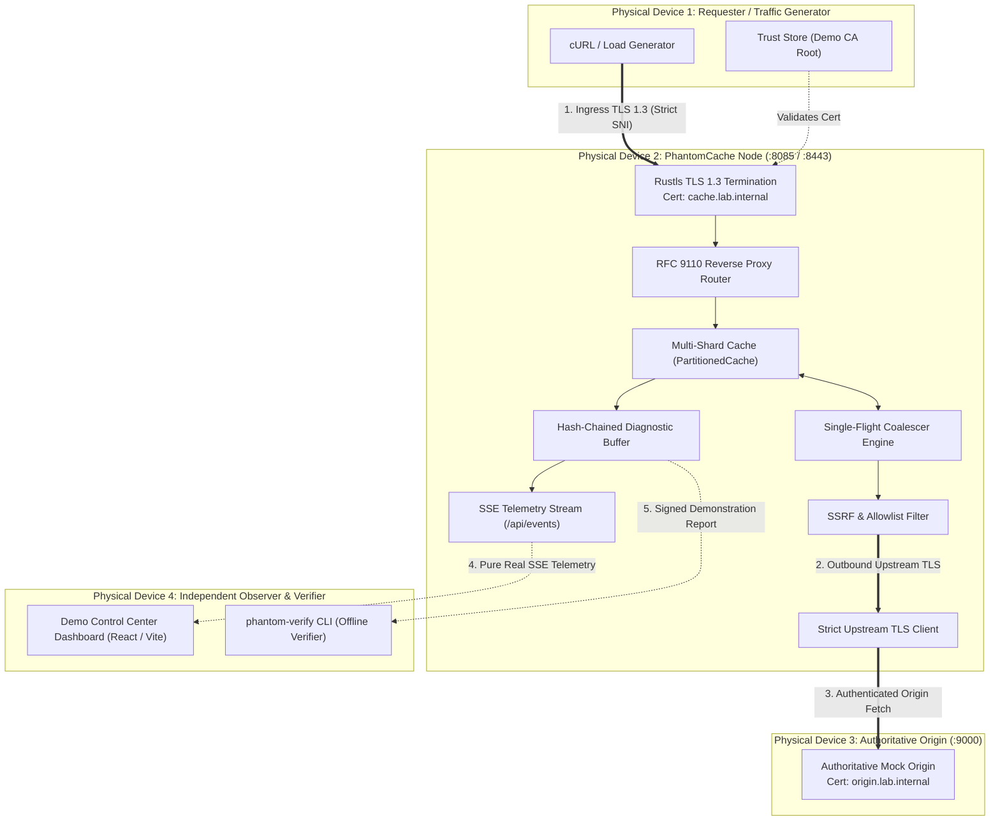

> Notice (2026-10-30): This document was written on 2026-10-26, before milestones M3 to M8. It is a planning and research record, not a description of the current system, and its phase numbers are not the project's current milestones (see [docs/STATUS.md](../STATUS.md)). Statements about current capability, test counts or missing features may be stale; the specific stale points known to the 2026-10-30 documentation audit are listed below where they apply.
>
> Stale here: the reference to safeguards "validated across 73" tests (line 78) is superseded (current baseline: [docs/STATUS.md](../STATUS.md)). A `phantom-verify` verifier tool, where mentioned here, is a proposal: it does not exist in `src/` or `Cargo.toml`.
>
> Links in the text below, including `file:///d:/...` links, are unchanged and work only on the original machine.
>
> Original text below is unchanged.

# PhantomCache — Multi-Device Demonstration Lab & Cybersecurity Trust Architecture

## 1. Master Overview & Mission

This documentation suite establishes the technical research, architecture audit, cybersecurity threat model, and implementation roadmap required to evolve PhantomCache into a production-grade caching system that can be demonstrated, tested, and evaluated convincingly in front of technical review committees.

It accomplishes two co-equal objectives:
- **Objective A — Multi-Device Demonstration Lab:** A practical, robust framework for demonstrating PhantomCache using 3 to 5 physical devices on a local area network (LAN), featuring real HTTP requests, single-flight request coalescing, live telemetry, and distributed failover.
- **Objective B — Cybersecurity Trust, Authenticity & Verification:** A zero-trust security architecture answering the fundamental question: *"What authorizes PhantomCache to sit between requester and origin, how do clients authenticate it, how does it prevent rogue proxying and SSRF, and how can independent evaluators verify its software provenance and test evidence?"*

---

## 2. Global Architecture Diagram

---

## 3. Documentation Suite Index

| Document | Focus & Key Insights |
| :--- | :--- |
| **[capability-audit.md](file:///d:/Personal/phantom-cache/docs/demo-lab/capability-audit.md)** | **Codebase Reality Audit:** Details exact execution paths, classifies current operating model as an *Explicit REST Cache Gateway API*, audits `fetch_origin_raw` and SSE telemetry streams, reveals client-side UI simulation arithmetic, and maps out verified vs missing capabilities. |
| **[device-topologies.md](file:///d:/Personal/phantom-cache/docs/demo-lab/device-topologies.md)** | **Physical Network Topologies:** Full specifications and light-background Mermaid diagrams for Topologies A (3-Device Baseline), B (Traffic & Observer), C (4-Device Gold Standard), D (Multi-Requester Contention), E (Distributed Cache Cluster), and F (Adversarial Security Lab). |
| **[security-threat-model.md](file:///d:/Personal/phantom-cache/docs/demo-lab/security-threat-model.md)** | **Zero-Trust Threat Model:** Complete STRIDE analysis covering Rogue Proxies, Tenant Spoofing, SSRF, Cache Poisoning, Unique-Key Floods, and Telemetry Tampering. Documents existing code defenses, critical vulnerabilities, and residual risks. |
| **[trust-and-authenticity-design.md](file:///d:/Personal/phantom-cache/docs/demo-lab/trust-and-authenticity-design.md)** | **Cryptographic Architecture:** Evaluates proxy operating modes (why Mode B Reverse Proxy is chosen over Mode A Forward Proxy and Mode C Transparent Intermediary). Specifies Ingress/Upstream TLS, RBAC, cryptographic tenant binding, SLSA software provenance, signed evidence reports, and SPIFFE/SPIRE attestation. |
| **[security-scenario-catalogue.md](file:///d:/Personal/phantom-cache/docs/demo-lab/security-scenario-catalogue.md)** | **Cybersecurity Scenario Catalogue (1–10):** Exhaustive specifications for 10 controlled security scenarios including Rogue Proxy Rejection, Cache-Key Confusion, Cross-Tenant Isolation, SSRF Mitigation, Waiter Stampede Suppression, Telemetry Integrity, and Timing Side-Channel Analysis. |
| **[demo-experience-design.md](file:///d:/Personal/phantom-cache/docs/demo-lab/demo-experience-design.md)** | **Control Center & Operator Experience:** Designs the Demo Control Center UI, eliminates synthetic illusions, details the 6-card Trust & Verification Center, defines the automated Preflight Connectivity Checker, and provides 3 step-by-step operator runbooks. |
| **[implementation-roadmap.md](file:///d:/Personal/phantom-cache/docs/demo-lab/implementation-roadmap.md)** | **Implementation Plan & Decision Gates:** 8-phase dependency-ordered roadmap (Phases 0–7) with 31 engineer-days work breakdown structure, risk mitigation, acceptance tests, and 5 key architectural decisions requiring user sign-off. |
| **[research-references.md](file:///d:/Personal/phantom-cache/docs/demo-lab/research-references.md)** | **Authoritative Citations:** Formal mapping from IETF RFCs (9110, 9111, 8446, 7519), OWASP guidelines (A10 SSRF, API1 BOLA), NIST SP 800-207, and SLSA/in-toto standards to PhantomCache architectural choices. |

---

## 4. Key Reviewer Takeaways

1. **Defensible Authorization:** PhantomCache operates authoritatively as an RFC 9110 Reverse Proxy (Application Gateway) presenting authentic TLS certificates for the application domain, rather than attempting fragile, high-liability MITM forward proxy interception.
2. **Absolute Telemetry Truth:** The updated design eliminates client-side UI simulation math, clearly distinguishing real request-driven counters from synthetic background load generators.
3. **Verified Safety Limits:** The system already possesses proven in-process safeguards (512 KB request cap, 2 MB response cap, 200,000 unique-key capacity rejection, 256 waiter saturation bound), validated across 73 passing tests.
4. **Independent Offline Verification:** evaluators do not need to trust the running web dashboard; demonstration evidence is cryptographically signed with Ed25519 and verified using a standalone CLI tool (`phantom-verify`).

