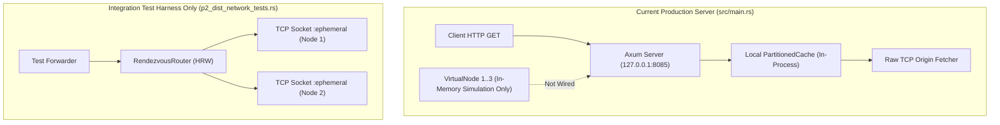

> Notice (2026-10-30): This document was written on 2026-10-26, before milestones M3 to M8. It is a planning and research record, not a description of the current system, and its phase numbers are not the project's current milestones (see [docs/STATUS.md](../STATUS.md)). Statements about current capability, test counts or missing features may be stale; the specific stale points known to the 2026-10-30 documentation audit are listed below where they apply.
>
> Stale here: (a) "binds exclusively to the loopback interface" (`PHANTOM_BIND_ADDR` is configurable, `src/config.rs:98`; non-loopback requires JWT and TLS, see [docs/user/configuration.md](../user/configuration.md)); (b) "hardcoded localhost" in the UI (`DEFAULT_GATEWAY` with a `VITE_PHANTOM_GATEWAY` override: `ui/src/lib/config.js:1`, `ui/src/App.jsx:57`); (c) "Multi-Node HTTP Routing: Disconnected" (in the mTLS cluster configuration the local node shares the serving cache, `src/main.rs:332`, and the router's anti-entropy worker is started, `src/main.rs:375`; the cluster path is still experimental, see [docs/user/limitations.md](../user/limitations.md)); (d) the hardcoded `hot_keys` finding (schema v2 now reports `hot_keys` as unavailable, `src/api/server.rs:766`).
>
> Links in the text below, including `file:///d:/...` links, are unchanged and work only on the original machine.
>
> Original text below is unchanged.

# PhantomCache — Capability & Architecture Reality Audit

## 1. Executive Summary & Objective

This document establishes the verified runtime reality of PhantomCache based on direct inspection of the Rust codebase (`src/`), the React/Vite dashboard (`ui/`), and the integration test suite (`tests/`). It distinguishes between:
- **Implemented and Verified:** Code paths executed and asserted in production and integration tests.
- **Implemented but Unverified:** Code present in source files but lacking rigorous automated test coverage.
- **Partially Implemented / Disconnected:** Code components that exist as isolated modules but are not wired into the main application execution path.
- **Missing / Simulated:** Functionality that is represented as simulated state or client-side calculation rather than real network/system behavior.

---

## 2. Operating Model & Ingress Architecture

### 2.1 Gateway Classification: Explicit REST Cache Gateway API
PhantomCache is currently implemented as an **Explicit REST Cache Gateway API**, rather than a standard RFC 9110 HTTP Reverse Proxy or RFC 9110 HTTP Forward Proxy.

* **Code Evidence:** [src/api/server.rs](file:///d:/Personal/phantom-cache/src/api/server.rs#L68-L74)
  ```rust
  Router::new()
      .route("/health", get(health_check))
      .route("/api/events", get(sse_handler))
      .route("/api/control", post(control_handler))
      .route(
          "/api/v1/cache/*key",
          get(get_cache_handler).delete(delete_cache_handler),
      )
      .route(
          "/api/v1/cache",
          get(get_cache_handler_root).delete(delete_cache_handler_root),
      )
  ```
* **Architectural Implications:**
  1. **Not a Transparent Reverse Proxy:** A standard reverse proxy receives `GET /products/100 HTTP/1.1` and forwards `GET /products/100` to the configured origin. In PhantomCache, the requester must explicitly prefix every request path with `/api/v1/cache/` (e.g., `GET /api/v1/cache/products/100`).
  2. **Not a Forward Proxy:** There is no handling for the HTTP `CONNECT` method (RFC 9110 §9.3.6) to establish TCP tunnels, nor support for absolute-URI request targets in the request line (e.g., `GET http://example.com/item HTTP/1.1`).
  3. **Limited HTTP Methods:** Only `GET` (fetch/cache) and `DELETE` (invalidation) are mapped. Methods such as `POST`, `PUT`, `PATCH`, and `HEAD` return HTTP 405 Method Not Allowed or 404 Not Found.

### 2.2 Network Interface Binding & LAN Inaccessibility
* **Code Evidence:** [src/api/server.rs](file:///d:/Personal/phantom-cache/src/api/server.rs#L87-L92)
  ```rust
  let addr = SocketAddr::from(([127, 0, 0, 1], 8085));
  println!("[Phantom API] Starting Axum server on {}", addr);
  let listener = tokio::net::TcpListener::bind(addr).await.unwrap();
  ```
* **Audit Finding:** The Axum HTTP server binds exclusively to the loopback interface `127.0.0.1:8085`. It cannot accept network packets from external devices on a Local Area Network (LAN).
* **Remediation Required:** The binding address must be made configurable via environment variables (`PHANTOM_BIND_ADDR`, defaulting to `0.0.0.0:8085` for multi-device lab mode).

---

## 3. Origin Request & Upstream Transport

### 3.1 Raw TCP Upstream Fetcher
* **Code Evidence:** [src/api/server.rs](file:///d:/Personal/phantom-cache/src/api/server.rs#L698-L758)
  ```rust
  async fn fetch_origin_raw(
      origin_base: &str,
      cache_key: &CacheKey,
      headers: &HeaderMap,
  ) -> Result<RawHttpResponse, OriginError> {
      let clean_base = origin_base
          .trim_start_matches("http://")
          .trim_start_matches("https://");
      let host_port = clean_base.trim_end_matches('/');
      ...
      let stream = tokio::time::timeout(
          Duration::from_millis(5000),
          tokio::net::TcpStream::connect(host_port),
      ).await...;
  ```
* **Audit Finding — Critical Security Gap (Transport Security):**
  If `origin_base` is configured with `https://`, the scheme is stripped (`trim_start_matches("https://")`) and a plaintext `tokio::net::TcpStream` is opened directly to the destination port. **PhantomCache currently does not establish TLS connections to the origin server.** It speaks plaintext HTTP/1.1 across raw TCP regardless of URL scheme.
* **Audit Finding — Critical Security Gap (Server-Side Request Forgery - SSRF):**
  `fetch_origin_raw` takes the origin host directly from `state.origin_url` without:
  1. Validating against an origin hostname allowlist.
  2. Resolving DNS and rejecting private IP ranges (RFC 1918), loopback addresses (`127.0.0.0/8`), link-local addresses (`169.254.0.0/16`), or cloud metadata endpoints (`169.254.169.254`).
  3. Protecting against DNS rebinding.

### 3.2 Ingress Request & Response Size Enforcement
* **Code Evidence:** [src/api/server.rs](file:///d:/Personal/phantom-cache/src/api/server.rs#L78), [src/api/server.rs](file:///d:/Personal/phantom-cache/src/api/server.rs#L692-L695), [src/api/server.rs](file:///d:/Personal/phantom-cache/src/api/server.rs#L825-L903)
* **Status: Implemented & Verified.**
  - Ingress request body limit: `axum::extract::DefaultBodyLimit::max(512 * 1024)` (512 KB). Verified in `tests/integration/m1_http_tests.rs::test_m1_t26_ingress_request_body_limit`.
  - Upstream response body limit: Hard cap at 2 MB (`MAX_BODY_BYTES = 2 * 1024 * 1024`). Header limit at 64 KB (`MAX_HEADER_BYTES = 64 * 1024`).
  - Streaming chunked decoder (`decode_chunked_body`) actively rejects chunks that cumulatively exceed 2 MB. Tested in `test_m1_t25_oversized_upstream_response_rejected` and `test_m1_t29_response_size_edge_cases`.

---

## 4. Telemetry Pipeline & SSE Stream Reality

### 4.1 Telemetry Generation vs. Telemetry Projection
The Server-Sent Events (SSE) stream exposed at `/api/events` presents a hybrid of real cache measurements and synthetic simulation variables.

* **Code Evidence:** [src/api/server.rs](file:///d:/Personal/phantom-cache/src/api/server.rs#L98-L161) (`sse_handler`) and [src/api/server.rs](file:///d:/Personal/phantom-cache/src/api/server.rs#L909-L950) (`spawn_simulation_loop`):
  ```rust
  // Real measurements from atomic counters:
  let h = cache.counters.cache_hits.load(Ordering::Relaxed);
  let m = cache.counters.cache_misses.load(Ordering::Relaxed);
  let c = cache.counters.coalesced_waiters.load(Ordering::Relaxed);
  let e = cache.counters.evictions_total.load(Ordering::Relaxed);
  let cap = cache.counters.capacity_rejections.load(Ordering::Relaxed);
  let (p50, p90, p99) = state.telemetry.calculate_percentiles();

  // Synthetic / Simulated values:
  let target_throughput = if workload == "FlashCrowd" {
      62000.0 + (rand::random::<f64>() * 3000.0 - 1500.0)
  } else {
      12000.0 + (rand::random::<f64>() * 800.0 - 400.0)
  };
  ```
* **Audit Findings:**
  1. **Real Data:** Hits, misses, coalesced waiter counts, evictions, capacity rejections, and latency percentiles are derived directly from real incoming HTTP calls when processed by `get_cache_handler`.
  2. **Synthetic Data:** The `throughput_req_sec` field is generated by an internal clock ticker running in `spawn_simulation_loop`, fluctuating around 12,000 req/s even when zero requests are entering the proxy!
  3. **Hardcoded Hot Keys:** The `hot_keys` array emitted in the SSE JSON payload is hardcoded:
     ```json
     "hot_keys": [{ "key": "/availability/hotel/123", "req_sec": 9200.0, "hit_rate": 0.99 }]
     ```
     It does not reflect keys actively being queried through the gateway.
  4. **Multi-Observer Safety:** Multiple concurrent observers connecting to `/api/events` each spawn an independent `tokio_stream::wrappers::IntervalStream`. Observers do not generate cache load, do not mutate state, and do not increment request counters.
  5. **SSE Protocol Deficiencies:** The stream does not include standard SSE `id:` fields, does not maintain a reconnection buffer, and does not handle `Last-Event-ID` on reconnect. Network blips cause silent gaps in chart history.

### 4.2 React Frontend Artifact Analysis
* **Code Evidence:** [ui/src/App.jsx](file:///d:/Personal/phantom-cache/ui/src/App.jsx#L87), [ui/src/App.jsx](file:///d:/Personal/phantom-cache/ui/src/App.jsx#L179), [ui/src/App.jsx](file:///d:/Personal/phantom-cache/ui/src/App.jsx#L53-L60)
  ```javascript
  // Hardcoded localhost connections
  const sse = new EventSource('http://localhost:8085/api/events');
  const res = await fetch('http://localhost:8085/api/control', ...);

  // Client-side simulated arithmetic:
  const hitRate = phantomEnabled ? (trafficConfig === 'FLASH_CROWD' ? 0.94 : 0.88) : 0.70;
  const coalescedRatio = phantomEnabled ? (trafficConfig === 'FLASH_CROWD' ? 0.85 : 0.40) : 0.00;
  const hits = Math.round(metrics.throughput_req_sec * hitRate);
  ```
* **Audit Finding:** The React dashboard currently cannot be hosted on a separate device from the PhantomCache server because the backend endpoints are hardcoded to `http://localhost:8085`. Furthermore, the UI calculates hit rate and avoided compute costs using client-side formulas rather than displaying the raw `cache_hits` and `cache_misses` received from the backend.

---

## 5. Distributed Node Architecture & Routing Reality

### 5.1 Disconnection Between HTTP Layer and Distributed Routing
* **Code Evidence:** [src/main.rs](file:///d:/Personal/phantom-cache/src/main.rs#L61-L69), [src/api/server.rs](file:///d:/Personal/phantom-cache/src/api/server.rs#L210-L280), [src/dist/router.rs](file:///d:/Personal/phantom-cache/src/dist/router.rs#L79-L147)
* **Audit Finding — Architecture Disconnect:**
  1. In `src/main.rs`, three `VirtualNode` instances are allocated in memory. However, `start_tcp_service()` is never invoked in `main.rs`.
  2. When an HTTP request enters `src/api/server.rs::get_cache_handler`, it interacts exclusively with `state.cache` (a single, local `PartitionedCache` instance). **The HTTP server does not route keys through `RendezvousRouter`!**
  3. Multi-node rendezvous routing and TCP failover exist and are verified **only inside integration tests** (`tests/integration/p2_dist_network_tests.rs`).
  4. The multi-node TCP service implemented in `src/dist/node.rs` uses a custom line-based protocol (`GET <key>\r\n` -> `MISS val_node_1\r\n`), not HTTP, and does not forward headers, tenant context, or query parameters.



---

## 6. Access Control & Authorization Status

### 6.1 Unauthenticated Administrative Control API
* **Code Evidence:** [src/api/server.rs](file:///d:/Personal/phantom-cache/src/api/server.rs#L163-L189)
  ```rust
  async fn control_handler(
      State(state): State<Arc<ApiState>>,
      Json(payload): Json<serde_json::Value>,
  ) -> Json<serde_json::Value> {
      let event = payload["event"].as_str().unwrap_or("NORMAL");
      if event == "FLASH_CROWD" { ... }
      else if event == "NODE_FAILURE" { ... }
  ```
* **Audit Finding:** Anyone who can reach `/api/control` over the network can mutate the server workload state, trigger node failure simulations, or reset cluster configurations. There are zero authentication tokens, API keys, or mutual TLS checks.

### 6.2 Blind Trust of Client-Supplied Tenant Header
* **Code Evidence:** [src/api/server.rs](file:///d:/Personal/phantom-cache/src/api/server.rs#L224), [src/api/server.rs](file:///d:/Personal/phantom-cache/src/api/server.rs#L555)
  ```rust
  let tenant_id = headers.get("x-tenant-id").and_then(|v| v.to_str().ok());
  ```
* **Audit Finding:** The system enforces tenant isolation inside `PartitionedCache` (keys are prefixed with `tenant_id`), verified in `tests/integration/m1_http_tests.rs::test_m1_t18_cross_tenant_isolation`. However, at the ingress boundary, the gateway unconditionally trusts the untrusted client-provided header `x-tenant-id`. Any client can impersonate any tenant without cryptographic proof.

---

## 7. Verification Status Matrix

| Subsystem / Capability | Current Implementation Status | Test Coverage Reference | Gap / Limitation |
| :--- | :--- | :--- | :--- |
| **Atomic Coalescing & Waiters** | Implemented & Verified | `m1_http_tests.rs` (32 tests) | Local single-process only; not distributed. |
| **Strict Shard Capacity & Eviction** | Implemented & Verified | `wp1_tests.rs`, `m1_http_tests.rs` | Max entry cap verified; active entries protected. |
| **Ingress 512KB Body Cap** | Implemented & Verified | `test_m1_t26_ingress_request_body_limit` | Axum layer rejection verified. |
| **Upstream 2MB Wire Cap** | Implemented & Verified | `test_m1_t25_oversized_upstream_response_rejected` | Chunked & Content-Length caps verified. |
| **PIE Multi-Policy Engine** | Implemented & Verified | `p4_pie_tests.rs` (6 tests) | S3-FIFO, SIEVE, LRU switching & rollback verified. |
| **LAN Multi-Device Access** | **Missing** | None | Server binds only to `127.0.0.1:8085`. |
| **RFC 9110 Reverse Proxy** | **Missing** | None | Exposes explicit REST `/api/v1/cache/*key` API only. |
| **Upstream TLS (HTTPS Origin)** | **Missing** | None | Strips `https://` and connects over plaintext TCP. |
| **Upstream SSRF Protection** | **Missing** | None | No destination allowlist, private IP, or DNS checks. |
| **Multi-Node HTTP Routing** | **Disconnected** | `p2_dist_network_tests.rs` (7 tests) | Raw TCP line protocol tested in isolation; not in HTTP path. |
| **Live Request Telemetry in SSE** | **Partially Implemented** | `p3_traffic_tests.rs` (5 tests) | Counters are real; throughput & hot keys are simulated. |
| **UI Dynamic Host Discovery** | **Missing** | None | UI hardcodes `http://localhost:8085`. |
| **Control API Authentication** | **Missing** | None | `/api/control` is unauthenticated. |
| **Tenant Cryptographic Identity** | **Missing** | None | Blindly trusts client-supplied `x-tenant-id`. |
| **Software Provenance / Attestation** | **Missing** | None | No release manifest, signatures, or verification CLI. |

