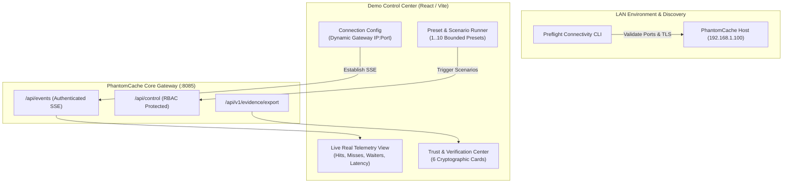

> Notice (2026-10-30): This document was written on 2026-10-26, before milestones M3 to M8. It is a planning and research record, not a description of the current system, and its phase numbers are not the project's current milestones (see [docs/STATUS.md](../STATUS.md)). Statements about current capability, test counts or missing features may be stale; the specific stale points known to the 2026-10-30 documentation audit are listed below where they apply.
>
> A `phantom-verify` verifier tool, where mentioned here, is a proposal: it does not exist in `src/` or `Cargo.toml`.
>
> Links in the text below, including `file:///d:/...` links, are unchanged and work only on the original machine.
>
> Original text below is unchanged.

# PhantomCache — Demonstration Experience & Control Center Design

## 1. Design Philosophy: Defensible Evidence Over Synthetic Illusion

For technical reviewers, evaluators, and system architects, demonstration credibility hinges on one fundamental rule:
> **Every number, chart, status indicator, and timeline event presented on the screen must reflect verified system reality.**

### Elimination of Synthetic Illusions
In accordance with our audit findings ([docs/demo-lab/capability-audit.md](file:///d:/Personal/phantom-cache/docs/demo-lab/capability-audit.md)):
1. **Remove Frontend Arithmetic:** The React dashboard must cease computing hit rates and avoided compute costs using client-side JavaScript formulas (`Math.round(throughput * 0.88)`). All metrics must be bound directly to raw counters streamed from the backend.
2. **Explicit Dual Telemetry Streams:** The system explicitly distinguishes **Real Ingress Traffic** (measured from actual HTTP requests arriving at `/api/v1/cache`) from **Simulated Background Load** (generated by internal clock ticks).
3. **No Unauthenticated Controls:** Control operations (Flash Crowd, Node Kill, Policy Reset) require operator role credentials, preventing casual network tampering.

---

## 2. The Demo Control Center Architecture

The Demo Control Center is a web-based dashboard and CLI suite operating across physical devices on a LAN.



---

## 3. Trust & Verification Panel Specification

The Demo Control Center features a dedicated **Trust & Verification Center** replacing the generic "System Healthy" badge with six machine-verifiable security cards:

```
+--------------------------------------------------------------------------------------------------+
| PHANTOMCACHE TRUST & VERIFICATION CENTER                                                         |
+------------------------------------+-----------------------------------+-------------------------+
| [CARD 1: INSTANCE IDENTITY]        | [CARD 2: SOFTWARE PROVENANCE]     | [CARD 3: CONFIG PROFILE]|
| Endpoint: https://192.168.1.100    | Version: v0.2.0 (Release)         | Proxy Mode: Rev-Proxy   |
| TLS: TLS 1.3 (ChaCha20-Poly1305)   | Binary SHA256: 8f4b238a...        | Upstream: Allowed (1)   |
| Certificate: CN=cache.lab.internal | Git Commit: c4b31a8 (Clean)       | SSRF Filter: STRICT     |
| Status: [VERIFIED ENCRYPTED]       | Signature: [COSIGN VALID]         | Status: [PROFILE MATCH] |
+------------------------------------+-----------------------------------+-------------------------+
| [CARD 4: AUTHORIZATION & RBAC]     | [CARD 5: SECURITY SELF-TESTS]     | [CARD 6: EVIDENCE EXPORT|
| Ingress Role: Operator             | T-01 Rogue Proxy: REJECTED        | Evidence Hash: 4e2f9... |
| Client Auth: Valid JWT Bearer      | T-03 SSRF Injection: BLOCKED      | Merkle Root: c8901a...  |
| Tenant Binding: Cryptographic      | T-04 Tenant Bleed: ISOLATED       | [DOWNLOAD SIGNED REPORT]|
| Status: [AUTHORIZED]               | Self-Test Status: [6/6 PASSED]    | Verifier: phantom-verify|
+------------------------------------+-----------------------------------+-------------------------+
```

### Card Status Rules
- **Endpoint Identity Verified:** TLS 1.3 handshake completed, certificate valid and matching configured SAN.
- **Software Provenance Valid:** Binary SHA256 matches the cryptographic release manifest signed by the release authority.
- **Configuration Profile Matches:** In-memory configuration digest matches the approved lab security baseline.
- **Runtime Integrity (Honest Reporting):** Marked as `[NOT ATTESTED: Standard OS Kernel]` unless running within a hardware-attested Confidential VM (AMD SEV / Intel TDX).

---

## 4. Preflight Connectivity Checker & Deployment Assistant

To eliminate setup friction during live technical evaluations, PhantomCache includes an automated diagnostic CLI tool:

```bash
cargo run --bin preflight -- --gateway 192.168.1.100:8085 --role observer
```

### 4.1 Automated Preflight Checklist

| Check Item | Target / Test | Pass Criteria | Remediation on Failure |
| :--- | :--- | :--- | :--- |
| **P-01: Interface Binding** | TCP port reachability | Socket opens within 500ms | Verify server bound to `0.0.0.0`, not `127.0.0.1`. |
| **P-02: Firewall & Routing** | Port 8085 / 9000 ingress | Zero TCP drop / timeout | Open Windows Defender / UFW firewall ports. |
| **P-03: Clock Synchronization**| NTP clock drift check | Drift < 50ms across hosts | Synchronize system clocks via `w32tm` or `chrony`. |
| **P-04: TLS Certificate Anchor**| CA Root trust validation | Handshake completes cleanly | Import `Demo CA Root` into test client trust store. |
| **P-05: Upstream Origin Probe**| Origin health endpoint | Origin responds HTTP 200 | Start mock origin server on designated device. |
| **P-06: Telemetry Stream Probe**| SSE `/api/events` handshake | Initial JSON payload received | Ensure no corporate proxy buffers chunked SSE. |

---

## 5. Step-by-Step Operator Runbooks

### Runbook 1: 10-Minute Executive Demonstration (Topology C)
* **Audience:** Technical Directors, Engineering Managers, Review Committees.
* **Goal:** Prove cache acceleration, single-flight coalescing, and verifiable resource protection.

1. **Pre-Demo Check (T- minus 2 mins):**
   - Presenter runs `cargo run --bin preflight` on Device 4 (Observer).
   - Display confirms: `[ALL 6 PREFLIGHT CHECKS PASSED]`.
2. **Phase 1: Cold Fetch vs. Warm Cache Hit (0:00 - 3:00):**
   - Presenter sends single request from Device 1 (Requester): `curl -i http://192.168.1.100:8085/api/v1/cache/catalog/item100`.
   - Observer dashboard highlights: `MISS`, Origin Latency: `18ms`, `Origin Requests: 1`.
   - Presenter repeats request immediately.
   - Observer dashboard highlights: `HIT`, Latency: `<0.2ms`, `Origin Requests: 1` (zero increase).
3. **Phase 2: Flash Crowd & Stampede Suppression (3:00 - 6:00):**
   - Presenter triggers 1,000 concurrent requests for cold key `/deal_of_the_day` from Device 1.
   - Observer displays live coalescing spike: `Active Waiters: 999`, `Origin Fetches: 1`.
   - Avoided origin work displayed: `99.9%`.
4. **Phase 3: Capacity Protection & Graceful Contraction (6:00 - 9:00):**
   - Presenter triggers 50,000 unique key flood.
   - Dashboard demonstrates strict capacity cap at 10,000 entries.
   - Evictions increment smoothly via S3-FIFO policy; RSS memory stays completely flat.
5. **Phase 4: Evidence Export (9:00 - 10:00):**
   - Presenter clicks `[DOWNLOAD SIGNED REPORT]`.
   - Runs `phantom-verify --report report.json`.
   - Terminal outputs: `[VERIFIED: Signature Valid, 0 Events Tampered]`.

---

### Runbook 2: Adversarial Security Evaluation (Topology C + F)
* **Audience:** Security Architects, Penetration Testers, Compliance Evaluators.
* **Goal:** Verify that PhantomCache enforces strict zero-trust boundaries, rejects forged headers, blocks SSRF, and protects cross-tenant isolation.

1. **Step 1: Rogue Proxy Rejection (Scenario 1):**
   - Attempt connection to rogue proxy IP; show immediate TLS handshake drop.
2. **Step 2: Tenant Header Forgery (Scenario 3):**
   - Send forged `x-tenant-id: admin` header; demonstrate gateway overrides header using cryptographic JWT claims.
3. **Step 3: SSRF Link-Local Injection (Scenario 4):**
   - Attempt fetch to `http://169.254.169.254/latest/meta-data/`; demonstrate HTTP 403 Forbidden rejection before socket creation.
4. **Step 4: Tamper Detection (Scenario 8):**
   - Modify a single byte in the saved evidence report JSON; execute `phantom-verify`; prove cryptographic detection.

---

### Runbook 3: Disaster Recovery & Distributed Failover (Topology E)
* **Audience:** Distributed Systems Engineers, SREs.
* **Goal:** Prove deterministic rendezvous hashing, partition detection, and socket failover to secondary replicas.

1. **Step 1: Steady-State Routing:**
   - Execute requests across keys; demonstrate Rendezvous hash partitioning across Nodes 1, 2, 3.
2. **Step 2: Abrupt Hardware Crash Simulation:**
   - Terminate Node 2 process (`kill -9` or pulling network cable).
3. **Step 3: Automatic TCP Failover:**
   - Send request for key mapped to Node 2; Node 1 receives TCP `ConnectionRefused`, marks Node 2 `Suspect`, and routes to replica Node 3 in `<2ms`.
   - Observer confirms zero client-facing HTTP 500 errors.

