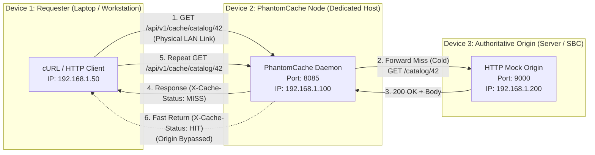
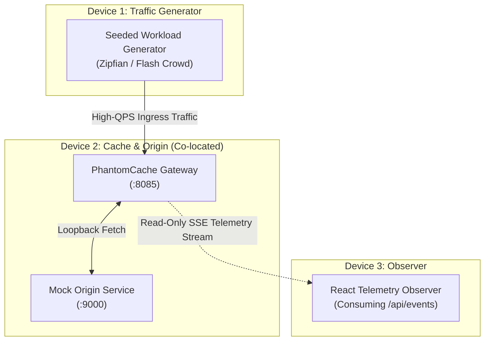
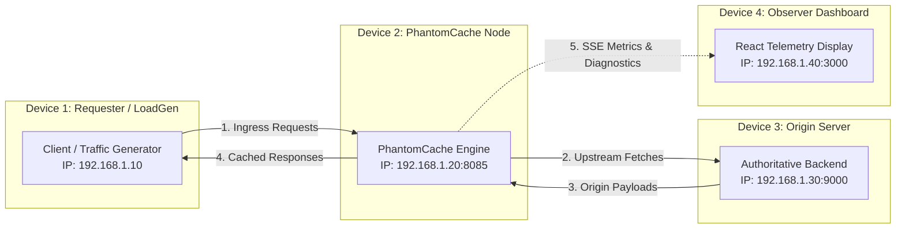
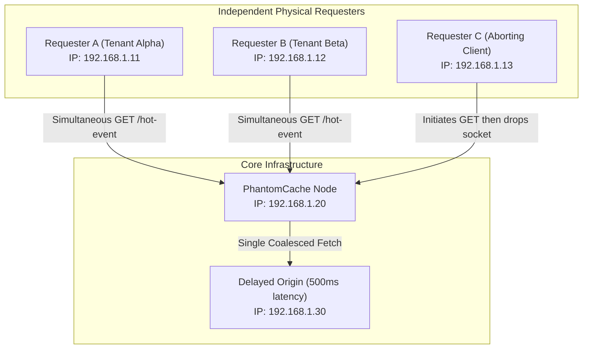
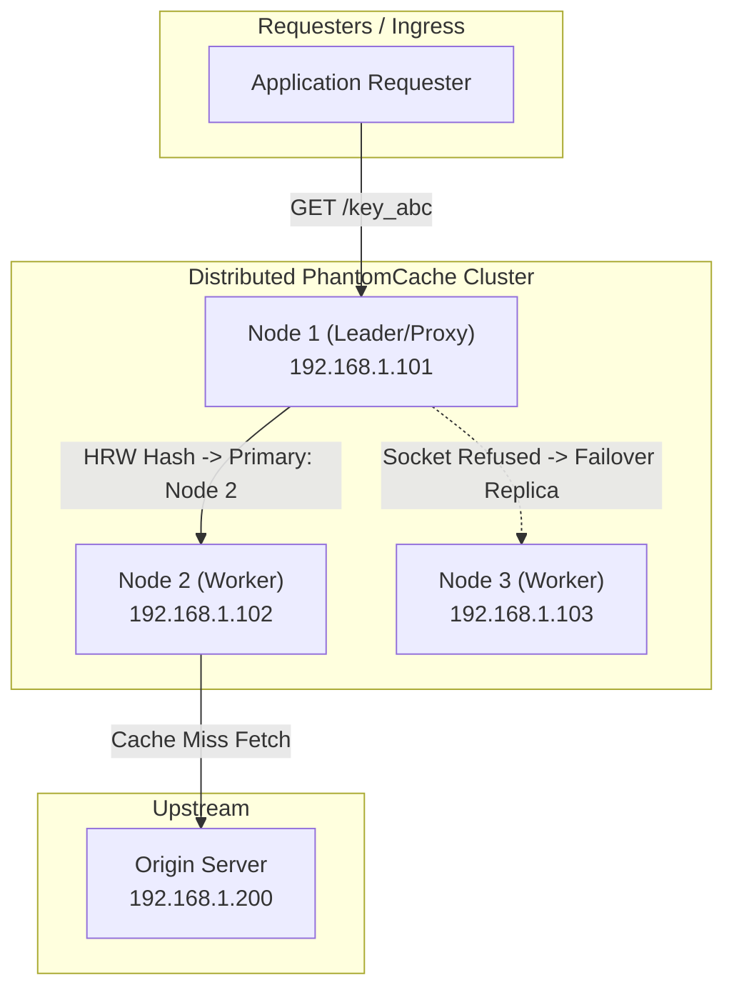
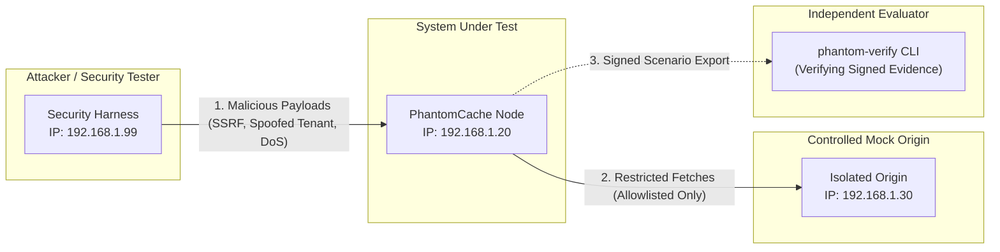

> Notice (2026-10-30): This document was written on 2026-10-26, before milestones M3 to M8. It is a planning and research record, not a description of the current system, and its phase numbers are not the project's current milestones (see [docs/STATUS.md](../STATUS.md)). Statements about current capability, test counts or missing features may be stale; the specific stale points known to the 2026-10-30 documentation audit are listed below where they apply.
>
> Stale here: (a) lines 26 and 94, "blocked by hardcoded loopback binding (127.0.0.1:8085)" and "Requires Phase 1 (server LAN binding)": `PHANTOM_BIND_ADDR` is configurable (`src/config.rs:98`) and non-loopback binds are allowed with JWT and TLS ([docs/user/configuration.md](../user/configuration.md)); (b) line 65, "hardcoded `localhost:8085` in `ui/src/App.jsx`": the UI reads `VITE_PHANTOM_GATEWAY` (`ui/src/App.jsx:57`, `ui/src/SimDemo.jsx:20`) with default `DEFAULT_GATEWAY` (`ui/src/lib/config.js:1`); (c) line 165, router "disconnected from the HTTP gateway": in the mTLS cluster configuration the router is wired into the gateway (`src/main.rs:332`, `:375`), still experimental, with no multi-host validation ([docs/user/limitations.md](../user/limitations.md)). A `phantom-verify` verifier tool, where mentioned here, is a proposal: it does not exist in `src/` or `Cargo.toml`.
>
> Original text below is unchanged.

# PhantomCache — Multi-Device Demonstration Lab Topologies

## 1. Role Taxonomy & Distribution Rules

To avoid ambiguity in demonstrations and evaluations, actors in the demonstration lab are classified into six explicit roles:

1. **Requester:** An interactive client (e.g., cURL, web browser, mobile client) sending discrete application requests to evaluate functional correctness, cache hits/misses, and response headers.
2. **Traffic Generator:** An automated benchmarking process running reproducible, seeded synthetic workloads (Zipfian or Uniform) to measure throughput, latency percentiles, and concurrency behavior.
3. **PhantomCache Node:** The core cache server accepting ingress traffic, evaluating cache policies, coalescing concurrent misses, executing evictions, and forwarding requests to upstream destinations.
4. **Origin Server:** The authoritative upstream HTTP service serving canonical responses, controlled delays, synthetic headers, and simulated backend failures.
5. **Observer:** A read-only monitoring client consuming the live Server-Sent Events (SSE) telemetry stream to visualize real-time cache metrics, node states, and diagnostic event logs.
6. **Peer Cache Node:** Additional independent PhantomCache daemon instances participating in distributed consistent hashing (Rendezvous / HRW routing), health monitoring, and replica failover.

### Co-Location vs. Physical Distribution
> [!IMPORTANT]
> A single machine may host multiple logical roles during local development. However, **co-location must never be presented to evaluators as equivalent to physical distribution**.
> Physical distribution introduces real OS network stack overhead, packet serialization, LAN switch jitter, ARP resolution, independent hardware clocks, and real socket disconnects. Demonstrations must clearly identify which processes run on which hardware hosts.

---

## 2. Supported Topology Specifications

### 2.1 Topology A — Three-Device Baseline (The Core Proof)
* **Purpose:** Demonstrates the fundamental value proposition of PhantomCache: cold miss fetching, coalescing, warm hit acceleration, and invalidation across physical network boundaries.
* **Device Count:** 3 physical machines.
* **Current Status:** Requires Phase 1 (binding `0.0.0.0` and configuring origin URL). Currently blocked by hardcoded loopback binding (`127.0.0.1:8085`).

* **Network Paths & Prerequisites:**
  - Device 2 firewall allows inbound TCP on port `8085`.
  - Device 3 firewall allows inbound TCP on port `9000` (restricted to Device 2 IP).
  - PhantomCache environment: `PHANTOM_BIND_ADDR=0.0.0.0:8085`, `ORIGIN_URL=http://192.168.1.200:9000`.
* **Demonstration Script & Verification:**
  1. *Cold Fetch:* Requester sends `GET http://192.168.1.100:8085/api/v1/cache/resource/1`. Assert `X-Cache-Status: MISS`, latency ~15ms.
  2. *Warm Fetch:* Requester repeats request. Assert `X-Cache-Status: HIT`, latency <1ms. Origin logs confirm zero incoming requests.
  3. *Controlled Invalidation:* Requester sends `DELETE http://192.168.1.100:8085/api/v1/cache/resource/1`. Assert HTTP 204 No Content.
  4. *Post-Invalidation Fetch:* Requester sends `GET`. Assert `X-Cache-Status: MISS`.

---

### 2.2 Topology B — Three-Device Traffic & Observer Setup
* **Purpose:** High-throughput performance benchmarking and policy observation without interference from observer telemetry consumption.
* **Device Count:** 3 physical machines.
* **Current Status:** Blocked by hardcoded `localhost:8085` in `ui/src/App.jsx`.

* **Key Guarantee:** The observer on Device 3 connects via SSE to `/api/events`. It consumes telemetry without generating application cache requests or inflating request accounting counters.

---

### 2.3 Topology C — Four-Device Presentation Setup (Gold Standard)
* **Purpose:** The recommended configuration for formal technical reviews. Completely separates every primary architectural responsibility onto dedicated hardware.
* **Device Count:** 4 physical machines.
* **Current Status:** Requires Phase 1 (server LAN binding) and Phase 2 (UI dynamic backend configuration).

* **Role Isolation Table:**

| Hardware Host | Running Processes | Network Open Ports | Failure Impact |
| :--- | :--- | :--- | :--- |
| **Device 1** | Benchmarking harness / cURL | None | Halts workload; cache remains active. |
| **Device 2** | `phantom-cache` daemon | `8085` (HTTP/SSE) | Halts service; clients receive TCP connection refused. |
| **Device 3** | Mock origin / test backend | `9000` (HTTP) | Cache serves warm hits; misses trigger HTTP 502/504. |
| **Device 4** | Web browser / Vite preview | None (outbound only) | Observer disconnects; cache throughput unaffected. |

---

### 2.4 Topology D — Multiple Requesters Under Contention
* **Purpose:** Proves concurrency fairness, single-flight stampede suppression (coalescing), tenant isolation, and client abort resilience.
* **Device Count:** 4–5 physical machines (2+ Requesters, 1 Cache Node, 1 Origin, 1 Observer).

* **Key Demonstrations:**
  1. **Stampede Coalescing:** Requesters A and B request `/hot-event` at the same instant. Observer proves exactly 1 upstream request reached the origin, while both clients received identical responses with `X-Cache-Status: MISS` and `X-Cache-Status: COALESCED`.
  2. **Cross-Tenant Isolation:** Requester A passes `x-tenant-id: alpha` and Requester B passes `x-tenant-id: beta` for the identical path `/account`. Observer confirms separate shard entries and zero data bleeding.
  3. **Client Abort Resilience:** Requester C terminates its TCP connection while waiting for the origin. PhantomCache completes the fetch in the background and populates the cache without panicking or stranding Requesters A and B.

---

### 2.5 Topology E — Distributed Multi-Node PhantomCache
* **Purpose:** Evaluates Rendezvous (Highest Random Weight - HRW) consistent hashing, partition failover, replica data usability, and split-brain resistance across independent physical machines.
* **Device Count:** 5+ physical machines.
* **Current Status:** Multi-node TCP forwarding is implemented in `src/dist/router.rs` and verified in unit tests, but **disconnected from the HTTP gateway**. Wiring into HTTP routing is scheduled for Phase 6.

* **Consistency Guarantees & Realities:**
  - **Model:** Independent local caches coordinated via deterministic Rendezvous Hashing with fallback to next-highest weighted replica.
  - **No Distributed Consensus:** PhantomCache does not run Raft or Paxos. It does not provide linearizable distributed consistency.
  - **Failover Usability:** When Node 2 fails abruptly, Node 1 fails over to Node 3. If Node 3 has not cached the key, it performs a cold fetch. Invalidation messages are point-to-point and do not currently have a distributed commit log.

---

### 2.6 Topology F — Controlled Adversarial / Security Lab
* **Purpose:** Executes safe, isolated cybersecurity test scenarios (Scenarios 1–10) including rogue proxy detection, SSRF rejection, unique-key DoS floods, and signature verification.
* **Device Count:** 4 physical machines (Attacker/Tester, PhantomCache Node, Mock Vulnerable Origin, Security Verifier).

