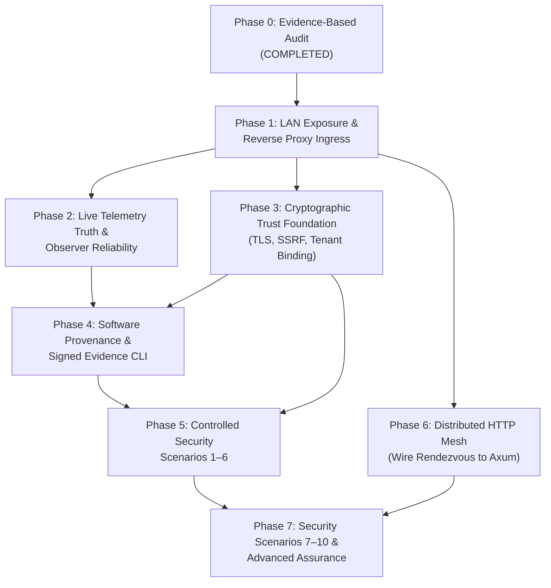

> Notice (2026-10-30): This document was written on 2026-10-26, before milestones M3 to M8. It is a planning and research record, not a description of the current system, and its phase numbers are not the project's current milestones (see [docs/STATUS.md](../STATUS.md)). Statements about current capability, test counts or missing features may be stale; the specific stale points known to the 2026-10-30 documentation audit are listed below where they apply.
>
> Stale here: "existing 73 tests" is superseded (current baseline: [docs/STATUS.md](../STATUS.md)); the roadmap phases 1 to 6 are not the executed milestones, and the "hardcoded simulation formulas" it plans to remove in the UI were reworked in M8 ([docs/design/ui_audit.md](../design/ui_audit.md)). A `phantom-verify` verifier tool, where mentioned here, is a proposal: it does not exist in `src/` or `Cargo.toml`.
>
> Original text below is unchanged.

# PhantomCache — Implementation Roadmap & Decision Gates

## 1. Roadmap Architecture & Dependency Ordering

The evolution of PhantomCache into a production-grade, demonstrable, cryptographically verifiable multi-device caching system is organized into eight sequential phases (Phases 0 to 7).

---

## 2. Phase-by-Phase Work Breakdown

### Phase 0 — Evidence-Based Audit & Architecture Proposal
* **Objective:** Establish true system baseline, audit actual execution paths, and produce architectural documentation.
* **Status:** **COMPLETE.**
* **Deliverables:** `docs/demo-lab/` comprehensive documentation suite (9 files).
* **Exit Criteria:** Audit confirms all existing 73 tests pass and Clippy is clean.

---

### Phase 1 — LAN Exposure & True Ingress Reverse Proxy
* **Objective:** Enable multi-device physical LAN connectivity (Topologies A, B, C) and implement standard RFC 9110 Reverse Proxy request mapping.
* **Tasks:**
  1. Make server binding address configurable via `PHANTOM_BIND_ADDR` (default `0.0.0.0:8085`).
  2. Implement RFC 9110 Reverse Proxy route mapping (`/*path` directly forwarded to upstream origin, deprecating the mandatory `/api/v1/cache/` prefix while preserving backwards compatibility).
  3. Remediate `fetch_origin_raw` to support real TLS connections when `origin_url` specifies `https://`.
  4. Make React UI backend endpoint configurable via environment variables or browser URL parameter (`?gateway=http://<IP>:8085`).
* **Effort Estimate:** 3 Engineer-Days.
* **Exit Criteria:** Topology A successfully executes across 3 physical devices on LAN. Real cURL request to `http://<D2_IP>:8085/catalog/1` fetches from Device 3 and returns `X-Cache-Status: MISS` then `HIT`.

---

### Phase 2 — Live Telemetry Truth & Observer Reliability
* **Objective:** Eliminate synthetic metrics and client-side arithmetic; deliver a tamper-evident, multi-observer SSE telemetry stream.
* **Tasks:**
  1. Refactor `ui/src/App.jsx`: Bind hit rates, misses, coalescing ratios, and cost savings directly to live SSE counters; remove all hardcoded simulation formulas (`Math.round(throughput * 0.88)`).
  2. Implement true real-time throughput measurement in `TelemetryCollector` (tracking real request completions per second).
  3. Update `/api/events` SSE stream with standard `id:` sequential event identifiers and monotonic sequence numbers.
  4. Add a ring buffer replay cache to support seamless client reconnections via `Last-Event-ID`.
  5. Dynamically populate `hot_keys` in SSE from actual `CountMinSketch` heavy-hitters instead of static mock strings.
* **Effort Estimate:** 4 Engineer-Days.
* **Exit Criteria:** Independent observer dashboard on Device 4 shows exactly 0 throughput when idle, and tracks real cURL request counts 1:1 without synthetic baseline noise.

---

### Phase 3 — Cryptographic Trust Foundation
* **Objective:** Implement zero-trust boundaries: Ingress TLS, SSRF origin protection, RBAC on control APIs, and cryptographic tenant binding.
* **Tasks:**
  1. Add Rustls ingress TLS termination supporting TLS 1.3/1.2 on port 8443 (`PHANTOM_TLS_CERT`, `PHANTOM_TLS_KEY`).
  2. Add upstream origin allowlist (`allowed_origins = [...]`) and strict IP blacklisting (blocking `127.0.0.0/8`, `169.254.0.0/16`, RFC 1918 private IPs, and cloud metadata).
  3. Secure `/api/control`: Require Bearer JWT with `role: operator` or `role: admin`.
  4. Cryptographic tenant binding: Extract `tenant_id` from validated client JWT or mTLS client certificate SAN, stripping or overriding unauthenticated `x-tenant-id` headers.
* **Effort Estimate:** 5 Engineer-Days.
* **Exit Criteria:** Ingress connections over HTTPS verified via curl; SSRF probe to `169.254.169.254` blocked with HTTP 403; unauthenticated `POST /api/control` blocked with HTTP 401.

---

### Phase 4 — Software Provenance & Signed Evidence CLI
* **Objective:** Enable independent verification of software artifacts and test results.
* **Tasks:**
  1. Create build provenance workflow generating `manifest.json` with binary SHA256, commit SHA, and compiler version.
  2. Implement demonstration evidence export endpoint: `POST /api/v1/evidence/export` generating hash-chained event logs signed with Ed25519.
  3. Build standalone verification CLI `phantom-verify` (`cargo run --bin phantom-verify`) that validates manifests and checks report signatures without network dependencies.
* **Effort Estimate:** 4 Engineer-Days.
* **Exit Criteria:** `phantom-verify` successfully validates official demonstration reports; tampering with one byte of the report causes immediate signature verification failure.

---

### Phase 5 — Controlled Security Scenarios 1–6
* **Objective:** Implement automated demonstration fixtures and regression tests for Scenarios 1 to 6.
* **Tasks:**
  1. Implement automated test harness for Scenario 1 (Rogue Proxy Rejection).
  2. Implement Scenario 2 (Cache Poisoning & Header Normalization).
  3. Implement Scenario 3 (Cross-Tenant Forgery Prevention).
  4. Implement Scenario 4 (SSRF & Destination Allowlist).
  5. Implement Scenario 5 (Unique-Key DoS & 200k Capacity Saturation).
  6. Implement Scenario 6 (Coalescing & Waiter Stampede Suppression).
* **Effort Estimate:** 5 Engineer-Days.
* **Exit Criteria:** All 6 security scenarios execute cleanly in CI and pass automated assertions without manual intervention.

---

### Phase 6 — Distributed HTTP Mesh Integration
* **Objective:** Wire `RendezvousRouter` into the Axum HTTP gateway and enable multi-node distributed caching over physical LAN devices (Topology E).
* **Tasks:**
  1. Connect Axum ingress handler to `RendezvousRouter` so incoming HTTP requests forward to the primary node owner over TCP.
  2. Upgrade node-to-node TCP protocol from custom raw line strings (`GET <key>`) to framed HTTP/2 or framed binary protocol forwarding headers, status codes, and tenant context.
  3. Implement node cluster mTLS with shared cluster CA root.
  4. Add distributed invalidation broadcast (`DELETE` propagates to all peer nodes).
* **Effort Estimate:** 6 Engineer-Days.
* **Exit Criteria:** Topology E functional across 3 physical nodes. Key requested on Node 1 routes over TCP to Node 2; killing Node 2 causes automatic, seamless failover to Node 3 replica.

---

### Phase 7 — Advanced Assurance & Scenarios 7–10
* **Objective:** Complete remaining scenarios (Invalidation propagation, Telemetry integrity, Timing side-channel quantification, Rogue node rejection) and evaluate SPIFFE/SPIRE attestation.
* **Tasks:**
  1. Implement Scenarios 7, 8, 9, 10 test fixtures.
  2. Build preflight connectivity checker CLI (`cargo run --bin preflight`).
  3. Produce timing side-channel statistical distribution analysis report.
  4. Complete SPIFFE/SPIRE production migration blueprint.
* **Effort Estimate:** 4 Engineer-Days.
* **Exit Criteria:** Full suite of 10 security scenarios verified; preflight checker validates LAN environment in <3 seconds.

---

## 3. Work Breakdown Structure & Resource Summary

| Phase | Focus Area | Engineer-Days | Key Risk | Mitigation Strategy |
| :--- | :--- | :--- | :--- | :--- |
| **Phase 0** | Evidence Audit & Architecture | **0** (Done) | Inaccurate code claims | Direct file & test verification |
| **Phase 1** | LAN Exposure & Reverse Proxy | 3 Days | Firewall / network friction | Preflight tool & automated binding |
| **Phase 2** | Live Telemetry Truth in UI | 4 Days | UI chart rendering bugs | Incremental React refactor |
| **Phase 3** | Zero-Trust TLS & SSRF Defense | 5 Days | Certificate management in lab | Lightweight demo CA generator |
| **Phase 4** | Provenance & Evidence CLI | 4 Days | Signature format incompatibilities | Standard Ed25519 / JSON-LD signatures |
| **Phase 5** | Security Scenarios 1–6 | 5 Days | Flaky network tests | Mock origin with deterministic timing |
| **Phase 6** | Distributed HTTP Mesh | 6 Days | Protocol complexity | High-performance Tokio framed codec |
| **Phase 7** | Advanced Assurance & Scenarios 7–10 | 4 Days | Timing jitter on LAN | Statistical confidence intervals |
| **TOTAL** | **Phases 1 through 7** | **31 Engineer-Days** | | |

---

## 4. Decision Gates Requiring User Approval

Before modifying runtime behavior in future tasks, the following key architectural decisions require user sign-off:

1. **Operating Mode Direction:** Confirm approval to adopt **Mode B (Reverse Proxy / Application Gateway)** as the target architecture, while preserving the existing `/api/v1/cache/*` REST endpoint for backwards compatibility.
2. **TLS Certificate Strategy for Demo Lab:** Approve the use of an automated local Certificate Authority script (`scripts/gen-demo-certs.sh`) for multi-device lab testing, avoiding external cloud/ACME dependencies.
3. **Control API Access Model:** Confirm approval to require signed JWT tokens for `/api/control` (disabling unauthenticated control requests).
4. **Tenant Identity Policy:** Confirm approval to enforce that tenant identities must be derived from authenticated token claims, ignoring untrusted client-supplied `x-tenant-id` headers.
5. **Minimum Viable Milestone (MVP):** Approve **Phase 1 + Phase 2 (LAN Reverse Proxy + Pure Telemetry Truth)** as the first executable implementation milestone.

