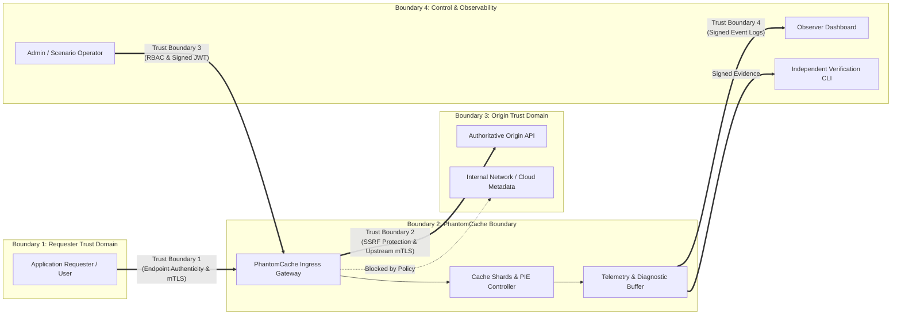

> Notice (2026-10-30): This document was written on 2026-10-26, before milestones M3 to M8. It is a planning and research record, not a description of the current system, and its phase numbers are not the project's current milestones (see [docs/STATUS.md](../STATUS.md)). Statements about current capability, test counts or missing features may be stale; the specific stale points known to the 2026-10-30 documentation audit are listed below where they apply.
>
> A `phantom-verify` verifier tool, where mentioned here, is a proposal: it does not exist in `src/` or `Cargo.toml`.
>
> Links in the text below, including `file:///d:/...` links, are unchanged and work only on the original machine.
>
> Original text below is unchanged.

# PhantomCache — Cybersecurity Threat Model & Boundary Analysis

## 1. Core Security Question & Trust Boundaries

> "If PhantomCache sits between a requester and an origin server, what authorizes it to occupy that position? How does the requester know it is communicating with the intended PhantomCache instance? How do we know the cache has not been replaced by a rogue proxy, has not tampered with responses, and is authorized to access the origin?"

In a zero-trust network environment, an intermediary cannot merely declare itself authoritative. Authorization to occupy the request-response path requires explicit, verifiable cryptographic relationships across distinct trust boundaries:

---

## 2. Assets & Attack Surfaces

| Asset ID | Description | Confidentiality | Integrity | Availability |
| :--- | :--- | :--- | :--- | :--- |
| **A-1: Cached Resources** | HTTP response payloads, headers, ETags stored in memory. | **High** (Tenant data isolation) | **Critical** (No cache poisoning) | **High** (Fair eviction, no starvation) |
| **A-2: In-Flight Waiters** | Channels coalescing concurrent requests for identical keys. | Low | **High** (Orderly waiter delivery) | **Critical** (No deadlocks or leaked ops) |
| **A-3: Telemetry Stream** | SSE metrics, latency percentiles, counters, diagnostic events. | Low (Redact sensitive keys/headers) | **High** (Tamper-evident logs) | Medium |
| **A-4: Control Plane** | APIs controlling workload presets, failure injection, policies. | Low | **Critical** (Only authorized admins) | **High** |
| **A-5: Origin Access** | The cache's authority to query upstream backends. | Medium | **High** (Prevent SSRF misuse) | **High** (Respect origin rate limits) |
| **A-6: Software Artifact** | PhantomCache release binary and demonstration reports. | Low | **Critical** (SLSA provenance & signatures)| High |

---

## 3. Threat Categorization (STRIDE Matrix)

### 3.1 Spoofing (Identity Deception)

#### T-01: Rogue Proxy / Man-in-the-Middle (MITM) Interception
* **Threat:** An attacker on the local network (via ARP spoofing or rogue DNS) redirects requester traffic to an unauthorized proxy. The rogue proxy serves forged cached data or steals credentials.
* **Current Code Defense:** **None.** PhantomCache binds plaintext HTTP on `127.0.0.1:8085`. It offers no TLS endpoint authentication.
* **Required Defense:** Ingress TLS termination using strict certificates. Requesters must validate the cache’s certificate against an explicit trust anchor (CA root or pinned public key).

#### T-02: Tenant Identity Spoofing
* **Threat:** A malicious tenant passes `x-tenant-id: victim_tenant` in request headers.
* **Current Code Defense:** **Vulnerable.** [src/api/server.rs](file:///d:/Personal/phantom-cache/src/api/server.rs#L224) extracts `headers.get("x-tenant-id")` unconditionally. While `PartitionedCache` correctly isolates keys by tenant string, any client can self-declare any tenant ID!
* **Required Defense:** Ingress gateway must establish tenant identity from an authenticated cryptographic context (mTLS client certificate SAN or signed JWT claims), completely stripping or overwriting untrusted client-supplied headers.

#### T-03: Unauthorized Distributed Node Impersonation
* **Threat:** A rogue process joins the rendezvous cluster and advertises itself as a cache node, serving poisoned responses or intercepting cache keys.
* **Current Code Defense:** **Vulnerable.** `src/dist/router.rs` and `src/dist/node.rs` have zero node authentication. Any TCP listener can accept connections.
* **Required Defense:** Mutual TLS (mTLS) with SPIFFE/SPIRE workload identities or a shared cluster CA for all node-to-node TCP links.

---

### 3.2 Tampering (Data Modification)

#### T-04: Cache Poisoning via Unkeyed Header or Query Parameter
* **Threat:** An attacker crafts a request with malicious headers or unkeyed query parameters that modify the origin response (e.g., `X-Forwarded-Host` or reflection). The poison is cached and served to legitimate users.
* **Current Code Defense:** Partial. [src/core/cache.rs](file:///d:/Personal/phantom-cache/src/core/cache.rs#L30-L55) canonicalizes paths and sorts query parameters in `CacheKey::new`. Uncacheable headers (`Cache-Control: no-store, private`, `Set-Cookie`) prevent caching ([src/api/server.rs](file:///d:/Personal/phantom-cache/src/api/server.rs#L373-L386)).
* **Required Defense:** Strict keying rules; hop-by-hop header stripping; explicit key inclusion/exclusion policies.

#### T-05: Binary or In-Memory State Manipulation
* **Threat:** An untrusted or modified PhantomCache binary is deployed to the lab, presenting falsified benchmark results or compromised caching logic.
* **Current Code Defense:** **None.** No release signature or runtime digest verification exists.
* **Required Defense:** Cryptographic build manifests signed via Sigstore/Cosign (SLSA Provenance); verification tool `phantom-verify` to check binary SHA256 before testing.

---

### 3.3 Repudiation (Disavowal of Actions)

#### T-06: Telemetry Falsification & Unverifiable Reports
* **Threat:** A presenter claims PhantomCache achieved 99% hit rates and 100x speedups, but the numbers were fabricated by synthetic timers or client-side UI math.
* **Current Code Evidence:** Real vulnerability in audit! [src/api/server.rs](file:///d:/Personal/phantom-cache/src/api/server.rs#L928) generates synthetic 12,000 req/s throughput independently of real traffic, and [ui/src/App.jsx](file:///d:/Personal/phantom-cache/ui/src/App.jsx#L53) computes hit rates client-side.
* **Required Defense:** Tamper-evident demonstration reports signed with an Ed25519 key, containing cryptographic hashes of raw diagnostic events, input workloads, random seeds, and software digests.

---

### 3.4 Information Disclosure (Privacy Breaches)

#### T-07: Cross-Tenant Response Leakage
* **Threat:** Tenant A receives cached responses belonging to Tenant B due to cache-key collisions or improper normalization.
* **Current Code Defense:** **Verified & Strong.** `CacheKey` prefixes canonical strings with `tenant_id:path?query`. Shards use separate entries. Rigorously verified in `tests/integration/m1_http_tests.rs::test_m1_t18_cross_tenant_isolation`.
* **Residual Risk:** Only present if the gateway accepts forged `x-tenant-id` headers (see T-02).

#### T-08: Side-Channel Cache Timing Attack
* **Threat:** An unauthenticated observer measures request latency (0.2ms for HIT vs. 15ms for MISS) to infer whether another user has requested a sensitive URL.
* **Current Code Defense:** Inherent to caching systems.
* **Analysis & Mitigation:** Quantified in Scenario 9. In high-security multi-tenant environments, sensitive routes must require `Cache-Control: private, no-store` or tenant-scoped isolation so timing leaks cannot cross security domains.

---

### 3.5 Denial of Service (Resource Exhaustion)

#### T-09: Unique-Key Ingress Flood (Cache Pollution Attack)
* **Threat:** An attacker sends millions of requests for non-existent or unique random keys (`/rand/1`, `/rand/2`...) to exhaust server memory and flush legitimate hot items.
* **Current Code Defense:** **Verified & Hardened.** [src/core/cache.rs](file:///d:/Personal/phantom-cache/src/core/cache.rs) enforces strict per-shard entry capacity (`max_entries_per_shard`) using SIEVE/LRU/S3-FIFO eviction. When all entries are locked/active, it strictly rejects new fetches with HTTP 503 (`CapacityExceeded`). Tested up to 200,000 keys in `tests/unit/wp1_tests.rs::test_core_200k_unique_key_flood_strict_capacity`.

#### T-10: Ingress Body & Upstream Response Bloat
* **Threat:** Attackers upload massive request bodies, or upstream returns an endless streaming response to exhaust heap memory.
* **Current Code Defense:** **Verified.** Ingress capped at 512 KB via Axum `DefaultBodyLimit`. Upstream streaming response capped at 2 MB wire limit in `src/api/server.rs::fetch_origin_raw`.

#### T-11: Waiter Saturation (Coalescing Queue Bomb)
* **Threat:** 10,000 concurrent requests target a single cold key, consuming memory with waiting channels.
* **Current Code Defense:** **Verified.** `max_waiters_per_key` (default 256) rejects excess waiters with HTTP 503 (`WaiterLimitExceeded`). Tested in `test_m1_t27_waiter_saturation_and_cleanup_after_rejection`.

---

### 3.6 Elevation of Privilege (Unauthorized Operations)

#### T-12: Unauthenticated Administrative Control API
* **Threat:** An attacker issues `POST /api/control` with `{ "event": "NODE_FAILURE" }` or `{ "event": "FLASH_CROWD" }`, disrupting cluster operation or poisoning simulation states.
* **Current Code Defense:** **Vulnerable.** [src/api/server.rs](file:///d:/Personal/phantom-cache/src/api/server.rs#L163) provides zero authorization checks.
* **Required Defense:** Control endpoints must require signed administrative tokens (JWT) or administrative mTLS client certificates. Read-only observers must be restricted to `/api/events`.

#### T-13: Server-Side Request Forgery (SSRF) via Upstream Destination
* **Threat:** If PhantomCache accepts target URLs or redirects, an attacker coerces PhantomCache to make HTTP requests to internal network services (`http://169.254.169.254/latest/meta-data/` or internal database admin ports).
* **Current Code Defense:** **Vulnerable.** `fetch_origin_raw` takes `state.origin_url` and connects without IP validation or hostname allowlists.
* **Required Defense:** Strict origin allowlisting in configuration (`allowed_origins = ["https://api.example.com"]`). Automated IP validation blocking loopback, link-local, private RFC 1918 networks, and cloud metadata IPs.

---

## 4. Comprehensive Threat Matrix & Code Remediation

| Threat ID | Threat Category | Target Subsystem | Severity | Current Code Status | Remediation Required |
| :--- | :--- | :--- | :--- | :--- | :--- |
| **T-01** | Spoofing | Ingress HTTP Gateway | **Critical** | Missing TLS | Ingress TLS termination with valid certificate |
| **T-02** | Spoofing | Tenant Mapping | **Critical** | Trusted header | Authenticate tenant via mTLS/JWT claims |
| **T-03** | Spoofing | Distributed TCP Mesh | **High** | No node auth | Node-to-node mTLS with shared cluster CA |
| **T-04** | Tampering | Cache Shard Storage | Medium | Key canonicalized | Header normalization & unkeyed parameter strip |
| **T-05** | Tampering | Release Binary | **High** | Unsigned | Cosign / SLSA release manifest & signatures |
| **T-06** | Repudiation | SSE & Demonstration | **High** | Synthetic metrics | Signed evidence reports & hash-chained logs |
| **T-07** | Information Disc. | Multi-Tenant Shards | Low | Verified safe | Retain tenant key prefixing |
| **T-08** | Information Disc. | Response Latency | Low | Inherent risk | Restrict sensitive data from public caching |
| **T-09** | DoS | Cache Shard Memory | Low | Verified safe | Retain strict shard capacity & PIE eviction |
| **T-10** | DoS | Network Buffers | Low | Verified safe | Retain 512KB ingress & 2MB upstream caps |
| **T-11** | DoS | Coalescing Queues | Low | Verified safe | Retain 256 waiter saturation limits |
| **T-12** | Privilege Elev. | `/api/control` API | **Critical** | Unauthenticated | RBAC token authorization on control plane |
| **T-13** | Privilege Elev. | Upstream TCP Fetcher | **Critical** | Unvalidated host | Origin allowlisting & SSRF IP blocking |

---

## 5. Residual Risks & Trust Assumptions

Even after full remediation, the following residual risks must be acknowledged:
1. **Host Compromise:** If an attacker achieves `root` or administrator access on the PhantomCache host OS, in-memory cache data and private keys can be extracted via memory inspection. Host security is assumed.
2. **Side-Channel Timing:** Network jitter on a LAN reduces timing side-channel resolution, but cannot completely eliminate latency differential between in-memory hits (~0.1ms) and origin fetches (~15ms).
3. **Origin Authenticity:** PhantomCache guarantees it fetches from the configured origin, but cannot guarantee the origin's internal database has not been corrupted.

