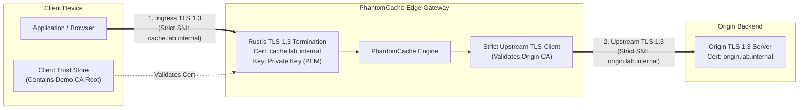
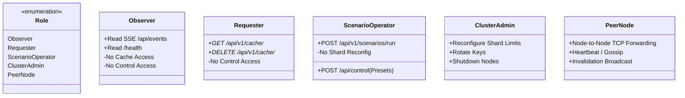

> Notice (2026-10-30): This document was written on 2026-10-26, before milestones M3 to M8. It is a planning and research record, not a description of the current system, and its phase numbers are not the project's current milestones (see [docs/STATUS.md](../STATUS.md)). Statements about current capability, test counts or missing features may be stale; the specific stale points known to the 2026-10-30 documentation audit are listed below where they apply.
>
> A `phantom-verify` verifier tool, where mentioned here, is a proposal: it does not exist in `src/` or `Cargo.toml`.
>
> Original text below is unchanged.

# PhantomCache — Trust, Authenticity, and Cryptographic Verification Design

## 1. Interception & Proxy Operating Modes

To evaluate what authorizes PhantomCache to occupy the request-response path, we analyze four candidate operating modes against IETF standards and security requirements:

| Operating Mode | RFC Specification | Request Path Ingress | TLS Handling | Authorization Authority | Recommended For |
| :--- | :--- | :--- | :--- | :--- | :--- |
| **Mode A: Explicit Forward Proxy** | RFC 9110 §7.1 | Client sets HTTP proxy; sends `GET http://origin/path` or `CONNECT origin:443` | End-to-end tunnel (`CONNECT`) OR MITM TLS termination | Client configuration | Outbound enterprise egress only |
| **Mode B: Reverse Proxy / Gateway** | RFC 9110 §7.2 | Client connects to cache domain; sends `GET /path` | Terminate ingress TLS; establish upstream TLS to origin | Domain owner / DNS authority | **Recommended Architecture** |
| **Mode C: Transparent Intermediary** | RFC 9110 §7.3 | In-line packet interception (IPtables / WCCP) | Bypasses TLS (plaintext only) OR rogue CA root | Network infrastructure authority | **Rejected** (Unsafe for HTTPS) |
| **Mode D: Explicit REST Gateway API** | Custom REST | Client calls `GET /api/v1/cache/path` | Direct HTTP/HTTPS to API endpoint | Application API contract | **Current Baseline** (Phase 0) |

### 1.1 Detailed Mode Analysis

#### Mode A — Forward Proxy: Tunneling vs. MITM Inspection
* **The `CONNECT` Tunneling Dilemma:** Under RFC 9110, when a client requests an `https://` resource via a forward proxy, it issues `CONNECT origin.com:443 HTTP/1.1`. The proxy forwards raw TCP packets between client and origin. **Because the payload is encrypted end-to-end with the origin's TLS certificate, a standard forward proxy CANNOT inspect, coalesce, or cache HTTP responses!**
* **The MITM Alternative:** To cache HTTPS forward proxy traffic, the proxy must terminate the TLS connection by dynamically generating a forged certificate for `origin.com` signed by a private Certificate Authority (CA). This requires installing the proxy's private CA root into every client device's trusted certificate store.
* **Architectural Decision:** **Do NOT implement MITM forward proxying.** It breaks end-to-end web security, introduces severe liability, and fails in modern clients with certificate pinning or Certificate Transparency (CT) enforcement.

#### Mode B — Reverse Proxy / Application Gateway (The Target Architecture)
* In Mode B, the application owner deliberately deploys PhantomCache in front of their backend.
* The domain name (e.g., `api.example.com`) resolves to the PhantomCache IP.
* PhantomCache presents an authentic, valid TLS certificate for `api.example.com`.
* PhantomCache inspects the decrypted request, checks cache shards, coalesces concurrent misses, and makes an independent, authenticated upstream TLS connection to the origin server.
* **Conclusion:** Mode B is the industry-standard architecture for edge caching (Cloudflare, Fastly, Varnish, NGINX) and provides clean, defensible authorization.

---

## 2. Cryptographic Endpoint Authenticity (Ingress & Upstream TLS)



### 2.1 Ingress TLS Implementation
- **TLS Engine:** Rustls (memory-safe, modern TLS 1.3/1.2 implementation without OpenSSL legacy vulnerabilities).
- **Demonstration Lab PKI:**
  - A dedicated offline Certificate Authority root (`PhantomCache Demo Root CA`) generates server certificates for `cache.lab.internal` and `origin.lab.internal`.
  - Requesters in the lab trust exclusively this demo CA root for test domains.
  - Zero modifications to global operating system trust stores outside the lab harness.
- **Production Path:** Automated ACME protocol integration (Let's Encrypt) or corporate Public Key Infrastructure (PKI).

### 2.2 Upstream TLS & Hostname Validation
Remediates the critical finding in `src/api/server.rs::fetch_origin_raw` (where `https://` was stripped to plaintext TCP):
1. Upstream requests strictly establish TLS when configured with `https://`.
2. Strict SNI (Server Name Indication) and hostname verification matching the origin certificate.
3. Configurable CA bundle allowing internal enterprise roots or custom mock origin certificates.

---

## 3. Mutual Authentication & Role-Based Access Control (RBAC)

In a multi-device LAN deployment, physical presence on the local network does not imply authorization. PhantomCache defines five explicit roles with distinct cryptographic credentials:



### 3.1 Authentication Mechanisms
1. **Observer & Operator (JWT Bearer Tokens):**
   - Signed with Ed25519 by the Lab Demonstration Controller.
   - Claims include `sub`, `role` (`observer` vs `operator`), `exp` (short-lived, e.g., 2 hours).
   - `/api/control` strictly checks for `role: operator` or `role: admin`.
2. **Requester Tenant Binding (Cryptographic Tenant ID):**
   - Untrusted `x-tenant-id` header is replaced or validated against a signed client token claim `tenant_id`.
   - If mTLS is enabled for enterprise clients, `tenant_id` is extracted directly from the Subject Alternative Name (SAN) of the client certificate.
3. **Peer Node-to-Node Mesh (Cluster mTLS):**
   - Inter-node TCP connections require mutual TLS.
   - Both nodes present certificates issued by the internal Cluster CA containing `SAN: DNS:node-{id}.cluster.phantom.internal`.
   - Prevents rogue machines from joining the rendezvous hash ring.

---

## 4. Upstream Request Safety & SSRF Mitigation

To permanently eliminate Server-Side Request Forgery risks identified in the audit:

### 4.1 Strict Destination Allowlisting
PhantomCache introduces an explicit configuration directive:
```toml
[upstream]
allowed_origins = [
    "https://origin-prod.internal:9000",
    "https://api.partner.com"
]
allow_redirects = false
enforce_tls = true
```

### 4.2 Network Boundary & IP Address Validation
Before establishing an outbound TCP/TLS socket, the destination hostname is resolved, and every resolved IP is validated against an IP blacklisting filter:
- **Loopback:** `127.0.0.0/8`, `::1`
- **Link-Local:** `169.254.0.0/16`, `fe80::/10`
- **Cloud Metadata Services:** `169.254.169.254` (AWS/GCP/Azure IMDS)
- **Private Networks (RFC 1918):** `10.0.0.0/8`, `172.16.0.0/12`, `192.168.0.0/16` (Blocked by default in public proxy mode; explicitly allowlisted for demo lab LAN).
- **DNS Rebinding Defense:** The TCP stream connects to the exact IP address validated by the filter, preventing time-of-check to time-of-use (TOCTOU) DNS rebinding attacks.

---

## 5. Software Provenance & Supply Chain Integrity

A running cache cannot be trusted if the compiled binary running on the host has been tampered with or built from uncommitted source modifications.

```mermaid
flowchart TD
    subgraph BuildPipeline ["Secure CI/CD Pipeline (GitHub Actions / Local Release)"]
        Source["Git Commit (Tag: v0.2.0)"] --> Build["Cargo Build --release<br/>(Deterministic Build Flags)"]
        Build --> Binary["target/release/phantom-cache"]
        Binary --> Digest["SHA256: 8f4b...3d2e"]
        Digest --> Sign["Cosign / Sigstore Keyless Signing"]
        Sign --> Manifest["release-manifest.json<br/>+ manifest.sig"]
    end

    subgraph HostRuntime ["Target Deployment Host"]
        DownloadedBinary["phantom-cache binary"]
        DownloadedManifest["release-manifest.json"]
        VerifierTool["phantom-verify CLI"]
        
        DownloadedBinary --> VerifierTool
        DownloadedManifest --> VerifierTool
        VerifierTool -->|"Verify Ed25519 Signature<br/>Compare SHA256 Hash"| Decision{"Signature Valid &<br/>Hash Matches?"}
        Decision -- "YES" --> RunOK["Authorized to Execute"]
        Decision -- "NO" --> AbortFail["HALT: Tampered Binary Detected"]
    end
```



### 5.1 Release Manifest Specification (`manifest.json`)
```json
{
  "system": "PhantomCache",
  "version": "0.2.0",
  "git_commit": "c4b31a89d7e52f01a34b2f",
  "build_timestamp": "2026-10-26T20:00:00Z",
  "binary_digest_sha256": "8f4b238a164c8d9e72f10b25d36e812f8e12470a12e8b5d381c8411b43d2e99a",
  "slsa_provenance": {
    "builder": "phantom-cache-ci",
    "materials": [{ "uri": "git+https://github.com/phantom-cache/core", "digest": "c4b31a89..." }]
  },
  "approved_configuration_digest": "4a71b2...",
  "signer_identity": "release-officer@phantomcache.org"
}
```

---

## 6. Tamper-Evident Signed Demonstration Evidence

To ensure demonstration metrics and benchmark results cannot be repudiated, falsified, or modified after execution:

### 6.1 Cryptographic Demonstration Report (`evidence-report.json`)
When a test scenario (e.g., Scenario 1–10) concludes, the PhantomCache daemon compiles a verifiable report containing:
1. **Scenario Parameters:** Scenario ID, random seed, concurrency, distribution (Zipfian skew), duration.
2. **Environment Digests:** Binary SHA256, active configuration SHA256, OS kernel/arch.
3. **Execution Timeline & Sequence Integrity:**
   - Sequential monotonic event IDs (`event_seq_0001` ... `event_seq_5000`).
   - Cryptographic hash chaining: `Hash(N) = SHA256(Hash(N-1) || EventPayload(N))`.
   - Explicit `gap_marker` events if the ring buffer drops events under pressure.
4. **Summary Metrics:** Total requests, hits, misses, coalesced count, evictions, p50/p90/p99 latencies.
5. **Ed25519 Digital Signature:** The report is signed by the node’s ephemeral or provisioned signing key.

### 6.2 Independent Offline Verification Tool (`phantom-verify`)
Evaluators verify the report independently without trusting the dashboard:
```bash
phantom-verify --report scenario-03-evidence.json --pubkey demo-release.pub
```
*Verification Steps:*
1. Validates the Ed25519 digital signature of the report.
2. Re-computes the SHA256 hash chain across all 5,000 events to ensure zero events were altered, injected, or removed.
3. Compares the recorded binary digest against the official release manifest.
4. Outputs: `[VERIFIED] Authentic test execution on approved binary v0.2.0`.

---

## 7. Workload Attestation & SPIFFE/SPIRE Analysis

### 7.1 SPIFFE / SPIRE Evaluation
- **What it provides:** Secure Production Identity Framework for Everyone (SPIFFE) issues short-lived cryptographic X.509 SVIDs (SPIFFE Verifiable Identity Documents) to running processes based on kernel/cgroup attestations.
- **Value for PhantomCache:** Automated, zero-touch mutual TLS rotation between distributed PhantomCache nodes and upstream microservices.
- **Operational Cost & Decision:** In a 3-device demonstration lab, running the SPIRE server and agent daemons adds significant operational complexity.
- **Recommendation:** **Defer SPIRE to Phase 7 (Advanced Assurance).** For Phases 1–6, use static X.509 certificates generated by a lightweight script (`scripts/gen-certs.sh`) to achieve identical cryptographic guarantees with zero external daemon dependencies.

### 7.2 Hardware-Backed Attestation (TPM 2.0 / Confidential Computing)
- Hardware attestation (AMD SEV-SNP, Intel SGX/TDX) proves to a remote client that the binary is running inside a secure hardware enclave.
- **Assessment:** Out of scope for the demonstration lab. Hardware enclaves do not change caching semantics and require specialized cloud instances not available on standard LAN test laptops.

