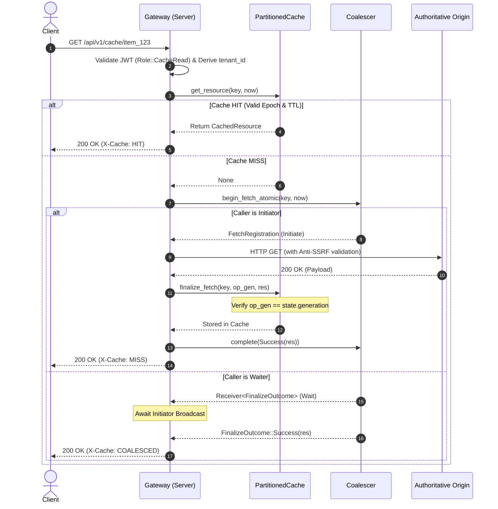
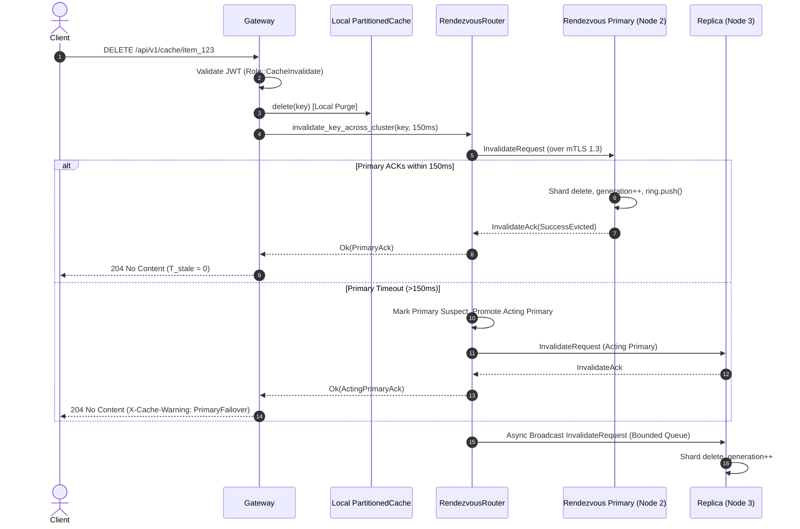

> Notice (2026-10-30): This handoff file is a historical record of the state on 2026-10-28 and is not edited. Parts of it are superseded: "Phase 4 accepted / zero P0 / formally accepted" and similar statements are not supported by the later audit ([handoff CORRECTIONS](CORRECTIONS.md), `CLAUDE.md` sections 6 and 6b); the test count "242 tests / 19 targets" is a 2026-10-28 baseline, not the current one ([docs/STATUS.md](../STATUS.md)); and descriptions of cluster cache sharing may predate the mTLS cluster path, where the local node shares the serving cache (`src/main.rs:332`).
>
> Original text below is unchanged.

# PhantomCache — Project Master Technical Context

**Document ID:** `docs/handoff/01_PROJECT_MASTER_CONTEXT.md`  
**Purpose:** Exhaustive technical knowledge base, system architecture, data flows, and subsystem specifications.  
**Audience:** Incoming senior systems engineers and AI coding assistants.  
**Authoritative Codebase:** `D:\Personal\phantom-cache`  

---

## 1. Vision, Goals, Non-Goals, and Differentiators

### 1.1 Vision
To deliver a high-performance, memory-safe, zero-trust caching and request-coalescing proxy tier that safeguards authoritative enterprise backends from cache stampedes, minimizes compute costs, and preserves strict data freshness without the operational overhead or write-side deadlocks of distributed multi-phase consensus protocols.

### 1.2 Core Goals
1. **Zero Thundering Herds:** Strict single-flight request coalescing ensures that regardless of concurrency, exactly one upstream fetch executes for a missing or expired key.
2. **Sub-Millisecond Cache Hits:** Lock striping across 64 sharded partitions provides fast, non-blocking cache lookups ($P_{99} \le 1.0\text{ ms}$).
3. **Zero-Trust Cluster Transport:** Inter-node communication is mutually authenticated via TLS 1.3, verified against an authoritative cluster membership registry, bounded by strict binary framing, and protected by active session revocation.
4. **Guaranteed Local Freshness & Bounded Replica Staleness:** Immediate purge of canonical primary rendezvous nodes ($T_{\text{stale}} = 0$) upon invalidation, backed by bounded asynchronous replica broadcasts and self-healing anti-entropy reconciliation.
5. **Fail-Closed Security Posture:** Upstream egress validates destination IP addresses against SSRF attack vectors; ingress validates cryptographic JWT claims; cluster nodes reject unauthorized connections before TLS completion.

### 1.3 Non-Goals
1. **Not a Distributed Database:** PhantomCache does not store primary authoritative records and does not implement Raft, Paxos, or 2PC write locks. Cache entries are ephemeral.
2. **Not a Multi-Region WAN Datastore:** Cluster invalidation and anti-entropy are engineered for low-latency datacenter LANs ($\le 5\text{ ms}$ RTT). Cross-region WAN replication is deferred to Phase 5.
3. **No Unbounded Memory Allocations:** No operation, queue, or network frame may allocate unbounded heap memory. All buffers have dual bounds (count and byte limits).

### 1.4 Architectural Differentiators
- **SIEVE Eviction by Default:** Outperforms classic LRU on web access traces with minimal metadata overhead (single visited bit per key).
- **Decoupled Key Generations vs Stream Sequences:** Fencing prevents stale origin fetches from resurrecting deleted keys without causing head-of-line blocking across distinct keys.
- **Tenant Generational Epochs:** Provides $O(1)$ tenant-wide cache invalidation without table scans, protected against capacity exhaustion via atomic global epoch resets.

---

## 2. Technology Stack & Key Dependencies

### 2.1 Backend (Rust)
- **Rust Edition 2021:** Strict static memory safety, zero-cost abstractions, fearless concurrency.
- **Tokio (`v1.38`, `features = ["full"]`):** Multi-threaded asynchronous I/O runtime powering network listeners, channels, semaphores, and background tasks.
- **Axum (`v0.7`, `features = ["ws", "macros"]`):** High-performance asynchronous HTTP routing engine.
- **Rustls (`v0.23`) & Tokio-Rustls (`v0.26`):** Pure-Rust TLS library enforcing modern TLS 1.3 without legacy cipher suites.
- **Ring (`v0.17`):** Cryptographic operations (SHA-256 state window digests, certificate fingerprint computation).
- **Jsonwebtoken (`v9`):** JWT signature verification and role-based claim validation.
- **Url (`v2.5`):** RFC-compliant URI parsing and anti-SSRF hostname canonicalization.

### 2.2 Frontend Operations Dashboard
- **React 18 & Vite:** Single-page dashboard rendering real-time cluster health, throughput, avoided compute dollars, and policy switching events over Server-Sent Events (SSE).

---

## 3. Module-by-Module Architecture

### 3.1 `src/core/cache.rs` — Partitioned Cache & Fencing
- **`PartitionedCache`:** Strips cache keys across $2^N$ shards (`shards: Vec<Mutex<CacheShard>>`, default 64 shards). Shard selection uses `DefaultHasher` masked by `shard_mask = num_shards - 1`.
- **`KeyState`:** Holds `entry: Option<Arc<CachedResource>>`, `generation: u64`, and `active_op_ids: HashSet<u64>`.
- **`CachedResource`:** Immutable response payload: `status: u16`, `content_type: String`, `body: Arc<Vec<u8>>`, `etag: Option<String>`, `created_at_ms: u64`, `ttl_ms: u64`, `entry_tenant_epoch: u64`, `entry_global_epoch: u64`.
- **Generational Fencing:** In-flight origin fetches record `op_gen` at initiation. On commit, `finalize_fetch` asserts `state.generation == op_gen`. If unequal (due to an intermediate `DELETE`), the response is dropped, preventing stale writes (`counters.stale_writes_prevented += 1`).
- **Tenant Generational Epochs:** `tenant_epochs: Mutex<HashMap<String, u64>>` and `global_epoch: AtomicU64`. Invalidating a tenant increments its epoch ($O(1)$). Stale entries fail the epoch match on lookup.
- **SEC-4A-01 Remediation:** Capped at `MAX_TENANT_EPOCHS = 10_000`. When saturated, advances `global_epoch` and flushes `tenant_epochs`, ensuring stale entries cannot be resurrected.

### 3.2 `src/core/coalesce.rs` — Single-Flight Coalescer
- **`Coalescer`:** Manages in-flight origin fetches (`in_flight: Mutex<HashMap<CacheKey, InFlightState>>`).
- **`begin_fetch_atomic`:** Atomically transitions an un-cached key to an in-flight operation. Returns `FetchRegistrationResult::Initiate(FetchRegistration)` for the first caller (the initiator), or `FetchRegistrationResult::Wait(Receiver<FinalizeOutcome>)` for subsequent callers (waiters).
- **`FetchGuard` (RAII Safety):** Wraps the fetch lifecycle. If the initiator task panics or aborts, the guard drops and notifies waiters of failure, preventing permanent deadlocks.

### 3.3 `src/dist/frame.rs` — Binary Mesh Framing
- **`PhantomMeshFrame`:** Strict 28-byte header + bounded payload layout:
  - Magic: `'P' 'H' 'A' 'N'` (`0x50 0x48 0x41 0x4E`).
  - Version: `1`.
  - Message Types:
    - `0x01`: `GetRequest`
    - `0x02`: `GetResponse`
    - `0x03`: `InvalidateRequest`
    - `0x04`: `InvalidateAck`
    - `0x05`: `HeartbeatRequest`
    - `0x06`: `HeartbeatResponse`
    - `0x07`: `AntiEntropySyncRequest`
    - `0x08`: `AntiEntropySyncResponse`
  - `request_id: u64` (BE): Ephemeral transport correlation token.
  - `sequence_number: u64` (BE): Connection-level TCP framing counter.
  - `payload_length: u32` (BE): Max length 1,048,576 bytes (1 MiB).
- **Framing Codecs:** `read_frame` and `write_frame` with strict length and bounds verification.

### 3.4 `src/dist/pool.rs` & `src/dist/session.rs` — mTLS Pooling & Revocation
- **`TlsConnectionPool`:** Bounded connection pool per node (`max_idle_per_node = 4`, `max_total_per_node = 8`).
- **Acquisition Reservation:** `checkout_or_reserve` returns `AcquisitionResult::Idle`, `AcquisitionResult::Reserved(Permit)`, or `AcquisitionResult::Full`. Eliminates connection stampedes to offline peers.
- **`SessionTracker`:** Layer 5 active session revocation. Tracks active stream IDs per peer node. When a node is revoked in `ClusterMembershipRegistry`, `SessionTracker::revoke_node` immediately severs active sockets.
- **Heartbeat Worker:** Sends `HeartbeatRequest` every 5 seconds. Ejects connections failing ping-pong within 1,000ms.

### 3.5 `src/dist/router.rs` — Rendezvous Routing & Invalidation
- **`RendezvousRouter`:** Distributes keys using Highest Random Weight (HRW) hashing: `hash(key, node_id)`.
- **`route_key` & `get_replicas`:** Selects primary node and ranked replica nodes. Strictly excludes nodes in `NodeState::Suspect`, `Failed`, `Offline`, or `Recovering` during healthy operation.
- **`invalidate_key_across_cluster`:** Synchronously invalidates canonical primary (150ms deadline). Promotes Acting Primary on primary timeout (`X-Cache-Warning: PrimaryFailover`). Spawns asynchronous broadcast to replicas.
- **`reconcile_peer_anti_entropy`:** Probes peers, exchanges digests, applies replay batches, and only promotes nodes to `Active` upon verified `InSync` or safe flush `HistoryOverwritten`.

### 3.6 `src/dist/anti_entropy.rs` — Dual-Bounded Anti-Entropy
- **`InvalidationRingBuffer`:** Circular log of invalidations:
  - Hard limit: 4,096 entries.
  - Hard limit: 4,194,304 bytes (4.0 MiB payload data bytes).
  - Front-eviction on overflow advancing `oldest_seq`.
  - `estimated_resident_memory_bytes()` calculates exact heap usage ($\le 4.25\text{ MiB}$ resident heap ceiling, $\le 6.5\text{ MiB}$ transient peak).
  - Cryptographic state digest via SHA-256 over active sequence window.
- **`AntiEntropyTracker`:** Tracks per-peer highest acked sequence with monotonic advancement preventing backwards sequence rewinds. Detects sequence gaps.

### 3.7 `src/security/` — Zero-Trust Boundary Controls
- **`src/security/cluster.rs`:** `ClusterTlsConfig` enforces TLS 1.3 only. Validates RFC 1035 SANs (`node-{id}.{cluster_id}.phantom.internal`) and leaf certificate SHA-256 fingerprints against `ClusterMembershipRegistry`. Parses peer socket addresses map from configuration.
- **`src/security/upstream.rs`:** Anti-SSRF policy. Rejects private (RFC 1918), loopback (127.0.0.0/8), link-local (169.254.0.0/16), and cloud metadata IP addresses unless loopback/LAN origins are explicitly allowed. Custom CA anchoring for egress TLS.

### 3.8 `src/control/pie.rs` & `src/intel/` — Adaptive Intelligence
- **Policy Inference Engine (PIE):** Tracks key access skew via Count-Min sketch. Dynamically evaluates SIEVE vs LRU vs S3FIFO eviction efficiency. Enforces a 60-second cooldown between policy switches and rolls back if hit ratio degrades.
- **`src/intel/telemetry.rs` & `src/intel/diagnostics.rs`:** Lockless atomic counters tracking cache hits, misses, stale writes prevented, anti-entropy sync totals, evicted keys, and full flushes.

---

## 4. End-to-End Data Flows

### 4.1 Ingress Cache Read (`GET /api/v1/cache/*key`)


### 4.2 Distributed Invalidation (`DELETE /api/v1/cache/*key`)


---

## 5. Startup & Configuration Reference

### 5.1 Environment Variables
| Variable | Default | Purpose |
| :--- | :--- | :--- |
| `PHANTOM_BIND_ADDR` | `127.0.0.1:8085` | Ingress HTTP listening address. |
| `PHANTOM_REQUIRE_AUTH` | `false` | Enable JWT authentication on ingress endpoints. |
| `PHANTOM_JWT_SECRET` | None | Secret key for JWT signature verification (required if auth enabled). |
| `PHANTOM_JWT_ISSUER` | `phantom-cache-auth` | Expected JWT issuer claim (`iss`). |
| `PHANTOM_JWT_AUDIENCE` | `phantom-cache-api` | Expected JWT audience claim (`aud`). |
| `ORIGIN_URL` | None | Upstream origin base URL. |
| `PHANTOM_ORIGIN_ALLOWLIST` | Empty | Comma-separated list of allowed upstream hostnames. |
| `PHANTOM_ENFORCE_UPSTREAM_TLS`| `false` | Disallow plaintext HTTP origins. |
| `PHANTOM_ALLOW_INSECURE_UPSTREAM`| `false`| Permit loopback/LAN origins (development only). |
| `PHANTOM_UPSTREAM_CA_CERT` | None | Custom CA certificate PEM file for upstream TLS anchoring. |
| `PHANTOM_CLUSTER_ID` | `phantom-cluster` | Target cluster identifier for mTLS SAN validation. |
| `PHANTOM_NODE_ID` | `1` | Unique node identifier (1..=255) for this process. |
| `PHANTOM_CLUSTER_CA` | None | Cluster root CA certificate PEM path. |
| `PHANTOM_NODE_CERT` | None | Node leaf certificate PEM path. |
| `PHANTOM_NODE_KEY` | None | Node private key PEM path. |
| `PHANTOM_CLUSTER_MEMBERS_FILE`| None | Authoritative JSON file path defining cluster members and addresses. |
| `PHANTOM_CLUSTER_LISTEN_ADDR`| None | Cluster inter-node TCP listening address (e.g. `127.0.0.1:9091`). |
| `PHANTOM_CLUSTER_PEER_ADDRS` | None | Comma-separated peer mappings: `2=127.0.0.1:9092,3=127.0.0.1:9093`. |
| `PHANTOM_ALLOW_INSECURE_CLUSTER`| `false`| Permit plaintext loopback cluster transport (testing only). |

### 5.2 Membership Configuration Schema (`cluster-members.json`)
```json
{
  "cluster_id": "phantom-cluster",
  "version": 1,
  "members": [
    {
      "node_id": 1,
      "fingerprints": ["64_char_lowercase_hex_sha256_hash..."],
      "active": true
    },
    {
      "node_id": 2,
      "fingerprints": ["64_char_lowercase_hex_sha256_hash..."],
      "active": true
    }
  ],
  "addresses": {
    "1": "10.0.1.11:9091",
    "2": "10.0.1.12:9091"
  }
}
```

---

## 6. Security Architecture & Threat Model

### 6.1 Attack Vectors & Implemented Mitigations
1. **SSRF via Upstream URL Injection:** Mitigated by `security::upstream::validate_url_against_policy`. Parses IP via DNS/socket resolution; blocks loopback (`127.0.0.0/8`), RFC 1918, RFC 3927 (`169.254.0.0/16`), and AWS/GCP metadata endpoints (`169.254.169.254`).
2. **Cluster Transport Spoofing & Man-in-the-Middle:** Mitigated by `security::cluster::ClusterTlsConfig`. Requires mutual TLS 1.3 signed by cluster CA. Validates leaf certificate SHA-256 fingerprint against authoritative membership registry.
3. **Cross-Tenant Invalidation Attack:** Mitigated by cryptographic tenant scoping. Gateway extracts `tenant_id` exclusively from verified JWT claims; prepends to canonical key before routing.
4. **Denial-of-Service via Tenant Epoch Exhaustion:** Mitigated by SEC-4A-01 synchronized global-epoch fallback. Map is bounded to 10,000 tenants; saturation increments `global_epoch` and resets the map, guaranteeing anti-resurrection.
5. **Memory Exhaustion via Malformed Framing:** Mitigated by `PhantomMeshFrame` size limits. Payload capped at 1 MiB; key length capped at 4 KiB. Header length mismatches immediately abort the TCP stream.

