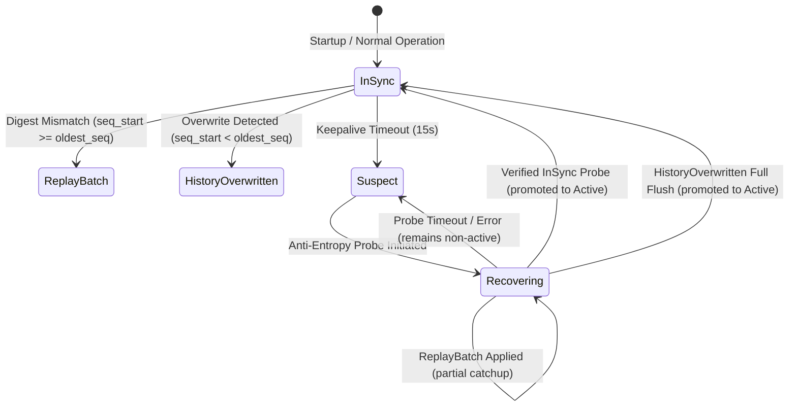

> Notice (2026-10-30): This handoff file is a historical record of the state on 2026-10-28 and is not edited. Parts of it are superseded: "Phase 4 accepted / zero P0 / formally accepted" and similar statements are not supported by the later audit ([handoff CORRECTIONS](CORRECTIONS.md), `CLAUDE.md` sections 6 and 6b); the test count "242 tests / 19 targets" is a 2026-10-28 baseline, not the current one ([docs/STATUS.md](../STATUS.md)); and descriptions of cluster cache sharing may predate the mTLS cluster path, where the local node shares the serving cache (`src/main.rs:332`).
>
> Original text below is unchanged.

> Correction notice (2026-10-30, owner-approved DEC-020): (1) Section 4, "Anti-entropy guarantees self-healing eventual consistency": anti-entropy is implemented and has a production caller (worker every 250 ms, `src/main.rs:375`, `:383`), but its effectiveness is not established (`docs/research/claims_ledger.md` C6) and the repair ledger is in memory. No convergence bound is proven. (2) Section 5, "strict global acquisition order ... deadlock freedom": this order was not machine-checked (no loom or shuttle run), and the cache-side edges are listed in `CLAUDE.md` errata item 1; treat deadlock freedom as unverified.

# PhantomCache — Architecture & Protocol Reference

**Document ID:** `docs/handoff/03_ARCHITECTURE_AND_PROTOCOL_REFERENCE.md`  
**Purpose:** Formal specification of wire protocols, binary layouts, sequence spaces, generational fencing, and anti-entropy algorithms.  
**Audience:** Protocol engineers, distributed systems developers, and AI coding assistants.  
**Authoritative Baseline Date:** October 28, 2026  

---

## 1. Binary Mesh Framing Protocol (`PhantomMeshFrame`)

Inter-node communication operates over TCP streams encrypted via Mutual TLS 1.3. Plaintext connections and legacy TLS versions are rejected at the transport layer.

### 1.1 Fixed Header Binary Layout (28 Bytes)
All frames begin with an immutable, big-endian 28-byte header:

```text
 0                   1                   2                   3
 0 1 2 3 4 5 6 7 8 9 0 1 2 3 4 5 6 7 8 9 0 1 2 3 4 5 6 7 8 9 0 1
+-+-+-+-+-+-+-+-+-+-+-+-+-+-+-+-+-+-+-+-+-+-+-+-+-+-+-+-+-+-+-+-+
|       Magic: 'P' 'H' 'A' 'N' (0x50 0x48 0x41 0x4E)            |
+-+-+-+-+-+-+-+-+-+-+-+-+-+-+-+-+-+-+-+-+-+-+-+-+-+-+-+-+-+-+-+-+
|  Version (1)  | Msg Type (u8) |        Flags (u16 BE)         |
+-+-+-+-+-+-+-+-+-+-+-+-+-+-+-+-+-+-+-+-+-+-+-+-+-+-+-+-+-+-+-+-+
|                        Request ID (u64 BE)                    |
+-+-+-+-+-+-+-+-+-+-+-+-+-+-+-+-+-+-+-+-+-+-+-+-+-+-+-+-+-+-+-+-+
|                     Sequence Number (u64 BE)                  |
+-+-+-+-+-+-+-+-+-+-+-+-+-+-+-+-+-+-+-+-+-+-+-+-+-+-+-+-+-+-+-+-+
|                      Payload Length (u32 BE)                  |
+-+-+-+-+-+-+-+-+-+-+-+-+-+-+-+-+-+-+-+-+-+-+-+-+-+-+-+-+-+-+-+-+
```

### 1.2 Header Field Semantics
- **Magic (4 Bytes):** Constant ASCII `'P' 'H' 'A' 'N'` (`[0x50, 0x48, 0x41, 0x4E]`). Any mismatch immediately severs the socket.
- **Version (1 Byte):** Protocol version `1`. Unrecognized versions cause immediate disconnection (`FrameError::UnsupportedVersion`).
- **Message Type (1 Byte):** Defines the message semantics and payload layout:
  - `0x01`: `GetRequest` (Stage 3B)
  - `0x02`: `GetResponse` (Stage 3B)
  - `0x03`: `InvalidateRequest` (Phase 4A)
  - `0x04`: `InvalidateAck` (Phase 4A)
  - `0x05`: `HeartbeatRequest` (Stage 3C)
  - `0x06`: `HeartbeatResponse` (Stage 3C)
  - `0x07`: `AntiEntropySyncRequest` (Phase 4C)
  - `0x08`: `AntiEntropySyncResponse` (Phase 4C)
- **Flags (2 Bytes, Big-Endian):** Reserved for future protocol options. Default `0x0000`.
- **Request ID (8 Bytes, Big-Endian):** Ephemeral 64-bit random correlation token. Used exclusively by `TlsConnectionPool` callers to pair responses with requests over shared sockets.
- **Sequence Number (8 Bytes, Big-Endian):** Per-connection monotonic framing sequence. Detects lost TCP frames or stream corruption.
- **Payload Length (4 Bytes, Big-Endian):** Exact byte count of the trailing payload. Capped at `MAX_FRAME_PAYLOAD_BYTES = 1,048,576` (1 MiB). Values exceeding 1 MiB or shorter than the minimum for the message type abort the connection.

---

## 2. Message Payload Layouts & Size Bounds

### 2.1 `InvalidateRequest` (`0x03`)
Used by gateways and routers to invalidate cached resources across cluster nodes:

```text
 0                   1                   2                   3
 0 1 2 3 4 5 6 7 8 9 0 1 2 3 4 5 6 7 8 9 0 1 2 3 4 5 6 7 8 9 0 1
+-+-+-+-+-+-+-+-+-+-+-+-+-+-+-+-+-+-+-+-+-+-+-+-+-+-+-+-+-+-+-+-+
|                   Membership Epoch (u64 BE)                   |
+-+-+-+-+-+-+-+-+-+-+-+-+-+-+-+-+-+-+-+-+-+-+-+-+-+-+-+-+-+-+-+-+
|                    Stream Sequence (u64 BE)                   |
+-+-+-+-+-+-+-+-+-+-+-+-+-+-+-+-+-+-+-+-+-+-+-+-+-+-+-+-+-+-+-+-+
| Orig Node(u8) | Scope (u8)    |       Key Length (u16 BE)     |
+-+-+-+-+-+-+-+-+-+-+-+-+-+-+-+-+-+-+-+-+-+-+-+-+-+-+-+-+-+-+-+-+
|                         Key Bytes...                          |
+-+-+-+-+-+-+-+-+-+-+-+-+-+-+-+-+-+-+-+-+-+-+-+-+-+-+-+-+-+-+-+-+
```
- **Size Bounds:** Minimum 20 bytes (Scope `0x02` with 0-length key). Maximum 4,116 bytes ($20 + 4,096$ max key length).
- **Scope Codes:**
  - `0x00`: `ExactKey` — Purges single canonical key.
  - `0x01`: `Tenant` — Purges all keys belonging to `tenant_id` ($O(1)$ epoch advance).
  - `0x02`: `FullCache` — Emergency cluster-wide cache flush ($O(1)$ global epoch advance).

### 2.2 `InvalidateAck` (`0x04`)
Returned by recipient node acknowledging an `InvalidateRequest`:

```text
 0                   1                   2                   3
 0 1 2 3 4 5 6 7 8 9 0 1 2 3 4 5 6 7 8 9 0 1 2 3 4 5 6 7 8 9 0 1
+-+-+-+-+-+-+-+-+-+-+-+-+-+-+-+-+-+-+-+-+-+-+-+-+-+-+-+-+-+-+-+-+
|                   Membership Epoch (u64 BE)                   |
+-+-+-+-+-+-+-+-+-+-+-+-+-+-+-+-+-+-+-+-+-+-+-+-+-+-+-+-+-+-+-+-+
|                    Stream Sequence (u64 BE)                   |
+-+-+-+-+-+-+-+-+-+-+-+-+-+-+-+-+-+-+-+-+-+-+-+-+-+-+-+-+-+-+-+-+
| Resp Node(u8) | Status (u8)   |        Reserved (u16)         |
+-+-+-+-+-+-+-+-+-+-+-+-+-+-+-+-+-+-+-+-+-+-+-+-+-+-+-+-+-+-+-+-+
|                    Reclaimed Bytes (u32 BE)                   |
+-+-+-+-+-+-+-+-+-+-+-+-+-+-+-+-+-+-+-+-+-+-+-+-+-+-+-+-+-+-+-+-+
```
- **Size:** Exactly 24 bytes fixed payload. Any other size aborts the stream.
- **Status Codes:**
  - `0x00`: `SuccessEvicted` — Key found and purged.
  - `0x01`: `SuccessNotPresent` — Key was not present in cache.
  - `0x02`: `IgnoredObsolete` — Obsolete stream sequence or epoch.
  - `0x03`: `RejectedRateLimit` — Node under invalidation backpressure.

### 2.3 `AntiEntropySyncRequest` (`0x07`)
Periodic probe sent by router/node to verify state synchronization with peers:
- **Size:** Exactly 50 bytes fixed payload.
- **Fields:**
  - `membership_epoch: u64` (8 bytes BE)
  - `highest_acked_seq: u64` (8 bytes BE) — Last acknowledged stream sequence from recipient.
  - `sender_node_id: u8` (1 byte)
  - `reserved: u8` (1 byte)
  - `ring_digest: [u8; 32]` (32 bytes) — SHA-256 hash over local sequence window.

### 2.4 `AntiEntropySyncResponse` (`0x08`)
Returned in response to `AntiEntropySyncRequest`:
- **Header Fields (20 bytes prefix):**
  - `status: u8` (0 = `InSync`, 1 = `ReplayBatch`, 2 = `HistoryOverwritten`)
  - `reserved: [u8; 3]`
  - `range_start: u64` (8 bytes BE)
  - `range_end: u64` (8 bytes BE)
  - `record_count: u16` (2 bytes BE)
  - `reserved2: [u8; 2]`
- **Trailing Batch:** Serialized `InvalidateRecord` entries for `ReplayBatch` (bounded by 1 MiB max frame payload).

---

## 3. Decoupled Sequence & Generation Spaces

A fundamental design requirement of PhantomCache is the strict separation between transport/stream sequencing and cache key generational fencing.

```text
[ Stream Sequence Space ]                              [ Key Generational Fencing ]
- Scope: Node-wide outbound stream                     - Scope: Local CacheKey in Shard
- Monotonic counter in Router                          - Monotonic counter in KeyState
- Detects stream gaps & triggers anti-entropy          - Discards stale in-flight origin fetches
- DOES NOT suppress out-of-order keys                  - DOES NOT suppress other keys
```

### 3.1 Outbound Stream Sequence (`stream_seq: u64`)
- Maintained by each node via `stream_sequence: Arc<AtomicU64>`.
- Incremented via `fetch_add(1, SeqCst)` when an invalidation record is generated.
- Tracked per sending peer by receiving nodes using `AntiEntropyTracker`.
- **In-Order Delivery Non-Requirement:** If sequence 22 arrives before sequence 21, sequence 22 is **executed immediately** (cache deletion is always safe). Sequence 21 is marked as a gap and subsequently recovered via anti-entropy replay. An invalidation for `key_B` is **never suppressed** because a higher sequence arrived for `key_A`.

### 3.2 Key-Level Generational Fencing (`generation: u64`)
- Located inside `KeyState` in `PartitionedCache`, protected by shard mutexes.
- When an origin fetch begins, it records `op_gen = state.generation`.
- When an invalidation for key $K$ occurs, `state.generation` is atomically incremented.
- When the origin fetch finishes, `finalize_fetch` validates `state.generation == op_gen`. If `generation` advanced, the fetched response is discarded, preventing stale writes (`counters.stale_writes_prevented += 1`).

---

## 4. Anti-Entropy Reconciliation State Machine

Anti-entropy guarantees self-healing eventual consistency without persistent WAL storage:



### 4.1 Invalidation Ring Buffer Invariants
- **Dual Limits:** Capped at 4,096 entries and 4,194,304 bytes (4.0 MiB payload data bytes).
- **Resident Memory:** Measured via `estimated_resident_memory_bytes()`:
  $$\text{Resident Heap} = \text{current\_bytes} + (\text{capacity} \times 40\text{B}) + (\text{entries} \times 16\text{B}) \le 4.25\text{ MiB}$$
- **Front Eviction:** When bounds are reached, oldest entries are popped from the front, advancing `oldest_seq`.
- **History Overwrite:** If a peer requests catchup from sequence $S < oldest\_seq$, the ring returns `AntiEntropyStatus::HistoryOverwritten`. The peer executes a safe full cache flush (`cache.try_invalidate_all()`), resetting its sequence to `newest_seq`.

### 4.2 Safe Node Recovery State Machine (SEC-POA-02 & SEC-POA-04)
- **Cache Read Bypass:** While a node is in `NodeState::Suspect` or `NodeState::Recovering`, inbound `MessageType::GetRequest` frames bypass cached entries and return `MISS` to origin. This prevents stale reads during re-synchronization.
- **Single-Probe Atomic Promotion:** `reconcile_peer_anti_entropy` executes atomic exchanges. It promotes nodes to `Active` **only** upon receiving `InSync` or completing a safe flush `HistoryOverwritten`. A partial catchup (`ReplayBatch`) leaves the node in `Recovering` until an `InSync` probe confirms full consistency.

---

## 5. Concurrency & Locking Hierarchy

To guarantee deadlock freedom across all multi-threaded operations, PhantomCache enforces a strict global acquisition order:

$$\text{Router / Registry Lock} \longrightarrow \text{Connection Pool Mutex} \longrightarrow \text{Shard Mutex} \longrightarrow \text{Ring Buffer Mutex}$$

1. **Registry & Router Locks:** Acquired for membership resolution and route calculation. Never held during network I/O or shard manipulation.
2. **Connection Pool Mutex:** Acquired briefly during socket reservation or checkout. Released before initiating TCP/TLS handshakes.
3. **Shard Mutex (`shards[i].lock()`):** Acquired during cache lookups, deletion, or fetch registration. Shard locks are strictly isolated; operations never hold multiple shard mutexes concurrently.
4. **Ring Buffer Mutex:** Acquired strictly to append or inspect invalidation descriptors. Never held while acquiring shard locks.

