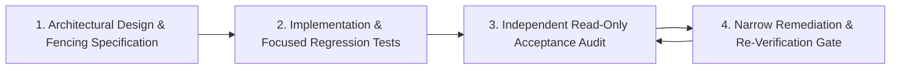

> Notice (2026-10-30): This handoff file is a historical record of the state on 2026-10-28 and is not edited. Parts of it are superseded: "Phase 4 accepted / zero P0 / formally accepted" and similar statements are not supported by the later audit ([handoff CORRECTIONS](CORRECTIONS.md), `CLAUDE.md` sections 6 and 6b); the test count "242 tests / 19 targets" is a 2026-10-28 baseline, not the current one ([docs/STATUS.md](../STATUS.md)); and descriptions of cluster cache sharing may predate the mTLS cluster path, where the local node shares the serving cache (`src/main.rs:332`).
>
> Original text below is unchanged.

# PhantomCache — Agent Engineering Workflow & Git Safeguards

**Document ID:** `docs/handoff/06_AGENT_WORKFLOW_AND_GIT_SAFEGUARDS.md`  
**Purpose:** Operating rules, development discipline, audit protocols, and Git safety invariants.  
**Audience:** All incoming AI coding assistants, subagents, and human contributors.  
**Authoritative Baseline Date:** October 28, 2026  

---

## 1. Absolute Git Safety Invariants

The PhantomCache repository is an active production-grade engineering workspace. The following rules are non-negotiable:

1. **NEVER Execute Destructive Git Commands:**
   - **Prohibited:** `git reset`, `git clean`, `git checkout -- <file>`, `git restore`, `git stash`, `git revert`.
   - **Reason:** The working tree contains essential tracked modifications and untracked artifacts (`docs/security/`, `docs/handoff/`, `src/dist/`, `tests/integration/`). Any destructive checkout or clean command destroys uncommitted work.
2. **NEVER Commit or Push Without Explicit Authorization:**
   - Do NOT run `git commit` or `git push`.
   - The user authorizes and executes commits separately on designated milestone boundaries.
3. **Inspect Before Changing Anything:**
   - At the start and end of every turn, run:
     ```powershell
     git rev-parse HEAD
     git branch --show-current
     git status --short
     ```
   - Verify that HEAD remains `456bb25930004f1896a84c53e776e7b3ef29ee16` and the branch is `feat/publish-phantomcache-core`.

---

## 2. Engineering Operating Principles

### 2.1 Explain Before Implementing
Before modifying any source file:
1. Explain what will be changed.
2. Identify which exact files will be modified.
3. Identify which existing repository pattern will be reused.
4. Highlight assumptions, failure modes, and potential risks.
5. Only then apply the change.

### 2.2 Minimal Change Principle
- Make the smallest surgical change required to fix the issue.
- Avoid unnecessary refactoring or style-only edits.
- Preserve backward-compatible signatures and struct constructors. If adding fields to configuration structs, ensure backward compatibility for all test call sites.

### 2.3 Passing Tests Are Not Proof of Architecture
> [!IMPORTANT]
> **Cardinal Rule:** A passing test suite does NOT independently prove that distributed consistency or security properties are correct.
- Tests can pass because of loose assertions, mocked conditions, or race windows not triggered on loopback.
- Verify the actual code paths, locking boundaries, and state transitions directly in code before accepting claims.

---

## 3. The Multi-Stage Audit & Remediation Lifecycle

PhantomCache enforces a 4-step governance gate for every architectural stage:



1. **Step 1 — Design & Threat Modeling:** Document message layouts, sequence spaces, memory limits, and failure modes in `docs/security/`.
2. **Step 2 — Minimal Implementation:** Implement code paths and add deterministic regression tests reproducing potential failure scenarios.
3. **Step 3 — Independent Read-Only Audit:** A dedicated review assesses the implementation in strictly read-only mode, determining `ACCEPT`, `ACCEPT WITH CONDITIONS`, or `REJECT`.
4. **Step 4 — Targeted Remediation:** Address identified findings without expanding scope; re-run full test suites and Clippy.

---

## 4. Verification Command Standard

On Windows with PowerShell, execute Cargo commands with single-threaded sequential scheduling (`-j 1`):

```powershell
# 1. Run focused target affected by change
cargo test --test <target_name> -j 1

# 2. Run full workspace test suite (all 19 targets)
cargo test --all-targets -j 1

# 3. Static linter verification (zero warnings policy)
cargo clippy --all-targets -j 1 -- -D warnings

# 4. Whitespace and formatting check
git diff --check src/ tests/ docs/security/
```

Never ignore a test failure or silence a Clippy lint with `#[allow(...)]` without documenting technical justification.

