# About this handbook

**Purpose.** This book teaches you what PhantomCache is, how it works inside, why it was built this way, and how to defend it in front of technically strong judges. It starts with the problem, not the product, and ends with an honest account of what is not finished.

**Who it is for.** A reader who knows programming basics and is building deeper expertise in distributed systems and systems engineering. Technical terms are always explained where they first appear.

**State of the project described here.** The text describes the repository as it was on 2026-10-30, on the feature branch `feat/publish-phantomcache-core`. Parts of the working tree were still uncommitted while the book was written, and several repair patches (U-01, G4A-01, M3 durable invalidation) exist only as sandbox work that is not merged. Where a statement depends on the exact state, it says "at the time of writing".

## How the chapters are organised
1. **The Problem and the Vision.** Caching from first principles, why it breaks down, and what PhantomCache tries to solve.
2. **System Architecture.** The components, the request paths, the routes and the configuration, with diagrams.
3. **Technology Stack and Engineering Decisions.** Rust, Tokio, Axum and the rest, and which choices are recorded decisions versus reasoning after the fact.
4. **Core Cache Engine and Algorithms.** Sharded locks, single-flight, expiry, eviction, fencing and epochs, with worked examples.
5. **Distributed Systems and Workload Intelligence.** Rendezvous hashing, invalidation, failure behaviour, and what the adaptive control really is.
6. **Security, Reliability and Performance.** The failure-scenario matrix, what protections exist, and what evidence supports any number.
7. **Phantom Lab, Experimentation and Innovation.** The simulator, the real-gateway experiments, the negative result, and the evidence-based innovation argument.
8. **Limitations, Roadmap and Technical Defence.** What is incomplete, what you must not claim, and the hardest questions.

The appendices at the end give a one-page overview, the architecture explained once, a technology and algorithm reference, a glossary, a consolidated judge-question bank, a source-file map, an implementation-versus-roadmap matrix and the ten concepts to master.

## Three ways to read it
- **One hour before a presentation:** Appendix A, Appendix H, then the judge bank (Appendix E) and the claims-you-must-not-make table in Chapter 8.
- **One day:** Chapters 1, 2, 4 and 8, then the judge boxes of Chapters 5 to 7.
- **To master it:** read the chapters in order, do the knowledge checks and the codebase exploration tasks at the end of each chapter, and answer the challenge questions aloud.

## The status labels used everywhere
Every claim about a capability carries one of these labels. They describe evidence, not hope.

| Label | Meaning |
|---|---|
| **IMPLEMENTED** | The code exists in the repository. It says nothing about whether it works. |
| **TESTED** | A named test exercises it. The text says what the test proves and what it does not. |
| **INDEPENDENTLY VERIFIED** | A human or external reviewer verified it. Almost nothing in the project reaches this level, and the book says so. |
| **PARTIAL** | Part of the behaviour exists. |
| **PROTOTYPE ONLY** | Exists as sandbox or library code that the running gateway does not use. |
| **DESIGNED BUT NOT IMPLEMENTED** | A design exists; the code does not. |
| **DEFERRED** | Consciously postponed. |
| **BLOCKED** | Cannot proceed until an owner decision or another piece of work. |
| **UNVERIFIED** | Could not be checked; the text says why. |

## What this book does and does not establish
- It was written and quality-checked by AI agents, each chapter against the current code. Reviews described as "AI second look" are not human verification. No part of the project, including this book, has had an independent human review.
- Passing tests are not proof of correctness. Several tests assert stub behaviour, and the book names them.
- Performance numbers appear only with their build profile, host, workload, seed, repetitions and limits. Loopback, simulated and physical-host results are kept separate. The book makes no claim that PhantomCache is faster or better than any other cache.
- Documents in the repository sometimes disagree with the code. Each chapter records the discrepancies it found; none were silently fixed.

## Judge boxes
Look for the boxes headed **JUDGE MAY ASK**. Each holds a question a technically strong judge might ask, a suggested answer you can say in 30 to 60 seconds, a deeper follow-up, and the evidence to know. If a feature is incomplete, the answer says so honestly. That is deliberate: the strongest defence is an accurate one.

# Chapter 1: The Problem and the Vision

**Status of this chapter:** written 2026-10-30 against the working tree. At the time of writing HEAD is `df68eaa` (branch `feat/publish-phantomcache-core`); most of the work described is uncommitted. Every capability claim carries a status label from the handbook vocabulary (IMPLEMENTED, TESTED, PARTIAL, PROTOTYPE ONLY, DESIGNED BUT NOT IMPLEMENTED, DEFERRED, BLOCKED, UNVERIFIED). Nothing in the repository is INDEPENDENTLY VERIFIED by a human reviewer; every review so far is an AI second look. The evidence behind each claim is in `docs/learning/evidence/ch01_evidence.md`.

## What you will learn

- What a cache is, and how to talk about hits, misses, latency, throughput and origin load with exact words.
- Why applications need caching, and the four problems caching introduces: stampedes, hot keys, stale data and invalidation.
- Why one cache node eventually stops being enough, and what a distributed cache costs in return.
- What PhantomCache is, in one minute, and which parts of that description are true today.
- The three pillars (distributed systems engineering, workload intelligence, product excellence), each with an honest status tied to real files and tests.

---

## 1.1 What a cache is

**Simple explanation.** A cache is a small, fast shelf that holds copies of answers you have already worked hard to get. A librarian who fetches a book from the basement stack walks down once, then keeps the book on the desk for the next reader. The desk is the cache. The basement is slower, but it is the only place that has the real, authoritative copy.

**The correct terms.**

- **Origin** (also "backend" or "source of truth"): the system that owns the real data and can always produce it, usually a database or an upstream web service. In PhantomCache the origin is whatever HTTP server `ORIGIN_URL` points to (`src/main.rs`, read with `cfg.get("ORIGIN_URL")`).
- **Cache**: a store of copies, keyed so that a later request for the same thing can be answered without calling the origin.
- **Key**: the identity of one cached item. In PhantomCache a key is the tenant plus the request path plus the query string (`src/core/cache.rs::CacheKey`, built in `src/api/server.rs::get_cache_handler`). Two query strings mean two keys.
- **Hit**: the cache has a usable copy and answers from it. **Miss**: it has none, so the origin must be asked.
- **Hit ratio** (or hit rate): hits divided by total lookups.
- **Latency**: how long one request takes, from the caller's point of view. **Throughput**: how many requests per second the system completes. **Origin load**: how many requests per second reach the origin.
- **TTL** (time to live) and **freshness lifetime**: how long a copy may be treated as correct. After that the copy is **stale** (expired).
- **Invalidation**: removing or marking a copy as no longer valid before it would expire naturally, usually because the origin data changed.

**How it works.** Every cache runs the same loop:

```
on request(key):
    if cache has a fresh copy of key:      # HIT
        return the copy
    copy = ask the origin for key          # MISS
    store copy in cache (with a lifetime)
    return copy
```

**Where it lives in PhantomCache.** PhantomCache is an HTTP caching gateway. A client sends `GET /api/v1/cache/<path>` to the gateway. The route is registered in `src/api/server.rs` (the router function adds `"/api/v1/cache/*key"` with `get(get_cache_handler).delete(delete_cache_handler)`). The gateway answers from its in-memory cache or fetches from the origin and stores the reply. Every reply to a cache GET carries an `X-Cache-Status` header whose value says what happened. The values set in the code are `HIT`, `MISS`, `COALESCED`, `STALE`, `BYPASS` and `BYPASS-AUTH`. Status: IMPLEMENTED, TESTED (for example `tests/integration/m1_http_tests.rs::test_m1_t13_barrier_stampede_100_clients` checks `MISS` and `COALESCED` values; it does not prove behaviour on a release build or across hosts).

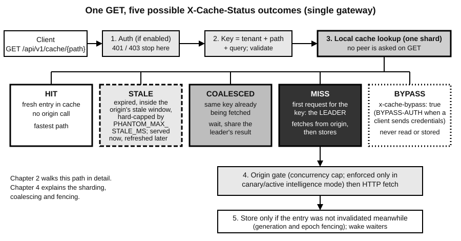

Source: `src/api/server.rs::get_cache_handler` (authentication, key construction, stale check, bypass branch, single-flight leader and waiter branches), `src/core/cache.rs::PartitionedCache::begin_fetch_atomic`. Chapter 2 walks this path step by step. Chapter 4 explains the machinery.

**Trade-offs and what can go wrong.** A cache trades memory and correctness risk for speed. Copies use memory, so a full cache needs an eviction rule. Copies can also become wrong, and a cache that returns wrong data is worse than none, because callers trust it. Section 1.3 is about how that happens.

---

## 1.2 Why applications need caching

**Simple explanation.** Asking the origin is expensive, and many people ask for the same thing. Answering from a nearby copy is cheap. If most questions repeat, most work disappears.

**Why the origin is the bottleneck.** An origin such as a relational database has limited connections and a limited query rate. When requests arrive faster than it can answer, they queue; callers hold threads and connections longer, and their callers queue in turn. This is a **queue collapse** or **cascading failure**: one slow component slows everything above it. The README and the handoff name this as the motivating problem ("database queue collapse, thundering herds, cache stampedes"). It is motivation, not a measurement taken by this project.

**Three quantities to keep apart.**

| Quantity | Meaning | A cache changes it by |
|---|---|---|
| Latency | Time for one request | Replacing a slow origin trip with a fast memory lookup on a hit |
| Throughput | Completed requests per second | Letting the gateway finish many requests without waiting on the origin |
| Origin load | Requests per second that reach the origin | Absorbing the repeated requests |

**Worked example (illustrative numbers, not measurements).** Suppose a service receives 10,000 requests per second. A hit costs 1 ms. A miss costs 50 ms because it includes the origin trip. Suppose the hit ratio is 95%.

```
average latency = h * t_hit + (1 - h) * t_miss
                = 0.95 * 1 ms + 0.05 * 50 ms
                = 0.95 + 2.50 = 3.45 ms

origin load     = (1 - h) * request rate
                = 0.05 * 10,000 = 500 requests per second
```

Without the cache the average latency is 50 ms and the origin sees 10,000 requests per second; with it, the origin sees 20 times fewer. Two points. The 5% of misses still dominate the average (2.50 of 3.45 ms). And origin load is sensitive to the hit ratio: at 90% instead of 95% it doubles to 1,000 requests per second. So caches are judged by what they do to the origin, not only by how fast a hit is.

::: concept
**Hit ratio, latency, origin load.** Average latency is a weighted mix of hit and miss times. Origin load is the miss rate times the request rate. Because misses are rare but expensive, the tail of the latency distribution (the slowest few percent, written P99 for the 99th percentile) is set mostly by misses. A cache protects the origin only as well as its hit ratio holds under stress.
:::

**Where it lives in PhantomCache.** Requests and outcomes are counted in `PartitionedCache::counters` (`requests_total` is incremented in `get_cache_handler`) and exposed at `GET /api/v1/metrics`. Status: IMPLEMENTED. There is no release-grade measurement of hit ratio, latency or throughput: `docs/user/limitations.md` says "No performance numbers are published with this release", and `docs/STATUS.md` says there is no release-profile general suite. Chapter 6, section 6.13 lists every measurement the repository contains.

::: judge
**JUDGE MAY ASK**

Question: Why is caching necessary at all? Why not just make the database faster?

**Suggested answer** (about 30 to 60 seconds spoken, plain English):

Making the database faster helps, but it does not remove the basic problem. Most real traffic repeats: many users ask for the same few items. A database answers every repeat from scratch, which costs a query, a connection and often disk or network time. A cache answers the repeat from memory in a fraction of the time and, more importantly, the repeat never reaches the database. The database load then drops by roughly the miss rate. If the hit ratio is 95%, the database sees one request in twenty. That headroom is what keeps the database alive during a traffic surge. A faster database is still worth having, but it is a one-off multiplier. A cache changes the shape of the load.

**If the judge asks further:**

Caching only works when requests repeat and when a slightly old answer is acceptable. If every request is unique, or if every answer must be perfectly current, a cache gives little or nothing. I would not claim a specific speed-up for PhantomCache: this repository contains no release-build performance measurement. The numbers I use to explain the idea are illustrative.

**Evidence to know:** `docs/user/limitations.md` (no published performance numbers); `docs/STATUS.md` section 3 (no release-profile suite); counters in `src/core/cache.rs::PartitionedCache` and `GET /api/v1/metrics`. Status: IMPLEMENTED (counters); performance benefit UNVERIFIED on a release build.
:::

::: judge
**JUDGE MAY ASK**

Question: Why not let the application query the database directly and keep the architecture simple?

**Suggested answer** (about 30 to 60 seconds spoken, plain English):

For a low-traffic service that is the right answer. A cache is an extra moving part with its own failure modes, so you should add one only when you need it. You need it when many callers repeat the same reads, when the database is the scarce resource, or when traffic arrives in sudden surges. In those cases direct access means the database load equals the full request rate, and any surge goes straight through. A gateway in front of the database turns a thousand identical simultaneous requests into one database query, and keeps working reads going when the database is slow. The cost is that you now own a second system that can be stale, so you must be able to say how stale and how it is corrected.

**If the judge asks further:**

PhantomCache is an HTTP gateway, not a database client library. The origin is any HTTP server reached through `ORIGIN_URL`, so the "database" in this project is really whatever sits behind that URL. I should also say that the project's tests use scripted origins and a mock origin. They show the gateway coalesces and caches correctly. They do not show how a real production database behaves behind it.

**Evidence to know:** `src/main.rs` (`ORIGIN_URL`), `tests/integration/m1_http_tests.rs` (mock origin), `docs/demo/scenario_b_interpretation_notice.md` item 4 (scripted origin has no load-dependent latency). Status: IMPLEMENTED, TESTED against scripted origins only.
:::

---

## 1.3 Where caching goes wrong

A cache solves one problem and creates four. A good engineer can name all four and say what each looks like in a running system.

### 1.3.1 Cache stampede (thundering herd)

**Simple explanation.** A popular item expires. In the instant before anyone has refilled it, a thousand customers walk up and ask for it. The cache has nothing, so all thousand go to the basement. The basement was only ever staffed for the occasional trip.

**Terms.** A **cache stampede** or **thundering herd** is a burst of simultaneous misses for the same key, each of which independently goes to the origin. A **flash crowd** is the sudden surge of real traffic that often triggers one. **Request coalescing** (also **single-flight**) is the defence: when several requests miss on the same key at the same moment, only one, the **leader**, fetches from the origin. The others, the **waiters**, wait for the leader's result and share it.

**How it works.**

```
on miss(key):
    if a fetch for key is already in flight:
        register as a waiter; sleep until the leader finishes   # COALESCED
    else:
        mark "fetch in flight" for key; become the leader        # MISS
        fetch from origin
        store the result (if still valid)
        wake every waiter with the same result
```

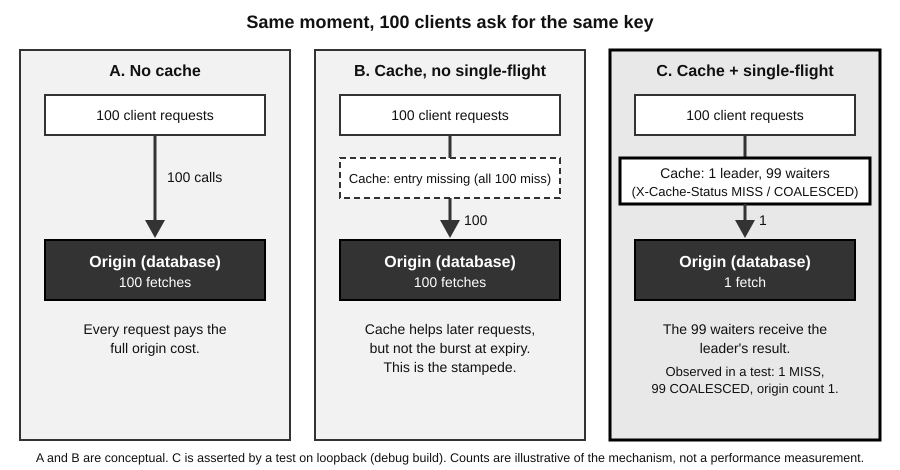

Source: `tests/integration/m1_http_tests.rs::test_m1_t13_barrier_stampede_100_clients` (panel C is what this test asserts). Panels A and B are conceptual and not measured.

**Worked example.** The test above releases 100 clients at a barrier against a mock origin that delays 150 ms. It asserts exactly one `MISS`, 99 `COALESCED`, and an origin request count of 1. A second test, `tests/integration/serving_contract_tests.rs::test_ct9_expiry_herd_coalescing`, expires an entry (100 ms lifetime, checked at +150 ms) and checks that exactly one request initiates the refetch while a concurrent request for the same key waits. (Chapter 4, section 4.4 uses a different, smaller test, `coalesce_tradeoffs_tests::test_negative_effect_head_of_line_blocking` with 10 clients, to show the cost to waiters.)

**Where it lives.** `src/core/cache.rs::PartitionedCache::begin_fetch_atomic` registers the leader or returns a waiter receiver. The shared in-flight state is the struct `SharedOp` in `src/core/coalesce.rs` (waiters are Tokio `oneshot` senders). The HTTP leader and waiter paths are in `src/api/server.rs::get_cache_handler`. A cap on waiters per key exists (`max_waiters_per_key`, default 1,000). Status: IMPLEMENTED, TESTED (loopback, debug build, mock origin). Chapter 4 section on coalescing owns the mechanism in detail.

**Note on a README discrepancy.** The README names a `Coalescer` in `coalesce.rs`. That type is kept for backward compatibility and is created as `_coalescer` (unused) in `src/main.rs`; the serving path uses `SharedOp` and `begin_fetch_atomic`. See the table in section 1.10.

**Trade-offs and limits.** Coalescing is per key: one hundred requests for one key cost one fetch, but one hundred different cold keys still cost one hundred. Waiters inherit the leader's fate: if its fetch fails, every waiter gets the failure. `tests/integration/coalesce_tradeoffs_tests.rs` is named for these trade-offs (head-of-line blocking, error fan-out, waiter fairness).

### 1.3.2 Hot keys

**Simple explanation.** Popularity is lopsided. A few items receive most of the requests, and a cache that is fast on average can still be overwhelmed at one spot.

**Terms.** A **hot key** is a key that receives a disproportionate share of requests. Key popularity in real workloads is often described as **Zipfian**: the most popular key is requested about twice as often as the second, three times as often as the third, and so on. The traffic simulator in `src/sim/traffic.rs` uses a Zipfian key popularity model (stated in the README; the simulator is synthetic).

**How it goes wrong.** PhantomCache splits its map into **shards**, each guarded by its own mutex, so that unrelated keys rarely wait on the same lock (`PartitionedCache::shards: Vec<Mutex<CacheShard>>`; `get_shard_index` hashes the key and masks the result). Sharding spreads many keys across locks. It does not spread one key: all requests for a hot key hash to the same shard and contend for the same mutex. The serving cache is built with 8 shards (`PartitionedCache::new(8)` in `src/main.rs`). See Chapter 4, section 4.2.

**What PhantomCache does about it.** Very little that is specific. The defences are indirect: a hit on a hot key is a cheap lookup, and coalescing stops a hot expired key from producing a herd. Detection is not on the serving path: the metrics response reports `"hot_keys": {"src": "unavailable", "reason": "not_implemented"}` (`src/api/server.rs`, verified). The hot-key emergence detector in `src/intelligence/signals.rs` is PROTOTYPE ONLY (unit-tested, not called by the gateway). `CountMinSketch` in `src/intel/sketch.rs` is referenced only by its own file and `tests/unit/wp2_tests.rs` (grep of `src/`, `tests/`, `benches/`), so it is unused when serving.

### 1.3.3 Stale data

**Simple explanation.** A copy is only a copy. If the original changes, the copy is out of date until someone notices.

**Terms.** **Staleness** is the age or amount by which a served copy lags the origin. A **stale-serving window** is a deliberate choice to serve an expired copy for a limited time, for example while a fresh copy is fetched in the background (**stale-while-revalidate**) or when the origin is failing (**stale-if-error**). **Revalidation** asks the origin "is my copy still current?" cheaply, using a validator such as an `ETag`, and the origin may answer `304 Not Modified`.

**How it works in PhantomCache.** When a client requests a key whose copy has expired, `get_cache_handler` calls `cache.check_stale_serving(&cache_key, now_ms, hard_cap_ms, false)`. If the result is `Eligible`, the gateway serves the expired copy with `X-Cache-Status: STALE`, and may start one bounded background revalidation. `PHANTOM_MAX_STALE_MS` (default 86,400,000 ms, 24 hours) is the hard cap on how long past expiry a copy may be served stale; the code records a counter `stale_cap_violations` that must stay at zero. Status: IMPLEMENTED, TESTED.

::: caution
**Three limits on staleness that are easy to overstate.**

1. The stale cap bounds stale-serving after expiry, not the freshness lifetime. Lifetimes the origin sets through `s-maxage`, `max-age` or `Expires` have no gateway ceiling (`docs/user/limitations.md`).
2. With no freshness headers the default lifetime is a literal 60 seconds. `PHANTOM_DEFAULT_TTL_MS` is validated but NotWired (`src/config.rs`); `src/api/server.rs` passes the literal `60_000` to `evaluate_response_freshness` at two call sites. Setting the variable changes nothing.
3. There is no linearizability or bounded-staleness guarantee across the system. A comment in `delete_cache_handler` says the local-first delete "Guarantees linearizability". That is stronger than anything the project may claim (CLAUDE.md section 4); do not repeat it as a guarantee.
:::

### 1.3.4 Invalidation

**Simple explanation.** When the original changes, someone has to tell every copy. Invalidation is hard because you must reach every copy, in the right order, even when messages are lost, delayed, duplicated or arrive late.

**Terms.** **Invalidation** removes or marks copies as invalid. **Fencing** (in PhantomCache, "generation fencing") makes sure an in-progress fetch that started before an invalidation cannot store its now-outdated result afterwards. **Epoch** is a counter bumped to invalidate many keys at once (all of a tenant's keys, or every key) without visiting each one.

**The race that makes it hard.** Picture this sequence on one gateway:

```
t0  leader starts fetching key K from the origin (origin returns old value V1)
t1  the origin owner changes K to V2 and calls DELETE K on the gateway
t2  DELETE removes K from the cache (nothing to remove yet)
t3  the leader's fetch returns V1 and stores it
    -> K is now stale in the cache although the DELETE already happened
```

The engine is built to prevent this ordering. A fetch records the key's generation when it starts, `delete` bumps it, and `PartitionedCache::finalize_fetch` stores the result only if `state.generation == op_gen` and the tenant and global epochs still match; otherwise it increments `stale_writes_prevented` (verified by reading `finalize_fetch`). Status: IMPLEMENTED, TESTED (`tests/integration/invalidation_contract_tests.rs`, `serving_contract_tests.rs`; not re-run here). Chapter 4, section 4.5 owns the mechanism and records that a stale-body race (G4A-01) is UNDER-INVESTIGATION, with a sandbox proposal that is not integrated.

**Where invalidation becomes a distributed problem.** With one gateway, `DELETE /api/v1/cache/<path>` purges one cache. With several gateways, each has its own copy, so a delete must reach all of them. That is the next section.

::: judge
**JUDGE MAY ASK**

Question: What does caching introduce that you did not have before? What are the costs?

**Suggested answer** (about 30 to 60 seconds spoken, plain English):

A cache gives speed and origin protection, and in return it introduces four problems. Stale data: a copy can lag the origin, so you must decide how stale is acceptable and enforce it. Invalidation: when the origin changes, every copy must be corrected, and that is a race against in-flight fetches. Stampedes: when a popular copy expires, many requests miss together and hit the origin at once. And hot keys: a few popular keys concentrate load on one lock or one node. PhantomCache addresses stampedes with request coalescing and addresses the invalidation race with generation fencing. It bounds stale serving with a configurable cap. It does not eliminate any of these: staleness is still bounded only by the origin's lifetime or a 60-second default, and the cluster invalidation path is experimental.

**If the judge asks further:**

I can add memory pressure as a fifth cost: the cache must evict, and PhantomCache keeps a logical byte budget (`PHANTOM_MAX_CACHE_BYTES`, default 256 MiB) with accounting invariants audited by `audit_bytes()`. A sixth is operational: one more component to run, monitor and secure. Finally, the cache can hide origin problems or amplify an origin failure if a leader's error is shared with many waiters, which the project tests as a trade-off.

**Evidence to know:** `src/core/cache.rs::begin_fetch_atomic`, `::finalize_fetch`, `::delete`; `src/core/coalesce.rs::SharedOp`; `src/config.rs` (`PHANTOM_MAX_STALE_MS`, `PHANTOM_DEFAULT_TTL_MS` NotWired, `PHANTOM_MAX_CACHE_BYTES`); `tests/integration/coalesce_tradeoffs_tests.rs`. Status: IMPLEMENTED, TESTED (loopback, debug); G4A-01 UNDER-INVESTIGATION.
:::

---

## 1.4 Why one cache is not enough: the case for distribution

**Simple explanation.** One shelf in one room has a limit. If the shop grows, you add rooms and shelves. But now two rooms can hold different versions of the same book, and a customer who walks into the wrong room gets the wrong edition.

**Why a single cache node stops being enough.**

1. **Capacity.** One machine has finite memory; a larger working set cannot all be held.
2. **Throughput.** One process has finite CPU cores and network bandwidth.
3. **Availability.** One process is a **single point of failure**: if it stops, the origin takes the whole load at once.
4. **Locality.** Callers far away are served faster by a nearby cache.

**What "distributed" means here.** A **distributed cache** is a cache made of several cooperating nodes (processes, often on different machines). Two designs are worth separating, because the difference decides what the product can honestly claim.

| Design | Reads | Writes and invalidation | What it gives |
|---|---|---|---|
| **Independent caches with a shared invalidation bus** | Each node serves from its own copies | A purge is sent to every node | Availability and throughput scale with nodes. Capacity does not pool: every node may hold the same hot items. Origin load can multiply with the number of nodes. |
| **Partitioned (sharded) cache with coordinated reads** | A key has an owner node. A read for key K is routed to its owner (or a peer fetches from it). | Only the owner (and any replicas) must be invalidated | Capacity pools. Each key is fetched from the origin once cluster-wide, in the best case. Needs a read protocol and a consistency contract. |

**The honest position of PhantomCache.** PhantomCache is **N independent caches with an invalidation bus**, in an experimental form. It has some pieces needed for the second design but not the second design itself. Verified in the current tree (Chapter 5 owns the detail):

- **GET is served from the local cache only.** `get_cache_handler` looks only at its own `PartitionedCache` and never asks a peer. The router (`state.router`) is used only in `delete_cache_handler`. Status: IMPLEMENTED as described. Peer reads: NOT IMPLEMENTED. The cluster `GetRequest` handler in `src/dist/node.rs` is a stub (DR-029), and `src/dist/router.rs::forward_key_over_tcp` has no caller in `src/`.
- **DELETE does fan out.** The gateway purges its own cache first, then calls `router.invalidate_key_across_cluster(&canonical_key, InvalidationScope::ExactKey)`. The primary chosen by rendezvous hashing must acknowledge within a short leg (default 150 ms, `PHANTOM_CLUSTER_TIMEOUT_MS`). Every other active member is told asynchronously; a repair worker and an anti-entropy worker (250 ms period, started in `src/main.rs`) re-deliver. So a `204` means the local purge plus the routed primary's acknowledgement, nothing more. Status: IMPLEMENTED, TESTED on loopback, debug build, Windows.
- **Rendezvous weights are constant.** In `route_key` the weight is `hash_val as f64 * capacity_weight` with `capacity_weight = 1.0`, so this is plain rendezvous hashing, used only for DELETE. The hash is `DefaultHasher`, which is not guaranteed stable across Rust versions. Status: IMPLEMENTED, weights unused.
- **Membership is static.** Nodes are read once from a members file at start-up. No join, leave or gossip. Dynamic membership: NOT IMPLEMENTED.
- **Owed invalidations live only in memory** of the issuing gateway and are lost if it crashes before delivery. Reproduced (see `docs/research/m3_durability/`); the patch exists only in a sandbox. Durability: NOT IMPLEMENTED; patch PROTOTYPE ONLY, not integrated, needs independent review and owner approval.
- **Each node has its own byte budget and origin cap.** Capacity does not pool.
- **No physical multi-host run exists.** Cluster tests run on loopback, debug, Windows, mostly three nodes. UNVERIFIED beyond that.

::: example
**A concrete cost of independent caches.** Suppose three gateways each cache `/price/42` and the origin changes. A client calls `DELETE /api/v1/cache/price/42` on gateway 1. Gateway 1 purges its own copy and gets the primary's acknowledgement, then returns 204. If gateway 3 was unreachable at that moment, it still holds the old copy. The repair worker retries while gateway 1 stays alive. If gateway 1 crashes first, gateway 3 keeps serving the old value until the entry expires (the origin's lifetime, or 60 seconds if none was given). So a 204 does not prove the object is gone everywhere. `docs/user/limitations.md` ("Cluster invalidation durability") says exactly this, and tells operators to use a short `s-maxage` for deletion-critical content.
:::

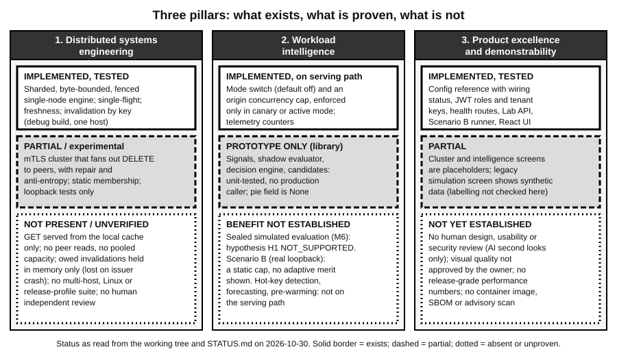

Source: `docs/STATUS.md`, `docs/research/vision/product_vision_vs_implementation_audit.md`, `docs/user/limitations.md`, `src/main.rs`, `src/api/server.rs`, `src/dist/router.rs`, `src/intelligence/executor.rs`, `docs/research/m6_sealed_results.md`, `ui/src/App.jsx`.

**Trade-offs and alternatives.** The repository records an owner preference for "a trustworthy single-node foundation first" and "do not delete or discard existing distributed code" (quoted in `product_vision_vs_implementation_audit.md`; I read the quotation there, not the session transcript). The partitioned design with coordinated reads was deferred. The original rationale for "distributed" is unrecoverable. So the reasons in this section are our reasoning, not a recorded decision, except where the audit quotes the owner.

**What can go wrong with distribution.** Messages are lost or delayed; nodes crash or are partitioned; two nodes can briefly hold different values for one key; an operator may mistake "a 204 came back" for "the object is gone everywhere". Chapter 5, section 5.6 gives the failure model.

::: judge
**JUDGE MAY ASK**

Question: Why do you need a distributed cache rather than one big cache node?

**Suggested answer** (about 30 to 60 seconds spoken, plain English):

One node has a ceiling on memory, on CPU and on network, and it is a single point of failure. If it dies, the origin takes the full load at once. Running several gateways raises throughput and keeps the service up when one fails. The price is that you now need a way to keep their copies consistent. In PhantomCache today the main distributed feature is reliable invalidation: when a key is deleted, the delete is sent to every node, with retries and anti-entropy. Reads are not distributed: each gateway serves from its own cache. So I would describe it honestly as a set of independent gateways with a shared invalidation bus, not as a pooled cache. Capacity does not add up across nodes, and the origin can see up to N times the load of one node.

**If the judge asks further:**

The stronger design, a partitioned cache where each key has one owner and reads are routed to it, is a gated goal, not a delivered feature. The routing hash exists but weights are constant and it is used only for deletes. The cluster is static in membership, tested on loopback only, and owed invalidations are lost if the issuing node crashes. I would not claim the cluster is production-ready. It is labelled experimental in `README.md` and in the startup message in `src/main.rs`.

**Evidence to know:** `src/api/server.rs::get_cache_handler` (local only) and `::delete_cache_handler` (`invalidate_key_across_cluster`); `src/dist/router.rs::route_key` (weight `1.0`); `src/main.rs` (static members file, `start_anti_entropy_worker`, "[EXPERIMENTAL] Cluster mode" message); `docs/user/limitations.md`; `docs/research/vision/product_vision_vs_implementation_audit.md` section 5. Status: invalidation fan-out IMPLEMENTED, TESTED (loopback, debug); peer reads NOT IMPLEMENTED; durability NOT IMPLEMENTED.
:::

---

## 1.5 What PhantomCache is, in one minute

::: judge
**JUDGE MAY ASK**

Question: In one minute, what is PhantomCache?

**Suggested answer** (about 30 to 60 seconds spoken, plain English):

PhantomCache is an in-memory HTTP caching gateway written in Rust. It sits between clients and an origin server, answers repeat requests from memory, and sends only one request to the origin when many clients ask for the same missing item at once. That single-flight coalescing is the core protection against cache stampedes. It also bounds how long expired data can be served, tracks bytes against a memory budget, keeps tenants' keys separate, and supports authenticated delete. It can run as several gateways that send each other invalidations over mutually authenticated TLS. On top there is an experimental layer that observes traffic and can cap origin concurrency, and a lab for running reproducible experiments. It is a research prototype. I can show tests for the cache engine and the invalidation path. I cannot show release-grade performance numbers, a multi-host run, or a measured benefit from the adaptive layer; the one controlled evaluation we ran found no benefit from it.

**If the judge asks further:**

The three goals are distributed systems engineering, workload intelligence, and a product that can demonstrate and explain itself. The first is partly delivered (a correct single-node engine, an experimental invalidation cluster). The second is mostly a library plus an origin cap, with a negative evaluation result kept on the record. The third is a lab and dashboard with honest labels, but without human design or security review.

**Evidence to know:** `README.md` opening and section 2; `docs/STATUS.md` sections 1 to 4; `docs/user/limitations.md`; `docs/research/m6_sealed_results.md`. Status: summary of IMPLEMENTED/TESTED engine, PARTIAL cluster, PROTOTYPE ONLY intelligence. Nothing is INDEPENDENTLY VERIFIED by a human.
:::

The README's first paragraph now reads: "An in-memory caching gateway and request coalescing engine (research prototype) ... Distributed operation is experimental." Section 1.10 explains how the wording changed.

---

## 1.6 Pillar 1: Distributed systems engineering

**What the pillar aims at.** A deterministic, memory-bounded, correctness-first cache engine, plus a cluster whose failure behaviour is written down with a failure model, a bound, and a test that could prove it wrong. Reliable invalidation comes first; coordinated reads and cluster-wide capacity are later, evidence-gated goals. Source: `docs/research/vision/phantomcache_three_pillar_product_direction.md`, itself a PROPOSAL, not an approved definition.

**What exists, by level.**

| Level | Capability | Status | Where | What the evidence does and does not show |
|---|---|---|---|---|
| A. Single node | Sharded map, per-shard mutex, byte budget, eviction behind a trait (SIEVE default, LRU, S3-FIFO selectable) | IMPLEMENTED, TESTED | `src/core/cache.rs::PartitionedCache`, `CacheShard::new` (Sieve), `src/core/eviction.rs` | Unit and integration tests pass in a debug build. Not measured on a release build; no soak run. |
| A. Single node | Single-flight coalescing | IMPLEMENTED, TESTED | `begin_fetch_atomic`, `SharedOp` | 100-client barrier test, one origin fetch. Loopback only. |
| A. Single node | Generation and epoch fencing, byte-accounting invariants | IMPLEMENTED, TESTED | `finalize_fetch`, `delete`, `audit_bytes()` | Code-reading reviews by AI only. G4A-01 (a stale-body race) UNDER-INVESTIGATION. |
| A. Single node | HTTP freshness (RFC 9111 subset), stale cap | IMPLEMENTED, TESTED | `src/core/freshness.rs` | Default TTL setting NOT WIRED; no ceiling on origin-set lifetimes. |
| B. Multi-node foundation | mTLS identity, framing, pooled connections, static membership | IMPLEMENTED, TESTED | `src/security/cluster.rs`, `src/dist/frame.rs`, `pool.rs`, `src/main.rs` | Loopback, debug, Windows. Identity-only authorisation. No certificate rotation. |
| B. Multi-node foundation | Key invalidation fan-out, repair ledger, anti-entropy worker | IMPLEMENTED, TESTED (loopback, debug build, at most four nodes); labelled EXPERIMENTAL in `main.rs`; effectiveness UNVERIFIED | `src/dist/router.rs`, `anti_entropy.rs`, `node.rs` | Claim of zero stale after 50 ms is recorded as unsupported (claims ledger C6). |
| B. Multi-node foundation | Durable invalidation (survives issuer crash) | NOT IMPLEMENTED in the tree; patch PROTOTYPE ONLY in `docs/research/m3_durability/` | n/a | Defect reproduced by the patch author, not independently. |
| C. Coordinated reads | Peer reads, pooled capacity, stable placement | NOT IMPLEMENTED (DESIGNED BUT NOT IMPLEMENTED as a goal) | cluster `GetRequest` handler is a stub | `docs/research/vision/` marks this a gated goal. |
| D. Intelligent distribution | Cluster-aware intelligence, coordinated pre-warming | NOT IMPLEMENTED | no file under `src/intelligence/` or `src/intel/` mentions a router or peer (reported by the audit) | n/a |

**Not yet proven for this pillar.** Release-profile behaviour; Linux; any run on more than one physical machine; any staleness bound across nodes; effectiveness of anti-entropy; durability of owed invalidations; human or external review.

**Tests that matter, and what they do not prove.** The last recorded full run (`docs/STATUS.md` section 3, reported, not re-run here; why 242, 851 and the grep counts differ is explained once in Chapter 8, section 8.2.2) is `cargo test --tests -j 1 --no-fail-fast`, debug profile: 75 targets, 851 passed, 0 failed, 8 ignored, on 2026-10-30. `CLAUDE.md` and `README.md` still quote an older 242 tests in 19 targets. A passing test shows that an author's expectation held in that build on that host, not that the expectation was right. Several tests assert the behaviour of known stubs (`tests/integration/known_gaps.rs`).

---

## 1.7 Pillar 2: Workload intelligence

**What the pillar aims at.** A layer that observes traffic, explains it, and adapts policy only where it measurably beats strong static settings. The hard caps (staleness cap, origin cap, byte budget, fencing) stay authoritative: intelligence may propose, the engine disposes. A negative result stays on the record. Same proposal document; `CLAUDE.md` section 6b makes "Phantom Intelligence" a required milestone (M5).

**A caution about the word "intelligence".** Here it does not mean machine learning. It means measured signals and simple control rules (for example additive-increase multiplicative-decrease, the family of rule TCP uses to adjust its sending rate). Chapter 5 explains the algorithms; this chapter asks only how much of it runs when a request arrives.

**What runs on the serving path today (IMPLEMENTED).**

- The mode switch `PHANTOM_INTELLIGENCE` with five values: off, observe, advisory, canary, active. The default is `off` (`src/config.rs`; `IntelligenceMode` derives `Default` with `Off` in `src/intelligence/mod.rs`).
- An **origin concurrency gate**: a counter that limits how many origin fetches may be in flight at once. It is a static cap or, optionally, an adaptive cap. It is **enforced only in canary or active mode and only when a cap is configured** (`src/intelligence/executor.rs::origin_cap_enforcing`: "In Off, Observe and Advisory the origin path is uncapped"). Callers that cannot get a permit receive HTTP 503 with `X-Cache-Error: CapacityExceeded` (`map_origin_error_to_response`). Coalesced waiters do not consume permits (`tests/integration/origin_cap_tests.rs::coalesced_waiters_do_not_consume_permits`).
- Telemetry counters and a latency histogram under `src/intel/`, and two read routes, `/api/v1/intelligence/status` and `/api/v1/intelligence/audit`. The audit store has no producer in the serving path, so it serves an empty store (reported by the proposal document; I confirmed the routes exist in `create_app_with_lab` but did not trace the producer search).

**What is only a library (PROTOTYPE ONLY).** The signal pipeline, the shadow evaluator, the decision engine `PieDecisionEngine` and the candidate policies in `src/intelligence/`. They are unit-tested, used by the lab, and not called by the gateway. In `src/main.rs` the field `pie` of the shared state is `None`. The older `src/control/pie.rs` is a threshold stub that `CLAUDE.md` says not to extend or present as a working controller.

**What has been tested about its benefit, and the result.**

- **Sealed M6 evaluation (Tier 1, SIMULATED).** Hypothesis H1 (an origin-aware adaptive controller beats the best static configuration) was recorded as NOT_SUPPORTED on 30 sealed seeds. The adaptive arm was credibly worse on peak origin concurrency in 7 of 8 scenarios, and the unconstrained tuning optimum was itself a static cap. Source: `docs/research/m6_sealed_results.md`. This is a simulation driving the real cache code. It is not a measurement of any host.
- **Scenario B (Tier T2, real gateway process on loopback).** Both capped arms were mechanically labelled `TRADE_OFF_FAILURE`. The binding notice `docs/demo/scenario_b_interpretation_notice.md` states that the nominal adaptive arm fell to roughly a static cap of 12 and so "does not demonstrate adaptive-controller effectiveness or ineffectiveness". It also lists what is not established (multi-host behaviour, origin-p99 benefit, served-client latency improvement and more). The retained run is `lab-results/scenario_b/20261030T003932Z/`; the raw files were not opened for this chapter. Chapter 7 owns both results.

**What this means.** `docs/STATUS.md`: the result "does not show that intelligent caching is not viable; it shows that this controller, on these plants, gave no benefit over a static cap." The research lead's provisional decision (`m6_sealed_results.md`, MVP-B) is that the most defensible product is the static gateway with a configurable static origin cap. The rest of this pillar is research direction.

**Not yet proven for this pillar.** Any benefit of adaptation over a strong static baseline; accuracy of the signal detectors; any hot-key detection, forecasting or pre-warming on the serving path; any real multi-host intelligence.

::: judge
**JUDGE MAY ASK**

Question: What is the actual intelligence in PhantomCache? Is it AI?

**Suggested answer** (about 30 to 60 seconds spoken, plain English):

It is not machine learning, and I would not call it AI. The word covers three things. First, telemetry: counters and a latency histogram. Second, a library of statistical signals and a decision engine that can compare a candidate policy against a baseline in a shadow evaluation, written for experiments. Third, one control rule on the live path: an origin-concurrency cap that is off unless you turn on the canary or active mode and configure a cap. The cap can be fixed or adjust itself with an additive-increase, multiplicative-decrease rule. When we tested whether the adaptive version beats the best fixed cap, in a pre-registered, sealed simulation, it did not: the hypothesis was not supported. So the honest answer is that the useful, working part today is a static origin cap, and the adaptive research is a prepared lab, not a proven feature.

**If the judge asks further:**

The decision to publish a negative result rather than tune until it passed is deliberate. The sealed run was executed once. Its limits are stated: it is a simulation, it covers one workload set, and the performance endpoint is quantised. It does not show adaptation can never help. The project's rules also require that intelligence never override the hard caps: the staleness cap, the origin cap, the byte budget and the fencing rules are enforced in the execution layer regardless of any decision.

**Evidence to know:** `src/intelligence/mod.rs::IntelligenceMode`, `src/intelligence/executor.rs::origin_cap_enforcing`, `src/main.rs` (`pie: None`), `docs/research/m6_sealed_results.md`, `docs/demo/scenario_b_interpretation_notice.md`, `CLAUDE.md` section 6b. Status: origin gate IMPLEMENTED, TESTED; decision engine PROTOTYPE ONLY; adaptive benefit NOT ESTABLISHED (H1 NOT_SUPPORTED, simulated).
:::

---

## 1.8 Pillar 3: Product excellence, observability and demonstrability

**What the pillar aims at.** A product that can be operated, shown and checked by someone who does not trust the author. Every value on screen should be labelled as measured, simulated, inferred or unavailable (CLAUDE.md section 4). The Phantom Lab should let a reviewer re-run an experiment. Security should be a visible capability, not a footnote.

**What exists (IMPLEMENTED unless noted).**

- A **configuration reference** with a wiring status per key (`src/config.rs`) and a `--check-config` mode (`docs/user/run.md`); it marks `PHANTOM_DEFAULT_TTL_MS` as `NotWired`. Status: IMPLEMENTED, TESTED (`tests/integration/m7_config_tests.rs`).
- **Authentication and tenant keys.** JWT role checks (`cache:read`, `cache:invalidate`, `telemetry:read`, `scenario:operate`, `admin`) and a tenant claim that namespaces keys; in secure mode a client-supplied `x-tenant-id` is ignored. Status: IMPLEMENTED, TESTED; SEC-M7-09/10/11 are open in `docs/STATUS.md`. Chapter 6 owns this.
- **Health routes** (`src/health.rs`, merged in `create_app_with_lab`) and **metrics and diagnostics routes**. No Prometheus `/metrics` export (`limitations.md`).
- **The Phantom Lab.** A deterministic simulator driving the real cache (`src/lab/`, run by `src/bin/phantom-lab.rs`, tier SIMULATED), a real-gateway loopback runner for Scenario B (`src/lab_live/`, tier `MEASURED_LOOPBACK`), and a Lab HTTP API (`src/api/lab_api.rs`, schema `lab-1`). Chapter 7 owns this.
- **A React dashboard** (`ui/src/`). `ui/src/App.jsx` routes to Traffic, Cache and Memory, Freshness, Origin, Lab and Simulation screens; the Cluster and Intelligence screens are placeholders (`renderScreen` returns `<Placeholder />`). `docs/STATUS.md` recorded 298 UI tests earlier on 2026-10-30; the current count and its source are in Chapter 8, section 8.2.2 (483 on the last run). Contrast and accessibility lint checks and a Vite build were recorded as passing. Status: IMPLEMENTED, TESTED (static and server-render checks).

**Truth about demo data.** With `PHANTOM_SIMULATION=true`, parts of the live event stream are synthetic; the configuration check warns that "dashboard values it generates are SIMULATED, not measured" (`src/config.rs`). The three demo `VirtualNode` objects in `src/main.rs` and the `/api/control` `NODE_FAILURE` flag are logical simulation, not a failed process. The honest-label rule exists because an earlier dashboard mixed real and synthetic values.

**Not yet proven for this pillar.** Human design review, usability testing, accessibility review by people or screen readers; visual quality is not approved by the owner (O8-2 OPEN in STATUS); no container image, SBOM, dependency advisory scan or code signing (`limitations.md` "Not provided"); no evidence-bundle signing; the G3 gate verdict (UI plus browser verification) is not recorded; every "independent" review so far is an AI second look.

---

## 1.9 Intended users and practical use cases

The following are use cases the design is aimed at, with what the evidence supports. They are not customer claims: the repository does not record any production user.

| Use case | Why a gateway cache helps | What is true today |
|---|---|---|
| Read-heavy API in front of a database that is the scarce resource | Repeats are answered from memory; misses are coalesced | Core behaviour IMPLEMENTED, TESTED against mock and scripted origins |
| Flash crowd on a few popular items (a product launch, a news item) | One fetch per key instead of N | Coalescing TESTED (100 clients, one origin fetch). Per key only. |
| Multi-tenant API where tenants must not read each other's cached data | Tenant is part of the cache key | IMPLEMENTED in secure mode; development mode trusts a header. Quotas and fairness between tenants NOT IMPLEMENTED. |
| Several gateways behind a load balancer, where deletes must reach all | Authenticated invalidation fan-out | PARTIAL: experimental, loopback only; no load-balancer integration in the repository |
| Operators who want to protect an origin during overload | Static origin concurrency cap | IMPLEMENTED, TESTED; effect measured only on loopback with a scripted origin |
| Researchers comparing caching policies reproducibly | Deterministic lab, sealed evaluation | IMPLEMENTED; results are simulated and negative for the adaptive controller |

**Who it is not for (today).** Anyone needing a distributed key-value store with shared capacity, strong consistency, persistence, or a managed production service. The project says it is "not a distributed database" (`docs/handoff/01_PROJECT_MASTER_CONTEXT.md`, agent-authored; quoted via the audit).

---

## 1.10 How the vision and the code relate (and where documents disagree)

The vision documents describe more than the code does, and some older documents describe things the code no longer does. A judge may probe this. Know the shape of it.

1. **The original idea was a distributed cache.** The first published README called it "an intelligent in-memory distributed cache", but the cluster was a modelled three-node simulation (about 117 lines in `src/dist` at that commit, per the audit). The reasoning behind "distributed" is not recoverable from the repository.
2. **Sequencing was an owner decision:** single-node first, keep the distributed code (audit section 4).
3. **Positioning drifted.** Agent-written definitions (MVP as a "single-binary gateway", a conditional distributed gate, an accepted ADR with no recorded owner ratification) narrowed the story. The audit concludes this was mostly unintended dilution and says there is no evidence of abandonment: "evidence gaps, not conclusions".
4. **Older handoff documents overstate.** `docs/handoff/00_START_HERE.md` still says "Phase 4 Remediated, Verified, and Formally Accepted (242/242 tests passing)" and describes "64-Partition Lock Striping". The notice at the top points to `docs/handoff/CORRECTIONS.md`, and `CLAUDE.md` section 6 says the "Phase 4 accepted / zero P0" claim is not supported. In the code the serving cache is built with 8 shards (`src/main.rs`).

**Discrepancies between documents and the current code, collected.**

| Document says | Code or later record says | Source of the correction |
|---|---|---|
| README: single-flight is the `Coalescer` in `coalesce.rs` | Serving path uses `SharedOp` plus `PartitionedCache::begin_fetch_atomic`; `_coalescer` in `main.rs` is unused | `src/main.rs`, `src/core/cache.rs` |
| README mermaid: requests go through the rendezvous router to a primary node, then to the coalescer | GET never uses the router; it is used for DELETE | `src/api/server.rs::get_cache_handler`, `::delete_cache_handler` |
| README table: "Cluster Topology & Nodes: Modeled / Simulated" | Partly outdated: with mTLS config the local node shares the serving cache and peers are real addresses; the three demo nodes remain simulation | `src/main.rs` cluster branch |
| Handoff: 64 partitions | 8 shards in `main.rs` | `PartitionedCache::new(8)` |
| Handoff and CLAUDE.md/README: 242 tests, 19 targets | 851 passed, 75 targets (debug, 2026-10-30) | `docs/STATUS.md` section 3 |
| Handoff: "adaptive Policy Inference Engine (PIE) monitoring access skew" | `pie: None`; adaptive benefit not established | `src/main.rs`, `m6_sealed_results.md` |
| CLAUDE.md section 6 (part): peer invalidations purge a side cache | Outdated for mTLS cluster mode: shares the serving cache | CLAUDE.md's own bracketed note; `src/main.rs` |
| CLAUDE.md section 6: "evictors named SIEVE/S3-FIFO/LRU are scans" | Outdated; faithful implementations exist (Chapter 4 verifies complexity) | three-pillar document; `src/core/eviction.rs` |
| Code comment: local-first delete "Guarantees linearizability" | The project must not claim linearizability | `src/api/server.rs::delete_cache_handler`, CLAUDE.md section 4 |
| STATUS.md section 3b/6: HEAD `456bb25` | At the time of writing HEAD is `df68eaa`, after documentation commits | `git rev-parse HEAD` on 2026-10-30 |

---

## 1.11 Where to look for the truth

When two documents disagree, trust in this order: (1) the code and a test you can run; (2) `docs/STATUS.md` and the records it points to (the progress ledger, claims ledger, verification register); (3) `docs/user/limitations.md`; (4) older handoff and README text. `CLAUDE.md` is binding for how agents work, but its section 6 carries bracketed corrections that you should read with it. The G4 Cycle 1 review found 99 findings (26 core, 38 distributed/security/API, 35 lab/intelligence/dependencies). Their dispositions in `docs/release/g4/cycle1_findings_disposition_register.md` are: 75 OPEN (of which 6 are owner-named: G4B-01, -03, -05, -06, -07, -08), 20 RECORDED-LIMITATION, 2 IN-SANDBOX-REMEDIATION, 1 UNDER-INVESTIGATION (G4A-01) and 1 REFUTED. Sandbox patches (U-01, the G4A-01 proposal, M3 durability) are not integrated into the tree. The findings are AI second looks, read-only, with no tests run, so "CONFIRMED" in them means confirmed by reading.

::: judge
**JUDGE MAY ASK**

Question: Your tests pass. Does that mean the system is correct and ready?

**Suggested answer** (about 30 to 60 seconds spoken, plain English):

No. The tests are evidence, not proof. The last full recorded run is 851 passing tests in a debug build on one Windows machine. That tells me the behaviours the authors thought to check hold in that setting. It does not tell me about release builds, Linux, several physical machines, or sustained load. Some tests assert the behaviour of known stubs. Every review so far is an AI second look, not a human review. The project's own status page says that nothing has been formally accepted by the owner, and that a set of review findings are still open. So I describe it as a research prototype with a tested core and an experimental cluster, and I list what is not yet shown.

**If the judge asks further:**

I can point to the specific open items: the reproduced loss of owed invalidations when the issuing node crashes, any member of the cluster being able to send tenant-wide purges, the unwired default TTL, and the absence of a release-profile suite. I can also say what I would test next: a release-profile run with repetitions on a stated host, and a multi-host run.

**Evidence to know:** `docs/STATUS.md` sections 1 to 3b; `docs/release/g4/cycle1_findings_disposition_register.md`; `docs/user/limitations.md`. Status: IMPLEMENTED, TESTED (debug, loopback); INDEPENDENTLY VERIFIED: none.
:::


## Key ideas to remember

- A cache is judged by what it does to the origin: origin load equals the miss rate times the request rate, so small drops in hit ratio are large rises in origin pressure.
- Caching introduces four standing problems: stampedes, hot keys, stale data, invalidation. Name all four and what PhantomCache does about each.
- PhantomCache's strongest real mechanism is per-key single-flight coalescing with generation fencing on a sharded, byte-bounded cache (IMPLEMENTED, TESTED, debug build, loopback).
- The cluster is a set of independent gateway caches with a shared invalidation bus. GET is local only. It is experimental.
- "Intelligence" here means telemetry plus control rules, not machine learning, and the only adaptive controller tested showed no benefit over a static cap.
- Always give the status label and the environment (debug, loopback, simulated) with a claim, and never convert a design document into a delivered capability.

## What you should now understand

- The words hit, miss, hit ratio, latency, throughput, origin load, TTL, stale, invalidation and what each means for PhantomCache.
- Why a stampede happens and how single-flight stops it, including its per-key limit.
- Why sharding helps many keys but not one hot key.
- What `X-Cache-Status` values mean and where in the code each is produced.
- Why one node is not enough, why distribution brings consistency problems, and what a 204 from DELETE does and does not prove in a cluster.
- The status of each pillar, and the evidence (and the lack of it) behind each.
- Which older documents are out of date and where to find the current truth.

## Knowledge check

1. A service gets 8,000 requests per second with a 90% hit ratio. How many requests per second reach the origin? What if the hit ratio drops to 85%?
2. Explain the difference between a cache stampede and a hot key. Which does single-flight address?
3. In PhantomCache, what makes two requests "the same key"? Name two request differences that produce different keys.
4. A DELETE returns 204 in a three-gateway cluster. List what has definitely happened and what has not.
5. What does `PHANTOM_MAX_STALE_MS` bound, and what does it not bound?
6. Why does setting `PHANTOM_DEFAULT_TTL_MS` not change behaviour today?
7. Which pillar-2 component runs on the serving path, in which modes, and what does the sealed evaluation say about the adaptive version?
8. A judge says "your cluster pools memory across nodes". Respond.
9. Why is "851 tests passed" not the same as "the system is correct"? Give three reasons.

::: answers
**Answers.**

1. Origin load = (1 - hit ratio) x rate. At 90%: 0.10 x 8,000 = 800 per second. At 85%: 0.15 x 8,000 = 1,200 per second, a 50% increase from a five-point drop.
2. A stampede is many simultaneous misses on one key (usually at expiry). A hot key is one key receiving a disproportionate share of all requests, which concentrates load on one lock or node. Single-flight addresses the stampede. It helps a hot key only indirectly, by avoiding refetch herds; it does not remove lock contention on the shard.
3. The key is tenant plus path plus query string (`CacheKey`). Different tenant, different path, or different query string gives a different key.
4. Done: the gateway purged its own copy and the canonical primary (or acting primary) acknowledged within about 150 ms. Not guaranteed: that every other node has applied it. The others are updated asynchronously with retries, only while the issuing gateway stays alive. If it crashes first, a peer may serve the old copy until it expires.
5. It bounds how long an expired entry may be served stale. It does not bound the freshness lifetime that the origin sets through `s-maxage`, `max-age` or `Expires`.
6. The key is validated and reported but not read at runtime. `src/api/server.rs` passes a literal `60_000` ms to the freshness engine, so the effective default is always 60 seconds.
7. The origin concurrency gate (a counter with a static or adaptive cap), enforced only in canary or active mode with a cap configured. The sealed simulated evaluation found hypothesis H1 (adaptive beats the best static cap) not supported; Scenario B showed no demonstrated adaptive merit.
8. It does not. Each gateway has its own byte budget and cache, GET is served locally, and peers do not read each other's entries. Capacity does not pool, and the origin may see up to N times the load of one node. Pooled capacity needs coordinated reads, which is a gated goal and not implemented.
9. Any three of: debug build only; one host (Windows, loopback); tests were written by the same project and some assert stub behaviour; no human review; no release-profile suite; open findings remain; passing tests show expected behaviour held, not that the expectation was right.
:::

## Codebase exploration tasks

1. **Trace one GET.** Start at `src/api/server.rs`, function `get_cache_handler`. Find (a) where authentication happens, (b) where the key is built, (c) where `STALE`, `HIT`, `COALESCED` and `MISS` are produced, (d) where the origin permit is acquired. You should learn the order of checks, and that the bypass branch returns before the cache is consulted.
2. **Find the local-only GET.** Open `delete_cache_handler` and search `src/api/server.rs` for `state.router`. Then open `get_cache_handler` and confirm it never touches a router. In `src/dist/router.rs`, read `route_key` and find `capacity_weight`. You should learn why reads are not distributed and why "weighted" rendezvous hashing currently has constant weights.
3. **Check the unwired setting.** In `src/config.rs` find the `PHANTOM_DEFAULT_TTL_MS` entry and its `Wiring` value. Then find the two `60_000` literals in `src/api/server.rs`. You should learn how the config reference exposes documentation drift and why "documented default" and "effective setting" differ.

## Challenge questions

1. **A flash crowd of 5,000 requests per second hits 1,000 different cold keys at once, on three gateways that each serve their own GET. Estimate the worst-case origin load, and say what single-flight does and does not fix.**
   *Model answer.* Single-flight is per key per gateway. In the worst case each gateway fetches each key once, so up to 3 x 1,000 = 3,000 origin fetches, not 1,000, because peers do not share fills and each node has its own cache. Within one gateway, repeats of the same key coalesce. The distinct keys are not coalesced at all. The only live protection for the remainder is the origin concurrency cap (enforced in canary or active mode only), which sheds load by rejecting requests rather than reducing it. A design that routes each key's reads to one owner would cut the worst case to about 1,000, but that is the coordinated-read design, which is not implemented.

2. **You are asked to guarantee that a revoked document disappears from every gateway within one second. What can the current system promise, what can it not, and what would you change first?**
   *Model answer.* It can promise that the issuing gateway has purged its own copy and that the canonical primary acknowledged within the 150 ms leg. It cannot promise delivery to every node: delivery to the rest is asynchronous, and owed invalidations are held only in the memory of the issuer, so a crash loses them. There is no cross-node staleness bound beyond the entry's lifetime (origin-set, with no gateway ceiling, or 60 s by default). The first change I would make is operational: have the origin send a short `s-maxage` for such documents (documented advice in `limitations.md`). Engineering-wise, the durable owed-invalidation log in `docs/research/m3_durability/` addresses the crash case, but it needs independent review and owner approval, and a gateway-side lifetime ceiling would put a hard bound on the remaining case. Any one-second claim would also need a stated failure model, a measured propagation bound with repetitions on more than one host, and a test designed to break it.

# Chapter 2: System Architecture

> Reading rules for this chapter. Every capability claim carries a status label (IMPLEMENTED, TESTED, PARTIAL, PROTOTYPE ONLY, DESIGNED BUT NOT IMPLEMENTED, UNVERIFIED). "TESTED" means a named test exercises the behaviour, and the text says what the test does not prove. Nothing here is INDEPENDENTLY VERIFIED; every review so far is an AI second look. Code was read in the working tree on 2026-10-30 (branch `feat/publish-phantomcache-core`; at the time of writing HEAD is `df68eaa`; most work is uncommitted). Where an older document disagrees with the code, the code wins and the disagreement is listed in section 2.11.

## What you will learn

- What processes and binaries exist, which ports they use, and the component map of the gateway with each part's responsibility.
- The real HTTP routes, who may call them, and what each one does.
- Step by step what happens on a cache hit, on a miss with coalescing, when the origin fails, and on a DELETE in a cluster.
- How the nodes talk to each other, what the cluster does and does not do, and where Phantom Lab and the UI sit.
- The real configuration keys with defaults and wiring status, and what "deployment" honestly means today (plus a one-page map of the auth boundaries).

## 2.1 Two viewpoints

### 2.1.1 The external user's view

Simple explanation. To a user, PhantomCache is a web address you put in front of your own data service. You ask the gateway for a page. If the gateway already holds a fresh copy, it answers at once. If not, it asks your data service (the "origin"), keeps a copy for next time, and answers. You can also tell the gateway to forget a page.

Terms. The **gateway** is the PhantomCache process. The **origin** is your system of record, set by `ORIGIN_URL`. A **hit** is an answer from memory. A **miss** needs the origin. The response header `X-Cache-Status` tells the caller which happened.

What the user sees (all IMPLEMENTED; routes in section 2.3, header values in section 2.3.3):

- `GET /api/v1/cache/<path>?<query>` returns the origin's body with `X-Cache-Status`, `Age` and, when the origin sent one, `ETag`.
- `DELETE /api/v1/cache/<path>?<query>` removes that one key and returns `204`.
- Failures carry an `X-Cache-Error` header with a short code.
- A browser UI (React, separate dev server) shows telemetry and a "Phantom Lab" for experiments. It is not needed to use the cache.

The cache stores only what a `GET` on the origin returned. There is no write API. To change cached data, change the origin and then `DELETE` the key, or wait for the entry to expire.

### 2.1.2 The internal engineer's view

The engineer sees one Rust binary, `phantom-cache-demo`, built from `src/main.rs`, plus a second binary, `phantom-lab`, built from `src/bin/phantom-lab.rs` (`Cargo.toml`, the single `[[bin]]` entry, plus the default binary from `src/main.rs`). The gateway is a Tokio multi-thread runtime (`tokio::runtime::Builder::new_multi_thread` in `main::real_main`) running an Axum router. State lives in one `PartitionedCache` (8 shards, each a `std::sync::Mutex`), plus optional cluster machinery in `src/dist/`.

Two facts surprise newcomers.

1. `src/main.rs` does not use the library crate for its own modules. It re-declares the module tree (`pub mod core { pub mod cache; ... }` and so on, lines 1 to 56) so that the binary compiles its own copy of the same files that `src/lib.rs` also registers. Tests for the library and for the binary therefore compile the code twice. (verified in code)
2. The gateway has two configuration paths. `src/config.rs` validates everything and `main` applies some keys directly; other keys are still read from the environment by `src/api/server.rs`, `src/dist/router.rs` and `src/security/cluster.rs`, so `main` exports validated values back into the environment before the runtime starts (`cfg.env_exports()`, `std::env::set_var` in `main::real_main`). Section 2.9 lists which is which.

### 2.1.3 What runs where

| Thing | Process | Default port | Status |
|---|---|---|---|
| Gateway (`phantom-cache-demo`) | one OS process | `127.0.0.1:8085` (`PHANTOM_BIND_ADDR`) | IMPLEMENTED |
| Cluster listener (mTLS, binary frames) | same process, second listener | no default; `PHANTOM_CLUSTER_LISTEN_ADDR` | IMPLEMENTED, TESTED (loopback only); labelled EXPERIMENTAL in `main.rs` |
| Origin | your server, or a test origin | from `ORIGIN_URL` | external |
| React UI | `npm run dev` (Vite), a separate process | 3000 (`ui/vite.config.js`) | IMPLEMENTED, development server only |
| `phantom-lab` CLI | separate short-lived process | none | IMPLEMENTED |
| Lab T2 child gateway, scripted origin, load generator | spawned by the Lab, on loopback | a free port picked per run (`lab_live::gateway::free_port`) | IMPLEMENTED |

The gateway does not serve the UI. A search for `ServeDir` or `ServeFile` in `src/` finds nothing, although `tower-http` is built with its `fs` feature. The UI is a Vite dev server on port 3000 that calls the gateway on 8085 (`ui/src/lib/config.js::DEFAULT_GATEWAY`), so the gateway must allow that browser origin (CORS, section 2.10). A built bundle exists in `ui/dist/`, but nothing in `src/` serves it. (verified in code)

## 2.2 The component map

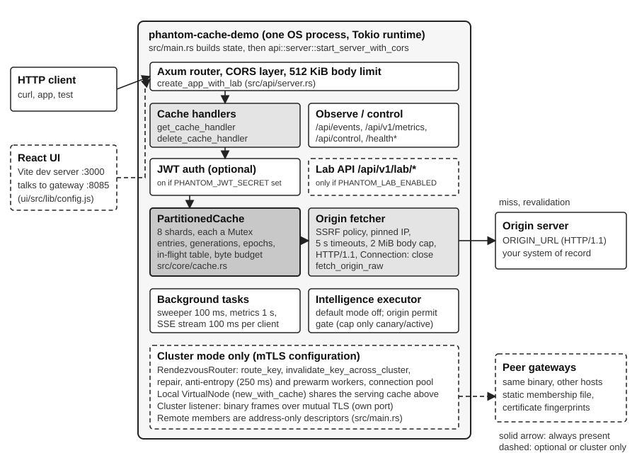

Source: `src/main.rs::run`, `src/api/server.rs::create_app_with_lab`, `::start_server_with_cors`, `src/core/cache.rs::PartitionedCache`, `src/dist/router.rs::RendezvousRouter`, `src/dist/node.rs::VirtualNode`.

Read the figure top to bottom. A request enters the Axum router, which applies the CORS layer and a 512 KiB body limit (`DefaultBodyLimit::max(512 * 1024)`). A cache handler authenticates the caller if JWT is configured, builds a `CacheKey`, and asks the `PartitionedCache`. Only on a miss does the handler call the origin fetcher. Dashed boxes exist only when you turn them on.

### 2.2.1 Responsibilities

| Component | Responsibility | Where | Status |
|---|---|---|---|
| Config loader | Parse CLI, file and environment; validate; fail closed with exit code 2; print a redacted effective configuration | `src/config.rs::resolve`, `::preflight`, `KEYS` | IMPLEMENTED; TESTED by `tests/integration/m7_config_tests.rs` (checks `docs/user/configuration.md` against the key table; does not prove runtime wiring) |
| Startup security gate | Refuse a network bind without JWT; refuse network plaintext without explicit override; refuse insecure upstream without an allowlist | `src/security/mod.rs::validate_startup_security`, `::validate_upstream_startup_security` | IMPLEMENTED |
| Router and layers | Route table, CORS, body limit | `server.rs::create_app_with_lab` | IMPLEMENTED |
| Cache handlers | Authenticate, derive key, hit/miss/stale/bypass logic, map errors to HTTP | `server.rs::get_cache_handler`, `::delete_cache_handler`, `::map_origin_error_to_response` | IMPLEMENTED; TESTED (section 2.4 to 2.7) |
| `PartitionedCache` | Sharded in-memory store, single-flight registry (`in_flight`), generations and epochs, byte budget, eviction, sweeper | `src/core/cache.rs` | IMPLEMENTED; deep treatment in Chapter 4 |
| Freshness engine | Decide cacheability and lifetime from `Cache-Control`, `Expires`, `ETag` and so on | `src/core/freshness.rs::evaluate_response_freshness` | IMPLEMENTED |
| Origin fetcher | SSRF policy, DNS pinning, HTTP/1.1 client with timeouts and size caps | `server.rs::fetch_origin_raw`, `src/security/upstream.rs` | IMPLEMENTED |
| Intelligence executor | Optional origin concurrency permit; default mode `off` | `src/intelligence/executor.rs::acquire_origin_permit` | IMPLEMENTED; cap enforced only in `canary`/`active` with a configured cap (`origin_cap_enforcing`); detail in Chapter 5 |
| Telemetry | Latency and counters for the observation endpoints | `src/intel/telemetry.rs`, `src/intel/diagnostics.rs` | IMPLEMENTED |
| Background tasks | Sweeper (every `PHANTOM_SWEEPER_INTERVAL_MS`, default 100 ms), metrics sampler (1 s), SSE feed (100 ms per connected client) | `cache.rs::spawn_sweeper_task`, `server.rs::spawn_metrics_sampler`, `::sse_handler` | IMPLEMENTED |
| Cluster router | Choose a primary for a key, send invalidation frames, fan out, repair, reconcile | `src/dist/router.rs::RendezvousRouter` | IMPLEMENTED, TESTED (loopback, debug build, at most four nodes); labelled EXPERIMENTAL in `main.rs`; effectiveness UNVERIFIED |
| Cluster node and listener | Accept mTLS connections, validate peer identity, handle frames | `src/dist/node.rs::VirtualNode::start_tcp_service`, `::process_binary_cache_stream` | IMPLEMENTED |
| Frame codec | Binary wire format (magic, version, 28-byte header, types) | `src/dist/frame.rs` | IMPLEMENTED; TESTED by the unit tests in the file and `tests/integration/security_phase3b_framing_tests.rs` |
| Lab API | HTTP front door for experiments | `src/api/lab_api.rs::router` | IMPLEMENTED, off by default |
| Standalone demo nodes and snapshot | Three `VirtualNode`s and a placeholder snapshot for the dashboard | `main.rs::run` (`nodes`, `initial_snap`) | PROTOTYPE ONLY: synthetic; the code says so in a comment |

Objects created in `main::run` but never used in serving: `_traffic`, `_network`, `_db` and `_coalescer` are built with underscore names and dropped. The serving path coalesces through `PartitionedCache::begin_fetch_atomic` and `SharedOp`, not through `core::coalesce::Coalescer`. (verified in code)

::: concept
**Key concept: what a "node" is.** In the standalone gateway there is one real cache and three placeholder `VirtualNode` objects with their own small caches (4 shards each) used only for dashboard demos. In the mTLS cluster configuration the local member is a `VirtualNode` built with `new_with_cache`, so it shares the gateway's serving cache. Every other member is an address-only descriptor with no cache of its own in this process. "Node" in the code therefore means "a member identity plus a connection", not "a separate machine you can read from".
:::

::: judge
**JUDGE MAY ASK**

Question: Explain the architecture of your system.

**Suggested answer** (about 30 to 60 seconds spoken, plain English):

PhantomCache is a read-through caching gateway written in Rust. A client sends an HTTP GET to the gateway. The gateway looks the key up in an in-memory cache split into eight lock-protected shards. On a hit it answers from memory. On a miss, one request goes to the origin and any other requests for the same key wait for that single answer; the result is stored if it is still valid. A DELETE removes the key locally first, then, in cluster mode, tells the node chosen by rendezvous hashing and waits for its acknowledgement, and then tells the other members in the background. Around that core there are optional parts: JWT authentication, an experimental mTLS cluster, an observation API, and a separate experiment tool called Phantom Lab. Reads are always served from the local gateway's own cache.

**If the judge asks further:**

"Is it a distributed cache?" Honestly: it is N independent caches with an invalidation bus. Each gateway caches locally and they coordinate invalidation. It does not route reads to a key owner, so it is not a partitioned distributed cache in the Redis Cluster or groupcache sense. The cluster work is about keeping invalidation reliable across gateways. "Where does the intelligence sit?" Off the request path by default; section 2.2 and Chapter 5.

**Evidence to know:** `src/main.rs::run`, `src/api/server.rs::create_app_with_lab`, `get_cache_handler`, `src/core/cache.rs::PartitionedCache`; `docs/user/limitations.md`; status IMPLEMENTED, TESTED for the single-gateway path; for the cluster IMPLEMENTED, TESTED (loopback, debug build, at most four nodes); labelled EXPERIMENTAL in `main.rs`; effectiveness UNVERIFIED.
:::

## 2.3 The HTTP surface

### 2.3.1 Real routes

These are the routes in `create_app_with_lab` and `lab_api::router`, plus the merged `health::router`. "JWT on" means `PHANTOM_JWT_SECRET` is set, which creates a `SecurityConfig` with `require_auth_for_control: true` in both constructors (`src/security/mod.rs`). Roles are defined in `src/security/jwt.rs::Role`. Chapter 6 owns the security analysis; this table only marks the boundary.

| Method and path | Role needed when JWT is on | Purpose | Status |
|---|---|---|---|
| `GET /health` | none | plain text `OK` | IMPLEMENTED |
| `GET /health/live` | none | `200 {"status":"alive"}` | IMPLEMENTED; TESTED (`m7_health_tests::m7_live_is_always_200_and_ready_tracks_state`) |
| `GET /health/ready` | none | `200` only when config is valid, the listener answered a TCP probe, and the process is not draining; else `503` with the failing checks | IMPLEMENTED; TESTED (same test) |
| `GET /api/v1/cache/*key`, `GET /api/v1/cache` | `cache:read`, and a non-empty `tenant_id` claim (not `__default__`) | read-through cache lookup | IMPLEMENTED; TESTED (`m1_http_tests`) |
| `DELETE /api/v1/cache/*key`, `DELETE /api/v1/cache` | `cache:invalidate`, and a tenant claim | remove one exact key (path plus raw query string) | IMPLEMENTED; TESTED |
| `GET /api/events` | `telemetry:read` | server-sent events every 100 ms; `?schema=2` is current, schema 1 is deprecated (`Deprecation` and `Sunset: Wed, 31 Dec 2026` headers) | IMPLEMENTED |
| `GET /api/v1/metrics` | `telemetry:read` | one JSON snapshot, schema 2 by default | IMPLEMENTED |
| `GET /api/v1/diagnostics/summary`, `/api/v1/diagnostics/events` | `telemetry:read` | counters snapshot; last 100 diagnostic events | IMPLEMENTED |
| `GET /api/v1/intelligence/status`, `/api/v1/intelligence/audit` | `telemetry:read` | state and audit log of the intelligence executor | IMPLEMENTED |
| `POST /api/control` | `scenario:operate` | body `{"event": ...}`; `FLASH_CROWD` sets a workload label, `NODE_FAILURE` sets node 2 to `Failed`, anything else resets labels and sets every node `Active` | IMPLEMENTED; it flips in-memory flags only |
| `GET /api/v1/lab/capabilities`, `/evidence`, `/evidence/:id`, `/runs`, `/runs/:id`, `/runs/:id/events` (SSE), `/runs/:id/artifacts`, `/runs/:id/artifacts/:name` | `telemetry:read` | read Lab state and retained evidence | IMPLEMENTED; exist only if `PHANTOM_LAB_ENABLED=true` |
| `POST /api/v1/lab/runs`, `POST /api/v1/lab/runs/:id/cancel` | `scenario:operate` | start and cancel experiments | IMPLEMENTED; same condition |

Without JWT, the cache routes and the observation routes are open on the bind address, and `x-tenant-id` selects the tenant. The startup gate makes that safe only on loopback: a non-loopback bind without JWT is refused (`StartupSecurityError::NetworkWithoutAuth`). The Lab API without JWT additionally requires a loopback bind (`lab_api::check_lab_bind`) and checks the `Host` and `Origin` headers (`host_origin_guard`, a DNS-rebinding defence). (verified in code)

What does not exist: there is no `PUT`, `POST` or `PATCH` on cache keys, no HTTP route for tenant-wide or whole-cache invalidation (the handler always uses `InvalidationScope::ExactKey`; the other scopes exist only in the cluster frame format and in the epoch methods used by peers and anti-entropy), and no `/metrics` Prometheus endpoint. (verified in code: route list above is complete for `create_app_with_lab`)

### 2.3.2 Cache key and path mapping

The URL path after `/api/v1/cache` becomes the origin path. `GET /api/v1/cache/item1?x=1` asks the origin for `/item1?x=1`.

The cache key is `CacheKey { tenant_id, path, query }` (`src/core/cache.rs::CacheKey`). With no tenant the tenant is the literal `__default__`. The canonical string is `tenant:path` or `tenant:path:?query` (`to_canonical_string`). `CacheKey::validate` rejects tenant ids that are not 1 to 128 bytes of `[A-Za-z0-9._-]`, paths over 2048 bytes, queries over 4096, control characters and spaces, `.` and `..` segments, `:?` inside a path, and canonical strings over 4096 bytes. The query is used exactly as sent: `?a=1&b=2` and `?b=2&a=1` are two keys. (verified in code)

The path of `ORIGIN_URL` is not prepended: `fetch_origin_raw` takes only host and port and builds the request target from the key via `encode_origin_target`, so `http://origin.example/v2` is still asked for `/item1`, not `/v2/item1`. (verified in code; no test read)

### 2.3.3 Response vocabulary

| `X-Cache-Status` | Meaning | Set in |
|---|---|---|
| `HIT` | fresh entry served from memory | `get_cache_handler`, `FetchRegistrationResult::Hit` branch |
| `MISS` | this request was the leader that fetched the origin | `Initiate` branch |
| `COALESCED` | this request waited for another request's fetch | `Wait` branch |
| `STALE` | an expired entry was served under a stale directive, or the leader's fetch failed and stale-if-error applied | stale pre-check, and `is_stale` in the `Wait` and `Initiate` branches |
| `BYPASS` | client sent `x-cache-bypass: true`; origin fetched, nothing stored | bypass branch |
| `BYPASS-AUTH` | a credential was presented and the gateway forwards credentials upstream, so reads skip the cache | bypass branch |

`X-Cache-Error` values come from `map_origin_error_to_response` (for example `Timeout`, `NetworkError`, `ResponseTooLarge`, `WaiterLimitExceeded`, `CapacityExceeded`, `InvalidPath`, `SsrfBlocked`). (verified in code)

## 2.4 Request flow 1: a cache hit

### 2.4.1 Simple explanation

The gateway checks its notebook. The page is in the notebook and still fresh, so it reads it out. The origin is never bothered.

### 2.4.2 Terms and how it works

A **shard** is one of eight independent sub-caches. The key is hashed (`PartitionedCache::get_shard_index` uses `DefaultHasher` and masks with `shard_mask`, which works because the shard count must be a power of two). Only the shard that owns the key is locked, so requests for different shards do not wait for each other. An **epoch** is a counter used to invalidate many entries at once; an entry is valid only if its recorded epochs equal the current ones.

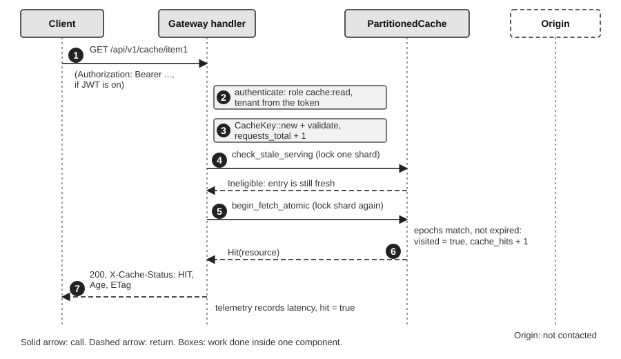

Source: `server.rs::get_cache_handler`, `cache.rs::check_stale_serving`, `::begin_fetch_atomic`.

Steps, as the code does them:

1. **Authenticate first** (`authenticate_request`, role `cache:read`, then `require_tenant_claim`). In secure mode the tenant comes only from the verified token; a caller-supplied `x-tenant-id` is ignored. Without JWT the header is used, and an invalid header value is a `400`, not a silent fallback to the default tenant.
2. **Build and validate the key**, increment `requests_total`.
3. **Stale pre-check.** `check_stale_serving` locks the shard and returns `Ineligible` for a fresh entry, so a fresh entry goes on to step 4. (Eligible only for an expired entry inside its stale window; section 2.6.)
4. **`begin_fetch_atomic`** locks the shard a second time. If the entry's tenant and global epochs equal the current ones and `created_at_ms + ttl_ms > now_ms`, it marks the entry visited (used by the eviction policy), counts a hit and returns `Hit(entry)`.
5. The handler answers `200` with `X-Cache-Status: HIT`, `Age`, `ETag`, answers `304` instead if the client's `If-None-Match` or `If-Modified-Since` matches, and records telemetry.

::: example
**Worked example.** Key `__default__:/item1`. Default budget `PHANTOM_MAX_CACHE_BYTES` is 268,435,456 bytes (256 MiB). `PartitionedCache::set_byte_budget` divides it by the shard count: 256 MiB / 8 = 32 MiB per shard. A single cached item larger than its shard's budget is rejected as oversize at store time (`byte_budget_rejections`, `oversize_rejections`), even though the whole cache has room. The default cap of 10,000 entries per shard (`max_entries_per_shard`) gives at most 80,000 entries in total.
:::

Two shard-lock acquisitions per hit (steps 3 and 4) is a fact about the implementation, not a measurement; this chapter makes no latency claim (Chapter 6 lists the real measurements).

### 2.4.3 What can go wrong

- A hit is only as fresh as the entry's lifetime. Staleness is bounded by the freshness rules in section 2.6, not by any cross-node guarantee.
- Sharding by hash means a very hot key concentrates its load on one shard lock. Detail and mitigation in Chapter 4.
- `begin_fetch_atomic` can return `Rejected(CapacityExceeded)` when a shard is full and nothing is evictable; the client sees `503` with `Retry-After: 1`.

::: judge
**JUDGE MAY ASK**

Question: Walk me through what happens to one request, from the network to the response.

**Suggested answer** (about 30 to 60 seconds spoken, plain English):

The request arrives at the Axum router, which applies CORS and a body limit. The cache handler first checks the caller's token if authentication is on, and takes the tenant from the token. It builds a cache key from tenant, path and query and validates it, rejecting anything odd such as control characters or dot segments. It then asks the sharded cache. The key's hash picks one of eight shards and only that shard's lock is taken. If a fresh entry exists, the handler returns it with `X-Cache-Status: HIT`. If not, it goes down the miss path: one leader fetches the origin, others wait, the result is stored if it is still valid, and everyone gets the answer.

**If the judge asks further:**

"Where is the lock held across a network call?" Never: the shard mutex is held only while reading or updating the map. The origin call happens in a separate spawned task with no shard lock held. "What if the client has a token but wrong tenant?" Cross-tenant isolation is by key namespace taken from the token; see Chapter 6 for the analysis and the open findings.

**Evidence to know:** `get_cache_handler`, `PartitionedCache::begin_fetch_atomic`, `CacheKey::validate`; `m1_http_tests::test_m1_t01_cold_cache_miss` and `test_m1_t02_repeat_cache_hit` (TESTED on loopback, debug profile, one gateway; they prove the MISS then HIT behaviour and one origin call, not performance).
:::

## 2.5 Request flow 2: a miss, coalescing and the origin fetch

### 2.5.1 Simple explanation

A hundred people ask for the same missing page at once. Instead of a hundred trips to the origin, one person is sent, and the other ninety-nine wait at the door and share what that one brings back.

### 2.5.2 Terms

**Single-flight** (also called request coalescing): at most one in-progress fetch per key; later arrivals join it. A **leader** starts the fetch; **waiters** join. A **stampede** (or thundering herd) is many simultaneous misses on one key, which would hit the origin together. **Generation** (`op_gen`) is a per-key counter that increases on delete; it lets a finishing fetch discover that the key was deleted while it ran.

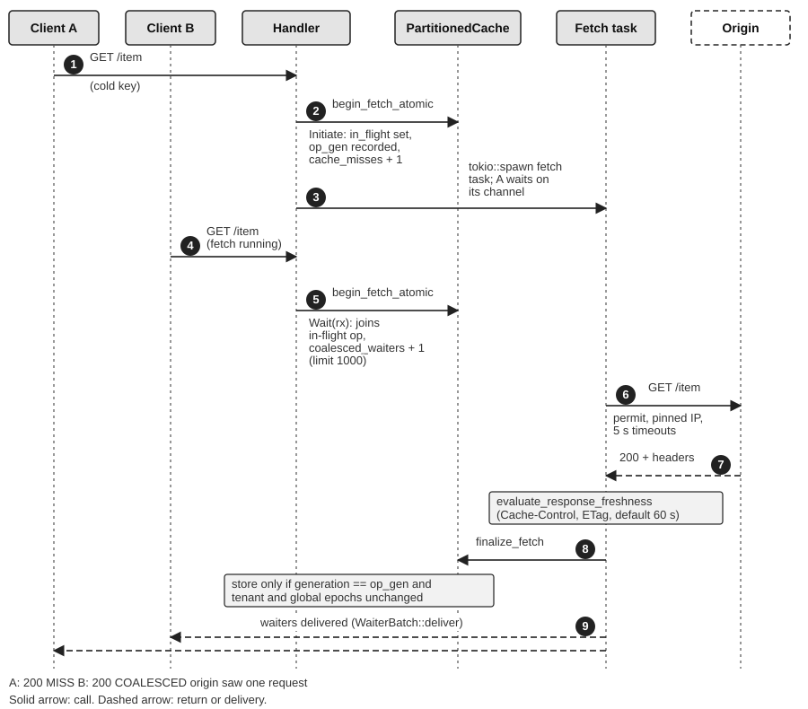

Source: `server.rs::get_cache_handler` (`Initiate` and `Wait` branches), `cache.rs::begin_fetch_atomic`, `::finalize_fetch`, `src/core/coalesce.rs` (`FetchRegistration`, `OriginFetchGuard`, `WaiterBatch`).

### 2.5.3 How it works

Inside `begin_fetch_atomic`, under the shard lock, three outcomes are possible after a miss check.

- If an operation for the key is already in `shard.in_flight`, the caller is added to that operation's waiter list (limit `max_waiters_per_key`, default 1,000, else `Rejected(WaiterLimitExceeded)` and `503`) and gets `Wait(rx)`.
- Otherwise the shard may evict (at most 32 victims per attempt) to make room. If it still has no room, `Rejected(CapacityExceeded)`.
- Otherwise it creates the key state if absent, records `op_id` and `op_gen = state.generation`, inserts a `SharedOp` into `in_flight`, counts `cache_misses` and returns `Initiate(registration)`.

The leader registers itself as a waiter on the same shared operation, then runs the origin call in a spawned task (`tokio::spawn` inside the `Initiate` branch). Because the work is in a separate task, a client that disconnects does not cancel the fetch for the others. That is a deliberate property. At HTTP level `m1_http_tests::test_m1_t14_initiator_disconnect_resilience` has a client time out after 50 ms while the origin takes 300 ms, then asserts that later clients get `200` and then a `HIT`. At cache level `serving_contract_tests::test_ct2_initiator_cancellation_detached_fetch` simulates the detached completion. Neither proves behaviour under production load.

The task does this, in order:

1. Takes an origin permit if an intelligence executor is installed (`acquire_origin_permit`). Only the leader takes one; waiters never reach this point. With the executor in its default mode `off` the permit only counts in-flight requests and never refuses.
2. Reads the stored validators of any resident (expired) entry, so the request can be conditional (`stored_validators`).
3. Calls `fetch_origin_raw`: validates the origin URL against the upstream policy, resolves and pins the IP address (`resolve_and_pin_origin`, with a pre-connect filter against loopback and private ranges unless allowed), connects (5 s timeout), does TLS if `https` (5 s), writes a `GET ... HTTP/1.1` request with `Connection: close`, and reads the whole response under one 5 s timeout, capped at 2 MiB of body (`MAX_BODY_BYTES`) and 64 KiB of headers.
4. Evaluates freshness (`evaluate_response_freshness`) and builds a `CachedResource`.
5. Calls `guard.complete(outcome)`, which calls `finalize_fetch`. **The fence:** the result is stored only if `state.generation == op_gen` and the entry's tenant and global epochs still equal the current ones. Otherwise the result is delivered to the waiters but not stored, and `stale_writes_prevented` increases. This is what stops a slow fetch from resurrecting data that a DELETE removed meanwhile.
6. `WaiterBatch::deliver` sends the result to every waiter. The leader sees `MISS`; the others see `COALESCED`.

What is forwarded to the origin is deliberately narrow: a valid client `x-request-id`; `x-tenant-id` from the cache key when the tenant is not `__default__`; `Authorization` only when `PHANTOM_FORWARD_UPSTREAM_AUTH` is set; the gateway's own `If-None-Match` and `If-Modified-Since`; a fixed `Accept: application/json`. The client's conditional and range headers are never forwarded, because the cached copy is shared. (verified in code, `fetch_origin_raw` and `get_cache_handler`)

The origin connection uses `Connection: close`: every fetch opens a new TCP (and TLS) connection, with no pool to the origin. This is a cost per miss that a judge may probe. (verified in code)

::: example
**Worked example: 100 simultaneous requests.** `m1_http_tests::test_m1_t13_barrier_stampede_100_clients` releases 100 clients at once against a mock origin that delays 150 ms, and asserts exactly 1 `MISS`, 99 `COALESCED` and one origin call. Without coalescing the origin would see 100 requests; with it, one. TESTED on loopback, debug profile, one key, one gateway process. It proves collapsing on one key in one process. It does not prove behaviour across gateways (each gateway coalesces independently, so N gateways can send N concurrent fetches for the same key), nor performance under load. Chapter 4, section 4.4 uses a different 10-client test (`coalesce_tradeoffs_tests::test_negative_effect_head_of_line_blocking`) to show the cost to waiters.
:::

### 2.5.4 Trade-offs and what can go wrong

- Waiters share fate with the leader. If the leader's fetch is slow, all waiters wait up to the origin timeout (5 s read timeout).
- A request that arrives after a DELETE does not join the pre-DELETE fetch (`delete_impl` removes the `in_flight` entry), tested by `m1_http_tests::test_m1_t09_get_after_delete_does_not_join_old_fetch`. A request that arrives after a tenant or global epoch change can still join an older in-flight fetch; the code documents this as limitation "L3" in `begin_fetch_atomic` and states the result is kept out of the cache by the epoch check. (verified in code)
- Why this design and not per-key locks held across the origin call, or a separate coalescer object? No recorded decision explains the switch from the unused `core::coalesce::Coalescer` to the shard-integrated `SharedOp`. Our reasoning, not a recorded decision: holding a shard mutex across `.await` is forbidden by the project rules (`CLAUDE.md` section 5), which pushes the design to an in-shard registry plus a detached task.

::: judge
**JUDGE MAY ASK**

Question: What happens on a cache miss? And what if a thousand clients ask for the same missing key?

**Suggested answer** (about 30 to 60 seconds spoken, plain English):

On a miss, the shard registers an in-flight operation for that key and the first request becomes the leader. It fetches the origin in its own task, with timeouts and size limits. Every other request for that key during the fetch joins the same operation and waits; the origin sees one request. When the answer arrives the gateway decides whether it may be cached, checks that the key was not deleted or invalidated during the fetch, stores it if all is well, and releases all waiters with the same body. There is a cap of 1,000 waiters per key; beyond that, extra requests are refused with a 503 so memory stays bounded. We tested the 100-client case on loopback.

**If the judge asks further:**

"Is that safe against a DELETE during the fetch?" Yes by design: the fetch records a generation number when it starts, and the store step compares it with the current one; DELETE increments it. "Across gateways?" No: coalescing is per gateway, so three gateways can fetch the same key three times at once. We do not claim cross-gateway coalescing.

**Evidence to know:** `PartitionedCache::begin_fetch_atomic`, `finalize_fetch`; `m1_http_tests::test_m1_t13_*`, `test_m1_t09_*`; `serving_contract_tests` (`test_ct1_single_flight_coalescing`, `test_ct3_waiter_limit_enforcement`, `test_ct7_fencing_under_invalidation`, cache-level); TESTED, loopback and debug build. Chapter 4 for the fencing proof and the open G4A-01 history.
:::

## 2.6 Freshness, stale serving and origin failure

### 2.6.1 What decides how long an entry lives

`evaluate_response_freshness` (`src/core/freshness.rs`) applies RFC 9111-style rules (cacheability, then lifetime from `s-maxage`, `max-age`, `Expires` minus `Date`, and finally a default of 60,000 ms when the origin gave nothing). The full rule list is in Chapter 4, section 4.8. (verified in code)

::: caution
**The default TTL setting is not wired.** `PHANTOM_DEFAULT_TTL_MS` is documented with default 60,000 and validated, but `src/config.rs` marks it `Wiring::NotWired`, and `src/api/server.rs` passes the literal `60_000` to `evaluate_response_freshness` at two call sites (the miss path and the background revalidation path). Setting the key changes nothing; the startup report prints "not honored by runtime" and a warning if you change it from the default. The effective fallback lifetime is always 60 s. Documented default and effective setting are the same number only by coincidence. (verified in code; re-checked 2026-10-30)
:::

### 2.6.2 Stale serving, only as far as the origin allows

The code serves expired data in two situations, both only when the origin's own response carried the matching directive, and always bounded by the hard cap `PHANTOM_MAX_STALE_MS` (default 86,400,000 ms, 24 h). Chapter 4, section 4.8 has the full rules.

- **stale-while-revalidate (SWR):** an expired entry inside its SWR window is returned at once with `X-Cache-Status: STALE`, and a background revalidation starts if due (bounded: `max_background_refresh`, default 128, single-flight).
- **stale-if-error:** if the origin fetch fails, a stale copy inside the stale-if-error window (or, if none, the SWR window) is returned instead of an error.

`must-revalidate` forbids any stale serving, and with no directive the window is zero. The gateway does not invent a "serve stale during an outage" behaviour: if your origin does not send `stale-if-error`, an outage produces errors. (verified in code, `PartitionedCache::check_stale_serving`)

### 2.6.3 Origin failure

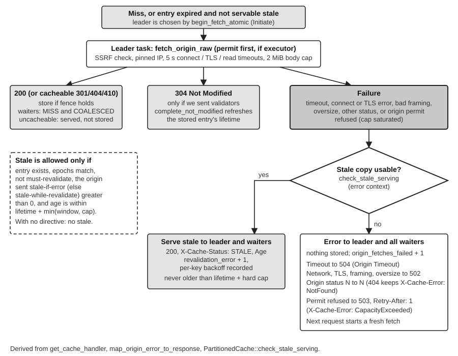

Source: `server.rs::get_cache_handler` (failure branches), `::map_origin_error_to_response`, `cache.rs::check_stale_serving`.

When the leader's fetch fails, the leader and every waiter get the same outcome: either a stale copy (if eligible) or a mapped error. Errors are not stored; the next request starts a fresh fetch. The mapping is: a timeout is `504`; connect, TLS, framing, size and other network failures are `502`; an origin status code is passed through (404 as `404` with `X-Cache-Error: NotFound`); an origin-cap refusal is `503` with `Retry-After: 1`. What the code does **not** have: a circuit breaker, negative caching of errors, a retry loop on the origin call, or a "degraded mode" switch. (verified in code: no such symbols in the handler; absence not proven for the whole tree)

A 304 reply to a conditional request is handled by `PartitionedCache::complete_not_modified`, which refreshes the stored entry's lifetime instead of replacing its body (`tests/integration/revalidation_304_tests.rs` exists; not read in detail for this chapter).

Evidence for the stale-if-error rule is at cache-component level: `stale_serving_tests::test_stale_if_error_on_origin_outage` builds an entry with a 5 s lifetime and a 30 s stale-if-error window, then calls `check_stale_serving` directly and asserts `Ineligible` in normal context, `Eligible` in error context inside the window, and `Ineligible` beyond it, with `stale_cap_violations` equal to 0. It does not drive the HTTP handler against a failing origin. A handler-level test named `test_http_stale_serving_headers_and_status` exists in the same file; its body was not read for this chapter, so end-to-end stale-if-error through HTTP is UNVERIFIED here.

::: judge
**JUDGE MAY ASK**

Question: What happens when the origin is unavailable?

**Suggested answer** (about 30 to 60 seconds spoken, plain English):

If the key is cached and fresh, nothing changes: clients are served from memory and never see the outage. If the entry has expired, the answer depends on what your origin told us when it sent the data. If it sent a stale-if-error or stale-while-revalidate window, we serve the expired copy, labelled STALE, for as long as that window allows, never beyond the 24-hour hard cap. If it sent nothing, we do not guess: the client gets an error, a 504 for a timeout or a 502 for a network failure. Errors are never cached, so recovery is immediate when the origin returns. Only one request per key goes to the failing origin at a time, because of coalescing, and an optional concurrency cap can shed load with a 503, but only in canary or active mode.

**If the judge asks further:**

"Is there a circuit breaker?" No. The protections are single-flight, a 5 second timeout, the optional origin concurrency cap, and the waiter limit. "Does it serve stale on every outage?" No, only with the origin's own directive. "Is stale-if-error tested end to end?" The rule is tested at cache level; I would not claim an HTTP-level outage test without checking.

**Evidence to know:** `get_cache_handler`, `check_stale_serving`, `map_origin_error_to_response`; `stale_serving_tests::test_stale_if_error_on_origin_outage` (TESTED at component level); `PHANTOM_MAX_STALE_MS` (`Wiring::Main`); status IMPLEMENTED.
:::

::: judge
**JUDGE MAY ASK**

Question: Your configuration lists a default TTL setting. Does it work?

**Suggested answer** (about 30 to 60 seconds spoken, plain English):

No, and the product says so itself. The key is validated and printed, but the freshness engine is called with a fixed 60 seconds in two places in the server. The configuration table marks it not wired, and the startup report prints "not honored by runtime" next to it. Entries with explicit `Cache-Control` or `Expires` use the origin's lifetime; only responses with no freshness information fall back to 60 seconds, and that fallback cannot be changed by configuration today.

**If the judge asks further:**

"Why not fix it?" It is an application-code change to a protected area and needs approval and a test; it is on the known-gap list, not hidden.

**Evidence to know:** `src/config.rs::KEYS` entry `PHANTOM_DEFAULT_TTL_MS` (`Wiring::NotWired`); the two `60_000` literals in `get_cache_handler`; `docs/user/limitations.md`.
:::

## 2.7 DELETE, the cluster, and how nodes communicate

### 2.7.1 Simple explanation

Each gateway keeps its own notebook. When a page changes, someone must tell every notebook to cross it out. DELETE does that: the gateway crosses it out locally at once, then phones the member chosen as "responsible" for that key and waits for it to confirm, and then tells everyone else without waiting.

### 2.7.2 Terms

**Rendezvous (highest random weight, HRW) hashing:** for a key, give each node a score derived from the key and the node id; the highest score wins. Every gateway that knows the member list computes the same winner without talking. The winner is called the **primary** here. **Fan-out:** sending the same message to many members. **mTLS:** both sides present certificates. **Anti-entropy:** a background exchange that repairs differences between members. **Repair ledger:** a bounded in-memory list of invalidations a peer is owed.

### 2.7.3 How DELETE works

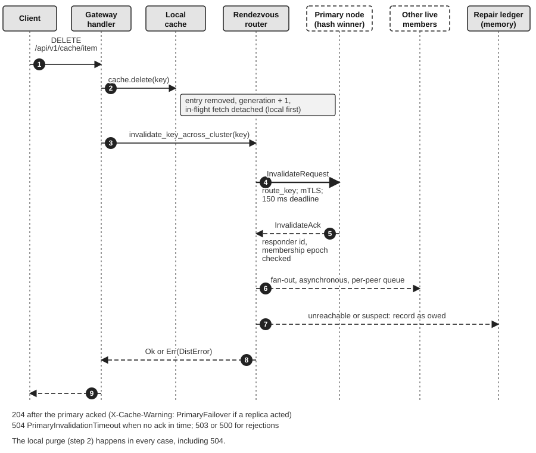

Source: `server.rs::delete_cache_handler`, `src/dist/router.rs::invalidate_key_across_cluster`, `::send_invalidation_frame_with_seq`, `::fanout_targets`, `::dispatch_fanout`, `::record_owed_to_all`, `src/dist/node.rs::process_binary_cache_stream`.

1. Authenticate (`cache:invalidate`, tenant claim), build and validate the key.
2. **Purge locally first** (`cache.delete`): the entry is removed, the generation is incremented, and any in-flight fetch for the key is detached so later GETs do not join it.
3. With no router (standalone), that is all: `204`.
4. With a router, `invalidate_key_across_cluster` computes the primary with `route_key`. The first pass skips nodes that are `Failed`, `Offline`, `Suspect` or `Recovering`; only if no healthy node exists does a second pass accept `Suspect` and `Recovering` nodes. It picks the highest `DefaultHasher(key, node_id)` value (the code multiplies by `capacity_weight = 1.0`, a constant, so this is plain rendezvous hashing, not weighted in effect). It sends an `InvalidateRequest` frame to the primary over a pooled mTLS connection, bounded by one 150 ms deadline (`PHANTOM_CLUSTER_TIMEOUT_MS`, default 150) for the whole leg including one retry on a fresh connection.
5. The primary's listener checks the peer's certificate identity against the membership registry and that the frame's claimed originator equals the authenticated peer, deletes the key in its cache and replies with an `InvalidateAck`. The router checks the responder id and membership epoch in the ack (G4B-06 records that the epoch check is vacuous: OPEN, owner-named).
6. On success the router queues the other members: live members go to a per-peer bounded queue (256 entries, one delivery in flight per peer); `Suspect`, `Failed`, `Offline` or `Recovering` members are recorded as owed in the `RepairLedger`. A repair worker re-delivers owed invalidations while this gateway stays alive; an anti-entropy worker runs every 250 ms in cluster configurations. Chapter 5, section 5.5 owns the detail.
7. If the primary fails to answer, it is marked `Suspect` and the first healthy replica from the same ranking acts as primary; the response then carries `X-Cache-Warning: PrimaryFailover` (with the suspect node id in brackets when known). If that fails too, every other member is recorded as owed and the client gets `504` with `X-Cache-Error: PrimaryInvalidationTimeout` (or a `503` or `500` with `PrimaryRateLimited`, `PrimaryInternalError` and similar codes when the failure was a rejection rather than a timeout).

The client sees `204` only after a primary acknowledged. The local purge in step 2 happens in all cases, including `504`.

Facts about the router that matter for honesty:

- The local node is one of the router's members. If it wins the hash, the "primary" frame goes over mTLS to this process's own cluster listener; no shortcut for self was found in `connect_to_node_inner` or `send_invalidation_frame_with_seq` (UNVERIFIED for the connection pool internals, which were not read in full).
- The membership is static: it is read once from `PHANTOM_CLUSTER_MEMBERS_FILE` at startup (`security::load_membership_from_file`). There is no join or leave protocol in the code path read.
- The repair ledger is in memory. An invalidation owed to a peer is lost if the issuing gateway process dies before delivery. The durability fix (milestone M3) exists only in a sandbox patch and is not integrated; the current status is in `docs/research/m3_durability/` and `docs/user/limitations.md`. (Chapter 5 owns this.)
- In the insecure or partial cluster configuration (`PHANTOM_ALLOW_INSECURE_CLUSTER` or a members file without full mTLS material) the router holds the three placeholder nodes with no addresses, so no frame is sent and a DELETE ends in `504`. `main.rs` prints this at startup. (verified in code)

### 2.7.4 How nodes communicate

| Channel | Transport | Messages | Used by | Status |
|---|---|---|---|---|
| Invalidation | TCP, TLS 1.3 stack via rustls, mutual authentication, one pooled connection per peer, binary frames (`MAGIC`, version 1, 28-byte header, payload up to 1 MiB, key up to 4,096 bytes) | `InvalidateRequest` (scopes `ExactKey`, `Tenant`, `FullCache`), `InvalidateAck` (status, responder id, membership epoch) | `DELETE` | IMPLEMENTED; TESTED on loopback (`security_phase4b_router_tests::test_p4b_http_gateway_204_primary_success_vs_504_timeout`: one plaintext loopback node, a router of one member, and a gateway cache that is a separate object from the node's cache; it checks 204 on a primary acknowledgement and 504 on timeout, not multi-gateway purge or mTLS) |
| Heartbeat | same connection | `HeartbeatRequest`, `HeartbeatResponse` | pool keepalive every 5 s (`PoolConfig.heartbeat_interval`): idle connections that fail the probe are discarded | IMPLEMENTED; in `pool.rs::probe_idle_connections` a failed heartbeat discards the connection and does not set a node state (state changes come from failed invalidation sends) |
| Anti-entropy | same | `AntiEntropySyncRequest`, `AntiEntropySyncResponse` (in sync, replay batch, history overwritten) | background pull reconciliation | IMPLEMENTED; effectiveness not established (`docs/research/claims_ledger.md` C6, per `CLAUDE.md`) |
| Peer read | same | `GetRequest`, `GetResponse` | nothing in production | PROTOTYPE ONLY |

The `GetRequest` handler (`node.rs`) does not read the origin. On a miss it fabricates the body `val_node_<id>`, stores it for 60 s in the node's cache and answers `MISS val_node_<id>`. Its only sender, `RendezvousRouter::forward_key_over_tcp`, has no caller in `src/`: a search for `forward_key_over_tcp` and `route_key` finds uses only inside `router.rs` (the DELETE path uses `route_key`). GET handling in `server.rs` never touches `state.router`. (verified in code by search)

Therefore: **GET is served from the local gateway's cache only.** There is no key ownership for reads, no forwarding to the primary, no remote read. A cluster of N gateways has N independent read caches that are kept coherent by invalidation, not by routing.

::: caution
**Consistency is bounded by what the invalidation path delivers.** A comment in `delete_cache_handler` says the local-first purge "guarantees linearizability". That wording is not supported by the system: there is no formal model, no linearizability test, and other gateways can serve an entry until their own invalidation arrives or the entry expires. Do not repeat it. The accurate claims are: this gateway purges before the cluster round trip; a `204` means a primary acknowledged within 150 ms; other members are invalidated asynchronously with bounded retry and repair while this process lives. Chapter 5 states the failure model and what is not guaranteed.
:::

::: judge
**JUDGE MAY ASK**

Question: How do the nodes communicate?

**Suggested answer** (about 30 to 60 seconds spoken, plain English):

Nodes talk over a custom binary protocol on TCP wrapped in mutual TLS: each node proves its identity with a certificate whose name is checked against a static membership file, including the certificate fingerprint. The main message is an invalidation: when a key is deleted, the gateway sends it to the member chosen by rendezvous hashing, waits up to 150 milliseconds for an acknowledgement, and then tells the other members in the background, with a bounded queue, retries and a repair worker for members that were unreachable. There is also a heartbeat and a reconciliation exchange. Reads do not use the network between nodes: each gateway answers reads from its own memory.

**If the judge asks further:**

"What if a node is down?" It is marked suspect, it is owed the invalidation in an in-memory ledger, and a repair worker retries; if the issuing gateway restarts before delivery the owed list is lost, which is a known limitation. "Is the membership dynamic?" No, static, read at startup. "Why not use Raft or gossip?" There is no recorded decision; our reasoning: the system only needs to propagate invalidations, not agree on data.

**Evidence to know:** `src/dist/frame.rs` (message types), `src/dist/router.rs::invalidate_key_across_cluster`, `src/dist/node.rs::start_tcp_service`; `docs/user/limitations.md`; status IMPLEMENTED, TESTED (loopback, debug build, at most four nodes); labelled EXPERIMENTAL in `main.rs`; effectiveness UNVERIFIED (no multi-host evidence).
:::

::: judge
**JUDGE MAY ASK**

Question: Which node serves a read for a key, and does rendezvous hashing decide that?

**Suggested answer** (about 30 to 60 seconds spoken, plain English):

The gateway that received the request serves it from its own cache. Rendezvous hashing is used today only to pick the node that must acknowledge a DELETE first. The code for forwarding a read to the key's owner exists as a function but nothing calls it, and the peer-side read handler is a stub that fabricates a value, so I do not claim distributed reads.

**If the judge asks further:**

"Then what does the hash buy you?" A deterministic primary for invalidation, which gives a single acknowledging authority per key and a stable failover order. "Are the weights real?" No, the weight factor is a constant 1.0.

**Evidence to know:** `RendezvousRouter::route_key` (`capacity_weight = 1.0`), `forward_key_over_tcp` (no caller), `process_binary_cache_stream` `GetRequest` arm; `docs/research/adr/ADR-003-distributed-architecture.md` for the intended direction (status: agent-recorded, not owner-ratified per `docs/STATUS.md`).
:::

## 2.8 Where Phantom Lab and the UI sit

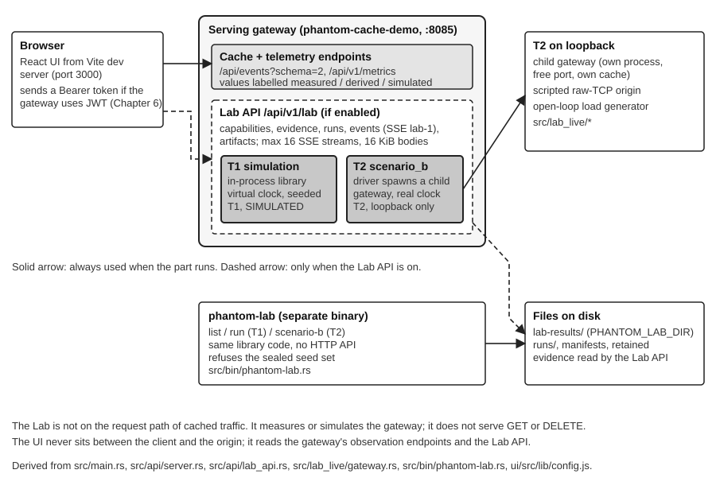

Source: `src/main.rs` (Lab block), `src/api/server.rs::create_app_with_lab`, `src/api/lab_api.rs`, `src/lab_live/gateway.rs`, `src/bin/phantom-lab.rs`, `ui/src/lib/config.js`.

Simple explanation. The gateway is the product. The Lab is a test bench that either simulates the gateway or starts real gateways on your own machine and measures them. The UI is a dashboard and a control panel for the Lab. Neither sits between clients and the origin.

How it works.

- **Lab API.** If `PHANTOM_LAB_ENABLED=true`, `main` builds a `LabService` (root `PHANTOM_LAB_DIR`, default `lab-results`) and the router adds `/api/v1/lab/*`. With the flag off those paths are `404` (tests in `tests/integration/lab_api/`, not read in detail). It starts the library code the tests and CLI also use: `lab::runner::execute` for **T1** (deterministic discrete-event simulation, virtual clock, seeded randomness, real cache and policy code, simulated origin) and `lab_live::scenario_b::run_experiment` for **T2** (a real gateway child process on a free loopback port, a scripted raw-TCP origin, an open-loop load generator).
- **Tier labels.** T1 results are labelled SIMULATED, T2 results MEASURED_LOOPBACK. Neither is a multi-host or production measurement (Chapter 7).
- **Process boundary.** T1 runs inside the serving gateway process. T2 spawns separate gateway processes (`PHANTOM_LAB_GATEWAY_EXE`, default the current executable); `main` binds them to the parent's lifetime with a Windows job object (`bind_children_to_process_lifetime`; hand-declared Windows FFI, the only `unsafe` found in `src/` is in `lab_api.rs`). On a non-Windows host this is UNVERIFIED here.
- **CLI.** `phantom-lab` runs the same library code without HTTP and refuses the sealed seed set.
- **UI.** A React app in `ui/`, served by Vite on port 3000 in development. It reads `GET /api/events?schema=2` (each value is meant to be labelled measured, derived, simulated or unavailable; the v1 payload nulls synthetic values unless `PHANTOM_SIMULATION` is on) and calls `/api/v1/lab/*`. Token handling is Chapter 6.

Security relation: the Lab API can start processes and read retained results, so without JWT it is loopback-only and Host- and Origin-checked, and with JWT it needs `telemetry:read` or `scenario:operate`. The service also refuses to start if `PHANTOM_SEALED_SALT_HEX` is in the environment (`refuse_if_sealed_salt_present`). (verified in code)

::: judge
**JUDGE MAY ASK**

Question: Is the dashboard showing real data? And how does the Lab relate to the real system?

**Suggested answer** (about 30 to 60 seconds spoken, plain English):

The observation endpoints return counters and latency measured in the running gateway, and each field is meant to carry a provenance label. Some placeholder values, such as the three demo nodes and the startup snapshot, are synthetic; the gateway only emits them as live when simulation mode is switched on, and otherwise returns null or labels them. The Lab is separate from serving. Its T1 mode is a simulation that reuses the real cache and policy code with a virtual clock, so its numbers are simulated. Its T2 mode starts a real gateway and a scripted origin on one machine, so its numbers are measured, but on loopback only.

**If the judge asks further:**

"Can I trust the dashboard numbers as production performance?" No: loopback, one machine, and some views are simulated or inferred. Check the label before quoting a number.

**Evidence to know:** `build_schema_v1_payload` (provenance map), `PHANTOM_SIMULATION` (`config.rs`), `src/lab/mod.rs` header comment, `src/lab_live/mod.rs`; tests `telemetry_honesty_tests`, `schema_deprecation_tests` (TESTED, details in Chapters 6 and 7).
:::

## 2.9 Configuration and deployment

### 2.9.1 How configuration is resolved

Precedence is command line, then environment, then the `--config` file (`KEY=VALUE` lines), then the default (`src/config.rs` header and `USAGE`). Unknown keys and duplicates in the file are errors, and all errors are collected. Exit code 2 means invalid configuration, 1 runtime failure, 0 clean exit or a valid `--check-config`. Secrets are redacted in the effective-configuration report. CLI flags: `--config`, `--bind`, `--mode`, `--origin`, `--check-config`, `--version`, `--help`. (verified in code)

`PHANTOM_MODE=production` turns on extra errors: it requires `PHANTOM_REQUIRE_AUTH=true` and a JWT secret, forbids `PHANTOM_SIMULATION`, forbids every insecure override and credential forwarding, and makes the default CORS list empty (`config.rs`, production block).

### 2.9.2 The real keys

There are 43 keys in `config::KEYS` (counted). "Main" = applied in `main::run`; "Env" = exported to the process environment and read by `server.rs`, `router.rs` or `cluster.rs`; "NOT WIRED" = validated and reported only.

| Key | Default | Wiring | Notes |
|---|---|---|---|
| `PHANTOM_MODE` | `development` | Main | `production` adds strict rules |
| `PHANTOM_BIND_ADDR` | `127.0.0.1:8085` | Env | non-loopback requires JWT and TLS (or the insecure-HTTP override) |
| `PHANTOM_TLS_CERT`, `PHANTOM_TLS_KEY` | unset | Env | ingress TLS; set together |
| `PHANTOM_ALLOW_INSECURE_HTTP` | `false` | Env | plaintext on a network bind; JWT still mandatory |
| `PHANTOM_REQUIRE_AUTH` | `false` | Env | startup fails unless a JWT secret exists |
| `PHANTOM_JWT_SECRET` | unset | Main | HS256 shared secret; enables RBAC; 32 bytes or more required in production |
| `PHANTOM_JWT_ISSUER` / `PHANTOM_JWT_AUDIENCE` | `phantom-cache-auth` / `phantom-cache-api` | Main | expected claims |
| `PHANTOM_MAX_CACHE_BYTES` | 268435456 (256 MiB) | Main | logical byte budget, split evenly across 8 shards |
| `PHANTOM_DEFAULT_TTL_MS` | 60000 | **NOT WIRED** | literal `60_000` in `server.rs` (section 2.6.1) |
| `PHANTOM_MAX_STALE_MS` | 86400000 (24 h) | Main | hard cap on stale serving |
| `PHANTOM_SWEEPER_BATCH_SIZE` | 32 | Main | see discrepancy D-5 |
| `PHANTOM_SWEEPER_INTERVAL_MS` | 100 | Main | sweeper tick |
| `ORIGIN_URL` | unset | Env (`main` also copies it into `ApiState.origin_url`) | not `PHANTOM_`-prefixed; only host and port are used |
| `PHANTOM_ORIGIN_ALLOWLIST` | unset | Env | non-empty means the origin must match |
| `PHANTOM_ENFORCE_UPSTREAM_TLS`, `PHANTOM_ALLOW_INSECURE_UPSTREAM`, `PHANTOM_ALLOW_LAN_ORIGIN`, `PHANTOM_FORWARD_UPSTREAM_AUTH` | all `false` | Env | upstream policy switches |
| `PHANTOM_UPSTREAM_CA_CERT` | unset | Env | extra CA for upstream TLS |
| `PHANTOM_CLUSTER_ID` | `phantom-cluster` | Env | must equal the label in certificate SANs |
| `PHANTOM_CLUSTER_MEMBERS_FILE` | unset | Env | static membership and fingerprints |
| `PHANTOM_CLUSTER_CA`, `PHANTOM_NODE_CERT`, `PHANTOM_NODE_KEY` | unset | Env | cluster mTLS material |
| `PHANTOM_NODE_ID` | 1 | Env | must exist in the registry |
| `PHANTOM_CLUSTER_LISTEN_ADDR` | unset | Env | required when mTLS is configured |
| `PHANTOM_CLUSTER_PEER_ADDRS` | unset | Env | `id=ip:port,...` overrides membership addresses |
| `PHANTOM_ALLOW_INSECURE_CLUSTER`, `PHANTOM_STRICT_CLUSTER` | `false` | Env | insecure cluster flag (leads to the no-frames mode); strict loopback rule |
| `PHANTOM_CLUSTER_TIMEOUT_MS` | 150 | Env | per-attempt invalidation timeout |
| `PHANTOM_INTELLIGENCE` | `off` | Main | `off`, `observe`, `advisory`, `canary`, `active` |
| `PHANTOM_ORIGIN_CAP_MAX` | unset | Main | unset means no cap configured; enforced only in `canary` and `active` |
| `PHANTOM_ORIGIN_CAP_MIN`, `_P99_CEILING_MS`, `_WINDOW` | 1, 1000, 100 | Main | AIMD controller parameters |
| `PHANTOM_SIMULATION` | `false` | Env | produces synthetic dashboard values |
| `PHANTOM_CORS_ORIGINS` | unset | Main | exact origins; development profile defaults to `http://localhost:3000` and `http://127.0.0.1:3000` |
| `PHANTOM_LAB_ENABLED`, `PHANTOM_LAB_DIR`, `PHANTOM_LAB_GATEWAY_EXE` | `false`, `lab-results`, unset | Main | Lab API switches |
| `PHANTOM_CONFIG` | unset | Main | config file path (same as `--config`) |

Other environment variables found by search are not gateway configuration: `PHANTOM_SEALED_SALT_HEX` (Lab evaluation only, must be absent from the serving process), `RUSTC`, `PROCESSOR_IDENTIFIER`, `NUMBER_OF_PROCESSORS` (Lab provenance). Fixed constants that look like settings but are not configurable: 8 shards (`PartitionedCache::new(8)` in `main.rs`), 10,000 entries per shard, 1,000 waiters per key, 128 background refreshes, the 5 s origin timeouts, the 2 MiB origin body cap, the 512 KiB request body limit, the 150 ms default invalidation deadline (configurable via the key above).

### 2.9.3 What deployment exists

Found by listing the repository (excluding `node_modules`, `target`, `.git`):

- `packaging/build-release.ps1` and `build-release.sh`: build a release bundle with a tarball and SHA256 sums, stamping `PHANTOM_BUILD_COMMIT` and `PHANTOM_BUILD_DATE`. They do not commit, tag or publish. IMPLEMENTED; whether a bundle was built and verified on this tree is UNVERIFIED.
- `packaging/smoke-test.sh` and `.ps1`: run `--version`, `--check-config` on the example, reject an invalid boolean, start the server on a loopback port and probe `/health`, `/health/live`, `/health/ready`. IMPLEMENTED.
- `packaging/phantom.example.conf` and `phantom.production.example.conf` (the production example binds `0.0.0.0:8443` with TLS, auth required, an origin allowlist and intelligence off), plus `packaging/verify-checksums.sh`.
- `Start-Phantom-Demo.bat`: a Windows demo launcher (release build if missing, gateway on 8085, Vite on 3000, opens the browser).
- `.github/workflows/ci.yml`: a CI definition (format check, `cargo check`, clippy, tests, a frontend job). It is a build pipeline, not a deployment; whether it has run is UNVERIFIED.
- `docs/user/` holds install, run, operate, configuration, security and troubleshooting guides.

What does not exist: no `Dockerfile`, no compose file, no Kubernetes manifest, no systemd unit, no Helm chart, and no Windows service wrapper were found. The UI has no production serving path. In-flight connection draining on shutdown is not implemented (the code says so in a comment in `main.rs`: it is a "deferred integration item"); the cache is in memory only, so a restart empties it and there is nothing to flush. The only multi-process evidence in the repository is on one machine over loopback; no physical multi-host deployment has been validated.

::: judge
**JUDGE MAY ASK**

Question: Is this deployable in production today? What exists for deployment?

**Suggested answer** (about 30 to 60 seconds spoken, plain English):

It is a research and engineering prototype with real hardening, not a production-ready product. What exists: a configuration system that fails closed, a production profile that refuses insecure settings, TLS and JWT options, health endpoints for liveness and readiness, release packaging scripts with checksums, a smoke test, and CI definitions. What does not exist: container images, orchestration files, service units, graceful connection draining, a built UI served by the gateway, durable invalidation across restarts, and any multi-host validation. The cluster mode is labelled experimental in the binary itself.

**If the judge asks further:**

"What would you need before production?" The list is in Chapter 8: durable invalidation, tenant quotas, multi-host validation, graceful shutdown, a release-profile benchmark on real hardware, and independent review. "Does the config file cover everything?" Almost: one key, the default TTL, is accepted but ignored.

**Evidence to know:** `packaging/`, `src/config.rs::KEYS`, `src/health.rs`, `main.rs` shutdown comment; `docs/user/limitations.md`; `docs/STATUS.md` (no milestone has a recorded formal acceptance).
:::

## 2.10 Auth boundaries at a high level

Chapter 6 owns the detail. For architecture, know the five boundaries.

- **Ingress.** Optional JWT (HS256, five roles: `cache:read`, `cache:invalidate`, `telemetry:read`, `scenario:operate`, `admin`). Authentication runs before the cache lookup, tenant resolution, coalescing or origin fetch on every cache route, including `x-cache-bypass`. In secure mode the tenant comes only from the token. Ingress TLS is optional (`PHANTOM_TLS_CERT`, `PHANTOM_TLS_KEY`).
- **Browser.** CORS allows only exact configured origins and never credentials; it is not authentication.
- **Upstream.** The origin URL passes the upstream policy (allowlist, IP filter, pinned address) as an SSRF defence.
- **Cluster.** Mutual TLS, certificate SAN identity, fingerprint match against a static registry.
- **Lab.** Off by default; loopback-only without JWT; Host and Origin guard.

Status: IMPLEMENTED; TESTED by the security suites (`security_phase1_tests` to `security_phase4c_antientropy_tests`, `m7_sec_*` tests), which Chapter 6 evaluates. Passing security tests do not make the system secure; the open findings are in the G4 disposition register.

## 2.11 Discrepancies between documents and code

Recorded in full in `docs/learning/evidence/ch02_evidence.md`. The ones a reader should know:

1. `docs/research/adr/ADR-001-present-architecture-and-direction.md` (dated 2026-10-28, status PROPOSED) is partly out of date. It says DELETE purges the local cache only after the cluster round trip, that no code links a node's cache to the serving cache, and that reconciliation has no caller. Current code purges locally first (`delete_cache_handler`), builds the local node with `new_with_cache` in the mTLS path, and starts the anti-entropy worker in `main.rs`. `CLAUDE.md` section 6 already flags parts of this.
2. `src/config.rs` (around line 858) still warns in cluster mode that "peer invalidations do not purge this gateway's HTTP cache". The startup message in `src/main.rs` (around line 373) and `docs/user/limitations.md` now say the local node shares the serving cache in the mTLS path. The `config.rs` warning text is stale.
3. A code comment in `delete_cache_handler` claims "linearizability". No evidence supports that word (section 2.7).
4. `PHANTOM_SWEEPER_BATCH_SIZE` is described as a "shards per tick" limit (`config.rs` unit) and as a shard inspection limit (`CLAUDE.md`). In `PartitionedCache::sweep_lazy_reclamation` the argument is `max_per_shard`: the sweeper visits every shard each tick and stops adding reclamation candidates in a shard at that count; entries that are not reclaimable are still iterated, so the limit bounds reclamations per shard per tick, not entries inspected. Chapter 4 should confirm the lock-hold consequence.
5. `PHANTOM_DEFAULT_TTL_MS` is unwired (section 2.6.1), as `CLAUDE.md` says; re-verified.

## Key ideas to remember

- One gateway process holds the product: Axum router, sharded cache with single-flight, origin fetcher, optional JWT, optional experimental cluster.
- Hit: two short shard-lock acquisitions and no origin call. Miss: one leader fetches, waiters share the answer, a generation and epoch fence decides whether to store it.
- Stale serving happens only when the origin's own headers allow it, and never beyond the 24-hour hard cap. With no directive, an outage means errors.
- GET is local-only. Rendezvous hashing selects the acknowledging primary for DELETE and nothing else. The peer read handler is a stub with no production caller.
- DELETE purges locally first, waits up to 150 ms for the primary's acknowledgement, then fans out in the background; owed invalidations live in memory only.
- Phantom Lab and the UI observe or simulate the gateway; they are not on the serving path. T1 is simulated; T2 is real but on loopback.
- Deployment today means build scripts, a smoke test, example configs and CI. There are no containers or service units.

## What you should now understand

- Which process, port and binary does what, and why the UI is a separate dev server.
- Each real route, who may call it, and which routes exist only when a flag is on.
- The exact order of events on a hit, a miss, a failed origin fetch, and a cluster DELETE.
- Why a DELETE cannot be resurrected by a slow fetch (the generation fence) and why a hit needs no origin call.
- What "node" means in this code and what the cluster really coordinates.
- Which configuration keys are applied, which are exported, and which one is ignored.
- Which sentences you must not say: "distributed reads", "linearizable", "serves stale during any outage", "production ready".

## Knowledge check

1. List the `X-Cache-Status` values and say when each is produced.
2. Why does a hit take the shard lock twice, and what does each acquisition decide?
3. A client sends `GET /api/v1/cache/a?x=1&y=2` and another sends `?y=2&x=1`. How many cache entries and origin fetches can result, and why?
4. State what happens, step by step, when 100 clients request the same missing key and the origin takes 150 ms.
5. When does the gateway serve an expired entry, and what stops it from doing so indefinitely?
6. What does a `204` from `DELETE` guarantee in a cluster, and what does it not guarantee?
7. Which function chooses the primary for a key, what is its weight factor, and which request type uses it?
8. Name three things in the repository that look like deployment but are not production deployment.
9. Where does the Lab's T1 simulation run, and where does T2 run? What label does each result carry?
10. Which configuration key is accepted but has no runtime effect, and where is the literal that overrides it?

::: answers
1. `HIT` (fresh entry), `MISS` (leader fetched), `COALESCED` (waited for another's fetch), `STALE` (expired entry served under a stale directive, or stale-if-error after a failed fetch), `BYPASS` (client asked to bypass), `BYPASS-AUTH` (credential presented while credentials are forwarded upstream).
2. First `check_stale_serving` decides whether an expired entry may be served stale; a fresh entry is `Ineligible`. Then `begin_fetch_atomic` decides hit, wait or initiate. They are separate locked calls.
3. Two distinct keys, because the query string is used verbatim. That can mean two origin fetches and two stored entries for the same logical resource.
4. First request: `Initiate`, becomes leader, spawns the fetch task. Other 99: `Wait`, joined to the same in-flight operation. One origin request. On completion `finalize_fetch` stores the result if generation and epochs match; waiters receive the body; leader reports `MISS`, others `COALESCED`. (Test: `test_m1_t13_barrier_stampede_100_clients`.)
5. Only when the entry's stored freshness metadata has a stale-while-revalidate window (for normal serving) or stale-if-error window (when the origin failed), and `must-revalidate` is absent. The age must be within lifetime plus the smaller of the window and `PHANTOM_MAX_STALE_MS`; past lifetime plus the hard cap the entry is `CapExceeded`.
6. It guarantees: this gateway removed its copy first, and a primary (or acting primary) acknowledged the invalidation within the 150 ms leg. It does not guarantee that other gateways have removed their copies: they are invalidated asynchronously with bounded retry and repair while the issuing process lives, and owed work is lost if that process dies.
7. `RendezvousRouter::route_key`; the weight factor is the constant 1.0 (`capacity_weight`); it is used by the DELETE invalidation path (`invalidate_key_across_cluster`).
8. Examples: `Start-Phantom-Demo.bat` (demo launcher), `.github/workflows/ci.yml` (CI, not deployment), `packaging/smoke-test.*` (verification), the `packaging/*.example.conf` files (examples). No Dockerfile, compose file, or service unit exists.
9. T1 runs in-process in the gateway (Lab API) or in the `phantom-lab` CLI, with a virtual clock; labelled SIMULATED. T2 runs a real child gateway, a scripted origin and a load generator on loopback; labelled MEASURED_LOOPBACK.
10. `PHANTOM_DEFAULT_TTL_MS`; `src/api/server.rs` passes `60_000` to `evaluate_response_freshness` in `get_cache_handler` (miss path and background revalidation path).
:::

## Codebase exploration tasks

1. **Trace a hit.** Start at `src/api/server.rs::get_cache_handler`. Find the `Hit` arm of the `match cache.begin_fetch_atomic(...)`. Then open `PartitionedCache::begin_fetch_atomic` in `src/core/cache.rs` and find the epoch comparison. You should learn which two conditions make an entry a hit and what the `visited` flag is for.
2. **Find the fence.** Start at `PartitionedCache::finalize_fetch`. Find `state.generation == op_gen` and the two epoch comparisons, then find where `delete_impl` increments `generation`. You should learn how a DELETE during a fetch prevents the stale body being stored, and which counter records it (`stale_writes_prevented`).
3. **Prove GET never leaves the node.** Search `src/api/server.rs` for `router` and `.nodes`. Find the single use in `delete_cache_handler`, then search `src/` for `forward_key_over_tcp`. You should learn why the cluster is an invalidation system, not a read-sharding system, and where the peer `GetRequest` stub lives in `src/dist/node.rs`.

## Challenge questions

1. **A hot key under cluster DELETE.** A key is requested 20,000 times per second on each of three gateways and an operator deletes it. Using only what the code does, describe the window in which a client can still see old data on each gateway, and name the two mechanisms that bound it. What would you change to shrink it?

   Model answer. On the gateway that handled the DELETE, the entry is purged before the cluster round trip, so new requests miss and one leader fetches fresh data; fetches already in flight are detached and fenced by the generation, so they cannot store old data. On the other two gateways the old entry remains until their invalidation frame arrives (queued after the primary's ack, normally within milliseconds on a healthy network but with no bound) or until the entry's lifetime ends (the only hard bound). If a peer is unreachable the bound is the lifetime, plus repair delivery whenever it recovers, provided the issuing gateway has not restarted. To shrink the window: make owed invalidations durable (milestone M3, not integrated), send the fan-out before waiting on the primary, set shorter origin lifetimes, or route reads of a key through its owner (a design change that does not exist today).

2. **Why is the origin fetch in a spawned task?** Suppose you moved the fetch inline into the request handler. Name two behaviours that break and one that gets simpler.

   Model answer. If the leader's client disconnects, Tokio drops the handler future and the fetch is cancelled, so every waiter would receive an abort; today the detached task finishes and serves them (`test_ct2_initiator_cancellation_detached_fetch`). Panic or cancellation inside the handler could leave an in-flight entry registered; the guard types (`FetchRegistration`, `OriginFetchGuard`) clean up in `Drop`, but the cleanup would run on the request path. What gets simpler: the leader's own response path, which would no longer need to register as a waiter and wait on a channel.

# Chapter 3: Technology Stack and Engineering Decisions

**Status of this chapter:** written 2026-10-30 from the current working tree (branch `feat/publish-phantomcache-core`, uncommitted work present; at the time of writing HEAD is `df68eaa`). Versions are the values in `Cargo.lock` and `ui/node_modules`. Nothing was built or run for this chapter; every statement is from reading files, `Cargo.lock`, and the vendored `axum-server 0.7.3` source in the local cargo registry. Nothing here is INDEPENDENTLY VERIFIED by a human; reviews cited are AI second looks.

## What you will learn

- What each technology in PhantomCache is, in plain English, why the system needs it, and exactly where it is used (`file::symbol`).
- Which technology choices have a **recorded** decision in the repository and which are only **our reasoning after the fact**. This chapter keeps the two apart on purpose.
- The concurrency model: Tokio tasks, `std::sync::Mutex` shards, atomics, the `RwLock` epoch snapshot, and the rule "never hold a std lock across `.await`".
- The real dependency facts: versions, features, unused declarations, two crypto stacks, no Dockerfile, no advisory scan.
- How to answer the hard "why Rust / why Tokio / why Axum / why not Go or C# / why sharded mutexes / why plain CSS" questions without overclaiming.

## 3.0 How to read this chapter: recorded decision versus reasoning

A judge will ask "why did you choose X?". There are two honest kinds of answer.

- **Recorded decision.** A file in the repository says X was chosen and gives the reason. You can point to it.
- **Reasoning after the fact.** No file records the choice. You can still explain why X fits the problem, but you must say "this is our reasoning, not a recorded decision". Claiming a rejected alternative was evaluated when nothing in the repository shows it would be inventing history.

I searched `docs/research/adr/` (ADR-001, ADR-002, ADR-003 and the index), `docs/security/phase-1-specification.md`, `docs/handoff/`, `docs/design/`, `docs/research/design_toolkit/`, and the README. The result:

| Choice | Recorded decision? | Where | Status |
|---|---|---|---|
| Rust as the language | **No.** README lists it ("Memory-safe, zero-cost abstractions") as a fact of the stack, not as a decision with alternatives. `docs/handoff/07_CONVERSATION_AND_DECISION_INDEX.md` says early "Go/Rust architecture discussions" happened in a ChatGPT conversation that is **not in the repository**. | README section 4; handoff 07 | Reasoning only |
| Tokio runtime | **No selection record.** ADR-002 clause CT-2 records a *use* of it: the origin fetch is detached with `tokio::spawn` so a disconnecting client does not cancel it. | `docs/research/adr/ADR-002-serving-path-contract.md` | Use recorded; choice not |
| Axum | **No.** README lists it. | README section 4 | Reasoning only |
| 8 power-of-two mutex shards | **Described, not decided.** ADR-001 (status PROPOSED) describes "8 shards (HTTP) x default 10,000 entries/shard" as present state. The power-of-two requirement is an `assert!` in code. | ADR-001; `src/core/cache.rs::PartitionedCache::new_with_diagnostics` | Reasoning only |
| rustls, `ring`, `rcgen` instead of OpenSSL | **Yes, a risk-table rationale.** "Use pure-Rust `ring` / `rcgen` and Rustls, eliminating OpenSSL C dependencies" to avoid Windows C-library build failures. | `docs/security/phase-1-specification.md` section 8 | Recorded (but see 3.7: the lockfile still contains C code) |
| `jsonwebtoken` 9.3 and `axum-server` with `tls-rustls` | **Yes, listed** as the dependency plan, with a one-line purpose each. No alternatives are listed. | same file, section 7 | Recorded (plan, no alternatives) |
| React 18 + Vite 5, plain CSS tokens, hand-built SVG, `node:test`, CDP scripts | **Partly.** The UI remediation record states the stack. The toolkit proposal records **rejected** libraries (chart libraries, React Flow, Radix and others) with reasons ("rejected on need, not licence"). A guard test pins the dependency list. | `docs/design/remediation/07_frontend_redesign_implementation_record.md`; `docs/research/design_toolkit/toolkit_proposal.md`; `ui/test/forbidden.test.mjs` | Recorded for what was rejected and why; the original choice of React is not |
| Docker / containers | **Nothing exists.** No `Dockerfile`, no compose file. | repo search | Not applicable |

Two more facts matter for defence. ADR-002 and ADR-003 name AI agents as authors and acceptors, and the ADR index says the owner's ratification is "not recorded in the repository" (no record is not proof of no approval). And nothing in this table was reviewed by a human outside the project.

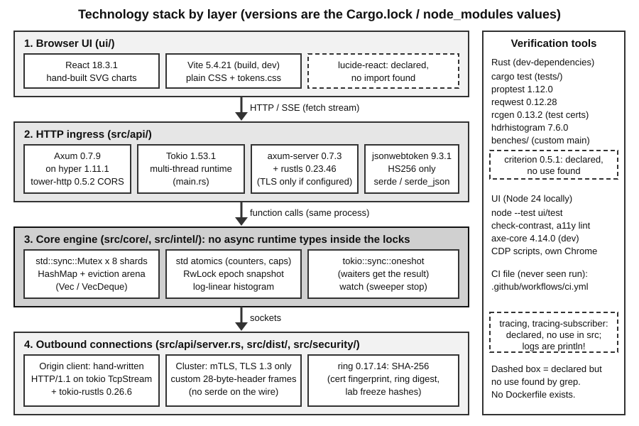

Source: `Cargo.toml`, `Cargo.lock`, `ui/package.json`, `ui/node_modules/{react,vite}/package.json`, `src/main.rs`, `src/api/server.rs`, `src/security/*`, `src/dist/*`.

## 3.1 The dependency picture in one table

Direct runtime dependencies from `Cargo.toml`, with the resolved versions in `Cargo.lock` (288 locked packages, lockfile v4; reproduced by reading the lockfile, and consistent with `docs/release/g4/cycle1_lab_intelligence_deps_review.md`, an **AI** review, not independent).

| Crate (declared) | Locked | What it is for here | Used in `src`? |
|---|---|---|---|
| `tokio` 1.38, features `full` | 1.53.1 | async runtime, timers, channels, TCP | yes, everywhere |
| `axum` 0.7, features `ws`, `macros` | 0.7.9 | HTTP routing, extractors, SSE | yes; **no WebSocket and no `#[debug_handler]` use found** |
| `axum-server` 0.7, `tls-rustls` | 0.7.3 | TLS listener for the ingress | yes (`security/tls.rs`, `server.rs`) |
| `hyper` / `hyper-util` / `tower` | 1.11.1 / 0.1.20 / 0.5.3 | **transitive** (via axum); not declared | not named in `src` (`hyper::` has zero hits) |
| `tower-http` 0.5, `cors`, `fs` | 0.5.2 (a second copy, 0.6.11, is also locked) | CORS layer | only `cors`; **`ServeDir`/`fs` unused** |
| `serde`, `serde_json` | 1.0.229 / 1.0.151 | JSON for API bodies, lab artifacts, JWT claims | yes |
| `jsonwebtoken` 9 | 9.3.1 | JWT sign/verify | yes (`security/jwt.rs`) |
| `rustls` 0.23, `tokio-rustls` 0.26, `rustls-pemfile` 2.2, `webpki-roots` 0.26 | 0.23.46 / 0.26.6 / 2.2.0 / 0.26.11 | TLS for cluster mTLS, origin HTTPS, ingress | yes |
| `ring` 0.17 | 0.17.14 | SHA-256 | yes (5 files in `src`; fingerprints, anti-entropy ring digest, lab hashes) |
| `rand` 0.8 | 0.8.8 (a second copy, 0.10.3, is transitive) | seeds, run ids, **synthetic dashboard numbers** | yes |
| `tokio-stream`, `futures-util` | 0.1.19 / 0.3.34 | SSE interval stream, stream helpers | yes |
| `url` | 2.5.8 | origin URL parsing | yes |
| `tracing`, `tracing-subscriber` | 0.1.44 / 0.3.x | structured logging | **no use found in `src`, `tests`, `benches`**; logs are `println!`/`eprintln!` |

Dev-dependencies: `jsonwebtoken`, `rcgen` 0.13.2, `reqwest` 0.12.28, `hdrhistogram` 7.6.0, `proptest` 1.12.0, and `criterion` 0.5.1 (declared, **no use found**; the seven benches have `harness = false` and a custom `main`).

Verification: I counted file-level `grep` hits over `src/`, `tests/`, `benches/` (`grep -rln "tracing::" src` returned nothing). "No use found" describes the current tree; it does not prove that a macro-generated or feature-gated use cannot exist. Axum itself pulls in `tracing` and `tokio-tungstenite` through its own features (`Cargo.lock`), so those crates are compiled regardless.

::: caution
Unused declarations (`tracing`, `tracing-subscriber`, `criterion`, the `ws` and `fs` features, UI `lucide-react`) widen the supply chain for no benefit. They are harmless to correctness. They are a fair point for a hostile reviewer, and the honest answer is "declared, not used, a tidy-up for the owner to approve" (the UI audit item UA-15 and the toolkit proposal TK-26 record `lucide-react` as an open owner decision).
:::

## 3.2 Rust

### 1. What it is, in simple English

Rust is a compiled systems language. The compiler checks, before the program runs, that memory is used safely: no use after free, no two threads changing the same data without a lock. Programs run as native machine code with no garbage collector.

### 2. Why PhantomCache needs it

A cache gateway sits on the hot path of every request, holds shared mutable state across many threads, and must not stall unpredictably. Rust makes "this data is shared between threads" explicit in the type system (`Arc`, `Mutex`, `Send`), which is what the core engine does.

### 3. Why it was selected

**Not recorded** (see 3.0). The README presents the choice as a stack fact. Anything below about *why* is our reasoning.

### 4 and 5. Alternatives, and why they were not selected

Go and C# are the two alternatives a judge will name (see the judge box). Nothing in the repository shows they were evaluated against Rust, so I cannot say "they were rejected because...". The handoff index only says that Go/Rust discussions happened in a conversation that is not available.

### 6. How it is used

- Edition 2021 (`Cargo.toml`). No `rust-version` field, no `rust-toolchain` file, no `[profile]` section, so release builds use Cargo defaults (no LTO setting, unwinding panics). The README claims "cargo 1.75+"; the G4C review (F28) found the code needs at least 1.88 (uses `slice::as_chunks`, `is_multiple_of`) and was only verified on 1.98.0 (reported by that review; I did not rebuild).
- `unsafe`: **five `unsafe` blocks in `src/api/lab_api.rs`** (Windows job-object and process-handle calls, each with a `// SAFETY:` comment, for killing child processes) and one `unsafe impl GlobalAlloc` in `benches/support/alloc_counter.rs` (a counting allocator for the memory bench). None in the cache engine (`src/core`, `src/intel`, `src/dist`). I grepped `unsafe` over `src`, `tests`, `benches`. Status: IMPLEMENTED; not reviewed by a human.
- Panics: the runtime is built in `src/main.rs::real_main` with `tokio::runtime::Builder::new_multi_thread().enable_all()`, and the whole `block_on` is wrapped in `std::panic::catch_unwind`. There is no per-request panic containment layer (G4B-28, OPEN).

### 7. Advantages and limits

Advantages: data-race freedom for safe code, no GC pauses, one binary. Limits: slow compiles (the project mandates `-j 1` on this Windows machine), a steep learning curve, and **memory safety does not mean logic safety**: the most serious reported cache finding (G4A-01, a stale-body race; UNDER-INVESTIGATION, confirmed by AI code reading, the owner calls it unconfirmed) would be a logic race that Rust's type system does not prevent. Say that in the defence.

::: judge
**JUDGE MAY ASK**

Question: Why did you choose Rust for a cache?

**Suggested answer** (about 30 to 60 seconds spoken, plain English):

A cache gateway keeps shared mutable state that many threads touch on every request, and it sits on the latency path. Rust gives me native speed with no garbage collector, and the compiler forces me to be explicit about what is shared between threads. That removes whole classes of memory and data-race bugs. I want to be straight about the record: the repository does not contain a written decision comparing languages. The README states the stack, and early language discussions happened in a conversation that is not in the repository. So this is my reasoning for why Rust fits, not a documented trade study.

**If the judge asks further:**

"Does Rust make the cache correct?" No. Rust prevents memory errors and data races on safe code. It does not prevent logic races. Our G4A-01 finding, where an old response body can survive an acknowledged invalidation, would be a logic race in safe Rust, and it is UNDER-INVESTIGATION (an AI code reading confirmed it; the owner calls it unconfirmed). I would say Rust reduced one risk class and did nothing for that one.

**Evidence to know:** `Cargo.toml` (edition 2021, no `[profile]`, no `rust-version`); README section 4; `docs/handoff/07_CONVERSATION_AND_DECISION_INDEX.md` (ChatGPT-Prior row: file not in repository); `grep unsafe`: five blocks in `src/api/lab_api.rs`, none in `src/core`; G4A-01 in `docs/release/g4/cycle1_findings_disposition_register.md` (UNDER-INVESTIGATION). Status: IMPLEMENTED; language choice UNVERIFIED as a recorded decision.
:::

::: judge
**JUDGE MAY ASK**

Question: Why not Go or C#? Go has goroutines, a good HTTP server, and is the language of many caches.

**Suggested answer** (about 30 to 60 seconds spoken, plain English):

Both would work, and both have strong HTTP stacks and concurrency support. I did not run a head-to-head, and the repository has no record of one, so I will not claim Go or C# were rejected on evidence. My reasoning for Rust is control: no garbage collector means no collector pauses in the tail latency, and ownership makes sharing visible. The cost is real: Rust is slower to write, and a Go service would have been faster to build. If tail latency from the collector turned out not to matter for this workload, Go would be a defensible choice.

**If the judge asks further:**

"Can you show Rust gave better latency than Go?" No. The repository contains no Go or C# implementation and no comparison. Our benchmarks have never been run in a release profile across languages. I would not claim a performance advantage over either. Also note we run on Windows loopback; any such comparison would need a release build, a fixed workload, a seed, and repetitions (CLAUDE.md section 4).

**Evidence to know:** absence of any Go/C# artefact (searched `docs/` and `src/`); `bench-results/README.md` (no release-profile result established); handoff 07 (language talk not in repository). Status: reasoning, not recorded; no performance claim.
:::

## 3.3 Async programming and Tokio

### 1. Simple explanation

A web server spends most of its time **waiting** for a socket, the origin or a timer. Blocking one operating-system thread per waiting request wastes memory and scheduling time. **Async** code lets a task say "I am waiting, run someone else", using `.await`. A **runtime** (here Tokio) owns a small pool of OS worker threads and schedules many lightweight **tasks** across them. A *task* is a unit of async work; a *thread* is an OS resource.

### 2. Why PhantomCache needs it

One process must serve many connections, hold hundreds of requests waiting on one origin fetch (coalescing), run timers (sweeper, heartbeats, anti-entropy) and talk to peers. All of that is waiting, so async fits.

### 3. Why it was selected

No selection record. The strongest recorded link is ADR-002 CT-2: the origin fetch runs in a spawned task so it survives a client disconnect, which is a design that *depends on* a runtime with detached tasks. Test named by the ADR: `test_ct2_initiator_cancellation_detached_fetch` (the ADR marks it VERIFIED; I did not rerun it; it proves the fetch completes after the initiator drops, not that every cancellation path is safe).

### 4 and 5. Alternatives

`async-std`, `smol`, or plain OS threads. Why not chosen: not recorded. Our reasoning: axum 0.7 and `tokio-rustls` (both already required) are built on Tokio, so a second runtime would be a cost with no benefit.

### 6. How it is used (`file::symbol`)

| Tokio feature | Where | Purpose |
|---|---|---|
| multi-thread runtime | `src/main.rs::real_main` (`Builder::new_multi_thread().enable_all()`; default worker count, no `worker_threads` setting found) | run everything |
| `tokio::spawn` | `src/api/server.rs` (leader fetch task; background revalidation task), `src/core/cache.rs::spawn_sweeper_task` | detach work from a request |
| `oneshot` | `src/core/cache.rs::FetchRegistrationResult::Wait`, `src/core/coalesce.rs` | give the one fetch result to many waiters |
| `watch` | `spawn_sweeper_task` (shutdown flag), `src/dist/node.rs`, `src/dist/session.rs` | broadcast a stop or state change |
| `mpsc` (bounded) | `src/dist/router.rs` (`channel::<PeerJob>(PER_PEER_QUEUE)`, replica-invalidation queue of 1024) | queue work per peer with back-pressure |
| `Semaphore` | `src/dist/node.rs` (64 handshake slots), `src/dist/router.rs` (16 permits) | cap concurrent handshakes / fan-out |
| `broadcast` | `src/security/cluster.rs` (`revocation_tx`, capacity 64) | tell connections a peer was revoked |
| `time::timeout`, `time::interval` | `server.rs::fetch_origin_raw` (17 uses of `tokio::time::timeout` in `src`), sweeper | bound every network wait |
| `select!` | `spawn_sweeper_task` | wait on tick or shutdown |
| `spawn_blocking` | `src/api/lab_api.rs` (lab artifact reads) | keep file work off the async workers |

A second thread pool exists only for the Lab: `lab_api.rs` starts named OS threads (`std::thread::Builder`) for experiment runs, wrapped in `catch_unwind`.

### 7. Advantages and limits

Advantages: one runtime for HTTP, TLS and timers; bounded channels and semaphores give explicit resource caps. Limits: a blocking call inside an async task stalls a worker thread (see 3.5). Cancellation is subtle: dropping a future cancels it at the next `.await`, which is why the code uses RAII guards (`OriginPermit::drop` releases the gate slot; `OriginFetchGuard`) so cleanup happens on cancellation too. Status: IMPLEMENTED; the cancellation and guard behaviour is TESTED by several tests but G4A-13 (byte drift in a guard drop path) is OPEN.

::: judge
**JUDGE MAY ASK**

Question: Why Tokio, and what does it give you that threads would not?

**Suggested answer** (about 30 to 60 seconds spoken, plain English):

Most of what the gateway does is wait on sockets and timers. Tokio lets a few worker threads serve thousands of waiting requests, and gives me the building blocks I need for the design: `oneshot` channels to hand one origin result to many coalesced waiters, bounded channels and semaphores to cap work, and timeouts around every network wait. I did not compare runtimes; the repository records the use of detached tasks in ADR-002 but not a runtime selection. The practical reason is that Axum and `tokio-rustls` are built on Tokio, so it is the natural fit.

**If the judge asks further:**

"What breaks if a task blocks?" It occupies a worker thread. The sweeper takes shard locks synchronously on a worker; the G4A-03 finding says one sweep tick scans a whole shard under its mutex, so a very large shard could hold a worker longer than the documented 1 ms bound. That is OPEN. The main protection today is that critical sections are short and contain no I/O.

**Evidence to know:** `src/main.rs::real_main`; `src/core/cache.rs::spawn_sweeper_task`; ADR-002 CT-2 and test `test_ct2_initiator_cancellation_detached_fetch`; G4A-03, G4A-13 in the disposition register. Status: IMPLEMENTED; sweeper lock-hold bound has a test (`test_sweeper_lock_hold_time_bounded`) but G4A-03 says the batch limit bounds candidates, not keys inspected.
:::

## 3.4 Axum, hyper and tower

### 1. Simple explanation

**hyper** is the low-level HTTP implementation: it parses requests and writes responses. **tower** is a small interface (`Service`) plus reusable wrappers called layers (timeouts, CORS, limits). **Axum** is a web framework on top: it maps a URL and method to an async function (a *handler*), extracts parts of the request (path, headers, JSON), and turns return values into responses. PhantomCache only names Axum and `tower-http` in its code; hyper and tower arrive as transitive dependencies.

### 2. Why PhantomCache needs it

It needs to expose a cache API, health probes, a metrics API, an SSE stream for the UI, and a Lab API, with shared state and middleware (body limit, CORS).

### 3. Why it was selected

Not recorded as a decision. The Phase 1 security specification lists `axum-server` (for TLS) in its dependency plan with the purpose "Ingress TLS 1.3 termination", but it does not compare it with alternatives.

### 4 and 5. Alternatives

`actix-web`, `warp`, or using `hyper` directly. Not recorded. Our reasoning: Axum follows the Tokio and tower ecosystem the project already uses, and extractors keep handlers short.

### 6. How it is used

- Router: `src/api/server.rs::create_app_with_lab` builds `Router::new()`, merges `crate::health::router` and, only when a Lab service is passed, the `/api/v1/lab/*` routes. The route table is in Chapter 2, section 2.3.1; auth is Chapter 6.
- Shared state: `.with_state(Arc<ApiState>)`. `ApiState` holds the `PartitionedCache` and several `std::sync::Mutex` fields (for example `snapshot`, `workload_type`).
- Layers: `DefaultBodyLimit::max(512 * 1024)` and a `tower_http::cors::CorsLayer` built from `CorsConfig` (`PHANTOM_CORS_ORIGINS`).
- Serving: with TLS, `axum_server::bind_rustls(addr, tls_cfg.rustls_config).serve(app.into_make_service())`; without TLS, `tokio::net::TcpListener::bind` then `axum::serve(listener, app)`. `validate_startup_security` fails closed on an unsafe combination (non-loopback bind without TLS or auth, unless explicitly allowed).
- SSE: `axum::response::sse` with a `tokio_stream` `IntervalStream` (10 Hz telemetry). The browser UI does not use the SSE route through `EventSource` for the Lab; it uses fetch-streaming so it can send an `Authorization` header (`ui/src/lib/sse.js`, per the G3 UI notes in `docs/research/progress_ledger.md`).
- **The origin client is hand-written.** `src/api/server.rs::fetch_origin_raw` opens a `tokio::net::TcpStream` to a **pre-validated, pinned address**, optionally wraps it in `tokio_rustls`, writes a literal `GET ... HTTP/1.1\r\nHost: ...\r\nConnection: close` request, and reads with `read_to_end` through a size limit and `tokio::time::timeout`. There is no `hyper` client and no `reqwest` in the runtime path (`reqwest` is dev-only). The pinning comment in `src/security/upstream.rs` ("Pin the first validated address for the socket connection") is why: the address that passed the SSRF check is the address that is connected to. Trade-off (our reasoning): the team controls every byte and can pin addresses, but now owns an HTTP/1.1 response parser; the parser has its own tests (`parser_robustness_tests`, proptest) and its own findings. Status: IMPLEMENTED; TESTED by `security_phase2_upstream_tests`, `parser_robustness_tests`; not independently verified.

### 7. Advantages and limits

Advantages: small handlers, composable layers, no custom server loop. Limits: there is no request-timeout layer on the ingress; the G4B-01 finding concerns a pre-authentication body read (Chapter 6 owns it). Axum's TLS listener config advertises ALPN `h2` and `http/1.1` (`axum-server-0.7.3/src/tls_rustls/mod.rs::config_from_der`, read from the registry source). Whether HTTP/2 is actually served depends on hyper's enabled features, which I did **not** verify: UNVERIFIED.

::: caution
**Discrepancy.** `server.rs` prints "Starting Axum server with TLS 1.3" and the Phase 1 specification says "Ingress TLS 1.3 termination", but the ingress config comes from `RustlsConfig::from_pem_file`, which in `axum-server 0.7.3` calls `ServerConfig::builder()` with no protocol-version restriction. By rustls documentation (not re-verified here) that allows TLS 1.2 and 1.3. The only test that rejects a TLS 1.2 client is for the **cluster** listener (`test_p3_sec04_strict_tls13_rejection_of_tls12_client`). Ingress "TLS 1.3 only" is therefore UNVERIFIED by test; the G4 register records the mismatch as G4B-20 (CONFIRMED by AI reading, OPEN, Low); the ingress tests (`test_phase1_at01`, `at02`) check that valid certificates work and untrusted ones fail.
:::

::: judge
**JUDGE MAY ASK**

Question: Why Axum rather than another framework, and why did you write your own HTTP client for the origin?

**Suggested answer** (about 30 to 60 seconds spoken, plain English):

Axum is a thin framework on hyper and tower, on the same Tokio runtime as the rest of the system, so routing, state, body limits and CORS were a few lines each. I did not compare frameworks and the repository does not record a comparison. For the origin side I wrote a small HTTP/1.1 client because I needed to connect to an address I had already validated against SSRF rules, send a fixed minimal header set, cap the response size, and time out every step. That is a deliberate control decision, and the cost is that I own a response parser, so it has its own tests and its own review findings.

**If the judge asks further:**

"Is your parser as safe as hyper's?" I cannot claim that. Hyper is a widely used public library; I have not reviewed its test history, and ours has only unit and property tests (`parser_robustness_tests`) and AI review, not independent review. The Connection: close, no keep-alive design also means every miss pays a fresh TCP (and TLS) handshake; that cost has not been measured in a release build.

**Evidence to know:** `src/api/server.rs::create_app_with_lab`, `fetch_origin_raw`; `src/security/upstream.rs`; `tests/integration/parser_robustness_tests.rs`, `security_phase2_upstream_tests.rs`; `Cargo.lock` (`hyper` is transitive). Status: IMPLEMENTED, TESTED; decision not recorded.
:::

## 3.5 Concurrency primitives and the concurrency model

This is the most important section of the chapter for your defence. Read it twice.

### 3.5.1 The two kinds of waiting

- **Async waiting** (`.await`): the task is parked and the thread runs someone else. Used for sockets, timers, channel receives.
- **Synchronous locking** (`std::sync::Mutex::lock()`): the *thread* waits until the lock is free. Used here for very short in-memory sections.

`tokio::sync::Mutex` exists and can be held across `.await`, but it is slower and is not used for the cache shards. PhantomCache uses `std::sync::Mutex` because each critical section is a few hash-map operations with no I/O. The **rule** (CLAUDE.md section 5, and the comment on `OriginGate` in `src/intelligence/executor.rs`) is: never hold a `std::sync` guard across an `.await`. Figure 3.2 shows why.

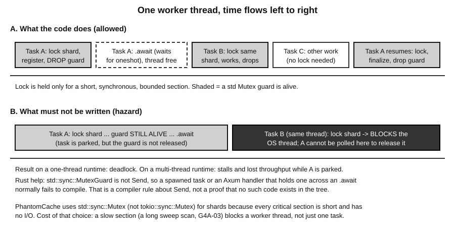

Source: `src/api/server.rs` (`Initiate` branch: the `waiters.lock()` push sits in its own `{ ... }` block before any await), `src/core/cache.rs::spawn_sweeper_task`, `src/intelligence/executor.rs::OriginGate` doc comment.

The compiler helps: `std::sync::MutexGuard` is `!Send`, so a guard alive across an `.await` inside a `tokio::spawn` task (or an Axum handler, which must be `Send`) normally does not compile. That is a language rule about `Send`; it is not a proof that the tree contains no violation, and I did not audit every function. The G4C review reports it read the executor code and found no std Mutex held across `.await` there (AI review).

### 3.5.2 Shards: the partitioned mutex buckets

**Simple explanation.** One lock for the whole cache means every request waits in one line. Split the cache into N independent buckets, each with its own lock; a request goes to the bucket its key hashes to. Two requests collide only if their keys land in the same bucket.

**How it works** (`src/core/cache.rs::PartitionedCache`):

```text
shard_index(key) = hash(key) & shard_mask        // shard_mask = num_shards - 1
guard = shards[shard_index].lock()                // one std Mutex per shard
... look up / insert in guard.map ...             // short, no I/O
drop(guard)
```

`new_with_diagnostics` asserts `num_shards.is_power_of_two()`, so `& mask` replaces a modulo. `src/main.rs` builds the serving cache with `PartitionedCache::new(8)`; the per-node demo caches in `src/dist/node.rs` use 4. The hash is `std::collections::hash_map::DefaultHasher::new()` over the `CacheKey` (`get_shard_index`).

**Worked example (illustrative numbers).** Eight shards, mask `0b111`. Suppose a key hashes to `0x9A3F...B5`. The low three bits of `0xB5` (`1011 0101`) are `101` = 5, so the key lives in shard 5. If the hash were uniform and requests independent, the chance that two simultaneous requests need the same shard is 1/8 = 12.5%; with one global lock it is 100%. The uniformity and independence assumptions are exactly what a hot key breaks: 10,000 requests for one popular key all use one shard, so sharding gives that key no benefit (Chapter 4 covers hot keys).

Each shard (`CacheShard`) holds the key map (`HashMap<CacheKey, KeyState>`), the single-flight map (`in_flight: HashMap<CacheKey, Arc<SharedOp>>`), byte accounting, and a boxed eviction policy. Default `max_entries_per_shard` is 10,000.

**What can go wrong.**

- *Hot key or skew*: one shard becomes the bottleneck (our reasoning; measured by `b2_concurrency` bench source, but no release-profile result exists in the repository).
- *Predictable shard choice* (hypothesis, not tested): `DefaultHasher::new()` uses fixed keys, so shard choice is deterministic and not secret; by std documentation (recalled, not re-verified) the algorithm is **not guaranteed stable across Rust releases**. Consequences: (a) a client that can choose many keys could aim them all at one shard; (b) rendezvous routing uses the same hasher (`src/dist/router.rs::calculate_hash`), so nodes built with different toolchains could disagree about ownership. The cluster therefore assumes one binary on all nodes; I found no document stating that requirement (UNVERIFIED as an explicit requirement). The inner `HashMap`s use the randomised `RandomState`, which is fine.
- *Poisoning*: if a thread panics while holding a std lock, the lock becomes poisoned. Cache shard locks are recovered with `Err(p) => p.into_inner()` and a counter `lock_poison_recovered`. Other sites still call `lock().unwrap()` and would panic (G4A-21 and G4B-28, both OPEN). Status: PARTIAL.
- *Sweeper hold time*: `sweep_lazy_reclamation` loops over shards and holds each shard's lock while it scans `shard.map.iter()`; the batch limit stops *collecting candidates*, not iterating (G4A-03, OPEN).

::: judge
**JUDGE MAY ASK**

Question: Why partitioned mutex buckets? Why not a lock-free concurrent map, or one `RwLock`?

**Suggested answer** (about 30 to 60 seconds spoken, plain English):

The cache keeps more than a key and a value. Each key has a generation, active operations, an in-flight fetch registration, and eviction bookkeeping, and the correctness rules in the system, like "never evict a key with an active fetch" and "only store a fetched result if the generation still matches", need several of those updated together. A mutex around a shard makes that multi-field update trivially atomic. Splitting into eight shards cuts contention without giving that up. I should be clear that the repository does not record a comparison with lock-free maps; ADR-001 only describes the shard layout as it was. This is my reasoning, and the cost is that a hot key or a long critical section still serialises on one lock.

**If the judge asks further:**

"Have you measured the contention benefit?" The benchmark sources exist (`benches/b2_concurrency.rs`), but the repository states no release-profile benchmark has been established on the current tree (`bench-results/README.md`), so I do not quote a speed-up. "Why 8?" It is a constant in `main.rs`, not tuned; a power of two is required by the mask.

**Evidence to know:** `src/core/cache.rs::PartitionedCache`, `get_shard_index`, `CacheShard`; `src/main.rs` (`PartitionedCache::new(8)`); `tests/integration/concurrency_verification_tests.rs`; G4A-03, G4A-21. Status: IMPLEMENTED; TESTED for correctness under stress and a proptest model, which does not prove performance or absence of every race.
:::

### 3.5.3 Atomics

An **atomic** is a number the hardware updates in one indivisible step (`fetch_add`), with no lock. PhantomCache uses them for counters and flags that do not need to change together with other data.

- `AtomicU64` / `AtomicUsize` counters (hit, miss, revalidation counts, `next_op_id`) and settings (`max_stale_ms`, `sweeper_batch_size`, `max_background_refresh`) in `PartitionedCache`, read with `Ordering::Relaxed`. In `cache.rs` I counted 62 lines using `Relaxed` and 7 using `SeqCst` (a `grep -c` of lines).
- `global_epoch: AtomicU64`, loaded and stored with `SeqCst`.
- `OriginGate` (`src/intelligence/executor.rs`): `in_flight` and `cap` are atomics; `OriginPermit::drop` does `fetch_sub`.
- `AtomicLogLinearHistogram` (`src/intel/telemetry.rs`): `Vec<AtomicU64>` buckets; `record` is two `Relaxed` `fetch_add` calls.

*Memory ordering in one paragraph.* `Relaxed` guarantees the increment is not lost but promises nothing about when other threads see it relative to other memory. That is fine for a counter you only display. It is **not** fine for a value that guards other data. A reader of the histogram can see `total_count` and the buckets at slightly different moments, so a percentile read concurrently with writes is approximate (our reasoning; a snapshot-consistency test was not checked).

**The histogram in one line.** `AtomicLogLinearHistogram` holds 2,688 `AtomicU64` buckets (128 exact plus 20 octaves of 128), about 21 KB. Chapter 5, section 5.11 owns the maths and the worked example (1000 us lands in bucket 506 and reads back as 1002 us, error 0.2%; worst case 0.39%). I recomputed that example from `value_to_bucket` and `bucket_to_value`: it is correct. Status: IMPLEMENTED; TESTED (`telemetry_redesign_tests::test_histogram_relative_error_bounded` checks round-trip error on its sampled values, not every input). Chapter 5 also records that no production reader of this histogram was found; this chapter covers only the recording design.

::: caution
Two comments in `src/intel/telemetry.rs` disagree with the code: a section header says "relative error <= 0.5%" while the function comment says 0.39% (the code supports 0.39%), and the constant comment "2^7 to 2^27 (128 us to ~67.1 seconds)" is wrong by a factor of two: 2^27 microseconds is about 134 seconds (67.1 s is 2^26). The bucket arithmetic is unaffected. The product is not edited.
:::

### 3.5.4 The RwLock epoch snapshot

An **epoch** is a counter that says "everything stamped with an older number is stale" (Chapter 4 explains invalidation). Every request must read its tenant's epoch. If that read had to take the `tenant_epochs` mutex, every request would queue on one lock.

Design (`PartitionedCache`): `tenant_epochs: Mutex<HashMap<String, u64>>` is the writable truth, touched only by invalidations. `epoch_snapshot: RwLock<Arc<HashMap<String, u64>>>` is a read-only copy. `get_effective_epochs` takes the **read** lock, looks up the tenant, and takes the `global_epoch` atomic. Many readers share a `RwLock` read lock at once. An invalidation updates the map under the mutex, then replaces the snapshot.

The honest details:

- The replacement is `let mut snap = epoch_snapshot.write()...; *snap = Arc::new(guard.clone());`. The O(n) clone of up to `MAX_TENANT_EPOCHS = 10_000` entries runs **while the write lock is held**, so readers pause for it: "readers never block" holds except during an invalidation. G4A-12 (PLAUSIBLE, OPEN) flags the clone and unvalidated peer-supplied tenant strings. A smaller fix (our reasoning): build the new `Arc` before taking the write lock.
- The tenant and global epochs are read separately, so a reader can see a mixed pair during `invalidate_all` (G4A-17, PLAUSIBLE, OPEN).
- Overflow: when 10,000 tenants exist and a new one arrives, the code increments `global_epoch` and clears the map (SEC-4A-01). That fences everything, so it is a cache flush.
- Tests: `tests/integration/epoch_contention_tests.rs` (four tests including `test_concurrent_epoch_reads_scaling` and `test_invalidate_during_concurrent_reads_linearizable`). I did not rerun them. The word "linearizable" in that test name is a label, not a proof: the test shows behaviour under its own workload, not linearizability and not a bound on reader pause time.

**Lock order** (CLAUDE.md section 5; I confirmed the parts I read): shard mutex first; `get_effective_epochs` (RwLock read plus an atomic) is called from inside shard-locked code such as the sweeper; the invalidation functions take `tenant_epochs` then the snapshot write lock and take no shard lock. Under that pattern there is no cycle.

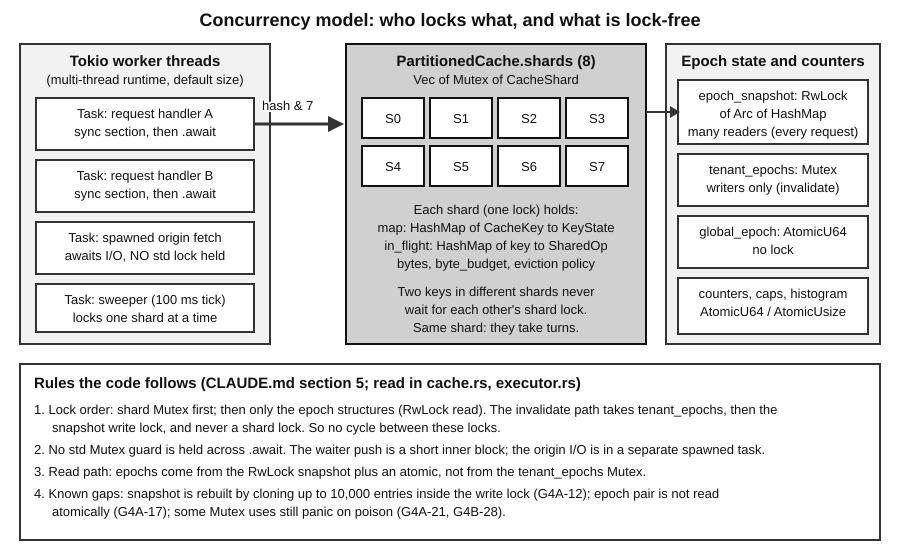

Source: `src/core/cache.rs::PartitionedCache` (fields), `get_effective_epochs`, `try_invalidate_tenant`, `try_invalidate_all`, `spawn_sweeper_task`; `src/main.rs` (`PartitionedCache::new(8)`); G4A-03, G4A-12, G4A-17, G4A-21, G4B-28.

### 3.5.5 Arc, channels, and the other mutexes

- `Arc<T>`: shared ownership across tasks. The cache, the state, bodies (`CachedResource.body: Arc<Vec<u8>>`) are `Arc`s. A cache hit clones the `Arc` pointer for the resource but the handler still copies the body bytes into the response (`(*resource.body).clone()` in the response-building branches of `get_cache_handler`; the "body clone per hit" is noted in G4A-26).
- `oneshot` for coalescing: waiters are `Vec<oneshot::Sender>` in `SharedOp.waiters` (itself a `std::sync::Mutex`); the leader pushes its own sender in a tiny block, then spawns the fetch, then awaits its receiver. Bounded by `max_waiters_per_key` (default 1,000).
- Other `std::sync::Mutex` uses: `eviction_policy`, `AuditStore` behind a process-wide `OnceLock` (`GLOBAL_INTEL_AUDIT`), router counters, the repair ledger, the OriginGate's observation window and AIMD controller, telemetry buffers. All are meant to be short; none is verified free of await-crossing by me.

::: judge
**JUDGE MAY ASK**

Question: What are the concurrency implications of your design? Where could it deadlock or stall?

**Suggested answer** (about 30 to 60 seconds spoken, plain English):

The rule is simple: short synchronous critical sections under `std::sync::Mutex`, and no lock held across an `await`. The slow work, the origin fetch, runs in a separate spawned task with no lock held, and the result is handed to waiters through channels. The lock order is shard first, then the epoch structures, and the invalidation path never takes a shard lock, so I see no lock cycle in what I read. The real risks I know of are these: a long sweep scan holds a shard lock on a worker thread (G4A-03), the epoch snapshot rebuild clones up to 10,000 entries while readers wait (G4A-12), and some locks still panic on poison (G4A-21). All three are open findings, not fixed.

**If the judge asks further:**

"Is it linearizable?" I do not claim that. I claim the single-flight and generation-fence rules, which have a protocol-model test and a stress test, and I tell you honestly that G4A-01 is a reported race (UNDER-INVESTIGATION) where an old body might survive an acknowledged invalidation. "How do you know there are no deadlocks?" I do not have a proof; I have a lock-order argument from reading the code and stress tests (`test_real_cache_concurrent_stress_schedule`) that did not hang, which shows absence of hangs in those schedules, not absence of deadlock.

**Evidence to know:** `src/core/cache.rs` (`get_effective_epochs`, `try_invalidate_tenant`), `src/intelligence/executor.rs::OriginGate` doc comment; `tests/integration/concurrency_verification_tests.rs`, `epoch_contention_tests.rs`; G4A-01, -03, -12, -17, -21, G4B-28 in the disposition register. Status: IMPLEMENTED; TESTED (stress and model); not INDEPENDENTLY VERIFIED.
:::

## 3.6 Data structures as actually used

| Structure | Where | Why this one (our reasoning) | Notes |
|---|---|---|---|
| `HashMap<CacheKey, KeyState>` per shard | `CacheShard.map` | O(1) average lookup by key | `CacheKey` includes tenant and path (Chapter 4) |
| `HashMap` + `HashSet` | in-flight map, tenant epochs, S3-FIFO ghost set and frequency map | membership tests | |
| `Vec<Option<Node>>` + `free_list: Vec<usize>` + `HashMap<CacheKey, usize>` | `FaithfulSieve`, `FaithfulLru` (`core/eviction.rs`) | an **arena-based doubly linked list**: nodes live in a `Vec`, links are indices, freed slots are reused. Gives O(1) unlink and move without unsafe pointers | `hand: usize` for SIEVE |
| `VecDeque<CacheKey>` x 3 + `HashSet` + `HashMap<_, u8>` | `FaithfulS3Fifo` | FIFO queues (small, main, ghost) | G4A-02: `on_remove` leaves tombstones; OPEN; default policy is SIEVE |
| `Vec<CacheKey>` + `HashMap<_, bool>` | `ClockScan` | legacy O(n) scan fallback (`on_remove` uses `retain`) | not the default |
| `Vec<AtomicU64>` of 2,688 | `AtomicLogLinearHistogram` | lock-free log-linear latency histogram | see 3.5.3 |
| `VecDeque` ring buffers | diagnostics, audit store, anti-entropy ring, engine switch history | bounded history with O(1) push/pop at both ends | capacities are explicit |
| `BTreeMap` / `BTreeSet` | `config.rs` (sorted config keys), `phantom-lab` reports, `intelligence/mod.rs` parameters, anti-entropy `resync_needed` | deterministic iteration order for output and hashes | |
| fixed array `[u64; 15]` | `origin_metrics::LATENCY_BUCKETS_MS` | coarse origin latency buckets | |
| `Vec<Vec<u32>>` | `intel/sketch.rs::CountMinSketch` | a probabilistic frequency counter | **no use outside its own file** (`grep CountMinSketch src`); PROTOTYPE ONLY |
| bitmaps | none found | | I searched for bitmap/bit-vector types and found none; "visited" flags are `bool`s |

Complexity claims (CLAUDE.md "O(1) amortised") belong to Chapter 4; the G4A-20 finding says pinned-key scans are not O(1), OPEN.

## 3.7 The TLS and mTLS stack

### 1. Simple explanation

**TLS** encrypts a connection and lets the client check the server's identity with a certificate. **mTLS** (mutual TLS) also makes the server check the *client's* certificate, so each side proves who it is. PhantomCache uses TLS in three separate places: the ingress (browser or client to gateway), the origin (gateway to your backend over HTTPS), and the cluster (node to node).

### 2. Why it needs it

The cluster carries invalidation commands; a forged one would purge or poison caches. Ingress TLS protects tokens in transit. (Trust analysis is Chapter 6.)

### 3. Why selected

**Recorded:** `docs/security/phase-1-specification.md` section 8 lists "Windows OpenSSL / C library build failures" as a risk and mitigates it with "pure-Rust `ring` / `rcgen` and Rustls, eliminating OpenSSL C dependencies". `docs/security/phase-3-design.md` plans `tokio_rustls::TlsAcceptor` / `TlsConnector` for the cluster.

### 4 and 5. Alternatives

OpenSSL (via `native-tls` or `openssl`), `aws-lc-rs` directly. The recorded rejection reason for OpenSSL is the Windows build risk above. No other comparison is recorded.

### 6. How it is used

- **Cluster mTLS**: `src/security/cluster.rs` builds `rustls::ServerConfig::builder_with_protocol_versions(&[&rustls::version::TLS13])` with `WebPkiClientVerifier` (client certificate mandatory), and a matching `ClientConfig` with `with_client_auth_cert`. After the handshake, `src/dist/node.rs` reads `peer_certificates()`, then calls `security::cluster::extract_sans_from_der` (a **hand-written ASN.1/DER walker**, not an X.509 library) to pull DNS SANs; exactly one SAN is required (SEC-3A-03). `compute_cert_fingerprint` is SHA-256 via `ring::digest`, and `parse_san_node_identity` enforces the `node-<id>.<cluster>` shape ("SAN node label must start with 'node-'"); both are in `src/security/cluster.rs`. Status: IMPLEMENTED; TESTED by `security_phase3_cluster_tests` including TLS 1.2 rejection.
- **Origin TLS**: `src/security/upstream.rs::UpstreamTlsConfig` with `webpki_roots::TLS_SERVER_ROOTS` (Mozilla roots as data) or a custom CA PEM; `ClientConfig::builder()` with default versions; no client auth.
- **Ingress TLS**: `axum-server` as in 3.4; optional; see the TLS 1.3 discrepancy.
- Cryptographic provider: `rustls 0.23.46` depends on `aws-lc-rs` (C code via `aws-lc-sys 0.46.0`, needs a C toolchain); `ring 0.17.14` is also a direct dependency. **Two crypto stacks are linked** (per `Cargo.lock` and the G4C inventory). Separately, dev-only `reqwest` pulls `native-tls` and `openssl 0.10.81` (on Windows it uses `schannel`, per the G4C review).

### 7. Advantages and limits

Advantages: memory-safe TLS logic, no OpenSSL link on Windows runtime paths, strict TLS 1.3 on the cluster. Limits: the recorded rationale "eliminating OpenSSL C dependencies" is only partly true: the default rustls provider is C-backed `aws-lc-sys`, and the dev tree has OpenSSL crates. The hand-written DER parser must be right on attacker-influenced bytes; I did not review it, and that it runs only after rustls has verified the chain is the intent per the comments, UNVERIFIED by test here. Demo certificates come from `scripts/gen-demo-certs.*`; never put real keys in the repository.

::: judge
**JUDGE MAY ASK**

Question: Why rustls and not OpenSSL for the mTLS between nodes? And why do you have both `ring` and `aws-lc-rs`?

**Suggested answer** (about 30 to 60 seconds spoken, plain English):

There is a recorded reason: the Phase 1 specification chose Rustls with `ring` and `rcgen` to avoid OpenSSL C-library build problems on Windows, where the project is developed. Rustls also lets me pin the cluster to TLS 1.3 only with a mandatory client certificate in a few lines, and a test checks that a TLS 1.2 client is refused. On the second part: the lockfile has two crypto libraries because I use `ring` directly for SHA-256, and rustls 0.23 defaults to `aws-lc-rs`. So the claim "no C crypto" in the spec is not literally true of the build, and I would recommend choosing one provider.

**If the judge asks further:**

"Is the node identity check sound?" It requires a certificate chaining to the cluster CA, exactly one DNS SAN of the expected form, and a fingerprint match against a registry. That is static membership; revocation is a broadcast flag (`revocation_tx`). It has been tested on loopback with generated certificates. It has not had independent security review, and there is no real multi-host deployment evidence.

**Evidence to know:** `src/security/cluster.rs` (`builder_with_protocol_versions`, `WebPkiClientVerifier`, `extract_sans_from_der`, `compute_cert_fingerprint`); `docs/security/phase-1-specification.md` section 8; `Cargo.lock` (`aws-lc-sys`, `ring`, `openssl`); `test_p3_sec04_strict_tls13_rejection_of_tls12_client`. Status: IMPLEMENTED, TESTED (loopback); not INDEPENDENTLY VERIFIED.
:::

## 3.8 JWT: jsonwebtoken

**Simple.** A JSON Web Token is a signed note: it says who you are, which role you hold, and when it expires; the server checks the signature with a shared secret.

**Why needed.** The control, delete, telemetry and Lab routes must be limited by role. **Why selected:** recorded as a dependency plan in the Phase 1 spec (`jsonwebtoken = "9.3"`, purpose "encoding, decoding, and cryptographic validation"); no alternative listed.

**How used (`src/security/jwt.rs`).** `JwtValidator` decodes with `jsonwebtoken::decode_header`, **rejects any algorithm other than HS256**, selects a secret by `kid` (rotation map) or the primary, and runs `Validation::new(HS256)` with `leeway = 10`. `JwtClaims` fields: `sub`, `iss`, `aud`, `exp`, optional `iat`, `tenant_id`, `roles`. Roles map to strings such as `cache:read`, `cache:invalidate`, `telemetry:read`, `scenario:operate`, `admin`. Status: IMPLEMENTED; TESTED (`security_phase1_tests`, `m7_sec_*`).

**Discrepancy.** The Phase 1 specification lists HS256, **RS256 and EdDSA** as allowed algorithms; the code accepts HS256 only. A symmetric HS256 secret means every verifier can also mint tokens, which is acceptable for a single gateway and weak for a multi-party setup. Revocation, `nbf`/`jti` handling are open (SEC-M7-09/10/11; Chapter 6). Limit: the library is a general one; correct use (algorithm pinning, required claims) is our code's job.

## 3.9 serde, JSON and the binary frame protocol

**Simple.** `serde` turns Rust structs into text or bytes and back. `serde_json` is the JSON format. Most of the system's inputs and outputs are JSON: API bodies, lab artifacts (`manifest.json`, `summary.json`), JWT claims, SSE events, the audit store.

**Where.** 19 source files derive `Serialize`/`Deserialize`; the lab uses it heavily (`src/lab/*`, `src/lab_live/*`). **Not used for the node-to-node wire.** `src/dist/frame.rs` defines a hand-written binary protocol: magic bytes `0x50 0x48 0x41 0x4E` ("PHAN"), version 1, a 28-byte big-endian header (flags, request id, sequence number, payload length), and fixed-size payloads such as the 50-byte anti-entropy sync request (8 epoch + 8 seq + 1 + 1 reserved + 32 digest). Our reasoning for a binary frame: bounded, length-checked parsing with no allocation driven by untrusted JSON; the cost is a protocol to version and fuzz by hand (`security_phase3b_framing_tests`, `parser_robustness_tests`). The choice is not recorded as an ADR; it is described in the Phase 3 design (not re-read in full for this chapter).

**Limits.** Hashing JSON is fragile: the G4C review found `compute_manifest_hash` (`src/lab/manifest.rs`) serialises a struct containing `HashMap`s, whose iteration order differs per process, so the digest of one logical manifest can differ (the production lab path uses a different manifest in `eval.rs`; this struct is only used by a test). Use `BTreeMap` where bytes get hashed.

## 3.10 Build, packaging and deployment: what exists and what does not

| Item | Exists? | Evidence |
|---|---|---|
| `Dockerfile`, `docker-compose`, Kubernetes manifests, Helm | **No** | searched the repository outside `node_modules` for `Dockerfile*` and `docker-compose*`: none; grep in `packaging/`, README, `docs/user` found no container references |
| Release build scripts | Yes | `packaging/build-release.sh` / `.ps1`: `cargo build --release --locked --bin phantom-cache-demo`, stamps `PHANTOM_BUILD_COMMIT` and `PHANTOM_BUILD_DATE` (read via `option_env!` in `src/config.rs`), packs a `.tar.gz` with checksums; "does NOT commit, tag, push or publish" |
| Smoke test of a bundle | Yes | `packaging/smoke-test.sh` / `.ps1`: `--version`, `--check-config`, rejects `PHANTOM_REQUIRE_AUTH=yes`, starts on a loopback port and probes `/health`, `/health/live`, `/health/ready` |
| Example configs | Yes | `packaging/phantom.example.conf`, `phantom.production.example.conf` (KEY=VALUE; precedence command line > environment > file > defaults) |
| Demo launcher | Yes (Windows) | `Start-Phantom-Demo.bat` (checks node/npm, port 8085) |
| Binaries | Two | `phantom-cache-demo` (`src/main.rs`) and `phantom-lab` (`src/bin/phantom-lab.rs`) |
| Process manager (systemd unit etc.) | **No** | not found |
| CI | A workflow file exists | `.github/workflows/ci.yml`: `ubuntu-latest`; `cargo fmt --check`, `cargo check`, `clippy -D warnings`, `cargo test` (note: **no `-j 1`, debug profile, all features**); frontend job: Node 20, `npm ci`, `npm run build` (it does **not** run `npm test`). Whether it ever ran on GitHub: UNVERIFIED (no run history in the repo) |
| Release-profile benchmarks | No result on record | `bench-results/README.md` |
| Clean-machine reproduction | Not done | `docs/STATUS.md` (M7 row) |

Honest statement for a judge: **PhantomCache has no container image and no orchestration**. It is one binary plus scripts, and the cluster path is validated on one host's loopback. Say "deployment packaging for a single binary exists; container and multi-host deployment are not built". CI runs on Linux while all measured work was on Windows, so a reproducible Linux CI result is UNVERIFIED. Chapter 2, section 2.9.3 covers the same ground from the architecture side.

## 3.11 The frontend: React, Vite, plain CSS, hand-built SVG

### 1. What it is

React builds the user interface from components that re-render when data changes. Vite is the build tool and dev server. CSS styles the page; here it is plain CSS files with variables ("tokens"). SVG is the vector image format used for charts.

### 2. Why needed

Operators need to see live telemetry and, in Phantom Lab, run and read experiments. The repository rule is that every displayed value is labelled measured, simulated, inferred or unavailable (CLAUDE.md section 4), which the UI enforces with a `ProvenanceBadge` component.

### 3. Why selected

The stack is **recorded as fact** in `docs/design/remediation/07_frontend_redesign_implementation_record.md`: "React 18 + Vite 5 single-page app; plain CSS with tokens (`ui/src/styles/*.css`); hand-built SVG charts with table twins; dependency-free CDP scripts (`ui/scripts/cdp-lib.mjs`) for browser evidence; `node:test` tests. Only dev-dependency change: axe-core 4.14.0." The choice of React over other frameworks is **not** recorded. What *is* recorded is a list of **rejected** libraries in `docs/research/design_toolkit/toolkit_proposal.md`: chart libraries (d3, Chart.js, recharts and others), React Flow, Excalidraw, Mermaid in-app, headless primitive libraries (Radix etc.; "adopt only if a hand-built widget fails the keyboard script or axe"), motion libraries, Storybook and visual-regression services. Stated reasons: size, dependency count, canvas not readable by assistive technology, "rejected on need, not licence". Their test for revisiting: one chart exceeds about 2,000 SVG nodes, or live series outrun the backend.

### 4 and 5. Alternatives and why not (where evidence exists)

Chart libraries: rejected for the reasons above (recorded). Tailwind, shadcn: the proposal notes they need Tailwind and fail the dependency guard (`forbidden.test.mjs`). Other frameworks (Vue, Svelte): no record.

### 6. How it is used

- `ui/package.json`: dependencies `react` ^18.3.1 (installed 18.3.1), `react-dom`, `lucide-react` (**declared, zero imports**); devDependencies `vite` ^5.2.0 (installed 5.4.21), `@vitejs/plugin-react`, `axe-core` 4.14.0 pinned. `ui/vite.config.js` sets the dev port 3000.
- Plain CSS: `ui/src/styles/{tokens,app,shell,pages,sim,lab}.css` (about 1,000 lines). `tokens.css` declares colours once with `light-dark(...)`, so light and dark are designed separately; browser baseline Chrome 123, Safari 17.5, Firefox 120 with deliberately no fallback. A test enforces that colours live only in `tokens.css` (`ui/test/forbidden.test.mjs`).
- Hand-built SVG: `ui/src/components/Charts.jsx` (for example a sparkline `<svg className="spark" viewBox=...>`), `LabCharts.jsx` (CSS charts each with a "View as table" twin).
- Guard tests: `forbidden.test.mjs` asserts the exact dependency lists, greps every UI source file for a literal `fetch(`, `XMLHttpRequest`, `sendBeacon` or `WebSocket` (the Lab client calls the network through `(fetchImpl || globalThis.fetch)(...)` in `ui/src/lib/labApi.js`, which that regex does not match, so this test is a tripwire, not proof that the UI contacts only the gateway), and blocks the old fabricated numbers ("94%", "PIE trace", ...).
- Token handling: held in a React ref, never in URL or storage (G3 notes; the D-7 browser verification observed this; Chapter 6 owns the security view).
- Tests: `node --test ui/test` (30 `.mjs` test files), `check:contrast`, `check:a11y`, `check:axe`, `check:forbidden`. The count changed during the day as the redesign added tests (298 to 299 to 483); the one canonical explanation is in Chapter 8, section 8.2.2 (AI/lead-run, not independently verified).
- Browser evidence: `ui/scripts/cdp-lib.mjs` launches the user's installed Chrome headless with a throwaway profile and drives it over the Chrome DevTools Protocol using Node built-ins only; scripts such as `browser-journey.mjs`, `browser-a11y.mjs`, `browser-r3-*.mjs`. Hard-coded Chrome path and `D:/Temp` profile directory: Windows-specific.

### 7. Advantages and limits

Advantages: a very small dependency set (react, react-dom, vite, plugin) and no chart library to audit; every chart has a table twin for accessibility. Limits: more code to write and maintain by hand (custom charts, SSE client), `lucide-react` is dead weight, and visual quality **is not approved** (STATUS: O8-2 open). Axe results: the first run was false-clean because the page had not rendered (lesson recorded in the remediation record). All browser evidence is from one Chrome version on one machine; no human usability or screen-reader study has been done.

::: judge
**JUDGE MAY ASK**

Question: Why React with plain CSS and no UI or chart libraries? Isn't that reinventing the wheel?

**Suggested answer** (about 30 to 60 seconds spoken, plain English):

Two reasons, and one of them is recorded. The recorded part: the toolkit proposal evaluated chart libraries, graph libraries and headless component libraries and rejected them on need: bundle size, dependency count and accessibility of canvas charts, with a rule for when to revisit, for example a chart that exceeds about two thousand SVG nodes. A guard test pins the dependency list so it cannot grow silently. The other part is my reasoning: the project's rule is that every number on screen is labelled measured, simulated, inferred or unavailable, and hand-built components let that label be part of every chart rather than something a library hides. The cost is real: more code, a hand-built SSE client, and one unused declared dependency.

**If the judge asks further:**

"Is the UI good?" I can say it is tested, not that it is approved. Tests, contrast and lint checks pass in the project's records; browser rounds found real defects (overflow at narrow widths, small tap targets) that were then fixed by the UI writer, and visual quality is still marked not approved by the owner. There has been no human usability study or screen-reader test. "Why React and not something lighter?" There is no recorded comparison.

**Evidence to know:** `ui/package.json`; `ui/test/forbidden.test.mjs`; `docs/design/remediation/07_frontend_redesign_implementation_record.md`; `docs/research/design_toolkit/toolkit_proposal.md` (rejected list); `docs/STATUS.md` M8 row. Status: IMPLEMENTED, TESTED; visual quality unapproved; React choice not recorded.
:::

## 3.12 Testing and benchmarking tools

| Tool | Role | Where | What it does not prove |
|---|---|---|---|
| `cargo test` | unit and integration tests | `tests/unit/wp1..wp4_tests.rs`, 72 `[[test]]` targets in `Cargo.toml`, many in `tests/integration/` | pass/fail on one machine, debug profile |
| In-crate tests | module tests | `#[test]` in `src/` | |
| `proptest` 1.12 | property-based tests (random inputs, shrinking) | 4 `proptest!` blocks: `byte_accounting_tests`, `canonical_key_roundtrip_tests` (regression file kept), `concurrency_verification_tests` (random op sequences against a model), `parser_robustness_tests` | random search is not proof; default case counts |
| `rcgen` 0.13 | generates test certificates in memory | cluster and ingress TLS tests | |
| `reqwest` 0.12 | real HTTP client in tests | 34 test files | |
| `tests/support/` | cluster harness, `fault_proxy.rs`, lab test doubles | | fault proxy is loopback only |
| Custom bench mains | seven benches, `harness = false`: `b1_hit_path`, `b2_concurrency`, `b3_coalesce`, `b4_eviction`, `b6_telemetry`, `b7_memory` (with `alloc_counter.rs`, a counting `GlobalAlloc`), `b8e_gateway` | `benches/` | **no release-profile result on the current tree** per `bench-results/README.md` |
| `hdrhistogram` 7.6 | high-resolution latency recording in benches | `b2_concurrency`, `b8e_gateway` | a different histogram from the one in `src/intel/telemetry.rs` |
| `criterion` | declared; no use found | `Cargo.toml` | |
| `node:test` | UI unit and contract tests | `ui/test/` | |
| CDP scripts | real-browser journeys and a11y probes | `ui/scripts/` | one Chrome, one machine |
| `scripts/` | `reproduce_tests`, `cleanroom_build`, `run_audit_suite`, `docs-lint.mjs` | | |

Reported baseline (`docs/STATUS.md` section 3; `CLAUDE.md` still quotes the older 242 tests in 19 targets): 851 passed, 0 failed, 8 ignored, 75 targets, debug profile, on 2026-10-30 (reported by the lead and agents; I did not rerun it). The counts are different measures (Chapter 8, section 8.2.2). The project's own rule is that passing tests do not establish correctness; several tests assert stub behaviour (`docs/research/code_findings.md`). A mutation experiment recorded in the progress ledger (disabling auth gates failed 13 of 22 and 4 of 10 tests) is a useful example of how the project checks whether tests can fail, and is also approximate by its own admission.

::: judge
**JUDGE MAY ASK**

Question: You have hundreds of tests. Do they prove your concurrent cache is correct?

**Suggested answer** (about 30 to 60 seconds spoken, plain English):

No, and I would be wary of anyone who said yes. The suite is large, and it includes useful kinds of test: a protocol model checked exhaustively, a mutation detector that checks the model can fail, concurrent stress schedules over real threads, and property tests with random operation sequences. Those give real confidence in specific invariants. But they run in a debug build on one machine, stress tests sample interleavings rather than enumerating them, and a reported race, G4A-01 (UNDER-INVESTIGATION), has not been settled by the suite. I would say: tested for the invariants named, not proven, and not independently reviewed.

**If the judge asks further:**

"What would you add?" A deterministic concurrency checker such as loom for the shard protocol, a G4A-01 regression test that fails without the fix, and release-profile runs. None of those is in the repository today, and I would describe them as future work, not as done.

**Evidence to know:** `tests/integration/concurrency_verification_tests.rs` (`test_exhaustive_protocol_model_invariants`, `test_protocol_model_mutation_detector`, `test_real_cache_concurrent_stress_schedule`, proptest); G4A-01; `docs/research/claims_ledger.md`. Status: TESTED (named invariants); not INDEPENDENTLY VERIFIED. (`loom` is not a dependency; this is a suggestion, our reasoning.)
:::

## 3.13 Supply-chain observations (verified list)

All from `Cargo.lock` and the G4C inventory unless marked.

- 288 packages, lockfile v4, **no git or alternate-registry sources** (G4C, reproduced by that review; I confirmed the package count with `grep -c '^name'`). A build with `--locked` (used by `packaging/build-release.*`) uses exactly these.
- 11 duplicated crate names, including `rand` (0.8.8 and 0.10.3), `tower-http` (0.5.2 and 0.6.11), `webpki-roots` (0.26.11 and 1.0.11).
- Two crypto stacks (`ring`, `aws-lc-rs`/`aws-lc-sys`); OpenSSL crates only through dev-only `reqwest`.
- `tokio` `full` and `tower-http` `fs`/axum `ws` widen features beyond use.
- Licences are permissive (MIT / Apache-2.0 / ISC); `webpki-roots` is a CDLA-Permissive data licence (G4C reading of registry manifests).
- **The vulnerability and yank status of every locked version is NOT determined.** `cargo audit` / `cargo deny` has not been run (G4C; STATUS M7: "no advisory scan"). A claim that dependencies are "free of known vulnerabilities" must not be made. `docs/PHASE_2_WORK_REPORT.md` itself says clean linting does not imply dependency safety.
- `Cargo.toml` and `Cargo.lock` are modified relative to HEAD in the working tree, and `Cargo.toml` is one of four files whose hash differs from the M6 freeze record (expected; G4C).
- npm side: `react`, `react-dom` and unused `lucide-react` at runtime; three dev packages; `npm audit` was not run (UNVERIFIED).

::: judge
**JUDGE MAY ASK**

Question: Are your dependencies safe? Have you scanned them?

**Suggested answer** (about 30 to 60 seconds spoken, plain English):

The dependency set is small and permissively licensed, the lockfile has no git or alternate-registry sources, and release builds use `--locked`. But I have not run a vulnerability scan: neither `cargo audit` nor `cargo deny` has been executed, and the project's own status page lists that as a gap. So I cannot say the locked versions are free of known advisories. I can also tell you what I would tidy: some declared crates are unused, and two crypto libraries are linked.

**If the judge asks further:**

"Why two crypto libraries?" I use `ring` directly for SHA-256, and rustls defaults to `aws-lc-rs`. Consolidating on one is an owner decision that I have not made.

**Evidence to know:** `Cargo.lock`; `docs/release/g4/cycle1_lab_intelligence_deps_review.md` (dependency inventory, AI review); `docs/STATUS.md` (M7 row); `docs/PHASE_2_WORK_REPORT.md` scope note. Status: inventory VERIFIED by reading; advisory status UNVERIFIED.
:::

## Key ideas to remember

::: concept
- Separate **recorded decisions** (rustls instead of OpenSSL; rejected UI libraries; detached fetch task in ADR-002) from **reasoning after the fact** (Rust, Tokio, Axum, sharded mutexes, React). Never invent a comparison that the repository does not contain.
- The concurrency rule is: short synchronous `std::sync::Mutex` sections, no guard across `.await`, slow work in a separate task, results passed by `oneshot`.
- Eight power-of-two shards give lower contention only for spread-out keys; a hot key serialises on one shard. The epoch `RwLock` snapshot keeps reads off the writer mutex, except while a snapshot is rebuilt.
- Rust prevents memory errors and data races, not logic races (G4A-01 is UNDER-INVESTIGATION).
- No Dockerfile exists; the system is one binary plus scripts; no dependency advisory scan has been run.
:::

## What you should now understand

- Why a std Mutex guard held across an await is a hazard and how the code avoids it (Figure 3.2).
- How `hash & mask` selects a shard and what sharding does and does not buy.
- Why the epoch snapshot exists, what it costs on invalidation, and the lock order.
- That the latency histogram is lock-free atomics (the maths is in Chapter 5, section 5.11).
- Which technology claims are recorded and which are your own reasoning, and the exact discrepancies: ingress TLS 1.3 label, HS256-only versus the spec, "no OpenSSL C" versus `aws-lc-sys`, unused declared dependencies, histogram comments.

## Knowledge check

1. Name two technology choices with a recorded rationale in the repository and two without one.
2. Why does the cache use `std::sync::Mutex` instead of `tokio::sync::Mutex`, and what rule must then hold?
3. A key hashes to `...0x6C`. With 8 shards, which shard? (Use the low three bits.)
4. Why does the `RwLock<Arc<HashMap>>` snapshot exist, and when do readers still wait?
5. What does `PartitionedCache::new_with_diagnostics` assert about `num_shards`, and why?
6. List three declared dependencies with no use found in `src`.
7. What is the difference between the ingress TLS configuration and the cluster TLS configuration with respect to protocol versions?
8. Why is the origin client hand-written, and what is the cost?
9. Does the existence of 72 test targets and a passing baseline prove the cache is race-free? Give one concrete counter-example from the repository.

::: answers
1. Recorded: rustls/ring/rcgen to avoid OpenSSL build problems (Phase 1 spec section 8); rejected UI chart/graph/headless libraries (toolkit proposal); detached `tokio::spawn` fetch (ADR-002 CT-2). Not recorded: Rust, Axum, React, the 8-shard layout.
2. Critical sections are short, in-memory, and have no I/O, so the cheaper std Mutex is enough. The rule: never hold the guard across an `.await` (it would block a worker thread and, because `MutexGuard` is `!Send`, usually does not compile in a spawned task).
3. `0x6C` = `0110 1100`; low three bits `100` = 4, so shard 4.
4. Every request needs its tenant's epoch; reading from a read-only snapshot avoids queueing on the writer mutex. Readers wait while an invalidation holds the snapshot write lock, which includes the O(n) clone of up to 10,000 entries (G4A-12).
5. That `num_shards.is_power_of_two()`, so `hash & (num_shards - 1)` equals hash modulo `num_shards` without a division.
6. `tracing`, `tracing-subscriber`, `criterion` (dev), plus unused features `ws`, `fs`, and UI `lucide-react`.
7. Cluster: `builder_with_protocol_versions(&[&TLS13])` plus mandatory client certificates, with a TLS 1.2 rejection test. Ingress: `RustlsConfig::from_pem_file` with no version restriction in this code; "TLS 1.3 only" is UNVERIFIED.
8. To connect to a pre-validated pinned address, send a fixed header set, cap size and time out each step. Cost: the project owns an HTTP response parser and pays a fresh connection per miss (`Connection: close`).
9. No. Tests are debug-profile, sample interleavings, and G4A-01 (a reported case where an old body can survive an acknowledged invalidation) is UNDER-INVESTIGATION despite the suite.
:::

## Codebase exploration tasks

1. **Find the lock scope.** Start at `src/api/server.rs`, search for `FetchRegistrationResult::Initiate`. Find the block that pushes `my_tx` into `registration.shared_op.waiters`, and the first `.await` after it. What you should learn: the guard is dropped before any await, and the slow work is in a spawned task.
2. **Trace a key to a shard.** Start at `src/core/cache.rs::get_shard_index` and `PartitionedCache::new_with_diagnostics`. Compute the shard of a key by hand using any 64-bit value; then open `benches/b1_hit_path.rs` to see how the bench isolates `get_shard_index` and `get_effective_epochs`. You should learn the cost components of a hit and what the bench would measure.
3. **Audit one dependency.** Pick `tracing` or `criterion`: run a search over `src`, `tests`, `benches`, and check `Cargo.lock` for who depends on it. You should learn how to distinguish "declared", "compiled" and "used".

## Challenge questions

1. A new requirement says the epoch snapshot must never pause readers more than 100 microseconds, even with 10,000 tenants. Propose a design change and say how you would test it.
   *Model answer:* Build the new `Arc<HashMap>` (or a persistent/copy-on-write map) before taking the write lock, and swap only the pointer under the write lock, so the pause is a pointer store. Better: avoid cloning altogether with per-tenant atomics or a sharded map, which also removes the O(n) cost (the fix suggested in G4A-12). Combine the tenant map and global epoch in one `Arc<EpochView>` so one atomic swap publishes both, fixing G4A-17. Test: a concurrent-readers benchmark with 10,000 tenants and a stream of invalidations, recording reader latency percentiles in a release build, with seeds and repetitions (CLAUDE.md section 4), plus a regression test that the epoch pair is never observed mixed.
2. Hot-key skew puts 60% of traffic on one shard. Compare three responses and say which you would try first and why.
   *Model answer:* (a) More shards: does not help, one key still maps to one shard. (b) Replicating hot entries across shards or a small read-through front cache of `Arc` resources: removes lock contention for reads of that key but complicates invalidation and the fencing rules. (c) Reducing critical-section length (no body clone under the lock, `Arc` the body, which the code already does for resources): cheap and safe. First try (c) and measure; only then consider (b) because it touches fencing, which CLAUDE.md says needs an independent review pass and a failing-without-the-change test. State that no measured evidence yet shows contention is the bottleneck.

# Chapter 4: Core Cache Engine and Algorithms

This is the deepest technical chapter. It explains the storage engine in `src/core/` (`cache.rs`, `coalesce.rs`, `eviction.rs`, `freshness.rs`) and the algorithms inside it. Every claim carries a status label and, where it matters, a path. Evidence for each claim is in `docs/learning/evidence/ch04_evidence.md`.

Tree state: branch `feat/publish-phantomcache-core`, HEAD `df68eaa` at the time of writing (the `src/core` files were re-read against this tree in the QA pass), large uncommitted working tree. Nothing here was measured; no benchmark was run. "Complexity" means asymptotic cost read from code, not speed.

## What you will learn

- How a cache key becomes a shard, why the cache uses one mutex per shard, and what that does and does not buy under load.
- How concurrent misses for one key become one origin request (single-flight), and how an entry moves from placeholder to resident under generation and epoch fences.
- How invalidation works without scanning the cache (epochs), and exactly where a known race (G4A-01) can defeat it.
- What the freshness engine does with HTTP caching headers, how the stale cap works, and why the default-TTL setting has no effect.
- Which eviction algorithms exist (SIEVE default, LRU, S3-FIFO), what their real complexity is, and why S3-FIFO carries an open High finding (G4A-02).

## 4.0 How to read the status labels

Labels used here: **IMPLEMENTED** (code exists), **TESTED** (a named test exercises it; the text says what it does not prove), **PARTIAL**, **UNVERIFIED**, **OPEN** (a finding in the G4 register that is not closed). Nothing in this chapter is **INDEPENDENTLY VERIFIED**. The G4 reviews quoted here are "AI second look": one AI pass reading code, no human review. See `docs/release/g4/cycle1_core_engine_review.md`, section 0 of that file.

Three kinds of sources disagree at times: `CLAUDE.md` section 5, older reports, and the code. This chapter follows the code and lists differences in section 4.12.

## 4.1 Storage and lookup

### Simple explanation

A cache is a lookup table that sits in front of a slow thing (the origin). Ask for a name, get the saved answer if one exists and is still good. The hard parts are not the table. They are doing it from many threads at once, deciding when a saved answer is no longer good, and not running out of memory.

### Terms

- **Key-value store**: maps a key to a value. Here the key is a `CacheKey` and the value is a `KeyState` that may hold a `CachedResource`.
- **Hash map**: a table that finds a key in expected constant time by computing a number (a hash) from the key and using it as a position. Worst case is slower if many keys collide.
- **Canonical string**: one agreed text form of a key, used on the wire between nodes.

### How it works in PhantomCache

`src/core/cache.rs::CacheKey` has three fields: `tenant_id`, `path`, `query` (optional). `CacheKey::new` fills a missing tenant with the literal `"__default__"`. `CacheKey::validate` rejects keys that are unsafe or ambiguous:

- tenant: 1 to 128 bytes of `[A-Za-z0-9._-]` (no `:`), so the first `:` of the canonical string is always the tenant separator;
- path at most 2,048 bytes, query at most 4,096 bytes, whole canonical string at most 4,096 bytes (`MAX_CANONICAL_KEY_BYTES`, kept equal to the cluster frame key limit);
- no control bytes, no space, no `.` or `..` path segments, no `:?` inside a path (that is the path/query separator).

`to_canonical_string` gives `tenant:path` or `tenant:path:?query`; `from_canonical_string` reverses it. Round-trip is tested in `tests/integration/canonical_key_roundtrip_tests.rs` (a property test; TESTED for generated keys, not for all strings).

A stored entry is a `CachedResource`: status, content type, body (`Arc<Vec<u8>>`), optional ETag, `created_at_ms`, `ttl_ms`. Only those headers are stored. Other origin headers are dropped (G4A-07, OPEN: a cached 301 loses its `Location`).

Around each entry is a `KeyState`:

| Field | Meaning |
|---|---|
| `state_instance_id` | identity of this state object; changes if the state is removed and recreated |
| `generation` | counter bumped by DELETE and by epoch-stale drops (the delete fence) |
| `active_op_ids` | ids of fetch operations currently running for this key |
| `entry` | the stored body, or `None` for a placeholder |
| `entry_tenant_epoch`, `entry_global_epoch` | epochs when the fetch started or the entry was stored |
| `freshness` | stale-while-revalidate, stale-if-error, must-revalidate, last-modified |
| `revalidation_backoff_ms`, `last_revalidation_failure_ms` | retry pacing for revalidation |
| `visited`, `last_accessed_ms`, `access_count` | bookkeeping; `visited` is written but no eviction policy reads it (G4A-20; verified by grep, section 4.9) |

Status: **IMPLEMENTED**. **TESTED** by `tests/integration/m1_http_tests.rs`, `serving_contract_tests.rs` and the byte-accounting tests (not all read by this author; see the evidence file).

### Complexity

Lookup hashes the whole key, so it costs O(length of key) plus expected O(1) for the table probe. With keys capped at 4,096 bytes that is bounded. A hit also clones the `CachedResource` (two small strings and an `Arc` pointer), and the HTTP layer then clones the body bytes again (G4A-26: `(*resource.body).clone()` in `src/api/server.rs`), so a hit costs O(body size) in copying. The `Arc` is not saving the second copy.

## 4.2 Sharded mutexes (partitioned buckets)

### Simple explanation

One lock around the whole table means one request at a time. Cut the table into N independent pieces, each with its own lock, and requests for different pieces can run side by side. A key always goes to the same piece, found by arithmetic on its hash.

### Terms

- **Mutex** (mutual exclusion lock): only one thread holds it at a time; others wait.
- **Shard / partition / bucket**: one independent piece of the table with its own lock.
- **Lock contention**: threads waiting for a lock that another thread holds.
- **Concurrency** is many tasks making progress in overlapping time. **Parallelism** is many tasks running at the same instant on different CPU cores. Sharding creates the chance for parallelism; it does not create cores.

### How it works

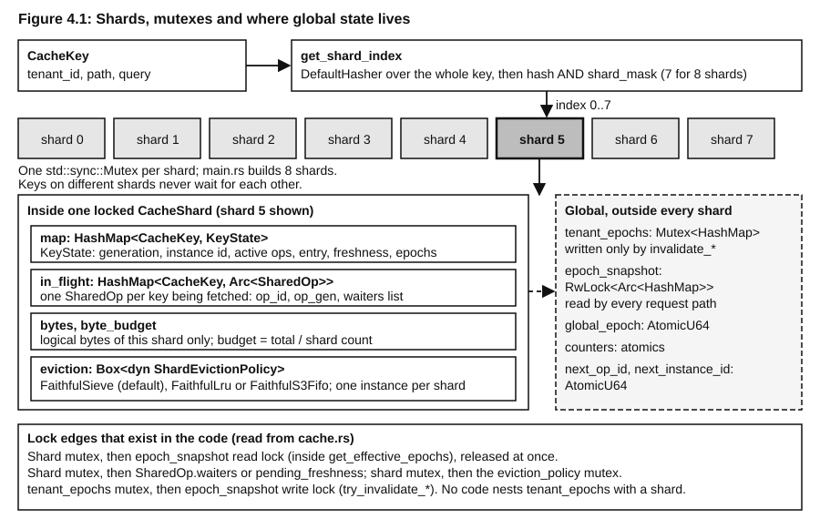

Source: `src/core/cache.rs::PartitionedCache`, `CacheShard`, `get_shard_index`; `src/main.rs` (`PartitionedCache::new(8)`).

```
shard_index(key):
    h = DefaultHasher::new(); key.hash(&mut h)       // hashes tenant, path, query
    return (h.finish() as usize) & shard_mask         // mask = shard_count - 1
```

`PartitionedCache::new` asserts the shard count is a power of two, so `& mask` equals `% count` and costs one instruction. Production builds 8 shards (`src/main.rs`, literal `8`; no configuration key sets it; verified by grep of `src/config.rs`). Each shard is `Mutex<CacheShard>`; a `CacheShard` holds the key map, the in-flight map, byte counters and one eviction policy instance.

::: example
**Worked example: how often do requests collide?**

Take 8 shards and 4 requests running at the same moment on 4 worker threads, with keys spread evenly. The chance that all 4 land on different shards is 8 x 7 x 6 x 5 / 8^4 = 1,680 / 4,096 = 41.0%. So in 59.0% of such moments at least two requests want the same shard mutex. That sounds bad, but a collision only costs a wait of one short critical section (a map lookup and a small clone), not of the origin fetch, because the origin fetch runs outside the lock. Compare one global mutex: collision chance 100%. The numbers are arithmetic from the model "uniform keys, 4 simultaneous requests", not a measurement.
:::

Why a power of two and a mask: speed and simplicity. Why 8: no recorded decision found (our reasoning, not a recorded decision: a small fixed number that keeps memory per shard modest). Status: **IMPLEMENTED**, fixed at 8 in production.

### What the shard lock protects, and what it does not

Everything touching one key's `KeyState`, its `in_flight` operation, the shard byte counter and the shard's eviction policy happens under that shard's mutex. The origin fetch itself does not: the leader task releases the mutex before it talks to the origin and takes it again only to finalize (section 4.5).

The epoch state (`tenant_epochs`, `epoch_snapshot`, `global_epoch`) is outside the shards (section 4.7). That choice is what makes tenant invalidation cheap and what makes the G4A-01 race possible.

### Contention and its limits

- **Different keys on different shards**: no waiting.
- **Different keys on the same shard**: they queue. At most 8 shards means at most 8-way lock parallelism for the cache state, however many cores exist.
- **One hot key**: all its traffic goes to one shard, so sharding cannot help. A hit on a hot key takes the shard mutex twice in the HTTP GET path: `check_stale_serving` (which finds a fresh entry and answers `Ineligible`) and then `begin_fetch_atomic` (`src/api/server.rs` around the `check_stale_serving` and `begin_fetch_atomic` calls). Status: verified in code; the cost was not measured.
- **Long critical sections hurt every key on the shard.** Examples read in the code: the sweeper scans the whole shard under the lock every tick (G4A-03), `set_eviction_policy` rebuilds each shard's policy under its lock (O(entries) per shard), and `finalize_fetch` may run up to 32 evictions inside its lock.
- **Per-shard budgets, not a global one**: `set_byte_budget` divides the total by the shard count (`PHANTOM_MAX_CACHE_BYTES` default 256 MiB gives 32 MiB per shard in config terms). A skewed key distribution can fill one shard while others have room. The entry limit is also per shard (`max_entries_per_shard`, default 10,000, so 80,000 entries in production).
- **Shard choice is deterministic**: `DefaultHasher::new()` uses fixed keys (recalled from the standard library documentation, not re-fetched). Anyone who can choose paths inside their own tenant can choose which shard they load; with 8 shards this is a weak lever, but the hash gives no protection against deliberate skew. Hypothesis: low impact; not tested.

::: caution
**Poisoned mutexes.** A Rust `std::sync::Mutex` becomes "poisoned" if a thread panics while holding it. Most `cache.rs` paths recover with `into_inner()` and count `lock_poison_recovered`, but recovery can expose a half-applied update (see G4A-13). Some other locks (`get_eviction_policy`, the shard locks inside `set_eviction_policy`, legacy shards, telemetry mutexes) call `unwrap()` and would panic on a poisoned lock (G4A-21, OPEN).
:::

### Lock order and the "no mutex across await" rule

The rule in `CLAUDE.md` section 5 says: lock the shard mutex first, then the `tenant_epochs` mutex, never the reverse; and never hold a `std::sync::Mutex` across `.await`. What the code actually does (read in `cache.rs`):

- A request path locks a shard, then takes only a **read** lock on `epoch_snapshot` (inside `get_effective_epochs`), then releases that read lock. It also takes, while holding the shard: `SharedOp.waiters`, `SharedOp.pending_freshness`, and the `eviction_policy` mutex (via `get_eviction_policy`).
- `try_invalidate_tenant` and `try_invalidate_all` lock `tenant_epochs`, then the `epoch_snapshot` **write** lock. They never lock a shard.
- No function takes both a shard and `tenant_epochs`. So the documented order "shard then tenant_epochs" is never exercised, and there is no inverse edge either. The G4A reviewer's hypothesis R3 (lock-order inversion) was REFUTED for this reason (an AI second look, which this author re-checked by reading), and the RACE agent's analysis agrees (`docs/research/g4a01_race/analysis.md`).
- `set_eviction_policy` takes the `eviction_policy` mutex in a temporary that is released at the end of the statement, before it locks any shard, so the edge shard to `eviction_policy` has no inverse.
- Deadlock between shards is impossible by construction because no function holds two shard mutexes at once (verified by reading `cache.rs`; `set_capacity_limits`, `set_byte_budget`, `bytes_resident` and `audit_bytes` take shards one at a time).

Status: **IMPLEMENTED** and, for "no deadlock", **UNVERIFIED by a model checker** (no loom or shuttle run exists). The `async` rule: the leader runs in a spawned task that holds no shard lock while awaiting the origin; the reviewer found no guard held across `.await` in the ranges it read (R4), which is not an exhaustive proof.

::: judge
**JUDGE MAY ASK**

Question: Why partitioned mutexes? Why not one lock, a lock-free map, or a concurrent hash map crate?

**Suggested answer** (about 30 to 60 seconds spoken, plain English):

One lock serializes every request. Splitting the table into 8 shards, each with its own lock, lets requests for different keys proceed in parallel, and a key always maps to the same shard by a hash and a bit mask, so there is no cross-shard coordination. The critical sections are short because the slow origin fetch happens outside the lock. I do not claim this is the fastest design. A lock-free or lock-striped concurrent map would scale further, and I have no benchmark in this repository that compares them. The reason for plain mutexes is that the cache needs several things to change together under one lock: the entry, the byte count, the in-flight record and the eviction list. That is simple to reason about with one mutex per shard and much harder lock-free.

**If the judge asks further:**

"Eight is small." Yes: at most 8-way parallelism for cache state, and the count is hard-coded in `main.rs`. One hot key lives in one shard, so sharding does not help it. The decision record for the number 8 was not found; I would say it is our reasoning, not a recorded decision.

**Evidence to know:** `src/core/cache.rs::PartitionedCache`, `get_shard_index`; `src/main.rs` (`PartitionedCache::new(8)`); IMPLEMENTED; contention not measured.
:::

::: judge
**JUDGE MAY ASK**

Question: What about lock contention? How do you know it is not a bottleneck?

**Suggested answer** (about 30 to 60 seconds spoken, plain English):

I do not know that it is not a bottleneck, because I have no contention measurement on a physical host to quote. What I can say from the code: lock hold times are short on the hit path (a map lookup, an epoch read, a small clone); the origin fetch is outside the lock; epoch checks use a read lock that does not block other readers. What I can also say is where contention would appear: one hot key, which is always one shard; and the sweeper, which scans a whole shard under its lock each tick, which a reviewer flagged as G4A-03 and is still open.

**If the judge asks further:**

"What would you measure?" Lock hold time and wait time per shard under a skewed workload on a release build, on a named host, with repetitions and confidence intervals. The repository's performance data is discussed in Chapter 6; none of it isolates shard lock contention (UNVERIFIED for that purpose).

**Evidence to know:** `docs/release/g4/cycle1_core_engine_review.md` G4A-03; `tests/integration/epoch_contention_tests.rs` (checks epoch reads and monotonicity, not shard mutex contention); status IMPLEMENTED, performance UNVERIFIED.
:::

## 4.3 Concurrency in this engine: what runs where

The gateway runs on a Tokio multi-thread runtime (`src/main.rs` builds `Builder::new_multi_thread()`): several worker threads run request tasks at the same time (parallelism) and each interleaves many tasks (concurrency). At each `.await` a task may pause, which is why no `std::sync::Mutex` guard may be held across one. The cache API is synchronous (`begin_fetch_atomic`, `finalize_fetch` and friends take a lock, do bounded work and return), so no shard guard is alive at an `.await`.

The origin fetch is the only long wait. It runs in a `tokio::spawn`ed leader task (`src/api/server.rs`), which owns an `OriginFetchGuard` (RAII: if the task is cancelled or panics, `Drop` finalizes the operation with an `Aborted` error so waiters are not left hanging; the reviewer's hypothesis R5 was REFUTED, and the permit-release behaviour is TESTED in `tests/integration/origin_cap_tests.rs`).

## 4.4 Request coalescing, single-flight and stampedes

### Simple explanation

Imagine a popular page expires. A thousand users ask for it in the same second. Without care, the cache sends a thousand identical requests to the origin, which may fall over. Coalescing makes the first request go to the origin and tells the other 999 to wait for that one answer.

### Terms

- **Cache stampede / thundering herd**: many requests miss the same key at once and all go to the origin.
- **Single-flight**: at most one in-flight fetch per key. The Go library `singleflight` uses the same idea; PhantomCache's implementation is its own (literature comparison is Chapter 7's job).
- **Leader**: the request that starts the fetch. **Waiters**: requests that join it.

### How it works

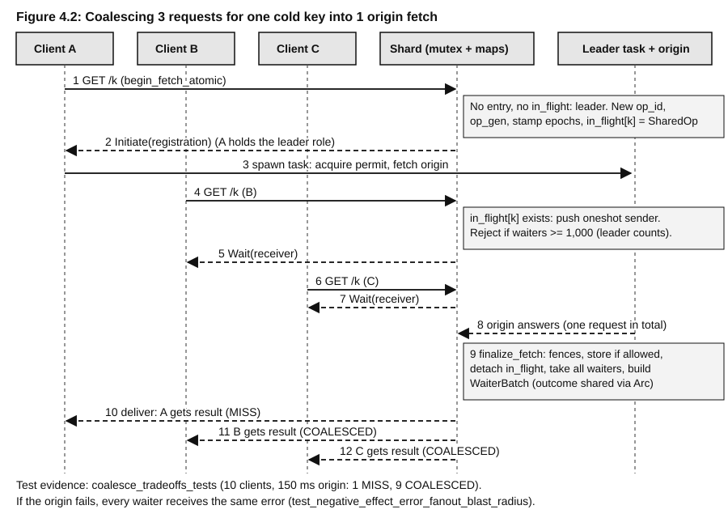

Source: `src/core/cache.rs::begin_fetch_atomic`, `finalize_fetch`; `src/core/coalesce.rs::SharedOp`, `WaiterBatch`, `OriginFetchGuard`; `src/api/server.rs` (leader task); `tests/integration/coalesce_tradeoffs_tests.rs`.

```
begin_fetch_atomic(key, now):                      // under the shard mutex
    (te, ge) = get_effective_epochs(key.tenant)
    if resident entry has epochs == (te, ge) and created+ttl > now:  return Hit
    if resident entry has epochs != (te, ge):  drop entry; generation += 1
    if in_flight has key:
        if waiters.len() >= max_waiters_per_key:  return Rejected(WaiterLimitExceeded)
        make oneshot (tx, rx); waiters.push(tx);  return Wait(rx)
    make room: up to 32 evictions while over entry limit or byte budget
    if still no room:  return Rejected(CapacityExceeded)
    op_id = next_op_id++ ; charge placeholder bytes if the key is new
    state = map.entry(key) (create if absent)
    state.entry epochs = (te, ge) ; state.active_op_ids.insert(op_id)
    op_gen = state.generation
    in_flight[key] = SharedOp{op_id, op_gen, state_instance_id, waiters=[], pending_freshness}
    return Initiate(registration)
```

The HTTP handler turns `Initiate` into a leader: it registers itself as the first waiter on the `SharedOp`, converts the registration into an `OriginFetchGuard` (`into_guard`) and spawns the origin task. `Wait(rx)` callers `await` their receiver. When the leader finishes, `finalize_fetch` builds one `WaiterBatch` with the outcome behind an `Arc` and `deliver()` sends it to every waiting `oneshot` sender. Delivery happens after the shard mutex is dropped, so slow receivers cannot hold the lock. If a `WaiterBatch` is dropped without `deliver()`, its `Drop` delivers.

::: example
**Worked example: stampede arithmetic.**

A cold key, origin latency 150 ms, 10 simultaneous clients. Without coalescing: 10 origin requests. With it: 1 origin request, 9 waiters, and each client waits about 150 ms. `test_negative_effect_head_of_line_blocking` runs exactly this and asserts 1 `MISS`, 9 `COALESCED`, `coalesced_waiters == 9`, and total time at least 140 ms. TESTED (loopback, in-process origin; it proves the count and that waiters are held for the origin duration; it does not prove behaviour under thousands of waiters). The 100-client barrier test of Chapters 1 and 2 (`test_m1_t13_barrier_stampede_100_clients`, HTTP level, 1 MISS and 99 COALESCED) is a different test: that one proves the count at larger fan-in, this one proves the count and the cost to waiters at small fan-in.

Now 1,200 simultaneous requests with `max_waiters_per_key` 1,000 (the default). The leader registers itself as a waiter, so about 1,000 requests are admitted (1 leader + 999 followers) and about 200 are rejected with `WaiterLimitExceeded`. Origin load stays at 1 request. The rejected 200 get an error rather than waiting forever. This is arithmetic from the code, not a test result. The limit itself is TESTED at small values: `serving_contract_tests.rs` (a third joiner is rejected with `WaiterLimitExceeded` when the limit is 2) and `m1_http_tests.rs` (limit 3, HTTP error header `WaiterLimitExceeded`, counter `waiter_limit_rejections`). The soak test named `test_waiter_capacity_bound` adds 100 waiters and asserts nothing about the limit, so it does not count as evidence.
:::

### Trade-offs, honestly

- **Head-of-line blocking**: every waiter waits for the leader, however slow. The origin read has a 5 s timeout (`src/api/server.rs`, `read_to_end` under `tokio::time::timeout(5000 ms)`), so the worst-case wait is bounded by about that. TESTED as a "negative effect" by `test_negative_effect_head_of_line_blocking`.
- **Error fan-out**: if the origin fails, all waiters get the same error at once. TESTED: `test_negative_effect_error_fanout_blast_radius` (8 clients, origin 504, all 8 get 504). Errors are not stored (finalize with `Error` stores nothing), so the next request becomes a new leader. There is no negative caching and no backoff for ordinary misses. Backoff exists only for revalidation (section 4.8).
- **Post-invalidation joiners (G4A-08, OPEN)**: a request arriving after `invalidate_tenant` can still join an in-flight fetch that started before it and receive the pre-invalidation body. The result is not stored in the cache, so the exposure is limited to the waiters of that one operation. DELETE avoids this by detaching `in_flight`; epoch invalidation does not. The code carries a comment ("L3, documented, NOT fixed").
- **Fairness**: `test_concurrency_waiter_fairness_and_starvation_freedom` and `test_concurrency_fairness_competing_keys_and_tenants` exist (names read; bodies not analysed).
- **Memory**: each waiter holds a `oneshot` channel; the per-key limit bounds it. There is no global waiter limit across keys (our reading; not tested).

### Origin protection: the concurrency gate

Coalescing limits identical requests. A second mechanism limits *distinct* origin requests: `src/intelligence/executor.rs::OriginGate`. Verified behaviour:

- Only the party that actually dispatches to the origin takes a permit: the single-flight leader, a bypass request and a background revalidation leader. Waiters never do (`src/api/server.rs::acquire_origin_permit`, comment and code; TESTED by `origin_cap_tests::coalesced_waiters_do_not_consume_permits`).
- The permit is RAII (`OriginPermit`): it is released on success, error, timeout and future cancellation (TESTED: `permit_released_after_origin_error`, `..._timeout`, `..._client_disconnect`, `permit_is_released_on_future_cancellation`).
- The cap is **enforced only when the intelligence mode is Canary or Active and a cap is configured** (`DefaultPolicyExecutor::origin_cap_enforcing`). In Off, Observe and Advisory the gate counts in-flight requests but never refuses (TESTED: `off_mode_is_uncapped`). The default mode is `off` (`PHANTOM_INTELLIGENCE` default in `src/config.rs`), and the cap is unset unless `PHANTOM_ORIGIN_CAP_MAX` is set (`src/main.rs` configures it only then). So **by default the origin path is uncapped**.
- The AIMD controller (`OriginConcurrencyCapController::step`; algorithm, parameters and worked example in Chapter 5, section 5.13) runs on every full observation window whenever a cap is configured, in any mode. Observations are recorded in every mode, so the cap value may move even when it is not enforced (verified by reading `record_observation`, which has no mode check). That the cap improves any outcome is not established; see Chapters 5 and 7.
- When the gate refuses, the request fails with its own reason code; if a stale entry is eligible it is served instead, else 503 (test name `saturation_serves_stale_if_eligible_else_503`; body not analysed beyond its name).

::: judge
**JUDGE MAY ASK**

Question: What stops a cache stampede? What happens to the origin when a hot key expires?

**Suggested answer** (about 30 to 60 seconds spoken, plain English):

Single-flight per key. Under the shard lock the first miss registers an in-flight operation; later misses for the same key find it and wait on a channel. When the one origin fetch returns, its result goes to everyone. A test (`test_negative_effect_head_of_line_blocking`) fires 10 simultaneous requests at a slow origin and gets 1 miss and 9 coalesced answers. Waiters per key are capped at 1,000, and the origin read times out after 5 seconds. Two limits to state: if the origin fails, all waiters fail together, and there is no negative caching, so the next request tries again. And across many different keys there is no protection unless the optional origin concurrency cap is switched on, which it is not by default.

**If the judge asks further:**

"Does the expired entry cause a herd?" If the response carried stale-while-revalidate, expired entries inside that window are served immediately and refreshed in the background by one leader (bounded to 128 background refreshes by default). Without it, an expired entry is a miss and coalescing applies.

**Evidence to know:** `src/core/coalesce.rs`; `cache.rs::begin_fetch_atomic`; `coalesce_tradeoffs_tests.rs`; `origin_cap_tests.rs`; G4A-08 (OPEN); status IMPLEMENTED and TESTED on loopback.
:::

::: judge
**JUDGE MAY ASK**

Question: What happens with a hot-key overload? Say one key gets most of the traffic.

**Suggested answer** (about 30 to 60 seconds spoken, plain English):

Two different problems. If the hot key is a miss, coalescing turns the burst into one origin request. If the hot key is a hit, every request still takes the same shard mutex, twice in the GET path, and the HTTP layer copies the body for each response. The hot key lives in one shard, so the cache cannot spread it over cores, and it is not replicated to other nodes: GET is served from the local cache only. I would expect the shard mutex and the body copy to be the limit, but I have not measured it. What exists is detection and policy research in the intelligence modules (Chapter 5), which is not a serving-path fix for hit-path hot keys.

**If the judge asks further:**

"How would you fix it?" Options I would test, none implemented: store the body once as `Arc` and stream it without cloning; take the hit path with a read lock; replicate hot entries per core. Those are proposals, not design decisions in the repository.

**Evidence to know:** `src/api/server.rs` (HIT branch clones the body); G4A-26; `cache.rs::check_stale_serving` and `begin_fetch_atomic`; status IMPLEMENTED, hot-hit behaviour UNVERIFIED.
:::

## 4.5 Entry lifecycle and fencing (generation, instance, epoch)

### Simple explanation

Fetching from the origin takes time. While a fetch is running, the world can change: someone deletes the key, or the whole tenant is invalidated. When the fetch returns, the cache must ask "is my answer still allowed to be stored?" Fencing is that question, answered by comparing numbers recorded at the start with numbers read at the end.

### Terms

- **Fencing token**: a number recorded when work starts and compared when it ends. If it changed, the work is stale.
- **Generation**: a per-key counter bumped by DELETE. Defends against "delete during fetch".
- **State instance id**: an identity for the `KeyState` object. Defends against "state removed and recreated during fetch".
- **Epoch**: a counter per tenant (and one global). Defends against "tenant or everything invalidated during fetch" without touching any shard. Section 4.7.
- **Placeholder**: a `KeyState` with `entry = None` created at the start of a fetch so the key can be tracked and pinned.
- **Pinned**: has an active operation or an in-flight fetch; may not be evicted.

### How it works

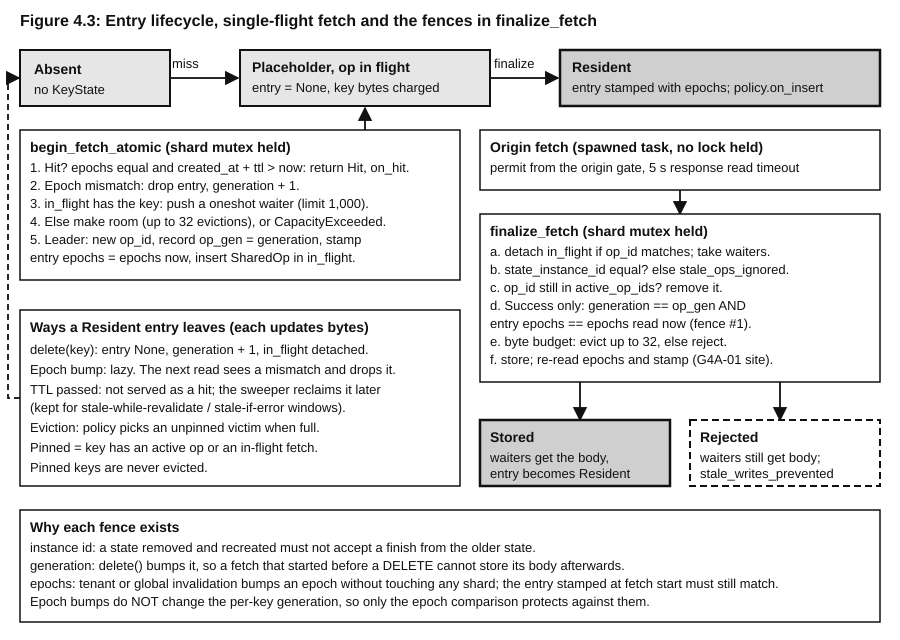

Source: `src/core/cache.rs::begin_fetch_atomic`, `finalize_fetch`, `delete_impl`, `get_resource`; `src/core/coalesce.rs`.

```
finalize_fetch(key, op_id, op_gen, inst_id, shared_op, outcome):   // lock shard
    if in_flight[key].op_id == op_id:  remove in_flight[key]          // commit boundary 1
    waiters = take(shared_op.waiters); batch = WaiterBatch(waiters, outcome)
    state = map[key]
    if state.instance_id != inst_id:   stale_ops_ignored++            // old state object
    else if state.active_op_ids.remove(op_id):
        if outcome is Success:
            (te, ge) = get_effective_epochs(key.tenant)
            if state.generation == op_gen and state.entry_epochs == (te, ge):   // fence #1
                candidate = resource
            else: stale_writes_prevented++
        if state.entry is None and no other active op:  reclaim placeholder
    if candidate:                                                     // commit boundary 2
        if size > shard byte_budget:                oversize reject
        else evict up to 32 victims (not this key) until it fits;  reject if still too big
        else:  bytes += new - old
               (te, ge) = get_effective_epochs(key.tenant)           // second read (G4A-01 site)
               state.entry = candidate ; state.entry_epochs = (te, ge)
               policy.on_insert(key)
    drop parked freshness metadata if not installed
    shrink_shard()          // up to 256 evictions if bytes > budget
    unlock; return batch    // caller delivers outside the lock
```

Two rules in that code make the design hold together:

1. **Waiters get the answer even when the store is refused.** The `WaiterBatch` is built from the outcome before any fence is checked. A fence only decides whether the *cache* keeps the body. So a request that waited during a DELETE may still receive the pre-DELETE body once; the cache does not keep it.
2. **Freshness metadata is installed together with the entry.** The leader parks metadata on the `SharedOp` (`pending_freshness`) and `finalize_fetch` installs it only if the store succeeds (M1 in the code comments). Without this, a rejected store could leave new directives attached to an old body.

::: example
**Worked example: DELETE during a fetch.**

Key K has generation 0 and no entry. A request becomes leader: `op_id = 41`, `op_gen = 0`, `state_instance_id = 7`. While the origin is slow, an admin calls DELETE on K: `generation` becomes 1, the in-flight record is detached (so later GETs start a fresh fetch rather than joining the doomed one). The old body arrives. `finalize_fetch` sees `state.generation (1) != op_gen (0)`, increments `stale_writes_prevented`, stores nothing. The next GET misses and becomes a new leader with `op_gen = 1`. `tests/integration/invalidation_contract_tests.rs::test_delete_fences_in_flight_fill_race` runs this and asserts the counter rose by one and `get_resource` returns none. TESTED (deterministic order, one thread; it does not explore interleavings).
:::

### Cancellation and panics: the RAII guards

- `FetchRegistration` (returned by `begin_fetch_atomic`) finalizes with `Aborted` if dropped without `into_guard()`.
- `OriginFetchGuard` has a three-state phase (`PENDING`, `FINALIZING`, `COMPLETED`, an `AtomicU8` compare-and-swap). Dropping in `PENDING` finalizes with `Aborted`. Dropping in `FINALIZING` (only possible if `finalize_fetch` panicked) runs a clean-up that removes the op and the in-flight record and fails the waiters.
- Gap, OPEN as G4A-13: that panic clean-up removes a placeholder from the map but does not subtract its bytes or call `eviction.on_remove`, so `audit_bytes` would show a permanent mismatch. The only trigger found is the test flag `test_panic_after_waiter_extraction`; no production panic source was identified.

### Pinning protects in-flight work

Eviction asks `is_pinned(key)`: true if the key is the excluded key, has an `in_flight` record, has a non-empty `active_op_ids`, or is missing from the map. All three policies check it before choosing a victim (`eviction.rs`). The G4A reviewer's hypothesis R7 (eviction of in-flight keys) was REFUTED, and `tests/integration/eviction_contract_tests.rs::test_invariant_i5_pinned_never_evicted` is TESTED for the property. The cost: a slow origin plus many distinct keys can pin so many entries that a shard cannot make room and returns `CapacityExceeded` (G4A-23, availability only).

::: judge
**JUDGE MAY ASK**

Question: How do you stop a stale response overwriting a newer one, for instance after a DELETE?

**Suggested answer** (about 30 to 60 seconds spoken, plain English):

Each key carries a generation number. A fetch records the generation when it starts. DELETE bumps it. When the fetch finishes, it stores its body only if the generation, the state identity and the tenant and global epochs still match what it recorded. All of that runs under the shard mutex, so the check and the store are one atomic step for that shard. If anything changed, the body is dropped and a counter, `stale_writes_prevented`, goes up. The waiters still get the response they asked for; the cache just does not keep it. I have to add one honest limit: for tenant-wide invalidation there is a known race in the epoch part of this check, which I cover in the next section.

**If the judge asks further:**

"Is that linearizable?" I would not use that word. A DELETE that has returned makes later reads on that node miss, which `test_linearizable_delete_prevents_read` checks in a single-threaded order. I have no schedule-exploring proof, no model-checker run, and for tenant-wide invalidation there are two open findings (G4A-01, G4A-08). The failure model is one process; cross-node behaviour is Chapter 5.

**Evidence to know:** `cache.rs::finalize_fetch`, `delete_impl`; `invalidation_contract_tests.rs`; `concurrency_verification_tests.rs` (an exhaustive 9-action, 5-step model of delete/fill/evict, 59,049 sequences; the model has no invariant about fills after tenant invalidation, so it cannot find G4A-01); status IMPLEMENTED, TESTED for DELETE.
:::

## 4.6 Memory management and byte accounting

### Simple explanation

A cache that never forgets runs out of memory. The cache keeps a running total of how many bytes it believes it stores, per shard, and refuses or evicts when the total would pass the budget. The total must stay correct through every path: insert, replace, delete, expire, evict, epoch purge.

### Terms

- **Logical bytes**: the cache's own bookkeeping of sizes (key length + body capacity + content type + ETag + a fixed overhead). It is not the operating system's memory figure.
- **Audit**: recompute the total from scratch and compare with the running total.

### How it works

`calculate_state_bytes(key, state)` = key bytes (tenant + path + query lengths) + resource bytes (`body.capacity()` + content-type length + ETag length) + `fixed_entry_overhead()` (`size_of::<CacheKey>() + size_of::<KeyState>() + 64`). `PartitionedCache::audit_bytes()` returns `(accounted, recorded)`: the sum of `calculate_state_bytes` over every `KeyState`, and the sum of every shard's running `bytes`. The invariant tests check they are equal. The specification calls these invariants I1 to I8; this author found where they are named (`docs/research/adr/ADR-002-serving-path-contract.md`, `docs/glossary.md`) but did not find a document listing all eight individually (UNVERIFIED which eight).

::: example
**Worked example: one key's life, in bytes.**

Let F be `fixed_entry_overhead()` (a platform-dependent constant). Key tenant `acme` (4 bytes), path `/a` (2 bytes): key bytes 6. Body with capacity 100, content type `application/json` (16), ETag `"v1"` including quotes (4): resource bytes 120.

1. Miss, placeholder created: `bytes += 6 + F`.
2. Fill stored: `bytes += 120`, total 126 + F.
3. Replace with a body of capacity 150: resource bytes become 170; `bytes = bytes - 120 + 170`, total 176 + F.
4. DELETE: entry removed, `bytes -= 170`; the state has no active op so it is removed, `bytes -= 6 + F`. Total 0.

At every step `audit_bytes()` should return equal numbers. `byte_accounting_tests.rs` tests each lifecycle step (`test_lifecycle_*`), contraction under load (`test_t_c1` to `test_t_c6`) and an adversarial large body. TESTED (consistency of the bookkeeping against real call sequences; it does not measure process memory).
:::

Controls that bound memory (all **IMPLEMENTED**):

- Per-shard byte budget (production total `PHANTOM_MAX_CACHE_BYTES`, default 268,435,456, divided by the shard count).
- Per-shard entry limit (`max_entries_per_shard`, default 10,000).
- Waiter limit per key (1,000), background-refresh limit (128), origin response body limit (`MAX_BODY_BYTES` 2 MiB in `src/api/server.rs`, applied while parsing the origin response; the ingress request body limit is separate, 512 KiB via `DefaultBodyLimit`).
- At most 32 evictions per miss registration and per store, and `shrink_shard` of up to 256 evictions to recover from over-budget (the "I8 recovery" in code comments).
- `set_byte_budget` and `set_capacity_limits` evict immediately down to a new bound (contraction), skipping pinned keys.

What the accounting does **not** cover (G4A-23, OPEN, Info): freshness metadata strings, the hash-set and hash-map allocations, `Arc` headers, and the eviction structures themselves (S3-FIFO queues grow outside the accounting, G4A-02). Also `PartitionedCache::new` alone sets the byte budget to `usize::MAX`; only `main.rs` sets a finite one, so tests and embedders that skip that call are unbounded in bytes. And there is no maximum TTL: a huge `max-age` makes an entry effectively permanent until evicted.

::: judge
**JUDGE MAY ASK**

Question: How do you know the cache does not leak memory? Is the byte count the real memory use?

**Suggested answer** (about 30 to 60 seconds spoken, plain English):

The byte count is a logical count, not the process memory. It adds up key size, body capacity, header strings and a fixed per-entry overhead, and the code can recompute it from the maps and compare. The tests drive every path that changes an entry and assert the recomputed and running totals match, including a concurrent stress run. That shows the bookkeeping is consistent. It does not show the operating system sees the same number, because some structures are not counted: freshness strings, hash-table slack, and the S3-FIFO queues. And there is one known path where the totals drift, a panic in the middle of finalizing, which is open as G4A-13.

**If the judge asks further:**

"What bounds the real memory?" The byte budget, the entry limit, the waiter limit and the 2 MiB origin response body limit bound the counted part. A soak test (`memory_bound_soak_tests.rs`) runs churn with accounting checks. I have no measured resident-memory figure for a release build to quote.

**Evidence to know:** `cache.rs::audit_bytes`, `calculate_state_bytes`; `byte_accounting_tests.rs`; G4A-13, G4A-23; status IMPLEMENTED, TESTED (consistency only).
:::

## 4.7 Invalidation and epochs

### Simple explanation

Invalidation means "forget what you saved". Forgetting one key is easy. Forgetting everything for a tenant, without walking the whole table, is the hard case. The trick is a version number: stamp every saved entry with the tenant's current version, and to invalidate, just raise the version. An entry stamped with an old version is treated as absent the next time anyone looks.

### Terms

- **Epoch**: the version number. There is one per tenant (in a map) and one global.
- **Lazy invalidation**: do not remove entries when invalidating; remove them when next touched or when a background sweeper finds them.
- **Snapshot**: an immutable copy that readers can use without blocking writers for long.

### How it works

Three invalidation levels exist in `cache.rs`:

| Operation | What changes | Cost |
|---|---|---|
| `delete(key)` / `try_delete_with_status` | that key's entry dropped, `generation += 1`, in-flight detached | O(1) under that shard's lock |
| `try_invalidate_tenant(t)` | `tenant_epochs[t] += 1`, then a fresh snapshot | O(T), T = tenants with a recorded epoch (at most 10,000) |
| `try_invalidate_all()` | `global_epoch += 1`, tenant map cleared, snapshot replaced by an empty map | O(T) to clear |

An entry is current only if `entry_tenant_epoch == tenant epoch now` and `entry_global_epoch == global epoch now`. `get_effective_epochs(tenant)` reads the tenant epoch from `epoch_snapshot: RwLock<Arc<HashMap<String,u64>>>` (a shared read lock, no exclusive mutex) and the global epoch from an atomic. Writers (invalidations) take the `tenant_epochs` mutex, update the map, then replace the snapshot under the `RwLock` write lock. Reading never takes the `tenant_epochs` mutex, which is what `CLAUDE.md` calls the zero-contention read path. It is not zero contention on the shard mutex: every request still takes that.

::: example
**Worked example: lazy purge.**

Tenant `acme` is at epoch 3, global 0. Keys `/a` and `/b` were stored with stamps (3, 0). `invalidate_tenant("acme")` makes the tenant epoch 4. Nothing is deleted yet and the bytes are still counted. A GET on `/a` calls `begin_fetch_atomic`: stamp (3, 0) differs from current (4, 0), so it drops the entry, subtracts its resource bytes, bumps the key's `generation`, and treats the request as a miss. `/b` stays resident, occupying memory, until it is touched or the sweeper reclaims it. Another tenant `beta` is unaffected: its epoch lookup is separate. `test_tenant_flush_ordering_and_lazy_invalidation` checks this (and asserts the bump takes under 5 ms, a host-dependent threshold). Its comment says "O(1)"; the bump is O(T) because of the map snapshot copy (below).
:::

**The overflow fallback (SEC-4A-01).** The tenant map is capped at `MAX_TENANT_EPOCHS = 10,000`. A new tenant arriving when the map is full raises `global_epoch` by one, clears the map, and starts the new tenant at 1. Every entry already stored has an older `entry_global_epoch`, so every entry on this process becomes stale. That is a full flush of this node's cache, chosen as the safe option over refusing the invalidation. The code comment says "cluster-wide"; the counter is per process, so the effect is on this node (a documentation discrepancy, section 4.12). Tenant strings can come from peers (G4A-12, OPEN): a peer sending 10,001 distinct tenant strings can force the flush. TESTED: `test_epoch_saturation_fallback_sec4a_preserved`.

**Costs and sharp edges read in the code:**

- `*snap = Arc::new(guard.clone())` runs inside the snapshot write-lock scope, so the clone of up to 10,000 `String` keys happens while readers are blocked on the read lock, and those readers hold shard mutexes. This is this author's reading; the G4A-12 text says the clone happens under the `tenant_epochs` mutex and does not mention the write lock. Impact not measured.
- `get_effective_epochs` reads the tenant epoch and the global epoch separately, not as one snapshot. G4A-17 (OPEN, PLAUSIBLE, Low) describes a theoretical resurrection in the window of `invalidate_all`.
- Invalidation does not bump any per-key `generation`. So the generation fence cannot catch an epoch bump. Only epoch equality does.

### The sweeper

`spawn_sweeper_task` runs `sweep_lazy_reclamation(batch, now)` every `PHANTOM_SWEEPER_INTERVAL_MS` (default 100). For each shard, under its lock, it walks the map, skips keys with active ops or in-flight fetches, and collects keys that are epoch-stale or expired. "Expired" means past `created_at + ttl + stale window`, where the window is the larger of stale-while-revalidate and stale-if-error, capped by the stale cap, and zero when `must-revalidate` is set. It stops collecting at `batch` candidates, then removes them and fixes the bytes and the policy.

Two facts differ from the documentation:

- The batch size bounds *candidates collected per shard*, not keys inspected: when few entries qualify, the loop walks the entire shard under the lock every tick. `src/config.rs` describes `PHANTOM_SWEEPER_BATCH_SIZE` as "shards per tick" and `CLAUDE.md` as a "shard inspection limit"; neither is what the code does (G4A-03, OPEN; `test_sweeper_lock_hold_time_bounded` does not catch it because its entries are all stale).
- An expired entry carrying a validator (ETag) is dropped within about one tick unless a stale window is declared, so conditional revalidation (304) mostly applies to requests that arrive within about 100 ms of expiry (G4A-16, OPEN).

### The known race: G4A-01 (read this honestly)

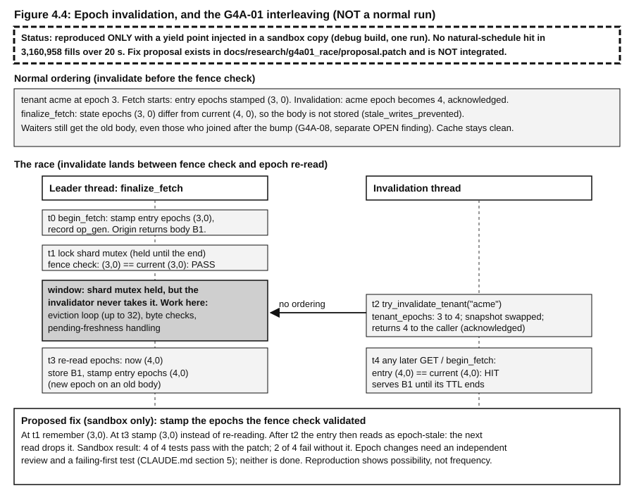

Source: `src/core/cache.rs::finalize_fetch` (the fence check, the eviction loop, the second `get_effective_epochs`, the stamp); `docs/research/g4a01_race/analysis.md`, `status.md`, `repro_attempts.md`, `proposal.patch`; `docs/release/g4/cycle1_core_engine_review.md` G4A-01.

**What it is.** `finalize_fetch` checks the fence once by reading the epochs, then does more work (budget checks, up to 32 evictions), then reads the epochs again and stamps the stored entry with the second reading. Invalidation does not take the shard mutex, so an epoch bump can land between the two reads. The old body is then stored with the new epoch and looks current. Every later read serves it until its TTL passes. The code lines were opened in this tree: the fence check, the second read and the stamp are as the analysis describes.

**What was shown.** CONFIRMED by a deterministic interleaving: in a sandbox copy with a test hook placed between the check and the re-read, an acknowledged `invalidate_tenant` (and `invalidate_all`) left the pre-invalidation body readable (two failing tests; a control test in which the bump comes before the check is correctly fenced). With the small proposed fix the sandbox tests pass.

**What was not shown.** No natural-schedule reproduction: a 20 s, 3-thread unhooked stress (3,160,958 fills) found 0 violations. The window is nanoseconds to microseconds wide, but zero hits do not bound the probability. Debug build, one run per configuration, no confidence intervals, no model checker (no loom or shuttle). Reachability is argued from the code, not measured.

**Status today.** The disposition register lists G4A-01 as UNDER-INVESTIGATION and blocking (owner decision ODR-4). The fix proposal (stamp the epochs the fence check validated) lives in `docs/research/g4a01_race/proposal.patch` and is **NOT integrated**; the main tree still contains the second read. Under `CLAUDE.md` a change to fencing or epochs also needs an independent review and a test that fails without the change.

**Impact if it happens.** An invalidation the caller was told succeeded leaves one stale entry on that node, until its TTL ends (60 s by default when the origin gives no freshness headers; longer if the origin says so). It needs a precisely timed invalidation on a key that is being filled at that instant.

**Related, different findings.** G4A-08 (joiners after invalidation receive the old body; not stored) and G4A-17 (epoch pair read not atomic). Together they say: tenant-wide invalidation on one node is eventually effective with documented edge cases, not an atomic cut.

::: judge
**JUDGE MAY ASK**

Question: Explain epochs. Why not just delete the keys? What does invalidation guarantee?

**Suggested answer** (about 30 to 60 seconds spoken, plain English):

Deleting every key of a tenant means walking the table under locks, which is slow and blocks requests. Instead each tenant has a version number. Every entry is stamped with the version when stored. To invalidate, we increase the number. Any entry with an older stamp is treated as missing the next time anyone touches it, and a background sweeper reclaims the rest. A fetch that started before the bump also cannot store its answer, because its stamp no longer matches. The guarantee is local to one node and it is lazy: after the call returns, reads on that node do not serve the old entries, with two documented exceptions and one open race. The bump itself is not free either: it copies the tenant-version map, up to 10,000 entries.

**If the judge asks further:**

"What if the tenant list overflows?" Past 10,000 tenants the node raises a global epoch instead, which invalidates everything on that node. That is safe but heavy, and a peer can trigger it by sending many tenant names (G4A-12, open).

"Is it atomic across nodes?" No. That is Chapter 5; here the guarantee is single process.

**Evidence to know:** `cache.rs::try_invalidate_tenant`, `get_effective_epochs`; `epoch_contention_tests.rs`, `invalidation_contract_tests.rs`; G4A-08, G4A-12, G4A-17; status IMPLEMENTED, TESTED for the basic and overflow paths.
:::

::: judge
**JUDGE MAY ASK**

Question: You say fencing prevents stale writes. Is there a race? Has it been reproduced? Is it fixed?

**Suggested answer** (about 30 to 60 seconds spoken, plain English):

Yes, one known race, and I will state exactly what is established. In the final step of a fetch, the cache checks the tenant epochs, does some more work, then reads the epochs again and stamps the entry with the second reading. Tenant invalidation does not take the shard lock, so a bump in that gap makes an old body look current. It was reproduced only in a sandbox with a test hook placed in the gap. A twenty-second stress without the hook found nothing, and that does not prove it cannot happen. A small fix was written and passes in the sandbox, but it is not integrated, because changes to fencing need an independent review and a test that fails first. The disposition register keeps it open and blocking. So: the DELETE fence is tested; the tenant-epoch fence has this known gap.

**If the judge asks further:**

"How likely?" I cannot say; the window is tiny and nobody has measured it. "Why not just fix it?" The change is to a protected file with a required review gate, and the owner has not yet decided. That is a process answer, and I would not hide it.

**Evidence to know:** `docs/research/g4a01_race/` (analysis, status, repro_attempts, proposal.patch); G4A-01 in `cycle1_findings_disposition_register.md` (UNDER-INVESTIGATION); status: defect CONFIRMED in sandbox, fix NOT integrated.
:::

## 4.8 Freshness, TTL, stale serving and revalidation

### Simple explanation

A saved answer is good for a while. After that it is "stale". HTTP lets the origin say how long, and also allows a cache to keep serving a stale answer briefly while it fetches a fresh one (stale-while-revalidate), or when the origin is broken (stale-if-error). PhantomCache adds its own hard ceiling on how long it will serve stale.

### Terms (RFC 9111 vocabulary)

- **Freshness lifetime / TTL**: how long a response counts as fresh. Here `ttl_ms`.
- **Age**: how old the stored response is.
- **Stale**: age beyond the lifetime. Not automatically unusable.
- **Revalidation**: ask the origin "is my copy still good?" with a conditional request (`If-None-Match` with the stored ETag). The origin may answer `304 Not Modified` (keep the body, refresh the clock) or send a new body.
- **stale-while-revalidate (SWR)**, **stale-if-error (SIE)**, **must-revalidate**: `Cache-Control` directives (RFC 5861 and RFC 9111) described below.

### How the lifetime is chosen

`src/core/freshness.rs::evaluate_response_freshness` is a pure function: status, headers, time, flags in; a `FreshnessDecision` out. In order:

1. Body present without explicit framing (`Content-Length` or `Transfer-Encoding`): uncacheable.
2. `Cache-Control: no-store` or `private`, or any malformed directive value: uncacheable.
3. Status: 200 is cacheable; 301, 404, 410 only when explicit freshness exists (`max-age`, `s-maxage` or an `Expires` header); every other status is uncacheable.
4. A request that carried `Authorization`, or a response with `Set-Cookie`, is cacheable only if the response says `public`, `s-maxage` or `must-revalidate`.
5. `Vary: *`, or any `Vary` other than `Accept-Encoding`: uncacheable.
6. Lifetime, first match wins: `no-cache` gives 0 and sets must-revalidate; else `s-maxage`; else `max-age`; else `Expires` minus `Date` (or minus now if `Date` is missing); else the **default TTL**.

`stale-while-revalidate` and `stale-if-error` values are read in seconds and stored in milliseconds in `FreshnessMetadata` next to the entry. Lifetimes use `saturating` arithmetic and there is no upper bound on `max-age` (G4A-23).

### The default TTL setting is not wired

`PHANTOM_DEFAULT_TTL_MS` is documented with default 60,000 ms and is validated and reported by `src/config.rs`, but the registry marks it `Wiring::NotWired` and says why. It is read nowhere else in `src/` (grep for `DEFAULT_TTL` and `default_ttl` finds only `config.rs` and the parameter names inside `freshness.rs`). `src/api/server.rs` passes the literal `60_000` to `evaluate_response_freshness` at two call sites (lines 1405 and 1688 in this tree). So: **the effective default lifetime is always 60 seconds and setting the variable changes nothing** (verified in code; the G4A-25 finding records the same, OPEN). It only matters for responses with no freshness headers at all. `CLAUDE.md` quotes lines 1077 and 1352; those line numbers have drifted but the fact has not.

### Serving stale, and the hard cap

Fresh means `created_at_ms + ttl_ms > now`. Past that, the GET path calls `check_stale_serving(key, now, hard_cap_ms, is_error_context)`:

```
check_stale_serving(key, now, cap, error_ctx):                  // under the shard mutex
    entry missing or epochs stale          -> Ineligible        // delete wins
    entry still fresh                      -> Ineligible        // normal HIT path
    meta.must_revalidate                   -> Ineligible        // never serve stale
    window = error_ctx ? (SIE or SWR or 0) : (SWR or 0)
    window == 0                            -> Ineligible
    age = now - created_at
    if age > ttl + cap                     -> CapExceeded       // hard cap
    if age <= ttl + min(window, cap)       -> Eligible(entry)   // serve stale
    else                                   -> Ineligible
```

The cap is `PHANTOM_MAX_STALE_MS` (default 86,400,000 ms = 24 h; `Wiring::Main`; `src/main.rs` calls `cache.set_max_stale_ms`). The intelligence executor can change it at run time only when a stale-serving candidate is applied, clamped to a hard maximum.

::: example
**Worked example: stale window and cap.**

An origin sends `max-age=60, stale-while-revalidate=300`. TTL 60 s, window 300 s, cap 86,400 s.

- Age 30 s: fresh. HIT.
- Age 200 s: expired, but 200 <= 60 + min(300, 86,400) = 360. Eligible: the old body is served marked STALE, and one background refresh is started (single-flight, at most 128 background refreshes at once).
- Age 400 s: 400 > 360. Ineligible: this request is a miss and fetches from the origin.

Now `stale-if-error=604800` (7 days) and the origin is down. Error-context window = min(604,800, 86,400) s = 86,400 s. Eligible while age <= 60 + 86,400 = 86,460 s. At age 90,000 s: 90,000 > 86,460, so `CapExceeded` and the request fails instead of serving a day-old-plus answer. TESTED: `stale_serving_tests.rs::test_hard_staleness_cap_enforced_strictly`, `test_stale_if_error_on_origin_outage`, `test_must_revalidate_strictly_forbids_stale_serving`.
:::

What the cap is **not**: it bounds the *stale* window, not the *fresh* lifetime. An origin that sends `max-age=10000000` has a fresh entry for 115 days; the cap does not touch it. `stale_cap_violations` (a counter) is described in `CLAUDE.md` as "must be 0"; it is near-tautological, because an `Eligible` decision already implies the age is within the cap, so zero is true by construction (G4A-18, OPEN). Treat "stale_cap_violations == 0" as weak evidence.

### Revalidation and 304

A stale entry that has an ETag is revalidated by sending `If-None-Match` from the *resident* entry read after single-flight registration (not from a copy captured earlier). A `304` goes through `complete_not_modified`:

- merge the 304's headers into the stored lifetime and metadata (`merge_not_modified`);
- if the 304 carries a different validator, delete the entry and fail the leader and waiters with 502;
- if nothing resident (purged or invalidated meanwhile), fail with 502 and store nothing: a purged entry is never resurrected;
- if the 304 is uncacheable, record a failure and hand out the resident body only if the normal serving policy allows it now.

Failure backoff for background revalidation: `record_revalidation_failure` sets 1,000 ms, then doubles per consecutive failure up to 60,000 ms; `is_revalidation_due` gates new attempts (TESTED: `test_failure_backoff_schedule`). Background refreshes are limited by an atomic compare-and-increment (`try_reserve_background_slot`) and an RAII `BackgroundSlot` that releases on panic or cancellation (TESTED: `test_bounded_background_refresh_under_concurrent_stale_requests`; `revalidation_304_tests.rs` has one `#[ignore]`d non-deterministic test).

### Known conformance gaps (all OPEN in the G4 register, each reported by one AI reviewer)

- **G4A-04**: upstream `Age`/`Date` is parsed into `initial_age_ms` but not applied; freshness restarts at the full lifetime when stored, and the emitted `Age` ignores it. An origin behind a CDN that says `max-age=60, Age: 59` is served as fresh for another 60 s.
- **G4A-05**: `Expires: 0` or an unparseable `Expires` gets the 60 s default instead of "already expired".
- **G4A-06**: stale-if-error is applied to any non-200/304 status (404, 403, 429, 3xx), not only 5xx. A deleted or forbidden resource can be masked by a stale body inside the SIE window.
- **G4A-10** (PLAUSIBLE): all time comes from the wall clock (`SystemTime`, `intel/diagnostics.rs`). A clock stepped backwards extends fresh and stale windows. The hard cap holds only relative to that clock. No monotonic clock is used.
- **G4A-16**: the sweeper drops validator-bearing expired entries within about one tick unless a stale window exists, so most 304 revalidation chances are lost.
- **G4A-09**: in the default secure configuration the client `Authorization` header is treated as "forwarded", so responses without `public`/`s-maxage`/`must-revalidate` are never cached; the cache is mostly idle for ordinary origins (fail-closed, safe, surprising).

::: judge
**JUDGE MAY ASK**

Question: How does expiry work? What stops the cache from serving very old data? Is the default TTL configurable?

**Suggested answer** (about 30 to 60 seconds spoken, plain English):

The origin's `Cache-Control` decides the lifetime: shared-cache max-age first, then max-age, then `Expires`; with no information we use 60 seconds. Be careful with the last point: there is a setting called `PHANTOM_DEFAULT_TTL_MS`, but it is not wired. The code passes a fixed 60,000 to the freshness function, so changing the setting does nothing today. For stale data, the cache serves an expired entry only if the origin allowed it with stale-while-revalidate or stale-if-error, never if must-revalidate is set, and never beyond a hard cap of 24 hours by default, which is `PHANTOM_MAX_STALE_MS` and is wired. The cap limits stale serving, not fresh lifetime. Known gaps: the upstream Age header is ignored, time comes from the wall clock, and stale-if-error is applied to more status codes than the RFC allows.

**If the judge asks further:**

"Is it RFC 9111 compliant?" It implements a subset, with the gaps above. I would say "RFC 9111-style", not "compliant". No conformance suite was run (UNVERIFIED).

**Evidence to know:** `src/config.rs` (`PHANTOM_DEFAULT_TTL_MS`, `Wiring::NotWired`); `src/api/server.rs` literal `60_000`; `cache.rs::check_stale_serving`; `freshness.rs::evaluate_response_freshness`; G4A-04, -05, -06, -10, -18, -25; status IMPLEMENTED (subset), TESTED for cap and SIE paths.
:::

## 4.9 Eviction

### Simple explanation

When the cache is full, something must go. A good policy removes entries that will not be asked for again soon. Nobody can see the future, so policies use hints: how recently or how often an entry was used.

### Terms

- **Eviction policy**: the rule that picks the victim.
- **Hit ratio**: the share of requests answered from the cache.
- **Recency / frequency**: how recently / how often an entry was used.
- **Scan resistance**: a one-time scan over many keys should not push out popular entries.
- **Amortized O(1)**: some single operations may cost more, but the average over a long run is constant per operation.

### The three algorithms explained

Literature (cited in the file header of `src/core/eviction.rs`; this author did not re-read the primary papers: **literature, not verified from a primary source**):

- **LRU** (Least Recently Used): keep a list ordered by last use. A hit moves the entry to the front; the victim is at the back. Simple and strong, but every hit rewrites the list, which means a write under the shard lock.
- **SIEVE** (Ying et al., NSDI 2024): keep a queue in insertion order and one "visited" bit per entry. A hit only sets the bit. A pointer, the "hand", walks from the oldest entry toward the newest: a visited entry has its bit cleared and is skipped; the first unvisited entry is the victim. Hits are cheap. Entries are not moved on a hit.
- **S3-FIFO** (Yang et al., SOSP 2023): three FIFO queues: a small queue (about 10% of capacity) for new entries, a main queue, and a "ghost" queue of recently evicted keys. A new entry enters small. When small is evicted from, an entry seen again is promoted to main; one never seen again leaves and its key goes to ghost. A key re-requested while in ghost enters main directly. A tiny frequency counter (capped at 3) lets main give popular entries extra turns.

### What is implemented

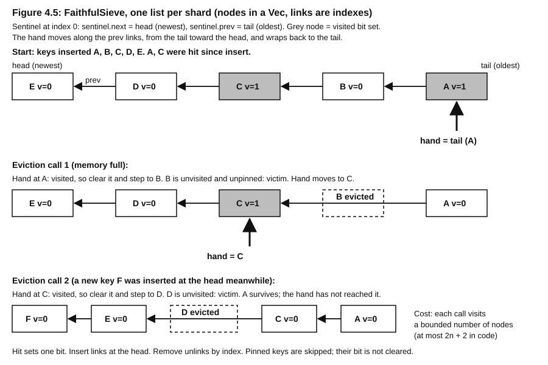

Source: `src/core/eviction.rs::FaithfulSieve`, `select_victim`; `src/core/cache.rs::evict_with_policy`.

Each shard owns one `Box<dyn ShardEvictionPolicy>` (trait: `on_insert`, `on_hit`, `on_remove`, `select_victim(is_pinned)`, `rebuild_from`, `name`). The factory `create_shard_eviction_policy` builds `FaithfulSieve` (the default), `FaithfulLru` or `FaithfulS3Fifo`. A fourth type, `ClockScan` (an O(n) scan), exists in the file as a "legacy fallback" but the factory never builds it and no other code references it (grep). A separate legacy string-keyed API on `PartitionedCache` (`get`, `insert`, `evict_sieve`, kept for old unit tests) does use a linear scan with its own `visited` flag; it is not on the HTTP serving path. `CLAUDE.md` section 6 says the evictors "are scans": that was true before the faithful implementations (the audit `docs/research/eviction_policy_audit.md` records the old linear scan) and is **outdated** for the current tree.

| Operation | LRU | SIEVE | S3-FIFO |
|---|---|---|---|
| Structure | doubly linked list in a `Vec` arena with sentinel; `HashMap<key, index>` | same arena, plus `visited` bit and `hand` index | `VecDeque` small, main, ghost; `HashSet` ghost set; `HashMap` frequency |
| `on_insert` | O(1) expected, plus hashing the key | O(1) expected | O(1) expected |
| `on_hit` | O(1): unlink and relink at head | O(1): set one bit | O(1): increment counter (max 3) |
| `on_remove` | O(1): unlink | O(1): unlink; moves the hand if needed | O(1) but **leaves the key in its queue** (tombstone) |
| `select_victim`, typical | O(1) | amortized O(1) | amortized O(1) (our reasoning) |
| `select_victim`, worst case | O(p), p = pinned keys at the tail | bounded by 2n + 2 node inspections, each cloning a key | bounded by 2(small + main) + 4 loop iterations |
| Memory | one node per live key; freed nodes reused | same | queue entries can outnumber live keys (G4A-02) |

"Expected O(1)" assumes the hash map works as usual and keys are short (a key is at most 4,096 bytes; hashing and cloning are O(key length)).

::: example
**Worked example: why SIEVE is amortized O(1).**

Look at the Figure 4.5 trace. Call 1 clears A's bit and evicts B: 2 node inspections. Call 2 clears C's bit and evicts D: 2 inspections. Each bit that a hit set can be cleared once by the hand, so over a long run the total clearing work is at most the number of hits, and each eviction ends the scan with a victim. Total work is roughly hits + evictions, so the average per operation is constant. This is our reasoning, in the spirit of the published argument, not a proof in the repository. The argument fails for pinned entries: the hand steps past a pinned node without clearing anything, so a long run of pinned nodes costs time on every eviction, up to the whole list (G4A-20, OPEN). A slow origin makes many keys in flight, so an attacker who can make origin requests slow can raise the eviction cost.
:::

### Where the policy is told about hits

`begin_fetch_atomic` calls `shard.eviction.on_hit(key)` on a fresh hit. Three other places that serve data do not: stale serving (`check_stale_serving` sets `state.visited` only), `get_resource` and `get_resource_with_metadata`. And `KeyState.visited`, set in several places in `cache.rs`, is never read by any eviction policy: the policies keep their own bits. A hot entry served stale therefore gains no recency (G4A-20). Verified by grep for `.visited` reads.

### Switching policy at run time

`set_eviction_policy` rebuilds each shard's policy from the map's keys in hash-map order under the shard lock, so recency and visited information are lost; `set_capacity_limits` does the same and then evicts down to the new bound. `evict_with_policy` rebuilds with capacity hint 1024 if the installed policy's name does not match (G4A-26). Calls to `set_eviction_policy` exist in `src/intelligence/executor.rs` (`apply_policy` in Canary or Active mode, and `revert_to_safe`) and in the legacy `src/control/pie.rs`. No call from `src/main.rs` or `src/api/` was found, so the production default stays SIEVE unless the intelligence executor is driven to apply an S3-FIFO candidate (**UNVERIFIED** whether anything in a normal run does that; the reviewer left the same question open). The default intelligence mode is `off`.

### The S3-FIFO finding (G4A-02, OPEN, High but conditional)

`on_remove` deletes the key from `freq` and `ghost_set` but not from `small_q` or `main_q`. Re-inserting the same key after a removal pushes a *second* queue entry. `select_victim` pops from the front and treats a key as live if `freq` contains it, so a stale duplicate can evict the live entry early. The check `small_q.len() >= small_cap` counts the stale entries too.

::: example
**Worked example: unbounded queue.**

S3-FIFO selected, no eviction pressure (cache below budget). A crawler requests 100,000 distinct URLs; each expires and the sweeper calls `on_remove`. Live keys at the end: 0. `small_q` length: 100,000 (one cloned `CacheKey`, up to three heap strings, per entry), because `select_victim` is the only code that pops the queue and it never ran. That memory is outside `audit_bytes`. Separately, `insert X; remove X; insert X` leaves `small_q = [X, X]` with `freq = {X}`. This is a code-reading trace; no test in the repository reproduces it (the current S3-FIFO test only asserts the victim is not a key that was hit twice).
:::

Exposure: only when S3-FIFO is selected. Default is SIEVE. The disposition register lists G4A-02 as OPEN, blocking, with an owner decision pending (fix, withdraw S3-FIFO from the selectable set, or accept). The code in this tree still has the tombstone behaviour (opened and confirmed).

Other S3-FIFO notes (this author's reading): capacity at construction is a hint (1024 in `CacheShard::new`, `max_entries_per_shard` in `set_eviction_policy`), so `small_cap` can differ from the real per-shard entry limit; and a key inserted twice without a removal is counted as a hit (frequency + 1).

### Tests: what they show

- `eviction_contract_tests.rs`: LRU golden trace (real ordering check); SIEVE and S3-FIFO "golden trace" tests assert only that the victim is not a key that was hit (weak: no comparison to a reference or published trace); pinned keys survive (LRU only); a timing test asserts average SIEVE eviction under 10 microseconds at 10,000 entries in whatever build runs it (host-dependent, no pinned keys, no visited bits, so it shows a timing, not a complexity); accounting holds under eviction; an HTTP end-to-end eviction test.
- `src/lab/eviction_baselines.rs` imports the same policy types for simulation (Chapter 7); `lab_eviction_tests.rs` exists but was not analysed here.
- **No test measures hit ratio of these implementations against the literature.** The audit file quotes miss-ratio figures for an earlier phase; their provenance was not checked here and they are not quoted.

::: judge
**JUDGE MAY ASK**

Question: Why SIEVE as the default? Is eviction really O(1)? You also have S3-FIFO; is it safe?

**Suggested answer** (about 30 to 60 seconds spoken, plain English):

SIEVE keeps a queue and one visited bit per entry. A hit only sets a bit, so the hit path does not rewrite a list under the shard lock, which matters in a design where a lock protects everything. Eviction advances a hand that clears bits until it finds an unvisited entry, and over a long run that is constant work per operation. I cannot cite a recorded decision for making it the default; the published design is the motivation, and no test in the repository measures its hit ratio against LRU on a real workload. On "O(1)": expected O(1) for hit, insert and remove, amortized O(1) for eviction when nothing is pinned. A worst-case single eviction can walk the whole list, and pinned entries, which are keys with a fetch in flight, make the walk longer, so I would not say worst-case O(1). S3-FIFO is implemented but has an open High finding: removing a key leaves it in the queue, so queues can grow without bound and early evictions can happen. It is only used if someone selects it; the default is SIEVE.

**If the judge asks further:**

"Is it faithful to the paper?" It follows the structure of the papers. The tests do not compare it against a reference implementation, and the S3-FIFO bug shows it does not preserve the algorithm's behaviour on remove and re-insert. "Faithful" is the code's own name for it, not a verified property.

**Evidence to know:** `src/core/eviction.rs` (`FaithfulSieve`, `FaithfulLru`, `FaithfulS3Fifo`); `eviction_contract_tests.rs`; G4A-02, G4A-20 (OPEN); `docs/research/eviction_policy_audit.md`; status IMPLEMENTED, TESTED (weakly), literature UNVERIFIED.
:::

::: judge
**JUDGE MAY ASK**

Question: State the time and space complexity of the cache operations.

**Suggested answer** (about 30 to 60 seconds spoken, plain English):

Let n be the entries in a shard and k the key length, at most 4,096 bytes. Lookup: hash the key, O(k), then expected O(1) in the hash map. Insert and delete: expected O(1) plus the eviction policy bookkeeping, also O(1). Eviction: amortized O(1) with no pinned keys. Coalescing a request: O(1). Memory is O(entries x entry size), bounded by the byte budget and the entry limit. Three honest exceptions: tenant invalidation is O(T) in the number of tenants with a recorded epoch, up to 10,000; the sweeper scans O(n) of a shard under its lock every tick; and switching policy is O(n) per shard. Also a hit copies the body, so it costs O(body size) as well.

**If the judge asks further:**

"Space beyond the cache?" Per-key state with a set of active ops, a waiter list per in-flight key (up to 1,000), the eviction structures, and for S3-FIFO possibly unbounded queues.

**Evidence to know:** `cache.rs` (`get_shard_index`, `try_invalidate_tenant`, `sweep_lazy_reclamation`, `set_eviction_policy`); G4A-03, G4A-12, G4A-20, G4A-26; status: asymptotics from reading code, none measured here.
:::

## 4.10 What happens when the origin fails

This section collects behaviour described in sections 4.4, 4.5 and 4.8; each line is read from code or a named test there.

| Situation | What happens |
|---|---|
| Miss, origin errors or refuses | One error to every waiter; nothing stored; the next request is a new leader (no negative caching, no ordinary-miss backoff). TESTED: `test_negative_effect_error_fanout_blast_radius` |
| Origin slow | Read times out after 5 s (`OriginError::Timeout`); waiters held up to about that long. TESTED: `test_negative_effect_head_of_line_blocking` |
| Origin down, stale-if-error window open | Served as STALE if `check_stale_serving(.., true)` is Eligible (window not zero, not must-revalidate, age within the cap); scope gap G4A-06. TESTED: `test_stale_if_error_on_origin_outage` |
| Origin down, beyond the 24 h cap, or `must-revalidate` | `CapExceeded` or Ineligible: not served; the request fails. TESTED: `test_hard_staleness_cap_enforced_strictly`, `test_must_revalidate_strictly_forbids_stale_serving` |
| Client disconnects during fetch | Leader task keeps running; the guard finalizes; dead receivers ignored; permit released. TESTED: `permit_released_after_client_disconnect`; R5 REFUTED |
| Origin cap saturated (only if enforcing) | Request shed with its own reason code; stale served if eligible, else 503 (`saturation_serves_stale_if_eligible_else_503`, name only) |
| Shard full of pinned keys | `CapacityExceeded` for that shard (G4A-23) |
| Revalidation failures | Backoff 1 s doubling to 60 s; stale body served while the window allows. TESTED: `test_failure_backoff_schedule` |

What is **not** there: negative caching of errors, retry budgets for ordinary misses, circuit breaking beyond the optional cap, and a distributed answer (a second node does not know the first node's origin is failing). The origin connection layer and its SSRF and TLS rules are Chapter 6.

::: judge
**JUDGE MAY ASK**

Question: The origin goes down. What does the user see, and what protects the origin when it comes back?

**Suggested answer** (about 30 to 60 seconds spoken, plain English):

It depends on what is cached. A fresh entry is still served; the origin is not involved. An expired entry that the origin marked with stale-if-error is served as stale up to the 24-hour hard cap, unless it is marked must-revalidate. A key with nothing usable fails for every request that was waiting on that one fetch, with the same error, and the next request tries again, since errors are not cached. When the origin returns, a returning stampede is limited by single-flight to one request per key. Across many keys there is no limit by default; there is an optional concurrency cap for the origin that only enforces in canary or active intelligence mode. Two caveats: stale-if-error is applied to more status codes than the standard allows (G4A-06), and there is no negative caching or circuit breaker.

**If the judge asks further:**

"Does the AIMD cap help?" Its effect is not established in this chapter: it starts at its maximum and reduces only if observed p99 latency or errors cross a threshold. The evidence discussion is in Chapters 5 and 7.

**Evidence to know:** `stale_serving_tests.rs`, `coalesce_tradeoffs_tests.rs`, `origin_cap_tests.rs`; G4A-06; status IMPLEMENTED, TESTED on loopback with in-process mock origins.
:::

## 4.11 Capability status table

| Capability | Status | Evidence and limits |
|---|---|---|
| Sharded key map, 8 shards in production | IMPLEMENTED, TESTED | `cache.rs`; many tests; contention not measured |
| Single-flight and coalescing, waiter limit | IMPLEMENTED, TESTED | `coalesce_tradeoffs_tests`, `serving_contract_tests`, `m1_http_tests`; loopback only |
| Generation fencing against DELETE | IMPLEMENTED, TESTED | `test_delete_fences_in_flight_fill_race`; single interleaving |
| Tenant and global epoch fencing | IMPLEMENTED, PARTIAL | known race G4A-01 (sandbox-reproduced, fix not integrated); G4A-08, G4A-17 open |
| Epoch overflow fallback to global epoch | IMPLEMENTED, TESTED | `test_epoch_saturation_fallback_sec4a_preserved`; peer-triggerable (G4A-12) |
| Lazy sweeper | IMPLEMENTED, PARTIAL | G4A-03 (full scan), G4A-16 (validators dropped) |
| Freshness engine (RFC 9111 subset) | IMPLEMENTED, PARTIAL | `freshness_matrix_tests` (not analysed here); G4A-04, -05, -06, -10 |
| `PHANTOM_DEFAULT_TTL_MS` | NOT WIRED (setting has no effect) | `config.rs` `Wiring::NotWired`; literal 60,000 in `server.rs` |
| `PHANTOM_MAX_STALE_MS` hard cap | IMPLEMENTED, TESTED | cap tests; counter weak (G4A-18); wall clock (G4A-10) |
| Revalidation with 304, backoff, bounded background refresh | IMPLEMENTED, TESTED | `revalidation_304_tests`, `stale_serving_tests`; one test `#[ignore]`d |
| SIEVE (default) and LRU eviction | IMPLEMENTED, TESTED (weakly) | pinned scans not O(1) (G4A-20); no hit-ratio check against literature |
| S3-FIFO eviction | IMPLEMENTED, PARTIAL | defect G4A-02 OPEN (tombstones); not selected by default |
| Byte accounting I1 to I8 | IMPLEMENTED, TESTED (consistency) | `byte_accounting_tests`; G4A-13, G4A-23 |
| Origin concurrency gate (AIMD) | IMPLEMENTED, TESTED (arithmetic and cap unit tests) | on the serving path only when a cap is set in canary or active mode; default off; `executor.rs`, `origin_cap_tests`; benefit not established |
| Hot-hit scalability (read lock, replication) | DESIGNED BUT NOT IMPLEMENTED | no code found; not claimed |
| Loom or model-checker verification of locking | NOT DONE | only an abstract model test exists |
| Independent human review of this engine | NOT DONE | G4A is an AI second look |

## 4.12 Where this chapter disagrees with other documents

These are differences between sources, recorded rather than fixed. Details and file references are in the evidence file.

1. **`CLAUDE.md` "O(1)-amortized eviction"**: true for SIEVE and LRU only when nothing is pinned; per-call worst case is O(n); S3-FIFO carries G4A-02. `CLAUDE.md` section 6 "evictors are scans" is outdated.
2. **`CLAUDE.md` "lock order: shard, then `tenant_epochs`"**: no code path nests them. The real nesting edges are shard to `epoch_snapshot` (read), `waiters`, `pending_freshness` and the `eviction_policy` mutex.
3. **"Per-tick shard inspection limit" for `PHANTOM_SWEEPER_BATCH_SIZE`** (`CLAUDE.md`, and "shards per tick" in `src/config.rs`): the code bounds candidates reclaimed per shard, and scans the whole shard (G4A-03).
4. **"O(1) tenant flush"** (test comment, `invalidation_contract_tests.rs`): the bump copies the tenant epoch map, O(T) up to 10,000.
5. **SEC-4A-01 comment "cluster-wide"**: the global epoch is per process.
6. **"Read-path zero contention"**: true for the epoch read; the shard mutex is still taken by every request, twice on a hit.
7. **"`stale_cap_violations` must be 0"**: true, but near-tautological (G4A-18).
8. **`CLAUDE.md` line numbers for the `60_000` literal** (1077, 1352) are stale; the fact holds (lines 1405 and 1688 in this tree).
9. **The `test_waiter_capacity_bound` soak test** is named as if it tests the bound but asserts nothing about it; the bound is covered elsewhere.
10. **`KeyState.visited`** looks like an eviction input but no policy reads it.

## Key ideas to remember

::: concept
- One mutex per shard (8 in production) lets different keys run in parallel; one hot key is still one shard.
- A miss registers an in-flight operation; later misses wait for it. One origin fetch serves many clients, and an origin failure fails them all together.
- A fetch stores its result only if the instance, generation and epochs recorded at the start still match. DELETE bumps the generation; tenant invalidation bumps an epoch without touching a shard.
- Invalidation by epoch is lazy and local to one node. G4A-01 is a real, sandbox-reproduced race in the epoch step; the fix is not integrated.
- Freshness comes from origin headers; the default of 60 s is a literal and `PHANTOM_DEFAULT_TTL_MS` has no effect. The stale cap bounds stale serving only.
- SIEVE is default; S3-FIFO has an open High defect; "O(1)" holds only without pinned keys.
:::

## What you should now understand

- How a key becomes a shard index and why `& mask` needs a power of two.
- Why sharding does not help a single hot key, and what in the GET path takes the shard lock.
- The step-by-step life of one entry from miss to resident, and what each of instance id, generation and epochs defends against.
- Why waiters receive the origin's answer even when the cache refuses to store it.
- How an epoch bump invalidates without a scan, what the sweeper does, and what the overflow fallback does.
- Exactly what G4A-01 is, what has been shown about it, what has not, and its integration status.
- How `check_stale_serving` decides between fresh, stale-eligible, cap-exceeded and ineligible.
- How SIEVE, LRU and S3-FIFO differ, which are implemented, and why O(1) is a qualified claim.
- What the byte accounting covers and what it leaves out.

## Knowledge check

1. A key hashes to 0x2F3B (hex) in a cache with 8 shards. Which shard? (Use the code's rule.)
2. Why must the shard count be a power of two in `PartitionedCache::new`?
3. A DELETE arrives while a fetch for the same key is running. Walk through what `finalize_fetch` does with the fetched body and what the waiters receive.
4. Name the three fences in `finalize_fetch` and the event each one detects.
5. Tenant `acme` is at epoch 6 and an entry was stamped (6, 0). `invalidate_tenant("acme")` runs. Is the entry freed immediately? What happens on the next GET for it?
6. An origin sends `max-age=30, stale-while-revalidate=120`. At age 100 s with the default cap, is the entry served? At age 200 s?
7. Someone sets `PHANTOM_DEFAULT_TTL_MS=5000`. What changes at runtime? Why?
8. Which eviction algorithm is the default, and what is the open defect with S3-FIFO?
9. State the G4A-01 interleaving in three steps and say how it was reproduced.
10. Give two reasons the byte count from `audit_bytes` is not the process's memory use.


## Codebase exploration tasks

1. **Trace a miss and a fill.** Start at `src/core/cache.rs::begin_fetch_atomic`. Follow `Initiate` into `src/core/coalesce.rs::FetchRegistration::into_guard` and then to `finalize_fetch`. Find every place the shard mutex is taken and released. You should learn where a `WaiterBatch` is delivered relative to the lock, and which counters change on each branch.
2. **Find the G4A-01 window.** Open `finalize_fetch` and locate the first `get_effective_epochs` call, the eviction loop, the second call and the line that stamps `entry_tenant_epoch`. Then open `docs/research/g4a01_race/proposal.patch`. You should learn how a change of four lines (three added, one replaced) would close the gap and why the repository does not apply it yet.
3. **Check the SIEVE trace.** Open `src/core/eviction.rs::FaithfulSieve::select_victim` and replay Figure 4.5 by hand with `on_insert` x5 and `on_hit` on A and C. Then look at what `is_pinned` does inside the loop. You should learn why pinned entries break the amortized argument.

## Challenge questions

1. **Design a fix for G4A-08 and G4A-01 together, then say what test would fail without it.** Constraints from `CLAUDE.md`: the read path must not take an exclusive epoch mutex; changes to fencing need an independent review and a failing-first test.

   *Model answer.* Capture `(tenant_epoch, global_epoch)` once, ideally from a single immutable `EpochView` snapshot (this also addresses G4A-17). In `finalize_fetch` stamp exactly the captured pair (the G4A-01 fix). For G4A-08, store the epoch pair on `SharedOp` at registration and, on a join, compare it with the current pair; if different, detach the stale in-flight record and start a new fetch, as DELETE does. Failing-first tests: (a) a test hook between the fence check and the stamp (as the sandbox did), then `invalidate_tenant`, then assert `get_resource` is `None`; (b) `begin_fetch_atomic` (Initiate), `invalidate_tenant`, `begin_fetch_atomic` again must return `Initiate`, not `Wait`. Residual risk: still needs a schedule-exploring check (loom or shuttle) and an independent reviewer.

2. **A tenant sends 100,000 distinct URLs through a slow origin. Which resource limits bind first in this engine, and which mechanism would you add?**

   *Model answer.* Entries become pinned while in flight, so the per-shard entry limit (10,000 in production, per shard) binds; further misses on a full shard return `CapacityExceeded` while pinned keys cannot be evicted (G4A-23). Origin load is not limited by coalescing because the URLs are distinct; only the optional origin cap (canary or active mode with a cap set) would limit it. Add a per-tenant quota on in-flight fetches and entries, and enable a fixed origin concurrency cap. These are proposals; tenant quotas are not implemented here (Chapter 8 lists future work).

## Answers to the knowledge check

::: answers
1. Low three bits of the hash: 0x2F3B ends in 0xB = 1011 binary; `& 7` gives 0b011 = 3. (The real hash is SipHash output, not a chosen number; the exercise tests the mask rule.)
2. So that `hash & (count - 1)` equals `hash % count`; `new` asserts it. A non-power of two would make the mask skip shards.
3. DELETE sets `entry = None`, bumps `generation`, detaches `in_flight`. On finish, `state.generation != op_gen`, so `stale_writes_prevented` increases and nothing is stored. The waiters batch was built from the fetch outcome, so waiters still receive the fetched body once.
4. State instance id (the `KeyState` was removed and recreated: `stale_ops_ignored`); generation (a DELETE happened: `stale_writes_prevented`); tenant and global epochs (invalidation happened: `stale_writes_prevented`). The epoch check is the one with the G4A-01 gap.
5. No; the bytes stay counted. On the next GET, `begin_fetch_atomic` sees stamp 6 != 7, drops the entry, subtracts its resource bytes, bumps the key's generation and treats it as a miss. The sweeper may reclaim it earlier.
6. Lifetime 30 s, window 120 s: eligible while age <= 150 s. At 100 s: served stale (and refreshed in the background). At 200 s: not eligible, so a miss.
7. Nothing. The setting is validated and reported but `Wiring::NotWired`; `server.rs` passes the literal 60,000 to the freshness engine.
8. SIEVE. S3-FIFO's `on_remove` leaves keys in its queues (tombstones), so the queues can grow without bound and duplicates can cause early eviction (G4A-02, OPEN, High but only when S3-FIFO is selected).
9. \(1) Leader passes the epoch fence check. (2) `invalidate_tenant` bumps the epoch without taking the shard mutex. (3) Leader re-reads epochs and stamps the old body with the new epoch, so it looks current. Reproduced only in a sandbox with an injected pause between the check and the re-read; no natural reproduction in a 20 s stress; fix proposal not integrated.
10. Any two of: it omits freshness metadata strings, hash-table slack and `Arc` headers; it omits eviction structures (S3-FIFO queues); it uses `body.capacity()` and a fixed overhead estimate rather than allocator reality; the panic path in finalize can drift it (G4A-13).
:::

# Chapter 5: Distributed Systems and Workload Intelligence

This chapter has two halves. The first half explains how several PhantomCache gateways cooperate: who is a member, how they talk, how a key is mapped to a node, and what happens to an invalidation when things break. The second half explains the workload-intelligence code: telemetry, probabilistic data structures, and the adaptive algorithms. In both halves the main skill is the same. You must be able to say exactly what the code does today, what only exists as a library, and what is not guaranteed.

## What you will learn

- How the cluster is wired: static membership, mutual TLS, the binary frame protocol, connection pooling, and what the "heartbeat" really does.
- How rendezvous hashing works (with the maths and real numbers), and the precise, narrow job it does in this code base: it picks the node that gives the synchronous acknowledgement for a DELETE. It does not place data and it does not route reads.
- How an invalidation travels: local purge, primary acknowledgement, asynchronous fan-out, the repair ledger, anti-entropy, and the three different "epochs" that are easy to confuse.
- What consistency PhantomCache can honestly claim, under which failure model, and which cases (an issuer crash, a long partition) have no bound and no test.
- What the "intelligence" is: a telemetry histogram and one small adaptive controller (AIMD) on the serving path, plus a library of detectors and evaluators that are not wired in, plus a legacy stub that is not the intelligence. The sealed experiment (M6) found no benefit from adaptivity.

**Status words.** Every capability below carries one of the labels from the style rules: IMPLEMENTED, TESTED, PARTIAL, PROTOTYPE ONLY, DESIGNED BUT NOT IMPLEMENTED, DEFERRED, BLOCKED, UNVERIFIED. "INDEPENDENTLY VERIFIED" is not used, because no human or external review of this code exists. The G4 reviews quoted here are AI second looks.

**How this chapter was checked.** Code statements were read in the working tree on 2026-10-30 (branch `feat/publish-phantomcache-core`; HEAD `df68eaa` at the time of writing; large uncommitted tree). Older documents were compared with that code. `docs/learning/evidence/ch05_evidence.md` lists each claim, its source and how it was verified. The only thing executed was a tiny standalone program that replicates the router's hash formula (section 5.3).

---

## 5.1 Distributed caching fundamentals, and the choice PhantomCache made

### Simple explanation

One cache in one process is fast and simple. When traffic grows, or you want to survive the loss of a machine, you run several caches. Now three questions appear that did not exist before.

1. **Placement.** Which cache holds which key?
2. **Coherence.** If the data changes, how do all caches learn it?
3. **Failure.** What happens when a cache, or the network between caches, breaks?

Systems answer these differently. Memcached clients and Redis Cluster *partition* the key space: each key lives on exactly one node, chosen by a hash. A read for key `k` is sent to the owner. There is one copy, so coherence is easy, but a lost node loses its keys. Content-delivery caches usually do the opposite: every edge keeps its own copy of whatever it served, and the operator *purges* the key everywhere when the origin changes. That is cheap to read (always local) and hard to keep coherent.

### The correct terms

- **Partitioned (sharded) cache:** each key has one owner; reads are routed to it.
- **Replicated or local-copy cache:** several nodes may hold the same key; invalidation must reach all of them.
- **Invalidation:** removing or marking stale a cached entry because the source of truth changed.
- **Fan-out:** sending one message to many receivers.
- **Anti-entropy:** a background process that compares state between nodes and repairs differences (the term comes from database replication, for example Cassandra and Dynamo-style systems).
- **Failure model:** a written list of the faults you claim to survive (crash, message loss, partition, slow node, malicious node) and the ones you do not.

### Where it lives in PhantomCache

PhantomCache chose the second design. Verified in code: a GET is answered from the gateway's own cache and, on a miss, from the origin. It is never forwarded to another gateway (`src/api/server.rs::get_cache_handler` uses `state.cache`; `RendezvousRouter::forward_key_over_tcp` has no caller outside tests, verified by grep over `src/`). The cluster layer exists to do one job: when a client sends DELETE for a key on any gateway, make every gateway drop its copy. The recorded decision is ADR-003 (Option A1, "Reliable Invalidation Fan-Out + Unified Cache" as the test header phrases it; `docs/research/adr/ADR-003-distributed-architecture.md`). IMPLEMENTED; TESTED (sections 5.5 and 5.6 give what the tests prove).

An earlier investigation (`docs/research/architecture_investigation.md`, 2026-10-28) found that the cluster protocol was "a protocol library and a demo" that did not touch the serving cache. That is **out of date** for the mTLS cluster path. The table below lists what changed, because a judge who has read the old document may quote it.

| Finding in the 2026-10-28 investigation | Current code (read in this tree) |
|---|---|
| A1: peer invalidations purge a side cache, not the HTTP cache | In the mTLS cluster branch the local node is built with `VirtualNode::new_with_cache(node_id, cache.clone())` (`src/main.rs`), so the cluster listener purges the same `PartitionedCache` that serves HTTP. Remote peers are address-only descriptors. |
| A5: anti-entropy has no production caller | `main.rs` calls `RendezvousRouter::start_anti_entropy_worker` (250 ms) in both cluster branches. |
| A6: outbound invalidations never recorded | `send_invalidation_frame_with_seq` and the broadcaster push each outbound record into the local ring (`push_outbound`). |
| A7: one shared sequence counter, false gaps | `DestinationSequencer` keeps one counter per destination node. |
| A9: missed fan-out lost without record | `RepairLedger` records every undelivered invalidation (bounded). |
| A11: local purge after the cluster round trip | `delete_cache_handler` calls `cache.delete` first, then the cluster. |
| A3: GET is local only | **Still true.** |
| A4: peer `GetRequest` fabricates data | **Still true** (section 5.8). |
| A10/G4B-12: heartbeat never changes node state | **Still true** (section 5.2). |

The project note in `CLAUDE.md` section 6 carries the same "partly outdated" warning; the startup banner in `main.rs` was updated to describe the shared cache correctly.

### Trade-offs

Local copies make reads fast and make a node loss harmless to read availability: any gateway can serve any key. The price is coherence. Staleness is possible on every gateway that missed an invalidation, and the system has no read path that could notice. This is the central trade-off of the chapter. (Whether partitioning would have been "better" is our reasoning, not a recorded decision; ADR-003 records why fan-out was chosen, not a comparison against a partitioned design for this exact workload.)

---

## 5.2 Cluster membership and node-to-node communication

### Membership is a static file

A cluster is defined by a JSON file named in `PHANTOM_CLUSTER_MEMBERS_FILE`. It lists the cluster id, a `version`, and for each member: node id (1 to 255, a `u8`), an `active` flag, and the SHA-256 fingerprints of the certificates that member may use. `src/main.rs` loads it once (`security::load_membership_from_file`). The comment in `src/security/cluster.rs` is explicit: "updates to the file require process restart to reload."

`ClusterMembershipRegistry::update` exists. It enforces that the new `version` is strictly greater and sends a revocation message for members that disappear. But a search of `src/` finds no production caller; only tests call it (`tests/integration/security_phase3_cluster_tests.rs`, `m7_security_review_tests.rs`). So **revocation machinery exists and is TESTED, but has no production trigger**. This is finding G4B-07, an owner-named OPEN item in the disposition register. The accurate sentence for a judge is: "membership is static; changing it means editing the file and restarting every node."

The `version` field is what the code calls the **membership epoch**. It is not a failure detector and it does not change at runtime.

### Node states, and which are real

`NodeState` (in `src/dist/node.rs`) has seven values: `Joining`, `Active`, `Degraded`, `Suspect`, `Failed`, `Offline`, `Recovering`. What actually happens to them:

| State | Who sets it | Notes |
|---|---|---|
| `Joining` | `VirtualNode::new` | Initial value; `start_tcp_service` and `main.rs` set `Active`. |
| `Active` | startup; repair/pull workers after reconciliation | Peers in a configured cluster start `Active`. |
| `Degraded` | nobody | Declared, never assigned (grep of `src/`). |
| `Suspect` | data-path failures in the router: connect error, timeout, bad ack, wrong responder | Excluded from `route_key` Pass 1 and from `get_replicas`. |
| `Recovering` | `repair_peer` after a Suspect peer's debts drain; `reconcile_peer_anti_entropy` | Not yet routable; becomes `Active` after a pull reconciliation. |
| `Failed`, `Offline` | `POST /api/control {"event":"NODE_FAILURE"}` (hard-coded to node 2); nothing else | See below. |

`NODE_FAILURE` is a **logical flag**, not a failure. `control_handler` in `src/api/server.rs` does `n.set_state(NodeState::Failed)` for the node with id 2. In a real cluster that node object is the live router entry, so the flag changes routing and makes the router refuse to connect to that peer (`connect_to_node_inner` returns `NodeUnreachable` for `Failed`/`Offline`). Any other event string, including a missing one, sets every node `Active`, silently clearing `Suspect` and `Recovering`. This is finding G4B-03 (OPEN, owner-named). It is a simulation hook that is live-wired. In demo mode it is how the UI "kills" a node; no process dies.

A listener whose own state is `Failed` or `Offline` drops every inbound socket (`start_tcp_service` accept loop), which is how the tests simulate a partition.

### Heartbeats do not detect failure

The connection pool sends a `HeartbeatRequest` to every *idle* pooled connection every 5 seconds (`PoolConfig::heartbeat_interval`, `TlsConnectionPool::probe_idle_connections`). A failed probe discards that connection. **Nothing in `pool.rs` reads or writes a `NodeState`.** A peer that died while idle stays `Active` until a real invalidation call to it fails. The first such call pays its full 150 ms deadline. This is G4B-12 (Medium, OPEN). The heartbeat's real value is to keep idle TCP connections alive and to throw away dead ones before they are used. Document it as "connection keepalive", not "failure detection". Status: IMPLEMENTED (as keepalive), TESTED in `security_phase3c_pooling_tests.rs`; failure detection DESIGNED BUT NOT IMPLEMENTED.

A further caution: because the heartbeat succeeds on a connection that is merely *open*, it also refreshes the pool's idle timer. A pooled connection can therefore live as long as the peer keeps answering, so certificate expiry or rotation is enforced only at handshake time (G4B-08, OPEN, owner-named).

### The wire protocol: PhantomMesh frames

Defined in `src/dist/frame.rs`. Every message is a fixed 28-byte header followed by a payload of at most 1,048,576 bytes.

```
magic "PHAN" (4) | version (1) | msg_type (1) | flags (2) | request_id (8)
| sequence_number (8) | payload_length (4)        -- all big-endian
```

Message types: `GetRequest/GetResponse`, `InvalidateRequest/InvalidateAck`, `HeartbeatRequest/Response`, `AntiEntropySyncRequest/Response`. Keys are at most 4,096 bytes. An `InvalidateRequest` carries: membership epoch (u64), stream sequence (u64), originator node id (u8), scope (`ExactKey`, `Tenant` or `FullCache`) and the key. The ack carries the responder id, a status (`SuccessEvicted`, `SuccessNotPresent`, `IgnoredObsolete`, `RejectedRateLimit`, `InternalError`) and the reclaimed bytes. Status: IMPLEMENTED; TESTED (`security_phase3b_framing_tests.rs`, codec tests in `security_phase4c_antientropy_tests.rs`). What these tests prove: encode/decode round trips and rejection of malformed headers and oversize payloads. They do not prove protocol behaviour under load.

Note the two different sequence numbers. The header's `sequence_number` is per *connection* and is just a counter. The payload's `stream_seq` is per *destination node* and is what anti-entropy reasons about. Section 5.5 uses the second.

### Admission: the mTLS handshake

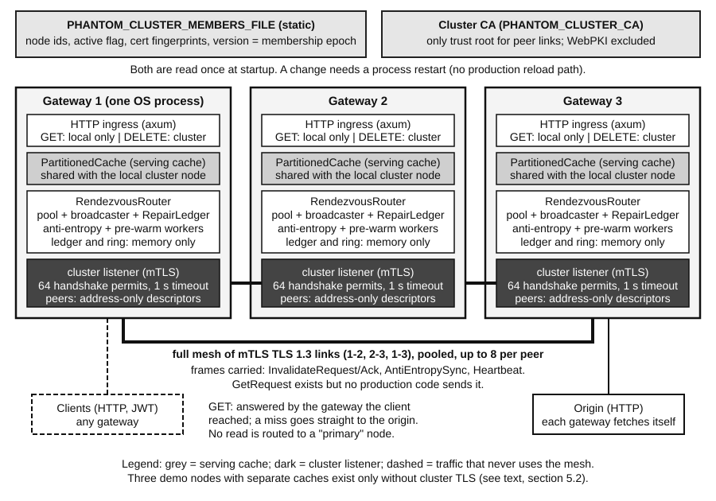

Source: `src/main.rs` (cluster branch), `src/dist/node.rs::start_tcp_service`, `src/dist/router.rs::RendezvousRouter`.

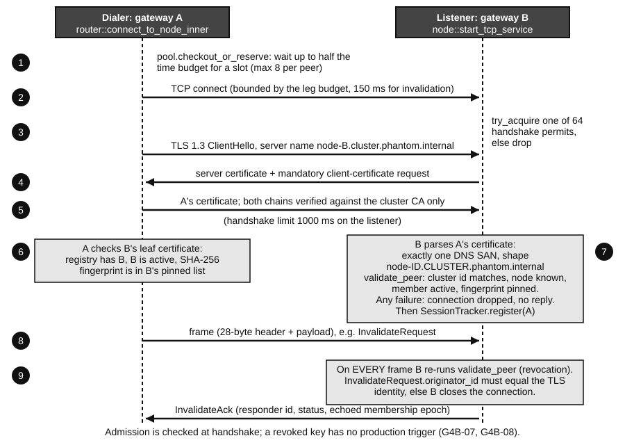

Source: `src/dist/router.rs::connect_to_node_inner`, `src/dist/node.rs::start_tcp_service` and `process_binary_cache_stream`, `src/security/cluster.rs::ClusterTlsConfig::from_pem` and `validate_peer`.

Key points, verified in code (the trust analysis is Chapter 6, section 6.4):

- TLS 1.3 only, both directions. The only trust root is the cluster CA (the web PKI is not loaded); the listener requires a client certificate (`WebPkiClientVerifier`).
- Identity is the certificate's single DNS Subject Alternative Name `node-<id>.<cluster_id>.phantom.internal`; zero or several SANs are rejected. Authorisation is *pinning*: the registry must list that node id as active with a fingerprint matching the leaf certificate, so a valid CA-signed but unpinned certificate is refused.
- Limits: 64 handshake permits and a 1,000 ms handshake timeout on the listener; at most 8 pooled connections per peer (4 idle). 64 silent connections can occupy all permits (G4B-10, OPEN).
- Every frame re-checks the peer against the registry; an `InvalidateRequest` whose `originator_id` differs from the TLS identity closes the connection (`test_l3_invalidate_request_originator_must_match_tls_identity`).
- With no cluster TLS a listener may bind only to loopback (fails closed). A plaintext loopback mode for tests skips the originator check (G4B-17, Low).

The security chapter (Chapter 6) owns the trust analysis. For this chapter the point is architectural: a member is *trusted*. Any pinned member can send `Tenant` or `FullCache` scope invalidations that flush other nodes' caches (G4B-05, DR-027, OPEN, owner-named). The cluster is a closed trust domain, not a hostile network.

### What runs in the other, non-mTLS configurations

Without cluster certificates but with `PHANTOM_ALLOW_INSECURE_CLUSTER` (or a members file but no certs), `main.rs` builds a router over three *placeholder* nodes with no addresses and no listeners. No frame is sent. A DELETE then purges the local cache and reports `504 PrimaryInvalidationTimeout`. With no cluster configuration at all, `router` is `None` and DELETE is purely local. The three demo `VirtualNode`s (ids 1 to 3) with separate caches exist for the simulation endpoints. Status: IMPLEMENTED; the insecure branch is labelled EXPERIMENTAL by its own startup message.

::: judge
**JUDGE MAY ASK**

Question: How do your nodes discover each other and communicate? What if I add a node?

**Suggested answer** (about 30 to 60 seconds spoken, plain English):

Membership is static. A JSON file lists every node, its id and the fingerprint of its certificate. Each gateway reads it at startup. Nodes talk over mutually authenticated TLS 1.3 with a small binary protocol; both sides check the certificate against the cluster CA and against the pinned fingerprint. There is no gossip and no dynamic join. To add a node you edit the file, bump its version and restart the cluster members. A runtime reload and revocation path exists in the library and is tested, but nothing in the shipped gateway triggers it. That is an open finding, G4B-07, and I would not claim dynamic membership.

**If the judge asks further:**

"Why not gossip or a consensus library?" Our reasoning, not a recorded decision: the cluster only needs to deliver invalidations to a small, known set, and static membership with pinned certificates is the simplest thing that gives strong identity. It limits operations (no rolling add without restart) and that is a stated limitation.

**Evidence to know:** `src/security/cluster.rs::ClusterMembershipRegistry::update` (no production caller), `src/main.rs` cluster branch, G4B-07 in `docs/release/g4/cycle1_findings_disposition_register.md`. Status: static membership IMPLEMENTED and TESTED; dynamic membership DESIGNED BUT NOT IMPLEMENTED.
:::

::: judge
**JUDGE MAY ASK**

Question: You have heartbeats. So does the cluster detect a dead node?

**Suggested answer** (about 30 to 60 seconds spoken, plain English):

Not by heartbeat. The heartbeat keeps idle connections alive every five seconds and discards dead ones, but it does not change any node's state. A node becomes Suspect when a real call to it fails, usually the first invalidation after it died, which then spends its 150 millisecond deadline. After that the node is skipped for routing and its owed invalidations go to a repair ledger. So detection is lazy and driven by traffic. If I had more time, wiring heartbeat results into the state machine is the obvious fix; it is recorded as finding G4B-12.

**If the judge asks further:**

"Does the UI show a failed node?" The UI can show a node as Failed after the demo control endpoint sets a flag. That is a logical flag on a router entry, not a detected failure, and the dashboard labels node state as inferred, not measured.

**Evidence to know:** `src/dist/pool.rs::probe_idle_connections` (no `NodeState` access), `src/api/server.rs::control_handler`, G4B-12 and G4B-03. Status: failure detection by heartbeat is not implemented.
:::

---

## 5.3 Rendezvous hashing

### Simple explanation

Imagine each node holds up a numbered ticket for every key, and the key goes to whoever's number is highest. Everyone computes the same numbers, so everyone agrees on the winner without talking. If the winner leaves, the second-highest takes over, and no other key changes hands. That is **rendezvous hashing**, also called **highest random weight (HRW)** hashing (Thaler and Ravishankar, 1998; cited from memory here, not re-verified against the paper in this session).

### The maths

Let the nodes be `n_1 ... n_N` and let `h(k, n)` be a hash of key `k` combined with node `n`, uniform over `[0, 2^64)`. Define the score `s(k, n) = h(k, n) / 2^64`, a number in `[0, 1)`. The **owner** of `k` is `argmax_n s(k, n)`.

*Why it is balanced.* The `N` scores are independent and identically distributed, so each node is the maximum with probability `1/N`.

*Why it is stable.* Remove node `x`. A key's owner changes only if `x` was its maximum, because removing a non-maximum cannot change the argmax. So exactly the keys owned by `x` move, each to its second-highest node, and the rest stay. Adding a node `y` moves exactly those keys for which `y` has the new highest score, about `1/(N+1)` of all keys. This is the **minimal disruption** property, and it needs no ring or virtual nodes.

*Cost.* One hash per node per lookup: `O(N)` time, `O(1)` extra space. With `N <= 255` (ids are `u8`) this is negligible.

*Weighted version.* To give node `i` a capacity weight `w_i`, the standard construction (from the weighted-rendezvous literature, for example the "logarithmic method"; stated from memory here, unverified against a primary source in this session) is

```
score_i = -w_i / ln(u_i),   u_i = h(k, n_i) / 2^64  in (0,1)
owner   = argmax_i score_i
```

Why this works: `-ln(u_i) / w_i` is an exponential random variable with rate `w_i`. The *smallest* of independent exponentials with rates `w_i` belongs to node `i` with probability `w_i / sum(w)`. Taking the argmax of `-w_i/ln(u_i)` is the same as taking the argmin of `-ln(u_i)/w_i`. So a node with weight 2 owns twice the keys of a node with weight 1, and the minimal-disruption property is kept.

A tempting shortcut is to multiply the raw hash by the weight, `w_i * u_i`. That is **not** proportional. With weights 1 and 2, node 2 wins when `2*u_2 > u_1`, which has probability 1 - 1/4 = 0.75, not 2/3 (checked by the QA pass: a 2,000,000-draw simulation gave 0.7499 for the shortcut and 0.6668 for the logarithmic form). This matters below.

### Worked example (real numbers)

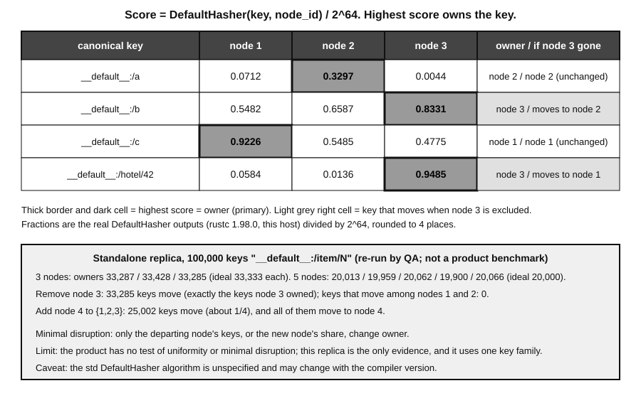

Source: `src/dist/router.rs::calculate_hash` and `route_key`; numbers produced by a standalone replica of that formula (reproduced here).

Read the first row. For key `__default__:/a` the three scores are 0.0712 (node 1), 0.3297 (node 2) and 0.0044 (node 3). Node 2 has the highest score, so node 2 is the owner. For `/b` the scores are 0.5482, 0.6587, 0.8331: node 3 owns it. If node 3 is excluded, `/b` falls to node 2 (0.6587) and `/hotel/42` falls to node 1 (0.0584, the higher of its two remaining scores), while `/a` and `/c` do not move. That is the minimal-disruption property in four lines.

::: example
**Measured on a replica, not on the product.** A standalone program (compiled with rustc 1.98.0 on this Windows host, in the session scratchpad) re-implements the router's formula exactly: `DefaultHasher::new()`, hash the key string, hash the node id byte, convert the `u64` to `f64`, multiply by 1.0, take the strict maximum. The QA pass re-compiled and re-ran the same formula (rustc 1.98.0, same host; an AI check, not independent verification) and reproduced every number below and the four-key scores in Figure 5.3 exactly. Over 100,000 keys of the form `__default__:/item/N`:

- 3 nodes own 33,287 / 33,428 / 33,285 keys (ideal 33,333).
- 5 nodes own 20,013 / 19,959 / 20,062 / 19,900 / 20,066 (ideal 20,000).
- Removing node 3 moves 33,285 keys, which is exactly node 3's share; keys moving between nodes 1 and 2: 0.
- Adding node 4 moves 25,002 keys (about 1/4), all of them to node 4.

Limits: one key family, one compiler, one machine; the product has no test for uniformity or minimal disruption (grep of `tests/`), so this replica is the only evidence. It supports the claim "the formula is balanced and minimally disruptive on this key family"; it does not support any claim about other key shapes.
:::

### What the code actually does

`RendezvousRouter::route_key` in `src/dist/router.rs`:

```rust
let hash_val = Self::calculate_hash(key, node.node_id);   // DefaultHasher over (key, node_id)
let capacity_weight = 1.0;
let weight = (hash_val as f64) * capacity_weight;
if weight > highest_weight { ... }                        // strict >, initial 0.0
```

Precisely:

1. **The weight is the constant 1.0.** The code is *plain* rendezvous hashing with the structure of a weighted one. There is no configuration key, node attribute or test for a non-constant weight. If a developer replaced `1.0` by a real capacity, the multiplication would be the non-proportional shortcut above, not the logarithmic form. Say "rendezvous hashing with equal weights; the weighted variant is not implemented". IMPLEMENTED (equal weights); weighted: DESIGNED BUT NOT IMPLEMENTED.
2. **The hash is `std::collections::hash_map::DefaultHasher`** (SipHash-1-3 with fixed zero keys in current Rust). The standard library documents that this algorithm is unspecified and may change between releases (the earlier agent note in `architecture_investigation.md` records the same concern). Two gateways built with different compiler versions could disagree about the owner. Since every gateway also fans out to all members, a disagreement changes only *which* node gives the synchronous ack, not whether others are invalidated, so the damage is small, but it is a real portability risk. A fixed, specified hash would remove it (our reasoning).
3. **Two passes.** Pass 1 skips `Failed`, `Offline`, `Suspect` and `Recovering`. Pass 2 runs only if Pass 1 found nobody, and then allows `Suspect` and `Recovering`. So a Suspect node is effectively removed from ownership until it recovers.
4. **Each gateway uses its own view of node states.** Two gateways may disagree on the owner of a key while their views differ (G4B-09).
5. **`u64 -> f64` loses the low 11 bits** (53-bit mantissa), so two nodes with different hashes can compare equal; the strict `>` then keeps the first node in the list. The effect on balance is negligible. A hash of exactly 0 can never win against the initial `0.0`; probability 2^-64.
6. **`get_replicas(key, n)`** returns the next `n` nodes in descending score order, skipping unhealthy ones. The router uses `n = 2`.

### Which operations are routed

Verified by reading every caller:

| Operation | Uses `route_key`? | Notes |
|---|---|---|
| HTTP `GET` | **No** | Local cache, then origin. |
| HTTP `DELETE` | **Yes**, for the synchronous leg | `invalidate_key_across_cluster`: owner first, then the first healthy replica as "acting primary". Everyone else is invalidated asynchronously. |
| Peer `GetRequest` (`forward_key_over_tcp`) | Yes, but | No production caller; used by tests only. |
| Anti-entropy, repair, pre-warm | No | They iterate over members. |

So rendezvous hashing decides **which node gives the acknowledgement that lets a DELETE return 204**. It does **not** decide where data lives. Every gateway caches whatever it served, whatever the hash says. There is therefore no data to rebalance when membership changes: a membership change alters only which node is "primary" for each key's DELETE. This is a different (and much weaker) role than hashing plays in Redis Cluster or Memcached client libraries, and a judge who assumes a partitioned cache will misjudge it. Say so before they do.

::: caution
The primary can be the issuing gateway itself. `route_key` iterates over *all* members including the local node, and the pre-warm worker even keeps a connection to the local node for this reason. For roughly `1/N` of keys the "primary acknowledgement" that releases the 204 comes from the issuer's own listener over loopback mTLS. In that case a 204 contains no evidence about any other node. See section 5.6.
:::

### Alternatives (our reasoning, not a recorded decision)

*Consistent hashing with a ring and virtual nodes* gives the same minimal disruption with `O(log N)` lookup but needs a ring structure, virtual-node tuning and a stable hash. *Jump consistent hash* handles only node lists that grow and shrink at the end, which does not fit arbitrary node ids. With `N <= 255` and a lookup used only on DELETE, rendezvous hashing's `O(N)` cost is irrelevant and its code is a dozen lines; that is a sound reason to prefer it, but the repository does not record it as the reason.

::: judge
**JUDGE MAY ASK**

Question: You say you use weighted rendezvous hashing. Walk me through it. How does the weight enter, and what does the system do with it?

**Suggested answer** (about 30 to 60 seconds spoken, plain English):

Each node gets a score for each key from a hash of the key and the node id, and the highest score owns the key. Everyone computes the same scores, so no coordination is needed, and removing a node moves only that node's keys. In weighted form you use minus weight over the natural log of the normalised hash, which makes a node win in proportion to its weight. In our code, honestly, the weight is a constant 1.0, so it is plain rendezvous hashing. I would not claim capacity-aware placement. And the result is only used to choose which node gives the synchronous acknowledgement for a delete. Reads are served from the local cache and are not routed.

**If the judge asks further:**

"Why does that matter?" Because it means no data is placed or rebalanced by the hash. "What would break if you set weights?" The code multiplies the raw hash by the weight, which is not proportional; you would need the logarithmic form. I checked that with a quick calculation: weights 1 and 2 give a 75 percent share to the heavier node, not 67 percent.

**Evidence to know:** `src/dist/router.rs::route_key` (`capacity_weight = 1.0`), `get_replicas`, callers of `route_key` (only `invalidate_key_across_cluster` in production). Replica measurement in section 5.3 (reproduced here, standalone). Status: equal-weight rendezvous IMPLEMENTED; weighted rendezvous DESIGNED BUT NOT IMPLEMENTED; no uniformity test in the repo.
:::

::: judge
**JUDGE MAY ASK**

Question: Walk me through a read. Which node serves it, and where does the hash come in?

**Suggested answer** (about 30 to 60 seconds spoken, plain English):

The gateway the client contacted serves it. It looks in its own cache; on a miss it fetches from the origin, with single-flight so concurrent misses share one fetch, and stores the result with whatever freshness the origin allowed. No other gateway is consulted, so the hash is not involved. The hash matters for deletes: it picks the node that must acknowledge before the delete returns.

**If the judge asks further:**

"So the same key can be cached on every node?" Yes. That is the design: local copies, with invalidation fan-out to keep them coherent. The cost is that a node that missed an invalidation can serve a stale copy, which is the subject of the next sections.

**Evidence to know:** `src/api/server.rs::get_cache_handler`, `RendezvousRouter::forward_key_over_tcp` (no production caller), ADR-003. Status: local-only GET IMPLEMENTED and TESTED (`known_gaps.rs`, `distributed_consistency_tests.rs`).
:::

---

## 5.4 Epochs and versioning across nodes

The word "epoch" names three unrelated counters in this code base. Mixing them up is the most common way to give a wrong answer in a defence, so keep them apart.

| Counter | Where | Scope | Changes when | What it protects |
|---|---|---|---|---|
| **Tenant epoch** and **global epoch** | `PartitionedCache` (`tenant_epochs`, `epoch_snapshot`, `global_epoch`) | One gateway's cache | `try_invalidate_tenant`, `try_invalidate_all` | A cached entry is stamped with the epochs at fill time; if either differs from the current value the entry is stale |
| **Membership epoch** | `ClusterMembershipRegistry.version` (`get_membership_epoch`) | The whole cluster, configured | Never at runtime (static file) | Intended: reject messages from a node with an obsolete view of who is a member |
| **Stream sequence** (`stream_seq`) | `DestinationSequencer`, `AntiEntropyTracker`, ring buffer | One *directed* pair (sender, receiver) | Every invalidation sent to that receiver | Detect lost or reordered invalidations and replay them |

Per-key **generation** (Chapter 4) is a fourth counter, local to a key's cache state; `delete` bumps it so that an in-flight origin fetch cannot store its result.

### Tenant and global epochs: a worked example

Entries carry `entry_tenant_epoch` and `entry_global_epoch`. A read counts as a hit only if both equal the current values (`get_effective_epochs`, which reads a snapshot `Arc<HashMap>` under an `RwLock`, so the read path takes no exclusive mutex).

::: example
Tenant `acme` has tenant epoch 0 and the global epoch is 0. Key `/a` is filled and stamped (0, 0).

1. A `Tenant` invalidation for `acme` arrives. `try_invalidate_tenant("acme")` makes the tenant epoch 1. The next read of `/a` compares stamp (0, 0) with current (1, 0): different, so the entry is treated as stale and refetched. Nothing was scanned or deleted; a counter moved.
2. A `FullCache` invalidation arrives. `try_invalidate_all` makes the global epoch 1 and clears the tenant map (every tenant epoch reads as 0 again). Old entries carry global epoch 0, which no longer matches, so they cannot come back to life even though tenant counters were reset. New fills are stamped (0, 1).
3. If more than `MAX_TENANT_EPOCHS = 10,000` distinct tenants are invalidated, the cache falls back to a global bump and clears the map (`SEC-4A-01`). Memory stays bounded and no stale entry can be resurrected.
:::

Status: IMPLEMENTED; TESTED (`security_phase4a_invalidation_tests.rs`, `epoch_contention_tests.rs`). Open items owned by Chapter 4: the epochs are re-read inside `finalize_fetch` after the fencing check, so a pre-invalidation body can be stamped with a newer epoch (G4A-01, UNDER-INVESTIGATION, reproduced only with an injected yield point in a sandbox; a patch of about four changed lines is proposed and not applied (`docs/research/g4a01_race/proposal.patch`)); and tenant and global epochs can be observed skewed (G4A-17). I did not re-derive these.

### What epochs do across nodes

Here is the important and easily missed fact: **the DELETE API only ever sends the `ExactKey` scope.** `Tenant` and `FullCache` frames are produced inside the distribution code, as an escalation: when a peer's repair backlog overflows (many keys of one tenant collapse into a tenant flush; too many tenants collapse into a full flush), when a single entry cannot be delivered permanently, or when a revoked member's debts are folded into one flush. `grep` confirms no HTTP handler constructs those scopes. So the tenant and global epochs matter across nodes only on those repair paths. An exact-key delete on a receiver is a `try_delete_canonical`, which bumps the key's generation and detaches any in-flight fetch.

The **membership epoch** is carried in every invalidation and echoed in the ack. The issuer rejects an ack whose epoch differs from its own (`IgnoredObsolete`). But the receiver echoes the *sender's* epoch without comparing it with its own registry (the `InvalidateRequest` handler in `node.rs` has no epoch check; the anti-entropy handler does), so the issuer-side comparison can differ only if the issuer's own registry changed while the request was in flight. The broadcaster path does not compare the ack epoch at all. Because the registry never changes at runtime, this has little practical effect today, but the comment "SEC-4B-05: validate responder identity and membership epoch" overstates what is enforced. This is G4B-06, OPEN, owner-named. Status: epoch carried and echoed IMPLEMENTED; epoch *enforcement* on invalidations NOT implemented.

The **stream sequence** is the useful cross-node version number. Section 5.5 shows how it turns "a message might have been lost" into something a receiver can detect.

::: judge
**JUDGE MAY ASK**

Question: You mention epochs. What is an epoch here, and does it give you a global version of the cache?

**Suggested answer** (about 30 to 60 seconds spoken, plain English):

There is no global version. Inside one gateway, a tenant epoch and a global epoch are counters; each cached entry remembers the counters it was filled under, and bumping a counter makes all older entries instantly stale without scanning. Between gateways we do not synchronise those counters. What crosses the wire for the normal delete is the exact key, plus a per-destination sequence number so the receiver can notice a lost message, and the cluster membership version. The membership version is carried but not enforced on invalidations yet, which is an open finding.

**If the judge asks further:**

"Why can a tenant counter not simply be shared?" Because gateways have independent caches and independent fill times; a shared counter would need agreement, which we do not have. The sequence number plus replay is the lightweight alternative.

**Evidence to know:** `src/core/cache.rs::try_invalidate_tenant`, `try_invalidate_all`, `get_effective_epochs`; `src/dist/node.rs` InvalidateRequest handler; G4B-06, G4A-01. Status: local epochs IMPLEMENTED and TESTED; cross-node epoch enforcement not implemented.
:::

---

## 5.5 Invalidation propagation

### Simple explanation

When a client deletes a key, the gateway that received the request does three things in order. It removes its own copy at once. It asks one chosen node to confirm it removed its copy, and only then tells the client "done". Then, in the background, it tells everyone else, retries if someone does not answer, and writes down any debt it cannot pay yet so that a repair loop keeps trying.

### The path, step by step

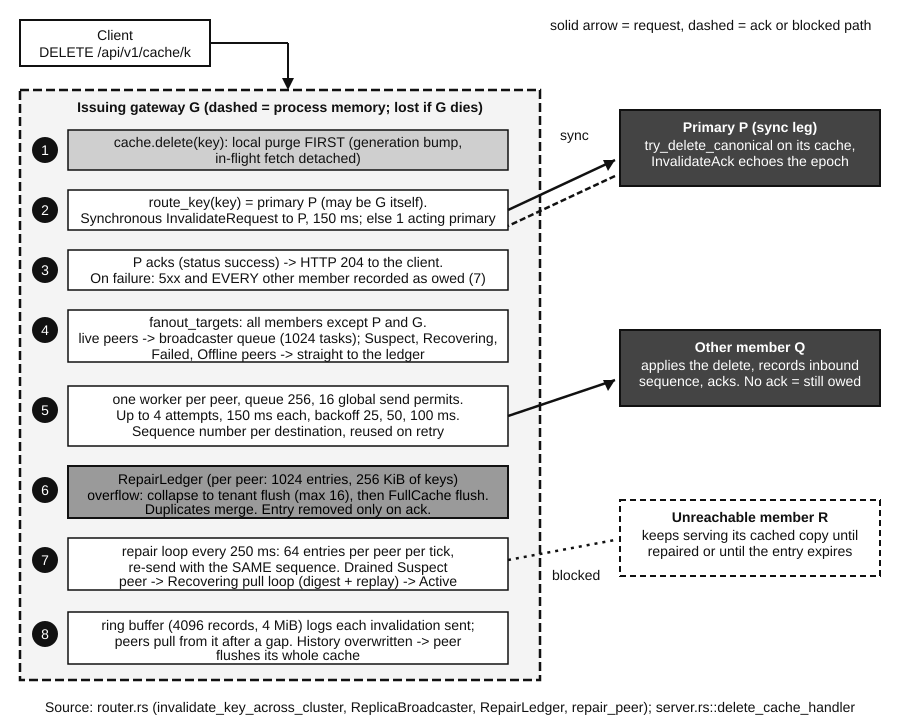

Source: `src/api/server.rs::delete_cache_handler`, `src/dist/router.rs` (`invalidate_key_across_cluster`, `fanout_targets`, `dispatch_fanout`, `ReplicaBroadcaster`, `RepairLedger`, `repair_peer`).

1. **Local purge first** (`cache.delete`). From this instant, reads on this gateway miss. This is the basis of the per-node guarantee (section 5.6).
2. **Synchronous leg.** `route_key` picks the primary. The gateway sends one `InvalidateRequest` and waits at most 150 ms (`PHANTOM_CLUSTER_TIMEOUT_MS`, default 150; one deadline covers a possible retry on a fresh connection). If the primary is unreachable, it is marked `Suspect` and the first healthy replica from `get_replicas` becomes the *acting primary* (the response carries `x-cache-warning: PrimaryFailover`). A `Rejected` result does not fail over.
3. **Acknowledgement.** If the primary (or acting primary) acks with a success status, the HTTP reply is 204. If it fails, the reply is 504 or 5xx and **every other member is recorded as owed** (`record_owed_to_all`), because the origin changed regardless of whether the cluster could be told.
4. **Fan-out to the rest.** `fanout_targets` selects *all* members except the primary and the local node. This is deliberate (finding S-3): every gateway caches what it serves, so a fan-out to "the primary and two replicas" would leave other gateways stale in clusters of more than three. Healthy members go to the broadcaster; members in `Suspect`, `Recovering`, `Failed` or `Offline` state go straight to the ledger.
5. **Broadcaster.** One worker task per destination (so a blackholed peer ties up one task and its own queue of 256, not everyone), a global limit of 16 concurrent send attempts, and up to four attempts per job with backoff 25, 50, 100 ms and 150 ms bounds on connect, write and read. The per-destination stream number is assigned once and reused on every retry, which keeps the receiver's gap tracking correct. A test derives the worst case as `4 x 300 + 175 = 1375` ms.
6. **Repair ledger.** If delivery fails after retries, if the queue is full, if the task panics, or if the broadcaster is stopped, the debt is recorded in `RepairLedger`, with the same stream number. The ledger is bounded per peer (1,024 entries and 256 KiB of key bytes). Duplicate (scope, key) pairs merge. When over the limit, the tenant with most entries collapses into a single `Tenant` invalidation (at most 16 per peer); when that cannot make progress, the peer is owed one `FullCache` flush. So memory is bounded and correctness is kept, at the price of coarser invalidation (more cache misses) under overload.
7. **Repair loop.** Every 250 ms the push-repair loop sends up to 64 owed entries per peer, using the original stream number. An ack removes the entry. A hard rejection drops the entry and escalates it to a tenant flush, so the receiver cannot be left stale. When a Suspect peer's ledger drains it becomes `Recovering`.
8. **Pull reconciliation.** A second loop, independent of the first so that a slow peer cannot delay repairs to healthy peers, handles peers that are `Suspect` or `Recovering` or that show sequence gaps. The receiver asks the sender for what it missed, using the digest and replay mechanism below. A peer returns to `Active` only after this succeeds and no debt older than its recovery ticket remains.

### Anti-entropy: ring buffer, gaps and replay

Each gateway keeps a ring of the invalidations it *sent*, tagged by destination (`InvalidationRingBuffer`: at most 4,096 records and 4 MiB). Each receiver keeps, per sender, the next sequence it expects (`AntiEntropyTracker`).

::: example
Gateway G sends invalidations numbered 1, 2, 3 to gateway B. Number 2 is lost. B receives 1 (expects 2 next), then 3. Since 3 is greater than the expected 2, B records a gap (2 to 2), keeps 3 in an out-of-order set, and its *highest contiguous acknowledged* sequence stays at 1. The pull loop sends `AntiEntropySyncRequest{highest_acked_seq: 1, ring_digest}` to G. G replays the records it sent to B with sequence greater than 1: records 2 and 3. B applies them (deleting those keys) and advances to 3. If G had already evicted record 2 from its ring (more than 4,096 newer records), the answer is `HistoryOverwritten` and B flushes its **entire** cache with `try_invalidate_all`. That is coarse but safe: B can never keep an entry whose invalidation it cannot prove it saw.
:::

Properties worth stating: the digest is a SHA-256 over the retained window (`compute_digest`); gap and out-of-order bookkeeping is bounded (256 gap ranges, 1,024 buffered sequences per peer, collapsing to a single "resync needed" flag); replay returns only the stream the sender sent to that requester; inbound records are kept in a separate 256-entry accounting list and are never replayed, so a flood of received invalidations cannot push out replayable history; a sequence-mismatch after a sender *restart* cannot be filled, and a successful pull clears such gaps.

### Status table

| Capability | Status | Evidence and what it does **not** prove |
|---|---|---|
| Local purge before cluster call | IMPLEMENTED, TESTED | `test_m3_04a_local_linearizability_immediate_eviction`, `pc5`/`kg5` in `known_gaps.rs`. Per gateway only. |
| Synchronous primary ack with acting-primary failover | IMPLEMENTED, TESTED | `security_phase4b_router_tests.rs` (`..._failover`, `..._strict_150ms_deadline_enforcement`, `..._fail_closed_no_false_204...`). Loopback, in-process or multi-process; not WAN. |
| Fan-out to all members | IMPLEMENTED, TESTED | `test_s3_five_gateway_fanout_reaches_every_peer` (5 gateways). Small N only. |
| Retry, per-peer queue, bounded concurrency | IMPLEMENTED, TESTED | `test_m4_blackholed_peer_keeps_task_count_bounded_and_owes_ledger`, `test_m6_blackholed_peers_do_not_starve_a_healthy_peer`. |
| Repair ledger with bounds and escalation | IMPLEMENTED, TESTED | `cluster_prewarm_repair_tests.rs` (`test_ledger_overflow_*`), `cluster_followup_tests.rs`. |
| Pull anti-entropy (digest, replay, history-overwritten flush) | IMPLEMENTED, TESTED | `security_phase4c_antientropy_tests.rs`, `cluster_followup_tests.rs` (`test_m2_*`, `test_r4_m4_*`). |
| Receiver crash and restart | PARTIAL | A restarted receiver has an empty cache; the sender repairs the logical debt. Sequence-restart behaviour is tested (`test_h1_restarted_sender_invalidations_are_still_applied_by_receiver`). |
| Issuer crash with owed invalidations | **NOT HANDLED in the main tree** | Section 5.7 and 5.9. No test in the main tree kills an issuer. |
| Durable owed-invalidation log (M3) | PROTOTYPE ONLY | Sandbox patch, not integrated (section 5.9). |

::: judge
**JUDGE MAY ASK**

Question: A DELETE returns 204. What exactly has been invalidated at that point?

**Suggested answer** (about 30 to 60 seconds spoken, plain English):

Two things for sure: the gateway that received the DELETE has dropped its own copy, and the chosen primary node for that key has confirmed it dropped its copy, within a 150 millisecond deadline. Every other node is told afterwards, in the background, with retries and a repair ledger, and that is guaranteed only while the issuing gateway stays alive. Sometimes the primary is the issuing gateway itself, so the 204 then says nothing about any remote node. I would not claim that 204 means the whole cluster is invalidated.

**If the judge asks further:**

"Why not wait for everyone?" It would make DELETE latency and availability depend on the slowest or dead node. The design trades that for bounded work and a repair loop. A stricter mode, a delayed 204 until all members ack, was considered in the M3 durability design and rejected as out of scope there; it is an open product decision, not an oversight.

**Evidence to know:** `src/api/server.rs::delete_cache_handler`, `src/dist/router.rs::invalidate_key_across_cluster` (doc comment states the contract), ADR-003 amendment 2026-10-30, G4B-09. Status: IMPLEMENTED and TESTED as described; cluster-wide acknowledgement DESIGNED BUT NOT IMPLEMENTED.
:::

::: judge
**JUDGE MAY ASK**

Question: What if the invalidation message is lost or arrives late?

**Suggested answer** (about 30 to 60 seconds spoken, plain English):

There are three layers. First, the sender retries up to four times with short backoff. Second, anything still undelivered is written to a per-peer repair ledger and re-sent every 250 milliseconds with the same sequence number until acknowledged. Third, a receiver that notices a gap in the sender's sequence numbers can pull the missed records from the sender's ring buffer; if the history has been overwritten it flushes its whole cache, which is safe but coarse. All of it is bounded in memory. A delayed message is harmless because a delete is idempotent: applying it twice, or after a newer fill, only causes an extra miss. The one case none of this covers is the sender dying while it still owes messages.

**If the judge asks further:**

"How long can a node stay stale?" Until the message is delivered; in the one test that cut a link for two seconds and healed it, convergence was asserted within 800 ms of healing on loopback in a debug build. With a permanent cut or a crashed sender there is no bound other than the entry's own expiry.

**Evidence to know:** `test_m3_04a_missed_fanout_repaired_by_antientropy_within_bound`, `RepairLedger`, `repair_peer`, `reconcile_peer_anti_entropy`. Status: IMPLEMENTED and TESTED (loopback, debug); sender crash UNHANDLED.
:::

---

## 5.6 Consistency: what is guaranteed, under which failure model

### Definitions

- **Linearizability:** every operation appears to take effect at one instant between its start and its reply, in an order consistent with real time, as seen by all clients of the system.
- **Read-your-delete (per-node):** after a DELETE returns on gateway X, later reads on X do not return the pre-delete body. This is weaker than linearizability across nodes.
- **Eventual consistency:** if no new writes occur and faults heal, all copies converge. It says nothing about how long.
- **Bounded staleness:** a read never returns data older than `B` (a time or a version count). To claim it you must name `B`, the failure model in which it holds, and a test that could falsify it.

### The failure model, written down

| Fault | Covered by a mechanism? | Evidence |
|---|---|---|
| Message loss or delay between live gateways | Yes: retry, ledger, pull | `test_m3_04a_missed_fanout_repaired...`; ADR-003 section 4.1 states loss up to 20 percent, but no test injects a loss *rate*: the fault proxy offers Normal, Delay, Blackhole, Partition and DropNewConnections only |
| Receiver crash and restart | Yes (cache is empty on restart; debts delivered; pull) | `cluster_followup_tests.rs` |
| Transient partition between live gateways | Yes, convergence after healing | one-link test above |
| **Issuer crash with owed invalidations** | **No** | section 5.7; reproduced in sandbox only |
| **Permanent partition** | No bound | entry expiry only |
| Receiver alive but slow beyond the 150 ms legs | Partly: Suspect, ledger | tests with blackholed peers |
| Malicious or compromised member | No (members are trusted) | DR-027, G4B-05 |
| Clock skew | Not relied on: sequences and counters, not wall time (except age-outs) | ADR-003 |
| Origin changes without a DELETE | No: PhantomCache is never told | by design |
| Several hosts, WAN | **UNVERIFIED**: all cluster evidence is single-host loopback | `claims_ledger.md` C6 |

### What the code and tests support

**G1: per-gateway read-your-delete.** The handler purges the local cache before any network call, so a read arriving after the delete began cannot return the old entry from the cache, and an in-flight fetch is detached so later requests do not join it. IMPLEMENTED; TESTED (`test_m3_04a_local_linearizability_immediate_eviction`, `kg5_get_after_delete_start_must_not_serve_old_entry`, `pc5_...`). Two honest limits. First, a comment in `delete_cache_handler` calls this "linearizability"; it is a single-gateway property, and the word should not be used for it in a defence. Second, the register keeps G4A-01 (a pre-invalidation body can survive an acknowledged invalidation through an epoch re-read race) and G4A-08 (a request after an invalidation can join an older in-flight fetch) as unresolved. A statement "no stale body is ever returned after a 204 on the same gateway" is therefore **not** established for all interleavings.

**G2: cross-node convergence after a 204.** ADR-003 stated "any connected reachable peer serves post-invalidation content after Δ ≤ 250 ms". The 2026-10-30 amendment qualifies it: it holds only while the issuing gateway stays alive and for reachable peers. The earlier test header text "P(stale-after-ack) = 0.0 at Δ ≥ 50 ms" is **not supported**: the claims ledger shows the 50 ms was a fixed sleep and cold first-use took longer. Measured (`tests/integration/cluster_propagation_latency_tests.rs`; recorded in `claims_ledger.md`; debug build, loopback, single host, 3 gateways with mTLS and fault proxies in Normal mode; N = 200 trials by 2 peers per run, 4 runs): warm-path P50 about 0.3 ms, P99 about 10 to 14 ms, maximum 15 to 21 ms; the first invalidation to a destination (cold connection plus handshake) took 35 to 60 ms (up to 117 ms under three concurrent copies). A separate harness run in a test comment (`distributed_consistency_tests.rs`) gives different numbers (P50 1.56 to 1.86 ms, P99 30 to 39 ms) with a different metric (it includes one origin fetch), so the two are not comparable; neither is a release-build, multi-host or WAN figure. Pre-warming now opens connections early to avoid the cold-start cost. Use the numbers only as "observed in these loopback debug runs"; the full measurement inventory is Chapter 6, section 6.13.

**G3: fallback staleness cap.** ADR-003 wrote "Staleness ≤ TTL_eff ≤ PHANTOM_MAX_STALE_MS (24 h)". The amendment says this is not true as written. `PHANTOM_MAX_STALE_MS` caps only the *stale-serving window* after expiry. The freshness lifetime itself comes from the origin's `s-maxage`, `max-age` or `Expires` with no gateway ceiling. The 60-second default applies only when the origin gives no freshness information, and it is the literal `60_000` in `server.rs`: `PHANTOM_DEFAULT_TTL_MS` is validated but not wired (CLAUDE.md section 5; `src/config.rs` marks it `Wiring::NotWired`). So the real bound on an unrepaired stale copy is "the entry's own freshness lifetime", which an origin can set to hours.

### The honest statement

> PhantomCache provides, on one gateway, that a read after a completed DELETE does not return the deleted entry (with the open race findings above). Across gateways it provides best-effort asynchronous invalidation with retry, a bounded repair ledger and a pull-based repair, which converged within milliseconds in loopback tests while the issuing gateway stayed alive and the network healed. It does **not** provide cross-node linearizability. It provides **no** staleness bound if the issuing gateway crashes with owed invalidations or if a partition is permanent, other than the entry's freshness lifetime. The test that would falsify the bound claim (kill the issuer after a 204) was reproduced as a failing scenario in a sandbox and is not in the main tree.

::: judge
**JUDGE MAY ASK**

Question: Can two of your nodes serve different values for the same key at the same time?

**Suggested answer** (about 30 to 60 seconds spoken, plain English):

Yes. By design each gateway has its own copy. They differ for a few milliseconds after a delete while the invalidation is in flight, for as long as a partition lasts if a gateway is cut off but still serving, and indefinitely until expiry if the gateway that issued the delete crashed before telling everyone. They can also differ legitimately with no delete at all, because two gateways fetched at different times and the origin changed in between; each is within its freshness lifetime. We never claim they are the same, we claim a mechanism that makes them converge after a delete when the system is healthy, and we say plainly what is not covered.

**If the judge asks further:**

"What would make it stronger?" Durable owed-invalidations for the issuer, which exists as a tested sandbox design; a gateway-side ceiling on freshness lifetime; and a heartbeat that marks silent peers Suspect. A truly linearizable read would need coordination or a leader, which is a different system.

**Evidence to know:** ADR-003 section 4 and its 2026-10-30 amendment; `docs/research/claims_ledger.md` C6 amendment and qualifier; `tests/integration/distributed_consistency_tests.rs`. Status: convergence IMPLEMENTED and TESTED on loopback; staleness bound UNVERIFIED and not claimed.
:::

::: judge
**JUDGE MAY ASK**

Question: Is your cache linearizable? Do you guarantee bounded staleness?

**Suggested answer** (about 30 to 60 seconds spoken, plain English):

No to both, and I want to be precise about why. Linearizability across nodes would require every read to be ordered against every delete, and our reads are local, so we do not have it. We have a per-gateway guarantee that a read after a completed delete misses, with two open findings about rare races. Bounded staleness needs a number, a failure model and a test. The number we can give in the healthy, issuer-alive case is milliseconds on loopback in a debug build, which is an observation not a guarantee. In the crash or permanent-partition case the bound is the entry's freshness lifetime, which comes from the origin. I would rather say that than quote a bound I cannot defend.

**If the judge asks further:**

"Your own ADR says 24 hours." The ADR was amended on 2026-10-30 because that statement was wrong: the 24 hour cap bounds the stale-serving window, not the freshness lifetime.

**Evidence to know:** ADR-003 amendment; `claims_ledger.md` C6 qualifier; `src/core/freshness.rs` (no gateway ceiling). Status: neither claim is made.
:::

---

## 5.7 Node failure, recovery, partitions, and concurrency across nodes

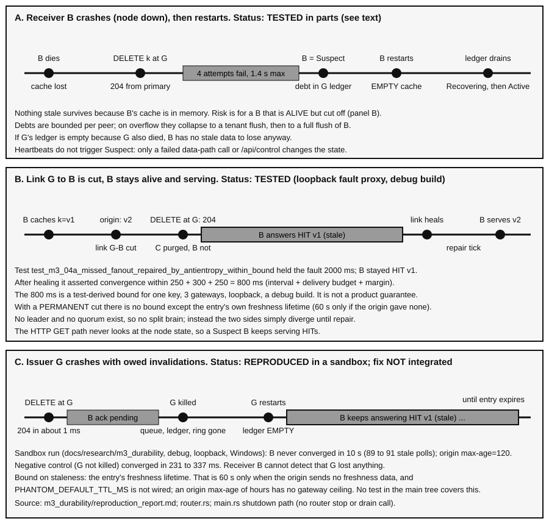

Source: `src/dist/router.rs` (broadcaster, ledger, `repair_peer`), `tests/integration/distributed_consistency_tests.rs`, `docs/research/m3_durability/reproduction_report.md`.

### A. A receiver node goes down

Calls to the dead node fail within the 150 ms legs, the node is marked `Suspect`, and its invalidations are recorded in the issuer's ledger. When the node returns, the issuer's repair loop delivers the debts; after a full drain it moves the peer to `Recovering`, and a successful pull reconciliation (or an empty-ledger `InSync` answer) moves it to `Active`. Because the node's cache lived in memory, a restart **empties** it, so no stale entry can survive a receiver crash. The real danger is the opposite case: a receiver that is alive but unreachable. Status: IMPLEMENTED. TESTED for an unreachable peer that heals (`test_m3_04a_suspect_to_active_automatic_recovery`, `test_m10_failed_peer_is_owed_the_invalidation`, `test_h2_failed_delete_still_invalidates_all_peers_after_heal`) and for an in-process peer that restarts on the same address (`test_l2_stale_pooled_connection_is_retried_on_fresh_connection`). The multi-process harness has no kill-and-restart helper in the main tree (it only shuts down), so a real gateway process crash and restart is not exercised there.

### B. A partition (link cut, both sides alive)

There is no leader and no quorum, so there is no split brain in the consensus sense; the two sides simply diverge. The cut-off gateway keeps serving hits from its cache, because **the HTTP read path never consults `NodeState`** (`server.rs` uses node state only for the control endpoint and dashboards). The rule "a Suspect or Recovering node must not serve cache hits" (SEC-POA-04, test `test_p4c_sec09_...`) exists only in the *peer `GetRequest`* handler, which production never sends: real in the protocol code, no effect on what a client sees. After healing, the repair loop converges the cut-off side (one-link test: 2 s fault, convergence asserted within 800 ms of healing, loopback, debug). During a permanent cut nothing bounds the staleness except entry expiry.

### C. The issuer crashes

The invalidations owed to peers live only in the issuer's memory: the broadcaster channel and per-peer queues, `RepairLedger`, the per-destination sequencers and the replay ring. `main.rs` shutdown on a signal prints "cache is in-memory, nothing to flush", drops the server and exits; it calls no router `stop` or drain. A restarted issuer starts with an empty ledger and its streams restart at sequence 1, which receivers ignore as duplicates or obsolete. The receiver cannot even tell that the issuer lost anything.

::: example
**Worked failure example (reproduced in a sandbox, flag off, debug build, loopback, Windows).** Three gateways; the key's primary is gateway 3. All three cache version 1. The origin is changed to version 2. The link from issuer G (1) to B (2) is blackholed. `DELETE` on G returns 204 in 0.59 to 0.95 ms (local purge plus gateway 3's ack). G is killed (`TerminateProcess`) inside B's roughly 1.4 s retry window and restarted. For 10 s B answered the old version on every poll (89 to 91 polls, never converged); the origin advertised `max-age=120`, so B would stay stale for about two minutes. The control run, where G was not killed, converged in 231 to 337 ms. Source: `docs/research/m3_durability/reproduction_report.md`. This is a sandbox reproduction of a defect on the then-current tree; it is **not** a test in the main tree, and it was run with an AI agent's harness, not independently.
:::

### Cross-node concurrency

- *Two DELETEs of the same key from different gateways.* Each sends exact-key invalidations; deletes are idempotent, and each sender has its own sequence stream per destination (the tracker is keyed by originator), so they do not disturb each other. Tested: `test_p4b_duplicate_invalidation_idempotence`, `test_m3_04a_per_destination_sequence_zero_false_gaps`.
- *A GET fill racing an invalidation on the receiver.* An exact-key delete bumps the key's generation and detaches the in-flight fetch, so a fill that started before the delete cannot store its result afterwards. Chapter 4 covers the mechanism and the open G4A-01 and G4A-08 findings.
- *Write ordering is the caller's job.* PhantomCache is never told that the origin changed. The contract is "commit the write at the origin, then DELETE". If the DELETE is sent first, any gateway may refetch the old value and keep it.

::: judge
**JUDGE MAY ASK**

Question: What happens if a node fails? What if the network partitions?

**Suggested answer** (about 30 to 60 seconds spoken, plain English):

If a node dies, calls to it fail fast, it is marked suspect and skipped, and the invalidations it missed are queued in a bounded ledger on the sender. When it comes back, its cache is already empty because it is in memory, the ledger is delivered, and it rejoins after a pull reconciliation. If the network splits but both sides are alive, there is no leader, so nothing stops the cut-off side from serving its cached copies; they can be stale until the link heals and the repair loop catches up, or until the entries expire. I would not claim availability and consistency both; we chose availability of reads, and the staleness during a partition is bounded only by the entry's freshness lifetime.

**If the judge asks further:**

"Does a suspect node stop serving?" Not on the HTTP path. The rule exists in the peer protocol handler only. That is a gap I would name before they find it.

**Evidence to know:** `test_m3_04a_suspect_to_active_automatic_recovery`, `test_m3_04a_missed_fanout_repaired_by_antientropy_within_bound`, `server.rs` (no `NodeState` in the GET path), `test_p4c_sec09_read_attempts_during_recovery_bypass_cache_hits` (peer path only). Status: receiver recovery IMPLEMENTED and TESTED (loopback); partition serving is stale by design; no staleness bound.
:::

::: judge
**JUDGE MAY ASK**

Question: What if the gateway that issued the delete crashes before the others got the message?

**Suggested answer** (about 30 to 60 seconds spoken, plain English):

Then those nodes keep serving the old entry until it expires. The owed messages are only in the issuer's memory, and a restarted issuer starts empty. I reproduced that in a sandbox: three gateways, issuer killed right after answering 204, the third gateway never converged in ten seconds. That defect is open in the main tree. A fix exists as a sandbox design: an opt-in durable log of owed invalidations replayed after restart, with 15 process-level crash tests. It is not integrated, because it touches the invalidation path and needs an independent review and the owner's approval. Until then, the right claim is "guaranteed while the issuer stays alive".

**If the judge asks further:**

"How bad is it?" Bounded by the entry's freshness lifetime, which is the origin's choice, 60 seconds only when the origin gives none. It affects only the entries whose invalidation was still in flight at the crash.

**Evidence to know:** `docs/research/m3_durability/` (`reproduction_report.md`, `design.md`, `remediation/00_status_and_plan.md`), `claims_ledger.md` C6 qualifier, G4B-09. Status: defect REPRODUCED in a sandbox; fix PROTOTYPE ONLY, not integrated.
:::

---

## 5.8 The peer GetRequest stub, DR-029 and DR-027

Two security-flavoured items belong here because they shape what a "cluster member" can do. Chapter 6 owns the full security analysis.

### The `GetRequest` handler fabricates data (DR-029, G4B-30)

In `process_binary_cache_stream` (`src/dist/node.rs`), a peer `GetRequest` is answered like this: if the key is cached, return `HIT <body>`; if not, **create a resource whose body is the string `val_node_<id>`, store it in the node's cache with a 60,000 ms lifetime, and return `MISS val_node_<id>`**. The origin is never contacted. A test pins this behaviour: `pin_kg6_node_get_request_fabricates_missing_key_body` in `known_gaps.rs`. In the mTLS cluster path the node's cache *is* the HTTP serving cache, so a fabricated entry lands in the real cache.

The investigation (`docs/security/investigations/DR-029_cluster_get_cache_poisoning_investigation.md`, an AI agent's report; its reproduction is MEASURED, not independent verification) concluded, and I re-checked in the code:

- The planted key is always tenant `__default__` with a path that does **not** begin with `/`. The handler rejects keys that begin with `/` (round-3 fix M-2) while the HTTP path always starts with `/`. The key spaces are disjoint, so no HTTP request can address a planted entry. The register's earlier claim that a peer can plant a bogus 200 body for any key in the real cache is therefore **not supported**: HTTP-visible poisoning was not demonstrated and appears structurally prevented for the code as it stands.
- What remains: a member can fill entries and bytes with garbage and evict real entries (measured in a small test cache), pollute hit/miss counters, and the stub is a hazard if peer fill is ever routed into the same namespace. Suggested severity: Low as exploited, Medium latent; an owner decision (DR-029).
- Nothing in production sends `GetRequest`; `forward_key_over_tcp` is called only from tests, so the stub is reachable only by a pinned member that chooses to send it.

For the defence, the right wording is: "peer reads are not implemented; the placeholder handler fabricates a value and is a documented design defect with bounded impact, pinned by a test and tracked as DR-029." Status of peer reads: PROTOTYPE ONLY (placeholder), DESIGNED BUT NOT IMPLEMENTED (real peer fill).

### Any member can flush any cache (DR-027, G4B-05)

An `InvalidateRequest` with `Tenant` or `FullCache` scope from any pinned member is applied without authorisation. Tenant strings from peers are not validated against the HTTP tenant alphabet, and each tenant invalidation clones the whole epoch map (the cost the section 5.4 fallback bounds at 10,000 tenants). One `FullCache` frame empties a peer's cache, causing an origin stampede. Inside the stated trust model (members are trusted) this is a blast-radius issue rather than a break-in. It is OPEN and owner-named. The repair ledger itself uses these scopes as an escalation, so removing them is not a one-line change; the design question is the member trust model.

::: judge
**JUDGE MAY ASK**

Question: Your node protocol has a GET request. Can a peer poison your cache with it?

**Suggested answer** (about 30 to 60 seconds spoken, plain English):

The peer GET is a placeholder, and I will not pretend otherwise: on a miss it invents a value called `val_node_` plus the node id and stores it. No production code sends that request, and it requires a valid cluster certificate pinned in the membership list. The planted key always lives in a key space that HTTP requests cannot reach, because peer keys must not start with a slash and HTTP paths always do. So I can show it does not poison what clients read today. It can still fill the cache with junk and evict real entries, and it is a hazard for any future peer-fill feature. We track it as DR-029, with a test that pins the behaviour, and the fix is waiting on an owner decision.

**If the judge asks further:**

"Why not delete it?" The register records the fix as gated on an owner decision and an independent review (G4B-30). Our reasoning: removing the handler and implementing real peer reads are different directions, and a test pins the current behaviour, so deleting it is a decision rather than a cleanup.

**Evidence to know:** `src/dist/node.rs` GetRequest arm, `tests/integration/known_gaps.rs::pin_kg6_node_get_request_fabricates_missing_key_body`, `m7_sec_round3_tests.rs` (leading slash rejection), DR-029 investigation and review notes, G4B-30. Status: PROTOTYPE ONLY; design defect OPEN.
:::

---

## 5.9 The durability gap and the M3 sandbox work

Section 5.7 showed that owed invalidations vanish with an issuer crash. A separate agent investigated and prepared a fix. Its location and status matter, because a judge may hear "durability was built" and assume it ships.

| Item | Fact |
|---|---|
| Location | `docs/research/m3_durability/` (`design.md`, `reproduction_report.md`, `test_plan.md`, `proposed_patch*.diff`, `remediation/`, `evidence/` logs). |
| Status | **Sandbox only. Not integrated into the main tree.** The defect "is NOT fixed in the main tree, and with the log unset (the default) it would remain present even after integration" (`remediation/00_status_and_plan.md`). |
| What it adds | An opt-in durable log of owed invalidations (`PHANTOM_INVALIDATION_LOG_PATH`; unset = today's behaviour byte for byte), a graceful-shutdown drain with a deadline (`PHANTOM_SHUTDOWN_DRAIN_MS`), harness support for kill and restart, and multi-process crash tests. |
| Mechanism | A group-committed append-only file of CRC-protected records (intent, ack with a stamp watermark, full-flush marker, checkpoint). An intent is durable after the primary acks and before fan-out starts, so a 204 never outruns the record; after a restart the log is replayed into the ledger; an ack removes only intents with a stamp not greater than the one captured before the send. |
| Failure model it claims | Process crash, SIGTERM, restart, and (with `fsync=always`) host reboot. **Not covered:** loss of the log medium, an operator deleting log and sentinel, a second issuer failure before replayed debts are delivered *and* loss of the log, peers gone forever, clock steps. |
| Evidence | Reproduction and fixes validated in a scratch copy, debug build, loopback, Windows: 6 of 8 new unit tests and 1 of 15 process tests fail on the earlier, unfixed version of the patch and pass on the fixed one (`remediation/crash_point_test_matrix.md`). Run by an AI agent; no independent review yet. |
| Gate | Owner approval (application-code change) plus an independent review pass, because it touches the invalidation path (`CLAUDE.md` section 5). |

The claim you may make: "the loss is reproduced, a durable-log design exists and passes its sandbox tests, and it is deliberately not integrated until it is reviewed." The claim you may not make: "invalidations are durable."

::: caution
The main-tree artefacts that mention this problem are documentation, not tests: `docs/research/claims_ledger.md` (C6 qualifier), the ADR-003 amendment, and G4B-09. No test in `tests/` kills an issuer. The risk register entry stays open until integration.
:::

---

## 5.10 Workload intelligence: what exists and where it runs

### Simple explanation

"Workload intelligence" means the gateway watches what traffic it gets (which keys, how fast, how often a request hits), notices patterns (a burst, a hot key, a changing mix), and may adjust a setting in response. Doing that safely needs four pieces: **observe** (measure), **detect** (spot a pattern), **evaluate** (check that a change would help, before applying it), and **adapt** (apply it with a guaranteed way back). The design document `docs/research/phantom_intelligence_phase.md` writes this as *observe, detect, predict, evaluate, adapt, explain*.

### The honest summary

**It is not AI.** There is no model, no training and no learning from data. The mechanisms are classical control and statistics: an additive-increase multiplicative-decrease rate controller (the rule TCP uses for congestion), counting sketches, an exponential moving average, a cumulative-sum change detector, and a normal-approximation confidence interval. One class, `DecisionStumpSelector`, is a single hand-set threshold (`candidates.rs`); it is library-only and learns nothing. Calling this "AI" would be wrong and a judge will test it. The design documents themselves say machine learning is admitted only through a gate (`phantom_intelligence_phase.md` section 6) and nothing has passed it.

**Almost none of it runs in the shipped gateway.** The table separates what is on the live request path from what is a library.

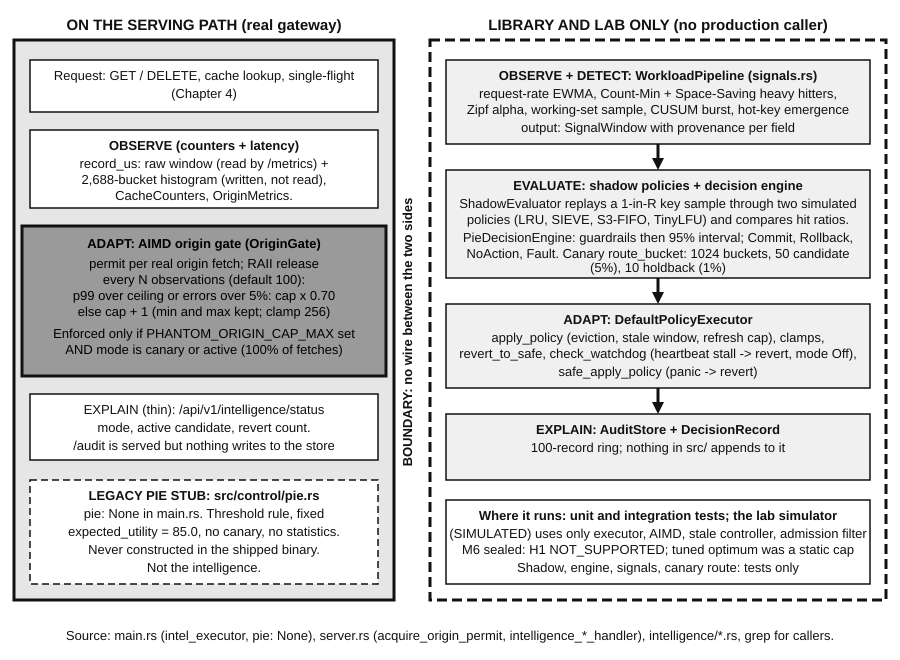

Source: `src/main.rs` (`intel_executor`, `pie: None`), `src/api/server.rs` (`acquire_origin_permit`, intelligence handlers), `src/intelligence/*.rs`, `src/intel/*.rs`; "no production caller" established by grep over `src/`.

| Component | File | What it is | On the serving path? | Status |
|---|---|---|---|---|
| Latency histogram `AtomicLogLinearHistogram` | `intel/telemetry.rs` | 2,688-bucket histogram | **Written** on every GET; **not read** by any production endpoint (section 5.11) | IMPLEMENTED, TESTED (bucket error) |
| `TelemetryCollector` raw window | `intel/telemetry.rs` | 10,000-sample ring, sorted on demand | Yes: this is what `/api/v1/metrics` percentiles use | IMPLEMENTED, TESTED |
| `OriginMetrics` | `intel/origin_metrics.rs` | 16-bucket origin latency histogram, in-flight and error counters | Yes | IMPLEMENTED |
| AIMD origin gate `OriginGate` + `OriginConcurrencyCapController` | `intelligence/executor.rs`, `candidates.rs` | Adaptive cap on concurrent origin fetches | **Yes, only if `PHANTOM_ORIGIN_CAP_MAX` is set and mode is `canary` or `active`** | IMPLEMENTED, TESTED; benefit NOT established |
| `PHANTOM_INTELLIGENCE` mode switch, `/api/v1/intelligence/status` | `main.rs`, `server.rs` | Reads mode, active candidate id, revert count | Yes (read-only) | IMPLEMENTED |
| `/api/v1/intelligence/audit` and `AuditStore` | `intelligence/audit.rs` | 100-record ring of decisions | Endpoint served; **nothing in `src/` appends to the store** | PARTIAL (empty in production) |
| `WorkloadPipeline`: rate EWMA, Count-Min + Space-Saving heavy hitters, Zipf estimate, working set, CUSUM burst, hot-key emergence | `intelligence/signals.rs` | Detectors | **No** (tests only) | IMPLEMENTED as library; TESTED (`intel_signals_tests.rs`) |
| `ShadowEvaluator` and shadow LRU/SIEVE/S3-FIFO/TinyLFU | `intelligence/shadow.rs` | Counterfactual replay on a key sample | **No** (tests only) | IMPLEMENTED as library; TESTED (`intel_shadow_tests.rs`) |
| `PieDecisionEngine` | `intelligence/engine.rs` | Guardrails + confidence interval verdict | **No** (tests only) | IMPLEMENTED as library; TESTED (`intel_engine_tests.rs`); statistics unsound (F12) |
| Canary routing `route_bucket`, `check_watchdog`, `safe_apply_policy`, `apply_policy` | `intelligence/executor.rs` | Stratified arms, stall revert, panic revert | **No** (no handler calls them) | IMPLEMENTED as library; TESTED (`intel_executor_tests.rs`, `intel_safety_and_replay_tests.rs`) |
| Other candidates: stale-window controller, admission filter, rate forecaster, hot-key predictor, decision stump | `intelligence/candidates.rs` | Library | No; the lab simulator uses the stale controller and admission filter | IMPLEMENTED as library |
| `CountMinSketch`, `WorkloadProfile` | `intel/sketch.rs`, `intel/workload.rs` | Early sketch and workload presets | **No**; only `tests/unit/wp2_tests.rs` uses them | PROTOTYPE ONLY |
| Legacy `PieController` | `control/pie.rs` | Threshold stub | **No**: `pie: None`; never constructed | Legacy, quarantined |

Everything marked "No" is exercised only by unit and integration tests, and (for the AIMD gate, the stale controller and the admission filter) by the Tier-1 lab simulator. The simulator is a deterministic virtual-time model; a result from it is SIMULATED, not measured on a real gateway.

---

## 5.11 Telemetry: the histogram, with the maths

### Simple explanation

To report "99 percent of requests were faster than X" you either remember every latency (expensive) or you count them in buckets. A **log-linear histogram** uses fine buckets for small values and coarser ones for large values, so the *relative* error stays small everywhere.

### How it works

`AtomicLogLinearHistogram` (`src/intel/telemetry.rs`) takes a latency in microseconds:

- Values below 128 µs get one bucket each (exact, 128 buckets).
- Above that, each power-of-two range (an *octave*, from `2^k` to `2^(k+1)`) is split into 128 equal sub-buckets. There are 20 octaves, so `128 + 20 x 128 = 2,688` buckets.
- The bucket index comes from the position of the highest set bit (a hardware count-leading-zeros instruction) and a shift: constant time, no loop, no lock. Each bucket is an `AtomicU64` incremented with relaxed ordering.

**Error bound.** In octave `k` the bucket width is `2^k / 128`. A bucket is reported by its midpoint, so the worst error is half a width, `2^k / 256`, and since the value is at least `2^k` the relative error is at most `1/256 = 0.39%`. Below 128 µs the error is zero.

::: example
Latency 1,000 µs. The highest set bit is bit 9 (512 to 1,023), so octave 2 (`k = 9`); width is `512/128 = 4`. Offset from the octave base is `1000 - 512 = 488`; sub-bucket `488 / 4 = 122`; bucket index `128 + 2 x 128 + 122 = 506`. The bucket covers 1,000 to 1,003 µs and is reported as its midpoint, 1,002 µs: error 0.2 percent, inside the 0.39 percent bound.
:::

Percentiles are read by walking the buckets in order until the cumulative count reaches `ceil(p x total)`.

Limits: values of 2^27 µs (about 134 s) or more fall into the last sub-bucket and lose the bound. The bound is a bound on *bucketing*, not on sampling error. The bucket mapping and its reconstruction error are TESTED (`telemetry_redesign_tests.rs`).

### A discrepancy you must know

`CLAUDE.md` describes "Telemetry Hot-Path: AtomicLogLinearHistogram ... bounded error <= 0.39%". That is true of the *recording* code. In the current tree no production reader uses the histogram's percentiles (a search for `histogram()` and `calculate_percentiles_histogram_*` finds callers only inside `telemetry.rs` and tests). The percentiles on `/api/v1/metrics` and in the UI come from `TelemetryCollector::calculate_percentiles_us`, which locks the 10,000-sample raw window, filters GET samples, **sorts them** and indexes with `floor(p x n)`; `record_us` also takes two mutexes (`raw_buffer`, `raw_buffer_us`) per observation. So the lock-free histogram is built and tested but the displayed percentiles do not use it. Say: "the histogram is implemented and recorded; the dashboard percentiles are computed from the raw window." Percentile-definition inconsistency (G4A-24 / F24) and the comparison of the two sources are Chapter 6, section 6.12.2. Found by reading and grep, not by running the gateway: UNVERIFIED at runtime.

::: judge
**JUDGE MAY ASK**

Question: How accurate are your latency percentiles, and how do you compute them without slowing the request path?

**Suggested answer** (about 30 to 60 seconds spoken, plain English):

We built a log-linear histogram: 2,688 counters, constant-time recording, relative error at most 0.39 percent by construction and checked by tests. That is the recording design. In the current gateway the percentiles on the metrics endpoint are actually computed from a 10,000-sample window that is sorted on demand, so they are exact for that window but not the histogram, and the sort and two locks are on the observation path. Switching the endpoint to read the histogram is a small change that has not been made. I would not quote the 0.39 percent as the accuracy of the displayed numbers.

**If the judge asks further:**

"Which is right?" The sorted window is exact for the last 10,000 GETs; the histogram would cover all history at 0.39 percent. They answer different questions, and the repository's percentile conventions are also inconsistent (floor versus nearest-rank) which Chapter 6 discusses.

**Evidence to know:** `src/intel/telemetry.rs` (`value_to_bucket`, `calculate_percentiles_us`, `record_us`), `tests/integration/telemetry_redesign_tests.rs`, `src/api/server.rs` (metrics uses `calculate_percentiles_us`). Status: histogram IMPLEMENTED and TESTED; histogram as the live percentile source NOT the case.
:::

---

## 5.12 Probabilistic structures, hot-key detection and workload patterns

### Count-Min Sketch

A **Count-Min Sketch** estimates how many times each item was seen using a small fixed table. It has `d` rows of `w` counters and `d` hash functions. To count an item, add 1 in each row at the position its hash gives. To estimate, take the **minimum** of its `d` counters. Collisions only add, so the estimate is never too low; it can be too high. With width `w` and depth `d` the overestimate is at most `(e/w) x N` with probability at least `1 - e^-d`, where `N` is the number of counted events (Cormode and Muthukrishnan, 2005; stated from memory and not re-verified against the paper in this session).

In `HeavyHitterDetector` (`src/intelligence/signals.rs`) `d = 4` and `w = 1,024`, so `e/w` is about 0.27 percent of `N` with confidence about 98 percent (`1 - e^-4`). Counters are halved every 10,000 samples so old traffic fades; hence `N <= 10,000` and the error is at most about 27 counts at that confidence. Memory is `4 x 1,024 x 4` bytes = 16 KiB.

The older `src/intel/sketch.rs::CountMinSketch` is a separate, simpler version using `DefaultHasher`. **It is not used by any production or library path** (only `tests/unit/wp2_tests.rs`). It is a prototype; do not describe it as the hot-key detector.

### Space-Saving (top-k)

A sketch estimates any item but does not say *which* items are heavy. **Space-Saving** (Metwally, Agrawal and El Abbadi, 2005; from memory) keeps `k` counters. A seen item increments its counter. A new item, when the table is full, takes over the entry with the smallest count and starts at that count plus one, remembering the inherited count as its possible error.

::: example
Capacity `k = 3`, stream `a a b c d`. After `a a b c` the table is `a:2, b:1, c:1`. Item `d` is new and the table is full, so `d` replaces the minimum (say `b:1`) and becomes `d:2` with error 1: its true count is between 1 and 2. In `HeavyHitterDetector` `k = 64`, so it tracks at most 64 candidate hot keys and finds a linear minimum in `O(k)` per miss.
:::

### The rest of the pipeline

| Detector | Method | Note |
|---|---|---|
| Request rate | EWMA over windows | smoothing factor `alpha` |
| Zipf skew | least-squares slope of `ln(frequency)` against `ln(rank)` over the top 50 | the doc comment says "MLE"; it is a regression, and it is fitted on the Space-Saving counts, which are biased upward |
| Working set | spatially sampled keys (1 in `R`) times `R`, assuming **1 KiB per object** | the 1 KiB is hard-coded, so the byte figure is a guess |
| Burst | one-sided CUSUM with slack and threshold | detects a sustained rate increase |
| Hot-key emergence | a top-10 key whose count is at least 3 times its previous window's count and at least 30 | a fixed rule |

### Where hot keys are actually handled

The shipped gateway does not detect hot keys. `/api/v1/metrics` returns `"hot_keys": {"src": "unavailable", "reason": "not_implemented"}`. What protects an origin from a hot key is **single-flight coalescing** (Chapter 4): concurrent misses on one key share one origin fetch. That needs no detection. A hot key that is already cached is simply served locally by every gateway, which is a benefit of the local-copy design. The detectors above could drive prefetch, admission or per-key caps; none does.

Workload "patterns" in the code are presets (`WorkloadProfile::travel_hotel()`, `ecommerce()`, `ticketing()`, `general_api()`: rate, Zipf skew, catalogue size, read ratio) not used by any gateway code (only an early unit test); the lab (`src/lab/workloads.rs`, Chapter 7) is the maintained workload generator.

::: judge
**JUDGE MAY ASK**

Question: How do you detect and handle hot keys?

**Suggested answer** (about 30 to 60 seconds spoken, plain English):

Two separate things. Handling: concurrent misses for one key are coalesced into a single origin request, so a hot key cannot multiply origin load, and once cached it is served locally by every gateway. That is live and tested. Detection: we have a library detector that combines a Count-Min Sketch with a Space-Saving table of 64 keys and a rule for sudden emergence, tested in isolation, but it is not wired into the gateway, and the metrics endpoint reports hot keys as unavailable. So I would claim hot-key protection through coalescing, and hot-key detection as a built-but-unused component.

**If the judge asks further:**

"What error does the sketch have?" Overestimate only, at most about 0.27 percent of the events in a window with about 98 percent probability for our dimensions, from the standard Count-Min bound. We have tests of its behaviour, not a measured error on production traffic, because there is none.

**Evidence to know:** `src/intelligence/signals.rs::HeavyHitterDetector`, `HotKeyEmergenceDetector`; `src/core/coalesce.rs` (Chapter 4); `server.rs` `"hot_keys"` unavailable; `src/intel/sketch.rs` unused. Status: coalescing IMPLEMENTED and TESTED; detection PROTOTYPE ONLY / library, not wired.
:::

---

## 5.13 The adaptive algorithms, one by one

### A. AIMD origin concurrency cap (the only adaptive control on the serving path)

**Idea.** When the origin is slow or failing, sending it more concurrent requests makes things worse. Cap the number of concurrent origin fetches, lower the cap fast when the origin struggles, raise it slowly when it is healthy.

**AIMD** stands for additive increase, multiplicative decrease, the rule behind TCP congestion control. Increase by a small constant; on trouble, multiply by a factor below one.

**What the code does** (`OriginGate`, `OriginConcurrencyCapController::step`):

```
every N real origin observations (config PHANTOM_ORIGIN_CAP_WINDOW, default 100):
    p99 = nearest-rank 99th percentile of the window's latencies
    err = failures / N            (HTTP status >= 500, or a transport error)
    if p99 > p99_ceiling or err > 5%:  cap = max(min_cap, floor(cap * 0.70))
    else:                              cap = min(max_cap, cap + 1)       # max_cap clamped to 256
```

A request that wants to contact the origin takes a **permit** first (an atomic counter below the cap). If none is free, the gateway answers `503 Service Unavailable` with `Retry-After: 1`. The permit is released by `Drop`, so success, error, timeout and cancellation all release it. Coalesced waiters never take a permit; only the single-flight leader, a bypass request and a background revalidation leader do.

::: example
`min = 2`, `max = 32`, ceiling 60 ms. The controller starts at 32. Window 1 shows p99 = 80 ms: cap becomes `floor(32 x 0.70) = 22`. Window 2, p99 = 90 ms: `floor(22 x 0.70) = 15`. Window 3, p99 = 70 ms: `floor(15 x 0.70) = 10`. The origin recovers and p99 = 50 ms for the next windows: 11, 12, 13 and so on, one step per window. Recovery from 10 back to 32 takes 22 healthy windows, 2,200 origin fetches at the default window of 100. The cap falls by 30 percent per slow window but rises by 1 per good window; that asymmetry is the point of AIMD.
:::

**Where the cap is enforced.** Only when `PHANTOM_ORIGIN_CAP_MAX` is set **and** `PHANTOM_INTELLIGENCE` is `canary` or `active` (`origin_cap_enforcing`). In `off`, `observe` and `advisory` the in-flight count is tracked but nothing is refused. When a cap is set but the mode is `off`, `config.rs` emits a warning that the cap is inert.

**Findings that apply.**

- **"Canary" is not a canary (F14, a recorded limitation under ODR-1).** `canary` mode applies the cap to 100 percent of origin fetches. The 5 percent routing exists only as `route_bucket`, which no handler calls. There is no automatic rollback in the serving path. The mode name over-promises; the config layer warns that the mode is experimental.
- **The "p99" is the window maximum for windows under 100 samples (F15 and the code).** Nearest-rank `ceil(0.99 x n)` equals `n` for `n < 100`. At the default window of 100 it is the second-largest sample. The controller also sees only *completed* fetches; cancelled or timed-out fetches contribute no sample (F15, a plausible survivorship bias, untested).
- **It can behave as a static cap.** In the Scenario B live artefact the cap fell from 32 to about 12 within seconds and stayed there (`AIMD_EFFECTIVE_CAP_NOTE` in `src/lab_live/scenario_b.rs`); the simulator's static cap is this same controller with `min = max` (`t1_sim.rs`). Details and caveats: Chapter 7, section 7.5.2.

Status: IMPLEMENTED; TESTED (`origin_cap_tests.rs`, `intel_executor_tests.rs`, `intel_candidates_tests.rs`: step arithmetic, permit accounting, saturation). What the tests do not prove: that adaptation helps. It is labelled experimental in `docs/user/limitations.md` and in config warnings.

### B. Shadow evaluation (library)

**Idea.** Before changing the eviction policy, test the new policy on *a copy* of the traffic, so a bad idea costs nothing. `ShadowEvaluator` feeds the key hashes of a spatial sample (`key_hash % R == 0`, design value `R = 16`) to two small simulated caches, each a policy implementation (`LruShadow`, `SieveShadow`, `S3FifoShadow`, `TinyLfuShadow`) of the sampled capacity (`C / R`), and compares their hit ratios.

The report computes `delta = hit_ratio_candidate - hit_ratio_baseline` and a 95 percent interval `delta +/- 1.96 x se`, with `se` the standard error of a difference of two **independent** proportions, then marks the result significant if the lower bound exceeds `delta_min` and at least 100 requests were sampled.

**Honest limitations (F13).** The two shadows replay the *same* sampled stream, so their outcomes are correlated (the interval is too wide in that respect), and cache hit sequences are serially dependent and skewed (the interval is too narrow in that respect); the 95 percent label has no stated coverage. Cold-start misses are included and there is no multiple-comparison control. It works on key hashes only, not object sizes. The mechanism (spatially sampled mini-simulation) is the idea behind published designs such as SHARDS and mini-simulation evaluators; the literature status is *not verified from a primary source here*.

Status: IMPLEMENTED as a library; TESTED; not on the serving path.

### C. Decision engine and canary routing (library)

`PieDecisionEngine::evaluate` applies a fixed sequence:

1. Mode `off` or `observe` returns `NoAction`.
2. Inside a 60 s cooldown: `NoAction`.
3. Fewer than 500 requests per arm: `NoAction`.
4. **Hard guardrails** (immediate `Rollback`): any stale-cap violation in the candidate arm; candidate origin errors more than the control's plus 5; candidate P99 more than 10 percent above control.
5. Otherwise the hit-ratio difference with a z-interval; `Commit` if the **lower bound exceeds 0.05** and fewer than 4 switches happened in the hour.

`evaluate_with_provenance` refuses `Canary` or `Active` decisions when the input data is `Simulated` or `Unavailable` (a provenance gate that matches the project rule never to adapt on synthetic metrics).

The three **arms** come from `route_bucket`: the key hash is mixed and reduced modulo 1,024 buckets; 10 buckets (about 1 percent) are the permanent *holdback*, 50 (about 4.9 percent) are the *candidate*, the rest are *control*. Because the split is by key, not by request, the arms see different keys.

**Honest limitations (F12).** The "p99 tracker" updates only when a sample exceeds its current value and moves 5 percent toward it, so it is not a quantile and depends on arrival order. The error guardrail compares raw counts of a 5 percent arm with a 95 percent arm, so it essentially cannot fire unless the candidate's error rate is about 19 times higher. The holdback arm is recorded and never used in the verdict. The comment says "5% relative improvement" while the code compares an absolute difference of 5 percentage points. The interval treats key-partitioned arms as random samples of one population. Tests feed constant latencies, which hide the tracker flaw. G4C says: do not activate on live traffic.

Status: IMPLEMENTED as a library; TESTED; not on the serving path.

### D. Executor, safe fallback and watchdog (library)

`DefaultPolicyExecutor` is the one object that *would* apply a decision. `apply_policy` sets an eviction policy, a stale window or a background-refresh cap on the cache, **clamping** to hard limits (24 h stale cap, 256 refreshes). `revert_to_safe` restores a baseline. `safe_apply_policy` catches a panic, reverts and forces mode `off`. `check_watchdog(now, timeout)` reverts and forces `off` if the intelligence loop's last heartbeat is older than the timeout. This is the "hard caps are enforced by the execution layer regardless of any decision" principle in code.

Limits: none of these methods is called by a request handler or a background task in `src/` (only `acquire_origin_permit`, the snapshot, mode, active candidate and revert count are used). The baseline restores `Sieve`, 24 h and 128 refreshes regardless of the operator's configuration (F09, latent); the watchdog never trips before the first heartbeat and uses a non-monotonic clock (F26). Status: IMPLEMENTED as a library; TESTED; DESIGNED BUT NOT WIRED.

### E. The legacy PIE stub, and why it is not the intelligence

`src/control/pie.rs` defines `PieController`. Its header says "LEGACY, not the PIE (Quarantined)". Its `evaluate_candidate` computes `utility = hit_rate x 100 - p99 x 0.1`, returns `NoAction` below 1,000 samples, and commits if the utility is above 80 or rolls back an "S3-FIFO" candidate below 50. It writes a trace with `expected_utility: 85.0`, a constant, not a prediction. It has no candidate evaluation, no canary, no confidence interval and no counterfactual: the "evaluation" is a threshold on the live aggregate. `main.rs` passes `pie: None`, so it is never constructed in the shipped binary; the only caller is the simulation loop in `server.rs`, guarded by `if let Some(pie)`. It remains so that legacy tests (`p4_pie_tests`, `wp2_tests`) compile. Earlier handoff documents and the README called this "PIE" or "adaptive intelligence". That is wrong; `docs/research/pie_audit.md` records the gap. The real engine is the library in `src/intelligence/`, which is itself not wired.

---

## 5.14 The M6 result: no benefit from adaptivity (sealed)

M6 was a pre-registered, sealed evaluation (Tier 1, simulated; protocol v2.2; 30 sealed seeds; 8 scenarios). The full account is Chapter 7, section 7.6; the mechanical verdict from `docs/research/m6_sealed_results.md` is:

- **H1 (the origin-aware adaptive controller beats the best static configuration found on the tuning data): NOT_SUPPORTED.**
- Peak origin concurrency: supported in 0 of 8 scenarios; the adaptive arm was credibly *worse* in 7 (it adapted up to 8 concurrent fetches where the static baseline held 2).
- Client P99: supported in 2 of 8 (O-HET +29.2 percent, O-GRD +5.6 percent); in five of the other six scenarios P99 was identical in both arms (a saturated, weak discriminator) and O-RT was +4.2 percent, below the 5 percent threshold.
- Constraint failures: fresh-hit loss over 1 point and error-rate increase over 0.5 points, in the same 3 scenarios. Hard-cap violations: 0 in every arm.
- The unconstrained tuning optimum for the adaptive controller was itself a **static cap** (min = max = 2). H2 and H4 (stale-window mechanisms): NOT TESTABLE at the registered horizon. H3, H5, H6 (overhead, oscillation): UNVERIFIED in a simulator.

It shows that, in this simulation, a forced-adaptive AIMD controller did not beat a tuned static cap. It does **not** show that adaptive caching is useless, and it is not a measurement of any real gateway. The research lead's product decision: the static origin-concurrency cap is the defensible feature; the adaptive controller is NOT promoted to the serving path as a claimed benefit, though the code stays behind configuration. A static cap versus no cap is a large effect in the simulator (development data, exploratory, outside H1): SIMULATED, not a production figure.

::: judge
**JUDGE MAY ASK**

Question: What is the actual intelligence in your system? Is it AI?

**Suggested answer** (about 30 to 60 seconds spoken, plain English):

It is not AI and I would not call it that. There is no learned model. On the live path there are two things: latency and hit telemetry, and one small adaptive controller, an additive-increase multiplicative-decrease cap on concurrent origin fetches, the same rule TCP uses. Beside that there is a library for workload detection, shadow evaluation of eviction policies, a statistical decision engine, a canary-routing function and a watchdog. That library is tested but not wired into the gateway. A legacy stub called PIE is a threshold rule and is not constructed in the shipped binary. We also ran a sealed, pre-registered simulation and the adaptive controller did not beat a good static cap, so the defensible feature is the static cap.

**If the judge asks further:**

"Then why build it?" As a research platform: the lab, the sealed protocol and the negative result are real engineering outputs. A negative result reported honestly is a finding. "Could it be wired in?" Yes, behind the provenance gate and the hard caps, but the findings on the decision engine's statistics would need fixing first, and there is no evidence yet that it helps.

**Evidence to know:** `src/intelligence/executor.rs`, `candidates.rs`, `engine.rs`; `src/control/pie.rs`; `docs/research/m6_sealed_results.md`, `pie_audit.md`; G4C F12, F13, F14. Status: AIMD cap IMPLEMENTED and TESTED, benefit NOT established; the rest PROTOTYPE ONLY or library; PIE stub legacy.
:::

::: judge
**JUDGE MAY ASK**

Question: Your own experiment says the adaptive controller does not beat a static cap. Why should anyone use the adaptive mode?

**Suggested answer** (about 30 to 60 seconds spoken, plain English):

They should not, on current evidence, and our documentation says so. The sealed result is simulated, so it is not a proof that adaptation never helps, but it gives no evidence that it does. The feature that did show a large effect in the simulator is the static cap itself: bounding concurrent origin fetches protects a slow origin. So the product position is a configurable static cap, with the adaptive mode available as an experimental option. We kept the negative result because hiding it would be worse than not having a positive one.

**If the judge asks further:**

"Is the simulator trustworthy?" It is deterministic and uses the real executor and cache code with a virtual clock, but it is a model of the origin; a loopback experiment with a real gateway (Scenario B) found the controller acted as a static cap near 12, which fits the simulation's lesson. Neither experiment is a multi-host measurement.

**Evidence to know:** `docs/research/m6_sealed_results.md`, `claims_ledger.md` section 6 (C1 NOT SUPPORTED, narrowed to Tier-1), `src/lab_live/scenario_b.rs::AIMD_EFFECTIVE_CAP_NOTE`, `docs/user/limitations.md`. Status: adaptive benefit NOT established; static cap IMPLEMENTED.
:::

---

## 5.15 Chapter status summary

| Capability | Status | Key limit |
|---|---|---|
| Static membership, pinned-certificate mTLS cluster | IMPLEMENTED, TESTED | No runtime change or revocation trigger (G4B-07); no certificate-lifetime enforcement on live links (G4B-08) |
| PhantomMesh frame protocol | IMPLEMENTED, TESTED | Codec and loopback behaviour only |
| Heartbeat-based failure detection (node state change) | DESIGNED BUT NOT IMPLEMENTED | Heartbeat frames and idle-connection keepalive are IMPLEMENTED (`pool.rs`); no code path lets a heartbeat change node state (G4B-12) |
| Rendezvous hashing, equal weights | IMPLEMENTED | No uniformity test in repo; unspecified `DefaultHasher` |
| Weighted rendezvous hashing | DESIGNED BUT NOT IMPLEMENTED | Weight is a constant 1.0 |
| Routed reads / peer fill | DESIGNED BUT NOT IMPLEMENTED | GET is local only; peer `GetRequest` is a placeholder (DR-029) |
| Exact-key DELETE: local purge, primary ack, fan-out to all members | IMPLEMENTED, TESTED | 204 is not a cluster-wide ack (G4B-09) |
| Retry, per-peer queues, repair ledger, pull anti-entropy | IMPLEMENTED, TESTED | Memory only; single host loopback evidence |
| Durable owed-invalidation log | PROTOTYPE ONLY (sandbox) | Not integrated; needs review and owner approval |
| Cross-node linearizability, bounded staleness | Not claimed | See section 5.6 |
| Membership-epoch enforcement on invalidations | Not implemented | G4B-06 |
| Tenant/global epochs (local) | IMPLEMENTED, TESTED | G4A-01, G4A-17 open (Chapter 4) |
| Telemetry log-linear histogram | IMPLEMENTED, TESTED | Recording and bucket arithmetic only; it is fed but has no production percentile reader, and it is not the source of displayed percentiles |
| Hot-key detection (`HeavyHitterDetector`, Count-Min plus Space-Saving) | PROTOTYPE ONLY (library) | Unit-tested; not wired into the serving path; metrics report hot keys unavailable |
| AIMD origin cap controller | IMPLEMENTED, TESTED (arithmetic and cap unit tests) | On the serving path only when a cap is configured in canary or active mode (default off); benefit not established; "canary" is 100 percent |
| Shadow evaluation, decision engine, canary routing, watchdog | IMPLEMENTED as library | Not wired; statistical flaws F12, F13 |
| Legacy `PieController` | Legacy stub | Not constructed |
| Machine learning | Not present | A hand-set stump in a library |


## Key ideas to remember

::: concept
1. **The cluster is local copies plus invalidation fan-out.** Reads are always local. Rendezvous hashing chooses only the node that must acknowledge a DELETE.
2. **A 204 means: this gateway purged, and the primary (possibly itself) acknowledged.** Everyone else is told asynchronously, with retry and a bounded, in-memory repair ledger.
3. **Three different "epochs":** local tenant/global epochs (cache entries), membership epoch (static, not enforced on invalidations), and per-destination stream sequences (loss detection and replay).
4. **Honest consistency:** per-gateway read-your-delete (with open race findings); cross-node convergence in milliseconds on loopback while the issuer lives; no bound if the issuer crashes or a partition is permanent, except the entry's freshness lifetime.
5. **The intelligence is mostly a library.** On the live path: telemetry and one AIMD cap. Not AI. The sealed experiment found no benefit over a static cap.
:::

## What you should now understand

- Why a membership change does not move data in this system, and what it does change.
- How highest-random-weight hashing is derived, why it is minimally disruptive, and why multiplying by a weight is not the weighted form.
- The ordered steps of a DELETE and which of them is synchronous.
- Why a restarted receiver is safe but a crashed issuer is not.
- What the node states mean in practice and which ones are only ever set by a demo control.
- The difference between a count-min sketch, a Space-Saving table and a histogram, and which of them the gateway actually uses on live requests.
- Why `canary` mode is not a canary, and why the legacy PIE is not the intelligence.

---

## Knowledge check

1. Which operations in the shipped gateway call `route_key`, and what does its result decide?
2. State the minimal-disruption property of rendezvous hashing and prove it in two sentences. How many keys moved in the replica experiment when node 3 was removed, and why that number?
3. What are the three things called "epoch", and which of them changes at runtime in a deployed cluster?
4. List the steps from receiving `DELETE` to returning 204. Which steps are asynchronous?
5. A peer is unreachable for 10 seconds. Describe what happens to the invalidation for a key deleted during that time, and which component bounds memory.
6. What does a receiver do when it sees stream numbers 4, 5, 8 from one sender? What if the sender's ring no longer holds record 6?
7. Why does a crashed receiver not serve stale data after restart, while a crashed issuer can leave a peer stale?
8. Give the Count-Min error bound for width 1,024 and depth 4. Is the estimator biased up or down?
9. In `canary` mode, what fraction of origin fetches is subject to the cap?
10. Which of these run on the live request path: Space-Saving, the AIMD gate, the shadow evaluator, `PieController`, the log-linear histogram (recording)?

## Codebase exploration tasks

1. **Trace a DELETE.** Start at `src/api/server.rs::delete_cache_handler`. Follow the call into `RendezvousRouter::invalidate_key_across_cluster` in `src/dist/router.rs`, then `fanout_targets`, `dispatch_fanout` and the `ReplicaBroadcaster` worker closure. Find: where the stream number is assigned, where a failed job is written to the ledger, and the numeric limits (attempts, backoff, timeouts). You should learn how "acknowledged", "retried" and "owed" are different states of one invalidation.
2. **Find what is wired.** Start at `src/main.rs` (the `router` construction and the `intel_executor` block). For each of `forward_key_over_tcp`, `check_watchdog`, `route_bucket`, `CountMinSketch`, `PieController::evaluate_candidate`, use `grep` over `src/` to list callers outside tests and the defining file. You should learn to separate library code from the live path, and to produce evidence for "no production caller".
3. **Replicate the router formula.** In a scratch file outside the repository, copy `calculate_hash` and `route_key`'s selection rule, hash 100,000 keys across 3 and 5 nodes, remove a node, and count the keys that move. Then change the weight to 2.0 for one node using the raw multiplication and measure the share of the heavier node (expect about 75 percent for two nodes with weights 1 and 2, not 67 percent). You should learn why minimal disruption holds and why the weighted form needs a logarithm.

## Challenge questions

1. **Close the issuer-crash gap without a durable log.** Propose a design that needs no disk write. State the new failure model and what remains unprotected. *Model answer:* (a) Delay the 204 until all reachable members ack (synchronous fan-out): removes the loss window for reachable peers at the cost of DELETE latency and availability coupled to the slowest member; a peer that is unreachable still needs a record, so some state must survive. (b) Replicate the owed set to a second gateway (a buddy) before answering 204: survives one crash, adds a message and a new trust and ordering problem, and fails on a double fault. (c) Cap the exposure instead: a gateway-side ceiling on freshness lifetime (for example a configured `s-maxage` clamp) bounds staleness regardless of crashes; it trades hit ratio. Each option moves, rather than removes, the failure model. Only a durable record (as in M3) or a bound on lifetime gives a stated bound after a crash.
2. **Make the weight real.** Suppose nodes have capacities 1, 2 and 4. Write the owner function that gives each node a share proportional to its capacity while keeping minimal disruption, state the share for each node, and say what you would need to change in `route_key` and in what tests. *Model answer:* `score_i = -w_i / ln(u_i)` with `u_i = (h + 0.5) / 2^64` to avoid 0 and 1; shares are 1/7, 2/7, 4/7. Replace `(hash_val as f64) * capacity_weight` with that expression, read weights from the membership file (and add them to the registry and the digest), and add tests for the share within a statistical tolerance over many keys and for minimal disruption when a node is removed. Note that all gateways must use identical weights and the same specified hash, or they will disagree about owners.

## Answers to the knowledge check

::: answers
1. Only `invalidate_key_across_cluster` (DELETE's synchronous leg, with `get_replicas` for the acting primary) in production. `forward_key_over_tcp` also uses it but has no production caller. The result decides which node must acknowledge before 204; it does not place data and does not route reads.
2. Removing a node `x` changes the argmax of a key only if `x` was the maximum, so only keys `x` owned move, each to its next-highest node. In the replica experiment 33,285 of 100,000 keys moved, exactly node 3's share, and 0 keys moved between nodes 1 and 2.
3. \(a) Local tenant epoch and global epoch in the cache: change on tenant/full invalidations, including repair escalations. (b) Membership epoch (`registry.version`): static, loaded from the file; does not change at runtime. (c) Per-destination stream sequence: increments with every invalidation sent to a peer. (a) and (c) change at runtime. (A per-key generation is a fourth, local counter.)
4. Local purge (sync) → route and send to primary with 150 ms deadline, possible acting-primary failover (sync) → on ack, reply 204 (sync) → compute fan-out targets → broadcaster per-peer queue with up to 4 attempts (async) → ledger on failure (async) → repair loop and pull loop (async).
5. Calls fail within their deadlines; the peer becomes Suspect; its invalidation goes to the sender's `RepairLedger` (deduplicated, bounded at 1,024 entries and 256 KiB per peer, collapsing to a tenant flush then a full flush on overflow). The repair loop retries every 250 ms with the original sequence once the peer is reachable and not Failed/Offline.
6. It expects 6, sees 8: records a gap 6 to 7, buffers 8, keeps its contiguous acknowledged point at 5. It pulls from the sender, which replays records after 5 for that receiver. If record 6 was evicted from the ring the sender answers `HistoryOverwritten` and the receiver flushes its whole cache.
7. The receiver's cache is in memory, so a restart empties it; nothing stale remains. The issuer's owed invalidations are in its memory only; a restarted issuer has an empty ledger and its restarted sequences are ignored, so a still-alive peer that missed a message keeps its stale entry until expiry.
8. Overestimate at most `(e/1024) x N`, about 0.27 percent of the counted events, with probability at least `1 - e^-4`, about 98 percent. Counters only increase on collisions, so the estimate is biased up, never down.
9. 100 percent of origin fetches (when a cap is configured). The 5 percent arm exists only in an unwired function.
10. On the live path: the AIMD gate (when configured) and the histogram recording. Not on the live path: Space-Saving, the shadow evaluator, `PieController`.
:::

# Chapter 6: Security, Reliability and Performance

This chapter answers three questions a judge will ask about any system that sits in front of other people's data: who can do what to it, what happens when parts of it fail, and how fast it really is. It is written against the working tree as read on 2026-10-30 (branch `feat/publish-phantomcache-core`; HEAD `df68eaa` at the time of writing, with substantial uncommitted work on top). Every claim carries a status label. Almost nothing here is **INDEPENDENTLY VERIFIED**: the G4 reviews cited are "AI second look" reviews (one AI pass reading code, running nothing). The M7 documents call review rounds 2 and 3 "independent", but we could not establish that a human performed them, so this chapter does not use that label.

## What you will learn

- How the gateway decides who may read, invalidate, observe and operate, and which parts of that design are complete and which are open findings.
- How cluster nodes trust each other (mutual TLS, certificate identity, a static registry), and what a trusted peer can still do.
- Where the gateway bounds its resources (bytes, bodies, waiters, queues, ledgers) and where it does not (connections, streams, origin concurrency by default).
- What happens to a DELETE when a peer is down, and which failure (issuer crash) loses an invalidation.
- How to evaluate performance correctly: what each percentile in the repository means, which measurements exist, and what each can and cannot support.

## 6.1 Threat model and trust boundaries

**Simple version.** A security review starts by asking "who are we afraid of, and what do they want?" A cache is attractive for four reasons. It holds data that other users asked for (confidentiality). It decides what answer users see (integrity). It shields a slower system (availability of the origin, and of itself). And it can be made to fetch URLs on someone's behalf (a stepping stone into a private network).

**Terms.**

- *Asset*: something worth protecting. Here: cached bodies per tenant, the origin's capacity, the JWT signing secret, the cluster private keys, the gateway's own CPU and memory.
- *Trust boundary*: a line where data passes between parties that do not trust each other equally. Every check belongs on a boundary.
- *Attack surface*: the set of inputs an outsider can reach.
- *Tenant*: one customer or application whose keys must not mix with another's. In PhantomCache the tenant is a string in the cache key.
- *Defence in depth*: several independent checks on one path, so one mistake does not open it.

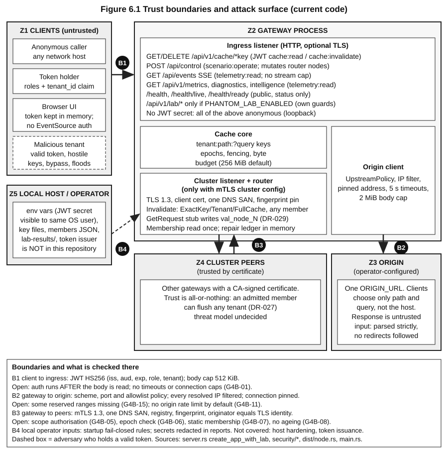

Source: `src/api/server.rs::create_app_with_lab`, `src/security/*`, `src/dist/node.rs::start_tcp_service`, `src/main.rs`.

**Where it lives.** The system has five zones. Clients (Z1) reach the ingress listener, the HTTP server in `src/api/server.rs`. The ingress and the cache core run in one process (Z2). The origin (Z3) is one operator-configured URL (`ORIGIN_URL`); a client chooses only the path and query, never the host. Cluster peers (Z4) reach a separate mTLS listener started only when the cluster certificate files and a membership file are configured (`src/main.rs`). The local host (Z5) supplies configuration, keys and files. The token issuer is **not in this repository**: who mints tokens, with what lifetime, is outside what the code can promise.

**Adversaries we reason about** (our framing, not a recorded threat model; the G4B review explicitly says the cluster-member trust decision is an owner decision still open, section 6.4):

1. An anonymous network caller.
2. A caller with a valid token for tenant A who wants tenant B's data or wants to exhaust shared resources.
3. A compromised or buggy cluster member.
4. A malicious or misbehaving origin response.
5. A local user on the same host.

**What the design does not claim.** There is no protection against a host-level attacker who can read the process environment (the JWT secret is an environment variable; the M7 review says so). There is no claim of resistance to a determined distributed denial-of-service attack. There has been no penetration test, no fuzzing run of the HTTP surface, no TLS configuration scan and no dependency advisory scan (`docs/security/m7_security_review.md`, "Not done"). **UNVERIFIED** for all of these: no one has run them.

## 6.2 Authentication and authorisation

**Simple version.** Authentication answers "who are you?"; authorisation answers "are you allowed to do this?". PhantomCache uses bearer tokens: the client sends `Authorization: Bearer <token>`, and the gateway checks the token's signature and claims.

**Terms.**

- *JWT* (JSON Web Token): a signed bundle of claims. *HS256* means one shared secret both signs and verifies, so any holder of the secret can mint any token.
- *Claims* used here: `sub` (who), `iss` (issuer), `aud` (audience), `exp` (expiry), `iat` (issued at), `tenant_id`, `roles`.
- *RBAC* (role-based access control): permissions come from roles in the token.
- *Revocation*: invalidating a token before it expires.

**How it works in the code** (**IMPLEMENTED**, **TESTED**):

1. `src/security/jwt.rs::JwtValidator::validate` decodes the header, rejects any algorithm other than HS256, picks the secret (the default secret, or a rotation secret chosen by `kid`; an unknown `kid` is an error with no fallback), and asks the `jsonwebtoken` 9.3.1 library to verify signature, `exp`, `iss` and `aud`, with 10 seconds of leeway. It then compares `iss` and `aud` again itself.
2. `Role` has five values: `cache:read`, `cache:invalidate`, `telemetry:read` (Observer), `scenario:operate` (Operator) and `admin`. `JwtClaims::has_role` lets `admin` satisfy every role.
3. `src/api/server.rs::authenticate_request` extracts the token, validates it, checks the role, and returns 401 (with `WWW-Authenticate: Bearer` and an `X-Auth-Error` class) or 403.
4. `require_tenant_claim` then demands a non-empty `tenant_id` that is not the reserved value `__default__`; otherwise 403.
5. `src/main.rs` builds the validator only if `PHANTOM_JWT_SECRET` is set. With no secret, `ApiState.security` is `None` and every route is anonymous.

**Startup is fail-closed** (**IMPLEMENTED**, **TESTED**). `src/security/mod.rs::validate_startup_security` refuses to start a non-loopback bind without a JWT secret, and without TLS unless `PHANTOM_ALLOW_INSECURE_HTTP=true` (even then, authentication stays mandatory). `src/config.rs` makes unknown boolean spellings an error rather than silently "false" (SEC-M7-05), and requires a JWT secret of at least 32 bytes when auth is required, the bind is a network address or the mode is `production` (SEC-M7-06).

::: example
**Worked example: what a request needs.** A client sends `DELETE /api/v1/cache/users/7` with a token whose `roles` is `["cache:read"]` and `tenant_id` is `acme`. Step 4 finds the signature, issuer, audience and expiry fine, but the role check for `cache:invalidate` fails: **403**, `X-Auth-Error: InsufficientPermissions`, and nothing in the cache changes. With `roles: ["cache:invalidate"]` and `tenant_id: acme`, the key becomes `acme:/users/7` and that exact key is purged. The same token cannot touch `globex:/users/7`, because the tenant comes only from the verified token (secure mode ignores the `x-tenant-id` header).
:::

**What is not done** (each an open register entry; check the current disposition in `docs/release/g4/cycle1_findings_disposition_register.md`):

| Gap | Verified in current code | Finding and disposition |
|---|---|---|
| No `nbf` (not-before) check. `Validation::new` leaves `validate_nbf` false and the code never sets it. | `jwt.rs::validate`; crate source `jsonwebtoken-9.3.1/src/validation.rs` | G4B-13 (SEC-M7-11): OPEN |
| No maximum token lifetime, no `jti`, no revocation list. `iat` is parsed but unused. | `jwt.rs` has no such code | G4B-13: OPEN |
| Rotation keys exist in `JwtValidator` but `main.rs` never configures any. | `main.rs` calls `JwtValidator::new` only | G4B-13: OPEN |
| `requester` and `read`/`invalidate` aliases; case-insensitive roles; a token without the `Bearer ` prefix is accepted. | `jwt.rs::has_role`, `authenticate_request` | G4B-14 (SEC-M7-09): OPEN (a characterisation test pins the bare-token behaviour) |
| No rate limit or lockout on failed authentication. | a search of `src/` for limiter code finds none (the Lab API uses fixed caps only) | G4B-13/G4B-11: OPEN |
| Short JWT secret on loopback dev is a warning, not an error. | `config.rs` validation | G4B-18: OPEN |

**Trade-offs.** HS256 with one shared secret is simple and fast, and it is the choice the code makes; the repository records no comparison with asymmetric signing (RS256/EdDSA), where only the issuer holds the private key. That would be *our reasoning*: an asymmetric scheme would let the gateway verify without being able to mint, which matters once the gateway and the issuer are run by different parties. The G4B review calls the shared-secret design an architecture-level choice that a human must confirm.

**What can go wrong.** A stolen token works until `exp` (no revocation). Anyone who reads the gateway's environment can mint an Admin token. A very long `exp` is accepted.

::: judge
**JUDGE MAY ASK**

Question: How do you stop an unauthorised user reading or deleting cached data?

**Suggested answer** (about 30 to 60 seconds spoken, plain English):

When a JWT secret is configured, every cache read, delete, metrics, stream and control call needs a signed token. The gateway checks the signature, issuer, audience and expiry, then checks that the token's role allows the action: `cache:read` to read, `cache:invalidate` to delete. The tenant is taken from the token, never from a client header. The check runs before any cache lookup or origin fetch. If no secret is configured the gateway only starts on a loopback address, and it refuses to bind to a network address without a secret and TLS. What I would not claim: tokens cannot be revoked before they expire, there is no not-before check, and the token issuer is outside this repository.

**If the judge asks further:**

Ask about ordering. In the GET and DELETE handlers the body is extracted before the handler authenticates (G4B-01, High, owner-named, OPEN; see 6.5). The Lab API does it in the right order with a 5-second body timeout.

**Evidence to know:** `src/security/jwt.rs::JwtValidator::validate`, `src/api/server.rs::authenticate_request`, `require_tenant_claim`; tests `m7_sec_fixes_tests::sec01_*`, `m7_security_review_tests::m7_jwt_rejects_alg_none_wrong_alg_missing_exp_and_tampering`, `m7_http_rbac_matrix_in_secure_mode`; G4B-01, G4B-13, G4B-14. Status: IMPLEMENTED, TESTED for the covered paths; revocation, `nbf`, lifetime caps absent.
:::

## 6.3 Management and API access

**What the surface is.** Besides the cache routes, the ingress exposes management routes. All are listed in `create_app_with_lab`:

| Route | Who may call (secure mode) | Notes |
|---|---|---|
| `GET/DELETE /api/v1/cache/*key` and `/api/v1/cache` | `cache:read` / `cache:invalidate` + tenant | DELETE authenticates whenever security is on, even if `require_auth_for_control` were false (G4B-31, info) |
| `POST /api/control` | `scenario:operate` | demo control; see below |
| `GET /api/events` (SSE) | `telemetry:read` | one JSON payload every 100 ms per open stream |
| `GET /api/v1/metrics`, `/diagnostics/summary`, `/diagnostics/events`, `/intelligence/status`, `/intelligence/audit` | `telemetry:read` | audit paging is bounded (limit 1..100) |
| `GET /health`, `/health/live`, `/health/ready` | public | status only |
| `/api/v1/lab/*` | Observer to read, Operator to start/cancel | exists only when `PHANTOM_LAB_ENABLED=true` |

**`/api/control` is the weakest management route.** In `control_handler`, `NODE_FAILURE` sets node 2's state to Failed, `FLASH_CROWD` flips a workload label, and any other value, or a missing `event`, sets *every* node to Active. In a cluster-configured process the `nodes` in `ApiState` are the same objects the router uses for DELETE routing (`main.rs` builds `RendezvousRouter::new(nodes.clone())` and then stores `nodes` in `ApiState`), so an Operator token can mark a live router node Failed. That is G4B-03, owner-named, OPEN. **Status:** IMPLEMENTED; reachable consequence verified by reading `main.rs` and `server.rs`, not by running a cluster; no test drives `/api/control` against a live cluster (the existing tests call it for the role matrix only). A related low finding: the event string is printed to the log unescaped (G4B-19).

**`/api/events` has no stream cap, and a stream outlives its token.** `sse_handler` authenticates once, then runs an interval timer that builds the full payload every 100 ms for each open connection. There is no counter of open streams and no check of `exp` after the stream starts (G4B-02, OPEN). Compare `src/api/lab_api.rs`: `MAX_SSE_STREAMS = 16` (429 beyond), a stream that ends when the opening token expires, and the token passed only in a header (never a URL). No test covers the main-API stream cap or expiry (checked: no test mentions it).

**A second consequence for the UI.** A browser `EventSource` cannot send an `Authorization` header. The UI therefore reads streams with `fetch` and its own parser (`ui/src/lib/sse.js`, design note `docs/design/sse_auth_options.md`), and the token lives in a React ref in memory only (`ui/src/screens/lab/LabScreen.jsx`: `getToken: () => tokenRef.current`). `ui/src/lib/linkState.js` tells the user when live telemetry may be refused for lack of a header. The owner decision on JWT telemetry authentication is listed as open in `docs/release/lead_working_state.md`.

**No Host or Origin guard on the main API.** The Lab API rejects a wrong `Host` in anonymous mode (DNS-rebinding defence, `lab_api.rs`); the main API does not. In anonymous loopback development mode a web page could use DNS rebinding to call DELETE or `/api/control` (G4B-04, OPEN). CORS is an exact-origin allowlist, no wildcard, never credentials (`CorsConfig`; tests `sec03_*`) but CORS is not authentication and does not stop a non-browser caller.

**Health endpoints** (`src/health.rs`, **IMPLEMENTED**, **TESTED** by `m7_health_tests`): `/health/live` is 200 while the process can answer. `/health/ready` is 200 only when configuration is valid, the TCP listener answered a self-probe, and the process is not draining. It does *not* check the origin, the cluster or the cache. A node whose origin is down is still "ready". That is a deliberate narrowness, not a defect, but it means readiness is a weak signal for a load balancer.

::: judge
**JUDGE MAY ASK**

Question: Your control endpoint changes cluster node state. Who can call it, and what stops a demo control from breaking production?

**Suggested answer** (about 30 to 60 seconds spoken, plain English):

In secure mode it needs the `scenario:operate` role. Without a JWT secret it is anonymous, which is only possible on a loopback address. But I will be honest: it is a demo control, and today it is not isolated from the real router. In a cluster process it operates on the same node objects the router uses, and an unknown event sets every node Active. The register has it as G4B-03, an owner-named open finding. The fix options are to refuse it when a cluster router exists or gate it behind the simulation flag. I would not claim it is safe to expose in production.

**If the judge asks further:**

Ask whether this changes cache correctness. Marking a node Failed changes which node is the routing primary for DELETE and makes the node drop incoming connections at accept time; it does not corrupt cache data. It can make invalidations go to a different node, which the repair machinery then has to reconcile.

**Evidence to know:** `src/api/server.rs::control_handler`; `src/main.rs` (nodes shared with the router); `src/dist/node.rs` accept loop drops sockets in Failed state; G4B-03 (OPEN, owner-named, ODR-4). Status: IMPLEMENTED, not isolated; no cluster test.
:::

## 6.4 Peer-to-peer trust

**Simple version.** Gateways in a cluster tell each other "forget key X". If anyone could send that message, anyone could empty your cache or, worse, keep a node serving old data. So nodes prove who they are with certificates, and the receiving node checks that the sender is on a list.

**Terms.**

- *TLS* encrypts and authenticates a connection. *mTLS* (mutual TLS) makes both sides present certificates.
- *CA* (certificate authority): the party whose signature makes a certificate believable. Here a private cluster CA, with web roots excluded.
- *SAN* (subject alternative name): a certificate field naming the holder. Here exactly one DNS SAN of the form `node-<id>.<cluster>.phantom.internal`.
- *Fingerprint*: a hash of the certificate, pinned in the membership file, so a different CA-signed certificate for the same node id is refused.
- *Admission*: the decision to let an authenticated connection act as a member.

**How it works** (**IMPLEMENTED**, **TESTED**):

1. `ClusterTlsConfig::from_pem` (`src/security/cluster.rs`) builds both server and client configs with TLS 1.3 only, a root store containing only the cluster CA, and a mandatory client-certificate verifier.
2. `VirtualNode::start_tcp_service` (`src/dist/node.rs`) accepts a socket, drops it if the node is Failed or Offline, takes one of 64 handshake permits (`try_acquire_owned`; no permit means the socket is dropped), and allows 1,000 ms for the handshake.
3. It requires a peer certificate, extracts SANs, requires **exactly one**, and parses the node identity.
4. `ClusterMembershipRegistry::validate_peer` checks the cluster id, that the node id is in the registry and `active`, and that the certificate fingerprint matches one pinned for that member.
5. The connection is registered in a `SessionTracker` so a revocation can cancel it.
6. For every frame on a reused connection the identity is checked against the registry again. For `InvalidateRequest` the `originator_id` in the frame must equal the authenticated node id (L3 fix) or the connection is closed.
7. Frame parsing (`src/dist/frame.rs::read_frame`) fails fast on bad magic, rejects an unknown version or type, and rejects a payload longer than 1 MiB before allocating it; keys over 4,096 bytes are refused.

```
accept -> [64-permit semaphore] -> TLS 1.3 handshake (1 s) -> client cert present?
  -> exactly one DNS SAN? -> parse node-<id>.<cluster>.phantom.internal
  -> registry: cluster id, node id, active, fingerprint pinned?
  -> SessionTracker.register -> per-frame re-check + originator == TLS identity
```

**What a trusted member can still do.** Admission answers "is this a cluster member?", not "may this member do *this*?". After admission:

- Any member can send `Tenant` or `FullCache` scope invalidations. The only check is the originator id (`node.rs`, the `InvalidateRequest` arm). A member can therefore flush any tenant or every entry. Peer-supplied tenant strings are not validated, and each new tenant string adds to the epoch map; at 10,000 entries (`MAX_TENANT_EPOCHS`) `try_invalidate_tenant` falls back to bumping the *global* epoch and clearing the map (SEC-4A-01), which is safe against stale resurrection (tested) but turns the next such frame into a full flush. Every tenant invalidation clones the whole map under the `tenant_epochs` mutex (O(n), n up to 10,000). This is DR-027, G4B-05 (owner-named, OPEN) and the same mechanism as G4A-12 (OPEN). It needs a protected-core change plus an independent review.
- `InvalidateRequest` carries a `membership_epoch`, but the receiver does not compare it with its own; it echoes the sender's value in the ack, so the sender's check of the ack is vacuous (G4B-06, owner-named, OPEN). Anti-entropy requests *do* check the epoch (`security_phase4c_antientropy_tests::test_p4c_sec02_mismatched_epoch_rejected`).
- Membership is read once at startup (`load_membership_from_file`; the doc comment says updates need a restart). `ClusterMembershipRegistry::update` and the revocation broadcast exist and are tested (`test_p3c_sec03_automated_membership_revocation_wiring`), but a search of `src/` finds no production caller of `update` (G4B-07, owner-named, OPEN).
- An established connection is never aged out; certificate expiry and rotation are enforced at handshake only, and the pool's idle timer is refreshed by the heartbeat (G4B-08, owner-named, OPEN).
- The `GetRequest` handler fabricates a body. See 6.6 (DR-029).
- The 64-permit handshake semaphore with a 1 s timeout can be held by an attacker who opens sockets and stalls; the accept loop exits permanently on any `accept()` error (G4B-10, OPEN); authenticated sessions and 1 MiB frame buffers are not capped per peer (G4B-36, OPEN).

**The plaintext fallback.** If no cluster TLS config is set, the listener accepts plaintext frames; this is allowed only on loopback and the production `main.rs` path never reaches it. Tests use it deliberately (`known_gaps.rs`, `security_phase3b_framing_tests`). The startup check for it uses the HTTP bind address, not the cluster listen address (G4B-17, OPEN).

**Static membership is a design fact, not a bug.** Nodes are listed in a JSON file; there is no discovery and no join protocol. That is simple and auditable and it is why revocation needs a restart today. Whether cluster members should be mutually trusted is the open owner decision behind DR-027.

::: caution
**Do not say "the cluster is authenticated, so it is safe."** The honest sentence is: "Only certificate-holding members can connect, and each is checked against a pinned list on every frame; what a member may do once admitted is not restricted, and membership cannot change without a restart."
:::

::: judge
**JUDGE MAY ASK**

Question: How do your nodes trust each other, and what if one node is compromised?

**Suggested answer** (about 30 to 60 seconds spoken, plain English):

Nodes use mutual TLS 1.3 with a private cluster CA. A connecting node must present a certificate with exactly one DNS name that encodes its node id and the cluster id, the node id must be in a membership file and marked active, and the certificate's fingerprint must match the one pinned for it. The gateway re-checks this on every frame, and an invalidation frame's claimed sender must equal the certificate's identity. If one node is compromised, the limit is real: a compromised member is trusted. It can send tenant-wide or full-cache invalidations, which flushes caches and, past 10,000 distinct tenant names, costs every tenant their cached data. It cannot read other nodes' cached bodies through this protocol, because the peer read path only returns what that node itself holds under a restricted key space. Revocation exists in code and tests but is not triggered in a running process; you would remove the member from the file and restart.

**If the judge asks further:**

Press on "cannot read". Peer `GetRequest` is a stub (DR-029, section 6.6): it returns "HIT" for the node's own cached bodies under non-HTTP keys and writes a fabricated `val_node_N` entry for missing ones. Keys starting with `/` are refused, so HTTP entries are not exposed (verified by reading). The residual harm is resource use and namespace pollution; that conclusion is an AI investigation, not independent review.

**Evidence to know:** `src/security/cluster.rs::ClusterTlsConfig::from_pem`, `validate_peer`; `src/dist/node.rs::start_tcp_service`, `process_binary_cache_stream`; tests `security_phase3_cluster_tests` (AT-01..AT-10, SEC-03, SEC-04), `cluster_followup_tests::test_l3_invalidate_request_originator_must_match_tls_identity`; G4B-05/06/07/08, DR-027. Status: IMPLEMENTED, TESTED for admission; authorisation of scopes DESIGNED BUT NOT IMPLEMENTED.
:::

## 6.5 Input validation, body limits, timeouts and connection management

**Simple version.** Treat every byte from outside as hostile until proven otherwise: check size, shape and meaning before using it, and do not wait forever for a slow sender.

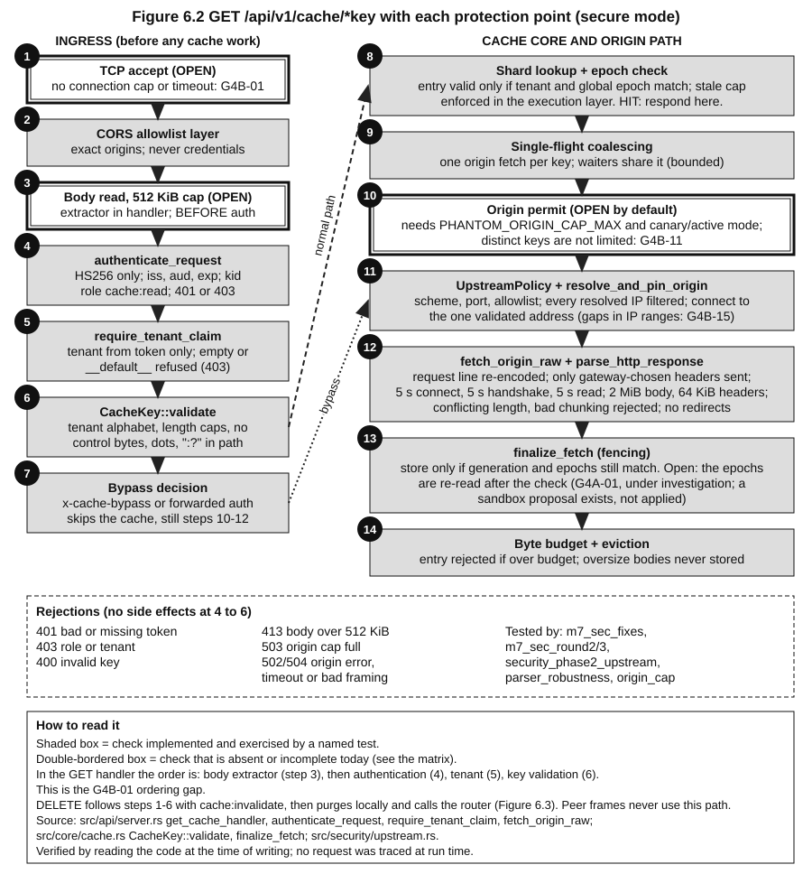

Source: `src/api/server.rs::get_cache_handler`, `authenticate_request`, `require_tenant_claim`, `fetch_origin_raw`; `src/core/cache.rs::CacheKey::validate`, `finalize_fetch`; `src/security/upstream.rs`.

**Key validation** (`CacheKey::validate`, **IMPLEMENTED**, **TESTED** by `m7_sec_round2_tests::h1_*`, `parser_robustness_tests::test_ingress_*_boundary_validation`, `canonical_key_roundtrip_tests`). A cache key is `tenant:path` or `tenant:path:?query`. The checks: tenant id 1 to 128 bytes of `[A-Za-z0-9._-]` (so it can never contain the separator colon); path at most 2,048 bytes; query at most 4,096; the whole canonical string at most 4,096 (the cluster frame limit); no byte at or below 0x20 or 0x7f anywhere (stops header injection through percent-decoded `%0d%0a`); no `.` or `..` segments (so `/a/../b` cannot alias another key); no `:?` inside a path (so two different keys cannot produce one canonical string). On top of that the upstream request line is re-encoded by `encode_origin_target`, a second layer.

**Origin response parsing** (`parse_http_response`): conflicting `Content-Length`, `Content-Length` with chunked, unsupported transfer encodings, bad or overflowing chunk sizes, truncated bodies and close-delimited bodies are all rejected or not cached; headers over 64 KiB and bodies over 2 MiB are rejected (`MAX_HEADER_BYTES`, `MAX_BODY_BYTES`); redirects are not followed. Tests: `parser_robustness_tests` (including two proptest cases that feed arbitrary bytes and assert no panic), `security_phase2_upstream_tests`.

**Timeouts toward the origin** (`fetch_origin_raw`): 5 s to connect, 5 s for the TLS handshake, 5 s to read the response; the read is wrapped in `take(MAX_TOTAL_RESPONSE_BYTES + 1)` so a hostile origin cannot stream forever.

**Body limits toward the gateway.** `create_app_with_lab` applies `DefaultBodyLimit::max(512 * 1024)` to the whole router; `test_m1_t26_ingress_request_body_limit` sends a 600 KiB body and expects 413. That proves the size cap, not time: the test sends at full speed. A client that promises 500 KiB and trickles bytes holds a connection and a buffer, and there is no body-read timeout, no `ConcurrencyLimitLayer` and no connection cap in `server.rs`. `get_cache_handler` and `delete_cache_handler` take `_body: axum::body::Bytes` and `control_handler` takes `Json(payload)`, so the extractor reads the body *before* the handler authenticates (verified in code in the current tree). This is **G4B-01**, High, owner-named, OPEN. The G4B reviewer did not reproduce it at run time and did not verify hyper's and axum's own defaults at the pinned versions, so the ordering is **verified in code** and the slow-body exhaustion is **UNVERIFIED** as a measured effect. The Lab API shows the intended pattern: `runs_start` authenticates first, then reads the body inside `tokio::time::timeout(BODY_READ_TIMEOUT, to_bytes(body, MAX_BODY_BYTES))` (5 s, 16 KiB).

::: caution
**Operational mitigation, not a code fix.** Running the gateway behind a reverse proxy that enforces request timeouts and connection limits would blunt G4B-01 in practice. The register records "authenticate before body extraction, add timeouts and limits, or document a mandatory fronting proxy" as the owner's choice. Nothing in the repository today requires or documents such a proxy.
:::

**Connection management.** Inbound HTTP: whatever hyper and axum defaults give, no explicit limits. Outbound origin: one fresh TCP (and TLS) connection per origin request with `Connection: close`; no origin connection pool. Cluster: a pool per node (`pool.rs`: at most 8 total and 4 idle connections per destination, 30 s idle timeout, 5 s heartbeat), with capacity reserved atomically (`test_p3c_sec01_concurrency_capacity_cap_and_no_leak`). Invalidations from all tenants share those 8 connections, so a tenant that floods DELETEs can saturate the local pool and others see 503 `PrimaryRateLimited` (G4B-11 part, OPEN).

::: caution
**Misleading status name.** `InvalidationStatus::RejectedRateLimit` (sent to clients as `PrimaryRateLimited`) is not a rate limiter. `router.rs` returns it when the *local* connection pool stays saturated for half the leg budget: it is backpressure on a shared resource, and it deliberately does not mark the peer Suspect. There is no rate limiting anywhere in the product (G4B-11); do not read the name as evidence that there is.
:::

::: judge
**JUDGE MAY ASK**

Question: What happens if someone sends a malicious request: a huge body, a slow body, a crafted path?

**Suggested answer** (about 30 to 60 seconds spoken, plain English):

Crafted paths and keys are handled well: the key is validated against a strict alphabet and length limits, control characters and dot-segments are rejected with 400, and the path is re-encoded before it goes upstream, so header injection and path traversal into another tenant's key space are blocked. There are tests for those. A huge body is capped at 512 KiB and gets 413. A slow body is the weakness: there is no read timeout or connection cap on the main API, and the body is read before authentication. That is finding G4B-01, the one High-severity security finding, still open and owner-named. The fix is known and already done in our Lab API; it has not been applied to the main API, and I would not call the main API hardened against slow-client exhaustion.

**If the judge asks further:**

Ask what you would do first. Move authentication ahead of body extraction by taking the raw request in the handler, add a body-read timeout and a connection limit, and add the two regression tests the reviewer proposed (stalled sockets must not block a legitimate request; an unauthenticated `POST /api/control` with invalid JSON must return 401, not 400). Say the fix needs the owner's decision because `server.rs` changes are application-code changes.

**Evidence to know:** `src/api/server.rs::create_app_with_lab` (`DefaultBodyLimit`), `get_cache_handler` signature, `src/api/lab_api.rs::runs_start`; tests `m1_http_tests::test_m1_t26_ingress_request_body_limit`, `m7_sec_round2_tests::h1_illegal_bytes_in_path_are_400_and_origin_receives_nothing`; G4B-01 (OPEN, owner-named). Status: key validation TESTED; slow-body protection absent.
:::

## 6.6 Tenant isolation and cache poisoning

**Simple version.** Tenant isolation means customer A never sees customer B's cached answer. Cache poisoning means an attacker makes the cache store a wrong answer that other users then receive.

**How isolation works.** The tenant is the first part of the key (`CacheKey::new` uses `__default__` when no tenant is given). In secure mode the tenant comes only from the verified token; a client's `x-tenant-id` header is ignored and is not forwarded (`get_cache_handler`: `else if state.security.is_some() { None }`). In development mode (no secret) the header is trusted, because there is no identity to compare it with. Tenant ids exclude `:`, so the first colon is always the separator, which prevents one tenant string from impersonating another's key prefix. Epochs (Chapter 4) make `invalidate_tenant` affect only that tenant's entries.

**The `__default__` question (G4A-19 versus the G4B refutation).** G4A-19 says a token with tenant `__default__` would share the tenant-less key space; G4B's refuted-hypothesis list says `require_tenant_claim` refuses that value. Reading the current code, both are right for different paths. In secure mode `require_tenant_claim` returns 403 `ReservedTenant` for `__default__` and 403 `MissingTenant` for an empty or absent claim, on GET and DELETE (`m7_sec_round2_tests::m1_tenantless_and_reserved_tenant_tokens_are_403_for_cache_read_and_invalidate`). But `CacheKey::validate` accepts the literal `__default__`, so in *development* mode `x-tenant-id: __default__` addresses the tenant-less space, and a peer invalidation frame can name it. G4A-19 stays OPEN because the proposed fix is to reject the literal in `validate()`. Net: **TESTED** in the secure HTTP path; **not closed** elsewhere.

**What tests prove and do not prove.** `security_phase1_tests::test_phase1_at05_and_at06_tenant_cryptographic_isolation`, `m7_sec_fixes_tests::sec01_tenant_boundary_and_anonymous_cannot_read_authenticated_entries`, `m7_sec_round2_tests::e2e_m2_tenant_isolation_and_denials_on_the_cached_path` and `m7_security_review_tests::m7_secure_mode_ignores_spoofed_tenant_header` prove isolation on the tested HTTP paths with a mock origin. They do not prove isolation for the diagnostics endpoints (events are not tenant-scoped; any Observer sees them), for the cluster path (a member can address any tenant), or under resource pressure from another tenant (there are no per-tenant quotas; the byte budget is shared; G4B-11, G4A-23).

**Poisoning paths we looked for, and what stops each:**

| Poisoning idea | Protection | Evidence |
|---|---|---|
| A client header changes the origin's answer and the variant is stored for everyone | Only gateway-chosen headers go upstream: a validated `x-request-id`, the key's tenant, optional `Authorization` when `PHANTOM_FORWARD_UPSTREAM_AUTH`, stored validators. Client `x-*`, `Accept`, `Cookie` never forwarded. Contract: origins must not vary on client headers. | `fetch_origin_raw`; `m7_sec_round3_tests::m1_client_x_headers_accept_and_cookie_never_reach_the_origin_and_users_share_one_variant` |
| An authenticated personalised answer is stored and served to others | With forwarding on, authenticated reads are BYPASS-AUTH. With forwarding off (default), an answer is stored only if the origin marks it shareable (public / s-maxage / must-revalidate). | `m7_sec_round2_tests::e2e_m2_*`; `security_phase1_tests::test_phase1_at08_*` |
| `Set-Cookie` from the origin replayed to another user | Not stored or replayed (only content type and ETag are kept) | `m1_set_cookie_from_the_origin_is_not_replayed_on_a_hit` |
| A path like `/a/../b` aliases a victim's key | `.`/`..` segments rejected | `l1_dot_segments_over_http_are_400_and_never_reach_the_origin` |
| A truncated or ambiguous origin response is stored | Not cached | `security_phase2_upstream_tests::test_p2_truncated_response_not_cached` and siblings |
| A race stores a pre-invalidation body | Generation fencing; one known hole | 6.9 (G4A-01) |
| A peer writes into the shared cache (DR-029) | See below | `known_gaps::pin_kg6_node_get_request_fabricates_missing_key_body` |

**DR-029 in plain terms.** The cluster `GetRequest` handler (`node.rs`) answers from the node's serving cache. On a miss it does not report "not found": it builds a body `val_node_<id>`, completes the fetch as a success and so *stores* that fabricated 200 response (TTL 60 s) under tenant `__default__`. In the mTLS cluster path that cache is the HTTP serving cache (`main.rs` builds the local node with `new_with_cache`). The DR-029 investigation (AI, MEASURED on a debug loopback harness) found HTTP clients cannot reach those entries, because the handler refuses keys starting with `/` and every HTTP key starts with `/` (`m2_cluster_get_request_keys_in_the_http_namespace_or_invalid_are_rejected`). Residual issues: fabricated data in a production cache (against the project's no-fabricated-data rule); a member can fill the byte budget and evict real entries (20 of 20 unvisited HTTP entries were evicted in a small test cache); no per-peer quota. No gateway code ever sends a `GetRequest`; only tests do. Status: **IMPLEMENTED** (the stub), **TESTED** (the pin test asserts the fabricated behaviour: a characterisation, not approval); DR-029 / G4B-30 OPEN pending an owner decision and independent review.

::: judge
**JUDGE MAY ASK**

Question: How is tenant isolation enforced, and could one tenant ever see another's data?

**Suggested answer** (about 30 to 60 seconds spoken, plain English):

The tenant is part of every cache key, and in secure mode it comes only from the signed token, never from a header. Tenant names are restricted so one cannot spoof another's prefix, and an invalidation bumps a per-tenant epoch so it only affects that tenant. Tests cover tenant-claim handling, spoofed headers, and a tenant reading another's entry. The limits: isolation is logical, inside one process and one shared byte budget; there are no per-tenant quotas, so a heavy tenant can evict others. A cluster member can address any tenant in an invalidation. And the literal tenant name `__default__` is refused in secure mode but the key validator still accepts it, which is why G4A-19 is not closed.

**If the judge asks further:**

Ask about cache poisoning. Explain the header whitelist: the only inputs that influence what the origin returns are the path, the query and the tenant, all part of the key, so a client cannot choose a variant that other users get. The contract is that origins must not vary responses on other client data.

**Evidence to know:** `src/core/cache.rs::CacheKey::new`, `validate`; `src/api/server.rs::require_tenant_claim`; tests named above; G4A-19, G4B-05, G4B-11, G4B-30 / DR-029. Status: TESTED on HTTP paths; quotas DESIGNED BUT NOT IMPLEMENTED.
:::

## 6.7 Data exposure and token handling

**What leaks, and where.**

- *Errors.* 401 bodies are generic and do not echo the `kid` or parser detail (`m7_sec_round2_tests::low_401_body_is_generic_and_does_not_echo_kid_or_parser_detail`). The `X-Auth-Error` header does name a class (`ExpiredToken`, `InvalidAudience`, ...), which helps a legitimate client and also tells an attacker which check failed.
- *Diagnostics.* Observers can read diagnostic events that may contain internal error text such as IPs and OS error strings (G4B-21, OPEN). They are not tenant-scoped.
- *Origin headers on the bypass path.* Response headers from the origin are copied except hop-by-hop/framing ones; no `nosniff` is added to cached responses (G4B-16, OPEN).
- *Secrets.* `PHANTOM_JWT_SECRET` is read once; the effective-config report, `Debug` and config errors redact it (test `secrets_never_appear_in_report_debug_errors_or_warnings`). The M7 review did not test logs, SSE or error pages for the secret, and the secret remains in the process environment. The Lab refuses to start if the sealed-seed salt variable is present in its environment (`refuse_if_sealed_salt_present`). Lab artifacts may include absolute paths and command lines (F17, OPEN).
- *Ingress TLS* is not restricted to 1.3 although a startup message says "TLS 1.3" (G4B-20, OPEN): `TlsServerConfig::from_pem_file` uses the library defaults. The *cluster* TLS is TLS 1.3 only and is tested (`test_p3_sec04_strict_tls13_rejection_of_tls12_client`).

**Token handling.** Tokens travel only in the `Authorization` header (the Lab API refuses tokens in URLs by design). The UI keeps the token in memory (a React ref) and never writes it to storage. `ui/src/lib/labToken.js` only decodes the `roles` claim for a display hint; its header says the page never verifies, stores or logs a token. `localStorage` is used for the theme (`ui/src/lib/theme.js`), a navigation fold state (`components/Shell.jsx`) and the saved gateway address, a URL and nothing else (`ui/src/lib/gatewayConfig.js`); a grep of `ui/src` found no other storage use. A raw token without the `Bearer ` prefix is accepted by the gateway (G4B-14).

## 6.8 Resource exhaustion, origin overload and SSRF

**Simple version.** Denial of service does not need a break-in; it needs a way to make you spend more than the attacker spends. The question for each resource is "what is the bound, and who sets it?"

**Bounds that exist** (**IMPLEMENTED**; most **TESTED**):

| Resource | Bound | Where |
|---|---|---|
| Cache bytes | logical byte budget, default 256 MiB (`PHANTOM_MAX_CACHE_BYTES`); oversize bodies never stored; invariants checked by `audit_bytes` | `core/cache.rs`, `config.rs`; `byte_accounting_tests`, `memory_bound_soak_tests` |
| Waiters per key | 1,000 (`max_waiters_per_key`) then 503 | `core/cache.rs` |
| Tenant epoch map | 10,000 entries then global-epoch fallback | `MAX_TENANT_EPOCHS`; `security_phase4a_invalidation_tests::test_p4a_sec01_*` |
| Origin response | 64 KiB headers, 2 MiB body, 5 s phases | `server.rs` |
| Ingress body | 512 KiB | `DefaultBodyLimit` |
| Cluster frame | 1 MiB payload, 4,096-byte key | `dist/frame.rs` |
| Cluster handshakes | 64 concurrent, 1 s each | `node.rs` |
| Per-peer delivery | 1 in-flight, queue 256; overflow goes to the repair ledger | `router.rs` (`PER_PEER_INFLIGHT`, `PER_PEER_QUEUE`) |
| Repair ledger | 1,024 entries and 256 KiB of key bytes per peer, 16 tenant flushes, then collapse to a bigger flush | `router.rs` (`REPAIR_*`); `cluster_prewarm_repair_tests::test_ledger_overflow_*` |
| Replay ring | 4,096 entries / 4 MiB | `anti_entropy.rs` |
| Lab API | 16 SSE streams, 16 KiB bodies, 64 MiB artifacts, caps on seeds/cells/reps | `lab_api.rs` |

**Bounds that do not exist** (each an open finding; none is covered by a test because the behaviour is absent):

- Number of inbound HTTP connections, and time to send a body (G4B-01).
- Number of `/api/events` streams (G4B-02).
- Origin concurrency **by default**. The origin permit gate is present only when `PHANTOM_ORIGIN_CAP_MAX` is set *and* `PHANTOM_INTELLIGENCE` is `canary` or `active` (`config.rs` key text; `origin_cap_tests::off_mode_is_uncapped`). Coalescing limits *one key* to one fetch; distinct keys are not limited. A token holder can send many distinct cache-busting query strings, or `x-cache-bypass: true` (which needs only `cache:read`), and each reaches the origin (G4B-11, OPEN). The bypass header is never forwarded to the origin.
- Per-tenant request or invalidation rate (G4B-11, SEC-M7-11).
- Cluster sessions per peer (G4B-36), anti-entropy responder work (G4B-22), repair-ledger CPU under adversarial key patterns (G4B-37).
- The epoch-map clone per tenant invalidation, quadratic-looking under a peer flood (G4B-05/G4A-12).
- Process-wide panic containment: handlers use `lock().unwrap()` on shared mutexes (for example in `control_handler`), so a poisoned lock panics the request task (G4B-28/G4A-21, OPEN).

**Origin overload protection that does exist.** When the cap *is* configured, the gate is a counter of permits: a request that cannot get a permit is served stale if eligible, otherwise 503 (`origin_cap_tests::saturation_serves_stale_if_eligible_else_503`); permits are released on error, timeout, client disconnect and future cancellation. The cap value can adapt by AIMD, but Chapter 5 explains why the evidence says it behaved like a fixed cap. The measured cost of a cap is in 6.13, item M5: static cap 24, peak origin concurrency down 38.3 percent (95 percent BCa CI 36.7 to 40.2) at a 4.9 percentage-point client success cost, `TRADE_OFF_FAILURE`; loopback, scripted origin, 10 paired repetitions.

**SSRF (server-side request forgery).** Simple version: if an attacker can make your server fetch a URL, they can reach things only your server can reach: cloud metadata addresses, internal admin ports, databases.

PhantomCache removes the largest share of this risk by design: the origin host is fixed by the operator in `ORIGIN_URL`, and a request can influence only path and query. The remaining protections guard against a misconfigured or rebinding origin name:

1. `UpstreamPolicy::validate_target` (**TESTED**: `m7_upstream_policy_validate_target`, `security_phase2_upstream_tests`): only http/https; no userinfo, query or fragment in the base URL; hard-blocked ports (SSH, SMTP, Redis, Memcached, databases, Docker, etcd, Consul and others); privileged ports outside 80/443 blocked; with an allowlist, the origin must match; plain http to a non-loopback host needs both `PHANTOM_ALLOW_INSECURE_UPSTREAM` and an allowlist entry.
2. `resolve_and_pin_origin`: resolve the name, run **every** returned address through `PreConnectIpFilter` (loopback, private, link-local, metadata, IPv4-mapped and transition IPv6 forms), reject the whole answer if any one is forbidden, then connect to the one validated address, so a DNS answer cannot change between check and connect. The same check runs at startup for `ORIGIN_URL` (`config.rs`).
3. Redirects are not followed; the gateway never forwards the client's `Authorization` unless configured.

Gaps: the filter misses some reserved ranges (198.18.0.0/15, 240.0.0.0/4, 192.0.0.0/24, Teredo, `fec0::/10`, an Azure wire address; G4B-15 / SEC-M7-10, OPEN); `PHANTOM_ALLOW_LAN_ORIGIN` deliberately relaxes the private-range rule; DNS rebinding beyond pinning the first answer was reviewed by reading, not by a rebinding test (M7 review).

::: judge
**JUDGE MAY ASK**

Question: How do you prevent resource exhaustion and protect the origin from overload?

**Suggested answer** (about 30 to 60 seconds spoken, plain English):

Memory is bounded by a byte budget with exact accounting, and many internal structures have fixed caps: waiters per key, the tenant epoch map, frames, repair queues, the origin response size and timeouts. Many requests for one key collapse into a single origin fetch. An optional origin concurrency cap sheds load with stale-serving or 503, and tests show permits are always released. What is missing: the cap is off by default and applies per process, not per tenant. Distinct cache-busting keys, or the bypass header, reach the origin without limit, and there is no rate limit or connection cap on the HTTP side. Those are open findings G4B-01, G4B-02 and G4B-11. I would not claim DoS resistance.

**If the judge asks further:**

Ask about the cost of the cap. We have a real loopback experiment: a static cap reduced peak origin concurrency but lowered client success because shed requests count as failures. We report that as a trade-off, not a win. Latency percentiles over all requests include fast 503s and do not show improvement for served clients.

**Evidence to know:** `src/intelligence/executor.rs` origin gate; `tests/integration/origin_cap_tests.rs`; `lab-results/scenario_b/*/summary.json` and `docs/demo/scenario_b_interpretation_notice.md`; G4B-11 (OPEN). Status: bounded memory IMPLEMENTED and TESTED; origin rate limiting DEFERRED (SEC-M7-11 queued; no code exists).
:::

::: judge
**JUDGE MAY ASK**

Question: Could a user make your gateway fetch an internal address (SSRF)?

**Suggested answer** (about 30 to 60 seconds spoken, plain English):

A user cannot choose the host: the origin is one configured URL, and users supply only a path and query, which are validated and re-encoded. If the origin name itself resolved to a private or metadata address, the gateway resolves it, checks every returned address against a block list, and connects to the exact address it checked, so DNS changing between the check and the connection cannot help. Dangerous ports like SSH, Redis and databases are blocked unconditionally, redirects are not followed, and the client's credentials are not forwarded by default. The known gap is that the block list is missing a few rarely used reserved ranges, tracked as G4B-15, and the rebinding defence was reviewed by reading plus the pinning design, not by an automated rebinding test.

**If the judge asks further:**

Ask about the LAN switch. `PHANTOM_ALLOW_LAN_ORIGIN` exists for private origins and is flagged high-risk in the config reference; network binds with an insecure upstream refuse to start without an allowlist.

**Evidence to know:** `src/security/upstream.rs::resolve_and_pin_origin`, `PreConnectIpFilter`, `UpstreamPolicy::validate_target`; tests `m7_ssrf_filter_blocks_metadata_private_and_embedded_addresses`, `test_p2_ssrf_cloud_metadata_blocked`, `test_p2_ssrf_mixed_dns_blocked`; G4B-15. Status: IMPLEMENTED, TESTED; range gaps OPEN.
:::

## 6.9 Failure recovery, lost invalidations and races

### 6.9.1 What "failure" means here

A failure model says which faults you design for. For the invalidation path, the stated model in the project documents is: packet loss, transient partitions, a slow or briefly unreachable peer, with the *issuing gateway process staying alive*. Process crash of the issuer is outside that model today. The claims ledger says so explicitly: C6 "remains qualified to single-host loopback AND to the issuer-alive failure model" (`docs/research/claims_ledger.md`, C6 qualifier).

### 6.9.2 One DELETE, step by step

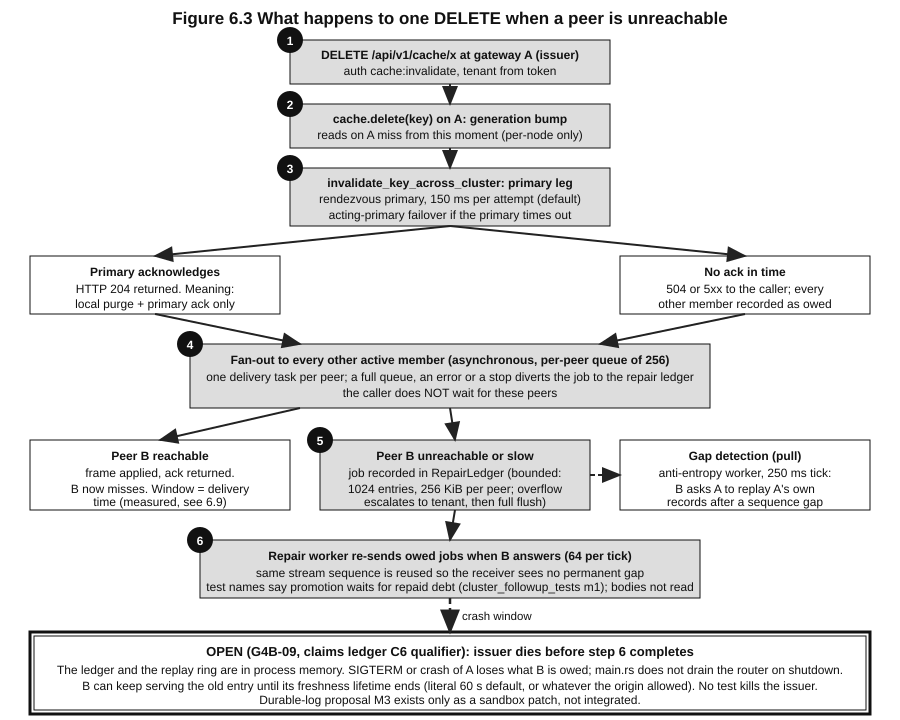

Source: `src/api/server.rs::delete_cache_handler`, `src/dist/router.rs::invalidate_key_across_cluster`, `RepairLedger`, `start_anti_entropy_worker`, `src/main.rs` shutdown path.

1. `delete_cache_handler` authenticates, builds the key and calls `cache.delete` on the *local* cache first. The code comment ("Guarantees linearizability", `server.rs`) is stronger than anything proven. What the tests support is per-node read-your-delete on the issuer: `distributed_consistency_tests::test_m3_04a_local_linearizability_immediate_eviction` does GET (MISS), GET (HIT), DELETE (204), then asserts the next read on the same gateway is a MISS with the new version.
2. `invalidate_key_across_cluster` sends the invalidation to the rendezvous primary with a 150 ms per-attempt timeout (`PHANTOM_CLUSTER_TIMEOUT_MS`). A silent primary is marked Suspect and the first replica acts as primary. (Full fan-out walk-through: Chapter 5.)
3. **HTTP 204 means "local purge plus primary or acting-primary acknowledgement".** It does not mean every peer applied it (G4B-09, OPEN; the register asks for exact wording in documentation). `x-cache-warning: PrimaryFailover` marks a failover.
4. All other active members are told *asynchronously* by per-peer workers (one in flight, queue of 256). A full queue, an error or a stopped worker diverts the job to the `RepairLedger`.
5. A repair worker re-sends owed jobs when the peer answers (64 per tick) with the *same* stream sequence number, so the receiver's contiguous-sequence tracker has no permanent gap. The anti-entropy worker (250 ms tick in `main.rs`) lets a peer notice gaps in a sender's sequence and pull a replay of that sender's own records. A recovering peer bypasses its cache for reads until reconciled (`security_phase4c_antientropy_tests::test_p4c_sec09_read_attempts_during_recovery_bypass_cache_hits`).
6. Coverage of the happy and repair paths is broad: `cluster_followup_tests` (about 40 tests), `cluster_prewarm_repair_tests`, `distributed_consistency_tests::test_h2_failed_delete_still_invalidates_all_peers_after_heal`, `security_phase4b_router_tests`, with in-process nodes and a fault-injecting TCP proxy (`tests/support/fault_proxy.rs`: delay, drop, blackhole, partitions). These are loopback, a handful of nodes, debug profile unless stated. They are not multi-host, long-running or crash tests.

### 6.9.3 The lost-invalidation case

The `RepairLedger` and the replay ring live in the issuing process's memory. The shutdown path in `src/main.rs` stops the ingress listener and exits ("cache is in-memory, nothing to flush"); it does not drain the router. If the issuer crashes, or receives SIGTERM, while a peer is owed an invalidation, that debt disappears. The peer keeps its old entry until it expires on its own. How long that is depends on the origin: the literal 60 s default applies only when the origin sends no freshness information (`PHANTOM_DEFAULT_TTL_MS` is **not wired**; `server.rs` passes a literal `60_000`), and an origin `max-age` or `s-maxage` has no gateway ceiling. `PHANTOM_MAX_STALE_MS` caps only the stale window beyond freshness. So the old claim "staleness is bounded by 60 s" is not a general bound. **No test kills the issuer** (searched: no test or doc names such a test). The M3 durable-log design (`docs/research/m3_durability/`, env-gated log, shutdown drain) was prototyped and passed its own sandbox tests; it is **PROTOTYPE ONLY**, not integrated, and needs owner approval and an independent review.

::: example
**Worked example.** Origin sets `max-age=300` for `/price/42`. Gateways A, B, C all hold it. A client DELETEs it at A. A purges locally and gets the primary's ack (B is primary). C is unreachable, so A records "C is owed `acme:/price/42`" in memory. One second later A is killed. C never hears. C serves the old price until `max-age=300` elapses, up to 300 s, because nothing remembers that C was owed. If A had stayed alive, the repair worker would have delivered the frame as soon as C answered.
:::

**Measured propagation delay.** The claims ledger (C6 amendment, 2026-10-30) records `cluster_propagation_latency_tests` on loopback (one host, Windows 11, 24 logical CPUs, **debug profile**, three gateway processes with mTLS): warm path P50 about 0.3 ms, P99 about 10 to 14 ms, max 15 to 21 ms in four runs of 200 trials by 2 peers; N=1000: P99 19.8 ms, max 49.2 ms; the first invalidation to a destination (cold connection plus mTLS handshake) 35 to 60 ms, up to 117 ms under concurrent copies. The earlier "P(stale)=0 after 50 ms" came from a fixed sleep and is **not supported**. These numbers are **reported** from the ledger, not re-run here; the CSV logs are under `D:\Temp` and not retained in the repository (UNVERIFIED). A connection pre-warm worker was added since (`start_prewarm_worker`, `test_prewarm_*`); its effect on the cold-start number is not recorded as measured.

### 6.9.4 The stale-body race (G4A-01)

**Simple version.** A request starts fetching a page from the origin. While it waits, someone invalidates that page. When the fetch finishes, the cache must not store the old page. The fence compares a counter (the *generation* and the epochs) seen when the fetch began with the counter now.

**The hole.** In `finalize_fetch` (`src/core/cache.rs`) the fence compares the epochs stamped on the entry placeholder with the current ones. If they match, the code stores the resource and then calls `get_effective_epochs` a *second* time and stamps the entry with those, possibly newer, epochs. An invalidation that bumps the tenant or global epoch between the check and the second read leaves a pre-invalidation body stamped as current. The epoch bump does not take the shard mutex, so nothing orders it against that window (mechanism: Chapter 4, section 4.5). G4A-01 is High, owner-labelled **UNCONFIRMED**, disposition UNDER-INVESTIGATION. The RACE agent's sandbox work (`docs/research/g4a01_race/status.md`, AI second look) **reproduced it deterministically with an injected yield point** in a debug build (two failing tests, one passing control) and **did not reproduce it** in a 20 s three-thread unhooked stress (about 3.16 million fills, 0 violations); the window is nanoseconds wide, and absence of a hit is not evidence it is unreachable. The proposal (stamp the epochs captured by the fence check) is a sandbox patch under which all four sandbox tests pass. **It has not been applied** to `src/`; the current code still re-reads. Related: G4A-08 (a request after an invalidation can join a pre-invalidation in-flight fetch; limitation L3) and G4A-17 (the epoch pair read is not atomic against `invalidate_all`). Fencing changes need a failing-first test and an independent review (CLAUDE.md section 5).

::: judge
**JUDGE MAY ASK**

Question: What happens if an invalidation is lost or delayed? Can two nodes serve different values?

**Suggested answer** (about 30 to 60 seconds spoken, plain English):

Yes, two nodes can briefly serve different values, and I can say exactly when. After a DELETE, the issuing gateway misses immediately. The primary has acknowledged before we return 204. Other nodes are told in the background, with retries and a repair record for any peer that cannot be reached, and a pull mechanism that detects gaps. On a warm loopback cluster we measured propagation mostly in milliseconds, with a first-use cold start of tens of milliseconds, in debug builds. During that window another node can serve the old value. If a peer is down, it can stay stale until repaired. The case we do not handle: if the issuing gateway crashes before the peer is repaired, the record of what was owed is in memory only and is lost, so that peer stays stale until the entry's own expiry. A durable log is designed and prototyped but not integrated. So I claim eventual repair while the issuer stays alive, not a bounded staleness guarantee.

**If the judge asks further:**

Ask what the bound is. State the failure model (issuer alive, loopback), say the measured window is milliseconds on warm connections, and say there is no general bound if the issuer dies. The test that would falsify the issuer-alive claim is a multi-process test that blackholes a peer, sends DELETE, then kills the issuer; it does not exist.

**Evidence to know:** `src/dist/router.rs::invalidate_key_across_cluster`, `RepairLedger`; `src/main.rs` shutdown; tests `distributed_consistency_tests`, `cluster_followup_tests`, `cluster_propagation_latency_tests`; claims ledger C6 amendment and qualifier; G4B-09 (OPEN); M3 design (PROTOTYPE ONLY). Status: PARTIAL.
:::

::: judge
**JUDGE MAY ASK**

Question: Is there a race that could resurrect a deleted value?

**Suggested answer** (about 30 to 60 seconds spoken, plain English):

There is one suspected race, the first High finding in our own review, and we are treating it as under investigation rather than fixed. A fetch that started before an invalidation checks a version counter when it finishes, but reads the epoch counters a second time after the check. An invalidation that lands in that gap can let the old body be stored as current. An agent reproduced it only with an artificial pause in a sandbox copy; a short unhooked stress run found nothing. A proposed fix is written and passes its sandbox tests, but it is not in the product code and has not been independently reviewed. So I describe fencing as designed to prevent stale writes, tested for the common orderings, with one known timing hole.

**If the judge asks further:**

Ask why not just fix it. Because the project rule says fencing changes need a test that fails without the change and an independent review, and the owner asked us to investigate rather than auto-fix an unconfirmed finding.

**Evidence to know:** `src/core/cache.rs::finalize_fetch`, `get_effective_epochs`; `docs/research/g4a01_race/status.md`, `proposal.patch`; `security_phase4a_invalidation_tests::test_p4a_inflight_fetch_fencing_prevents_stale_writes` (passes today; does not exercise the gap); G4A-01 (UNDER-INVESTIGATION), G4A-08, G4A-17. Status: IMPLEMENTED with a known hole; fix PROTOTYPE ONLY.
:::

## 6.10 Memory safety and supply chain

**Memory safety.** Rust prevents use-after-free and data races in safe code; the question is how much `unsafe` there is. In `src/`, `unsafe` occurs only in `src/api/lab_api.rs`, in a `#[cfg(windows)]` module that hand-declares a few Win32 functions (job objects that kill child gateways when the Lab dies; process reaping by image path and creation time). It has five `unsafe` blocks, each with a `SAFETY:` comment, and two `extern "system"` blocks (verified by grep in the current tree). There is no `#![forbid(unsafe_code)]`. `benches/support/alloc_counter.rs` has an `unsafe impl GlobalAlloc` that wraps the system allocator to count allocations (bench-only). Dependencies (tokio, rustls, ring, aws-lc-sys) contain their own `unsafe` and C code, which we did not audit. **IMPLEMENTED**: no `unsafe` in the cache, security, cluster or HTTP code. **UNVERIFIED**: correctness of the Win32 FFI beyond reading; no Miri or sanitiser run.

**Panics and poison.** Memory safety is not the same as no crash. `std::sync::Mutex` poisons if a thread panics while holding it; the core cache recovers with `into_inner` and counts it (`lock_poison_recovered`) but telemetry mutexes and handler code call `.lock().unwrap()` (G4A-21, G4B-28, both OPEN), and there is no `CatchPanicLayer`. A panic in one handler task does not take down the process (tokio isolates tasks) but a poisoned shared mutex would make later requests that touch it panic.

**Supply chain.** `Cargo.lock` lists 288 packages (counted by `[[package]]` entries). Direct dependencies include tokio ("full" features), axum 0.7 (with the unused `ws` feature), tower-http (with unused `fs`), axum-server with `tls-rustls`, rustls 0.23, tokio-rustls, webpki-roots, jsonwebtoken 9, ring 0.17, serde and tracing; dev-only: reqwest (pulls `native-tls`/`openssl` bindings), rcgen, criterion, hdrhistogram, proptest. Two TLS crypto providers are present: `ring` (direct) and `aws-lc-rs` (rustls default). **Nobody has run `cargo audit` or `cargo deny`**; yanked or vulnerable status is **not determined** (G4C-DEP, OPEN, release gate; M7 review "Not done"). A CI workflow (`.github/workflows/ci.yml`) runs fmt, check, clippy with `-D warnings` and tests on Ubuntu, plus a frontend job; it has no advisory step. Whether CI has ever run: UNVERIFIED (the tree is uncommitted; CI triggers on pushes and pull requests to `main`).

::: judge
**JUDGE MAY ASK**

Question: Is the system memory-safe, and how do you manage third-party risk?

**Suggested answer** (about 30 to 60 seconds spoken, plain English):

The code is Rust, and our own cache, security and cluster code contains no `unsafe`. The only unsafe code in the product is a small Windows-only block of operating-system calls in the Lab, used to kill child processes cleanly; each block is commented. Third-party crates have their own unsafe code that we have not audited. For dependencies, we pin versions in `Cargo.lock` (288 packages), keep TLS in rustls rather than OpenSSL for the product path, and I can name the open gaps: nobody has run a vulnerability scan such as `cargo audit` yet, some features such as websockets and file serving are enabled but unused, and there are two crypto providers. The scan is a release gate that needs a human decision.

**If the judge asks further:**

Ask about panics. Rust stops memory corruption, not logic failure. We have findings about lock poisoning handling and no catch-panic layer, tracked as G4A-21 and G4B-28.

**Evidence to know:** `grep unsafe` result (lab_api.rs Windows module; benches alloc counter), `Cargo.toml`, `Cargo.lock`, `docs/release/g4/cycle1_lab_intelligence_deps_review.md` (G4C-DEP). Status: IMPLEMENTED; scan UNVERIFIED.
:::

## 6.11 The security and failure-scenario matrix

How to read the matrix. *Protection that exists* is only what the code does today (verified by reading the symbol). *Tests* names what exercises it; a test proves only what its assertion says. *Unresolved* gives the finding ID and its disposition in `docs/release/g4/cycle1_findings_disposition_register.md` (last reviewed 2026-10-30 15:42 IST). "OPEN*" means OPEN and owner-named in ODR-4 (must not be dismissed). Review line numbers have drifted; every row was re-checked against symbols in the current tree and none of the cited High or Medium findings is fixed. Each row is split across two tables with the same row numbers so that both fit a page.

**Table 6.11a. Threats and the protections that exist.**

| # | What could go wrong, and how | Protection that exists | Where (file::symbol) |
|---|---|---|---|
| S01 | Anonymous caller reads or deletes cache data: Request without a token | Fail-closed startup; with a secret, 401/403 before any cache or origin work | `security/mod.rs::validate_startup_security`; `server.rs::get_cache_handler`, `delete_cache_handler`, `authenticate_request` |
| S02 | Forged or tampered token: alg=none, wrong alg, bad signature, wrong iss/aud, expired, unknown kid | HS256 only; library verification plus explicit iss/aud re-check; unknown kid rejected | `jwt.rs::JwtValidator::validate` |
| S03 | Stolen or leaked token reused: Token valid until `exp`; no `nbf`, `jti`, max lifetime or revocation | Short leeway only (10 s) | `jwt.rs` |
| S04 | Privilege confusion by role alias: `requester` grants read and invalidate; bare token without `Bearer`; case-insensitive | Documented, pinned by a characterisation test | `jwt.rs::has_role`; `authenticate_request` |
| S05 | Wrong-role caller operates the system: Observer calls DELETE, reader calls control | Per-route role check, 403 with no side effects | `authenticate_request` at each handler |
| S06 | Control endpoint breaks the live router: `POST /api/control` with NODE_FAILURE or an unknown event | Operator role in secure mode | `server.rs::control_handler`; `main.rs` nodes shared |
| S07 | Management stream exhausts the gateway or outlives revocation: Many `/api/events` connections; token expires mid-stream | Authenticated once at open | `server.rs::sse_handler` |
| S08 | DNS rebinding drives local API: Web page rebinds to 127.0.0.1 | CORS exact-origin allowlist (not a defence against non-browsers) | `server.rs::CorsConfig` |
| S09 | Unauthenticated slow or huge body: Trickled body; Content-Length 500 KiB | 512 KiB cap (413); hyper/axum defaults | `server.rs::create_app_with_lab` |
| S10 | Header or path injection to origin or into another key: `%0d%0a`, `..`, `:?`, non-ASCII | Strict `validate`; re-encoded target; only whitelisted headers sent | `cache.rs::CacheKey::validate`; `server.rs::encode_origin_target`, `fetch_origin_raw` |
| S11 | Tenant A reads tenant B: Spoofed `x-tenant-id`; tenant-less or `__default__` token | Tenant from token only; reserved/empty tenant is 403; tenant alphabet excludes `:` | `server.rs::require_tenant_claim`; `cache.rs::CacheKey::new` |
| S12 | Cache poisoning through client-controlled headers: Variant chosen by a header is stored for all | Only gateway-chosen headers go upstream; `Set-Cookie` not replayed; non-shareable authenticated answers not stored | `server.rs::fetch_origin_raw`; storage allowlist |
| S13 | Cluster peer plants data (DR-029): Authenticated member sends `GetRequest` for a missing key | Keys starting `/` or failing `validate` refused; mTLS | `node.rs::process_binary_cache_stream` (GetRequest arm) |
| S14 | Compromised member flushes tenants or all data: Tenant/FullCache frames; many tenant strings | Admission; originator equals TLS identity; epoch map capped with safe global fallback | `node.rs` InvalidateRequest arm; `cache.rs::try_invalidate_tenant` |
| S15 | Forged or replayed cluster invalidation from a stale era: Old-epoch frame accepted | Anti-entropy epoch checked; ack correlation by request id | `node.rs` AntiEntropy arm |
| S16 | Revoked or expired node stays connected: Certificate revoked or expired after handshake | Per-frame registry re-check; revocation broadcast and session cancel (in code) | `session.rs`, `pool.rs`, `security/cluster.rs::update` |
| S17 | Cluster listener exhausted: Stalled handshakes; many authenticated sessions; accept error | 64 handshake permits, 1 s timeout; frame cap 1 MiB; fail-closed drop | `node.rs::start_tcp_service`; `frame.rs::read_frame` |
| S18 | Origin overloaded by misses: Cache-busting keys; `x-cache-bypass`; flash crowd | One fetch per key (coalescing); optional concurrency cap with stale-or-503 | `server.rs::acquire_origin_permit`; `intelligence/executor.rs` |
| S19 | SSRF to internal address: Origin name resolves to private or metadata IP | Port and scheme policy; every resolved IP filtered; connection pinned | `upstream.rs::UpstreamPolicy::validate_target`, `resolve_and_pin_origin` |
| S20 | Malicious origin response: Conflicting lengths, bad chunking, huge body, slow body | Strict parser; 2 MiB/64 KiB caps; 5 s timeouts; truncated not cached | `server.rs::parse_http_response`, `decode_chunked_body` |
| S21 | Stale body survives an invalidation (race): Invalidation lands between fence check and epoch re-read | Generation and epoch fence | `cache.rs::finalize_fetch` |
| S22 | Invalidation delayed or lost to a down peer: Peer unreachable, queue full | Per-peer queues, repair ledger, anti-entropy pull, recovery bypass | `router.rs`; `anti_entropy.rs` |
| S23 | Invalidation lost on issuer crash: Issuer killed before repair | none (ledger and ring in memory) | `main.rs` shutdown path |
| S24 | Memory exhaustion: Many or large entries; many waiters; tenant flood | Byte budget, oversize rejection, waiter cap, tenant-map cap, ledger caps | `cache.rs`; `router.rs` |
| S25 | Hot or poisoned eviction state: S3-FIFO tombstones grow unbounded | SIEVE is the default; S3-FIFO only selectable through the executor or legacy PIE, which have no live caller (grep) | `core/eviction.rs` |
| S26 | Request amplification of invalidation work: Rejected DELETEs force ledger scans; pool saturation by one tenant | Ledger bounds; bounded pool | `router.rs::RepairLedger` |
| S27 | Secret or internal detail leaks: Config dump, error text, diagnostics | Redaction; generic 401 bodies | `config.rs`; `server.rs` |
| S28 | Weak transport on ingress: TLS 1.2 or plaintext allowed | Network bind needs TLS unless explicitly overridden (auth still required) | `security/tls.rs`; `mod.rs` |
| S29 | Process panic or poisoned lock: Panic while holding a shared mutex | Core cache recovers from poison and counts it | `cache.rs` lock helpers |
| S30 | Vulnerable dependency: Known advisory in a crate | Lockfile pins versions | `Cargo.lock` |
| S31 | Wall-clock jump extends freshness: Clock stepped backwards | none (TTL and stale cap use `SystemTime`) | `intel/diagnostics.rs::DiagnosticBuffer::now_ms` |
| S32 | Misleading statistics hide an incident: Hit rate 1.0 with no data; mixed percentile rules | Schema-2 payload labels values measured/derived/unavailable | `server.rs::build_schema_v2_payload`; `telemetry.rs` |

**Table 6.11b. The same rows: tests and what remains unresolved.**

| # | Tests that validate it | What remains unresolved (finding, disposition) |
|---|---|---|
| S01 | `m7_sec_fixes_tests::sec01_*`, `m7_http_rbac_matrix_in_secure_mode`, `security_phase1_tests::test_phase1_at03_and_at07_*` | Without a secret, loopback is fully anonymous by design; G4B-04 (no Host/Origin guard): OPEN |
| S02 | `m7_jwt_rejects_alg_none_wrong_alg_missing_exp_and_tampering`, `test_phase1_jwt_unknown_kid_rejected_without_fallback` | Shared-secret design (anyone with the secret mints Admin): architecture decision, no ID |
| S03 | none for `nbf`/lifetime/revocation (no test mentions `nbf`) | G4B-13 (SEC-M7-11): OPEN |
| S04 | `sec01_raw_token_without_bearer_prefix_is_still_accepted_characterization_sec_m7_09` | G4B-14 (SEC-M7-09): OPEN |
| S05 | `sec01_role_without_cache_read_is_403_and_causes_no_side_effects`, `test_phase1_at04_*`, `low_zero_side_effects_include_telemetry_and_diagnostics` | none cited |
| S06 | role matrix only | G4B-03: OPEN*; G4B-19 log injection: OPEN |
| S07 | `low_events_stream_is_observer_gated` (auth only) | G4B-02: OPEN (no cap, no expiry close); Lab API has both |
| S08 | `sec03_*` | G4B-04: OPEN |
| S09 | `test_m1_t26_ingress_request_body_limit` (size only) | G4B-01: OPEN*; High; runtime effect UNVERIFIED |
| S10 | `h1_*`, `l1_*`, `m1_client_x_headers_*` (round 2/3), `parser_robustness_tests` | G4B-24: DELETE is exact-key (aliases like `/x?`, `//x`): OPEN |
| S11 | `m7_secure_mode_ignores_spoofed_tenant_header`, `m1_tenantless_and_reserved_tenant_tokens_are_403_*`, `test_phase1_at05_and_at06_*` | G4A-19: OPEN (validator accepts the literal); no per-tenant quota (G4A-23 Info; G4B-11) |
| S12 | `m1_client_x_headers_*`, `m1_set_cookie_*`, `e2e_m2_*` | G4A-09 (secure default: personalised answers not cached unless marked shareable): OPEN; G4A-07 (cached 301 loses `Location`): OPEN |
| S13 | `m2_cluster_get_request_keys_*`, `known_gaps::pin_kg6_*` (pins the stub) | G4B-30 / DR-029: OPEN, owner decision pending; resource use and eviction by a member |
| S14 | `test_p4a_sec01_*`, `test_l3_invalidate_request_originator_must_match_tls_identity` | G4B-05 / DR-027: OPEN*; G4A-12: OPEN; needs protected-core change |
| S15 | `test_p4c_sec02_mismatched_epoch_rejected`, `test_p4b_mismatched_request_id_ack_discarded` | G4B-06: OPEN* (InvalidateRequest epoch not checked; ack epoch check vacuous) |
| S16 | `test_p3_at06_*`, `test_p3c_sec03_*`, `test_p3c_per_request_revocation_on_reused_connection` | G4B-07: OPEN* (no production trigger); G4B-08: OPEN* (no connection age or NotAfter check) |
| S17 | `test_p3_at10_tls_handshake_timeout`, `test_p3b_at11_oversized_payload_rejected_before_alloc` | G4B-10, G4B-36, G4B-22: OPEN |
| S18 | `origin_cap_tests::*`, `coalesce_tradeoffs_tests` | G4B-11: OPEN (cap off by default; no per-tenant limit) |
| S19 | `m7_ssrf_filter_*`, `test_p2_ssrf_*` | G4B-15 (SEC-M7-10): OPEN (range gaps) |
| S20 | `parser_robustness_tests` (with proptest), `security_phase2_upstream_tests` | G4B-35: odd 1xx statuses reach the client (PLAUSIBLE, Info): OPEN |
| S21 | `test_p4a_inflight_fetch_fencing_prevents_stale_writes` (does not hit the gap) | G4A-01: UNDER-INVESTIGATION (High); sandbox fix not applied; G4A-08, G4A-17: OPEN |
| S22 | `cluster_followup_tests`, `distributed_consistency_tests`, `cluster_prewarm_repair_tests` | G4B-09, G4B-12 (heartbeat does not drive state): OPEN |
| S23 | none | G4B-09: OPEN; M3 durable log PROTOTYPE ONLY |
| S24 | `byte_accounting_tests`, `memory_bound_soak_tests`, `test_p4a_sec01_over_10k_tenants_*` | G4A-23 (accounting omits metadata; pinned keys): OPEN; G4A-13 byte drift in a panic path: OPEN |
| S25 | `eviction_contract_tests` | G4A-02: OPEN (High, conditional) |
| S26 | `test_ledger_overflow_*`, `test_m6_one_tenants_overflow_does_not_flush_other_tenants_on_peer` | G4B-37, G4B-11: OPEN |
| S27 | `secrets_never_appear_in_report_debug_errors_or_warnings`, `low_401_body_is_generic_*` | G4B-21, G4B-16: OPEN; log/SSE channels not scanned for secrets |
| S28 | `test_phase1_at01_*`, `test_phase1_at09_startup_security_fail_closed_rules` | G4B-20: OPEN (not 1.3-only); G4B-17: OPEN |
| S29 | `lock_poison_recovered` counter paths | G4A-21, G4B-28: OPEN |
| S30 | none (no scan run) | G4C-DEP: OPEN; G4B-34 (broad features): OPEN |
| S31 | none | G4A-10: OPEN (PLAUSIBLE) |
| S32 | `telemetry_honesty_tests`, `telemetry_truth_tests` | G4A-11, G4A-24, F24: OPEN |

Rows S06, S09, S14, S15, S16 together are the owner-named set (ODR-4). The register lists no Critical finding and four High: G4A-01, G4A-02, G4B-01, and F01 (Lab verdicts, in sandbox remediation).

## 6.12 Evaluating performance correctly

**Simple version.** A performance number is only meaningful with its context: what ran, on what, under what load, how many times, and compared with what. "10 million operations per second" with no context is a slogan.

### 6.12.1 The vocabulary

- *Latency*: time for one request, start to finish; always a distribution. *Throughput*: completed requests per second.
- *Percentile* (P50, P95, P99): the value below which that share of requests fall. P99 = the slowest 1 percent starts here. Tail percentiles need many samples: with 100 samples P99 is one observation.
- *Hit rate* (hit ratio): hits divided by lookups. *Origin request reduction*: how much fewer requests reach the origin than without the cache. These differ: coalescing and stale serving change origin load without changing the hit ratio the same way.
- *Open-loop versus closed-loop load*: a closed-loop client sends the next request only after the previous finishes, so when the system slows, the client slows too and hides the queue (this is *coordinated omission*). An open-loop client sends on a schedule regardless.
- *Contention*: threads waiting for the same lock; throughput that stops scaling with threads and a growing tail are its signs. *Warm-up*, *repetition*, *confidence interval (CI)*: discard start-up effects, repeat in separate processes, report a range, not a point.

### 6.12.2 How percentiles are computed in each place (G4A-24, F24)

The repository computes percentiles at least five ways, and they give slightly different answers on the same data. Comparing one place's P99 with another's is invalid unless you know both rules. This chapter owns the detail.

| Place | Rule | Source |
|---|---|---|
| Live gateway `latency_ms` (schema-2 metrics and `/api/events`) | `TelemetryCollector::calculate_percentiles_us`: take the ring `raw_buffer_us` (capacity `TelemetryCollector::new(10000)` in `main.rs`), which holds the last up-to-10,000 observations of kind GET *and* DELETE; keep the GET ones; sort; index `floor(n * q)` clamped to `n-1` (the median uses `(n*0.5) as usize % n`). An empty window returns `(0,0,0,0)`, not "unavailable" | `intel/telemetry.rs::TelemetryCollector::calculate_percentiles_us`, called from `server.rs` |
| Log-linear histogram (2,688 buckets) | cumulative count, target rank `ceil(total * q)`, resolved to a bucket; documented error at most 0.39 percent. **No production reader:** `TelemetryCollector::record` and `record_us` feed it, but `calculate_percentiles_histogram_*` and `histogram()` have no caller outside tests (grep of `src/`; `server.rs` calls only the ring version), so its percentiles are never served | `telemetry.rs::AtomicLogLinearHistogram::calculate_percentiles_us` |
| Scenario B and Lab loadgen | nearest-rank, `ceil(q * n)`, `None` for empty | `lab_live/loadgen.rs::percentile` |
| T1 simulator | nearest-rank `ceil` | `lab/t1_sim.rs::percentile` (frozen) |
| AIMD controller window | nearest-rank on a window of observations | `intelligence/executor.rs::record_observation` |
| Intelligence signals | floor index | `intelligence/signals.rs` (F23/F24) |
| Micro-benchmarks | HdrHistogram, 3 significant digits | `benches/b2_concurrency.rs`, `b8e_gateway.rs` |

So for 100 samples, `ceil(0.99 * 100)` is rank 99, the 99th smallest value, but `floor(0.99 * 100)` used as a zero-based index is index 99, the 100th (the maximum). That one-sample difference is the whole of G4A-24. For small windows the difference is the entire tail: the AIMD "p99" of a 30-sample window is the window maximum, as the Scenario B notice points out. A separate 16-bucket `OriginLatencyHistogram` (`intel/origin_metrics.rs`) serves origin latency percentiles in the metrics snapshot; it is a different structure again.

**Hit rate caveats.** `hit_ratio_cumulative` in schema 2 is `hits / (hits + misses)` since process start, labelled "derived", and reports "unavailable" with no data (`build_schema_v2_payload`). A cumulative ratio cannot show a recent collapse; use `hit_ratio_10s` or `hit_ratio_1s` for that. The older ring-based `calculate_hit_rate()` returns **1.0 when there is no data**, and different parts of the code count coalesced waiters, stale serves and background revalidations differently (G4A-11, OPEN). Always ask: what counts as a hit?

**Throughput caveat.** `throughput_req_s_*` are windowed samplers; older documents describe throughput as a cumulative counter over uptime (a known gap from the Phase 1 tests). Check which field you are quoting.

### 6.12.3 Benchmark fairness and baselines

A fair comparison changes one thing: same release build, same host and load state, warm-up discarded, same workload and seed, enough repetitions in separate processes, arms run in the same session or order-randomised, a plausible baseline (not a straw man), and a stated limit on what the result generalises to. The repository has **no head-to-head comparison against Redis, Memcached, Varnish or any other cache**, and no end-to-end "origin without a cache" baseline on the real gateway except Scenario B's BASE arm (no cap). Internal baselines exist: static cap versus AIMD cap versus none (Scenario B); eviction policies against reference policies in `benches/support/refpolicies.rs` and in the simulator. We therefore cannot say PhantomCache is faster or better than any other product, and this handbook never does.

::: judge
**JUDGE MAY ASK**

Question: How did you measure performance, and why should I trust the numbers?

**Suggested answer** (about 30 to 60 seconds spoken, plain English):

We do not publish a performance figure as a claim. The repository does contain benchmark results with a stated host, profile and limits, and every one is listed in section 6.13. They are of two kinds, both on one Windows laptop and loopback only. First, micro-benchmarks of the cache hit path and concurrency, repeated ten times in separate processes with bootstrap confidence intervals, with large spread between sessions. Their build profile is not established: the runner scripts look for release binaries, but the benchmark directory's own README says no release-profile result is established. Second, a 30-run loopback experiment on origin protection, which used release builds. I would tell you what they do not show: no other cache was measured, no multi-host or network run exists, the benchmarks are closed-loop, and the numbers were taken on an earlier version of the code and not re-run on the current tree. None of them establishes a release-profile or comparative claim, and this book makes no superiority claim. So treat them as local, dated evidence, not as a product claim.

**If the judge asks further:**

Be ready to explain the spread: the same benchmark repeated in four sessions the same day gave gateway throughput results whose confidence intervals did not overlap (the sessions are listed in 6.13), so the within-session interval understates machine variation. That is why we do not quote a single figure.

**Evidence to know:** `bench-results/r0_summary.json`, `bench-results/manifests/*.json`, `benches/*.rs`; `docs/research/claims_ledger.md`; this chapter 6.13. Status: MEASURED (local, dated), not INDEPENDENTLY VERIFIED.
:::

::: judge
**JUDGE MAY ASK**

Question: Is your benchmark fair? Could you be fooling yourselves?

**Suggested answer** (about 30 to 60 seconds spoken, plain English):

For the micro-benchmarks, the fairness question is about what we compare: they measure one implementation against itself (hit path, component costs, with and without telemetry), not against a competitor, so the main risks are noise and coordinated omission. We controlled noise with repetitions and recorded the limits, including a hybrid-core laptop and a Windows scheduler. For the origin-cap experiment we did have an independent fairness review, and it found real problems that we published in a notice: the adaptive arm collapsed to a fixed cap near the minimum, the arms differ by more than the cap because the capped arms run in canary mode, success-only latency must be reported separately, the cap values were chosen after one pilot run, and the origin has no load-dependent slowdown. So I say: informative about mechanics, not evidence that the adaptive controller works.

**If the judge asks further:**

Ask about coordinated omission. The micro-benchmark and gateway load are closed-loop, and the project's own limitation text says so. Scenario B's load generator is open-loop: latency is measured from the scheduled send time.

**Evidence to know:** `docs/demo/scenario_b_interpretation_notice.md`; `lab-results/scenario_b/20261030T003932Z/summary.json`; `bench-results/r0_summary.json` `limitations_verbatim`. Status: MEASURED_LOOPBACK, with recorded qualifications.
:::

## 6.13 Every real measurement in the repository

We searched `benches/`, `bench-results/`, `lab-results/`, `docs/testing/` and the claims ledger. The table lists what exists, with the conditions required by the project's evidence rules. Anything not in the table is not a measurement we can quote. Keep the tiers apart: T1 is **simulated**, loopback is **MEASURED_LOOPBACK**, and nothing here is multi-host or WAN.

**M1. Micro-benchmarks R0 (2026-10-28) and passes R-A, R-B, R-C** (`bench-results/r0_summary.json`, `manifests/r0_baseline_manifest.json`, `ra_`, `rb_`, `rc_manifest.json`).

- *Measured:* B1 hit path and component costs; B2 concurrency throughput and latency; B6 telemetry; B8e gateway loopback GET.
- *Profile and host:* build profile **UNVERIFIED**. The runner scripts (`bench-results/tools/*_runner.py`) look for binaries in `target/release/deps`, but the manifests carry no profile field and `bench-results/README.md` states that no release-profile benchmark result is established by that directory. Windows 11 x86_64, hybrid-core laptop, Balanced power plan, affinity mask for P-cores 0 to 15, rustc 1.98.0; tree at `456bb25` with a dirty flag, **not the current tree**.
- *Workload and seed:* B1: 4 KiB body, 64-byte key, tenants 1 and 1,000. B2: 100,000-key universe, Zipf alpha 0.8 from a fixed xorshift state, 2 s warm-up, 5 s windows, threads 1, 8, 16. B8e: cached key, 16 concurrent clients, in-process mock origin, 2 s warm-up. Bootstrap CI seed 42.
- *Repetitions:* 10 process-level repetitions per benchmark; the CI is a bootstrap 95 percent interval of the medians.
- *Supports (re-read from `r0_summary.json` for this chapter):* hit 110.4 ns (CI 107.6 to 112.8) with 1 tenant and 118.5 ns with 1,000; epoch lookup 9.7 ns and 18.2 ns; fill about 1,037 ns. B2: 1 thread 2.5 M ops/s; 8 threads 10.2 M (1 tenant) but 5.0 M (1,000 tenants); 16 threads 8.1 M and 4.4 M. B8e: about 75.9 k req/s telemetry off and 74.2 k on (overlapping CIs), P50 about 201 to 206 microseconds. Evidence of order of magnitude, and that more tenants cost throughput under contention.
- *Does not support:* per-operation latency uses a timer around each call, so P50 values of 200 ns and 400 ns sit at a few timer ticks (inference: Windows timer resolution). B8e telemetry-off throughput differs between passes (75.9 k R0, 77.6 k R-A, 60.9 k R-B, 79.2 k R-C), and the R0 and R-B intervals do not overlap, so session-to-session spread exceeds within-session CIs. Closed-loop. No comparison with any other cache. Hit-path numbers are library calls, not HTTP. Not re-run on the current tree. Do not quote as release-profile product performance.

**M2. B3 coalescing, B4 eviction pressure, B7 memory and allocation** (same runner, `noncore_results`). Coalescing with N waiters and a 10 ms simulated origin; eviction latency for SIEVE, LRU and S3-FIFO as implemented (Zipf 0.8 and churn); allocation counts. Same profile and host as M1, 10 repetitions. Supports: B7 allocation counts agreed exactly across repetitions (14.0088 allocations per fill in every repetition: a determinism check); B3 asserts one origin call. Does not support: the values were not tabulated here, so read the raw arrays before quoting; B4 measures eviction implementations that the G4A review rates as scans or partly incorrect (S3-FIFO: G4A-02).

**M3. `bench-results/cluster/characterization_report.json`.** Phase 3 characterisation of distributed gaps (cited by ADR-003). Profile, host, workload and repetitions: not checked. A historical record of the gaps only. **UNVERIFIED**: not opened in detail for this chapter.

**M4. Claims ledger C6 amendment** (from `cluster_propagation_latency_tests`). Invalidation propagation latency between gateways: **debug** profile; loopback; Windows 11, 24 logical CPUs; 3 processes with mTLS; per-trial distinct key, warm then DELETE; 4 runs of 200 trials by 2 peers plus one run of 1,000. Supports: warm P50 about 0.3 ms, P99 about 10 to 20 ms; cold first use 35 to 117 ms; refutes "P(stale)=0 at 50 ms". Does not support: release profile or multi-host claims; raw CSVs are not retained in the repo; no loss was injected in those trials.

**M5. Scenario B** (`lab-results/scenario_b/20261030T003932Z/`: `summary.json`, `manifest.json`, `runs/`). Origin slowdown, three arms: BASE, STATIC-CAP 24, AIMD-CAP 12 to 32.

- *Profile and host:* release driver and gateway; one Windows host, 24 logical CPUs; tier MEASURED_LOOPBACK, label VALID (the notice says "release" was judged by a path heuristic).
- *Workload and seed:* Poisson arrivals, 300 req/s, Zipf 0.9 over 5,000 keys, 31 s runs (8 s warm-up, 5 s healthy, 10 s degraded at 6x service time, 8 s recovery), scripted origin base 20 ms. Seeds: base 20261030, run r uses base+r.
- *Repetitions:* 10 per arm, paired by seed.
- *Supports (re-read from `summary.json` for this chapter):* peak origin concurrency (window metric) fell 38.3 percent (95 percent BCa CI 36.7 to 40.2) with static cap 24 and 64.0 percent (CI 62.5 to 65.3) for the AIMD arm, at client success costs of 4.9 and 17.1 percentage points; both arms `TRADE_OFF_FAILURE` by the mechanical rule; cap enforcement correct (static arm peak exactly 24 in all 10 runs).
- *Does not support:* the AIMD arm sat near its floor of 12, so it is "static 12 versus static 24"; all-request percentiles include fast 503s; the scripted origin has no load-dependent latency; stale serving was not exercised; cap values were chosen after a pilot, not preregistered; canary mode only on capped arms; loopback; not production (see the notice).

**M6. `lab-results/m6_sealed_*` and dry runs.** T1 **simulated** evaluation of adaptive control (30 sealed seeds), detailed in Chapter 7. The verdict is H1 NOT_SUPPORTED (0 of 8 scenarios on peak origin concurrency, 2 of 8 on P99; `docs/research/m6_sealed_results.md`). It says nothing about real latency, throughput or hardware.

**M7. `docs/testing/*.md`** (V2, V3, V4 audits, validation reports). Historical audits of the simulation-era demo, each with a 2026-10-30 notice. None of their numbers is a gateway measurement.

**M8. Test suite baseline.** 242 tests in 19 targets passing (CLAUDE.md, 2026-10-28, debug, reproduced once); the latest recorded run is 851 passed in 75 targets (Chapter 8; `docs/release/verification_register.md` V-01); the counts are different measures, explained in Chapter 8, section 8.2.2. A pass is not correctness.

**How to quote these honestly.** Give the file, the profile, the host, the workload and seed, the repetitions and the limits, together. For example: "On one hybrid-core Windows 11 laptop (profile not established), at commit `456bb25` plus uncommitted changes, ten repetitions, the in-process hit path had a median of about 110 ns (95 percent bootstrap CI 108 to 113); this is a library call, not an HTTP request, and was not re-run on the current tree." Never: "PhantomCache serves 10 million requests per second."

::: judge
**JUDGE MAY ASK**

Question: Your results are on loopback with a simulator. How do you know this reflects reality, and what is the difference between simulation and a real run?

**Suggested answer** (about 30 to 60 seconds spoken, plain English):

Simulation means we model the system and the workload in software on a virtual clock, which is repeatable and fast and good for exploring many scenarios. A real run means the actual gateway process handles real network sockets, even if it is on the same laptop. We keep them labelled apart: T1 is simulated, loopback is measured on real binaries. Our simulated study found that the adaptive controller gave no benefit over a fixed cap, and our loopback study found a cap lowers peak origin load at a client-success cost. Neither says anything about a real network, several machines or production traffic. Loopback removes network round trips and shares one CPU between the load generator, the gateway and the origin. To close the gap we would need a multi-host run with a realistic origin and open-loop load.

**If the judge asks further:**

Ask whether T1 predicts T2. No agreement study was run (claims ledger C7: UNVERIFIED), and the agreement code is a recorded limitation (F05). We make no "simulation predicts reality" claim.

**Evidence to know:** `docs/glossary.md` section 5 tiers; `lab-results/README.md`; claims ledger C1, C7; Chapter 7. Status: MEASURED_LOOPBACK and SIMULATED kept separate.
:::

## 6.14 Reliability, health and bottlenecks

**Health and readiness** (6.3). Readiness reflects only local state, so a load balancer would keep sending traffic to a node whose origin is down; that node would answer misses with 502/504 and hits normally.

**Failure handling in the request path.** Origin timeouts give 504; transport errors 502; a saturated cap 503 (or stale if eligible); stale-if-error serves a stale entry within the hard cap `PHANTOM_MAX_STALE_MS` (default 24 h; `stale_cap_violations` must be 0) but is applied to every non-200/304 status rather than only 5xx (G4A-06, OPEN). A fetch task that is cancelled releases its permit and its single-flight registration through drop guards (`origin_cap_tests`); G4A-13 notes one byte-accounting drift in a panic path.

**Node failure.** A node is marked Suspect when a primary times out and recovers through reconciliation; heartbeats refresh pool idle timers and prune dead connections but do not change node state (G4B-12, OPEN), and `NODE_FAILURE` from `/api/control` is a logical flag, not a failure detector. There is no automatic membership change: a dead member stays in the registry and each DELETE retries it through the ledger.

**Where the time goes (bottlenecks).** What the evidence supports:

1. *The hit path is cheap and the contended path is not.* The R0 numbers show a hit costing about 110 ns single-threaded, but 8 to 16 threads on 1,000 tenants reach roughly half the throughput of 1 tenant (5.0 M versus 10.2 M ops/s at 8 threads) and a P99 several times higher (6.8 microseconds versus 2.3). That is consistent with contention on shard mutexes and shared structures; the cause was not isolated by a profiler (**hypothesis**).
2. *Per-request body clone and per-hit telemetry.* G4A-26 notes a body clone per hit; B8e shows no distinguishable telemetry overhead at gateway level in those runs.
3. *Epoch-map clone per tenant invalidation* is O(n) up to 10,000 entries (code reading; no benchmark).
4. *Sweeper scans.* `PHANTOM_SWEEPER_BATCH_SIZE` bounds candidates, not keys inspected, and a tick can scan a full shard under its mutex (G4A-03, OPEN).
5. *Idle CPU.* The M7 review recorded 14.78 CPU-seconds in 10 s wall on an idle release process (PERF-M7-01) and attributed it by code reading to the sweeper's shutdown channel; change D-2 keeps the sender alive. Whether the idle burn is gone was not re-measured (**UNVERIFIED**).
6. *The origin.* Under a miss storm the origin is the bottleneck by design; that is what the cap is for.

::: judge
**JUDGE MAY ASK**

Question: What would you improve first, and what are your real bottlenecks?

**Suggested answer** (about 30 to 60 seconds spoken, plain English):

Security first: authenticate before reading the body and add timeouts and connection limits to the main API, because that is the one High finding that is unauthenticated and remote; then give the owner a decision on cluster member authorisation so a member cannot flush other tenants; then make owed invalidations durable so an issuer crash does not lose them. For performance, the evidence shows the hit path is cheap and contention appears with many threads and many tenants; I would profile that on a quiet machine with a release build before changing anything. I would also run a multi-host experiment with an open-loop load generator, because everything we measured is on one laptop.

**If the judge asks further:**

Ask what you will not do. We will not add features before the High findings are dispositioned, and we will not quote throughput numbers without the full conditions.

**Evidence to know:** G4B-01, G4B-05, G4B-09; `bench-results/r0_summary.json` B2 results; `docs/release/lead_working_state.md` queued engineering. Status: plan, not implementation.
:::

::: judge
**JUDGE MAY ASK**

Question: What is still unresolved? Give me the honest list.

**Suggested answer** (about 30 to 60 seconds spoken, plain English):

There are 99 findings from three AI reviews; 75 are open, 20 are recorded as limitations in frozen research code, 2 are in sandbox remediation, 1 is under investigation, and 1 was refuted. There is no Critical finding. The High ones are: an unauthenticated slow-body weakness on the HTTP ingress; a suspected timing hole in the stale-write fence; a conditional S3-FIFO memory growth problem, where we found no live caller that selects S3-FIFO; and a Lab verdict labelling bug whose fix is in a sandbox. The Medium security items the owner flagged as must-not-dismiss are: the control endpoint touching the live router, member authorisation for tenant-wide invalidations, the missing epoch check on invalidation frames, static membership with no live revocation, and connections that never age out. We have not run a dependency scan, a penetration test or fuzzing. None of the reviews is independent human review.

**If the judge asks further:**

Say plainly that the register's counts are the DISP agent's, built from the reviewers' reports, and that "CONFIRMED" there means confirmed by reading code. We re-read the code for every item we cite and found them still present; we did not execute exploits.

**Evidence to know:** `docs/release/g4/cycle1_findings_disposition_register.md` section 3 (counts), `docs/release/owner_decisions_register.md` ODR-1 to ODR-4, `docs/release/known_limitations_frozen_code.md`. Status: all findings OPEN unless the owner dispositions them.
:::

## Key ideas to remember

::: concept
- Authentication runs on every sensitive route when a secret is set; the tenant comes only from the token. Gaps: no revocation, no `nbf`, and (G4B-01) auth runs after the body is read.
- Peer trust is certificate-based and strong at the door (TLS 1.3, one SAN, registry, fingerprint) and weak inside it: any admitted member can flush any tenant (DR-027).
- Memory is bounded and tested; connections, SSE streams and origin concurrency are not bounded by default.
- A DELETE returns 204 after the local purge and the primary's ack; other peers are repaired in the background from an in-memory ledger that an issuer crash loses.
- Percentile rules differ across the code base; hit-rate definitions differ; always state the rule.
- Every measurement in the repo is local, dated and loopback; none supports a comparison with another product.
:::

## What you should now understand

- The five trust zones and the checks at each boundary; why "read body, then authenticate" is a vulnerability and how the Lab API avoids it.
- How the JWT is checked and which standard checks are missing; the layers of peer admission and what a member can still do.
- Why `CacheKey::validate` and the header whitelist prevent injection and poisoning, and what DR-029 is.
- Exactly what a 204 on DELETE means, when an invalidation is lost, and the G4A-01 race in one paragraph.
- Reading a benchmark: profile, host, workload, seed, repetitions, CI, limits, and what each measurement in the repo supports.

## Knowledge check

1. In which order do the GET handler's body extraction, authentication and key validation happen, and which finding records the problem?
2. A token has `roles: ["cache:read"]` and `tenant_id: "__default__"`. What does GET return and why?
3. Name three JWT lifecycle controls that are absent from `jwt.rs`.
4. A cluster member sends a `Tenant`-scope invalidation naming 10,001 distinct tenant strings. What does the cache do, and which two findings describe it?
5. What exactly does an HTTP 204 from `DELETE` guarantee in a cluster?
6. Why can a peer's fabricated `val_node_N` entry not be served to an HTTP client? What harm remains?
7. Give the nearest-rank (`ceil`) and floor-index results for P99 of 100 sorted samples, and say which code uses which.
8. In `r0_summary.json`, B8e telemetry-on and telemetry-off throughput have overlapping intervals. What may you conclude, and what may you not?
9. Why is the claim "PhantomCache uses a hit path of about 110 ns" incomplete as stated?
10. Which fix would you not apply without a failing-first test and an independent review, and why?

::: answers
1. The extractors (`_body: Bytes`, `Json(payload)`) read the body first; then the handler authenticates (`authenticate_request`), then requires a tenant (`require_tenant_claim`), then validates the key (`CacheKey::validate`). Finding G4B-01 (OPEN, owner-named, High).
2. 403 with `X-Auth-Error: ReservedTenant`: `require_tenant_claim` refuses the reserved literal so the token cannot address the tenant-less key space (`m1_tenantless_and_reserved_tenant_tokens_are_403_*`).
3. `nbf` validation, maximum lifetime, `jti`/revocation (also: no rotation key configured in `main.rs`; `iat` unused). G4B-13.
4. `try_invalidate_tenant` hits `MAX_TENANT_EPOCHS` (10,000), bumps the global epoch and clears the map, which fences everything (safe against resurrection, tested by `test_p4a_sec01_*`) but flushes every tenant's entries. Each call also clones the map. G4B-05/DR-027 and G4A-12.
5. Local purge on the issuer plus an acknowledgement from the rendezvous primary or acting primary. Other members are updated asynchronously and are guaranteed only while the issuer process stays alive (G4B-09).
6. The handler rejects keys starting with `/` and every HTTP key begins with `/` after `norm_path`; the fabricated key lives under `__default__` without a leading slash. Remaining harm: fabricated data in a production cache, byte-budget filling and eviction of real entries, no per-peer quota.
7. `ceil(0.99*100)=99`: the 99th smallest value (index 98). `floor(0.99*100)=99` as an index: the 100th value, the maximum. Ceil: `loadgen::percentile`, `t1_sim::percentile`, the histogram, the AIMD window. Floor index: the live ring `TelemetryCollector::calculate_percentiles_us` and `signals.rs`.
8. That these runs show no distinguishable telemetry cost at 16 concurrent clients on that host. You may not conclude zero cost, or the same on other hardware; the CIs were within one session and sessions differed by up to about 30 percent.
9. It omits profile, host, workload, repetitions, CI, and that it is an in-process library call on an older tree; it is not an HTTP latency or a product claim.
10. Anything in `finalize_fetch` (G4A-01), epochs or invalidation (G4B-05/06): CLAUDE.md section 5 requires a test that fails without the change and an independent review, because a mistake can serve stale data.
:::

## Codebase exploration tasks

1. **Trace an authenticated DELETE.** Start at `src/api/server.rs::delete_cache_handler`. Follow `authenticate_request`, `require_tenant_claim`, `CacheKey::validate`, `cache.delete`, then `RendezvousRouter::invalidate_key_across_cluster` in `src/dist/router.rs`. Find every place a status code is chosen. You should learn what 204, 503 `PrimaryRateLimited` and 504 mean, and where the repair ledger is written.
2. **Read the peer admission path.** Start at `src/dist/node.rs::start_tcp_service`. Find the semaphore, the SAN count check, `validate_peer`, and the `originator_id` comparison in the `InvalidateRequest` arm. Then search for any use of `payload.membership_epoch` in that arm. You should learn what is checked at admission versus per frame, and see G4B-06 for yourself.
3. **Compare two body handlers.** Read `src/api/lab_api.rs::runs_start` beside `src/api/server.rs::get_cache_handler`. List the differences in order of operations, timeouts and caps. You should learn what a fix for G4B-01 looks like and why the Lab API already has it.

## Challenge questions

1. *Design a fix for G4B-01 without breaking existing tests.* Which axum or tower facilities do you use, where does authentication move to, what happens to the 413 test, and what new tests prove it? **Model answer.** Change the cache handlers to take `Request<Body>`, authenticate from the headers, then read the body with `tokio::time::timeout(..., to_bytes(body, limit))` as `runs_start` does (or drop the body entirely for GET and DELETE, since they need none); add a tower body-read timeout layer and a connection concurrency limit at the listener; keep `DefaultBodyLimit` so `test_m1_t26_ingress_request_body_limit` still returns 413 for authenticated callers (and note the oracle: unauthenticated oversized requests should now get 401 first). New tests: N stalled sockets with a long Content-Length must not block a legitimate GET and must be closed within a bound; unauthenticated `POST /api/control` with invalid JSON returns 401. This is an application-code change and needs the owner's approval.
2. *Make an issuer crash safe.* Specify a failure model, what to persist, when to flush, and a test that would fail on today's code. **Model answer.** Model: issuer process crash or SIGTERM, restart on the same disk; OS crash only with synchronous flush. Persist the owed set (peer, scope, canonical key, sequence), appended before the 204 is returned for fan-out targets and removed on ack; on restart reload into the `RepairLedger` and send; drain on graceful shutdown with a deadline. This is the M3 design (sandbox, not integrated). Test: a multi-process harness that blackholes peer C, sends DELETE through A, kills A with SIGKILL, restarts A, and asserts C stops serving the key within a bound; today it would fail because nothing remembers C was owed.

# Chapter 7: Phantom Lab, Experimentation and Innovation

This chapter has two halves. The first half explains Phantom Lab: the machinery the project built to test its own ideas, and how much each result can be trusted. The second half uses that evidence to build an honest innovation argument: what is different about PhantomCache, what is demonstrated, and what is not.

Read this chapter with one rule in mind. A result is only as strong as its label. Every number below carries one of two tiers: **SIMULATED** (T1, a computer model) or **REAL with qualifiers** (T2, real processes, loopback, one host). No result in this repository is a multi-host or production measurement.

## What you will learn

- What Phantom Lab is, why it was built, and how its parts fit together (T1 simulator, T2 real-gateway runner, Lab API, UI, evidence store).
- How a deterministic simulation works: virtual clock, seeded random streams, event queue, workload scheduling, simulated origin, and why the same seed gives the same answer.
- How results are turned into a verdict: paired differences, bootstrap confidence intervals (BCa), a permutation test, Holm correction, and the preregistration and sealed-seed mechanism.
- The exact relationship between the T1 simulation and the T2 loopback experiment, and what each can and cannot show.
- The evidence-based innovation argument: the actual technical contribution, the negative M6 result, how PhantomCache compares with Redis, Memcached, Varnish, groupcache, Caffeine and others, and where those systems are more mature.

---

## 7.1 What Phantom Lab is, and why it exists

**Simple explanation.** Imagine you invent a new traffic-light controller. You cannot test it first on a real city. So you build a model of the city, run the same morning rush hour many times, and compare your controller with the old fixed timer. Later you try it on one real road. Phantom Lab is that workshop for PhantomCache.

**Technical terms.**

- *Experiment*: a defined comparison with a stated question, inputs, outputs and a rule for reading the result.
- *Arm*: one configuration being compared (for example "single-flight only" or "AIMD cap plus stale window").
- *Cell*: one run of one arm in one scenario, workload family and seed. Cells are the rows of the result table.
- *Scenario*: what happens to the origin (for example "3 times slower from t0", or "30% errors for 10 s").
- *Workload family*: the shape of client traffic (for example Zipf-skewed keys, a flash crowd, a scan).
- *Seed*: the starting number of a pseudo-random generator. Same seed, same random numbers.
- *Tier*: how the number was produced. T1 is simulation. T2 is real processes on loopback. T3 would be physical multi-host (none exists).

**Why it was built.** The project made a claim: an origin-aware adaptive controller should protect the origin better than a tuned static configuration. An early test of that claim turned out to be invalid. The first preregistration used a formula (`static * 0.72`) instead of running anything. The record of that failure is in `docs/research/preregistration_m6_v2.md` section 1 (findings F-05, F-06, F-07, F-10), and a test now fails if the old shortcuts reappear (`test_sensitivity_c_old_shortcuts_are_gone` in `tests/integration/m6_research_evaluation_tests.rs`). The Lab was rebuilt so that every number comes from executed events. [IMPLEMENTED; the rebuild is TESTED by the tests named in this chapter.]

**What the Lab is not.** It is not a benchmark suite, not a production load test, and not evidence about real networks. `src/lab/mod.rs` says so in its first lines: "Every number produced here is tier SIMULATED."

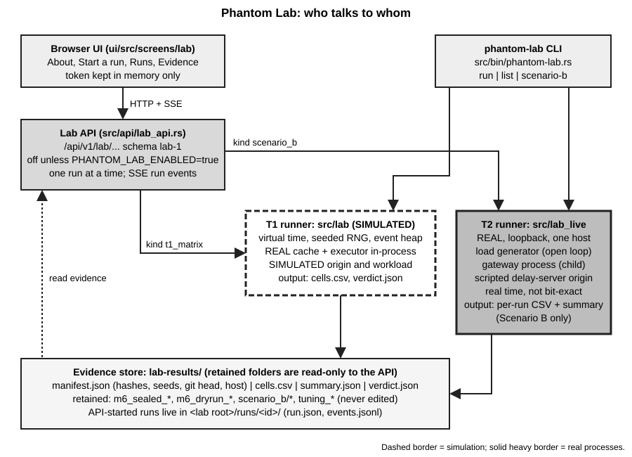

Source: `src/lab/mod.rs`, `src/lab_live/mod.rs`, `src/api/lab_api.rs::router`, `src/bin/phantom-lab.rs`, `ui/src/lib/routes.js`, `lab-results/README.md`.

### 7.1.1 The parts

| Part | Where | What it does | Status |
|---|---|---|---|
| T1 simulator | `src/lab/t1_sim.rs::run_cell` | Runs one cell on a virtual clock, driving the real cache and executor | IMPLEMENTED, TESTED (determinism, hard-cap invariants in smoke cells) |
| Event queue | `src/lab/events.rs::EventQueue` | Min-heap ordered by `(time_us, seq_id)` | IMPLEMENTED, TESTED (`test_t1_event_engine_total_ordering`) |
| Seeded RNG | `src/lab/rng.rs::MasterRng`, `StreamRng` | SplitMix64 streams named per subsystem | IMPLEMENTED, TESTED (`test_t1_master_rng_seed_splitting_determinism`, `test_t1_stream_independence`) |
| Workloads | `src/lab/workloads.rs` | Zipf, scan, flash crowd, diurnal, hot-set shift, mixture, hot key, invalidation | IMPLEMENTED, TESTED (`tests/integration/lab_workload_tests.rs`) |
| Simulated origin | `src/lab/origin_sim.rs::SimulatedOrigin` | Parallel servers, queue, degradation scenarios | IMPLEMENTED, TESTED (`lab_origin_tests.rs`) |
| Runner and CLI | `src/lab/runner.rs::execute`, `src/bin/phantom-lab.rs` | Validated `RunSpec`, writes `cells.csv` and `manifest.json` | IMPLEMENTED, TESTED (`lab_runner_lib_tests.rs`) |
| M6 pipeline | `src/lab/m6_pipeline.rs::run_pipeline` | Full registered matrix, analysis files, mechanical verdict | IMPLEMENTED, TESTED on synthetic matrices; run once on sealed seeds |
| Analysis | `src/lab/analysis.rs`, `src/lab/eval.rs::analyze_endpoints` | BCa interval, sign-flip permutation test, Holm adjustment | IMPLEMENTED, TESTED on planted data; no independent reference check (G4C item (ii)) |
| T2 runner | `src/lab_live/scenario_b.rs` and siblings | Real gateway process on loopback, scripted origin, open-loop load | IMPLEMENTED, TESTED (mechanics; debug-profile smoke runs) |
| Lab API | `src/api/lab_api.rs` | Starts and observes runs, evidence views, SSE events (`lab-1`) | IMPLEMENTED, TESTED (`tests/integration/lab_api/`); off by default |
| UI | `ui/src/screens/lab/*` | About, Start a run, Runs, Evidence tabs | IMPLEMENTED; read for this chapter, not run |

Neither the T1 simulator nor the T2 runner has had a human or external review. The G4C report (`docs/release/g4/cycle1_lab_intelligence_deps_review.md`) is an AI second look and it did not read the event loop in `t1_sim.rs`, `origin_sim.rs` or `workloads.rs` (`docs/release/known_limitations_frozen_code.md` section 1). This chapter's author also read those files, but that is another AI read, not independent verification. Status for the sealed M6 result: **not INDEPENDENTLY VERIFIED**.

---

## 7.2 Deterministic simulation, step by step

### 7.2.1 Virtual clock

**Simple explanation.** A game pauses and fast-forwards. A simulation does the same with time. Nothing waits for a real second to pass. The simulator jumps from one event to the next and sets "now" to that event's timestamp.

**Technical terms.** *Virtual time* is an integer count of microseconds (`u64`) that the simulation controls. *Monotonic* means it never goes backwards. *Discrete-event simulation* means state changes only at event timestamps.

**How it works.** `src/lab/clock.rs::VirtualClock` holds `time_us`, converts to milliseconds with `now_ms = time_us / 1000`, and `advance_to` panics if asked to go backwards. The product cache API takes `now_ms` as an argument, so the simulator can pass virtual milliseconds to the real cache. `t1_sim.rs::start_attempt` does exactly this (`let now_ms = t / 1000;`).

::: caution
**Discrepancy found.** The Lab struct `lab::clock::VirtualClock` (`src/lab/clock.rs`) is exercised only by `tests/integration/lab_core_tests.rs::test_t1_virtual_clock_monotonicity`. `run_cell` does not instantiate it. The loop takes `t = ev.id.time_us` from the event it popped, and the heap guarantees non-decreasing order. The effect is the same (virtual, monotonic time), but a reader who expects the `VirtualClock` struct in the event loop will not find it. Grep of `src/` and `tests/` shows no other user of `lab::clock::VirtualClock`. A different struct with the same name, `sim::clock::VirtualClock` in `src/sim/clock.rs`, belongs to the legacy simulation module (it is used by `src/main.rs` and `tests/unit/wp1_tests.rs`) and is not the Lab clock. [verified in code]
:::

**Where wall-clock time still enters.** The header of `t1_sim.rs` states that "the only wall clock used is inside the product cache (`shrink_shard`), which does not affect outcomes in the configurations used here; determinism is asserted by tests." That is the author's statement plus tests; I did not independently prove it. [UNVERIFIED beyond the tests]

### 7.2.2 The event queue and tie-breaking

**Simple explanation.** A to-do list sorted by time. If two items have the same time, the one added first goes first. Without this rule, two events at the same microsecond could swap order from run to run.

**How it works.** `events.rs::EventId` compares `(time_us, seq_id)` in reverse so Rust's max-heap `BinaryHeap` acts as a min-heap. `seq_id` is a counter that increases by one per `schedule` call. Complexity is O(log n) per push or pop.

::: example
**Worked example: tie-breaking.** Suppose a client `Timeout` (sequence 7) and the next `Arrive` (sequence 8) are both scheduled for t = 1,000,000 us. The heap returns sequence 7 first. Run it again and it returns sequence 7 first again, because sequence numbers are assigned in program order, and program order is fixed by the seed. Without the sequence number, the order of equal-time events would depend on heap internals. (The numbers are illustrative; the ordering rule is the verified part.)
:::

### 7.2.3 Seeded random streams

**Simple explanation.** A seed is like the shuffle order of a deck you can reproduce. Instead of one deck for everything, the Lab gives each concern its own deck, derived from the master seed. Then changing how many random numbers the origin consumes cannot disturb the arrival times.

**Technical terms.** A *pseudo-random number generator* (PRNG) produces a repeatable sequence from a seed. *SplitMix64* is a small PRNG with a 64-bit state. *Stream splitting* derives independent-looking streams from one master seed by name.

**How it works.** `rng.rs::StreamRng::next_u64` adds a constant to its state and mixes the bits (the SplitMix64 steps). `MasterRng::stream(name)` hashes the master seed with the stream name bytes, then discards two outputs as warm-up. `run_cell` takes the `"workload"` and `"origin"` streams from `MasterRng::new(spec.seed)`. `next_exponential(lambda)` gives Poisson inter-arrival gaps: `-ln(1-u)/lambda`.

**Zipf keys in O(1).** `AliasSampler` is Vose's alias method. It spends O(N) once to build two tables, then each sample costs one random integer and one random float. `new_zipf(n, alpha)` sets weights `1/k^alpha`. A reader who knows the Zipf law ("a few keys get most requests") can see why this is the right sampler for cache workloads.

::: example
**Worked example: why alias sampling is exact.** Take three keys with weights 1, 1, 2 (sum 4, n = 3). Scaled probabilities are `w*n/sum` = 0.75, 0.75, 1.5. Keys 0 and 1 are "small" (below 1), key 2 is "large". Pair small key 0 with large key 2: `prob[0] = 0.75`, `alias[0] = 2`, and key 2's remaining mass becomes `1.5 + 0.75 - 1 = 1.25`. Pair key 1 with key 2 the same way: `prob[1] = 0.75`, `alias[1] = 2`, key 2's mass becomes `1.25 + 0.75 - 1 = 1.0`. Sampling picks a slot uniformly (1/3 each), then keeps it with probability `prob`. P(key 0) = 1/3 x 0.75 = 0.25. P(key 1) = 0.25. P(key 2) = 1/3 x 1.0 + 1/3 x 0.25 + 1/3 x 0.25 = 0.5. These match the weights 1/4, 1/4, 2/4. (My arithmetic from the algorithm in `rng.rs::AliasSampler::new`; the code test is `test_vose_alias_sampler_accuracy_and_o1_speed`.)
:::

**Three disjoint seed sets.** `rng.rs::SeedSets` defines: tuning seeds T = 10001..=10060 (60 seeds), development seeds D = 20001..=20030 (30 seeds), and a sealed set S of 30 seeds derived at run time from a secret salt whose SHA-256 commitment is in the source. The old plaintext range 30001..=30030 is "burned" and rejected by leak checks. The salt is not in the repository, and this chapter does not reproduce the commitment value. [IMPLEMENTED, TESTED: `test_seed_sets_disjointness_and_sealed_leak_detection`, `test_seed_sets_disjoint_and_sealed_set_is_hash_only`]

### 7.2.4 The workload schedule

**Simple explanation.** The workload generator answers two questions again and again: "how long until the next request?" and "which key?" Because both answers come from seeded streams, the whole schedule is fixed by the seed before any cache logic runs.

**How it works.** Each generator implements `WorkloadGenerator::next_request(now_us, rng) -> RequestSpec { arrival_delta_us, key, body_size_bytes, ttl_ms, is_invalidation }`. The loop is *open loop*: `Ev::Arrive` draws the next arrival immediately, independent of system state. This matters. A closed-loop generator waits for each reply before sending the next request, so a slow system quietly receives less load (the "coordinated omission" problem). Open loop keeps offering the same load while the system struggles. [verified in code: `t1_sim.rs` `Ev::Arrive` handling comment "open loop"]

`t1_sim.rs::make_workload` maps family ids to generators:

| Family id | Meaning | Used in |
|---|---|---|
| `W-Z(alpha)` | Zipf skew | tuning |
| `W-FC` | flash crowd (rate x2 on 8 keys for 6 s after warm-up) | tuning |
| `W-SC` | scan (20% one-hit keys) | tuning |
| `W-DI` | diurnal sinusoid | held-out |
| `W-SH` | hot-set shift at mid-run | held-out |
| `W-MX` | 90% Zipf plus 10% invalidation stream | held-out |
| `W-HK` | an emerging hot key | held-out |
| `W-SF` | adversarial bimodal, phases of 2.5 s | sealed family, refused by the runner |
| `W-TR` | real trace | UNAVAILABLE: panics with "no trace data in the repository" |

So every T1 workload is synthetic. There is no production trace anywhere in the repository. [verified in code]

### 7.2.5 The simulated origin and scenarios

**Simple explanation.** The origin is a shop with `c` tills. A request takes a till for some service time; if all tills are busy, it queues. A scenario script then makes the shop worse: slower service, fewer tills, random failures, or a full outage.

**How it works.** `origin_sim.rs::SimulatedOrigin` keeps a min-heap of "server busy until" times. `fetch(now_us, key, body, rng)` first decides whether this fetch fails (outage, brownout, flapping), then finds the start time (now, if a till is free; otherwise when the earliest till frees), multiplies a sampled service time by the latency and per-key cost factors, and returns `finish_service_us`. Failures return in 100 us. The M6 standard parameters (`SimParams::standard()`): 8 servers, constant 60,000 us service time, 250 requests per second, catalogue 400 keys, Zipf alpha 0.95, TTL 3,000 ms, 1 KiB bodies, warm-up 8 s, measurement 20 s.

The eight M6 scenarios (`t1_sim.rs::scenario_for`):

| Id | What happens to the origin |
|---|---|
| O-DEG | service time x3 from the start of measurement |
| O-BRN | 30% of origin fetches fail (HTTP 500) for 10 s |
| O-SLW | full outage for 4 s, then capacity ramps 25% to 100% over 8 s |
| O-CO | cache invalidated at t0 and 2x arrival burst for 5 s (cold restart) |
| O-RT | service x2.5 and clients retry failures (up to 3, 100 ms backoff) |
| O-FL | flapping: 4 s cycle, 1.5 s down (HTTP 503) |
| O-HET | per-key origin cost differs for the whole run |
| O-GRD | latency rises linearly from 1x to 4x over the window |

::: caution
**Model limits, by reading the code.** With constant 60 ms service and Poisson arrivals, the origin is closest to an M/D/c queue; the module header says "M/M/c". [our reasoning] The model has no connection pool, no TCP, no memory pressure, no garbage collection and no network RTT. Offered load is 250 rps; if every request missed, 8 servers at 60 ms each could serve at most 8 / 0.06 = about 133 per second, so the cache must absorb most requests for the origin to cope. Whether the chosen load stresses the origin as intended in each scenario is a modelling decision documented in the preregistration, not something independently validated.
:::

### 7.2.6 What a "real component" means in T1

The T1 header lists what is real and what is simulated. This matters for the defence, so here it is as a table.

| Piece | In T1 | Why it matters |
|---|---|---|
| `PartitionedCache` (storage, SIEVE eviction, byte accounting, epochs) | REAL product code, in process | Bugs in the cache code can show up in the simulation |
| `begin_fetch_atomic`, `finalize_fetch` (single-flight, generation fencing) | REAL | The coalescing and fencing logic is exercised, with `oneshot` channels for waiters |
| `check_stale_serving`, `record_stale_served` | REAL | Stale rules and the hard cap counters are exercised |
| `DefaultPolicyExecutor` origin gate, AIMD controller, `OriginAwareStaleController`, `FrequencyAdmissionFilter` | REAL library code | The same code the gateway runs when `PHANTOM_INTELLIGENCE` is canary/active, for the cap only |
| Client arrivals, timeouts, retries | SIMULATED | A modelling choice |
| Origin service times, failures | SIMULATED | A modelling choice |
| Network, TLS, HTTP parsing, Axum handlers, Tokio scheduling | ABSENT | The serving path is not run in T1 |
| Cluster / peers | ABSENT | T1 is single cache |

So T1 tests the *policy logic and cache semantics* under a modelled origin. It does not test the HTTP gateway. That is why T2 exists.

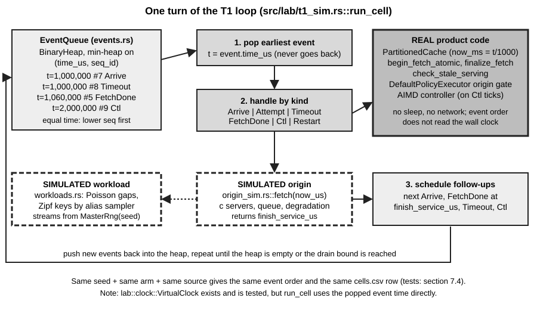

Source: `src/lab/t1_sim.rs::run_cell`, `src/lab/events.rs::EventQueue`, `src/lab/origin_sim.rs::SimulatedOrigin::fetch`, `src/lab/workloads.rs`.

### 7.2.7 Arms: different configurations, no multipliers

An *arm* is a configuration of the same event loop (`t1_sim.rs::ArmConfig`): does it coalesce, serve stale-while-revalidate, serve stale on error, which stale window, which cap (`CapConfig::None`, `Static`, `Aimd`), a lab-only circuit breaker, TinyLFU admission. `arm_config` builds them. Examples:

- `BL-0`: no coalescing, naive: every miss goes to the origin.
- `BL-1`: single-flight only.
- `BL-4`: standalone AIMD limiter.
- `BL-12b`: static baseline: single-flight plus stale-while-revalidate plus stale-if-error plus a static cap, with values tuned on tuning seeds T. The code comment says it is "not claimed to be the best deployable static policy".
- `BL-6`: per-scenario oracle static (cap and stale window tuned for each scenario).
- `PIE-Retained`: the adaptive arm: AIMD cap plus dynamic stale window plus TinyLFU admission.
- `PIE-no-stale`, `PIE-no-cap`, `PIE-evict-only`: ablations. `PIE-off`, `CTRL-nonadaptive`, `PLANT-CAP4`: sensitivity checks.

"PIE" in these arm names is a historical label for the adaptive bundle. It is **not** the legacy `src/control/pie.rs` stub, which is `pie: None` in the running gateway (CLAUDE.md section 6b). See Chapter 5 for the intelligence machinery.

---

## 7.3 Reading the numbers: metrics, paired differences and BCa intervals

### 7.3.1 Metrics in a cell

Each cell produces a `CellSummary` (`t1_sim.rs`): request counts by outcome (fresh hit, miss served, stale served, failure), `origin_dispatches`, `peak_outstanding` (the peak number of origin fetches in flight), `peak_servers_busy`, `cap_violations`, stale-cap violation counters, `p50_us`/`p95_us`/`p99_us`, `p99_success_us`, `fresh_hit_ratio`, `error_rate`, `final_cap`, and `bytes_audit_equal`. Latencies are virtual microseconds, not wall-clock measurements.

**Percentile definition.** `t1_sim.rs::percentile` is nearest-rank: `rank = ceil(n*q)`, index `rank-1`. For n = 1,000 requests and q = 0.99, rank 990, the 990th smallest value. Other places in the repository use other definitions (G4A-24 and F24; see Chapter 6). Do not compare percentiles across places without checking the definition.

::: caution
**The primary P99 includes failures.** `M_P99` takes the P99 over *all* logical requests, and a request that is shed or errors enters at the time the failure was known, which can be near zero. A policy that sheds quickly can therefore look better on this endpoint. The v2.2 amendment records this in section 2, and success-only P99 (`p99_success_us`) is reported as a secondary endpoint. [verified in code and amendment]
:::

### 7.3.2 The comparison: paired by seed

The registered analysis compares a *treatment* arm with a *control* arm on the same seeds (`eval.rs::analyze_endpoints`). For each seed it averages the metric over the chosen families, then computes a *relative reduction*:

```
r_i = (control_i - treatment_i) / control_i
```

Positive `r_i` means the treatment is lower (better for peak concurrency and latency). Pairing by seed removes the large seed-to-seed variation (a bad seed is bad for both arms). If the control value is zero, the code sets `r_i = 0` (a documented weakness: G4C F16).

### 7.3.3 Bootstrap and BCa, in plain English

**Simple explanation.** You have 30 numbers (one `r_i` per seed). You want a range for the true average effect, but you only have this one sample. The bootstrap pretends the sample is the whole world: draw 30 values *with replacement*, take the mean, repeat 10,000 times. The spread of those 10,000 means shows how much the average could wobble. The middle 95% is a confidence interval.

**Why "BCa".** The simple percentile interval can be biased if the bootstrap distribution is lopsided. **BCa** (bias-corrected and accelerated) fixes two things:

- *Bias correction* `z0`: how far the bootstrap means sit above or below the original mean (the fraction of bootstrap means below the observed mean, turned into a normal score).
- *Acceleration* `a`: how much the spread changes as the true value changes, estimated from a leave-one-out (jackknife) calculation. It captures skew.

BCa then picks different percentile positions than 2.5% and 97.5%. `analysis.rs::StatisticalEvaluator::bca_ci_mean(data, resamples, seed)` implements it with B = 10,000, a SplitMix64 stream for resampling, and Acklam's approximation for the inverse normal. Constant data returns `(mean, mean)`, a zero-width interval (G4C F06 notes this for degenerate cells).

**Sign-flip permutation test.** Under "no effect", each paired difference is equally likely to be positive or negative. So flip the sign of each `r_i` at random and see how often the flipped mean is as extreme as the real mean. For n at most 16 the code enumerates all `2^n` sign patterns exactly; above that it samples 20,000. The p-value is the fraction at least as extreme.

**Holm correction.** With 16 primary hypotheses (8 scenarios x 2 endpoints) some will look significant by chance. `HolmBonferroni::adjust` sorts p-values, multiplies the smallest by m, the next by m-1, and so on, keeping the sequence monotone. A hypothesis is Holm-significant if the adjusted p is below 0.05.

**The registered "supported" rule per hypothesis:** Holm-significant AND mean relative reduction at least `delta_min = 0.05` AND BCa lower bound above 0. "Adverse" means the BCa *upper* bound is below 0 (credibly worse).

::: example
**Worked example (invented numbers, for teaching only; not a result of this project).** Five seeds give relative reductions `r = [0.10, 0.02, -0.05, 0.08, 0.05]`.

1. Mean = (0.10 + 0.02 - 0.05 + 0.08 + 0.05) / 5 = **0.04** (4% lower peak concurrency on average).
2. Exact sign-flip test: there are 2^5 = 32 sign patterns. I enumerated them: 8 of 32 give a sum whose absolute value is at least the observed 0.20, so p = 8/32 = **0.25**. Not significant. (With so few seeds the smallest possible p is 2/32 = 0.0625, so five seeds can never reach p < 0.05; this is why the registered design uses 30 seeds.)
3. Percentile bootstrap, B = 10,000 resamples with an arbitrary generator I ran for this illustration: the 95% interval came out near [-0.01, +0.08]. It contains zero.
4. BCa ingredients: the fraction of bootstrap means below 0.04 was about 0.46, so `z0` is slightly negative (about -0.09); the jackknife leave-one-out means are 0.025, 0.045, 0.0625, 0.030, 0.0375 giving acceleration `a` of about -0.047. BCa shifts the endpoints a little relative to the percentile interval but does not change the story.

Reading: a 4% average gain, p = 0.25, an interval that includes zero and extends below zero. Under the rule above this is **not supported** (Holm cannot rescue p = 0.25, and the lower bound is not above 0). Also, the interval's upper end (about 8%) stays above `delta_min = 5%`, so the data cannot exclude a 5% effect either. That is the honest reading: "inconclusive with five seeds", not "no effect".
:::

(The rule for inconclusive versus not supported in Scenario B, T2, is in section 7.5.)

### 7.3.4 Check that the statistics work

`SyntheticAnalysisValidator::verify_analysis_pipeline` plants a +8% effect, a -8% effect and a null effect in synthetic data and checks that the interval detects the first two and spans zero for the third. `test_bca_permutation_and_holm_on_synthetic_data` and the sensitivity tests (`test_sensitivity_a_disabling_the_adaptive_mechanism_yields_zero_effect`, `test_sensitivity_b_planted_real_effect_is_detected`) test the end-to-end path. These show the pipeline *can* detect a planted effect. They do not show that BCa was independently reproduced against a reference implementation (G4C section 6 item (ii) lists that as undone), and the validator's interval is a percentile bootstrap, not BCa (`analysis.rs::bootstrap_ci` is used by `evaluate_paired`; BCa is a separate function). [verified in code]

---

## 7.4 Reproducibility, preregistration and evidence retention

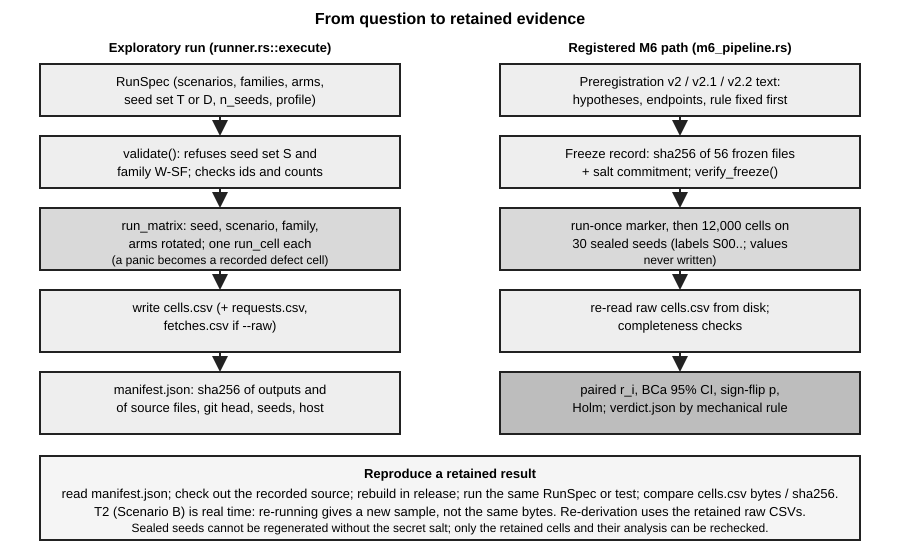

Source: `src/lab/runner.rs::execute`, `src/lab/eval.rs::run_matrix_with_progress`, `src/lab/m6_pipeline.rs::run_pipeline`, `docs/research/preregistration_m6_v2_2_amendment.md` section 10.

### 7.4.1 Deterministic replay

**Claim.** The same `RunSpec` and the same source give byte-identical `cells.csv`. [IMPLEMENTED; TESTED]

**Tests.** `lab_runner_lib_tests.rs::same_runspec_twice_gives_identical_cells_and_bytes` runs a spec twice and compares bytes. `lab_reproduction_tests.rs::test_t1_10_rerun_bitwise_determinism` reruns one cell ten times and compares four summary fields (origin fetches, peak concurrency, hit ratio, stale-cap violations). `m6_research_evaluation_tests.rs::test_runner_is_deterministic` is a third check.

**What these tests do not prove.** They run in one process on one machine. They do not show equality across operating systems, Rust versions or CPU architectures (floating point and `HashMap` iteration could differ). Source hashes in the manifest let you detect that the code changed; they do not make it portable. [limit]

### 7.4.2 Arm interleaving

`eval.rs::run_matrix_with_progress` loops seed, then scenario, then family, then arms rotated by `(seed_index + scenario_index) mod n_arms`. The comment names this as interleaving. In a simulation there is no warm-machine effect to balance, so the rotation is a defence-in-depth habit from real experiments (T2 uses the same idea with real warm-up effects). [our reasoning]

### 7.4.3 Common random numbers

The O-BRN scenario draws a random failure for each origin fetch. If the number of earlier fetches changed the random draw, two arms would see *different* fault luck for the same request, and some of the "effect" would be luck. Protocol v2.2 (finding M2) fixes this: `SimulatedOrigin::with_fault_crn(seed, 10_000)` makes the fate of a fetch a function of `(seed, key, 10 ms bucket)`. All arms then see the same faults. Residual caveat from the amendment: two requests for the same key in the same 10 ms bucket share a fate. Test: `test_brownout_faults_use_common_random_numbers_across_dispatch_orders`. [IMPLEMENTED, TESTED]

### 7.4.4 Preregistration and the freeze

**Simple explanation.** Before you open the sealed envelope, you write down exactly how you will read it. Then no one can accuse you of choosing a favourable reading afterwards.

**What exists.**

1. A preregistration text (`docs/research/preregistration_m6_v2.md`) with hypotheses, endpoints and the analysis. H1 (primary): the adaptive arm lowers peak origin concurrency and client P99 versus the tuned static baseline by at least 5%, with at most 1 percentage point of hit-ratio loss and zero cap violations.
2. Two amendments before the sealed run (`preregistration_m6_v2_1_amendment.md`, `preregistration_m6_v2_2_amendment.md`). v2.1 replaced a sealed-salt commitment whose salt had been generated inside an agent session; v2.2 corrected defects found by an independent pre-run review and fixed a mechanical verdict rule (`m6_pipeline.rs::compute_verdict`).
3. A freeze record (`preregistration_m6_v2_2_freeze.json`) that pins SHA-256 values of the preregistration files and 56 source files (counted from G4C section 2) and the salt commitment. `eval.rs::verify_freeze` and `verify_freeze_with_addendum` check them and fail closed.
4. A run-once marker (`lab-results/m6_sealed_run_started.marker`, created by `create_run_once_marker`) written before cell 1.
5. A leak scan (`scan_for_seed_leak`) that looks for the sealed seed values in the repository text.

**Honest limits of this mechanism.**

- Amendment 7b (adaptivity requirement `max >= 4*min`) was added *after* the researchers saw tuning and development results, but before any sealed data. The amendment discloses this as a "researcher degree of freedom". The unconstrained tuned optimum on T was a static cap (min = max = 2), so, in the amendment's own words, the sealed test is "a forced-adaptive AIMD controller versus the best static configuration found on T".
- The freeze check covers 4 of 56 files that now differ because of a pinned addendum (`Cargo.toml`, `src/lib.rs`, `src/lab/eval.rs`, test file). G4C reproduced that the differences match the addendum; whether editing `eval.rs` after the sealed run is acceptable is a human decision (known_limitations section 2).
- The salt was generated by an agent process and is readable by same-user processes (the freeze record's own limitations, quoted in G4C). The leak scan is decimal-substring only (F19). `verify_no_sealed_leak` is vacuous in normal runs because the salt is not in the environment (F32).
- The sealed manifest shows 64 `git_status_entries`: the sealed run executed on a dirty working tree. Source hashes were recorded per file (`source_sha256`), which is the defence. [verified: read from `lab-results/m6_sealed_2026-10-29T234845Z/manifest.json`]

Nobody outside the project has audited this procedure. [not INDEPENDENTLY VERIFIED]

### 7.4.5 Manifests and evidence retention

Every run folder has a `manifest.json`. For T1 matrices (`eval.rs::run_matrix_with_progress`): manifest version, tier `SIMULATED`, scenario/family/arm lists, per-arm configuration JSON, sim parameters, `git_head`, `git_status_entries`, per-file `source_sha256`, build profile, host OS and architecture, UTC start and end times, SHA-256 of each output file, and the interleaving rule. For sealed runs the seed values are `null` and labels are `S00`...; the commitment is recorded. For T2 (Scenario B): manifest plus `summary.json` plus one folder per (repetition, arm) with client, origin and gateway-snapshot files (`docs/demo/scenario_b_artifacts.md`).

`lab-results/README.md` states the retention rules: do not edit, rename or delete; the sealed and frozen material has hash records in `docs/research/preregistration_m6_v2_*freeze.json`; about 48 MB total. The `runs/` folder is empty at the time of writing, which means no API-started run is retained.

::: caution
**Two manifest systems exist.** `src/lab/manifest.rs::RunManifestV2` (provenance tags, EV-1 to EV-14 checklist) is **not** the manifest that real runs write. It hard-codes a git hash and `is_dirty: true`, implements 3 of 14 validity checks (EV-1, EV-2, EV-11), serialises through a `HashMap` so its digest is not deterministic, and is used only by tests (`lab_core_tests.rs`). Real runs write the JSON manifest built in `eval.rs`. G4C finding F04. [verified in code]
:::

### 7.4.6 How to reproduce an experiment

For a retained T1 result:

1. Read `manifest.json` in the result folder: note `git_head`, `source_sha256`, `build_profile`, `arm_params`, scenarios, families, arms, seed labels.
2. Check out that source state (the working tree was dirty, so use the per-file hashes to confirm your files match).
3. Build in release. The sealed test requires it (`require_release_build`).
4. Re-run: for a development-seed run use `phantom-lab run --scenarios ... --families ... --arms ... --seed-set D --n-seeds N --profile standard --arm-params frozen --out DIR` (flags from `src/bin/phantom-lab.rs`). The M6 dry run is the ignored test `m6_full_matrix_dry_run_on_dev_seeds`.
5. Compare `cells.csv` bytes or SHA-256 with the retained file.

For the sealed result, step 4 is impossible for anyone without the secret salt. Anyone can still re-run the *analysis* on the retained `cells.csv` and check the verdict, which is the check the pipeline itself performs (it re-reads the raw file from disk). I did not re-run this analysis for this chapter; I read the retained `verdict.json`. [read, not reproduced]

For T2: re-running produces a new sample. Compare against the retained summary using the stated intervals, not byte equality.

---

## 7.5 T2: Scenario B on a real gateway over loopback

**Simple explanation.** T1 asks "does the policy logic behave on a model?" T2 asks "does the real program, with real sockets and a real clock, behave the same way?" It starts the actual `phantom-cache-demo` binary as a child process, points it at a small scripted origin, fires seeded traffic at it, and records what happens.

### 7.5.1 The experiment

Source: `src/lab_live/scenario_b.rs`. Contract: `docs/demo/scenario_B_origin_slowdown.md`.

- **Arms.** `BASE` (intelligence `off`, no cap), `STATIC-CAP` (cap 24; `PHANTOM_INTELLIGENCE=canary`, min = max = 24), `AIMD-CAP` (min 12, max 32, p99 ceiling 60 ms, window 30; canary).
- **Phases.** Warm-up 8 s, healthy 5 s, degraded 10 s, recovery 8 s (default). During the degraded phase the scripted origin multiplies its 20 ms service time by 6.
- **Workload.** Poisson arrivals at 300 rps, 5,000 keys, Zipf alpha 0.9, seed `20261030 + repetition`, identical across the arms of a repetition. The schedule comes from `loadgen.rs::schedule`, which reuses `MasterRng` streams `"arrivals"` and `"keys"` and `AliasSampler` from the T1 code. Open loop: each request is sent at its scheduled time regardless of earlier replies; latency is measured from the scheduled time, so a late send still counts.
- **Gateway control.** `gateway.rs::gateway_env` removes inherited `PHANTOM_*` and `ORIGIN_URL` variables, sets bind address, cache size, `PHANTOM_INTELLIGENCE` and the cap keys; the child is killed on drop. The runner polls `GET /api/v1/metrics` every 250 ms.
- **Repetitions.** 10 per arm, arms interleaved rep-major in a rotating order.
- **Origin.** A raw-TCP scripted delay server (`origin.rs`). Service time does not grow with load, so a real origin's positive-feedback overload is **not** reproduced.
- **Analysis.** `lab_live/analysis.rs::paired` calls the same `bca_ci_mean` and `sign_flip_p_value` as T1. `evaluate_arm` applies a fixed rule in this order: (1) mechanism failure if origin concurrency exceeded the cap in any run; (2) inconclusive if fewer than 10 valid pairs, host contention flagged (send-lag P99 above 100 ms), or the interval includes zero but its upper bound is at least 5%; (3) benefit not supported if the mean reduction is under 5% or the interval does not exclude zero; (4) trade-off failure if mean client success is more than 1 percentage point below BASE (shed 503s count as failures); (5) benefit not supported if origin P99 is worse; (6) otherwise benefit supported.

### 7.5.2 The retained result and its qualifiers

Retained: `lab-results/scenario_b/20261030T003932Z/`. Release-profile gateway and driver (manifest), host Windows 11 (build 10.0.26300), x86_64, 24 logical CPUs (`Intel64 Family 6 Model 183`), RAM not collected, loopback, 10 repetitions, seed 20261030 + r. Label `VALID` in the sense of `LABEL_VALID_MEANING` only.

| Quantity (mean over 10 paired repetitions) | BASE | STATIC-CAP (24) | AIMD-CAP (12-32) |
|---|---|---|---|
| Origin peak concurrency, degraded phase | 39.0 | 24.0 | about 13.1 |
| Reduction vs BASE, 95% BCa interval (window metric `origin_peak_concurrency_window`; the degraded-phase means above give 38.5% and 66.4%) | | 38.3% [36.7, 40.2] | 64.0% [62.5, 65.3] |
| Client success rate | 100% | 95.05% (-4.95 pp) | about 82.9% (-17.1 pp) |
| Mechanical verdict | | TRADE_OFF_FAILURE | TRADE_OFF_FAILURE |
| All-request client P99 (mean of per-run P99s) | 167.1 ms | difference -0.24 ms, interval [-1.10, +0.47], p = 0.59 | not tabulated here |

(Source: `summary.json` `verdicts`, `arms`, `paired_vs_base`; read for this chapter. Host, build and seed as above. These figures were produced by the project; I did not re-run them. Independent recomputation by the project is in `docs/demo/scenario_b_verification/`, reported by that document, not repeated by me.)

What this shows, in plain English: a hard cap on origin concurrency really limits origin concurrency (the static arm peaked at exactly 24 in all 10 runs), and the price is that some requests are refused with a 503. This is the expected shape of any cap.

What the dated interpretation notice (`docs/demo/scenario_b_interpretation_notice.md`) says **must** accompany every citation:

1. The adaptive arm fell from 32 to about 12 within about 2 s and stayed near 12 in every phase, shedding about 2% even when healthy. So AIMD-CAP versus BASE was effectively a static cap near 12 versus no cap. The experiment shows nothing about adaptive-controller merit.
2. The controller's 30-sample "p99" is the window maximum, compared with an absolute 60 ms ceiling that timer overshoot and healthy variation can cross.
3. All-request latency includes fast-failing 503s and is not evidence of improved latency for served clients.
4. The scripted origin has no load-dependent latency, so the origin-P99 clause is untestable.
5. Stale serving never happened (`stale_served_total` is 0; the origin sent only `max-age=3`).
6. The caps were chosen after a single-repetition pilot and were not preregistered.
7. Arms differ by more than the cap: the capped arms run `canary` and BASE runs `off`. No cap-free canary arm exists.

The code carries these as constants (`AIMD_EFFECTIVE_CAP_NOTE`, `CANARY_VS_OFF_NOTE`, `ALL_REQUEST_LATENCY_NOTE`, `ORIGIN_P99_NOTE`, `STALE_SERVING_NOTE`, `PILOT_DISCLOSURE`, `CAN_NOT_ESTABLISH`) and the Lab API ships the notice with every Scenario B evidence payload (`lab_api.rs::SCENARIO_B_NOTICE`). That is a good design for honesty: the caveat travels with the number.

::: caution
**Known open defects in the integrated Lab code.** G4C F01 (High): a capped arm with no run data can get the verdict `MECHANISM_FAILED`. F02: label `VALID` can appear on cancelled or partial summaries. Their remediation (U-01) is sandbox only: the owner has approved integration with conditions (DEC-001) and it is in progress, but at the time of writing it is **not integrated**, not committed and not human-verified (`cycle1_findings_disposition_register.md`: IN-SANDBOX-REMEDIATION). I did not re-run the code path; the status is from the register. The retained experiment is not affected by them in the sense that all 10 pairs per arm had data (the summary shows `valid_runs` 10 and `mechanism_pass` true).
:::

### 7.5.3 The exact relationship between T1 and T2

| Question | T1 (`src/lab`) | T2 (`src/lab_live`) |
|---|---|---|
| Label | SIMULATED | MEASURED_LOOPBACK; shown in the UI as "Real (loopback, one host)" |
| Clock | virtual, integer microseconds | real time (Tokio timers; resolution host-dependent) |
| Product code that runs | cache, coalescing, executor, candidates, as a library | the whole gateway binary: HTTP, Axum, Tokio, cache, executor |
| Origin | modelled queue with scenario scripts | scripted raw-TCP delay server, no internal queue |
| Load | modelled arrivals in the same event loop | real sockets, open-loop sender |
| Repeatability | byte-identical for the same source and spec | statistically similar, not bit-exact |
| Scenarios | 8 degradations (M6) x 4 held-out families | one: origin slowdown (Scenario B) |
| Sample size | 30 sealed seeds x 12,000 cells | 10 repetitions x 3 arms |
| Shared code | `MasterRng`, `AliasSampler`, `bca_ci_mean`, `sign_flip_p_value` | the same functions, imported |

What T2 adds over T1: it shows the cap is enforced by the real binary (mechanism pass in every run) and that the shape of the trade-off (lower origin peak, some 503s) appears outside the model. What it does not add: any agreement study. The class `matrix_runner.rs::AgreementStudy` computes "rank concordance" between T1 and T2 cells, but (a) it compares *positional* rank matches, not a Spearman coefficient despite the return-value comment, and (b) its only test (`test_t1_t2_agreement_study_concordance`) feeds it hand-written T2 numbers that the test itself calls "SYNTHETIC FIXTURES that only exercise AgreementStudy mechanics; they are not measurements." The claims ledger therefore keeps C7 ("lab reproduces Tier 2 outcomes within a stated tolerance") as **UNVERIFIED**: "no T2/loopback agreement study was run." [verified in code, test and ledger]

So the correct statement is: T1 and T2 are two separate pieces of evidence about different things. T2 does not validate the T1 model, and T1 does not predict T2. A project that wanted to claim "the simulator is predictive" would need paired T1 and T2 runs of the same scenario and a pre-stated tolerance. That has not been done.

---

## 7.6 The M6 result: a negative outcome, reported as such

**What was tested.** H1: a forced-adaptive AIMD controller (with `max >= 4*min`, tuned on seeds T) beats the best static configuration found on T (`BL-12b`) on peak origin concurrency and client P99, without breaking hit-ratio and error-rate constraints.

**Setup (verified from the retained `manifest.json` and `verdict.json`).** 8 scenarios x 5 families (the 4 held-out families plus the sealed `W-SF`) x 10 arms x 30 sealed seeds = 12,000 cells (`cells.csv` has 12,001 lines including the header). Release build, Windows, started 2026-10-29 23:48:45 UTC, finished about 97 seconds later (23:50:22 UTC per the manifest; the results document says 97 s of test time). Tier SIMULATED.

**Mechanical verdict:** `H1: NOT_SUPPORTED`.

| Item | Result (from `verdict.json` and `m6_sealed_results.md`) |
|---|---|
| Peak origin concurrency, scenarios supported | 0 of 8; the adaptive arm is credibly worse in 7 (it adapts up to 8 concurrent fetches while the static baseline holds 2) |
| Client P99, scenarios supported | 2 of 8 (O-HET about +29%, O-GRD about +5.6%); five scenarios identical (P99 saturated at the failure latency) |
| Hit-ratio constraint (loss at most 1 pp) | fails in O-BRN, O-FL, O-HET |
| Error-rate constraint (increase at most 0.5 pp) | fails in the same three |
| Cap and stale-cap violations | 0 in the adaptive arm (F-d does not fire) |
| Falsifier F-a (fewer than 10% gain in at least 6 of 8 scenarios) | fires: 7 of 8 versus BL-12b |
| H2 (mechanism attribution), H4 (stability) | NOT TESTABLE at the registered horizon: the dynamic stale window never binds; `PIE-no-stale` equals `PIE-Retained` in 1,200 of 1,200 cells |
| H3 (overhead), H5, H6 | UNVERIFIED: not measurable in T1 |

**How to read it.**

- It is a real negative result, produced by a rule written before the sealed data and applied by code. That is a strength of the process.
- The unconstrained tuned optimum on T was already a static cap. On tuning data, no adaptive configuration beat the best static one.
- It does **not** show that adaptive caching is useless. It shows no evidence of benefit for *this* controller (absolute-ceiling AIMD), under *this* protocol, in *this* simulation, with synthetic workloads.
- The statement the project may make (claims ledger section 6): a static origin-concurrency cap reduces peak origin concurrency and P99 versus no cap in the simulated overload scenarios (development data, exploratory). The statement it may not make: that adaptive control improves origin protection or latency.
- The result has not been independently reviewed (known_limitations section 1).

**The product consequence** (research lead, `m6_sealed_results.md`): MVP-B, "the static gateway": single-flight, correct freshness and stale serving, generation-fenced invalidation and a configurable static origin cap. The adaptive controller is not promoted. The serving path today calls only `DefaultPolicyExecutor::new/set_mode/configure_origin_cap`, `acquire_origin_permit`/`OriginPermit::observe`; the rest of `src/intelligence` (shadow evaluation, decision engine, canary routing) has no caller in the serving path (G4C section 5, a grep result I did not repeat). `PHANTOM_INTELLIGENCE=canary` applies the cap to 100% of fetches (G4C F14). [see Chapter 5]

---

## 7.7 The Lab API and UI

### 7.7.1 API

`src/api/lab_api.rs`, schema `lab-1`. Routes (verified in `router`): `GET /api/v1/lab/capabilities`, `GET /api/v1/lab/evidence`, `GET /api/v1/lab/evidence/:id`, `POST` and `GET /api/v1/lab/runs`, `GET /api/v1/lab/runs/:id`, `POST .../cancel`, `GET .../events` (SSE), `GET .../artifacts`, `GET .../artifacts/:name`.

Properties from the module header and constants (reading, with tests under `tests/integration/lab_api/`):

- Off unless `PHANTOM_LAB_ENABLED=true` (`src/config.rs`); the routes do not exist otherwise.
- With JWT enabled, every route authenticates before any side effect: Observer role for reads, Operator for start and cancel. Without JWT (development), only loopback is allowed (`check_lab_bind`) with a Host and Origin guard against DNS rebinding.
- Body cap 16 KiB, read timeout 5 s, at most 16 SSE streams, at most one concurrent run, at most 30 seeds, 20,000 cells, 30 repetitions per request.
- No client-supplied path is joined to a filesystem path. Run ids follow a fixed grammar; artifacts are matched by equality against an allow-list.
- The API refuses seed set S and family W-SF (library validator) and refuses to start if `PHANTOM_SEALED_SALT_HEX` is in the process environment.
- Events are written to `events.jsonl` under one lock with monotone ids (Chapter 6 covers SSE authentication limits: the UI uses fetch streaming with an `Authorization` header, not `EventSource` URLs).

The API starts the same code the CLI and tests use (`runner::execute` and `scenario_b::run_experiment`). It contains "no second implementation and no canned result" (module header; consistent with what I read).

### 7.7.2 UI

`ui/src/screens/lab/` holds the Lab screens (About, Start a run, Runs, Evidence tabs; `ScenarioBResult.jsx`; `ConnectionPanel.jsx` keeps the token in memory). `ui/src/lib/labProvenance.js` maps tiers to display words: `MEASURED_LOOPBACK` appears as **Real** with the qualifier "loopback, one host" (and ", debug build" when known); `SIMULATED` as **Simulated**; `DERIVED`; `UNAVAILABLE`. `REPLAYED` and `PREDICTED` are reserved words with no backend data. The retained-evidence tiers carry a separate "retained" tag. The provenance vocabulary matches CLAUDE.md section 4: every displayed value is labelled measured, simulated, derived, or unavailable. I read the UI source for this chapter; I did not run it in a browser. [IMPLEMENTED; display behaviour UNVERIFIED by me]

The main navigation also has a "Simulation" explainer labelled Simulated, and "Cluster" and "Intelligence" entries marked "Not available" (`ui/src/lib/routes.js`). That is consistent with the backend facts above.

---

## 7.8 Innovation: building the argument from evidence

**The rule for this section.** The project's own prior-art record says RT-0 (the prior-art closure) is **OPEN**: `rt0_prior_art_sweep_2026-10-30.md` begins "Status: PARTIAL. RT-0 is still OPEN after this sweep. This file makes NO novelty claim, now or conditionally." The older `novelty_snapshot_m6.md` says "RT-0 PASS" but carries a correction notice that this is unsupported and that several features it lists (canary bucketing, provenance-gated rollback, AIMD-paced background refresh) are not in the serving path. This chapter therefore does not use the snapshot's matrix. It makes no "first" and no "novel" claim. What it can do is separate three things: what exists elsewhere, what the combination is, and what the evidence demonstrates.

### 7.8.1 What problem the combination addresses

Chapter 1 introduced the problems: stampedes on popular keys, stale data after change, an origin that gets slow and then collapses under retries, and operators who must tune several knobs. A cache gateway can address them with separate mechanisms. PhantomCache's design puts these mechanisms in one HTTP gateway with explicit invariants:

1. single-flight coalescing of concurrent misses (per node);
2. generation-fenced fill, so a fetch that started before a DELETE cannot store a stale body;
3. tenant and global epoch invalidation;
4. RFC 9111-style freshness with stale-while-revalidate and stale-if-error, bounded by a hard stale cap (`PHANTOM_MAX_STALE_MS`);
5. a bounded origin-concurrency gate, with an optional AIMD controller;
6. byte accounting with an audit (`audit_bytes`);
7. a cluster layer: rendezvous placement for DELETE, mTLS peers, invalidation fan-out, an anti-entropy worker;
8. a *lab* that can test these under degradation with a deterministic, preregistered, auditable method.

Details of 1 to 7 are in Chapters 2, 4 and 5. Their statuses are in those chapters. Item 8 is this chapter.

### 7.8.2 Comparison with established systems

Figure 7.4 summarises; the text below gives the evidence class for each statement. The classes are those of the repository's own sweep: **OPENED-DIRECT** (primary text read), **OPENED-VIA-TOOL** (primary page fetched through a summarising tool), **SNIPPET** or **SECONDARY** (not primary). Statements marked *this session* were fetched while writing this chapter, via the WebFetch tool, which returns a summary. They are OPENED-VIA-TOOL, not verbatim reads.

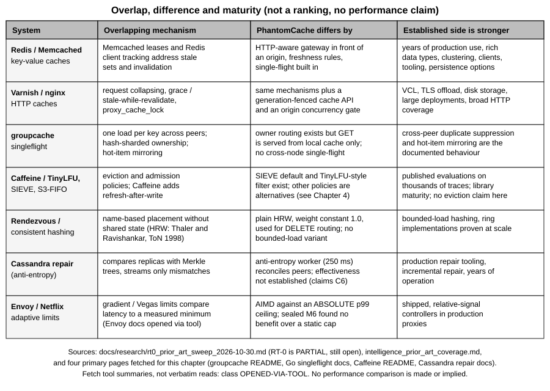

Source: `docs/research/rt0_prior_art_sweep_2026-10-30.md`, `intelligence_prior_art_coverage.md`, `src/dist/router.rs`, `src/lab/t1_sim.rs`, and pages fetched this session.

**Memcached and Redis.**
- *Verified from a primary source (OPENED-DIRECT, sweep T3):* Facebook's "Scaling Memcache" (NSDI '13) section 3.2.1 describes leases: a token bound to the key, invalidated by a delete, which prevents stale sets, and rate-limiting tokens to mitigate thundering herds. The authors report a peak database query rate falling from 17K/s to 1.3K/s over one week for herd-prone keys (authors' data; the intelligence coverage record flags that number as secondary-sourced, class B, in that pass).
- *OPENED-VIA-TOOL (sweep T10):* Redis client-side caching server tracks keys per connection and pushes invalidations; on disconnect the client flushes its whole local cache.
- *Consequence for PhantomCache:* generation fencing against stale sets is the same family of idea as leases. That is not new. What is different is the shape of the product: Redis and Memcached are general key-value servers; PhantomCache is an HTTP-aware caching gateway in front of an origin with freshness rules. The two are not interchangeable and a judge's "why not Redis?" has a clear answer (judge box below).

**Varnish, nginx, Fastly (HTTP caches).**
- *OPENED-VIA-TOOL (sweep T5, T6):* Varnish serves one backend request while others wait on a waiting list, supports grace (stale serving) and `std.healthy` to vary grace by backend health; nginx has `proxy_cache_lock` (default off), `proxy_cache_use_stale updating` and background update; Fastly documents request collapsing and soft purge. RFC 9111 describes collapsing of multiple requests into one forward request.
- *Consequence:* coalescing and stale serving are standard. PhantomCache's coalescer is not novel and the repository's own prior-art record says so ("May state as a standard mechanism").

**groupcache and Go `singleflight` (this session, OPENED-VIA-TOOL).**
- The groupcache README says it coordinates fills so "only one load in one process of an entire replicated set of processes populates the cache", "shards by key to select which peer is responsible", and "supports automatic mirroring of super-hot items to multiple processes." It also says it has "neither cache expiration times, nor explicit cache evictions."
- The `golang.org/x/sync/singleflight` package doc: "provides a duplicate function call suppression mechanism"; concurrent callers with the same key wait and receive the same result.
- *Consequence:* groupcache solves **cross-node** duplicate suppression, which PhantomCache does **not**: in the current tree GET is served from the local cache only (Chapter 5). On that axis groupcache is ahead. PhantomCache adds HTTP freshness, explicit invalidation, stale caps and an origin gate, which groupcache's README says it lacks (no expiry, no explicit eviction).

**Caffeine, TinyLFU, SIEVE, S3-FIFO (eviction and admission).**
- *OPENED-VIA-TOOL (sweep T4):* TinyLFU is frequency-based admission (arXiv:1512.00727); SIEVE (NSDI '24) is a simple FIFO-with-hand policy with author-reported gains over ARC on 1,559 traces; S3-FIFO (SOSP '23, OPENED-DIRECT abstract and introduction) uses three FIFO queues, author-reported lowest mean miss ratio on 10 of 14 datasets. This session: the Caffeine README says it provides "size-based eviction ... based on frequency and recency" and lists refresh-after-write and asynchronous loading; it does not mention stampede coalescing and the page does not name Window-TinyLFU (it cites TinyLFU papers).
- *Consequence:* PhantomCache uses SIEVE as default and a TinyLFU-style admission filter in the lab arms; eviction adaptation is explicitly not the thesis. The repository's sweep says the field is crowded and strong simple baselines are published. No eviction claim is made here. How faithful PhantomCache's policy implementations are is Chapter 4's subject.

**Consistent and rendezvous hashing.**
- *This session (search result, SECONDARY to primary):* the original rendezvous (highest random weight) hashing paper is Thaler and Ravishankar, "Using name-based mappings to increase hit rates", IEEE/ACM Transactions on Networking 6(1):1-14, 1998. The repository's sweep did not search rendezvous literature ("Not searched").
- *Verified in code:* `src/dist/router.rs` computes a hash-times-weight score with `capacity_weight = 1.0` (plain, unweighted rendezvous in practice). Routing is used for DELETE; GET is local (Chapter 5). Bounded-load hashing (Mirrokni et al., arXiv:1608.01350, OPENED-VIA-TOOL abstract in sweep T11) addresses hot nodes under skew; PhantomCache does not implement it.

**Anti-entropy and Cassandra repair.**
- *This session (OPENED-VIA-TOOL):* the Cassandra documentation page calls the function "repair", says it reconciles diverged replicas by comparing data with Merkle trees and streaming only mismatched sections.
- *Consequence:* the idea of periodic reconciliation is established. PhantomCache's `RendezvousRouter::start_anti_entropy_worker` (250 ms) calls `reconcile_peer_anti_entropy`; its effectiveness is not established (claims ledger C6 and its qualifiers: owed invalidations are in issuer memory only and are lost if the issuer dies).

**Adaptive concurrency limits (Envoy, Netflix).**
- *OPENED-VIA-TOOL (sweep T7):* Envoy's adaptive concurrency filter uses a gradient controller that compares sampled latency with a periodically measured minimum RTT; Netflix's concurrency-limits library offers Vegas and Gradient2 variants. Both use *relative* signals.
- *Consequence:* PhantomCache's AIMD (`candidates.rs::OriginConcurrencyCapController::step`: multiply by 0.7 if measured P99 exceeds the ceiling or the error rate exceeds 5%, otherwise add 1) compares against an *absolute* ceiling. The sweep notes this is consistent with the repository's own finding that its AIMD behaved like a threshold switch. It is not evidence about whether a relative controller would help.

**CDNs and request collapsing.** Fastly's guide (OPENED-VIA-TOOL) says collapsing happens per cache node and cluster-wide collapsing needs a shield or tier. PhantomCache's coalescing is also per node. Nothing here is a differentiator.

### 7.8.3 What is genuinely different, stated carefully

Using only what the repository's evidence supports:

1. **The packaging of mechanisms with explicit, testable invariants in one HTTP gateway.** Generation fencing + epochs + stale cap + origin gate + byte audit, with invariants written down (CLAUDE.md section 5; Chapter 4). Each mechanism has precedent; the repository does not claim otherwise. Whether the *combination* offers value over assembling Varnish or nginx with a limiter is **not demonstrated**.
2. **An evaluation method with preregistration and a mechanical verdict.** A deterministic simulator driving the real cache code, a preregistered verdict rule applied by code, a hash-committed sealed seed set, an honest negative result, and provenance labels carried through the API and UI. This is a methodological contribution of this project's practice. It is not a claim that the method is rarer or stricter than anyone else's: no survey of other projects was done.
3. **A real negative result.** H1 is `NOT_SUPPORTED`, the rule was fixed before the data, and the headline finding (the best tuned "adaptive" setting was a static cap) is reported rather than hidden.
4. **A hypothesis the evidence supports in simulation:** a static origin-concurrency cap reduces peak origin concurrency and P99 versus no cap in simulated overload (development data, exploratory), at a cost of refused requests. T2 shows the same shape on a real binary on loopback. This is useful but is not novel science: caps trade availability for protection.

### 7.8.4 The actual technical contribution (what we can defend)

> A working, tested HTTP caching gateway core that combines single-flight coalescing, generation-fenced fills, epoch invalidation, stale-serving with a hard staleness cap and a bounded origin gate, plus a deterministic, preregistered experiment harness that drove the real cache code through eight origin-degradation scenarios and reported, mechanically, that a forced-adaptive controller did **not** beat a tuned static cap.

That sentence is deliberately narrow. It avoids "novel", "first" and "better than".

### 7.8.5 What is demonstrated, and what needs stronger evidence

| Claim | Evidence | Status |
|---|---|---|
| Deterministic T1 replay of cells | `same_runspec_twice_gives_identical_cells_and_bytes`, `test_t1_10_rerun_bitwise_determinism`; one machine | TESTED (limits in 7.4.1) |
| Static cap reduces peak origin concurrency vs no cap (simulation) | dev data per claims ledger section 6 | EVALUATED (exploratory, Tier 1) |
| Cap is enforced by the real binary | Scenario B: static arm peak exactly 24 in all 10 runs | TESTED/MEASURED (loopback, one host, release) |
| Forced-adaptive AIMD beats tuned static | M6 sealed: `NOT_SUPPORTED` | REFUTED in this simulation, for this controller |
| Adaptive stale window helps | sealed horizon: window never binds | NOT TESTABLE |
| Controller overhead | no release benchmark | UNVERIFIED (C3) |
| T1 predicts T2 | no study | UNVERIFIED (C7) |
| Hit rate or latency superiority over Redis, Varnish, etc. | no comparison run | NOT CLAIMED, NOT EVIDENCED |
| Multi-host behaviour | no physical multi-host run | NOT EVIDENCED |
| Novelty of any mechanism | RT-0 OPEN | NOT CLAIMED |
| Independent review of the Lab | none | NOT INDEPENDENTLY VERIFIED |

Evidence that would strengthen the case, in order of cost:

1. Run the M6 pipeline again with a *relative-signal* controller (a gradient or latency-ratio cap) as a new, newly registered arm, with a new protocol and new seeds. Do not reinterpret the completed result.
2. Make the scripted origin load-dependent (a queue with finite capacity) so Scenario B reproduces overload feedback, and add a cap-free canary arm so the cap is the only difference.
3. Pair T1 and T2 runs of one scenario with a pre-stated tolerance (a real agreement study).
4. A release-profile overhead benchmark on a named host for hit-path cost with intelligence off and on.
5. An independent human review of the Lab core and a BCa cross-check against a reference implementation.
6. A multi-host (T3) run and baseline runs against actual Varnish or nginx with the same workload, with fairness rules written in advance.

### 7.8.6 Where established products are more mature (honest list)

- **Production history and operability:** Redis, Memcached, Varnish and nginx run at scale with years of bug-fixing, documentation, monitoring and community. Redis adds data structures, clustering, persistence and clients in every language; Varnish and nginx add VCL programmability, disk storage, TLS offload and broad HTTP coverage; Caffeine has years of library use and published evaluations on thousands of traces (general knowledge, not a repository finding).
- **Cross-node duplicate suppression and hot-item mirroring:** groupcache documents them; PhantomCache's GET is local-only.
- **Invalidation durability:** Fastly and Cloudflare document purge networks; Cloudflare reports global P50 purge latency of 149 ms (sweep T10, OPENED-VIA-TOOL, vendor-reported). PhantomCache's cross-node invalidation is best-effort after the first acknowledgement, and owed invalidations are lost if the issuer dies (claims ledger C6 qualifier; M3 durability is a sandbox proposal, not integrated).
- **Adaptive concurrency control:** Envoy and Netflix ship relative-signal controllers; PhantomCache's absolute-ceiling AIMD is not better than a static cap in the evidence.
- **Eviction:** published evaluations over thousands of traces versus a lab with synthetic workloads only.
- **Security and tenancy:** Chapter 6; no per-tenant resource quotas exist (vision audit).
- **Performance:** there is no head-to-head performance measurement in the repository. Any claim of speed would be unsupported.

### 7.8.7 The "intelligence" question

"Intelligence" in PhantomCache means, at present, small, understandable control rules: an AIMD loop (multiply by 0.7 on a high P99 or more than 5% errors, otherwise add 1), a dynamic stale-window controller, a frequency-based admission filter, and a shadow-evaluation and canary framework in the library. It is not machine learning (the ML gate disposition is unverified: claims ledger C12). On the serving path only the origin gate and the AIMD controller are wired; `src/control/pie.rs` is a threshold stub with `pie: None`; the shadow, canary and decision engine have no serving-path caller. Say "adaptive control", not "AI". The evidence is that it did not beat a static cap in the one test run (algorithms: Chapter 5).

---

## 7.9 Judge boxes

::: judge
**JUDGE MAY ASK**

Question: What is novel about PhantomCache?

**Suggested answer** (about 30 to 60 seconds spoken, plain English):

I will not claim any single mechanism is new. Request coalescing, stale-while-revalidate, leases against stale writes, adaptive concurrency limits and anti-entropy all exist in Varnish, nginx, Memcached, Envoy and Cassandra. Our own prior-art record is still open and says we may not claim novelty. What I can defend is the combination and the method. The combination is an HTTP caching gateway where fencing, epochs, stale caps, an origin gate and byte accounting are explicit invariants with tests. The method is a deterministic simulator that drives the real cache code, a preregistered mechanical verdict, and an honest negative result: our adaptive controller did not beat a tuned static cap.

**If the judge asks further:**

"Is the combination better?" I do not know, because no head-to-head measurement exists. Showing it would need the same workload against Varnish or nginx with a limiter, with fairness rules fixed in advance.

**Evidence to know:** `docs/research/rt0_prior_art_sweep_2026-10-30.md` (status PARTIAL, RT-0 OPEN), `docs/research/novelty_snapshot_m6.md` (correction notice), `docs/research/claims_ledger.md` sections 6-7.
:::

::: judge
**JUDGE MAY ASK**

Question: Why not just use Redis or Memcached?

**Suggested answer** (about 30 to 60 seconds spoken, plain English):

For a general key-value cache, you should. They are mature, widely supported and have more features. PhantomCache is a different shape: an HTTP gateway that sits in front of an origin, applies HTTP freshness rules, serves stale content under a hard cap, coalesces concurrent misses and caps origin concurrency. With Redis you would write that logic in the application. Memcached's leases and Redis client tracking solve parts of the stale-write and invalidation problem; our generation fencing is the same family of idea. The honest trade-off is that we offer less maturity, no persistence and no clustering depth, and no benchmark shows we are faster.

**If the judge asks further:**

"Could you put Redis behind your gateway?" That is a plausible design, but it is not what exists. The cache is in-process memory per node.

**Evidence to know:** `docs/research/rt0_prior_art_sweep_2026-10-30.md` T3 (Facebook leases, OPENED-DIRECT) and T10 (Redis tracking); `src/core/cache.rs` (in-process cache); Chapters 2 and 4.
:::

::: judge
**JUDGE MAY ASK**

Question: What is the actual intelligence in the system?

**Suggested answer** (about 30 to 60 seconds spoken, plain English):

It is adaptive control, not machine learning. The part that touches live traffic is an origin concurrency cap with an optional AIMD controller: if the measured origin P99 exceeds a ceiling or errors exceed 5%, cut the allowed concurrency by 30%; otherwise add one. Around it the library has a dynamic stale-window rule, a frequency-based admission filter, and a shadow and canary framework, but the serving path does not call the shadow and canary parts today. The legacy PIE controller is a threshold stub that is not even instantiated. And the evidence says the adaptive version did not beat a static cap.

**If the judge asks further:**

"Why keep it?" It is available behind explicit configuration, labelled experimental, and the result is published as a negative finding. The product decision, recorded by the research lead, is to ship the static cap path as the MVP.

**Evidence to know:** `src/intelligence/candidates.rs::OriginConcurrencyCapController::step`, `docs/release/g4/cycle1_lab_intelligence_deps_review.md` section 5, `docs/research/m6_sealed_results.md`.
:::

::: judge
**JUDGE MAY ASK**

Question: What is your strongest technical contribution?

**Suggested answer** (about 30 to 60 seconds spoken, plain English):

Two things, and I would rank the method above the mechanisms. First, the evaluation discipline: a deterministic simulator that runs the real cache and executor, a preregistered rule applied by code, a hash-committed sealed set, and a result we reported even though it was negative. Second, the cache core's explicit invariants: generation fencing, epochs, a hard staleness cap and byte accounting, each with tests. I would not call either a breakthrough. They are careful engineering and honest reporting.

**If the judge asks further:**

"Show me the strongest evidence." The M6 sealed run: 12,000 cells, 30 sealed seeds, verdict H1 NOT_SUPPORTED, produced by `m6_pipeline::compute_verdict`. It has not been independently reviewed, and I say so.

**Evidence to know:** `lab-results/m6_sealed_2026-10-29T234845Z/verdict.json`, `src/lab/m6_pipeline.rs::compute_verdict`, `docs/release/known_limitations_frozen_code.md` section 1.
:::

::: judge
**JUDGE MAY ASK**

Question: What evidence do you have for your claims? How do you know your results are not an artefact of the simulator?

**Suggested answer** (about 30 to 60 seconds spoken, plain English):

I am careful to say what each tier shows. T1 is a simulation that runs the real cache code against a modelled origin, so it tests policy logic and cache semantics, not networking. T2 runs the real gateway binary on loopback with a scripted origin. They are separate pieces of evidence, and I have not run an agreement study between them, so I cannot say the simulator predicts reality. What I can say: the simulation is deterministic and tested for determinism, and the analysis is preregistered and mechanical. The main result is negative, so it is not the kind of result a flattering simulator would produce, but that does not show the simulator is right either.

**If the judge asks further:**

"Could the simulator hide a real benefit?" Yes. For example, the dynamic stale window never bound at the registered horizon, so that mechanism was not tested at all. And the scripted origin in T2 has no overload feedback.

**Evidence to know:** `src/lab/matrix_runner.rs::AgreementStudy` and its synthetic-fixture test; claims ledger C7 UNVERIFIED; `lab-results/m6_sealed_2026-10-29T234845Z/verdict.json` H2 section.
:::

::: judge
**JUDGE MAY ASK**

Question: Where are established products stronger than PhantomCache?

**Suggested answer** (about 30 to 60 seconds spoken, plain English):

Many places. Production maturity and tooling in Redis, Memcached, Varnish and nginx. Cross-node duplicate suppression and hot-item mirroring in groupcache, where our GET is local-only. Invalidation durability: our cross-node invalidations are best-effort after the first ack, and owed invalidations are lost if the issuing node dies. Adaptive concurrency in Envoy and Netflix use relative signals, ours uses an absolute ceiling and did not beat a static cap. Eviction research with thousands of traces. Per-tenant resource quotas are absent. And we have no head-to-head performance numbers.

**If the judge asks further:**

"What would you fix first?" The invalidation durability gap, then a load-dependent test origin, then a relative-signal controller under a new preregistration.

**Evidence to know:** claims ledger C6 qualifier; `src/dist/router.rs` (constant weight); `docs/research/rt0_prior_art_sweep_2026-10-30.md` T7, T10; Chapter 8 section on limitations.
:::

::: judge
**JUDGE MAY ASK**

Question: How would I reproduce one of your experiments?

**Suggested answer** (about 30 to 60 seconds spoken, plain English):

Every run folder has a manifest with the source file hashes, git head, build profile, seeds, scenarios and arm configurations. Check out or confirm that source, build in release, and run the same `RunSpec` with the `phantom-lab` command; the cells file should be byte-identical on the same machine. For the sealed M6 run, nobody can regenerate the seeds without the secret salt, but anyone can re-run the analysis on the retained cells and check the verdict. The T2 Scenario B experiment is real time, so a re-run gives a fresh sample that should agree within the intervals, not byte for byte.

**If the judge asks further:**

"Would it be identical on my laptop?" I have not tested cross-platform determinism. The tests ran in one environment.

**Evidence to know:** `src/lab/eval.rs::run_matrix_with_progress` (manifest fields), `docs/release/reproduction_guide.md` (exists; not read for this chapter), `lab_runner_lib_tests.rs::same_runspec_twice_gives_identical_cells_and_bytes`.
:::

::: judge
**JUDGE MAY ASK**

Question: What is the difference between your simulation and a real test?

**Suggested answer** (about 30 to 60 seconds spoken, plain English):

In T1 the clock is virtual, the origin and the clients are models, and the real cache and policy code run in-process as a library. Nothing touches a network or the HTTP stack. Results are exactly repeatable. In T2 the real gateway binary runs as a child process, the load generator uses real sockets and real time, and the origin is a small scripted server. It is real but only on loopback on one machine with shared CPU, so no network latency, and the origin has no queue. Neither is a production or multi-host measurement. The interface labels them differently: Simulated versus Real with the qualifier "loopback, one host".

**If the judge asks further:**

"Why is T2 not enough on its own?" Real-time runs are not repeatable, cost minutes each, and cover one scenario. T1 covered 12,000 cells in about 97 seconds of test time.

**Evidence to know:** `src/lab/t1_sim.rs` header, `src/lab_live/mod.rs`, `ui/src/lib/labProvenance.js`, `docs/demo/scenario_b_interpretation_notice.md`.
:::

::: judge
**JUDGE MAY ASK**

Question: You report that your adaptive controller failed. Why should I trust anything else?

**Suggested answer** (about 30 to 60 seconds spoken, plain English):

Reporting the failure is the reason to trust the process. The rule that produced it was written before the sealed seeds were used, and the code applied it mechanically. I also list the weaknesses: the amendment that forced the controller to be adaptive was chosen after seeing development results, the stale-window mechanism was never exercised at that horizon, the primary P99 includes quickly refused requests, and nobody independent has reviewed the pipeline. What the failure does not mean is that adaptive control is useless. It means this controller, with an absolute ceiling, shows no benefit in this simulation.

**If the judge asks further:**

"What would make adaptive control win?" A relative-signal controller, a load-dependent origin and workloads where a static setting cannot fit all phases. That is a new hypothesis needing a new protocol.

**Evidence to know:** `preregistration_m6_v2_2_amendment.md` sections 3, 5, 7b; `m6_sealed_results.md`; `docs/research/rt0_prior_art_sweep_2026-10-30.md` T7.
:::

::: judge
**JUDGE MAY ASK**

Question: What would you improve with more time?

**Suggested answer** (about 30 to 60 seconds spoken, plain English):

In order: make invalidations durable so a crashed issuer does not leave stale entries; make GET able to use the owner, or at least cluster-wide single flight, since that is where groupcache is ahead; make the Scenario B origin load-dependent and add a cap-free canary arm; run a real T1-to-T2 agreement study; write a new preregistration for a relative-signal controller; run an overhead benchmark in release on a named host; and get an independent human review of the Lab core and a BCa cross-check against a reference implementation.

**If the judge asks further:**

"What would you not do?" I would not claim the product is faster or more consistent than anything until a fair head-to-head run exists.

**Evidence to know:** `docs/release/known_limitations_frozen_code.md` section 5; claims ledger C3, C6, C7; Chapter 8 roadmap.
:::

::: judge
**JUDGE MAY ASK**

Question: What does "H1 NOT_SUPPORTED" actually say, and what does it not say?

**Suggested answer** (about 30 to 60 seconds spoken, plain English):

It says that on 30 sealed seeds, 8 origin-degradation scenarios and 4 held-out workload families plus one sealed family, an AIMD controller allowed to range at least 4 times its minimum did not reduce peak origin concurrency in any scenario versus the tuned static baseline, and it was credibly worse in seven. It reduced client P99 in two scenarios, and it broke the hit-ratio and error-rate limits in three. It does not say adaptive caching cannot work, it does not say anything about real networks, and it does not test overhead or the stale-window rule.

**If the judge asks further:**

"What was the tuned static baseline?" BL-12b: a static cap and stale window chosen on tuning seeds. The code comment says it is not claimed to be the best deployable static policy.

**Evidence to know:** `lab-results/m6_sealed_2026-10-29T234845Z/verdict.json`, `docs/research/m6_sealed_results.md` "What this does and does not establish".
:::

::: judge
**JUDGE MAY ASK**

Question: Scenario B shows a 64% drop in origin load for the adaptive arm. Isn't that a win?

**Suggested answer** (about 30 to 60 seconds spoken, plain English):

No, and we say so. The adaptive arm fell from 32 to about 12 concurrent fetches within two seconds and stayed there, so it behaved as a static cap of about 12. Client success dropped by about 17 percentage points, because refused requests count as failures. The mechanical verdict for both capped arms is trade-off failure. What the experiment does show is that a cap is enforced by the real binary, and that the price is refused requests.

**If the judge asks further:**

"Why did it stay near 12?" The controller compares a window maximum of 30 samples against an absolute 60 ms ceiling; timer overshoot and healthy variation can cross that ceiling, and the multiplicative decrease then pins it at the minimum. That is our reading of the notice and code, not a recorded root-cause analysis.

**Evidence to know:** `docs/demo/scenario_b_interpretation_notice.md`, `lab-results/scenario_b/20261030T003932Z/summary.json`, `src/lab_live/scenario_b.rs::AIMD_EFFECTIVE_CAP_NOTE`.
:::

---

## 7.10 Discrepancies found while writing this chapter

| # | Document says | Code or retained evidence shows |
|---|---|---|
| 1 | `src/lab/mod.rs` header: T2 helpers "remain in `tests/support/lab`" | `src/lab_live/` now exists and is the T2 implementation |
| 2 | Virtual clock described as the simulation clock | The Lab `VirtualClock` (`src/lab/clock.rs`) is used only in `lab_core_tests.rs`; `run_cell` uses event timestamps (a different `VirtualClock` exists in `src/sim/clock.rs`) |
| 3 | `matrix_runner.rs` return comment "rank_concordance_spearman" | computes the fraction of positional matches, not Spearman |
| 4 | `RunManifestV2` with EV-1 to EV-14 | 3 of 14 checks; hard-coded git hash; test-only |
| 5 | `origin_sim.rs` header "M/M/c" | M6 uses constant service time (M/D/c-like) |
| 6 | `analysis.rs` header "BCa" for the module | the synthetic validator and `evaluate_paired` use a percentile bootstrap |
| 7 | `novelty_snapshot_m6.md` "RT-0 PASS" | its own correction notice, `rt0_prior_art_sweep`, and STATUS: RT-0 OPEN |
| 8 | `claims_ledger.md` section 1 table (C1, C2, C7 HYPOTHESIS) | section 7 reconciliation: C1 NOT SUPPORTED, C2 NOT TESTABLE, C7 UNVERIFIED |
| 9 | `docs/demo/README.md` describes a demo launcher and Showcase/Explorer modes | not the Lab; it appears to be an older demo guide (not investigated further) [UNVERIFIED relevance] |


## Key ideas to remember

- T1 is a simulation: virtual time, seeded random streams, real cache code, modelled origin and clients. Same seed and source, same bytes.
- T2 is the real gateway on loopback, one host, real time. T1 and T2 are separate evidence; no agreement study exists.
- Paired-by-seed relative reductions, a BCa interval, a sign-flip test and Holm correction turn cells into a verdict; the M6 verdict rule was fixed before the sealed run and applied by code.
- M6 H1 is NOT_SUPPORTED: the forced-adaptive AIMD controller did not beat the tuned static cap. Scenario B's adaptive arm behaved as a static cap near 12.
- The innovation argument rests on the combination and the method, not on any new mechanism. RT-0 is open; no novelty or superiority claim is made.

## What you should now understand

- Why a simulation can be deterministic and why that is not the same as being right.
- The difference between SIMULATED and REAL (loopback, one host), and why the UI always shows the qualifier.
- How a bootstrap interval and a permutation test differ, and why 5 seeds cannot reach p below 0.05 in an exact sign-flip test.
- What the sealed-seed and freeze mechanism protects against and what it does not.
- What PhantomCache shares with Varnish, nginx, Memcached, groupcache, Caffeine and Envoy, and where each is ahead.

## Knowledge check

1. What does the heap in `events.rs` order by, and what happens when two events have the same time?
2. Why does the T1 loop draw the next arrival immediately instead of waiting for the system?
3. Name three things in T1 that are real product code and three that are modelled.
4. For `r = [0.06, 0.04, 0.05]`, what is the mean relative reduction, and can an exact sign-flip test on 3 seeds reach p below 0.05? Why?
5. What does "adverse" mean in `EndpointResult`, and how does it differ from "not supported"?
6. Why is it wrong to say Scenario B shows the adaptive controller works?
7. What would a real T1-to-T2 agreement study need that the current `AgreementStudy` test lacks?
8. Give two reasons the M6 result does not prove that adaptive caching is useless.
9. Name two capabilities where groupcache, Varnish or Envoy is ahead of PhantomCache, with the evidence class for each statement.
10. Which tier would a result from `phantom-lab run` carry, and which tier would a `phantom-lab scenario-b` result carry?

::: answers
1. By `(time_us, seq_id)`, earliest first; equal times are served in the order scheduled (lower `seq_id` first).
2. It is an open-loop model. A slow system must not receive less load, otherwise latency problems are hidden (coordinated omission).
3. Real: `PartitionedCache`, `begin_fetch_atomic`/`finalize_fetch`, the executor's origin gate and AIMD controller (also stale checks). Modelled: client arrivals, origin service times and failures, retries and timeouts.
4. Mean = 0.05. With n = 3 there are 8 sign patterns; the smallest two-sided p is 2/8 = 0.25, so it can never reach 0.05. (Exact test minimum p is 2/2^n.)
5. Adverse: the BCa upper bound is below 0 (the treatment is credibly worse). Not supported: the rule for a benefit was not met, which also includes "no clear difference".
6. The adaptive arm fell to about 12 and stayed there, so it behaved as a static cap near 12; both capped arms are TRADE_OFF_FAILURE; the experiment cannot separate adaptivity from a lower static cap.
7. Real T2 measurements for the same scenarios, paired with T1 cells, a rank statistic that is actually computed (for example Spearman), and a pre-stated tolerance. The current test uses hand-written synthetic T2 values.
8. Any two of: absolute-ceiling controller only; stale window never bound; synthetic workloads only; one model; no overhead data; no real-process or multi-host data; the constraint `max >= 4*min` was chosen after seeing T and D data.
9. groupcache: cross-node duplicate suppression and hot-item mirroring (README fetched this session, OPENED-VIA-TOOL). Envoy: adaptive concurrency with a relative signal (docs opened via tool in the sweep). Varnish: grace and waiting-list collapsing with production maturity (OPENED-VIA-TOOL in the sweep; maturity is general knowledge).
10. `phantom-lab run`: SIMULATED. `phantom-lab scenario-b`: MEASURED_LOOPBACK (displayed as Real, loopback, one host).
:::

## Codebase exploration tasks

1. **Follow one event.** Start at `src/lab/t1_sim.rs::run_cell`. Find the `Ev::Arrive` branch, then `start_attempt`, then `leader_dispatch` and `on_fetch_done`. Find where `now_ms = t / 1000` is passed to the cache and where `FetchDone` is scheduled. You should learn how a virtual-time event drives real cache calls without sleeping.
2. **Trace a verdict.** Start at `src/lab/m6_pipeline.rs::compute_verdict`. Find the `analyze_endpoints` calls, the F-a to F-e falsifiers and the `not_supported` expression. Open `lab-results/m6_sealed_2026-10-29T234845Z/verdict.json` and match each field to a line of code. You should learn how a rule written in advance becomes a mechanical output.
3. **Compare T1 and T2 schedules.** Start at `src/lab_live/loadgen.rs::schedule`. Find the `MasterRng` streams and `AliasSampler` it reuses from `src/lab/rng.rs`, then find `schedule_is_deterministic_and_seed_sensitive` in `tests/integration/lab_live_scenario_b_tests.rs`. You should learn what is shared between the tiers and why the T2 arrival schedule is repeatable even though T2 results are not.

## Challenge questions

1. **Design a fair test of adaptive control.** Suppose you want to test whether a relative-signal controller (latency divided by a measured minimum) beats a static cap. List the changes needed to the T1 origin model, the arms, the preregistration and the claims you would allow in advance.

   *Model answer.* The T1 origin must have feedback (a queue whose service time grows with concurrency, or a finite connection pool), otherwise a controller has nothing to control. Add the controller as a new arm with its own tuned parameters and an equal tuning budget with `BL-12b` and `BL-6`. Include a no-adaptation control (same arm, mechanism disabled) and a planted-effect sensitivity check. Fix the primary endpoints, `delta_min`, the verdict rule and the analysis before seeing any sealed data; use fresh sealed seeds, since the old ones are spent. Allow in advance only: "in this simulation, with these workloads, the controller does/does not beat the static cap". Do not claim real-world benefit until a T2 run with a load-dependent origin and a T1-to-T2 agreement check have been done.

2. **A judge says: "Your T2 result shows the AIMD arm lowers origin load 64% with the same P99. Why isn't that your headline?"** How do you answer, using the three most important qualifiers?

   *Model answer.* (1) The arm is effectively a static cap near 12: it fell to about 12 within 2 s and stayed there, so the comparison is a low static cap versus no cap. (2) The price is about 17 points of client success, because the refused requests are failures; the mechanical verdict is TRADE_OFF_FAILURE. (3) The P99 is computed over all requests including fast 503s, so it does not show a better experience for served clients. Add that the origin has no load-dependent latency, stale serving was not exercised and the caps were chosen after a pilot. The headline is therefore the opposite: the experiment shows a cap works as a cap and costs availability.

# Chapter 8: Limitations, Roadmap and Technical Defence

**State described:** the working tree and the project records as read on 2026-10-30, between about 16:15 and 16:40 on the machine clock (HEAD `df68eaa` at the time of writing). Several agents were still writing files at that time. Counts in this chapter are dated snapshots, not constants.

## What you will learn

- What PhantomCache cannot do today, and which of those limits are design choices and which are defects.
- How the 99 review findings of gate G4 (cycle 1) group into themes, what became of each theme, and which findings the owner has refused to let anyone dismiss.
- Exactly what has been committed, what exists only as an uncommitted file or a sandbox patch, and what nobody has independently verified.
- The planned future architecture (durable invalidation, tenant quotas, multi-host validation, intelligence experiments E0 to E2, the UI redesign) and the gates each step must pass.
- How to answer a hostile technical judge without overclaiming: what to say, what never to say, and what evidence backs each answer.

## 8.1 How to read this chapter

Every capability line carries one status label from the handbook rules. The labels mean:

- **IMPLEMENTED** (code exists; says nothing about whether it works) and **TESTED** (a named test exercises it; we say what it does not prove).
- **INDEPENDENTLY VERIFIED**: a human or external reviewer other than the author checked it. In this project **no item qualifies**. Every "independent" review on record is an AI second look (another AI session in the same tooling environment, or the lead re-running a command); `docs/release/workstream_completion_ledger.md` section 6 and `docs/STATUS.md` section 5b say so.
- **PARTIAL**, **PROTOTYPE ONLY**, **DESIGNED BUT NOT IMPLEMENTED**, **DEFERRED**, **BLOCKED**, **UNVERIFIED**: as in the style file.

Two rules shape the whole chapter. First, a passing test is not a proof of correctness. Several tests in this repository assert stub behaviour (`docs/research/code_findings.md` findings F3 and others). Second, the most recent record wins. Where an older document (the handoff, the README, parts of `CLAUDE.md`) disagrees with the code or with `docs/STATUS.md`, section 8.7 lists the disagreement instead of repeating the old claim.

::: concept
**Three questions for every claim.** (1) Does the code exist? (2) Does a named test exercise it, and what does that test not cover? (3) Has anyone other than its author checked it, and was that someone human? In PhantomCache the honest answer to the third question is "an AI second look at best".
:::

## 8.2 Where the project stands

### 8.2.1 Repository and test facts (read now)

| Fact | Value | How obtained | Label |
|---|---|---|---|
| HEAD | `804a7b8` on branch `feat/publish-phantomcache-core`, at the time of writing (2026-10-30, about 17:10; it was `df68eaa` at about 16:35 and `caeedfd` earlier the same afternoon). Local branch and its remote-tracking branch point at the same commit (all pushed) | `git rev-parse HEAD`, `git branch --show-current` | reproduced here |
| Commits since the first published snapshot `456bb25` | six, all documentation or tooling, no Rust: `8523cc1` (apple-design skill adoption), `3e6e03e` (docs-lint tool), `caeedfd` (four animation skills), `df68eaa` (`.gitattributes` protecting four hash-pinned frozen files from line-ending conversion), `9ab179f` (research records, phase reports, audits and plans), `804a7b8` (product, security, handoff and release documentation, docs index and historical notices) | `git log --oneline -8` | reproduced here |
| Tracked files modified, not committed | 22 (at the time of writing; the Rust, UI and test files modified by the redesign and earlier phases) | `git status --short`, status column | reproduced here |
| Untracked entries | 89 collapsed entries (`git status --short` prints 111 lines in total, tracked and untracked); about 4,510 entries with `-uall` at the time of writing (without `-uall` git collapses directories; the count moves as agents write) | same | reproduced here |
| Stashes | 0 | `git stash list` | reproduced here |
| Rust code committed beyond the first snapshot | none. The modified tracked files include `src/api/server.rs`, `src/core/cache.rs`, `src/dist/router.rs`, `src/main.rs` and others; the `.gitattributes` commit touches no Rust | `git status` list | reproduced here |

In plain words: **almost all the engineering of this project, including the Rust source changes made after the first snapshot, the UI work, the tests and the research records, exists only in the working tree of one machine and in one local backup on the same machine** (`docs/STATUS.md` section 5b; backup path in `docs/release/execution_register.md`). The owner's commit policy (decision ODR-3 in `docs/release/owner_decisions_register.md`) is to commit only individually reviewed file groups. Nothing in the code groups has passed that bar.

### 8.2.2 What the tests say

| Suite | Reported result | Source and limits |
|---|---|---|
| Rust, `cargo test --tests -j 1 --no-fail-fast` | 851 passed, 0 failed, 8 ignored, 75 targets | `docs/release/verification_register.md` V-01, lead re-run on 2026-10-30 between 10:11 and 10:23. Debug profile, Windows, single host. The tree has not changed since by file time (V-04; modification time is not a content hash). Not run by me. |
| Rust, clippy `-D warnings` | exit 0 | V-02. `cargo fmt --check` fails with 38,042 diff lines (G1 disposition D4); it is not clean and was deliberately left alone. |
| Rust, release profile | a targeted run of 10 suites: 209 passed, 0 failed, 6 ignored | V-03. **There is no release-profile general suite.** |
| UI, `node --test test` in `ui/` | 483 passed, 0 failed (30 `*.test.mjs` files), reproduced during the final reconciliation pass of this handbook with `npm test` (2026-10-30, evening, Windows, one host). Earlier records: 298 at 15:29 (V-07) and 299 at 16:07; the suite grew after the redesign added tests | Tests are mostly regex and rendered-markup guards. They do not prove layout or visual quality. |

Inventory by reading and counting only (no test was run): `tests/` holds 97 Rust files and about 821 `#[test]` or `#[tokio::test]` attributes; `src/` holds 19 more; `ui/test` holds 30 `*.test.mjs` files (the count of 483 above is from running them, not from grepping); 9 `#[ignore]` attributes appear in `tests/` and `src/`. The 851 figure comes from the recorded run, not from this count, and a grep cannot see macro-generated tests. The numbers 242 and 263 in `CLAUDE.md`, `README.md` and older reports are historical (see 8.7).

**Why the numbers differ (the one canonical explanation; other chapters point here).** They are different measures, not rival answers. (a) 242 tests in 19 targets is the baseline in `CLAUDE.md`, from an older reproduction (debug, 2026-10-28) before many tests were added. (b) 851 passed and 8 ignored in 75 targets is the recorded run in `docs/STATUS.md` and `docs/release/verification_register.md` at HEAD `456bb25` (debug, Windows, single host); the repository HEAD has since moved only by documentation commits (8.2.1). (c) "About 821 plus 19" and "9 `#[ignore]`" are greps of test attributes: they cannot see macro-generated tests or count parameterised cases, and they are not run results. (d) The UI suite is separate: 483 tests in 30 files at the last run, up from 298 and 299 earlier the same day because the redesign added tests. Quote a number only with its measure.

**Passing tests do not establish correctness.** Examples recorded in the repository: the legacy PIE tests assert the stub's wiring (`tests/integration/p4_pie_tests.rs`, `code_findings.md` F3); the stale-cap violation counter is nearly a tautology (G4A-18); the sealed-evaluation tests that once computed research results from float literals were found hollow (`claims_ledger.md` section 4).

### 8.2.3 The delivery gates

| Gate | Status (docs/STATUS.md section 2 and the ledger) |
|---|---|
| G1 Scenario B | PASS with dispositions D1 to D5. Results are exploratory (debug, loopback, one host). |
| G2 Lab API | PASS with dispositions G2-D1 to G2-D7. |
| G3 UI plus browser verification | Verdict not recorded. Open high findings U-01, U-02, U-03. Visual quality **not approved**; owner decision O8-2 is open. |
| G4 two whole-product review cycles | Rust cycle 1 delivered (three AI reviewers, 99 findings). Cycle 2 and the UI side not started. |
| G5 reviewed commits and push | Preparation done; only documentation groups committed; nothing pushed. |

Formal owner acceptance of any milestone M1 to M8 is **not recorded** anywhere in the repository. `docs/STATUS.md` calls that "an evidence gap, not proof that no authorization or acceptance was given", because the owner may hold records outside the repository.

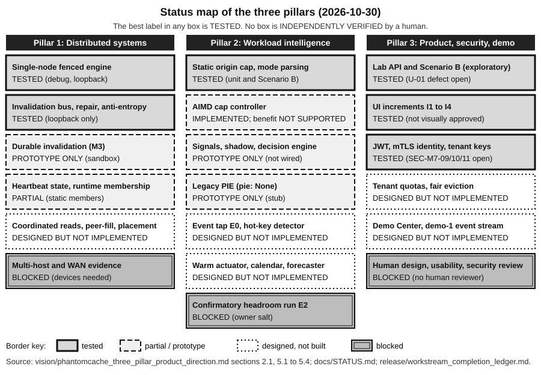

Source: `docs/research/vision/phantomcache_three_pillar_product_direction.md` sections 2.1 and 5.1 to 5.4; `docs/STATUS.md`; `docs/release/workstream_completion_ledger.md`.

The pillars come from the owner's current mandate: distributed systems engineering, workload intelligence, and product excellence with observability. The product-direction document that defines them is itself a **proposal** ("Nothing in this file is approved, implemented, or run"). The figure shows how little of the aspirational scope exists. The strongest boxes are single-node correctness and the loopback invalidation bus. Everything that makes the system a coordinated, intelligent cache is designed, prototyped, or blocked.

## 8.3 Architectural limitations

An architectural limitation is a boundary of the design, not a bug. Each item below states the limit, the evidence, and the label.

### 8.3.1 One cache per gateway, served locally

GET is served from the local cache only (Chapter 5). The cluster path is an invalidation bus between independent caches, not a distributed cache: `docs/user/limitations.md` says "there is no cross-gateway read-through", and the product-direction document (section 5.2) separates "N independent caches with an invalidation bus" from coordinated distributed caching, "which does not exist". Peer-fill, coordinated placement, cluster capacity and cluster-wide origin protection are **DESIGNED BUT NOT IMPLEMENTED**.

The cluster `GetRequest` handler in `src/dist/node.rs` is a stub that fabricates a `val_node_<id>` value (the format string appears at two sites; verified by grep). DR-029 / G4B-30 records it as a design defect: an authenticated peer can make a node store a fabricated entry. A debug loopback reproduction found no HTTP request that can reach it (disjoint key spaces), so the rating is Low as exploited today and Medium as a latent hazard (`docs/security/investigations/DR-029_cluster_get_cache_poisoning_investigation.md`; AI second look only, no fix applied). Detail: Chapter 6, section 6.6.

### 8.3.2 Placement is plain rendezvous hashing, used for DELETE

`RendezvousRouter::route_key` in `src/dist/router.rs` computes a hash per node and picks the highest. The weight multiplier is the constant `capacity_weight = 1.0` (seen at two sites). The hash is `std::collections::hash_map::DefaultHasher`, which Rust does not guarantee stable across toolchain versions (G4B-27). So routing is unweighted, not health-aware beyond membership, and not safe to compare across differently built gateways. It decides which node is the primary for a DELETE; it does not route reads. Status: **IMPLEMENTED**. The target (a fixed hash with golden vectors, owners derived from a membership epoch) is **DESIGNED BUT NOT IMPLEMENTED**.

### 8.3.3 Invalidations owed by the issuer live in memory

After a DELETE the other members are told asynchronously, with bounded retry and a repair worker, but the ledger of invalidations a peer has not yet acknowledged lives only in the issuing process's memory (Chapter 5; Chapter 6, section 6.9). Kill that process before delivery and the invalidations are lost; peers keep serving the old entry until it expires. The defect was reproduced on unmodified code (`docs/research/m3_durability/reproduction_report.md`: 92 of 92 polls stale over 10 s with the log off, in the sandbox reproduction). `docs/user/limitations.md` warns operators that **a 204 from DELETE is not proof that the object is gone from every gateway**: 204 means the canonical primary, which may be the issuing node itself, acknowledged within a 150 ms leg (G4B-09). The fix is a sandbox patch and is **not integrated** (8.8).

### 8.3.4 Freshness bounds are weak

The only gateway-side staleness mechanics are: origin freshness headers, a default of 60 s when the origin gives none, and the hard stale cap `PHANTOM_MAX_STALE_MS` (24 h by default) that limits how long an expired entry may be served stale. **Origin-supplied lifetimes have no gateway ceiling** (`docs/user/limitations.md`, `src/core/freshness.rs`). `PHANTOM_DEFAULT_TTL_MS` is validated by `src/config.rs` but not wired: `src/api/server.rs` passes the literal `60_000` to `evaluate_response_freshness` (verified at two call sites). Setting the key does nothing. This confirms `CLAUDE.md` section 5. Consequence: you cannot state a "staleness bound" for the product beyond "the origin's lifetime, or 60 s".

TTL, staleness and the cap use the wall clock (`SystemTime`), so a backwards clock step extends windows (G4A-10, PLAUSIBLE, not tested).

### 8.3.5 Tenancy is key isolation, not resource isolation

The cache key includes the tenant id and per-tenant epochs fence invalidation (`src/core/cache.rs`, `CacheKey`, `tenant_epochs`, `MAX_TENANT_EPOCHS = 10_000`; overflow falls back to the global epoch). There are **no per-tenant quotas, no per-tenant byte accounting and no fair eviction** (invariant I9 and Stages A and B of the quota plan are **DESIGNED BUT NOT IMPLEMENTED**; execution register items E5 and the P3 section of the product-direction file). A noisy tenant can fill the byte budget, and any authenticated cluster member can send tenant-scoped or full-cache invalidations (DR-027 / G4B-05, owner-named, open).

### 8.3.6 Platform and evidence scope

Only Windows x86-64 has been exercised. No Linux run exists, so Unix-specific code paths (file permissions, signal handling) are unexecuted. No result is from a physical multi-host network; no cluster larger than four nodes has run (`docs/research/m3_durability/remediation/00_status_and_plan.md` section 7). Every measurement is debug-profile, loopback or simulated. Keep these tiers labelled apart: loopback, simulated (T1), WSL2, physical host.

### 8.3.7 Operations gaps

`docs/user/limitations.md` lists as not provided: Prometheus `/metrics`, certificate hot reload, runtime configuration reload, token revocation, container image, SBOM, dependency advisory scan, code signing. In-flight connection draining and a sweeper shutdown channel are listed as open integration items D-1 and D-2 in `docs/release/deferred_integration.md`; an idle gateway was observed using more than one CPU core (single runs, debug and release, Windows; the cause is a code-reading hypothesis).

## 8.4 Known defects and risks, by theme

### 8.4.1 What the G4 register is

Gate G4 asked for two whole-product review cycles. Cycle 1 on the Rust side produced three reports (`docs/release/g4/cycle1_core_engine_review.md`, `cycle1_dist_security_api_review.md`, `cycle1_lab_intelligence_deps_review.md`): 26 findings from G4A (core engine), 38 from G4B (distribution, security, API), and 35 from G4C (lab, intelligence, freeze, dependencies). Total **99**. The disposition register (`cycle1_findings_disposition_register.md`) adds the status of each. Four caveats govern how to read it:

1. All three reviews are **AI second looks**: one AI pass each, read-only, no tests run. "CONFIRMED" in the reports means confirmed by reading code, not by an executed failing test.
2. The register closes nothing. Only owner statements (ODR-1 to ODR-4) set dispositions.
3. G4C did not read the simulation core of the lab (listed in `docs/release/known_limitations_frozen_code.md` section 1), so the absence of a finding there is absence of review.
4. The register's grouping into commit groups is an inference.

Counts by severity and disposition (register section 3.1): Critical 0; High 4; Medium 37; Low 42; Info 16. Dispositions: 75 OPEN (of which six owner-named), 20 RECORDED-LIMITATION, 2 IN-SANDBOX-REMEDIATION, 1 UNDER-INVESTIGATION, 1 REFUTED.

### 8.4.2 The 99 findings by theme

The themes below are **my grouping** of the register's IDs (the register groups by report, not by theme). I computed the counts with a short script over the register rows and checked that the totals reconcile to 99. A "RECORDED" finding is one the owner decided to record as a known limitation in frozen code (ODR-1). "Sandbox" means a fix exists as an unintegrated patch in a scratch copy.

| Theme | Count | Highest severity | Dispositions | Representative IDs |
|---|---:|---|---|---|
| Fencing, epochs, invalidation races | 4 | High | 1 under investigation (G4A-01), 3 open | G4A-01, -08, -12, -17 |
| Eviction, byte accounting, resource bounds | 8 | High (conditional) | 8 open | G4A-02 (S3-FIFO tombstones), -03 (sweeper scan), -13 (byte drift) |
| HTTP freshness semantics and config wiring | 8 | Medium | 8 open | G4A-04 (upstream `Age` ignored), -05 (`Expires: 0`), -06 (stale-if-error on 4xx), -25 (TTL literal) |
| Telemetry honesty and clocks | 5 | Medium | 5 open | G4A-10 (wall clock), -11 (hit-rate definition), F24 (percentile conventions) |
| Tenancy alias and lock robustness | 2 | Low | 2 open | G4A-19, -21 |
| Ingress, denial of service, rate limiting | 7 | High | 6 open, 1 owner-named open | G4B-01 (slow body before auth), -02, -11 |
| Cluster trust, membership, invalidation delivery | 12 | Medium | 8 open, 4 owner-named open | G4B-05 (DR-027), -06, -07, -08, -09, -27, -30 |
| Authentication, JWT, SSRF | 4 | Medium | 4 open | G4B-13 (`nbf`, lifetime), -14, -15, -18 |
| API surface and control hygiene | 14 | Medium | 13 open, 1 owner-named open | G4B-03 (`/api/control` mutates live nodes), -04, -16, -20 |
| Dependencies | 2 | Info | 2 open | G4B-34, G4C-DEP (no `cargo audit` run) |
| Scenario B and Lab live | 9 | High | 2 in sandbox (F01, F02), 7 open | F01 (U-01), F02, F06, F07, F08 |
| Frozen lab verdict and provenance | 13 | Medium | 10 recorded, 2 open, 1 refuted | F03, F04, F05, F16, F27, F34 (refuted) |
| Intelligence library (not wired) | 10 | Medium | 10 recorded | F09 to F15, F23, F25, F26 |
| Documentation consistency | 1 | Low | 1 open | F28 (README MSRV claim) |
| **Total** | **99** | | 75 open (6 owner-named), 20 recorded, 2 sandbox, 1 under investigation, 1 refuted | |

Reading the table honestly: the **runtime-serving risk is concentrated in four themes**: ingress hardening, cluster trust, fencing races, and freshness semantics. The intelligence and frozen-lab themes carry many findings but mostly in code that is **not wired into serving** (G4C's grep; the register's "LATENT" impact class). They matter for research validity and for any future activation, not for today's request path.

### 8.4.3 The six findings the owner named

ODR-4 names six findings that "must not be dismissed": G4B-01 (the HTTP ingress reads a request body before authentication, with no body timeout or connection limit), G4B-03 (`/api/control` mutates the live router nodes and a missing event sets every node Active), G4B-05 (any active cluster member can send tenant or full-cache invalidation scopes; DR-027), G4B-06 (no membership-epoch check on `InvalidateRequest`; the acknowledgement-epoch check is vacuous because the receiver echoes the sender's epoch), G4B-07 (cluster membership is static and the revocation machinery has no production trigger) and G4B-08 (live mutual-TLS connections never expire, so certificate expiry and rotation are enforced only at handshake). All six are **OPEN**. None has a fix in the tree. G4A-01 is separate: the owner calls it **unconfirmed** and ordered an investigation.

### 8.4.4 Findings I re-checked against the current tree

The register says "AI second look" and the line numbers in reports drift. I opened the current code for several High and Medium items. This is still reading, not execution.

| Finding | What I opened | What I saw | Result |
|---|---|---|---|
| G4A-01 (stale body survives an acknowledged invalidation) | `src/core/cache.rs`, `finalize_fetch` region | The fence check compares `state.generation == op_gen` and the entry epochs to `get_effective_epochs(...)`; later, in the insert block, the code calls `get_effective_epochs` again and stamps `entry_tenant_epoch` and `entry_global_epoch` with the **newly read** values. | Mechanism present in the tree as the reviewers describe it. Natural-schedule reproduction was not achieved (see 8.8). |
| G4A-02 (S3-FIFO `on_remove` leaves tombstones) | `src/core/eviction.rs`, `FaithfulS3Fifo::on_remove` | It removes the key from `freq` and `ghost_set` only; it does not touch `small_q` or `main_q`. | Present. Reachability: `set_eviction_policy` is called only from `src/control/pie.rs` (not instantiated: `pie: None` in `src/main.rs`) and from `src/intelligence/executor.rs` (`apply_policy`, no serving caller per the limitations record). `PartitionedCache::new(8)` starts with the default policy. So S3-FIFO is not reachable in the default serving path. I did not exhaustively search all callers. |
| G4A-03 (sweeper scans the shard) | `src/core/cache.rs`, sweeper loop | The loop iterates `shard.map.iter()` and breaks when `candidates_to_reclaim.len() >= max_per_shard`, so the batch limit bounds candidates, not keys inspected. | Present. |
| G4B-01 / G4B-03 (extractors before authentication) | `src/api/server.rs`: `control_handler`, `get_cache_handler`, `delete_cache_handler`, `create_app_with_lab` | `control_handler` takes `Json(payload)`; the GET and DELETE handlers take `_body: axum::body::Bytes`; all three extract the body before the handler can authenticate. The only limit found is `DefaultBodyLimit` at 512 KiB; no timeout, concurrency or connection layer. `control_handler` also falls through to "set every node Active" for an unknown event. | Present for all three handlers. The runtime effect of a slow body remains unverified. |
| G4B-13 (JWT `nbf` not validated) | `src/security/jwt.rs` | `Validation::new(HS256)` with `leeway = 10`; no `validate_nbf` assignment seen. | Consistent with the finding (library default). Not tested. |
| G4B-27 (unstable hash) | `src/dist/router.rs`, `route_key` | `DefaultHasher` used. | Present. |
| TTL literal (G4A-25, CLAUDE.md) | `src/api/server.rs` | `60_000` passed to `evaluate_response_freshness` at two sites; `src/config.rs` registers the key as not wired. | Present. |
| F28 (README MSRV) | `README.md` | Line says `cargo 1.75+`; `Cargo.toml` has no `rust-version`. G4C says locked crates need about 1.88. | Present; the 1.88 figure is G4C's, I did not re-derive it. |

I did **not** re-check the lab and intelligence findings by execution, and I did not run any test.

### 8.4.5 The sealed result and what the limitations record says

The sealed M6 evaluation (Tier 1, **SIMULATED**; Chapter 7, section 7.6) ran once and found H1 **NOT SUPPORTED** (`docs/research/m6_sealed_results.md`). `docs/release/known_limitations_frozen_code.md` says the result "has NOT been independently reviewed by a human or an external reviewer", that G4C did not read the simulation core, and that the run is a forced-adapt comparison on a simulator. Four of 56 hashed freeze files differ from the frozen values (`Cargo.toml`, `src/lib.rs`, `src/lab/eval.rs`, `tests/integration/m6_research_evaluation_tests.rs`); an addendum written after the run explains all four, and the `eval.rs` verifier change is a refactor (+108/-2), not a purely additive edit. The frozen versions can be rebuilt only from copies outside the repository (G4C F27). Treat the freeze chain as reproduced by the lead and an AI, not audited by a person.

### 8.4.6 Other recorded risks

- **SEC-M7-09, -10, -11** (role alias and bare tokens, SSRF range gaps, rate limiting and JWT lifetime) are open (`docs/security/m7_security_review.md`; execution register E3, queued). SEC-M7-01 to -08 are recorded as fixed and tested.
- **Hostile-input paths**: the HTTP ingress has no host or origin guard in anonymous mode (G4B-04) and `/api/events` has no stream cap (G4B-02).
- **Telemetry honesty**: the hit-rate function returns 1.0 with no data (G4A-11). UI values must be labelled measured, simulated, inferred or unavailable (`CLAUDE.md` section 4); the UI increments I1 to I4 aim at that, but visual and usability acceptance is open.
- **Dependencies**: 288 locked packages, two TLS crypto stacks, broad feature flags; **no advisory scan has been run** (G4C-DEP, execution register E4 queued).

## 8.5 Incomplete and deferred functionality

| Item | State | Why it is not done |
|---|---|---|
| Durable invalidation log, drain on shutdown, restart replay | PROTOTYPE ONLY (sandbox patch set, not integrated) | Protected-core files; needs independent review and owner approval; design choices open (fail-open or fail-closed on log errors, default fsync policy, drain deadline) |
| Heartbeat-based failure detection (node state change) | DESIGNED BUT NOT IMPLEMENTED | Heartbeat frames and idle-connection keepalive are IMPLEMENTED, but no code path lets a heartbeat change node state (G4B-12) |
| Runtime membership, certificate revocation trigger, connection ageing | PARTIAL | Static member file; machinery without a production trigger (G4B-07, -08) |
| Peer-fill, stable placement, coordinated capacity | DESIGNED BUT NOT IMPLEMENTED | Gated on durable invalidation, a formal fill model and independent review |
| Tenant quotas and fair eviction | DESIGNED BUT NOT IMPLEMENTED | Frozen `src/core/cache.rs`; needs addendum 2 and owner approval |
| Hot-key detection (`HeavyHitterDetector` library) | PROTOTYPE ONLY | Library in frozen `src/intelligence`, unit-tested, not wired into the serving path; `CountMinSketch` in `src/intel/sketch.rs` is used only by a unit test (`tests/unit/wp2_tests.rs`) |
| Event tap, pre-warming, forecasting | DESIGNED BUT NOT IMPLEMENTED | Frozen `src/intelligence`; experiments E0, E4, E9 first |
| PIE as a counterfactual canary | PROTOTYPE ONLY | `src/control/pie.rs` is a legacy threshold stub with a literal `expected_utility`; `PieDecisionEngine` is not wired. The `PHANTOM_INTELLIGENCE=canary` mode applies the origin cap to all fetches and has no rollback in the serving path (F14) |
| Release-profile suite, 2 h soak, benches on a quiet machine | DEFERRED | Needs an exclusive machine and a stable tree |
| Multi-host LAN validation | BLOCKED | Needs physical devices (owner) |
| Human design, usability, accessibility and security review | BLOCKED | Needs human reviewers (owner) |
| `/metrics`, TLS hot reload, config reload, token revocation | DEFERRED | Owner decision O7-4 and others |
| Graceful connection draining | DEFERRED | Integration item D-1 |

## 8.6 Design trade-offs

State each trade-off with the alternative. Where the repository does not record why an alternative was rejected, the text says "our reasoning, not a recorded decision".

- **Local-only GET versus read-through.** Local GET gives a hot path with no network round trip and no peer dependency. The price is N independent caches, so each node pays its own cold misses and the origin sees up to N fills of the same object. Read-through (peer-fill) would reduce origin load but adds a failure and consistency surface. The owner's roadmap defers it behind durable invalidation. (Our reasoning for the cost; the deferral is recorded in the product-direction file section 2.2 rule 1.)
- **Fencing, coalescing and the invalidation bus.** The mechanisms are explained in Chapters 4 and 5; the trade-offs are: generations plus epochs cost extra state per key and a second lock, and their weak point is G4A-01 (8.4.4); single-flight protects the origin but waiters share the leader's fate, and requests after an invalidation can join a pre-invalidation fetch (G4A-08, limitation L3); best-effort fan-out with repair keeps the write path fast and converges only while the issuer survives, without linearizability, whereas a consensus log would order better at higher latency and complexity. The repository records the failure model and bounds as clauses in the product-direction document (section 7), not as an ADR that rejects consensus.
- **Static origin cap over adaptive control.** After the sealed negative result, the research lead chose MVP-B: the static gateway with a configurable static origin cap; the adaptive controller is **not** promoted to serving (`m6_sealed_results.md`, "MVP decision"). This is a recorded decision by the research lead, still provisional until the release gates pass.
- **Frozen files versus fixing defects.** The pre-registration freeze protects the integrity of the sealed result. The price is that defects in frozen files (F03 to F26) are recorded as limitations rather than fixed, because any edit needs a signed addendum. That is a deliberate owner decision (ODR-1).
- **Sandbox remediation.** Rust fixes are built in scratch copies and not merged. This protects the protected core and the evidence, but it means the reported defects remain in the tree.

## 8.7 Technical debt and documentation honesty

### 8.7.1 Debt in the tree

- **Everything uncommitted** (8.2.1). The single largest delivery risk.
- **Protected-core gates.** `src/core/**`, `src/lab/**`, `src/intelligence/**`, `src/lib.rs` and `Cargo.toml` are frozen or protected. Changes touching fencing, epochs or invalidation need an independent review pass and a test that fails without the change (`CLAUDE.md` section 5).
- **Preregistration holds.** The two commitment files and the code holding commitment strings are on hold for an owner check offline, which blocks committing the Rust code groups (execution register, owner decisions register "Still open").
- **Formatting.** `cargo fmt --check` fails (38,042 diff lines); formatting would rewrite frozen files, so it waits for addendum 2.
- **Line endings.** `core.autocrlf=true` is set. Commit `df68eaa` added a `.gitattributes` that marks exactly four hash-pinned frozen files `-text` (its comment cites DEC-006, owner-approved, Option B), so their bytes are not converted. There is no repository-wide normalisation, so other files can still change line endings on another machine.
- **No release-profile suite**; the soak (2 h) has not been run.
- **Weak tests.** Tests that pin weak claims (golden trace, cap counter) are flagged for rewrite (G4A section 5); the UI fixture masked U-01 (`ui/test/lab.view.test.mjs`, F01).

### 8.7.2 Statements in project documents that are out of date

I compared the main status-bearing documents with the current code and records.

| Document | Statement | Reality (current evidence) |
|---|---|---|
| `docs/handoff/00_START_HERE.md` | "Phase 4 Remediated, Verified, and Formally Accepted (242/242 tests passing across 19 targets)"; "Do NOT begin Phase 5" | The same file carries a notice that prior claims were audited and corrected (`docs/handoff/CORRECTIONS.md`). Formal acceptance is not recorded for any milestone; the test baseline is now 851 across 75 targets (debug). `CLAUDE.md` section 6 says the "Phase 4 accepted / zero P0" claim is not supported. |
| `docs/handoff/05_OPEN_RISKS_AND_NEXT_STEPS.md` | "ZERO open P0 code blockers remain in Phase 4" | Superseded: G4B-01 and others are open; its roadmap is marked historical. |
| `docs/handoff/00_START_HERE.md` | "64-Partition Lock Striping" | `src/main.rs` constructs `PartitionedCache::new(8)` (verified); `new` takes `num_shards` and asserts a power of two. The gateway starts with 8 shards, not 64. A handoff claim, not verified elsewhere. |
| `CLAUDE.md` section 6 | evictors "are scans"; "the only staleness bound is a fixed 60 s TTL"; reported baseline 242 tests | Section 5 of the same file lists `ShardEvictionPolicy` with `FaithfulSieve`, `FaithfulLru`, `FaithfulS3Fifo` (verified present in `src/core/eviction.rs`), so the "scans" note is outdated; origin headers and a stale cap also bound staleness (the 60 s is the default only); 242 is historical. Parts of section 6 already carry "OUTDATED" annotations. |
| `CLAUDE.md` section 6 / `src/main.rs` startup text | "startup message at `main.rs:368`" says peer invalidations do not purge the HTTP cache | The mTLS path builds the local node with `VirtualNode::new_with_cache(node_id, cache.clone())` (verified at `src/main.rs` near line 332), so the local node shares the HTTP serving cache. The insecure-cluster message in `main.rs` now describes a different situation (no listeners, DELETE reports a gateway timeout). But `src/config.rs` still emits "peer invalidations do not purge this gateway's HTTP cache" (verified near line 858) — contradicts the mTLS path (G4B-32). |
| `README.md` | "cargo 1.75+" | False per G4C F28 (about 1.88 needed; not re-derived). |
| `docs/research/claims_ledger.md` C6 | "zero stale reads after 50 ms" | Amended in the same file (section 5, C6 amendment): cold first use took 35 to 60 ms in every isolated run, so "P(stale)=0 at 50 ms" is **not supported**. |
| `docs/research/claims_ledger.md` section 5 / round 2 | "histogram has no callers in `src/`" | Partly outdated. `TelemetryCollector::record` and `record_us` do feed `AtomicLogLinearHistogram`. But no production code reads its percentiles: `src/api/server.rs` calls only the ring-buffer version (`calculate_percentiles_us`), and `calculate_percentiles_histogram_*` have no caller outside tests (grep, 2026-10-30; Chapter 6, section 6.12.2). |
| `docs/research/code_findings.md` (2026-10-28) | evictors are scans; SIEVE "is not SIEVE" | Predates the faithful policies. Treat as historical. |
| `docs/STATUS.md` | UI tests "298" | Superseded: the suite is 483 tests in 30 files after the redesign added tests (measured, 8.2.2). Minor. |

The reading rule that follows: **trust `docs/STATUS.md`, the ledger and verification register for status; trust the code for behaviour; treat the handoff and the README as history.** The register also holds an acknowledged discrepancy of its own: G4A-19 and the G4B refutation of the `__default__` tenant alias point in different directions and nobody has reconciled them (register section 2, discrepancy 1).

## 8.8 Remediation status: what is committed and what is not

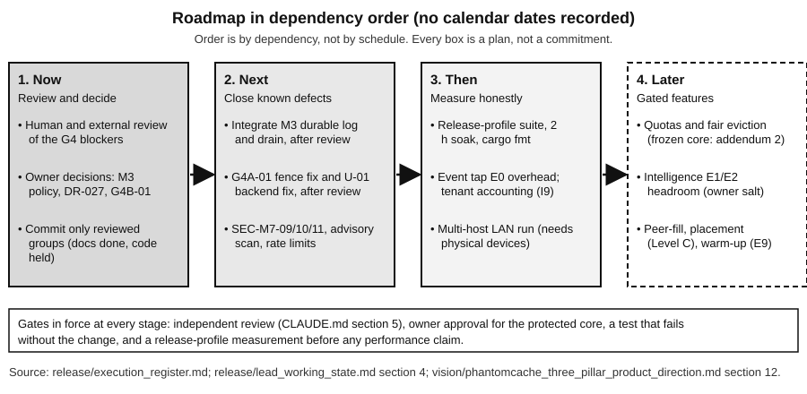

Source: `docs/release/execution_register.md`; `docs/release/lead_working_state.md` section 4; `docs/research/vision/phantomcache_three_pillar_product_direction.md` section 12.

**Documentation and tooling commits** (`8523cc1`, `3e6e03e`, `caeedfd`, `df68eaa`: apple-design skill, docs-lint tool, animation skills, `.gitattributes` for the four frozen files). Applied to the main tree: yes, committed. Evidence: blob hashes checked by the lead.

**U-01 backend fix** (cancelled or partial Scenario B runs must not carry a completed mechanism verdict).

- *Where:* `docs/research/u01_backend/u01_backend.patch`; sandbox `D:\Temp\sbx_u01`. Applied to the main tree: **No, not yet**: the owner approved integration with conditions (DEC-001, `docs/design/OWNER_DECISION_REGISTER.md`) and an integration agent is working in the working tree, but no integration record exists at the time of writing (`docs/research/u01_backend/integration/` is absent), and nothing is committed.
- *Evidence quality:* 5 of 6 new tests fail on unmodified source and pass after the fix; the target ran 65 passed, 0 failed, 2 ignored; debug profile, one test target, no clippy, patch not tested with `git apply` (`u01_backend/status.md`).
- *Gate:* an AI independent review is complete (`independent_review.md`; AI, not human); owner approval is given with conditions (DEC-001, ODR-2); UI contract in `contract.md`. Still open: finishing integration, the conditions checklist, and any human review.

**G4A-01 fence fix proposal** (stamp the epochs captured by the fence check).

- *Where:* `docs/research/g4a01_race/proposal.patch`. Applied: **No**.
- *Evidence quality:* reproduced only with an **injected yield point** in a sandbox (two failing tests, a passing control); 20 s of unhooked three-thread stress, about 3.16 million fills, 0 violations; the natural window is nanoseconds wide and its natural frequency was not measured.
- *Gate:* independent review, a decision on a permanent test hook, owner approval for the protected `src/core/cache.rs`.

**M3 durable invalidation** (opt-in log, replay, shutdown drain, detached DELETE leg, crash-point tests).

- *Where:* `docs/research/m3_durability/` and `remediation/patches/`; sandbox `D:\Temp\sbx_m3`. Applied: **No**.
- *Evidence quality:* sandbox report: 6 of 8 new unit tests and 1 of 15 process tests fail on the unfixed patch and pass on the fixed one; 21 unit tests pass; debug, loopback, one Windows host. The report lists what remains UNVERIFIED (no Linux, no power-loss test, no multi-host, AI-only review). **With the log unset (the default) the defect would remain even after integration.**
- *Gate:* independent review brief, owner approval; touches `router.rs`, `main.rs`, `server.rs`, `config.rs`, `lib.rs`.

**DR-029, DR-027, SEC-M7-09/10/11, advisory scan, quotas, intelligence tap** (execution register E1, E3, E4, E5, E6). Applied: **No**; queued behind M3, nothing written. Evidence: none. Gate: per item.

The M3 status file says "fix prepared and verified in a sandbox" while `docs/release/lead_working_state.md` listed the M3 agent as still running at the last update (discrepancy; I did not resolve it). Nothing in this table has been reviewed by a human.

## 8.9 Future architecture

This section describes plans. Every item is **DESIGNED BUT NOT IMPLEMENTED** or **PROTOTYPE ONLY** unless stated. The source for the stages is the proposal in `docs/research/vision/phantomcache_three_pillar_product_direction.md` sections 12 to 14, which the owner has not approved as a whole.

### 8.9.1 M3: durable invalidation

The idea in plain words: before a gateway tells peers about a delete, it writes the debt ("peer B still owes me an ack for key K") to a file. If it dies and restarts, it reads the file and finishes the job. A small explanation of the terms: a **write-ahead log** records an intent before acting; **replay** reads it after restart; **drain** waits at shutdown for debts to be settled; **fsync policy** decides when bytes are forced to disk.

The sandbox design (`docs/research/m3_durability/design.md`, `remediation/00_status_and_plan.md`): a new `src/dist/durable_log.rs`, ledger hooks in `router.rs`, replay before the repair worker starts, a shutdown drain, and a detached DELETE leg. The open owner choices include fail-open versus fail-closed on log errors, the default fsync policy, the drain deadline and debt age-out. Falsifier: a crash-point matrix of multi-process tests (15 in the sandbox) that kills a node at defined points and checks convergence. Not yet true: Linux, power loss, multi-host.

### 8.9.2 Tenant quotas

Stage A adds per-tenant byte accounting (invariant I9) behind a hook, with a property test over random operations and an "omit one site and the test must fail" check. Stage B adds quotas and fair eviction, checked by a noisy-neighbour suite. Both touch the frozen `src/core/cache.rs` and need addendum 2, owner final approval and independent review. Until then, tenancy is key isolation only (8.3.5).

### 8.9.3 Multi-host validation

A plan and runbook for a physical LAN run are being prepared (execution register N5). It is **BLOCKED** on devices and operating systems from the owner and on human reviewers. The proposed rule is that the label `MULTI_HOST_LAN` is created only after a real run is retained. Until then, every cluster result is loopback on one machine, and the UI must never draw three processes on one host as three machines.

### 8.9.4 Intelligence experiments E0 to E2

The mode ladder is offline, shadow, canary, active, and every decision is validated by a separate safety layer against hard caps (staleness, origin load, memory), which the execution layer enforces regardless of any intelligence decision (`CLAUDE.md` section 6b).

- **E0**: measure the cost of an event tap and observation pipeline and check counts against existing counters. Exploratory first; release build; kill criterion: hot-path adder beyond a budget fixed before the run.
- **E1**: check that a load-dependent origin plant exists and behaves correctly in the simulator (validity work; kill if rank disagreement between simulator tier and real-process tier exceeds 25% of paired scenarios).
- **E2**: the headroom question: can any per-scenario cap beat one good static cap by at least 3 percentage points of goodput? The protocol is a **draft** (`docs/research/intelligence_e2_headroom_protocol_DRAFT.md`). A dry run is exploratory; a confirmatory run needs an E1-validated plant, a new owner-generated salt and a freeze. If E2 returns NO_HEADROOM, adaptive caps are abandoned and only the advisor continues.

These stay **BLOCKED** or exploratory until the owner approves lab changes and generates a salt offline. No agent may generate, store or propose a salt. Any change to `src/lab` or `src/intelligence` needs addendum 2. An ML selector is admitted only after a non-ML selector passes a five-part gate; claim C12 ("ML failed to beat heuristics by 0.020") is UNVERIFIED because the test asserts no comparison (`claims_ledger.md` section 4).

### 8.9.5 The UI redesign

Increments I1 (foundations), I2 and I2b (Phantom Lab), I3 (Simulation page retired to an honest explainer) and I4 (shell and non-Lab pages) are **IMPLEMENTED and TESTED** at the UI-test level (483 tests at the last run; 298 or 299 when the contrast and a11y figures here were recorded; contrast 196/196, a static a11y lint on 74 combinations with 0 issues, Vite build ok at 14:26). The owner has since approved the toolkit and redesign phase, so the UI implementation phase is open (lead working state section 3b). Not done: increment I5 (final polish), the Track 2 accessibility report beyond its raw evidence, re-verification of browser-round findings on the current UI, and human design, usability and screen-reader review. **Visual quality is not approved; owner decision O8-2 is open.** The three high usability findings U-01 (verdict-like result on a cancelled run; backend half unintegrated), U-02 (no control for the gateway address) and U-03 (progress "0 of 2 units" looks stalled) came from an AI walkthrough, not human data.

## 8.10 Production-maturity checklist

Read "Status" as the honest present state. "No" means absent; nothing here is a claim of readiness.

| Area | Requirement | Status |
|---|---|---|
| Correctness | Fencing, byte accounting, freshness tested | TESTED (debug); open G4A-01 and freshness gaps |
| Correctness | Independent review of the protected core | UNVERIFIED (AI second look only; no human) |
| Correctness | Mutation or model evidence that fencing tests fail without the change | DESIGNED BUT NOT IMPLEMENTED |
| Durability | Issuer-crash-safe invalidation | PROTOTYPE ONLY (sandbox; default would stay off) |
| Distribution | Multi-host run on real network | BLOCKED |
| Distribution | Larger than four nodes, WAN | UNVERIFIED (not run); WAN deferred |
| Security | Ingress hardening (auth before body, timeouts, connection limits, rate limits) | PARTIAL; G4B-01, -02, -11 open |
| Security | Cluster peer authorization per scope | DESIGNED BUT NOT IMPLEMENTED (DR-027) |
| Security | JWT lifecycle (`nbf`, max lifetime, revocation) | PARTIAL |
| Security | Dependency advisory scan and SBOM | DEFERRED |
| Security | External or human security review | BLOCKED |
| Performance | Release-profile suite, repeated measurements with intervals | DEFERRED |
| Performance | Any published latency or throughput number | none made; the project declines to publish one |
| Operations | Graceful drain, health endpoints | health endpoints TESTED (`tests/integration/m7_health_tests.rs`); drain DEFERRED |
| Operations | Metrics export, config reload, TLS reload | DEFERRED |
| Operations | Linux and container packaging | UNVERIFIED |
| Operations | Idle CPU behaviour | PARTIAL (observed high; cause hypothesised) |
| Tenancy | Quotas and noisy-neighbour isolation | DESIGNED BUT NOT IMPLEMENTED |
| Observability | Every UI value labelled by provenance | TESTED (static scan `check-forbidden`, DOM tests); visual and usability acceptance open |
| Process | Everything committed and pushed | No (nothing beyond four documentation or tooling commits) |
| Process | Formal owner acceptance of milestones | Not recorded |
| Process | Two review cycles (G4) | PARTIAL (cycle 1 Rust only) |

## 8.11 Claims you must NOT make

| Tempting overclaim | Accurate statement | Evidence |
|---|---|---|
| "PhantomCache is production-ready." | It is a research prototype with an experimental cluster mode. It has no release-profile suite, no advisory scan, open High findings, and has been run only on Windows. | `docs/STATUS.md` sections 3 to 5b; `docs/user/limitations.md`; register 8.4 |
| "It is a distributed cache." | Each gateway has its own cache; the cluster adds an authenticated invalidation bus with repair. GET is served locally. Coordinated reads do not exist. | `docs/user/limitations.md`; product-direction 5.2; `src/dist/router.rs` |
| "DELETE returns 204, so the object is gone everywhere." | 204 means the canonical primary acknowledged within a 150 ms leg; other members are told asynchronously, and owed invalidations are lost if the issuer dies. | G4B-09; `docs/user/limitations.md` durability section; M3 reproduction |
| "Invalidations survive crashes." | Not in the tree. A sandbox patch with an opt-in log exists and is not integrated; the default would still lose them. | `m3_durability/remediation/00_status_and_plan.md` |
| "Zero stale reads after 50 ms" or "bounded staleness." | Not supported. Cold first use took 35 to 60 ms; the only gateway bound is the origin lifetime or 60 s, and the stale cap bounds stale serving only. Origin lifetimes have no ceiling. | `claims_ledger.md` C6 amendment; `freshness.rs`; `limitations.md` |
| "Linearizable" or "strongly consistent." | No. Per-node ordering and eventual convergence under the loopback failure model that was tested. No linearizability claim has a stated failure model, bound and falsifying test. | `CLAUDE.md` section 4; product-direction 7.4 |
| "Adaptive or intelligent caching improves performance." | Not established. The sealed simulation found H1 NOT_SUPPORTED; Scenario B gave TRADE_OFF_FAILURE for both arms. This shows no benefit for this controller on these plants, not that adaptation cannot work. | `m6_sealed_results.md`; `g1_verdict.md`; `scenario_b_interpretation_notice.md` |
| "The PIE is a working canary controller." | `src/control/pie.rs` is a legacy threshold stub with a literal utility; it is `pie: None` in `src/main.rs`. `PHANTOM_INTELLIGENCE=canary` applies the cap to all fetches with no rollback in the serving path. | `pie_audit.md`; `src/main.rs`; F14 |
| "It uses machine learning." | No ML ships. An ML selector is gated and its negative claim is itself unverified. | `claims_ledger.md` C12; `phantom_intelligence_phase.md` |
| "PhantomCache is fast" or "faster than Redis, Nginx or Varnish." | The repository contains benchmark results with a stated profile, host and limits; none establishes a release-profile or comparative claim, and this book makes no superiority claim. | Chapter 6, section 6.13; `claims_ledger.md` C3, C5 |
| "Eviction is 200 times faster" or "controller overhead is below 1% CPU." | Untraceable. The figures appear in completion reports and test literals; no release-build measurement backs them. | `claims_ledger.md` C3, C5 |
| "Independently audited or verified." | Reviewed by AI second looks. No human or external reviewer has checked anything. | ledger section 6; verification register |
| "Secure by design / hardened." | Authentication, roles, mTLS and SSRF filtering exist and are tested. Open: pre-auth body read, live-control mutation, member flush capability, no rate limits, no advisory scan. Not security-certified. | register 8.4.3; `m7_security_review.md` |
| "Multi-tenant isolation with quotas." | Tenant-keyed entries and tenant epochs only. No quotas; any authenticated member can flush any tenant. | 8.3.5; DR-027 |
| "`PHANTOM_DEFAULT_TTL_MS` sets the default lifetime." | Validated but not wired; the effective default is always 60 s. | `src/config.rs`; `src/api/server.rs`; `CLAUDE.md` section 5 |
| "SIEVE, LRU and S3-FIFO are benchmarked and superior." | Faithful implementations exist in `src/core/eviction.rs`; relative performance has no release-grade measurement; S3-FIFO has a tombstone defect (unreachable by default). | README; G4A-02 |
| "The UI is finished / accessible." | Increments I1 to I4 are implemented and pass automated checks. Visual quality is not approved, no screen-reader or human usability test exists. | `STATUS.md` M8 row; verification register V-07 to V-19 |
| "Everything is saved / committed." | Almost everything is uncommitted; one local backup on the same machine. | 8.2.1 |
| "Tests passing means it is correct." | 851 debug tests pass; several assert stub behaviour. | `CLAUDE.md` section 3; 8.2.2 |

## 8.12 Implementation versus roadmap matrix

Exactly one label per capability. "Why" gives the one reason that justifies the label. Reading rule used in every chapter and appendix: TESTED means IMPLEMENTED and a named test exercises it (Chapters 4 and 5 write this "IMPLEMENTED, TESTED"; it is the same label), and "IMPLEMENTED, PARTIAL" is written here as PARTIAL. No row is INDEPENDENTLY VERIFIED: nothing in this repository has been checked by a human or external reviewer.

| Capability | Status | Why |
|---|---|---|
| Single-flight coalescing | TESTED | Named integration tests; coalescing under cancellation reviewed only by reading |
| Generation fencing against DELETE | TESTED | `test_delete_fences_in_flight_fill_race`; a single interleaving |
| Tenant and global epoch fencing | PARTIAL | IMPLEMENTED, but the G4A-01 race is reproduced in a sandbox and its fix is not integrated; G4A-08 and G4A-17 open |
| Byte accounting (I1 to I8) | TESTED | `audit_bytes` equality tests; G4A-13 drift on a rare path |
| Freshness (RFC 9111 subset) | PARTIAL | `Age`, `Expires: 0`, stale-if-error scope gaps (G4A-04 to -06) |
| Default TTL setting | PARTIAL | Validated, not wired |
| Stale-while-revalidate, stale-if-error, hard stale cap | TESTED | Counter-based gate is weak (G4A-18) |
| SIEVE (default) and LRU eviction | TESTED | Weakly: pinned scans are not O(1) (G4A-20); no hit-ratio check against the literature; no release benchmark |
| S3-FIFO eviction | PARTIAL | IMPLEMENTED with the open defect G4A-02 (tombstones); not selected by default |
| Lazy sweeper | PARTIAL | Scans the shard under the lock; shutdown channel dropped (D-2) |
| Telemetry log-linear histogram | TESTED | Recording and bucket arithmetic only (`telemetry_redesign_tests`); the histogram is fed but has no production percentile reader (Chapter 6, 6.12.2) |
| HTTP ingress hardening | PARTIAL | G4B-01, -02, -04, -11 open |
| JWT roles, mTLS identity | TESTED | M7 security tests; lifecycle gaps open |
| SSRF upstream filter | TESTED | Range gaps (G4B-15) |
| Cluster invalidation fan-out, repair, anti-entropy | TESTED | IMPLEMENTED and tested on loopback, debug build, at most four nodes; labelled EXPERIMENTAL in `main.rs`; effectiveness UNVERIFIED; 204 is not a cluster-wide acknowledgement (G4B-09) |
| Durable invalidation | PROTOTYPE ONLY | Sandbox patch, not integrated |
| Graceful connection drain | DEFERRED | Integration item D-1 |
| Heartbeat-based failure detection (node state change) | DESIGNED BUT NOT IMPLEMENTED | Heartbeat frames and idle-connection keepalive are IMPLEMENTED (`pool.rs`), but no code path lets a heartbeat change node state (G4B-12) |
| Runtime membership and revocation | PARTIAL | Machinery, no production trigger |
| Rendezvous routing for DELETE primary | IMPLEMENTED | Unweighted, unstable hash |
| Peer-fill, coordinated reads, stable placement | DESIGNED BUT NOT IMPLEMENTED | A stub handler exists and is a defect, not the feature |
| Multi-host operation | BLOCKED | No devices |
| Tenant keyspace isolation | TESTED | Tenant-keyed entries and epochs |
| Tenant quotas, fair eviction | DESIGNED BUT NOT IMPLEMENTED | Frozen core |
| Rate limiting | DEFERRED | SEC-M7-11 queued |
| Static origin concurrency cap | TESTED | Scenario B and unit tests |
| AIMD cap controller | TESTED | Arithmetic and cap unit tests only; on the serving path only when a cap is configured in canary or active mode (default off); benefit NOT SUPPORTED |
| Signals, shadow evaluator, decision engine | PROTOTYPE ONLY | Not wired; unsound statistics (F12, F13) |
| Legacy PIE | PROTOTYPE ONLY | `pie: None` |
| Intelligence `canary` mode | PARTIAL | Cap only; no canary or rollback in serving |
| Hot-key detection (`HeavyHitterDetector`, Count-Min plus Space-Saving) | PROTOTYPE ONLY | Library in `src/intelligence/signals.rs`, unit-tested and used by the lab simulator's admission filter, not wired into the serving path; the older `CountMinSketch` in `src/intel/sketch.rs` is used only by a unit test |
| Event tap, pre-warming, forecasting | DESIGNED BUT NOT IMPLEMENTED | Experiments E0, E9, E10 first |
| ML selector | DEFERRED | Gate unmet; negative claim unverified |
| Lab API and Scenario B | TESTED | Exploratory; U-01 defect open |
| Sealed M6 evaluation | TESTED | Executed once, Tier 1 simulated, not human-reviewed |
| T1 to T2 (simulator to real) agreement | UNVERIFIED | No agreement study run |
| Release-profile performance measurements | DEFERRED | Needs a quiet machine |
| Dashboard UI I1 to I4 | TESTED | Automated checks only |
| Visual acceptance of the UI (O8-2) | UNVERIFIED | Owner decision open |
| Demo Center and `demo-1` stream | DESIGNED BUT NOT IMPLEMENTED | Proposal only |
| Human review of design, usability, security | BLOCKED | No human reviewer |
| Linux and container deployment | UNVERIFIED | Never run |
| Metrics export, TLS and config reload | DEFERRED | Not provided |
| Dependency advisory scan and SBOM | DEFERRED | Queued |

## 8.13 Preparing to defend the project

The judge boxes are grouped by theme. Their answers are written to be said aloud and to survive follow-ups. They share one rule: **never claim what the evidence labels forbid, and say so before the judge finds it.**

### 8.13.1 Honesty and verification

::: judge
**JUDGE MAY ASK**

Question: Who has independently verified this system?

**Suggested answer** (about 30 to 60 seconds spoken, plain English):

No human has. Every review so far is an AI second look: a separate AI session or the lead re-running a command, all inside one tooling environment. We label them that way everywhere. What we have is breadth: 851 recorded debug tests, three read-only reviews that produced 99 findings, an independent Node recomputation of the Scenario B results, and a hash-checked freeze chain for the sealed evaluation. What we have not got is a human reviewer, an external security review, or a physical multi-host run. Those are listed as blocked in our register, waiting on reviewers and devices.

**If the judge asks further:**

"Doesn't an AI second look count?" It counts as evidence that a second reader found things the first missed, and it did: G4 found a High finding the authors had not. It does not count as independence, because the reviewers share training, tools and prompts with the authors. A human review is the next step.

**Evidence to know:** `docs/release/workstream_completion_ledger.md` section 6; `docs/release/verification_register.md` (independence classes); status label INDEPENDENTLY VERIFIED: none.
:::

::: judge
**JUDGE MAY ASK**

Question: Your tests pass. Why should I believe the system is correct?

**Suggested answer** (about 30 to 60 seconds spoken, plain English):

You should not believe correctness from passing tests, and our own rules say so. The 851 tests run in debug mode on one Windows machine. Some assert stub behaviour, for example the legacy PIE tests. The stale-cap counter is close to a tautology, and one UI fixture even masked a real defect. What the tests do give is regression protection and a set of invariant checks, such as byte accounting equality and generation fencing in single-process cases. For anything stronger we have named gaps: no mutation test showing fencing tests fail without the fence, no model checking, no release-profile run.

**If the judge asks further:**

"What is the weakest test?" The one behind the stale-cap violation counter (G4A-18), because, as the reviewer describes it, the counter is near-tautological (I did not re-derive that). The fix is to rewrite it so that it attempts a violation.

**Evidence to know:** `docs/research/code_findings.md` F3; G4A-18; G4C F01 fixture at `ui/test/lab.view.test.mjs`; `claims_ledger.md` section 4.
:::

### 8.13.2 Consistency and the distributed layer

::: judge
**JUDGE MAY ASK**

Question: A client sends DELETE and gets 204. Is that content guaranteed gone from every node?

**Suggested answer** (about 30 to 60 seconds spoken, plain English):

No. A 204 means the issuing gateway purged its own cache and the canonical primary for that key acknowledged within 150 milliseconds. That primary can be the issuer itself. The other members are informed asynchronously with retries, a repair worker and anti-entropy, but the list of invalidations still owed lives only in the issuer's memory. If the issuer is killed first, peers keep serving the old object until its freshness lifetime ends. We reproduced that on unmodified code. A fix with a durable log exists as a sandbox patch, not in the tree, and it is opt-in. So for deletion-critical content our documentation tells operators to set a short `s-maxage`, re-issue DELETEs after any restart, and verify by reading through each gateway.

**If the judge asks further:**

"What staleness bound do you offer?" None beyond the origin's lifetime, or 60 seconds when the origin gives none. We measured a warm loopback propagation P99 of about 10 to 14 ms in a debug build, but cold first use took 35 to 60 ms, so we withdrew the "zero stale after 50 ms" claim.

**Evidence to know:** G4B-09; `docs/user/limitations.md` "Cluster invalidation durability"; `m3_durability/reproduction_report.md`; `claims_ledger.md` C6 amendment; label PROTOTYPE ONLY for durability.
:::

::: judge
**JUDGE MAY ASK**

Question: Is this linearizable? What is your consistency model?

**Suggested answer** (about 30 to 60 seconds spoken, plain English):

It is not linearizable and we do not claim it. Each node orders its own fills and deletes using generation fencing, so a fetch that started before a delete cannot store its result after it. Across nodes the model is eventual convergence of invalidations under a loopback fault model we tested. Concretely: N independent caches and an invalidation bus. We have drafted numbered consistency clauses with a failure model, a bound and a test that could falsify each, but they are drafts waiting on owner ratification, and several are known to be unmet.

**If the judge asks further:**

"Is even the single-node fencing airtight?" Not proven. A reviewer found that the epochs are read twice in the fill path, so a pre-invalidation body can survive an acknowledged tenant invalidation if the invalidation lands in a nanosecond window. We reproduced it only with an injected yield; a 20-second natural stress run saw nothing. A three-line fix is proposed and not applied because the file is protected.

**Evidence to know:** G4A-01; `docs/research/g4a01_race/`; `src/core/cache.rs::finalize_fetch`; product-direction section 7.
:::

::: judge
**JUDGE MAY ASK**

Question: Can one tenant, or one cluster node, hurt another?

**Suggested answer** (about 30 to 60 seconds spoken, plain English):

Yes, in two ways. First, tenants are separated by key and by invalidation epoch, but there are no quotas, so one tenant can consume the byte budget. Second, any authenticated cluster member can send tenant-scope or full-cache invalidation frames, and the receiver does not check scope against the sender's rights. That is finding DR-027 or G4B-05, and the owner has named it as one that must not be dismissed. The plan is per-member scope authorization and tenant-flood caps, in a sandbox, queued behind the durability work. It needs a valid cluster certificate, so the attacker is an insider or a compromised member.

**If the judge asks further:**

"What about a bad peer fabricating cache content?" The cluster `GetRequest` stub writes a placeholder value into the node cache. We reproduced it, and an AI review agreed that no HTTP request can reach that entry because the key spaces are disjoint. We rate it low as exploited today and medium as a latent hazard.

**Evidence to know:** G4B-05, G4B-30; `docs/security/investigations/DR-029_*`; `src/dist/node.rs` (the `val_node_` format); status PARTIAL for security.
:::

### 8.13.3 Intelligence and performance

::: judge
**JUDGE MAY ASK**

Question: The sealed evaluation says H1 is NOT_SUPPORTED. What does that mean for your "intelligent" caching claim, and what happens to the product?

**Suggested answer** (about 30 to 60 seconds spoken, plain English):

It means we have no evidence that our adaptive controller beats a well-tuned static origin cap, so we do not claim that it does. In the simulated, pre-registered, run-once evaluation, the adaptive arm did not reduce peak origin concurrency in any of eight scenarios, and in seven it was credibly worse. The unconstrained tuning optimum was itself a static cap. Our research lead therefore chose the static gateway as the minimum viable product and did not promote the adaptive controller to the serving path. The negative result is kept on the record. It does not prove adaptation is useless; it shows no benefit for this controller under this protocol. Next steps are a headroom experiment to see whether any adaptive cap could beat a static one at all.

**If the judge asks further:**

"Was that run reviewed?" By the lead and AI reviewers for integrity of the hash chain, not by a human, and the reviewers did not read the simulation core. Also the P99 endpoint was quantized, and the stale-window mechanism was never exercised.

**Evidence to know:** `docs/research/m6_sealed_results.md`; `known_limitations_frozen_code.md` section 1; status label TESTED, tier SIMULATED.
:::

::: judge
**JUDGE MAY ASK**

Question: What are your performance numbers?

**Suggested answer** (about 30 to 60 seconds spoken, plain English):

We do not publish a performance figure as a claim, deliberately. The repository does contain benchmark results with a stated profile, host and limits, and the book makes no superiority claim. The numbers in the repository come from simulation, loopback on one host, or benchmark runs whose build profile is not established; none establishes a release-profile or comparative claim, and some earlier figures, like a 200 times eviction speedup and a 0.45 microsecond controller overhead, cannot be traced to any retained artifact, so we withdrew them. There are micro-benchmarks with bootstrap intervals from 2026-10-28 and one release-profile loopback experiment (Scenario B), but there is no release-profile general suite and no soak run, and the micro-benchmarks predate the current tree. A performance claim here would need a release build, stated hardware, workload and seed, a baseline, repetitions and intervals (Chapter 6, section 6.13 lists every retained measurement).

**If the judge asks further:**

"Can you say it is fast?" We can say a hit is an in-memory map lookup behind a shard lock, and show the design. We cannot say how fast or compare it with Nginx or Varnish.

**Evidence to know:** `claims_ledger.md` C3, C5; `docs/user/limitations.md`; `CLAUDE.md` section 4; status DEFERRED.
:::

### 8.13.4 Security and attack surface

::: judge
**JUDGE MAY ASK**

Question: Where would a hostile reviewer attack first?

**Suggested answer** (about 30 to 60 seconds spoken, plain English):

At the HTTP ingress and the control endpoint. The ingress extracts request bodies before authentication, with no body timeout, no connection limit and no rate limit, so a slow-sender attack is plausible; the reviewers rated it High and the owner named it must-not-dismiss. `/api/control` parses its JSON before checking the token, and an unknown event sets every router node active. Second, the cluster: static membership, long-lived connections that never re-check certificates, and members who can flush every cache. Third, the supply chain: no advisory scan has been run on 288 locked packages. We have documented all of these. The mitigation today is a stated deployment assumption: put it behind a proxy with limits. We have not made it a proven property.

**If the judge asks further:**

"Did you test any of these exploits?" These findings are confirmed by reading code, not by running attacks. We re-opened the control handler and saw the extractor order ourselves, but did not execute a slow-body test. Runtime verification of the library defaults is still needed.

**Evidence to know:** G4B-01, -02, -03, -05 to -08, -11; G4C-DEP; `src/api/server.rs::control_handler`; status PARTIAL.
:::

### 8.13.5 Process, debt and the future

::: judge
**JUDGE MAY ASK**

Question: What would you do with more time?

**Suggested answer** (about 30 to 60 seconds spoken, plain English):

In order: first, get a human to review the protected core, because everything we know about it is AI second looks. Second, integrate the three sandbox fixes after review: the durable invalidation log, the fence fix for the double epoch read and the Scenario B cancelled-run fix, each with a test that fails without it. Third, close the ingress holes: authenticate before reading bodies, add timeouts and limits. Fourth, run a release-profile suite and the soak on a quiet machine, and run the cluster on real hardware over a network. Fifth, only then start tenant quotas and the headroom experiment for intelligence, because a quota built on an unreviewed fencing layer would sit on sand.

**If the judge asks further:**

"Why not just fix them now?" Because the protected core is frozen for evidence integrity and for safety: changes to fencing and invalidation need a failing-first test, an independent review and the owner's approval. We chose not to merge unreviewed changes to the part of the system whose correctness matters most.

**Evidence to know:** `docs/release/execution_register.md`; `docs/release/owner_decisions_register.md` ODR-2 to ODR-4; Figure 8.2.
:::

::: judge
**JUDGE MAY ASK**

Question: What have you chosen not to claim, and what is untested?

**Suggested answer** (about 30 to 60 seconds spoken, plain English):

We do not claim production readiness, a distributed cache, linearizability, bounded staleness, adaptive benefit, ML, performance numbers, or independent verification. Untested: any Linux run, any physical network, clusters beyond four nodes, power loss and fsync-error behaviour, a release-profile suite, a two-hour soak, the natural-schedule rate of the fence race, the real behaviour of ingress defaults under attack, human usability and screen readers. Also unverified: whether the simulator ranks scenarios the way a real process would, because no simulator-to-real agreement study was run.

**If the judge asks further:**

"Which of those worries you most?" The unreviewed fencing and invalidation core, because the product's one hard promise is that a deleted object is not served after an acknowledged delete.

**Evidence to know:** 8.10 checklist; 8.11 table; `m3_durability/remediation/00_status_and_plan.md` section 7.
:::

::: judge
**JUDGE MAY ASK**

Question: Your repository is mostly uncommitted. Isn't that a process failure?

**Suggested answer** (about 30 to 60 seconds spoken, plain English):

It is a delivery risk and we list it first. The cause is a deliberate policy: commit only file groups that have been individually reviewed, never everything at once, and never groups with unresolved blocking findings. Documentation and tooling groups are committed; the code groups wait for the review gate and an owner check on held preregistration files. The risk is real: one machine and one local backup. Mitigation is to commit reviewed groups as they clear and to make an off-machine copy, which is still an open action.

**If the judge asks further:**

"Is anything pushed?" No push has occurred. Commit and push need an explicit instruction from the owner.

**Evidence to know:** `docs/release/owner_decisions_register.md` ODR-3; `docs/STATUS.md` section 5b; `git log --oneline -8`.
:::

::: judge
**JUDGE MAY ASK**

Question: The README and an older handoff say the system passed a formal acceptance. Why do your records say otherwise?

**Suggested answer** (about 30 to 60 seconds spoken, plain English):

Because those statements came from agent self-reports and were later audited. The handoff's "Phase 4 accepted, zero P0" is not supported by later review: no dated owner acceptance is recorded for any milestone, the M3 completion report said "zero compromises" before a durability defect was reproduced, and the M6 report was retracted. We kept the old documents as history, added correction notices, and made `docs/STATUS.md` and the verification register the entry points. In a defence we would show the register, not the old claims.

**If the judge asks further:**

"Could the owner have accepted milestones elsewhere?" Possibly. The register calls missing acceptance an evidence gap, not proof that none was given.

**Evidence to know:** `docs/handoff/CORRECTIONS.md`; `docs/STATUS.md` section 1; `CLAUDE.md` section 6.
:::

## Key ideas to remember

- The honest ceiling for any capability here is TESTED; nothing is INDEPENDENTLY VERIFIED by a human.
- PhantomCache is N independent caches with an invalidation bus. GET is local. A 204 is not cluster-wide proof.
- The 99 G4 findings are 75 open (six owner-named), 20 recorded limitations, 2 in sandbox, 1 under investigation, 1 refuted. The serving risk concentrates in ingress, cluster trust, fencing and freshness.
- The three fixes (U-01, G4A-01 proposal, M3) are sandbox patches, none committed, none reviewed by a human. U-01 is sandbox only with owner-approved integration (DEC-001) authorised and in progress; G4A-01 and M3 are not integrated.
- H1 is NOT_SUPPORTED in simulation. The product position is a static gateway; adaptive benefit is unestablished.
- Almost all engineering work is uncommitted. Old documents (handoff, README, parts of `CLAUDE.md`) are history.

## What you should now understand

- Why a passing test suite is weak evidence here, with two concrete examples.
- How to explain the difference between a distributed cache and an invalidation bus between local caches.
- What each of the six owner-named findings is, in one sentence each.
- Which statements in older documents are wrong now, and which record to trust instead.
- Why the roadmap is ordered by dependency, and what gate blocks each stage.
- How to answer "what would you not claim" without hedging.

## Knowledge check

1. List the status labels in order of strength, and name the one nothing in the project has earned.
2. What does a DELETE 204 mean in cluster mode? Name the in-memory structure that limits the guarantee.
3. Name the four themes where serving-path risk concentrates, and one finding in each.
4. Why is G4A-01 "UNDER-INVESTIGATION" and not "fixed" or "refuted"? What exactly was reproduced, and how?
5. What does `PHANTOM_DEFAULT_TTL_MS` do today?
6. Why can S3-FIFO's tombstone defect not affect the default serving path, and what did we not check?
7. What is the difference between RECORDED-LIMITATION and closed? Which owner decision created the status?
8. Which three sandbox patches exist, and what must happen before each can enter the tree?
9. What would a NO_HEADROOM result from experiment E2 change in the plan?
10. Give three statements in the handoff or `CLAUDE.md` that are outdated and the record that corrects each.

::: answers
1. IMPLEMENTED, TESTED, INDEPENDENTLY VERIFIED are the strong ones in that order; the weak or negative ones are PARTIAL, PROTOTYPE ONLY, DESIGNED BUT NOT IMPLEMENTED, DEFERRED, BLOCKED, UNVERIFIED. Nothing has earned INDEPENDENTLY VERIFIED.
2. The routed canonical primary (possibly the issuer) acknowledged within a 150 ms leg. Other members are told asynchronously. The issuer's ledger of unacknowledged invalidations lives only in memory, so a crash loses it.
3. Fencing/epochs (G4A-01), ingress and rate limiting (G4B-01), cluster trust (G4B-05 or -06/-07/-08), freshness semantics (G4A-04 to -06, -25).
4. The owner called it unconfirmed. It was reproduced only with an injected yield point between the fence check and the epoch re-read in a sandbox; a 20 s natural stress run (about 3.16 million fills) found no violation; the proposed fix is not applied.
5. Nothing at runtime. It is validated and reported only; the effective default is the literal 60,000 ms.
6. `set_eviction_policy` is called only from the unwired legacy PIE and the executor's `apply_policy`, which has no serving caller; the cache starts with its default policy. We did not search every caller exhaustively or run it.
7. RECORDED-LIMITATION means the owner chose to document the finding rather than fix it in frozen code; it stays open and nothing is closed. ODR-1 created it.
8. U-01 backend fix, G4A-01 fence proposal, M3 durable invalidation. Each needs independent review and owner approval; protected-core merges need final approval; failing-first tests are required for fencing and invalidation changes.
9. Adaptive caps are abandoned as a direction; the origin-protection advisor continues.
10. Handoff "Phase 4 formally accepted, 242 tests": `docs/STATUS.md` and `CLAUDE.md` section 6; README "cargo 1.75+": G4C F28; `CLAUDE.md` section 6 "evictors are scans": `src/core/eviction.rs` faithful policies and section 5 of the same file; also "64 partitions": `src/main.rs` starts 8 shards.
:::

## Codebase exploration tasks

1. **Trace the double epoch read.** Start at `src/core/cache.rs::finalize_fetch`. Find the fence check and the insert block, and note where `get_effective_epochs` is called each time. Then read `docs/research/g4a01_race/analysis.md` and `proposal.patch`. You should learn why the shard mutex does not order the epoch bump, and why the lock order shard then `tenant_epochs` is not itself violated.
2. **Follow a DELETE through the cluster.** Start at `src/api/server.rs` (the DELETE handler) and `src/dist/router.rs` (`route_key`, the repair ledger, the broadcaster). Find where the 150 ms leg is set and where unacknowledged invalidations are stored. You should learn exactly what a 204 asserts and where the in-memory debt sits, then compare with `docs/research/m3_durability/design.md`.
3. **Audit one disposition.** Pick any open finding from `docs/release/g4/cycle1_findings_disposition_register.md` (try G4B-13). Open the cited file, decide whether the finding still holds, and write down what you checked and what you could not check. You should learn the difference between "confirmed by reading" and "reproduced".

## Challenge questions

1. A judge says: "You admit the epoch bug is real, yet you ship the cache. Defend that." Give a technically honest answer and say what you would add to the test suite.

   *Model answer:* We do not ship it; it is a research prototype and the finding is open. The bug window is two reads of an epoch counter in one critical section while the epoch writer does not take the shard lock, so it needs an invalidation to land in a nanosecond window and the stored body to be pre-invalidation. It was reproducible only with an injected yield, and a natural stress run found nothing, so frequency is unknown, not zero. I would not claim zero. To add: a deterministic test hook (permanent, behind a test-only feature) that forces the interleaving and asserts the body is not readable after an acknowledged invalidation; a randomised interleaving or loom-style model of the fill and invalidate paths; and a mutation test that removes the fence to prove the tests fail. The fix itself (stamp the epochs captured at the fence check) is small, which is exactly why it needs independent review before it touches the fencing core.

2. Design the minimum evidence package that would let you move the durable invalidation log from PROTOTYPE ONLY to TESTED-and-integrated, and say which part would still not be INDEPENDENTLY VERIFIED.

   *Model answer:* Integrate the patch only after an independent reviewer works from the review brief; keep the crash-point matrix (kill at each defined point, restart, assert convergence) in the suite behind its feature flag; add a Linux run for the signal and fsync-error assumptions; add a power-loss or filesystem-fault test or declare the durability claim limited to process crashes; expose log statistics through telemetry with provenance labels; decide the open policy questions (fail-open or closed, fsync default, drain deadline, age-out) and record them; make the log default-on only after a measured release-build cost. The artefacts that remain unverified are the review itself (if done by AI), the OS-crash durability and the multi-host behaviour. A human reviewer and a physical run are the only ways to change that.

# Appendix A: PhantomCache on one page

**What it is.** An in-memory HTTP caching gateway written in Rust (a research prototype). It sits between clients and one origin server, answers repeat `GET` requests from memory and sends one request to the origin when many clients ask for the same missing item. Several gateways can run as an experimental cluster. It is not a production system. (Chapter 1, section 1.5; Chapter 8, section 8.11.)

**The problem.** An origin is slow or fragile. Popular items expire together and cause a stampede. Deleted items must not come back. A cache that gets this wrong serves old data or crushes the origin. (Chapter 1, section 1.3.)

**The three pillars and their honest status.**

| Pillar | What exists | Status |
|---|---|---|
| Distributed systems engineering | Single-node engine: 8 shards, single-flight, generation and epoch fencing, byte accounting. Cluster: mTLS, exact-key `DELETE` fan-out, repair, anti-entropy | Engine IMPLEMENTED, TESTED (epoch fencing PARTIAL: G4A-01 race open); cluster IMPLEMENTED, TESTED on loopback only, labelled EXPERIMENTAL, effectiveness UNVERIFIED (durable invalidation and coordinated reads not done) |
| Workload intelligence | A static or AIMD origin concurrency cap; a library of detectors and a decision engine that no request calls | Cap IMPLEMENTED, TESTED (serving path only when a cap is configured in canary or active mode; default off), benefit not established; rest PROTOTYPE ONLY |
| Product, observability, demonstrability | Health and metrics routes, Phantom Lab, React dashboard with provenance labels | IMPLEMENTED, TESTED (automated checks only; visual acceptance UNVERIFIED, no human review) |

**How a request flows.**

1. `GET` is served from the local gateway's cache. A fresh entry is a `HIT`. Reads are never routed to another node.
2. On a miss, the first request becomes the leader and fetches the origin once. Other requests for that key wait and share the answer. The result is stored only if the key's generation and epochs did not change meanwhile.
3. `DELETE` purges locally, then waits up to 150 ms for the rendezvous-chosen primary to acknowledge. A `204` means that, not "gone everywhere". Other members are told in the background.

**Implemented and tested** (tests exercise them; they do not prove correctness, and each has open gaps listed in Chapter 8): coalescing, generation fencing, byte accounting, stale serving under a hard cap, JWT roles, SSRF filtering, mTLS identity, `DELETE` fan-out on loopback. Freshness (an RFC 9111 subset) and epoch fencing are PARTIAL.

**Not done.** The `PHANTOM_DEFAULT_TTL_MS` setting is NOT WIRED (the default lifetime is a literal 60 s). Owed invalidations are lost if the issuing gateway crashes (the durable fix is a sandbox patch, PROTOTYPE ONLY). Coordinated reads are DESIGNED BUT NOT IMPLEMENTED. Weights in rendezvous hashing are a constant. Open defects include the G4A-01 epoch race. No multi-host run, no release-profile suite, no human or external review.

**The contribution and its limits.** A tested caching core with fencing and an optional, off-by-default origin gate, plus a deterministic, preregistered experiment harness that drove the real cache code. Its sealed evaluation (M6) reported hypothesis H1 as NOT_SUPPORTED: a forced-adaptive controller did not beat a tuned static cap, in simulation. It is not AI, not linearizable, has no staleness bound across nodes, and makes no speed claim against other products.

**Status vocabulary.** IMPLEMENTED: code exists. TESTED: a named test exercises it; passing is not correctness. INDEPENDENTLY VERIFIED: a human or external reviewer checked it (nothing here qualifies; AI reviews are an "AI second look"). PARTIAL: some of it works. PROTOTYPE ONLY: exists, not wired or not integrated. DESIGNED BUT NOT IMPLEMENTED: on paper only. DEFERRED: postponed. BLOCKED: cannot proceed. UNVERIFIED: not checked.

# Appendix B: The complete architecture, explained once

This appendix tells the whole story in one pass, from a client's request to the origin and across the cluster. It does not re-teach. Each paragraph points to the chapter section that owns the detail. Status labels are the ones the chapters use: IMPLEMENTED, TESTED, PARTIAL, PROTOTYPE ONLY, DESIGNED BUT NOT IMPLEMENTED, NOT WIRED, UNVERIFIED. Nothing in this handbook is INDEPENDENTLY VERIFIED by a human.

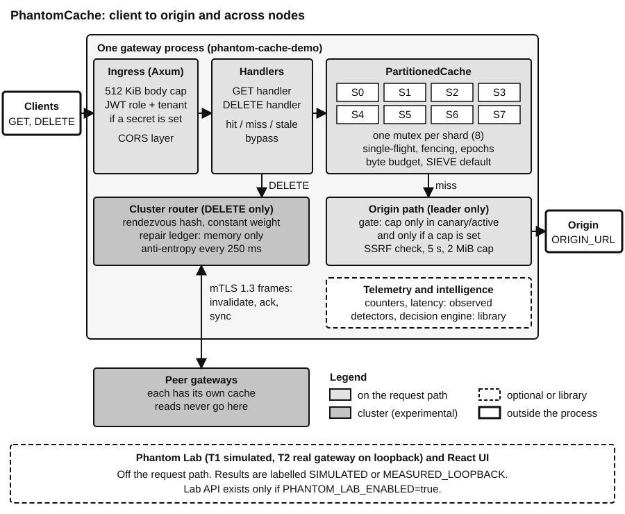

Source: Figure 2.1 (`ch02_components.svg`), Figure 5.1 (`ch05_cluster_topology.svg`), Figure 2.6 (`ch02_lab_ui.svg`); `src/main.rs::run`, `src/api/server.rs::create_app_with_lab`, `src/core/cache.rs::PartitionedCache`, `src/dist/router.rs::RendezvousRouter`, `src/intelligence/executor.rs::OriginGate`.

## B.1 What the system is, in one paragraph

PhantomCache is a read-through caching gateway: a Rust program that sits in front of one origin, which is the operator's own data service named by `ORIGIN_URL`. Clients call `GET /api/v1/cache/<path>` and `DELETE /api/v1/cache/<path>` on the gateway. The gateway answers reads from memory when it can and from the origin when it must. There is no write route: to change data you change the origin and then `DELETE` the key, or wait for the entry to expire (see Chapter 2, section 2.1). It is a research prototype. The single-node engine is IMPLEMENTED and TESTED. The cluster is experimental: fan-out, repair and anti-entropy are IMPLEMENTED and TESTED, but only on one host over loopback, and durable invalidation and coordinated reads are not done (see Chapter 8, section 8.12).

## B.2 The process and what runs in it

One OS process, `phantom-cache-demo`, runs a Tokio multi-thread runtime and an Axum router (see Chapter 2, section 2.1.2 and Chapter 3, section 3.3). Inside it live the ingress, the handlers, one `PartitionedCache`, an optional cluster router and listener, and background tasks: a sweeper every 100 ms by default, a metrics sampler, and a server-sent-events feed. The React UI is a separate Vite dev server on port 3000. The gateway does not serve it. The Lab is a separate tool (`phantom-lab`) or, when `PHANTOM_LAB_ENABLED=true`, an extra set of routes (see Chapter 2, sections 2.1.3 and 2.8). The component table is in Chapter 2, section 2.2.1.

One caution about the word "node". In the standalone gateway there is one real cache plus three placeholder `VirtualNode` objects for dashboard demos. Those demo nodes are PROTOTYPE ONLY and synthetic. In the mTLS cluster configuration the local member is built with `VirtualNode::new_with_cache`, so it shares the gateway's serving cache, and remote members are address-only descriptors with no cache in this process (see Chapter 2, section 2.2.1).

## B.3 The front door: ingress, authentication, tenants

A request first meets the router layers: CORS and a 512 KiB body limit. If `PHANTOM_JWT_SECRET` is set, the handler authenticates the caller. The JWT algorithm is HS256 only. The check covers signature, expiry, issuer and audience, then a role: `cache:read` to read, `cache:invalidate` to delete. A non-empty `tenant_id` claim is required. In secure mode the tenant comes only from the verified token, never from the `x-tenant-id` header (see Chapter 6, section 6.2). With no secret the gateway starts only on a loopback bind, and a non-loopback bind without a secret is refused (see Chapter 2, section 2.3.1).

The cache key is the tenant plus the path plus the raw query. With no tenant it is the literal `__default__`. `?a=1&b=2` and `?b=2&a=1` are two keys. A key is validated for length and unsafe characters before use (see Chapter 2, section 2.3.2 and Chapter 4, section 4.1). Tenancy here is key isolation. There are no per-tenant quotas, and any pinned cluster member can flush any tenant's cache (see Chapter 6, section 6.6 and Chapter 8, section 8.3.5).

Known open items at this door: the handlers read the body before they authenticate (G4B-01, OPEN, owner-named), there is no rate limit, there is no token revocation and there is no `nbf` check (see Chapter 6, section 6.2). These are listed rather than hidden. Authentication is IMPLEMENTED and TESTED for the covered paths. The system is not security-certified and has had no penetration test (see Chapter 6, section 6.1).

## B.4 The cache core: 8 shards

The cache is split into 8 shards. Production code builds `PartitionedCache::new(8)` in `src/main.rs`, and no configuration key changes it. Each shard is one `std::sync::Mutex` around a map of keys, an in-flight map, byte counters and one eviction policy. The shard for a key is the hash of the key masked by 7 (see Chapter 4, section 4.2).

Different keys on different shards never wait for each other. Different keys on the same shard queue for a short critical section. One hot key always lands on one shard, so sharding cannot spread it. A hit takes the shard mutex twice in the HTTP path (once in `check_stale_serving`, once in `begin_fetch_atomic`) and the response body is copied. Contention has not been measured on a release build (see Chapter 4, section 4.2 and Chapter 6, section 6.13).

The rule that holds the design together: never hold a `std::sync::Mutex` across `.await`. The leader runs the origin call in a spawned task that holds no shard lock while it waits (see Chapter 3, section 3.5 and Chapter 4, section 4.2). No model checker has been run on the locking, so "no deadlock" is argued from reading, not proven (see Chapter 4, section 4.2).

## B.5 A hit

If the key's entry exists, is not past its lifetime and carries the current tenant and global epochs, the gateway returns it with `X-Cache-Status: HIT` and an `Age` header. Nothing leaves the process. The hit path is IMPLEMENTED and TESTED in `m1_http_tests` (see Chapter 2, section 2.4). Micro-benchmark numbers for the hit path exist, but none is an established release-profile product figure. Quote them only with the conditions given in Chapter 6, section 6.13.

## B.6 A miss: single-flight, then the origin

On a miss, `begin_fetch_atomic` runs under the shard lock and has three outcomes. If a fetch for that key is already in flight, the caller joins its waiter list (at most 1,000 per key, else 503 `WaiterLimitExceeded`). Otherwise the shard evicts, at most 32 victims, to make room, and if there is still no room the request fails with `CapacityExceeded`. Otherwise it records an operation id and the key's current generation and registers the fetch. This request is the leader (see Chapter 2, section 2.5 and Chapter 4, section 4.4).

The leader fetches in its own task, so a client that disconnects does not cancel the fetch for others. Only the leader, a bypass request, or a background revalidation leader takes an origin permit. Waiters never do (see Chapter 4, section 4.4).

### B.6.1 The origin gate

An optional concurrency gate limits distinct origin fetches. It is enforced only when `PHANTOM_INTELLIGENCE` is `canary` or `active` and `PHANTOM_ORIGIN_CAP_MAX` is set. In the default mode `off` the origin path is uncapped, and the gate only counts (`origin_cap_enforcing`). When it refuses, the caller gets a stale copy if one is eligible, else 503 with `Retry-After: 1`. The cap can be static, or can move by an AIMD rule (multiply by 0.70 when the window's p99 or error rate is bad, otherwise add 1). IMPLEMENTED and TESTED for its arithmetic and permit accounting. The benefit of the adaptive version is NOT established (see Chapter 4, section 4.4 and Chapter 5, section 5.13).

### B.6.2 The fetch itself

`fetch_origin_raw` checks the origin against the upstream policy, resolves the name, filters every returned address against loopback, private and metadata ranges, pins the validated address and connects. Timeouts are 5 s per phase, the body cap is 2 MiB and the header cap is 64 KiB. Redirects are not followed. Each fetch opens a new connection (`Connection: close`). The client's `Authorization` header is not forwarded unless `PHANTOM_FORWARD_UPSTREAM_AUTH` is set. The origin host is fixed by the operator, so the main SSRF risk is removed by design (see Chapter 2, section 2.5.3 and Chapter 6, section 6.8).

### B.6.3 Store, fencing and waiters

When the answer arrives, `finalize_fetch` decides whether the cache may keep it, under the shard lock. The body is stored only if the key's generation still equals the recorded one, the state object is the same one, and the tenant and global epochs still match. `DELETE` bumps the generation, so a slow fetch cannot resurrect a deleted key. Otherwise the body goes to the waiters but is not stored, and `stale_writes_prevented` increases (see Chapter 4, section 4.5).

The mechanism is IMPLEMENTED and TESTED, with one honest open item. `finalize_fetch` reads the epochs twice, and an epoch bump that lands between the reads can let an old body be stored with the new stamp. This is G4A-01. It was reproduced only in a sandbox with a test hook, and the small fix lives in `docs/research/g4a01_race/proposal.patch` and is NOT integrated (see Chapter 4, section 4.7). A request that joins an older in-flight fetch after a tenant or global epoch change can also receive the older body once (G4A-08). The generation fence catches `DELETE`. Only epoch equality catches tenant or global invalidation (see Chapter 4, section 4.5).

Cancellation and panics are handled by guards that finalize a fetch as aborted if it is dropped early. By design, eviction skips a key with an active operation or in-flight fetch; this is argued from reading and tested, not model-checked (see Chapter 4, section 4.5).

## B.7 Memory, freshness and eviction

**Bytes.** Each shard keeps a running count of logical bytes: key length, body capacity, content-type and ETag lengths and a fixed per-entry overhead. `audit_bytes()` recomputes the total so tests can compare. This proves the bookkeeping is consistent. It is not the operating system's memory figure, and some structures are not counted (see Chapter 4, section 4.6). The default total budget is 256 MiB, divided by the shard count, plus an entry limit per shard.

**Freshness.** The lifetime of an entry comes from the origin: `s-maxage`, `max-age`, or `Expires` minus `Date`. If the origin says nothing, the gateway uses 60,000 ms. That 60 s is a literal in `src/api/server.rs`, passed at two call sites. The setting `PHANTOM_DEFAULT_TTL_MS` is validated and reported but is NOT WIRED: setting it changes nothing. The documented default and the effective default match only by coincidence. There is no gateway ceiling on an origin-set lifetime (see Chapter 4, section 4.8 and Chapter 2, section 2.6.1).

**Stale serving.** Expired data is served only if the origin's response carried `stale-while-revalidate` or `stale-if-error`, and always inside the hard cap `PHANTOM_MAX_STALE_MS` (24 h by default). The cap bounds the stale-serving window, not the freshness lifetime. `must-revalidate` forbids stale serving. A 304 reply refreshes the stored entry. There is no circuit breaker, no negative caching and no retry loop. Errors are not stored, so recovery is immediate when the origin returns (see Chapter 2, section 2.6 and Chapter 4, section 4.8). Freshness is PARTIAL: it is an RFC 9111 subset with open conformance findings (see Chapter 4, section 4.11).

**Eviction.** The default policy is SIEVE. LRU and S3-FIFO are selectable. All three implement `ShardEvictionPolicy` and skip pinned keys. They are not worst-case O(1) when keys are pinned, S3-FIFO carries an open defect (G4A-02), and there is no hit-ratio or release-profile comparison (see Chapter 4, section 4.9).

**Invalidation inside one process.** `DELETE` removes one key and bumps its generation in O(1). A tenant invalidation raises the tenant's epoch, and entries with an older stamp are treated as absent the next time they are touched or when the sweeper finds them. Readers get the epochs from an `RwLock` snapshot without taking the `tenant_epochs` mutex, but the shard mutex is still taken. The tenant map is capped at 10,000. A new tenant arriving when full raises the global epoch, which invalidates everything on that node. That fallback is peer-triggerable (G4A-12). The sweeper scans each shard in full under its lock (G4A-03) (see Chapter 4, section 4.7).

## B.8 DELETE and the cluster

A `DELETE` purges the local cache first, so later reads on this gateway miss. With no router that is all, and the reply is 204. With a router, the gateway uses rendezvous hashing to choose a primary for the key and sends one `InvalidateRequest` over mutual TLS. It waits at most 150 ms (`PHANTOM_CLUSTER_TIMEOUT_MS`) for an `InvalidateAck`. A 204 means the primary acknowledged in that window. It does not mean every member has purged. If the primary is silent, it is marked Suspect and the first healthy replica acts as primary (`X-Cache-Warning: PrimaryFailover`). If that also fails the client gets 504 and every other member is recorded as owed. The local purge happens in every case (see Chapter 2, section 2.7.3 and Chapter 5, section 5.5).

**Rendezvous hashing** gives each node a score from the key and the node id; the highest score wins. In this code the hash is `DefaultHasher`, the weight factor is the constant 1.0, and the router makes two passes (healthy nodes first, then Suspect and Recovering). So it is plain rendezvous hashing, not weighted. Weighted hashing is DESIGNED BUT NOT IMPLEMENTED. Its use is narrow: it picks which node gives the acknowledgement for a `DELETE`. It does not decide where data lives. About 1 in N keys has the issuer itself as primary, and then the 204 carries no evidence about any other node (see Chapter 5, section 5.3).

**GET is local-only.** `get_cache_handler` never touches the router. The function that would forward a read to the key's owner, `forward_key_over_tcp`, has no caller. The peer-side `GetRequest` handler is a stub that fabricates a value, which is a recorded defect (DR-029), not a feature. So a cluster of N gateways is N independent read caches kept coherent by invalidation, not a partitioned distributed cache. Coordinated reads are DESIGNED BUT NOT IMPLEMENTED (see Chapter 2, section 2.7.4 and Chapter 5, section 5.8).

**The rest of the propagation.** After the primary's ack, every other member (not only replicas) is told asynchronously. A per-peer queue of 256 and up to four attempts handle live members. Members that are not live, and deliveries that fail, go to a bounded repair ledger. A repair loop every 250 ms re-sends owed entries, and a pull-based anti-entropy worker (also 250 ms) repairs sequence gaps using a ring of 4,096 sent records, or flushes the whole receiver cache when history was overwritten (see Chapter 5, section 5.5).

**Membership and transport.** Membership is a static file read at startup. There is no join or leave protocol. The wire format is the PhantomMesh binary frame: magic `PHAN`, a 28-byte header, a payload of at most 1 MiB and keys of at most 4,096 bytes. Connections use TLS 1.3 only with a cluster CA as the sole trust root. Identity is a single DNS SAN `node-<id>.<cluster_id>.phantom.internal`, pinned to a fingerprint in the registry. Every frame is re-checked, and an `InvalidateRequest` whose originator differs from the TLS identity closes the connection. Heartbeats are connection keepalive, not failure detection (see Chapter 5, section 5.2 and Chapter 6, section 6.4). Members are trusted: a compromised member can flush others (G4B-05, DR-027).

**What is and is not guaranteed.** On one gateway, a read after a completed `DELETE` does not return the deleted entry, subject to the open G4A-01 and G4A-08. Across gateways there is best-effort asynchronous invalidation with retry, a bounded in-memory ledger and pull repair, which converged within milliseconds in loopback tests while the issuer stayed alive. The repo does not provide linearizability, and it provides no staleness bound if the issuer crashes with owed invalidations or if a partition is permanent, other than the entry's own freshness lifetime. The durable-log fix is a sandbox patch, PROTOTYPE ONLY, and is not in the tree. All cluster evidence is single-host loopback in a debug build (see Chapter 5, sections 5.6, 5.7 and 5.9; Chapter 8, section 8.11).

## B.9 Observation and intelligence

**Telemetry.** A latency histogram `AtomicLogLinearHistogram` has 2,688 buckets and constant-time recording. Its design error is at most 0.39 percent. In the current tree it is written on every GET but no production endpoint reads it. The percentiles on `/api/v1/metrics` come from a sorted 10,000-sample window. Counters and an origin-latency histogram feed the observation routes (see Chapter 5, section 5.11). Every displayed value should carry a provenance label: measured, simulated, inferred or unavailable. With `PHANTOM_SIMULATION=true` parts of the live event stream are synthetic (see Chapter 2, section 2.8).

**Intelligence.** It is not AI and not machine learning. On the serving path there is only the origin gate described in B.6.1. Everything else is library code that no request calls: the signal pipeline (Count-Min plus Space-Saving heavy hitters, EWMA, CUSUM), the shadow evaluator, the decision engine with its confidence interval, canary routing and a watchdog. These are PROTOTYPE ONLY, and the statistics in the evaluator and engine have recorded flaws (F12, F13). `CountMinSketch` in `src/intel/sketch.rs` is used only by a unit test. The legacy `src/control/pie.rs` is a threshold stub, and `main.rs` passes `pie: None`. The hot-keys field of `/api/v1/metrics` reports "unavailable". Hot keys are in practice protected by coalescing (see Chapter 5, sections 5.10, 5.12 and 5.13). The hard caps (stale cap, origin cap, byte budget, fencing) are enforced by the execution layer regardless of any intelligence decision (see Chapter 5, section 5.13 D).

## B.10 Phantom Lab and the UI

Phantom Lab has two tiers, kept apart. T1 is a deterministic discrete-event simulation with a virtual clock and seeded random streams. It drives the real cache, coalescing, fencing and origin-gate code but simulates clients and the origin, and it does not run HTTP, TLS or any cluster. Its results are labelled SIMULATED. T2 starts the real gateway binary as a child process on loopback, against a scripted raw-TCP origin, with an open-loop load generator. Its results are labelled MEASURED_LOOPBACK, on one host, and are not multi-host or production figures (see Chapter 7, sections 7.2 and 7.5).

Experiments compare arms paired by seed, using a BCa bootstrap interval and a sign-flip permutation test, with Holm correction across hypotheses (see Chapter 7, section 7.3). The sealed M6 evaluation (30 sealed seeds, 8 scenarios, simulated) gave hypothesis H1 the verdict NOT_SUPPORTED: a forced-adaptive controller did not beat the best tuned static cap. The best tuned adaptive setting was itself a static cap. Scenario B on a real gateway showed that a cap limits origin concurrency at a cost in refused requests, and that the adaptive arm acted as a static cap near 12. No agreement study between T1 and T2 has been run (see Chapter 7, sections 7.5 and 7.6). The product position that follows is a gateway with a configurable static origin cap.

The Lab API (`src/api/lab_api.rs`) exists only if `PHANTOM_LAB_ENABLED=true`. Without JWT it requires a loopback bind and checks the `Host` and `Origin` headers. The service refuses to start if the sealed salt is present in its environment (see Chapter 2, section 2.8 and Chapter 7, section 7.7). The React dashboard shows telemetry and the Lab. Its Cluster and Intelligence screens are placeholders. It has automated checks only, with no human design or accessibility review (see Chapter 8, section 8.12).

## B.11 Security boundaries in brief

Five zones: clients, the gateway process, the operator-fixed origin, cluster peers and the local host (see Chapter 6, section 6.1). At each boundary the repo has a named check: JWT roles and tenant claims at the ingress; the upstream policy, DNS pinning and an address filter at the origin; certificate pinning and originator matching on the cluster link; a loopback-only rule with Host and Origin checks on the Lab API. The bounds that exist are listed in Chapter 6, section 6.8 (bytes, waiters per key, epoch map, response size, frame size, handshakes, per-peer queues, ledger size). The bounds that do not exist are listed there too: inbound connection count, `/api/events` streams, origin concurrency by default, per-tenant rates. The host environment holds the JWT secret, so a host-level attacker is out of scope.

## B.12 Where the architecture stops

Seven limits shape every defence answer (see Chapter 8, section 8.3).

1. One cache per gateway, served locally.
2. Placement is plain rendezvous hashing, used for `DELETE` only.
3. Owed invalidations live in the issuer's memory.
4. Freshness bounds are weak: the 60 s default is a literal, and origin lifetimes have no ceiling.
5. Tenancy is key isolation, not resource isolation.
6. Evidence is single-host, Windows, debug-profile for the suite, with no release-profile performance claim and no multi-host run.
7. Operations gaps: no metrics export, no config reload, no container image, no advisory scan.

Passing tests establish that an author's expectation held in a build on a host. They do not establish correctness (see Chapter 8, section 8.2.2). Reviews so far are AI second looks, not independent verification.

# Appendix C: Technology and algorithm reference

Use this appendix to look something up fast. It adds no new claims. Each row repeats what a chapter says and points to it. Status labels are the chapters' labels: IMPLEMENTED, TESTED, PARTIAL, PROTOTYPE ONLY, DESIGNED BUT NOT IMPLEMENTED, NOT WIRED. A TESTED label means a named test exercises the thing. It does not mean the thing is correct. Nothing here is INDEPENDENTLY VERIFIED by a human. Where a row names a symbol, it is written `path::symbol`. Complexity entries are the chapters' own reasoning unless a measurement is cited, and no performance number in this appendix is a measurement.

## C.1 Technologies

| Technology | What it is, and why it is here | Where in the code path (`path::symbol`) | Status | Chapter |
|---|---|---|---|---|
| Rust | Memory-safe systems language. Chosen for safety and no garbage collector. The only `unsafe` found in `src/` is Windows FFI in the Lab API | all of `src/`; `src/api/lab_api.rs` (the `unsafe` blocks) | IMPLEMENTED | Ch 3, section 3.2; Ch 6, section 6.10 |
| Tokio | Async runtime: timers, channels, TCP, spawned tasks. The leader fetch runs as a spawned task | `src/main.rs` (`tokio::runtime::Builder::new_multi_thread`) | IMPLEMENTED | Ch 3, section 3.3 |
| Axum (hyper and tower arrive transitively) | HTTP routing, extractors, server-sent events. No WebSocket use found | `src/api/server.rs::create_app_with_lab` | IMPLEMENTED, TESTED | Ch 3, section 3.4 |
| tower-http CORS layer | Lets the browser UI on port 3000 call the gateway. The `fs` feature is declared but unused | `src/api/server.rs::create_app_with_lab` (layer) | IMPLEMENTED | Ch 3, sections 3.1 and 3.4 |
| `std::sync::Mutex` per shard | One lock per bucket of keys, so unrelated keys do not wait | `src/core/cache.rs::PartitionedCache`, `CacheShard` | IMPLEMENTED, TESTED | Ch 3, section 3.5.2; Ch 4, section 4.2 |
| `RwLock` epoch snapshot | Readers see the tenant epochs without the exclusive mutex | `src/core/cache.rs::PartitionedCache::epoch_snapshot`, `get_effective_epochs` | IMPLEMENTED, TESTED | Ch 3, section 3.5.4; Ch 4, section 4.7 |
| Atomics | Lock-free counters and histogram buckets (relaxed ordering) | `src/intel/telemetry.rs::AtomicLogLinearHistogram`; `src/intel/diagnostics.rs` | IMPLEMENTED, TESTED | Ch 3, section 3.5.3 |
| `DefaultHasher` (SipHash) | Picks the shard and scores nodes in rendezvous hashing. The algorithm is unspecified by the standard library | `src/core/cache.rs` (shard index); `src/dist/router.rs::calculate_hash` | IMPLEMENTED; portability risk | Ch 4, section 4.2; Ch 5, section 5.3 |
| rustls and tokio-rustls | TLS 1.3 for cluster mTLS, origin HTTPS and ingress. Pure Rust, no OpenSSL | `src/security/cluster.rs::ClusterTlsConfig` | IMPLEMENTED, TESTED | Ch 3, section 3.7; Ch 5, section 5.2 |
| `ring` | SHA-256 for certificate fingerprints, the anti-entropy digest and lab hashes | `src/dist/anti_entropy.rs::InvalidationRingBuffer::compute_digest` | IMPLEMENTED | Ch 3, section 3.1 |
| `jsonwebtoken` | Verifies HS256 tokens: signature, expiry, issuer, audience | `src/security/jwt.rs::JwtValidator::validate` | IMPLEMENTED, TESTED | Ch 3, section 3.8; Ch 6, section 6.2 |
| serde and serde_json | JSON for API bodies, JWT claims and lab artifacts | `src/api/server.rs`; `src/security/jwt.rs`; `src/lab/` | IMPLEMENTED | Ch 3, section 3.9 |
| PhantomMesh frames | Custom binary protocol: magic `PHAN`, 28-byte header, payload up to 1 MiB, key up to 4,096 bytes | `src/dist/frame.rs` | IMPLEMENTED, TESTED | Ch 3, section 3.9; Ch 5, section 5.2 |
| Upstream policy, DNS pinning, IP filter | Stops the origin fetch reaching private or metadata addresses | `src/security/upstream.rs::resolve_and_pin_origin`, `PreConnectIpFilter` | IMPLEMENTED, TESTED | Ch 6, section 6.8 |
| Static cluster membership file | Fixed member list with certificate fingerprints, read once at startup | `src/security/cluster.rs::load_membership_from_file` | IMPLEMENTED, TESTED | Ch 5, section 5.2 |
| React, Vite, hand-built SVG | The dashboard and Lab screens. A separate dev server, not served by the gateway | `ui/src/App.jsx` | IMPLEMENTED, TESTED (automated checks only) | Ch 3, section 3.11; Ch 7, section 7.7 |
| Test tools: proptest, reqwest, rcgen, hdrhistogram | Property tests, real HTTP in tests, in-memory certificates, bench latency recording. `criterion` is declared but unused | `tests/`; `benches/` | IMPLEMENTED | Ch 3, section 3.12 |

## C.2 Algorithms and mechanisms

| Mechanism and what it does | Cost or complexity | Where (`path::symbol`) | Status; failure mode in brief | Chapter |
|---|---|---|---|---|
| Sharded mutexes: hash the key, lock one of 8 buckets | Lookup O(key length) plus expected O(1); at most 8-way parallelism; contention not measured | `src/core/cache.rs::PartitionedCache::new` (8 in `main.rs`) | IMPLEMENTED, TESTED; a hot key cannot spread, long critical sections block a shard | Ch 4, section 4.2 |
| Single-flight coalescing: first miss leads, others wait and share | O(1) per request; at most 1,000 waiters per key | `src/core/cache.rs::begin_fetch_atomic`; `src/core/coalesce.rs::SharedOp` | IMPLEMENTED, TESTED; waiters share the leader's fate, per gateway only | Ch 4, section 4.4 |
| Generation fencing: store a fetch result only if the key's generation is unchanged | O(1) under the shard lock | `src/core/cache.rs::finalize_fetch`, `delete_impl` | IMPLEMENTED, TESTED; tested on one interleaving, no model checker | Ch 4, section 4.5 |
| Epoch fencing: tenant and global version stamps; invalidate by raising the epoch | Tenant bump O(T), T at most 10,000 | `src/core/cache.rs::try_invalidate_tenant`, `get_effective_epochs` | IMPLEMENTED, PARTIAL; G4A-01 race (fix not integrated), G4A-08, G4A-17 | Ch 4, section 4.7 |
| Epoch overflow fallback: a new tenant on a full map raises the global epoch | Flushes the whole node, O(T) | `src/core/cache.rs::MAX_TENANT_EPOCHS` | IMPLEMENTED, TESTED; a peer can trigger it (G4A-12) | Ch 4, section 4.7 |
| TTL and freshness: lifetime from `s-maxage`, `max-age`, `Expires`, else 60 s | O(1) per response | `src/core/freshness.rs::evaluate_response_freshness`; literal `60_000` in `src/api/server.rs` | IMPLEMENTED, PARTIAL; `PHANTOM_DEFAULT_TTL_MS` is NOT WIRED, no ceiling on origin lifetimes | Ch 4, section 4.8 |
| Stale serving and hard cap: serve expired data only inside origin-declared windows, capped at `PHANTOM_MAX_STALE_MS` | O(1) per check | `src/core/cache.rs::check_stale_serving` | IMPLEMENTED, TESTED; cap counter is weak (G4A-18), cap bounds stale window only | Ch 4, section 4.8 |
| Revalidation with 304: refresh a stored entry's lifetime | O(1) | `src/core/cache.rs::complete_not_modified` | IMPLEMENTED, TESTED; validators dropped early by the sweeper (G4A-16) | Ch 4, section 4.8 |
| Lazy sweeper: reclaim stale and expired entries in the background | Scans each shard in full under its lock every tick | `src/core/cache.rs::spawn_sweeper_task`, `sweep_lazy_reclamation` | IMPLEMENTED, PARTIAL; lock held for the whole scan (G4A-03) | Ch 4, section 4.7 |
| SIEVE (default): queue plus visited bit plus a moving hand | Hit O(1); eviction amortized O(1) with no pinned keys | `src/core/eviction.rs::FaithfulSieve` | IMPLEMENTED, TESTED (weakly); pinned keys make a scan costly (G4A-20) | Ch 4, section 4.9 |
| LRU: recency list, victim at the back | O(1); worst case O(p) for p pinned keys | `src/core/eviction.rs::FaithfulLru` | IMPLEMENTED, TESTED (weakly); every hit rewrites the list | Ch 4, section 4.9 |
| S3-FIFO: small, main and ghost queues | Amortized O(1) (our reasoning) | `src/core/eviction.rs::FaithfulS3Fifo` | IMPLEMENTED, PARTIAL (defect G4A-02 OPEN); queues can outgrow live keys, not the default | Ch 4, section 4.9 |
| Byte accounting: running logical byte count per shard, with an audit | O(1) per update; audit walks all entries | `src/core/cache.rs::calculate_state_bytes`, `audit_bytes` | IMPLEMENTED, TESTED (consistency only); drift on a panic path (G4A-13), uncounted structures | Ch 4, section 4.6 |
| Origin concurrency gate: a permit counter, released on drop | O(1) atomic | `src/intelligence/executor.rs::OriginGate`, `origin_cap_enforcing` | IMPLEMENTED; enforced only in canary or active with a cap, uncapped by default | Ch 4, section 4.4; Ch 5, section 5.13 |
| AIMD cap controller: multiply by 0.70 on a bad window, else add 1 | O(1) per observation; steps once per window | `src/intelligence/candidates.rs::OriginConcurrencyCapController` | IMPLEMENTED, TESTED (arithmetic and cap unit tests); on the serving path only when a cap is configured in canary or active mode (default off); benefit NOT established, behaved as a static cap | Ch 5, section 5.13; Ch 7, section 7.6 |
| Log-linear latency histogram: 2,688 buckets, bit tricks | O(1) record; design error at most 0.39 percent | `src/intel/telemetry.rs::AtomicLogLinearHistogram` | IMPLEMENTED, TESTED (recording and bucket arithmetic only); it is fed but has no production percentile reader | Ch 5, section 5.11 |
| Count-Min sketch (4 by 1,024) in the heavy-hitter detector | O(d) per item, overestimates only | `src/intelligence/signals.rs::HeavyHitterDetector` | PROTOTYPE ONLY (library); not wired. The older `src/intel/sketch.rs::CountMinSketch` is used only by a unit test | Ch 5, section 5.12 |
| Space-Saving top-k (k = 64) | O(k) per miss | `src/intelligence/signals.rs::HeavyHitterDetector` | PROTOTYPE ONLY (library); metrics report hot keys as unavailable | Ch 5, section 5.12 |
| EWMA, CUSUM burst, Zipf estimate | O(1) per window; Zipf over the top 50 | `src/intelligence/signals.rs` | PROTOTYPE ONLY (library); working-set size assumes 1 KiB per object | Ch 5, section 5.12 |
| Shadow evaluation and decision engine | Replay on a sampled stream (one in R keys) | `src/intelligence/shadow.rs::ShadowEvaluator`; `src/intelligence/engine.rs::PieDecisionEngine` | IMPLEMENTED as library, not wired; unsound intervals (F12, F13) | Ch 5, section 5.13 |
| Rendezvous hashing: highest score of (key, node) wins, equal weights | O(N) per key for N members | `src/dist/router.rs::RendezvousRouter::route_key` (`capacity_weight = 1.0`) | IMPLEMENTED; weighted version DESIGNED BUT NOT IMPLEMENTED; routes `DELETE` only, `GET` is local | Ch 5, section 5.3 |
| Invalidation fan-out: per-peer queue of 256, up to four attempts | Bounded queues and attempts | `src/dist/router.rs::invalidate_key_across_cluster`, `fanout_targets` | IMPLEMENTED, TESTED; 204 is not a cluster-wide acknowledgement | Ch 5, section 5.5 |
| Repair ledger: bounded record of owed invalidations | 1,024 entries per peer, collapses to a coarser flush | `src/dist/router.rs::RepairLedger` | IMPLEMENTED, TESTED; memory only, lost if the issuer dies | Ch 5, sections 5.5 and 5.7 |
| Anti-entropy: ring of sent records, sequence gaps, pull replay | Ring of 4,096 records; digest is SHA-256 | `src/dist/anti_entropy.rs::InvalidationRingBuffer`, `AntiEntropyTracker`; `src/dist/router.rs::reconcile_peer_anti_entropy` | IMPLEMENTED, TESTED; effectiveness beyond loopback UNVERIFIED | Ch 5, section 5.5 |
| mTLS admission: TLS 1.3, cluster CA, one SAN, fingerprint pinning, originator match | Per connection and per frame check | `src/security/cluster.rs::ClusterTlsConfig`, `validate_peer`; `src/dist/node.rs::start_tcp_service` | IMPLEMENTED, TESTED; no revocation trigger (G4B-07), members are trusted (G4B-05) | Ch 5, section 5.2; Ch 6, section 6.4 |
| HS256 JWT with roles and tenant claim | One signature check per request | `src/security/jwt.rs::JwtValidator::validate`; `src/api/server.rs::authenticate_request` | IMPLEMENTED, TESTED; no revocation, no `nbf`, shared secret can mint any token | Ch 6, section 6.2 |
| SSRF pre-connect filter with DNS pinning | One resolve and filter per origin fetch | `src/security/upstream.rs::resolve_and_pin_origin` | IMPLEMENTED, TESTED; range gaps open (G4B-15) | Ch 6, section 6.8 |
| Discrete-event simulation (T1): virtual time, event heap with sequence tie-break | O(log n) per event (heap) | `src/lab/t1_sim.rs::run_cell`; `src/lab/events.rs::EventQueue` | IMPLEMENTED, TESTED (determinism on one machine); a model of the origin, not the HTTP gateway | Ch 7, section 7.2 |
| Seeded random streams and alias sampling | One stream per purpose, seeded | `src/lab/rng.rs::MasterRng`, `AliasSampler` | IMPLEMENTED, TESTED | Ch 7, section 7.2 |
| BCa bootstrap, sign-flip permutation test, Holm correction | B = 10,000 resamples; exact sign-flip for n at most 16 | `src/lab/analysis.rs::bca_ci_mean`, `sign_flip_p_value`, `HolmBonferroni` | IMPLEMENTED, TESTED on synthetic data; not cross-checked against a reference | Ch 7, section 7.3 |

## C.3 How to use the tables in a defence

1. If a judge names a mechanism, find its row, say the status label first, then the failure mode. Do not state a label stronger than the one here.
2. Every complexity statement here is arithmetic or code reading. If asked for a number, say there is no release-profile measurement, and point to Chapter 6, section 6.13 for the few measurements that exist and their limits.
3. If a row says "library" or "not wired", say so before the judge asks. The honest answer is the strong one.

# Appendix D: Glossary and abbreviations

This glossary lists the terms and abbreviations used in Chapters 1 to 8, in alphabetical order. Each entry is one line in plain English, followed by the place where the chapter teaches it (for example `Ch 4, 4.5` means Chapter 4, section 4.5). The definitions follow the way the chapters use the words. Where a term has a status or a caveat in the chapters, the entry says so. Code names are given as in the source tree; Appendix F maps them to files.

Three conventions apply throughout. A **status label** (IMPLEMENTED, TESTED, PARTIAL, PROTOTYPE ONLY, DESIGNED BUT NOT IMPLEMENTED, DEFERRED, BLOCKED, UNVERIFIED, INDEPENDENTLY VERIFIED) always has the meaning given in Ch 8, 8.1. A finding identifier such as `G4A-01` points to the review register described in Ch 8, 8.4. A tier label (T1, T2) says how a number was produced (Ch 7, 7.1).

**A**


- **Active** (node state): the state of a cluster member that is in service; peers in a configured cluster start in it. One of seven values of `NodeState`, of which `Degraded` is never assigned. (Ch 5, 5.2)
- **ADR** (architecture decision record): a file in `docs/research/adr/` that records an architectural choice and its reason; the chapters separate "recorded decision" from "our reasoning". (Ch 3, 3.0)
- **Advisory scan**: a check of locked dependencies against known vulnerability reports (for example `cargo audit`). None has been run; the chapters list it as DEFERRED. (Ch 3, 3.13)
- **Age**: how old a stored response is; compared with its freshness lifetime to decide fresh or stale. (Ch 4, 4.8)
- **AIMD** (additive increase, multiplicative decrease): the rule behind TCP congestion control, used by the optional origin-concurrency cap controller: add a little when healthy, cut sharply on trouble. IMPLEMENTED, TESTED (arithmetic and cap unit tests); on the serving path only when a cap is configured in canary or active mode; its benefit is NOT SUPPORTED. (Ch 5, 5.13)
- **Amortized O(1)**: some single operations cost more, but the average over a long run is constant per operation; used for eviction. (Ch 4, 4.9)
- **Anti-entropy**: a background process that compares state between nodes and repairs differences; here, a pull of missed invalidation records from the sender's ring buffer. (Ch 5, 5.1 and 5.5)
- **Arc**: the Rust shared-ownership pointer; the epoch snapshot is an `Arc` of a map, so readers share it without an exclusive lock. (Ch 3, 3.5.4)
- **Arm**: one configuration compared in an experiment (for example `BASE`, `STATIC-CAP`, `AIMD-CAP` in Scenario B). Arms differ in configuration, not through hidden multipliers. (Ch 7, 7.2.7 and 7.5.1)
- **Async / await**: Rust's way to park a task while it waits on a socket or timer so a thread can run another task. Never combined with a held `std::sync::Mutex`. (Ch 3, 3.3 and 3.5.1)
- **Atomic**: a counter or flag that threads update without a lock; used for statistics and for epochs read on the hit path. (Ch 3, 3.5.3)
- **Audit store** (decision audit store): a bounded buffer of decision records in `src/intelligence/audit.rs`; the serving path has no producer, so the route returns an empty store. (Ch 1, 1.8; Ch 2, 2.3.1)
- **Authentication / authorisation**: authentication asks "who are you?"; authorisation asks "may you do this?". PhantomCache checks a JWT and then the role. (Ch 6, 6.2)
- **Axum**: the Rust web framework (on hyper and tower) that routes HTTP requests in the gateway. (Ch 3, 3.4)

**B**


- **BASE** (arm): the Scenario B arm with intelligence off and no cap. (Ch 7, 7.5.1)
- **BCa** (bias-corrected and accelerated): a bootstrap confidence interval that corrects for bias and skew; the Lab uses it for paired differences. (Ch 7, 7.3.3)
- **Bearer token**: a credential sent in the `Authorization` header; whoever holds it is treated as the caller. (Ch 6, 6.2)
- **BL-12b**: the tuned static baseline (a static cap and stale window chosen on tuning seeds) used in the sealed M6 evaluation; the code says it is not claimed to be the best deployable static policy. (Ch 7, 7.6 and 7.9)
- **Bootstrap**: draw values with replacement from the sample many times to estimate the spread of a statistic. (Ch 7, 7.3.3)
- **Bounded staleness**: a read never returns data older than a named bound `B`. To claim it you must state `B`, the failure model and a test that could falsify it. Not claimed. (Ch 5, 5.6)
- **Byte budget**: the logical memory limit (`PHANTOM_MAX_CACHE_BYTES`, default 256 MiB), divided across shards. (Ch 4, 4.6)
- **Byte accounting (I1 to I8)**: the invariants that the running byte total equals the recomputed sum of entry sizes, checked by `audit_bytes()`. TESTED for consistency only. (Ch 4, 4.6)

**C**


- **Cache**: a store of copies, keyed so that a later request for the same thing can be answered without calling the origin. (Ch 1, 1.1)
- **Cache key**: the identity of one cached item: tenant plus request path plus query string (`CacheKey`). (Ch 1, 1.1; Ch 2, 2.3.2)
- **Cache poisoning**: an attacker makes the cache store something that other users then receive. The key contains every input that influences the origin response, which limits it. (Ch 6, 6.6)
- **Cache stampede** (thundering herd): many simultaneous misses for one key, each going to the origin. (Ch 1, 1.3.1; Ch 4, 4.4)
- **Cache-Control**: the origin's header that sets lifetime and stale rules (`max-age`, `s-maxage`, `must-revalidate`, `stale-while-revalidate`, `stale-if-error`). (Ch 4, 4.8)
- **Canary** (mode): the setting `PHANTOM_INTELLIGENCE=canary`. In this code it applies the origin cap to all fetches with no rollback in the serving path, so it is not a canary in the usual sense. (Ch 5, 5.13)
- **Canary routing**: a library function that sends a fraction of decisions to a candidate; not wired into the gateway. PROTOTYPE ONLY. (Ch 5, 5.13)
- **Canonical string**: one agreed text form of a key, used on the wire between nodes. (Ch 4, 4.1)
- **Cancellation**: a client giving up mid-request; the origin fetch runs in its own detached task and RAII guards release state, so a cancelled leader does not strand waiters. (Ch 4, 4.4 and 4.5)
- **Cell** (Lab): one run of one scenario, workload family, arm and seed; the sealed M6 evaluation had 12,000 of them (8 scenarios, 5 families, 10 arms, 30 seeds). (Ch 7, 7.2 and 7.6)
- **Claims ledger**: `docs/research/claims_ledger.md`, the record of which project claims are supported, narrowed, amended or untraceable (for example C6 and C7). (Ch 6, 6.9.3; Ch 7, 7.5.3)
- **Cluster CA**: the private certificate authority whose certificates cluster members must chain to. (Ch 3, 3.7; Ch 6, 6.4)
- **Coalescer**: a legacy type kept for compatibility; the serving path coalesces through `PartitionedCache::begin_fetch_atomic` and `SharedOp` instead. (Ch 1, 1.3.1; Ch 2, 2.2.1)
- **Coalescing** (request coalescing): see single-flight. (Ch 4, 4.4)
- **Concurrency gate** (origin gate, `OriginGate`): a counter of permits that limits concurrent origin fetches; enforced only in `canary` or `active` mode with a configured cap. (Ch 4, 4.4; Ch 5, 5.13)
- **Concurrency vs parallelism**: concurrency is many tasks making progress in overlapping time; parallelism is tasks running at the same instant on different cores. (Ch 4, 4.2)
- **Coordinated omission**: a load-test error where a slow response delays later requests, hiding the slowness; closed-loop tests suffer from it, an open-loop generator does not. (Ch 6, 6.12.1 and 6.12.3)
- **CORS**: the browser rule for cross-origin calls; the gateway allows only exact configured origins and never credentials. It is not authentication. (Ch 2, 2.10; Ch 3, 3.4)
- **Count-Min Sketch**: a small fixed table that estimates how often each item was seen; it only overestimates. The library hot-key detector uses one; the older `CountMinSketch` in `src/intel/sketch.rs` is unused. (Ch 5, 5.12)

**D**


- **Debug build / release build**: the Cargo build profiles; all recorded tests ran in debug, and no release-profile suite exists on the current tree. (Ch 6, 6.12.1; Ch 8, 8.2.2)
- **DEC-006**: an owner-approved decision (Option B) behind the `.gitattributes` entry that protects four hash-pinned frozen files from line-ending conversion. (Ch 8, 8.7.1)
- **Decision engine** (`PieDecisionEngine`): the library that compares a candidate policy with a baseline from shadow evaluations; not wired; its statistics have findings F12 and F13. PROTOTYPE ONLY. (Ch 5, 5.13)
- **Default TTL setting** (`PHANTOM_DEFAULT_TTL_MS`): validated and printed but not read at runtime; the effective default lifetime is a fixed 60 seconds. PARTIAL. (Ch 2, 2.6.1; Ch 4, 4.8)
- **DELETE**: `DELETE /api/v1/cache/<path>`; purges locally, waits up to 150 ms for the primary's acknowledgement, then tells other members in the background. 204 is not a cluster-wide acknowledgement. (Ch 2, 2.7.3; Ch 5, 5.5)
- **Deterministic simulation**: a simulation in which the same seed and source give the same bytes, because time and randomness are controlled. (Ch 7, 7.2 and 7.4.1)
- **Disposition register**: `cycle1_findings_disposition_register.md`, which lists the 99 G4 findings and their status. It closes nothing; only owner statements set dispositions. (Ch 8, 8.4.1)
- **DNS pinning**: resolve the origin name once, check every returned address, and connect to the exact address checked, so DNS changes cannot bypass the filter. (Ch 6, 6.8)
- **DR-027** (G4B-05): any active cluster member can send tenant-scope or full-cache invalidations that flush other nodes; owner-named, OPEN. (Ch 5, 5.8; Ch 6, 6.4)
- **DR-029** (G4B-30): the peer `GetRequest` handler fabricates a `val_node_` value for a missing key; unreachable by HTTP because key spaces are disjoint; a hazard for any future peer-fill. PROTOTYPE ONLY, OPEN. (Ch 5, 5.8)

**E**


- **E0, E1, E2**: the first planned intelligence experiments: cost of an event tap, validity of a load-dependent origin plant, and the headroom question (can any per-scenario cap beat one good static cap). Not run. (Ch 8, 8.9.4)
- **Epoch**: a counter that makes old state invalid by moving a number instead of scanning. The chapters name three: tenant and global epochs (per cache), the membership epoch (per cluster, static), and the stream sequence (per sender and receiver pair). (Ch 4, 4.7; Ch 5, 5.4)
- **ETag**: an origin validator stored with an entry and sent back in `If-None-Match` for revalidation. (Ch 4, 4.8)
- **Eventual consistency**: if writes stop and faults heal, all copies converge; it says nothing about how long. (Ch 5, 5.6)
- **Eviction**: removing entries to stay inside the byte budget or entry limit. (Ch 4, 4.9)
- **Error fan-out**: when the origin fails, every waiter on that fetch receives the same error. (Ch 4, 4.4)
- **Event queue**: the Lab's time-ordered to-do list; equal times are ordered by a sequence number so replays are identical. (Ch 7, 7.2.2)

**F**


- **Fail-closed**: refuse to start or refuse a request when a safety condition is not met, instead of continuing. The configuration loader and the startup security gate do this. (Ch 2, 2.2.1; Ch 6, 6.2)
- **Fan-out**: sending one message to many receivers; here, one invalidation to every member. (Ch 5, 5.1 and 5.5)
- **Fencing** (generation fencing): a fetch records a number when it starts and may store its result only if that number is unchanged when it finishes. (Ch 1, 1.3.4; Ch 4, 4.5)
- **Fencing token**: the number recorded at the start and compared at the end. (Ch 4, 4.5)
- **Fingerprint** (certificate): a hash of a member's certificate pinned in the membership file; checked in addition to the chain. (Ch 3, 3.7; Ch 5, 5.2)
- **Frame**: one message of the PhantomMesh binary protocol (magic, version, 28-byte header, type). (Ch 2, 2.2.1; Ch 5, 5.2)
- **Freshness lifetime**: how long a copy may be treated as correct; after it the copy is stale. (Ch 1, 1.1; Ch 4, 4.8)
- **Frozen files**: sources and records whose bytes are pinned by the pre-registration freeze; edits need a signed addendum, so defects there are recorded as limitations. (Ch 7, 7.4.4; Ch 8, 8.6 and 8.7.1)

**G**


- **G1 to G5** (delivery gates): G1 Scenario B, G2 Lab API, G3 UI plus browser verification, G4 two whole-product review cycles, G5 reviewed commits and push. (Ch 8, 8.2.3)
- **G4, G4A, G4B, G4C**: gate G4 and its three AI reviews: G4A core engine (26 findings), G4B distribution, security and API (38), G4C lab, intelligence, freeze and dependencies (35); 99 in all. (Ch 8, 8.4.1)
- **G4A-01**: the reported race in `finalize_fetch`: the epochs are read twice, so an invalidation landing between the reads can let an old body be stored as current. Reproduced only in a sandbox with a test hook; fix not integrated; UNDER-INVESTIGATION. (Ch 4, 4.7; Ch 6, 6.9.4)
- **Gateway**: one PhantomCache process (an HTTP caching proxy in front of an origin). Each gateway has its own cache. (Ch 1, 1.5; Ch 2, 2.1)
- **Generation**: a per-key counter that DELETE bumps; defends against "delete during fetch". (Ch 4, 4.5)
- **Ghost queue**: in S3-FIFO, a queue that remembers recently evicted keys (no bodies). (Ch 4, 4.9)
- **Global epoch**: the one counter that invalidates everything on a node; also the fallback when more than 10,000 tenant epochs exist (SEC-4A-01). (Ch 4, 4.7; Ch 5, 5.4)

**H**


- **H1**: the registered hypothesis that an origin-aware adaptive controller beats the best static configuration. Sealed verdict: NOT_SUPPORTED (simulated). (Ch 7, 7.6; Ch 5, 5.14)
- **Hard staleness cap** (`PHANTOM_MAX_STALE_MS`, default 24 hours): the limit on how long past expiry a stale copy may be served. It bounds stale serving, not the fresh lifetime. (Ch 4, 4.8)
- **Hash map**: a table that finds a key in expected constant time from a hash of the key. (Ch 4, 4.1)
- **Head-of-line blocking**: every waiter waits for the leader, however slow; the origin read has a 5-second timeout. (Ch 4, 4.4)
- **Heartbeat**: a keepalive probe on idle pooled connections every five seconds. It does not change any node state, so it is not a failure detector (G4B-12). (Ch 5, 5.2)
- **Heavy hitter**: an item that accounts for a large share of requests; found with Count-Min plus Space-Saving in the library. (Ch 5, 5.12)
- **Hit / miss**: a hit is answered from a usable cached copy; a miss needs the origin. (Ch 1, 1.1)
- **Hit ratio**: hits divided by total lookups. (Ch 1, 1.1 and 1.2)
- **Holm correction**: a step-down adjustment of p-values across many hypotheses (16 primary ones in M6). (Ch 7, 7.3.3)
- **Hot key**: a key that receives a disproportionate share of requests; handled by coalescing on a miss, not by detection. (Ch 1, 1.3.2; Ch 5, 5.12)
- **HRW** (highest random weight): another name for rendezvous hashing. (Ch 2, 2.7.2; Ch 5, 5.3)
- **HS256**: the symmetric JWT signing algorithm the code accepts; the only one. (Ch 3, 3.8; Ch 6, 6.2)
- **hyper / tower**: hyper is the low-level HTTP implementation; tower supplies reusable service wrappers. Axum sits on both. (Ch 3, 3.4)

**I**


- **Idempotent**: applying the same operation twice has the same effect as once; a repeated delete only causes an extra miss. (Ch 5, 5.5)
- **INDEPENDENTLY VERIFIED**: a status label for a check by a human or external reviewer. Nothing in the project holds it; AI reviews are "AI second looks". (Ch 8, 8.1)
- **Invalidation**: removing or marking a copy as invalid before it would expire. (Ch 1, 1.1 and 1.3.4)
- **Invalidation bus**: the experimental mTLS layer that carries invalidations between gateways; the main distributed feature. (Ch 1, 1.4; Ch 5, 5.5)

**J**


- **JWT** (JSON Web Token): a signed note stating who the caller is, the role and tenant, and when it expires. Checked for signature, issuer, audience and expiry; no revocation. (Ch 3, 3.8; Ch 6, 6.2)

**K**


- **Key**: see cache key. (Ch 1, 1.1)
- **KeyState**: the per-key record holding the entry, generation, active operations and in-flight registration. (Ch 4, 4.1)

**L**


- **Lab API**: the HTTP interface to Phantom Lab (`/api/v1/lab/*`); off by default. (Ch 2, 2.8; Ch 7, 7.7.1)
- **Latency / throughput**: latency is how long one request takes; throughput is requests completed per second. (Ch 1, 1.1)
- **Lazy invalidation**: do not remove entries at invalidation; drop them when next touched or when the sweeper finds them. (Ch 4, 4.7)
- **Leader / waiter**: the leader is the request that starts the origin fetch; waiters join it and receive the same result. (Ch 4, 4.4)
- **Linearizability**: every operation appears to take effect at one instant in real-time order, as seen by all clients. Not claimed. (Ch 5, 5.6)
- **Lock contention**: threads waiting for a lock another thread holds. (Ch 4, 4.2)
- **Lock order**: shard mutex first, then the epoch structures; never the reverse; no `std::sync::Mutex` held across `.await`. (Ch 3, 3.5.4; Ch 4, 4.2)
- **Log-linear histogram**: 2,688 counters with constant-time recording and a relative error of at most 0.39 percent by construction; IMPLEMENTED, TESTED (recording and bucket arithmetic only); it is fed but has no production percentile reader, so it is not the source of the percentiles the endpoint displays. (Ch 5, 5.11)
- **Logical bytes**: the cache's own size bookkeeping (key, body capacity, headers, fixed overhead); not operating-system memory. (Ch 4, 4.6)
- **Loopback**: network traffic inside one machine; no real network latency. Results are labelled MEASURED_LOOPBACK. (Ch 6, 6.12.1; Ch 7, 7.5)
- **LRU** (least recently used): evict the entry untouched the longest. (Ch 4, 4.9)

**M**


- **M3**: the durable-invalidation milestone; its sandbox prototype is not integrated. (Ch 5, 5.9; Ch 8, 8.9.1)
- **M6**: the milestone of the sealed, pre-registered evaluation of the adaptive controller (H1 NOT_SUPPORTED). (Ch 5, 5.14; Ch 7, 7.6)
- **MEASURED_LOOPBACK**: tier label for numbers from real binaries on one host; separate from SIMULATED. (Ch 2, 2.8; Ch 7, 7.5)
- **Measured / simulated / inferred / unavailable**: the four labels every displayed UI value must carry; synthetic data is never shown as live. (Ch 2, 2.8; Ch 7, 7.7.2)
- **Membership** (static): the cluster's member list in a JSON file read at startup; no join, leave or gossip. (Ch 5, 5.2)
- **ML** (machine learning): none ships; the "intelligence" is classical control and statistics. (Ch 1, 1.7; Ch 5, 5.10)
- **mTLS** (mutual TLS): both sides present certificates; used between nodes with TLS 1.3 only. (Ch 3, 3.7; Ch 5, 5.2)
- **Mutex**: a lock that one thread holds at a time. (Ch 4, 4.2)
- **MVP-B** ("the static gateway"): the research lead's product decision after the negative M6 result: single-flight, correct freshness, and a configurable static origin cap; the adaptive controller is not promoted. (Ch 7, 7.6; Ch 8, 8.6)

**N**


- **Negative caching**: remembering an error response; PhantomCache does not do it, so the next request tries the origin again. (Ch 2, 2.6.3; Ch 4, 4.10)
- **Node**: in the code, a member identity plus a connection, not necessarily a separate machine you can read from. (Ch 2, 2.2.1)
- **NodeState**: the seven-value state enum (`Joining`, `Active`, `Degraded`, `Suspect`, `Failed`, `Offline`, `Recovering`). (Ch 5, 5.2)
- **NotWired**: the configuration marker for a key that is validated but not read at runtime (`Wiring::NotWired`). (Ch 2, 2.6.1; Ch 4, 4.8)

**O**


- **ODR** (owner decision register entries ODR-1 to ODR-4): ODR-1 records frozen-code findings as limitations; ODR-3 is the commit policy; ODR-4 names six findings that must not be dismissed. (Ch 8, 8.4.1 and 8.4.3)
- **OPEN** (finding status): the finding stands; the register closes nothing. Other statuses are RECORDED-LIMITATION, IN-SANDBOX-REMEDIATION, UNDER-INVESTIGATION and REFUTED. (Ch 8, 8.4.1)
- **Open-loop / closed-loop** (load): open-loop fixes arrival times in advance regardless of responses; closed-loop waits for each response. (Ch 6, 6.12.1)
- **Origin**: the system that owns the real data; in PhantomCache, any HTTP server behind `ORIGIN_URL`. (Ch 1, 1.1)
- **Owed invalidation**: an invalidation the issuer still has to deliver to a peer; held in memory only, so lost if the issuer crashes (G4B-09). (Ch 5, 5.5 and 5.7)

**P**


- **Partition** (network): a link cut where both sides stay alive; the cut-off side keeps serving its cached copies. (Ch 5, 5.7)
- **Partitioned cache vs local-copy cache**: a partitioned cache gives each key one owner and routes reads to it; a local-copy cache lets several nodes hold the same key. PhantomCache is the second. (Ch 5, 5.1)
- **Percentile** (P50, P99): the value below which that share of requests fell; each place in the repository computes it differently. (Ch 6, 6.12.1 and 6.12.2)
- **PhantomMesh**: the name of the node-to-node binary frame protocol. (Ch 5, 5.2)
- **Phantom Lab**: the experiment toolkit: deterministic simulator T1, real-gateway loopback runner T2, a Lab API and a UI area. Not a benchmark suite. (Ch 7, 7.1)
- **PIE**: short for Policy Intelligence Engine, the name `CLAUDE.md` (section 6b) gives to the project's planned policy-decision component. The legacy `src/control/pie.rs` (`PieController`) is a threshold stub, never constructed (`pie: None` in `main.rs`), and is not the intelligence; `PieDecisionEngine` in `src/intelligence/engine.rs` is a library that no request calls. Neither is a working canary controller. (Ch 5, 5.13)
- **Pinned**: an entry with an active operation or in-flight fetch; it may not be evicted. (Ch 4, 4.5)
- **Placeholder**: a `KeyState` with no entry, created at the start of a fetch so the key can be tracked and pinned. (Ch 4, 4.5)
- **Poisoned mutex**: a `std::sync::Mutex` left poisoned when a thread panics while holding it; most core paths recover. (Ch 4, 4.2; Ch 6, 6.10)
- **Pre-registration**: writing down the analysis rule before opening the sealed data, so the verdict cannot be chosen afterwards. (Ch 7, 7.4.4)
- **Primary** (canonical primary): the node rendezvous hashing picks to acknowledge a DELETE first. (Ch 5, 5.3 and 5.5)
- **Property test** (`proptest`): a test that runs random inputs and shrinks failures; random search is not proof. (Ch 3, 3.12)
- **Protected core**: `src/core/**`, `src/lab/**`, `src/intelligence/**`, `src/lib.rs` and `Cargo.toml`; changes need a failing-first test, independent review and owner approval. (Ch 8, 8.7.1)
- **Provenance label**: the tag on a value saying how it was produced (measured, simulated, inferred, unavailable). (Ch 2, 2.8; Ch 7, 7.7.2)
- **PROTOTYPE ONLY**: status label for code that exists but is not wired into the product or not integrated. (Ch 8, 8.1)

**Q**


- **Quota** (tenant): a per-tenant resource limit. None exists; one tenant can use the whole byte budget. DESIGNED BUT NOT IMPLEMENTED. (Ch 6, 6.6; Ch 8, 8.9.2)

**R**


- **RAII guard**: a Rust object that releases a resource when dropped, so cancellation and panics do not leak permits or in-flight state. (Ch 4, 4.5)
- **Read-through**: the gateway fetches from the origin on a miss and stores the result. (Ch 2, 2.2)
- **Read-your-delete**: after a DELETE returns on a gateway, later reads on that gateway do not return the old body; weaker than linearizability. (Ch 5, 5.6)
- **Rendezvous hashing**: give each node a score from the key and node id; the highest score owns the key. In PhantomCache the weight is a constant 1.0 and the result only picks the DELETE primary. (Ch 5, 5.3)
- **Repair ledger**: a bounded in-memory record of invalidations a peer still owes or is owed; re-sent every 250 ms until acknowledged. (Ch 5, 5.5)
- **Revalidation**: ask the origin whether a stored copy is still good, using `If-None-Match`; a 304 answer renews the copy. (Ch 4, 4.8)
- **Revocation** (certificate): removing a member's trust. The machinery exists but nothing triggers it in a running process. (Ch 5, 5.2; Ch 6, 6.4)
- **RFC 9111**: the HTTP caching standard; PhantomCache implements a subset ("RFC 9111-style"), not a verified compliant cache. (Ch 4, 4.8)
- **Ring buffer**: a fixed-size buffer in which the newest records overwrite the oldest; holds sent invalidation records for replay. (Ch 5, 5.5)
- **Role** (RBAC): the permission carried in the token: `cache:read`, `cache:invalidate`, `telemetry:read`, `scenario:operate`, `admin`. (Ch 2, 2.10; Ch 6, 6.2)
- **RwLock**: a lock allowing many readers or one writer; guards the epoch snapshot. (Ch 3, 3.5.4)
- **rustls**: the Rust TLS library used instead of OpenSSL. (Ch 3, 3.7)

**S**


- **S3-FIFO**: an eviction policy with a small queue, a main queue and a ghost queue. Implemented as `FaithfulS3Fifo`; IMPLEMENTED, PARTIAL (open High finding G4A-02); used only if selected. (Ch 4, 4.9)
- **s-maxage**: the shared-cache lifetime directive; read before `max-age`. (Ch 4, 4.8)
- **SAN** (subject alternative name): the certificate field holding the member's identity; the code requires exactly one DNS name of the expected form. (Ch 3, 3.7; Ch 6, 6.4)
- **SBOM**: a software bill of materials; not provided. DEFERRED. (Ch 8, 8.3.7 and 8.12)
- **Scan resistance**: a one-time scan over many keys should not push out popular entries. (Ch 4, 4.9)
- **Scenario B**: the T2 experiment on a real gateway over loopback with a scripted origin and three arms; both capped arms are TRADE_OFF_FAILURE. (Ch 7, 7.5)
- **Sealed (evaluation)**: an evaluation whose seed set is kept secret until the analysis rule is frozen; the M6 run was executed once. (Ch 7, 7.4.4 and 7.6)
- **SEC-4A-01**: the rule that tenant-epoch overflow falls back to a global epoch bump so memory stays bounded. (Ch 4, 4.7)
- **Seed / seed sets**: a number that fixes a pseudo-random sequence; the Lab has disjoint tuning, development and sealed seed sets. (Ch 7, 7.2.3)
- **Sequence number** (`stream_seq`): a per-destination counter on invalidations so a receiver can notice a gap. (Ch 5, 5.4)
- **Shadow evaluation**: testing a candidate policy on a copy of traffic before changing anything; library only, with flaws F12 and F13. PROTOTYPE ONLY. (Ch 5, 5.13)
- **Shard** (partition, bucket): one independent piece of the cache table with its own mutex; there are eight. (Ch 3, 3.5.2; Ch 4, 4.2)
- **SIEVE**: an eviction policy with a queue, one visited bit per entry and a moving hand; the default policy. (Ch 4, 4.9)
- **Sign-flip permutation test**: a test that randomly flips the sign of each paired difference to see how often chance gives an effect this large. (Ch 7, 7.3.3)
- **Single-flight**: at most one in-flight origin fetch per key; later requests wait for it. The core stampede defence; per gateway only. (Ch 2, 2.5.2; Ch 4, 4.4)
- **Snapshot** (epoch snapshot): an immutable copy of the tenant epoch map that readers use without blocking writers. (Ch 4, 4.7)
- **Space-Saving**: a top-k counting table that replaces its smallest entry when full; 64 slots in the library detector. (Ch 5, 5.12)
- **SplitMix64**: a small pseudo-random generator used for seeded streams and bootstrap resampling. (Ch 7, 7.2.3)
- **SSE** (server-sent events): a one-way HTTP stream from server to browser used by the dashboard feed. (Ch 2, 2.2.1; Ch 3, 3.4)
- **SSRF** (server-side request forgery): making the gateway fetch an address it should not; blocked by the upstream filter with known range gaps (G4B-15). (Ch 6, 6.8)
- **Stale**: older than its freshness lifetime; not automatically unusable. (Ch 1, 1.3.3; Ch 4, 4.8)
- **Stale-if-error**: serve an expired copy, labelled STALE, when the origin fails, within the window the origin allowed. (Ch 2, 2.6.2; Ch 4, 4.8)
- **Stale-while-revalidate** (SWR): serve an expired copy immediately inside the origin's window and refresh it in the background. (Ch 2, 2.6.2; Ch 4, 4.8)
- **State instance id**: an identity for the `KeyState` object; defends against "state removed and recreated during fetch". (Ch 4, 4.5)
- **Static origin cap**: a fixed limit on concurrent origin fetches; TESTED, and the feature that did show an effect. (Ch 5, 5.14; Ch 8, 8.6)
- **Supply chain**: the third-party dependencies in the build (288 locked packages) and the checks on them. (Ch 3, 3.13; Ch 6, 6.10)
- **Suspect** (node state): set when a real call to a peer fails; the node is skipped for routing and owed invalidations go to the repair ledger. (Ch 5, 5.2)
- **Sweeper**: the background task that reclaims expired and invalidated entries each tick (default 100 ms); it scans a shard under its lock (G4A-03). (Ch 3, 3.3; Ch 4, 4.7)

**T**


- **T1** (tier): simulation with a virtual clock, seeded randomness, real cache and policy code and a modelled origin. Labelled SIMULATED. (Ch 7, 7.1 and 7.2)
- **T2** (tier): real gateway processes on loopback with a scripted origin and an open-loop generator. Labelled MEASURED_LOOPBACK. (Ch 7, 7.5)
- **Tenant**: the customer namespace that is the first part of every key; in secure mode it comes only from the token. (Ch 6, 6.6)
- **Tenant epoch**: the per-tenant invalidation counter stamped on each entry. (Ch 4, 4.7; Ch 5, 5.4)
- **TLS 1.3**: the transport encryption version the cluster requires; a TLS 1.2 client is refused by test. (Ch 3, 3.7)
- **Tokio**: the Rust async runtime on which the gateway, Axum and the TLS libraries run. (Ch 3, 3.3)
- **Tombstone**: a leftover marker; in S3-FIFO, a removed key stays in a queue, so queues can grow (G4A-02). (Ch 4, 4.9)
- **TRADE_OFF_FAILURE**: the mechanical Scenario B verdict for both capped arms: origin load fell but client success fell too. (Ch 7, 7.5.2)
- **TTL** (time to live): how long a copy may be treated as correct; see freshness lifetime. (Ch 1, 1.1)

**U**


- **U-01**: an open Lab finding (a cancelled or partial Scenario B run can carry a completed mechanism verdict); the fix is sandbox only; owner-approved integration (DEC-001) is authorised and in progress, not committed. (Ch 7, 7.5.2; Ch 8, 8.8)
- **UNVERIFIED**: status label for something that could not be read or checked, with the reason stated. (Ch 8, 8.1)
- **Upstream filter**: the SSRF defence on the origin side: allowlist, IP filter and pinned address. (Ch 2, 2.10; Ch 6, 6.8)

**V**


- **Virtual clock**: an integer microsecond counter that the simulator advances; nothing waits for real time. (Ch 7, 7.2.1)
- **Vite / React**: the build tool and UI library for the dashboard, with plain CSS and hand-built SVG charts. (Ch 3, 3.11)
- **Vose alias method**: an O(1)-per-sample way to draw keys from a weighted (Zipf) distribution after one setup pass. (Ch 7, 7.2.3)

**W**


- **Waiter**: see leader. At most 1,000 waiters per key; beyond that the gateway answers 503. (Ch 2, 2.5.3; Ch 4, 4.4)
- **Watchdog**: a library check (`check_watchdog`) that reverts to the safe policy and forces mode `off` if the intelligence loop's last heartbeat is older than a timeout; not wired. PROTOTYPE ONLY. (Ch 5, 5.13)
- **Weighted rendezvous hashing**: rendezvous hashing where a node wins in proportion to its weight, using `-w / ln(u)`. DESIGNED BUT NOT IMPLEMENTED; the code multiplies by a constant 1.0. (Ch 5, 5.3)
- **Wiring**: whether a configuration key is read by the running gateway (`Wiring::Main`) or only validated (`Wiring::NotWired`). (Ch 2, 2.6.1 and 2.9.2)

**Z**


- **Zipf** (Zipfian): a popularity pattern in which a few items receive most requests; used by the Lab workload generators. (Ch 1, 1.3.2; Ch 7, 7.2.4)

# Appendix E: Consolidated judge-question bank

This appendix collects every judge box from Chapters 1 to 8 into one bank, organised by theme.

**Count.** Counted with `grep` on the fenced-div opener `::: judge`, the chapters hold 93 judge boxes: Chapter 1, 7; Chapter 2, 9; Chapter 3, 10; Chapter 4, 12; Chapter 5, 16; Chapter 6, 15; Chapter 7, 12; Chapter 8, 12. All 93 are below, each exactly once. The themes hold: Fundamentals 5, Architecture 8, Technology 11, Algorithms 13, Distributed systems 15, Security 11, Innovation 7, Evaluation 12, Limitations and honesty 11.

**How to use it.** Each entry gives the question, a short answer taken in substance from the chapter, a pointer to the section where the topic is taught, and the evidence to know. The answers are compressed. They keep the chapter's qualifiers, status labels and open-finding caveats, and they are never stronger than the chapter. Before an oral defence, read the full box in the chapter: it also has the "if the judge asks further" follow-ups. Status labels have the meaning given in Ch 8, 8.1. Nothing in this project is INDEPENDENTLY VERIFIED; every review on record is an AI second look.

## Ten hard questions to rehearse first

These ten are the questions where an overclaim does the most damage. Rehearse them until the honest answer comes out without hedging in the wrong places.

1. A DELETE returned 204. Is the object gone from every node? (DIS-8, DIS-7)
2. Is it linearizable? Do you guarantee bounded staleness? (DIS-12, DIS-13)
3. What if the gateway that issued the delete crashes before the others hear? (DIS-15)
4. Is there a race that could resurrect a deleted value, and is it fixed? (ALG-4, ALG-5)
5. What is the actual intelligence? Is it AI? (INN-4, INN-5)
6. Your own experiment says the adaptive controller does not beat a static cap. Why should anyone use it? (INN-6)
7. Who has independently verified this system? (LIM-2)
8. What are your performance numbers? (EVA-11)
9. Your tests pass. Why should I believe the system is correct? (EVA-12, LIM-1)
10. Where would a hostile reviewer attack first? (SEC-11)

## Never say

These are the tempting overclaims from Ch 8, 8.11, each with the accurate sentence to say instead.

| Do not say | Say instead |
|---|---|
| "PhantomCache is production-ready." | A research prototype with an experimental cluster mode; no release-profile suite, no advisory scan, open High findings, run only on Windows. |
| "It is a distributed cache." | Each gateway has its own cache; the cluster adds an authenticated invalidation bus with repair. GET is served locally. |
| "DELETE returns 204, so the object is gone everywhere." | 204 means the canonical primary acknowledged within a 150 ms leg; others are told asynchronously, and owed invalidations are lost if the issuer dies. |
| "Invalidations survive crashes." | Not in the tree. A sandbox patch with an opt-in log exists and is not integrated. |
| "Zero stale reads after 50 ms" or "bounded staleness." | Not supported. The only gateway bound is the origin lifetime or 60 s; the stale cap bounds stale serving only. |
| "Linearizable" or "strongly consistent." | No. Per-node ordering and eventual convergence under the loopback failure model that was tested. |
| "Adaptive or intelligent caching improves performance." | Not established: H1 NOT_SUPPORTED (simulated); Scenario B TRADE_OFF_FAILURE for both arms. It shows no benefit for this controller on these plants, not that adaptation cannot work. |
| "The PIE is a working canary controller." | `src/control/pie.rs` is a legacy threshold stub, `pie: None` in `main.rs`; `canary` mode applies the cap to all fetches with no rollback in the serving path. |
| "It uses machine learning." | No ML ships. An ML selector is gated and its negative claim is itself unverified. |
| "PhantomCache is fast" or "faster than Redis, Nginx or Varnish." | The repository contains benchmark results with a stated profile, host and limits; none establishes a release-profile or comparative claim, and this book makes no superiority claim (Ch 6, 6.13). |
| "Eviction is 200 times faster" or "controller overhead is below 1% CPU." | Untraceable; no release-build measurement backs them. |
| "Independently audited or verified." | Reviewed by AI second looks; no human or external reviewer has checked anything. |
| "Secure by design / hardened." | Authentication, roles, mTLS and SSRF filtering exist and are tested; open items include the pre-auth body read, live-control mutation, member flush capability, no rate limits and no advisory scan. Not security-certified. |
| "Multi-tenant isolation with quotas." | Tenant-keyed entries and tenant epochs only; no quotas; any authenticated member can flush any tenant. |
| "`PHANTOM_DEFAULT_TTL_MS` sets the default lifetime." | Validated but not wired; the effective default is always 60 s. |
| "SIEVE, LRU and S3-FIFO are benchmarked and superior." | Faithful implementations exist; no release-grade comparison; S3-FIFO has a tombstone defect (unreachable by default). |
| "The UI is finished / accessible." | Increments I1 to I4 are implemented and pass automated checks; visual quality is not approved; no screen-reader or human usability test exists. |
| "Everything is saved / committed." | Almost everything is uncommitted; one local backup on the same machine. |
| "Tests passing means it is correct." | 851 debug tests pass; several assert stub behaviour. |

## 1. Fundamentals

### FUN-1. Why is caching necessary at all? Why not just make the database faster?

**Answer.** A faster database helps but does not remove the basic problem: most traffic repeats, and a cache answers the repeat from memory so it never reaches the database. Database load drops by roughly the miss rate (at a 95% hit ratio, one request in twenty gets through; illustrative numbers). Caching only works when requests repeat and a slightly old answer is acceptable. No speed-up is claimed for PhantomCache: the repository has no release-build performance measurement.

**Where taught:** Ch 1, 1.2. **Evidence to know:** `docs/user/limitations.md`; `docs/STATUS.md` section 3; counters in `PartitionedCache`; IMPLEMENTED (counters), performance benefit UNVERIFIED on a release build.

### FUN-2. Why not let the application query the database directly and keep the architecture simple?

**Answer.** For a low-traffic service that is the right answer; a cache is an extra moving part. You need one when callers repeat reads, the database is scarce or traffic surges. The cost is a second system that can be stale, so you must be able to say how stale. The origin is any HTTP server behind `ORIGIN_URL`, and the tests use scripted or mock origins, which show correct coalescing and caching but not how a real production database behaves.

**Where taught:** Ch 1, 1.2. **Evidence to know:** `src/main.rs` (`ORIGIN_URL`); `tests/integration/m1_http_tests.rs`; `docs/demo/scenario_b_interpretation_notice.md` item 4; IMPLEMENTED, TESTED against scripted origins only.

### FUN-3. What does caching introduce that you did not have before? What are the costs?

**Answer.** Speed and origin protection, paid for with four problems: stale data, invalidation (a race against in-flight fetches), stampedes and hot keys. PhantomCache addresses stampedes with coalescing and the invalidation race with generation fencing, and bounds stale serving with a configurable cap. It eliminates none of them: staleness is bounded only by the origin's lifetime or a 60-second default, and the cluster invalidation path is experimental. Memory pressure and one more component to operate are further costs.

**Where taught:** Ch 1, 1.3.4. **Evidence to know:** `PartitionedCache::begin_fetch_atomic`, `::finalize_fetch`, `::delete`; `src/config.rs`; `coalesce_tradeoffs_tests.rs`; IMPLEMENTED, TESTED (loopback, debug); G4A-01 UNDER-INVESTIGATION.

### FUN-4. Why do you need a distributed cache rather than one big cache node?

**Answer.** One node has a ceiling on memory, CPU and network and is a single point of failure. Several gateways raise throughput and survive one failure, but then you must keep copies consistent. Today the main distributed feature is reliable invalidation: a delete is sent to every node with retries and anti-entropy. Reads are not distributed, so it is a set of independent gateways with a shared invalidation bus, not a pooled cache; capacity does not add up and the origin can see up to N times one node's load.

**Where taught:** Ch 1, 1.4. **Evidence to know:** `get_cache_handler` (local only), `delete_cache_handler`; `src/dist/router.rs::route_key` (weight 1.0); the "[EXPERIMENTAL] Cluster mode" message; invalidation fan-out IMPLEMENTED, TESTED (loopback, debug build, at most four nodes), effectiveness UNVERIFIED; peer reads and durability NOT IMPLEMENTED.

### FUN-5. In one minute, what is PhantomCache?

**Answer.** An in-memory HTTP caching gateway in Rust that answers repeat requests from memory and sends one origin request when many clients ask for the same missing item (single-flight coalescing). It bounds stale serving, tracks bytes against a budget, keeps tenant keys separate and supports authenticated delete; several gateways can exchange invalidations over mutual TLS. On top sit an experimental layer that can cap origin concurrency and a lab for reproducible experiments. It is a research prototype: there are tests for the engine and invalidation path, but no release-grade numbers, no multi-host run and no measured benefit from the adaptive layer.

**Where taught:** Ch 1, 1.5. **Evidence to know:** `README.md`; `docs/STATUS.md` sections 1 to 4; `docs/user/limitations.md`; `docs/research/m6_sealed_results.md`; IMPLEMENTED/TESTED engine, PARTIAL cluster, PROTOTYPE ONLY intelligence; nothing INDEPENDENTLY VERIFIED.

## 2. Architecture

### ARC-1. Explain the architecture of your system.

**Answer.** A read-through caching gateway: the client sends GET, the gateway looks up an in-memory cache split into eight lock-protected shards; a hit answers from memory, a miss sends one request to the origin while others wait, and the result is stored if still valid. DELETE removes the key locally, tells the node chosen by rendezvous hashing and waits for its acknowledgement, then tells the other members in the background. Optional parts are JWT authentication, an experimental mTLS cluster, an observation API and Phantom Lab. Reads are always served from the local cache, so this is N independent caches with an invalidation bus.

**Where taught:** Ch 2, 2.2.1. **Evidence to know:** `src/main.rs::run`; `src/api/server.rs::create_app_with_lab`, `get_cache_handler`; `PartitionedCache`; IMPLEMENTED, TESTED for the single-gateway path; for the cluster IMPLEMENTED, TESTED (loopback, debug build, at most four nodes); labelled EXPERIMENTAL in `main.rs`; effectiveness UNVERIFIED.

### ARC-2. Walk me through what happens to one request, from the network to the response.

**Answer.** The Axum router applies CORS and a body limit; the handler checks the token if authentication is on and takes the tenant from it; it builds and validates a key from tenant, path and query (control characters and dot segments are rejected). The key's hash picks one of eight shards and only that shard's lock is taken. A fresh entry returns with `X-Cache-Status: HIT`; otherwise the miss path runs: one leader fetches, others wait, the result is stored if still valid. The shard mutex is never held across a network call.

**Where taught:** Ch 2, 2.4. **Evidence to know:** `get_cache_handler`, `begin_fetch_atomic`, `CacheKey::validate`; `test_m1_t01_cold_cache_miss`, `test_m1_t02_repeat_cache_hit` (TESTED on loopback, debug, one gateway; they show MISS then HIT and one origin call, not performance).

### ARC-3. What happens on a cache miss? And what if a thousand clients ask for the same missing key?

**Answer.** The first request becomes the leader and fetches the origin in its own task with timeouts and size limits; every other request for that key joins the same operation, so the origin sees one request. The gateway checks the result may be cached and that the key was not deleted or invalidated meanwhile, stores it if so, and releases all waiters. Waiters are capped at 1,000 per key; extra requests get 503. Coalescing is per gateway, so three gateways can fetch the same key three times; the 100-client case was tested on loopback.

**Where taught:** Ch 2, 2.5. **Evidence to know:** `begin_fetch_atomic`, `finalize_fetch`; `test_m1_t13_*`, `serving_contract_tests` (`test_ct1_*`, `test_ct3_*`, `test_ct7_*`); TESTED, loopback, debug. Fencing and G4A-01 are in Ch 4.

### ARC-4. What happens when the origin is unavailable?

**Answer.** A fresh cached key is served as normal. For an expired entry it depends on what the origin allowed: with a stale-if-error or stale-while-revalidate window the expired copy is served, labelled STALE, never beyond the 24-hour hard cap; with nothing, the client gets 504 (timeout) or 502 (network failure). Errors are not cached, and coalescing keeps it to one request per key at a time. There is no circuit breaker, and stale-if-error is tested at cache level, not as an HTTP-level outage.

**Where taught:** Ch 2, 2.6.3. **Evidence to know:** `get_cache_handler`, `check_stale_serving`, `map_origin_error_to_response`; `stale_serving_tests::test_stale_if_error_on_origin_outage` (TESTED at component level); `PHANTOM_MAX_STALE_MS` (`Wiring::Main`).

### ARC-5. The origin goes down. What does the user see, and what protects the origin when it comes back?

**Answer.** A fresh entry is still served; an expired one marked stale-if-error is served as stale up to the 24-hour cap unless marked must-revalidate; a key with nothing usable fails for every request waiting on that fetch, and the next request tries again. On return, single-flight limits a stampede to one request per key; across many keys there is no limit by default, only the optional origin cap, which enforces only in canary or active mode. Stale-if-error is applied to more status codes than the standard allows (G4A-06), and there is no negative caching or circuit breaker.

**Where taught:** Ch 4, 4.10. **Evidence to know:** `stale_serving_tests.rs`, `coalesce_tradeoffs_tests.rs`, `origin_cap_tests.rs`; G4A-06; IMPLEMENTED, TESTED on loopback with in-process mock origins.

### ARC-6. Your configuration lists a default TTL setting. Does it work?

**Answer.** No, and the product says so. The key is validated and printed, but the freshness engine is called with a fixed 60 seconds in two places in the server; the configuration table marks it not wired and the startup report prints "not honored by runtime". Entries with explicit `Cache-Control` or `Expires` use the origin's lifetime; only responses with no freshness information fall back to 60 seconds, and that cannot be changed by configuration today. Fixing it is an application-code change that needs approval and a test.

**Where taught:** Ch 2, 2.6.1 (box in 2.6.3); Ch 4, 4.8. **Evidence to know:** `src/config.rs::KEYS` (`PHANTOM_DEFAULT_TTL_MS`, `Wiring::NotWired`); the two `60_000` literals in `get_cache_handler`; `docs/user/limitations.md`; PARTIAL.

### ARC-7. Is the dashboard showing real data? And how does the Lab relate to the real system?

**Answer.** The observation endpoints return counters and latency measured in the running gateway, each field meant to carry a provenance label. Some values, such as the three demo nodes and the startup snapshot, are synthetic and are emitted as live only when simulation mode is on. The Lab is separate from serving: T1 reuses the real cache and policy code on a virtual clock, so its numbers are simulated; T2 runs a real gateway and scripted origin on one machine, so its numbers are measured, on loopback only. Do not quote dashboard numbers as production performance.

**Where taught:** Ch 2, 2.8. **Evidence to know:** `build_schema_v1_payload` (provenance map); `PHANTOM_SIMULATION`; `src/lab/mod.rs`; `src/lab_live/mod.rs`; `telemetry_honesty_tests`, `schema_deprecation_tests` (TESTED).

### ARC-8. Is this deployable in production today? What exists for deployment?

**Answer.** It is a research and engineering prototype with real hardening, not a production-ready product. What exists: a configuration system that fails closed, a production profile that refuses insecure settings, TLS and JWT options, health endpoints, release packaging scripts with checksums, a smoke test and CI definitions. What does not: container images, orchestration files, service units, graceful connection draining, a gateway-served UI build, durable invalidation across restarts and any multi-host validation. Cluster mode is labelled experimental in the binary.

**Where taught:** Ch 2, 2.9.3. **Evidence to know:** `packaging/`; `src/config.rs::KEYS`; `src/health.rs`; the `main.rs` shutdown comment; `docs/user/limitations.md`; `docs/STATUS.md`.

## 3. Technology

### TEC-1. Why did you choose Rust for a cache?

**Answer.** The gateway keeps shared mutable state that many threads touch on every request and sits on the latency path; Rust gives native speed with no garbage collector and forces explicit sharing, removing classes of memory and data-race bugs. The repository does not contain a written language decision, so this is reasoning, not a documented trade study. Rust does not prevent logic races: G4A-01 would be a logic race in safe Rust and is UNDER-INVESTIGATION.

**Where taught:** Ch 3, 3.2. **Evidence to know:** `Cargo.toml`; README section 4; `docs/handoff/07_CONVERSATION_AND_DECISION_INDEX.md`; five `unsafe` blocks in `src/api/lab_api.rs`, none in `src/core`; IMPLEMENTED; language choice UNVERIFIED as a recorded decision.

### TEC-2. Why not Go or C#?

**Answer.** Both would work and have strong HTTP and concurrency support. No head-to-head was run and the repository records none, so no claim is made that they were rejected on evidence. The reasoning for Rust is control: no collector pauses and visible ownership. The cost is real: Rust is slower to write, and no latency advantage over Go or C# can be shown.

**Where taught:** Ch 3, 3.2. **Evidence to know:** absence of any Go or C# artefact; `bench-results/README.md` (no release-profile result established); reasoning, not recorded; no performance claim.

### TEC-3. Why Tokio, and what does it give you that threads would not?

**Answer.** Most of the gateway waits on sockets and timers; Tokio lets a few worker threads serve thousands of waiting requests and supplies `oneshot` channels (one origin result to many waiters), bounded channels, semaphores and timeouts. No runtime comparison was done; Axum and `tokio-rustls` are built on Tokio, so it is the natural fit. A blocked task occupies a worker thread: the sweeper scans a whole shard under its mutex (G4A-03, OPEN), so a very large shard could hold a worker longer than the documented 1 ms bound.

**Where taught:** Ch 3, 3.3. **Evidence to know:** `src/main.rs::real_main`; `cache.rs::spawn_sweeper_task`; ADR-002 CT-2; `test_sweeper_lock_hold_time_bounded` (the batch limit bounds candidates, not keys inspected); IMPLEMENTED.

### TEC-4. Why Axum rather than another framework, and why did you write your own HTTP client for the origin?

**Answer.** Axum is a thin framework on hyper and tower on the same runtime, so routing, state, body limits and CORS were a few lines each; no framework comparison is recorded. The origin client is a small HTTP/1.1 client written to connect to an address already validated against SSRF rules, send a fixed minimal header set, cap the response size and time out every step. The cost is owning a response parser, which has unit and property tests and AI review only, and `Connection: close` means each miss pays a fresh handshake, unmeasured in a release build.

**Where taught:** Ch 3, 3.4. **Evidence to know:** `create_app_with_lab`, `fetch_origin_raw`; `src/security/upstream.rs`; `parser_robustness_tests.rs`, `security_phase2_upstream_tests.rs`; IMPLEMENTED, TESTED; decision not recorded.

### TEC-5. Why partitioned mutex buckets? Why not a lock-free concurrent map, or one `RwLock`?

**Answer.** Each key has a generation, active operations, an in-flight registration and eviction bookkeeping, and rules like "never evict a key with an active fetch" need several of these updated together; a mutex around a shard makes that atomic, and eight shards cut contention without giving that up. The repository records no comparison with lock-free maps; this is reasoning. The cost is that a hot key or long critical section still serialises on one lock, and the contention benefit has not been measured on a release build.

**Where taught:** Ch 3, 3.5.2. **Evidence to know:** `PartitionedCache`, `get_shard_index`; `PartitionedCache::new(8)` in `main.rs`; `concurrency_verification_tests.rs`; G4A-03, G4A-21; TESTED for correctness, not for performance.

### TEC-6. Why partitioned mutexes? Why not one lock, a lock-free map, or a concurrent hash map crate? (Chapter 4 version)

**Answer.** One lock serialises every request; eight shards let different keys proceed in parallel, with a key always mapping to the same shard by hash and mask. Critical sections are short because the origin fetch is outside the lock. A lock-free or lock-striped map would scale further, and no benchmark here compares them; plain mutexes are used because entry, byte count, in-flight record and eviction list must change together. Eight is small and hard-coded; the decision record for the number was not found.

**Where taught:** Ch 4, 4.2. **Evidence to know:** `PartitionedCache`, `get_shard_index`; `PartitionedCache::new(8)`; IMPLEMENTED; contention not measured.

### TEC-7. What about lock contention? How do you know it is not a bottleneck?

**Answer.** It is not known: there is no contention measurement on a physical host. From the code, hit-path lock holds are short, the origin fetch is outside the lock and epoch checks use a read lock. Contention would appear on one hot key (always one shard) and in the sweeper, which scans a whole shard under its lock each tick (G4A-03, OPEN). The measurement to make is per-shard hold and wait time under a skewed workload, on a release build, on a named host, with repetitions.

**Where taught:** Ch 4, 4.2. **Evidence to know:** `docs/release/g4/cycle1_core_engine_review.md` G4A-03; `epoch_contention_tests.rs` (epoch reads, not shard contention); IMPLEMENTED, performance UNVERIFIED.

### TEC-8. What are the concurrency implications of your design? Where could it deadlock or stall?

**Answer.** Short synchronous critical sections under `std::sync::Mutex`, no lock across `.await`, slow work in a spawned task, results handed over channels; lock order is shard first, then epoch structures, and the invalidation path never takes a shard lock, so no cycle was seen in the reading. Known stall risks, all open: a long sweep holds a shard lock (G4A-03), the epoch snapshot rebuild clones up to 10,000 entries (G4A-12), and some locks panic on poison (G4A-21). There is no deadlock proof, only a lock-order argument and stress tests that did not hang; linearizability is not claimed.

**Where taught:** Ch 3, 3.5.5. **Evidence to know:** `get_effective_epochs`, `try_invalidate_tenant`; `OriginGate` doc comment; `concurrency_verification_tests.rs`, `epoch_contention_tests.rs`; G4A-01, -03, -12, -17, -21, G4B-28; IMPLEMENTED; TESTED (stress and model); not INDEPENDENTLY VERIFIED.

### TEC-9. Why rustls and not OpenSSL for the mTLS between nodes? And why do you have both `ring` and `aws-lc-rs`?

**Answer.** The recorded reason (Phase 1 specification) is to avoid OpenSSL C-library build problems on Windows; rustls also pins the cluster to TLS 1.3 with a mandatory client certificate, and a test refuses a TLS 1.2 client. Two crypto libraries are linked because `ring` is used directly for SHA-256 and rustls 0.23 defaults to `aws-lc-rs`, so the spec's "no C crypto" is not literally true; choosing one is an owner decision. The identity check (chain, one DNS SAN, fingerprint match) was tested on loopback with generated certificates and has had no independent review.

**Where taught:** Ch 3, 3.7. **Evidence to know:** `src/security/cluster.rs`; `docs/security/phase-1-specification.md` section 8; `Cargo.lock`; `test_p3_sec04_strict_tls13_rejection_of_tls12_client`; IMPLEMENTED, TESTED (loopback); not INDEPENDENTLY VERIFIED.

### TEC-10. Why React with plain CSS and no UI or chart libraries? Isn't that reinventing the wheel?

**Answer.** The recorded part: the toolkit proposal rejected chart, graph and component libraries on bundle size, dependency count and canvas-chart accessibility, with a guard test pinning the dependency list. The other part is reasoning: every number on screen carries a measured, simulated, inferred or unavailable label, and hand-built components keep that label inside each chart. The cost is more code and a hand-built SSE client. The UI is tested, not approved; there is no human usability or screen-reader test, and no recorded comparison explains React over something lighter.

**Where taught:** Ch 3, 3.11. **Evidence to know:** `ui/package.json`; `ui/test/forbidden.test.mjs`; `docs/design/remediation/07_frontend_redesign_implementation_record.md`; `docs/research/design_toolkit/toolkit_proposal.md`; `docs/STATUS.md` M8 row; IMPLEMENTED, TESTED; visual quality unapproved.

### TEC-11. Are your dependencies safe? Have you scanned them?

**Answer.** The dependency set is small and permissively licensed, the lockfile has no git or alternate-registry sources and release builds use `--locked`. But neither `cargo audit` nor `cargo deny` has been run, so freedom from known advisories cannot be claimed. Some declared crates are unused and two crypto libraries are linked; consolidating is an owner decision.

**Where taught:** Ch 3, 3.13. **Evidence to know:** `Cargo.lock`; `docs/release/g4/cycle1_lab_intelligence_deps_review.md`; `docs/STATUS.md` (M7 row); inventory VERIFIED by reading, advisory status UNVERIFIED.

## 4. Algorithms

### ALG-1. What stops a cache stampede? What happens to the origin when a hot key expires?

**Answer.** Single-flight per key: under the shard lock the first miss registers an in-flight operation, later misses wait on a channel, and the one origin result goes to everyone. A test (`test_negative_effect_head_of_line_blocking`, 10 clients; a separate 100-client HTTP test, `test_m1_t13_barrier_stampede_100_clients`, also exists) fires 10 simultaneous requests at a slow origin and gets 1 miss and 9 coalesced answers; waiters are capped at 1,000 per key and the origin read times out after 5 seconds. Limits: if the origin fails all waiters fail together, there is no negative caching, and across many different keys there is no protection unless the optional origin cap is on (off by default).

**Where taught:** Ch 4, 4.4. **Evidence to know:** `src/core/coalesce.rs`; `begin_fetch_atomic`; `coalesce_tradeoffs_tests.rs`; `origin_cap_tests.rs`; G4A-08 (OPEN); IMPLEMENTED and TESTED on loopback.

### ALG-2. What happens with a hot-key overload? Say one key gets most of the traffic.

**Answer.** Two problems. A hot key that misses is coalesced into one origin request. A hot key that hits still takes the same shard mutex twice in the GET path and the HTTP layer copies the body per response; the key lives in one shard and is not replicated, because GET is local only. The shard mutex and the body copy are expected to be the limit, but this is unmeasured. The intelligence modules have detection research, which is not a serving-path fix for hit-path hot keys.

**Where taught:** Ch 4, 4.4. **Evidence to know:** `src/api/server.rs` (HIT branch clones the body); G4A-26; `check_stale_serving`, `begin_fetch_atomic`; IMPLEMENTED, hot-hit behaviour UNVERIFIED.

### ALG-3. How do you stop a stale response overwriting a newer one, for instance after a DELETE?

**Answer.** Each key has a generation; a fetch records it at start, DELETE bumps it, and the fetch stores its body only if generation, state identity and tenant and global epochs still match, all under the shard mutex. Otherwise the body is dropped and `stale_writes_prevented` rises; waiters still get their response. This is not called linearizable: a completed DELETE makes later reads on that node miss (a single-threaded order is tested), but there is no schedule-exploring proof, and for tenant-wide invalidation two findings are open (G4A-01, G4A-08).

**Where taught:** Ch 4, 4.5. **Evidence to know:** `finalize_fetch`, `delete_impl`; `invalidation_contract_tests.rs`; `concurrency_verification_tests.rs` (exhaustive model, 59,049 sequences, with no invariant about fills after tenant invalidation, so it cannot find G4A-01); IMPLEMENTED, TESTED for DELETE.

### ALG-4. Is there a race that could resurrect a deleted value?

**Answer.** One suspected race, the first High finding in the project's own review, treated as under investigation, not fixed. A fetch checks the epochs when it finishes but reads them a second time after the check, so an invalidation landing in that gap can let the old body be stored as current. It was reproduced only with an artificial pause in a sandbox copy; a short unhooked stress run found nothing. A proposed fix passes sandbox tests but is not in the product code and has not been independently reviewed.

**Where taught:** Ch 6, 6.9.4. **Evidence to know:** `finalize_fetch`, `get_effective_epochs`; `docs/research/g4a01_race/status.md`, `proposal.patch`; `test_p4a_inflight_fetch_fencing_prevents_stale_writes` (passes; does not exercise the gap); G4A-01 UNDER-INVESTIGATION; IMPLEMENTED with a known hole; fix PROTOTYPE ONLY.

### ALG-5. You say fencing prevents stale writes. Is there a race? Has it been reproduced? Is it fixed?

**Answer.** Yes, one known race. In the last step of a fetch the cache checks the tenant epochs, does more work, reads the epochs again and stamps the entry with the second reading; tenant invalidation does not take the shard lock, so a bump in that gap makes an old body look current. It was reproduced only in a sandbox with a test hook; a twenty-second stress run without the hook found nothing, which does not prove it cannot happen. A small fix passes in the sandbox but is not integrated because fencing changes need independent review and a failing-first test; the register keeps it open and blocking. The DELETE fence is tested; the tenant-epoch fence has this gap.

**Where taught:** Ch 4, 4.7. **Evidence to know:** `docs/research/g4a01_race/` (analysis, status, repro_attempts, proposal.patch); G4A-01 in the disposition register; defect CONFIRMED in sandbox, fix NOT integrated.

### ALG-6. Explain epochs. Why not just delete the keys? What does invalidation guarantee?

**Answer.** Deleting every key of a tenant means walking the table under locks. Instead each tenant has a version number stamped on every entry; invalidation increases it, and older entries are treated as missing when touched, with a background sweeper reclaiming the rest. A fetch that started before the bump also cannot store its answer. The guarantee is local to one node and lazy, with two documented exceptions and one open race; past 10,000 tenants the node raises a global epoch instead, which is safe but heavy and can be triggered by a peer (G4A-12, open). It is not atomic across nodes.

**Where taught:** Ch 4, 4.7. **Evidence to know:** `try_invalidate_tenant`, `get_effective_epochs`; `epoch_contention_tests.rs`, `invalidation_contract_tests.rs`; G4A-08, G4A-12, G4A-17; IMPLEMENTED, TESTED for basic and overflow paths.

### ALG-7. How do you know the cache does not leak memory? Is the byte count the real memory use?

**Answer.** The count is logical (key size, body capacity, header strings, fixed overhead), and the code can recompute it from the maps and compare. Tests drive every path that changes an entry and assert the totals match, including a concurrent stress run; that shows the bookkeeping is consistent, not that the operating system sees the same number, because freshness strings, hash-table slack and S3-FIFO queues are not counted. One known path drifts: a panic mid-finalize (G4A-13, open). No measured resident-memory figure for a release build exists.

**Where taught:** Ch 4, 4.6. **Evidence to know:** `audit_bytes`, `calculate_state_bytes`; `byte_accounting_tests.rs`; `memory_bound_soak_tests.rs`; G4A-13, G4A-23; IMPLEMENTED, TESTED (consistency only).

### ALG-8. How does expiry work? What stops the cache serving very old data? Is the default TTL configurable?

**Answer.** The origin's `Cache-Control` decides lifetime (shared-cache max-age, then max-age, then `Expires`); with no information the lifetime is 60 seconds. `PHANTOM_DEFAULT_TTL_MS` is not wired, so changing it does nothing. An expired entry is served only if the origin allowed stale-while-revalidate or stale-if-error, never with must-revalidate, and never beyond the 24-hour cap (`PHANTOM_MAX_STALE_MS`, wired); the cap limits stale serving, not fresh lifetime. Known gaps: upstream `Age` ignored, wall-clock time, stale-if-error applied to more status codes than the RFC allows. It is "RFC 9111-style", not compliant; no conformance suite was run.

**Where taught:** Ch 4, 4.8. **Evidence to know:** `src/config.rs`; `src/api/server.rs` literal `60_000`; `check_stale_serving`; `freshness.rs::evaluate_response_freshness`; G4A-04, -05, -06, -10, -18, -25; IMPLEMENTED (subset), TESTED for cap and SIE paths.

### ALG-9. Why SIEVE as the default? Is eviction really O(1)? You also have S3-FIFO; is it safe?

**Answer.** SIEVE keeps a queue and a visited bit per entry, so a hit only sets a bit and does not rewrite a list under the shard lock; eviction advances a hand that clears bits. No recorded decision makes it the default, and no test measures its hit ratio against LRU on a real workload. It is expected O(1) for hit, insert and remove and amortized O(1) for eviction when nothing is pinned, not worst-case O(1). S3-FIFO has an open High finding: a removed key stays in the queue, so queues can grow and early evictions can happen; it is used only if selected.

**Where taught:** Ch 4, 4.9. **Evidence to know:** `src/core/eviction.rs` (`FaithfulSieve`, `FaithfulLru`, `FaithfulS3Fifo`); `eviction_contract_tests.rs`; G4A-02, G4A-20 (OPEN); `docs/research/eviction_policy_audit.md`; SIEVE and LRU IMPLEMENTED, TESTED (weakly); S3-FIFO IMPLEMENTED, PARTIAL (G4A-02 OPEN); literature UNVERIFIED. "Faithful" is the code's name, not a verified property.

### ALG-10. State the time and space complexity of the cache operations.

**Answer.** With n entries in a shard and key length k (at most 4,096 bytes): lookup is O(k) hashing then expected O(1); insert and delete are expected O(1) plus O(1) policy bookkeeping; eviction is amortized O(1) with no pinned keys; coalescing a request is O(1); memory is bounded by the byte budget and entry limit. Three exceptions: tenant invalidation is O(T) in tenants with a recorded epoch (up to 10,000), the sweeper scans O(n) of a shard under its lock each tick, and switching policy is O(n) per shard. A hit also copies the body.

**Where taught:** Ch 4, 4.9 (box) and 4.1. **Evidence to know:** `cache.rs` (`get_shard_index`, `try_invalidate_tenant`, `sweep_lazy_reclamation`, `set_eviction_policy`); G4A-03, -12, -20, -26; asymptotics from reading code, none measured here.

### ALG-11. You say you use weighted rendezvous hashing. How does the weight enter, and what does the system do with it?

**Answer.** Each node scores each key from a hash of key and node id and the highest score owns the key; everyone computes the same scores, and removing a node moves only its keys. Weighted form uses minus weight over the natural log of the normalised hash. In the code the weight is a constant 1.0, so it is plain rendezvous hashing; no capacity-aware placement is claimed. The result only picks the node that acknowledges a DELETE first; reads are not routed. The code multiplies the raw hash by the weight, which is not proportional (a quick standalone calculation gave 75% for weights 1 and 2, not 67%).

**Where taught:** Ch 5, 5.3. **Evidence to know:** `src/dist/router.rs::route_key` (`capacity_weight = 1.0`), `get_replicas`; only `invalidate_key_across_cluster` calls `route_key` in production; equal-weight rendezvous IMPLEMENTED; weighted DESIGNED BUT NOT IMPLEMENTED; no uniformity test in the repo.

### ALG-12. How accurate are your latency percentiles, and how do you compute them without slowing the request path?

**Answer.** The log-linear histogram has 2,688 counters, constant-time recording and relative error at most 0.39 percent by construction, checked by tests. But the percentiles on the metrics endpoint are computed from a 10,000-sample window sorted on demand, exact for that window, with the sort and two locks on the observation path. So the 0.39 percent is the recording design, not the accuracy of displayed numbers. Percentile conventions across the repository are also inconsistent (floor versus nearest-rank).

**Where taught:** Ch 5, 5.11. **Evidence to know:** `src/intel/telemetry.rs` (`value_to_bucket`, `calculate_percentiles_us`, `record_us`); `telemetry_redesign_tests.rs`; `src/api/server.rs`; histogram IMPLEMENTED, TESTED (recording and bucket arithmetic only); it is fed but has no production percentile reader and is not the live percentile source.

### ALG-13. How do you detect and handle hot keys?

**Answer.** Handling is live: concurrent misses for one key are coalesced into one origin request, and a cached hot key is served locally by every gateway. Detection is a library detector (Count-Min Sketch plus a 64-key Space-Saving table and an emergence rule), tested in isolation but not wired into the gateway; the metrics endpoint reports hot keys as unavailable. So claim hot-key protection through coalescing and hot-key detection as a built-but-unused component. The sketch overestimates only, with error bounded by the standard Count-Min result; there is no measured error on production traffic.

**Where taught:** Ch 5, 5.12. **Evidence to know:** `src/intelligence/signals.rs::HeavyHitterDetector`, `HotKeyEmergenceDetector`; `src/core/coalesce.rs`; `server.rs` `"hot_keys"` unavailable; `src/intel/sketch.rs` unused; coalescing IMPLEMENTED and TESTED; detection PROTOTYPE ONLY.

## 5. Distributed systems

### DIS-1. How do the nodes communicate?

**Answer.** A custom binary protocol on TCP inside mutual TLS: each node proves identity with a certificate whose name and fingerprint are checked against a static membership file. The main message is an invalidation, sent to the member chosen by rendezvous hashing, which has up to 150 milliseconds to acknowledge, then to the others in the background with a bounded queue, retries and a repair worker. There are also heartbeats and a reconciliation exchange. Reads do not use the network between nodes. A down node is marked suspect and owed the invalidation in an in-memory ledger, lost if the issuer restarts first.

**Where taught:** Ch 2, 2.7.4. **Evidence to know:** `src/dist/frame.rs`; `router.rs::invalidate_key_across_cluster`; `node.rs::start_tcp_service`; `docs/user/limitations.md`; IMPLEMENTED, TESTED (loopback, debug build, at most four nodes); labelled EXPERIMENTAL in `main.rs`; effectiveness UNVERIFIED (no multi-host evidence). The choice over Raft or gossip has no recorded decision.

### DIS-2. How do your nodes discover each other? What if I add a node?

**Answer.** Membership is static: a JSON file lists every node, its id and certificate fingerprint, read at startup. Nodes talk over mutually authenticated TLS 1.3 with a small binary protocol; there is no gossip and no dynamic join. To add a node you edit the file, bump its version and restart the members. A runtime reload and revocation path exists in the library and is tested, but nothing in the shipped gateway triggers it (G4B-07, open); dynamic membership is not claimed.

**Where taught:** Ch 5, 5.2. **Evidence to know:** `ClusterMembershipRegistry::update` (no production caller); `src/main.rs` cluster branch; G4B-07; static membership IMPLEMENTED and TESTED; dynamic membership DESIGNED BUT NOT IMPLEMENTED. Avoiding gossip or consensus is our reasoning, not a recorded decision.

### DIS-3. Which node serves a read for a key, and does rendezvous hashing decide that?

**Answer.** The gateway that received the request serves it from its own cache. Rendezvous hashing today only picks the node that must acknowledge a DELETE first. The code to forward a read to the key's owner exists as a function but nothing calls it, and the peer-side read handler is a stub that fabricates a value, so distributed reads are not claimed. The hash gives a deterministic primary for invalidation; the weight is a constant 1.0.

**Where taught:** Ch 2, 2.7.4. **Evidence to know:** `RendezvousRouter::route_key`, `forward_key_over_tcp` (no caller), the `GetRequest` arm of `process_binary_cache_stream`; ADR-003 (agent-recorded, not owner-ratified per `docs/STATUS.md`).

### DIS-4. Walk me through a read. Which node serves it, and where does the hash come in?

**Answer.** The contacted gateway looks in its own cache; on a miss it fetches from the origin with single-flight and stores the result with whatever freshness the origin allowed. No other gateway is consulted, so the hash is not involved; it matters only for deletes. The same key can be cached on every node: local copies with invalidation fan-out. The cost is that a node that missed an invalidation can serve a stale copy.

**Where taught:** Ch 5, 5.3. **Evidence to know:** `get_cache_handler`; `forward_key_over_tcp` (no production caller); ADR-003; local-only GET IMPLEMENTED and TESTED (`known_gaps.rs`, `distributed_consistency_tests.rs`).

### DIS-5. You have heartbeats. So does the cluster detect a dead node?

**Answer.** Not by heartbeat. The heartbeat keeps idle connections alive every five seconds and discards dead ones, but changes no node's state. A node becomes Suspect when a real call to it fails, usually the first invalidation after it died, which spends its 150 ms deadline; after that it is skipped for routing and its owed invalidations go to a repair ledger. Detection is lazy and traffic-driven; wiring heartbeat results into the state machine is the obvious fix (G4B-12). The UI can show a node as Failed only after the demo control sets a flag, which is inferred, not detected.

**Where taught:** Ch 5, 5.2. **Evidence to know:** `src/dist/pool.rs::probe_idle_connections` (no `NodeState` access); `server.rs::control_handler`; G4B-12, G4B-03; failure detection by heartbeat is not implemented.

### DIS-6. What is an epoch here, and does it give you a global version of the cache?

**Answer.** There is no global version. Within one gateway, tenant and global epochs are counters stamped on entries; bumping one makes older entries stale without scanning. Between gateways the counters are not synchronised. What crosses the wire for a normal delete is the exact key, a per-destination sequence number to notice lost messages, and the membership version, which is carried but not enforced on invalidations (open finding G4B-06). A shared tenant counter would need agreement, which the system lacks.

**Where taught:** Ch 5, 5.4. **Evidence to know:** `try_invalidate_tenant`, `try_invalidate_all`, `get_effective_epochs`; the `InvalidateRequest` handler in `src/dist/node.rs`; G4B-06, G4A-01; local epochs IMPLEMENTED and TESTED; cross-node epoch enforcement not implemented.

### DIS-7. A DELETE returns 204. What exactly has been invalidated at that point?

**Answer.** Two things for sure: the gateway that received the DELETE dropped its own copy, and the chosen primary confirmed it dropped its copy, within a 150 millisecond deadline. Every other node is told afterwards, in the background, with retries and a repair ledger, guaranteed only while the issuer stays alive. Sometimes the primary is the issuer itself, so 204 then says nothing about any remote node. A delayed 204 until all members acknowledge was considered in the M3 design and rejected there as out of scope; it is an open product decision.

**Where taught:** Ch 5, 5.5. **Evidence to know:** `delete_cache_handler`; `invalidate_key_across_cluster` (doc comment states the contract); ADR-003 amendment 2026-10-30; G4B-09; IMPLEMENTED and TESTED as described; cluster-wide acknowledgement DESIGNED BUT NOT IMPLEMENTED.

### DIS-8. A client sends DELETE and gets 204. Is that content guaranteed gone from every node?

**Answer.** No. 204 means the issuing gateway purged its own cache and the canonical primary acknowledged within 150 milliseconds, and that primary can be the issuer itself. Other members are informed asynchronously with retries, a repair worker and anti-entropy, but the list of invalidations still owed lives only in the issuer's memory. If the issuer is killed first, peers keep serving the old object until its freshness lifetime ends; this was reproduced on unmodified code, and the durable-log fix is a sandbox patch, opt-in, not in the tree. For deletion-critical content the documentation advises a short `s-maxage`, re-issuing DELETEs after any restart, and verifying through each gateway.

**Where taught:** Ch 8, 8.13.2 (see also Ch 5, 5.5 and 5.7). **Evidence to know:** G4B-09; `docs/user/limitations.md` "Cluster invalidation durability"; `m3_durability/reproduction_report.md`; `claims_ledger.md` C6 amendment; durability PROTOTYPE ONLY. No staleness bound is offered beyond the origin's lifetime (60 s when the origin gives none); a "zero stale after 50 ms" claim was withdrawn.

### DIS-9. What if the invalidation message is lost or arrives late?

**Answer.** Three layers: the sender retries up to four times with short backoff; anything undelivered goes to a per-peer repair ledger and is re-sent every 250 milliseconds with the same sequence number until acknowledged; and a receiver that sees a gap can pull the missed records from the sender's ring buffer, flushing its whole cache if the history was overwritten (safe but coarse). All of it is bounded in memory. A late message is harmless because a delete is idempotent. The one case none of this covers is the sender dying while it owes messages; with a permanent cut or crashed sender the only bound is the entry's own expiry.

**Where taught:** Ch 5, 5.5. **Evidence to know:** `test_m3_04a_missed_fanout_repaired_by_antientropy_within_bound` (loopback, debug; a two-second cut, convergence asserted within 800 ms of healing); `RepairLedger`, `repair_peer`, `reconcile_peer_anti_entropy`; IMPLEMENTED and TESTED; sender crash UNHANDLED.

### DIS-10. What happens if an invalidation is lost or delayed? Can two nodes serve different values?

**Answer.** Yes, briefly. After a DELETE the issuing gateway misses immediately and the primary has acknowledged before 204; others are told in the background with retries, a repair record and a gap-detecting pull. On a warm loopback cluster propagation was mostly milliseconds, with a first-use cold start of tens of milliseconds, in debug builds, and during that window another node can serve the old value. If a peer is down it can stay stale until repaired; if the issuer crashes first the owed record is lost and the peer stays stale until expiry. The claim is eventual repair while the issuer stays alive, not bounded staleness.

**Where taught:** Ch 6, 6.9.3 to 6.9.4. **Evidence to know:** `invalidate_key_across_cluster`, `RepairLedger`; `distributed_consistency_tests`, `cluster_followup_tests`, `cluster_propagation_latency_tests`; claims ledger C6 amendment and qualifier; G4B-09 (OPEN); M3 design PROTOTYPE ONLY; status PARTIAL. The test that would falsify the issuer-alive claim (blackhole a peer, DELETE, kill the issuer) does not exist.

### DIS-11. Can two of your nodes serve different values for the same key at the same time?

**Answer.** Yes, by design each gateway has its own copy. They differ for milliseconds after a delete while the invalidation is in flight, for as long as a partition lasts if a gateway is cut off but serving, and until expiry if the issuing gateway crashed before telling everyone. They can also differ with no delete, because two gateways fetched at different times and the origin changed in between. The claim is a mechanism that converges after a delete when the system is healthy, with what is not covered stated plainly.

**Where taught:** Ch 5, 5.6. **Evidence to know:** ADR-003 section 4 and its 2026-10-30 amendment; `claims_ledger.md` C6 amendment and qualifier; `distributed_consistency_tests.rs`; convergence IMPLEMENTED and TESTED on loopback; staleness bound UNVERIFIED and not claimed.

### DIS-12. Is your cache linearizable? Do you guarantee bounded staleness?

**Answer.** No to both. Linearizability across nodes would order every read against every delete, and reads are local. There is a per-gateway guarantee that a read after a completed delete misses, with two open findings about rare races. Bounded staleness needs a number, a failure model and a test: in the healthy, issuer-alive case the observation is milliseconds on loopback in a debug build, which is not a guarantee; in the crash or permanent-partition case the bound is the entry's freshness lifetime, set by the origin. The ADR's earlier "24 hours" statement was amended on 2026-10-30 because the cap bounds the stale-serving window, not the freshness lifetime.

**Where taught:** Ch 5, 5.6. **Evidence to know:** ADR-003 amendment; `claims_ledger.md` C6 qualifier; `src/core/freshness.rs` (no gateway ceiling); neither claim is made.

### DIS-13. Is this linearizable? What is your consistency model?

**Answer.** Not linearizable, and no such claim is made. Each node orders its own fills and deletes with generation fencing; across nodes the model is eventual convergence of invalidations under the tested loopback fault model: N independent caches and an invalidation bus. Numbered consistency clauses with a failure model, a bound and a falsifying test have been drafted, but they await owner ratification and several are known to be unmet. Even single-node fencing is not proven airtight: the double epoch read (G4A-01) was reproduced only with an injected yield, and a three-line fix is proposed and not applied because the file is protected.

**Where taught:** Ch 8, 8.13.2. **Evidence to know:** G4A-01; `docs/research/g4a01_race/`; `src/core/cache.rs::finalize_fetch`; product-direction section 7.

### DIS-14. What happens if a node fails? What if the network partitions?

**Answer.** If a node dies, calls to it fail fast, it is marked suspect and skipped, and the invalidations it missed are queued in a bounded ledger on the sender; when it returns its cache is already empty (memory only), the ledger is delivered and it rejoins after a pull reconciliation. If the network splits with both sides alive there is no leader, so the cut-off side can serve stale copies until the link heals or the entries expire. Reads chose availability; staleness during a partition is bounded only by the entry's freshness lifetime. A suspect node does not stop serving on the HTTP path; the rule exists only in the peer handler.

**Where taught:** Ch 5, 5.7. **Evidence to know:** `test_m3_04a_suspect_to_active_automatic_recovery`, `test_m3_04a_missed_fanout_repaired_by_antientropy_within_bound`; no `NodeState` in the GET path of `server.rs`; `test_p4c_sec09_read_attempts_during_recovery_bypass_cache_hits` (peer path only); receiver recovery IMPLEMENTED and TESTED (loopback); no staleness bound.

### DIS-15. What if the gateway that issued the delete crashes before the others got the message?

**Answer.** Those nodes keep serving the old entry until it expires. The owed messages are only in the issuer's memory and a restarted issuer starts empty. This was reproduced in a sandbox: three gateways, the issuer killed right after answering 204, and the third gateway did not converge in ten seconds. It is open in the main tree. A fix exists as a sandbox design (an opt-in durable log replayed after restart, with 15 process-level crash tests) but is not integrated; until then the right claim is "guaranteed while the issuer stays alive". The damage is bounded by the entry's freshness lifetime, and it affects only entries whose invalidation was in flight.

**Where taught:** Ch 5, 5.7 and 5.9. **Evidence to know:** `docs/research/m3_durability/` (`reproduction_report.md`, `design.md`, `remediation/00_status_and_plan.md`); `claims_ledger.md` C6 qualifier; G4B-09; defect REPRODUCED in a sandbox; fix PROTOTYPE ONLY.

## 6. Security

### SEC-1. How do you stop an unauthorised user reading or deleting cached data?

**Answer.** With a JWT secret configured, every cache read, delete, metrics, stream and control call needs a signed token; the gateway checks signature, issuer, audience and expiry, then that the role allows the action (`cache:read`, `cache:invalidate`), and takes the tenant from the token, never a header, before any lookup or fetch. Without a secret the gateway starts only on loopback and refuses a network address without a secret and TLS. Not claimed: tokens cannot be revoked before expiry, there is no not-before check, and the issuer is outside this repository. In the GET and DELETE handlers the body is extracted before authentication (G4B-01, High, owner-named, OPEN).

**Where taught:** Ch 6, 6.2. **Evidence to know:** `jwt.rs::JwtValidator::validate`; `server.rs::authenticate_request`, `require_tenant_claim`; `m7_sec_fixes_tests::sec01_*`, `m7_security_review_tests`, `m7_http_rbac_matrix_in_secure_mode`; G4B-01, -13, -14; IMPLEMENTED, TESTED for covered paths; revocation, `nbf` and lifetime caps absent.

### SEC-2. Your control endpoint changes cluster node state. Who can call it, and what stops a demo control from breaking production?

**Answer.** In secure mode it needs the `scenario:operate` role; without a JWT secret it is anonymous, possible only on loopback. It is a demo control and is not isolated from the real router: in a cluster process it operates on the same node objects the router uses, and an unknown event sets every node Active (G4B-03, owner-named, open). Marking a node Failed changes the DELETE primary and makes the node drop incoming connections, without corrupting cache data. It is not safe to expose in production.

**Where taught:** Ch 6, 6.3. **Evidence to know:** `server.rs::control_handler`; `main.rs` (nodes shared with the router); the accept loop in `node.rs`; G4B-03 (OPEN, ODR-4); IMPLEMENTED, not isolated; no cluster test.

### SEC-3. How do your nodes trust each other, and what if one node is compromised?

**Answer.** Mutual TLS 1.3 with a private cluster CA: a certificate with exactly one DNS name encoding node id and cluster id, a node id in the membership file and marked active, and a fingerprint matching the pinned one, re-checked on every frame; an invalidation frame's claimed sender must equal the certificate identity. A compromised member is trusted: it can send tenant-wide or full-cache invalidations (past 10,000 tenant names costing every tenant its cached data). Revocation exists in code and tests but is not triggered in a running process; the remedy is to remove the member from the file and restart. The peer `GetRequest` stub does not expose HTTP entries (keys starting with `/` are refused); that conclusion is an AI investigation, not independent review.

**Where taught:** Ch 6, 6.4. **Evidence to know:** `security/cluster.rs::ClusterTlsConfig::from_pem`, `validate_peer`; `node.rs::start_tcp_service`; `security_phase3_cluster_tests`, `cluster_followup_tests::test_l3_invalidate_request_originator_must_match_tls_identity`; G4B-05/06/07/08, DR-027; admission IMPLEMENTED and TESTED; scope authorisation DESIGNED BUT NOT IMPLEMENTED.

### SEC-4. Your node protocol has a GET request. Can a peer poison your cache with it?

**Answer.** The peer GET is a placeholder: on a miss it invents a value named `val_node_` plus the node id and stores it. No production code sends the request, it needs a valid pinned cluster certificate, and the planted key lives in a key space HTTP requests cannot reach because peer keys must not start with a slash. So it does not poison what clients read today, but it can fill the cache with junk and evict real entries and is a hazard for any future peer-fill. It is tracked as DR-029 with a test that pins the behaviour; the fix awaits an owner decision.

**Where taught:** Ch 5, 5.8. **Evidence to know:** `src/dist/node.rs` GetRequest arm; `known_gaps.rs::pin_kg6_node_get_request_fabricates_missing_key_body`; `m7_sec_round3_tests.rs`; DR-029, G4B-30; PROTOTYPE ONLY; design defect OPEN.

### SEC-5. What happens if someone sends a malicious request: a huge body, a slow body, a crafted path?

**Answer.** Crafted paths and keys are handled well: strict alphabet and length limits, control characters and dot segments rejected with 400, and the path re-encoded before going upstream, with tests. A huge body is capped at 512 KiB and gets 413. A slow body is the weakness: no read timeout or connection cap on the main API, and the body is read before authentication (G4B-01, the High-severity security finding, open and owner-named). The fix is known and already done in the Lab API but not applied to the main API, so it is not hardened against slow-client exhaustion.

**Where taught:** Ch 6, 6.5. **Evidence to know:** `create_app_with_lab` (`DefaultBodyLimit`); `get_cache_handler` signature; `lab_api.rs::runs_start`; `test_m1_t26_ingress_request_body_limit`, `h1_illegal_bytes_in_path_are_400_and_origin_receives_nothing`; G4B-01; key validation TESTED; slow-body protection absent. Changing `server.rs` needs the owner's decision.

### SEC-6. How is tenant isolation enforced, and could one tenant ever see another's data?

**Answer.** The tenant is part of every cache key and, in secure mode, comes only from the signed token; tenant names are restricted so one cannot spoof another's prefix, and an invalidation bumps only that tenant's epoch. Tests cover tenant-claim handling, spoofed headers and cross-tenant reads. Limits: isolation is logical, in one process and one shared byte budget, with no per-tenant quotas, so a heavy tenant can evict others; a cluster member can address any tenant in an invalidation; and `__default__` is refused in secure mode but the key validator still accepts it (G4A-19 not closed). Only path, query and tenant influence the origin response and all are in the key; origins must not vary responses on other client data.

**Where taught:** Ch 6, 6.6. **Evidence to know:** `CacheKey::new`, `validate`; `server.rs::require_tenant_claim`; G4A-19, G4B-05, G4B-11, G4B-30 / DR-029; TESTED on HTTP paths; quotas DESIGNED BUT NOT IMPLEMENTED.

### SEC-7. How do you prevent resource exhaustion and protect the origin from overload?

**Answer.** Memory is bounded by a byte budget with exact accounting and fixed caps on waiters, the tenant epoch map, frames, repair queues, origin response size and timeouts; many requests for one key collapse to one fetch; an optional origin concurrency cap sheds load with stale serving or 503, and tests show permits are always released. Missing: the cap is off by default and per process, cache-busting keys or the bypass header reach the origin without limit, and there is no rate limit or connection cap on the HTTP side (G4B-01, -02, -11). DoS resistance is not claimed. In the loopback experiment a static cap reduced peak origin concurrency but lowered client success, reported as a trade-off.

**Where taught:** Ch 6, 6.8. **Evidence to know:** `intelligence/executor.rs` origin gate; `origin_cap_tests.rs`; `lab-results/scenario_b/*/summary.json`; `scenario_b_interpretation_notice.md`; G4B-11 (OPEN); bounded memory IMPLEMENTED and TESTED; rate limiting DEFERRED (SEC-M7-11 queued).

### SEC-8. Could a user make your gateway fetch an internal address (SSRF)?

**Answer.** A user cannot choose the host: the origin is one configured URL and users supply a validated, re-encoded path and query. If the origin name resolved to a private or metadata address, the gateway resolves it, checks every returned address against a block list and connects to the exact address it checked, so DNS changes in between cannot help. Dangerous ports are blocked, redirects are not followed and client credentials are not forwarded by default. Known gap: a few rarely used reserved ranges are missing from the block list (G4B-15), and rebinding defence was reviewed by reading, not an automated rebinding test.

**Where taught:** Ch 6, 6.8. **Evidence to know:** `security/upstream.rs::resolve_and_pin_origin`, `PreConnectIpFilter`, `UpstreamPolicy::validate_target`; `m7_ssrf_filter_blocks_metadata_private_and_embedded_addresses`, `test_p2_ssrf_cloud_metadata_blocked`, `test_p2_ssrf_mixed_dns_blocked`; G4B-15; IMPLEMENTED, TESTED; range gaps OPEN. `PHANTOM_ALLOW_LAN_ORIGIN` is flagged high-risk.

### SEC-9. Is the system memory-safe, and how do you manage third-party risk?

**Answer.** Our cache, security and cluster code contains no `unsafe`; the only unsafe in the product is a small commented Windows-only block in the Lab for killing child processes. Third-party crates have their own unsafe code, unaudited. Versions are pinned in `Cargo.lock` (288 packages) and TLS is in rustls on the product path, but no `cargo audit` has been run, some features are enabled and unused, and there are two crypto providers; the scan is a release gate needing a human decision. Rust stops memory corruption, not logic failure: lock poisoning and no catch-panic layer are findings G4A-21 and G4B-28.

**Where taught:** Ch 6, 6.10. **Evidence to know:** `grep unsafe` result (`lab_api.rs` Windows module; bench alloc counter); `Cargo.toml`, `Cargo.lock`; `docs/release/g4/cycle1_lab_intelligence_deps_review.md` (G4C-DEP); IMPLEMENTED; scan UNVERIFIED.

### SEC-10. Can one tenant, or one cluster node, hurt another?

**Answer.** Yes, in two ways. Tenants are separated by key and invalidation epoch, but there are no quotas, so one tenant can consume the byte budget. And any authenticated cluster member can send tenant-scope or full-cache invalidation frames without the receiver checking scope against the sender's rights (DR-027 or G4B-05, owner-named, must not be dismissed); the plan is per-member scope authorisation and tenant-flood caps, in a sandbox, queued behind durability. It needs a valid cluster certificate, so the attacker is an insider or compromised member. The `GetRequest` stub writes a placeholder value, but key spaces are disjoint: low as exploited today, medium as a latent hazard.

**Where taught:** Ch 8, 8.13.2. **Evidence to know:** G4B-05, G4B-30; `docs/security/investigations/DR-029_*`; `src/dist/node.rs` (`val_node_` format); status PARTIAL for security.

### SEC-11. Where would a hostile reviewer attack first?

**Answer.** At the HTTP ingress and the control endpoint: bodies are extracted before authentication with no body timeout, connection limit or rate limit, so a slow-sender attack is plausible (High, owner-named), and `/api/control` parses its JSON before checking the token. Second, the cluster: static membership, long-lived connections that never re-check certificates, and members who can flush every cache. Third, the supply chain: no advisory scan on 288 locked packages. All are documented; the stated mitigation is a deployment assumption (a proxy with limits), not a proven property. These findings are confirmed by reading code, not by running attacks.

**Where taught:** Ch 8, 8.13.4. **Evidence to know:** G4B-01, -02, -03, -05 to -08, -11; G4C-DEP; `server.rs::control_handler`; status PARTIAL.

## 7. Innovation

### INN-1. What is novel about PhantomCache?

**Answer.** No single mechanism is claimed as new: coalescing, stale-while-revalidate, leases against stale writes, adaptive concurrency limits and anti-entropy all exist in Varnish, nginx, Memcached, Envoy and Cassandra, and the project's own prior-art record is open and says novelty may not be claimed. What can be defended is the combination and the method: explicit invariants (fencing, epochs, stale caps, origin gate, byte accounting) with tests, and a deterministic simulator that drives the real cache code with a preregistered mechanical verdict and an honest negative result. Whether the combination is better is unknown; no head-to-head measurement exists.

**Where taught:** Ch 7, 7.8 (box in 7.9). **Evidence to know:** `docs/research/rt0_prior_art_sweep_2026-10-30.md` (status PARTIAL, RT-0 OPEN); `novelty_snapshot_m6.md` (correction notice); `claims_ledger.md` sections 6-7.

### INN-2. Why not just use Redis or Memcached?

**Answer.** For a general key-value cache you should; they are mature and feature-rich. PhantomCache is a different shape: an HTTP gateway in front of an origin that applies HTTP freshness rules, serves stale under a hard cap, coalesces misses and caps origin concurrency, which with Redis you would write in the application. Memcached leases and Redis client tracking address parts of the stale-write and invalidation problem; generation fencing is the same family of idea. The trade-off is less maturity, no persistence and no clustering depth, and no benchmark shows it is faster.

**Where taught:** Ch 7, 7.8.2 (box in 7.9). **Evidence to know:** `rt0_prior_art_sweep_2026-10-30.md` T3 (Facebook leases, OPENED-DIRECT) and T10 (Redis tracking); `src/core/cache.rs` (in-process cache); Chapters 2 and 4.

### INN-3. What is the actual intelligence in PhantomCache? Is it AI?

**Answer.** It is not machine learning and not called AI. The word covers telemetry (counters and a latency histogram), a library of statistical signals and a decision engine for shadow evaluation written for experiments, and one control rule on the live path: an origin-concurrency cap, off unless canary or active mode is on and a cap configured, fixed or AIMD. When tested in a pre-registered sealed simulation, the adaptive version did not beat the best fixed cap (hypothesis not supported). The working part today is a static origin cap; the adaptive research is a prepared lab, not a proven feature.

**Where taught:** Ch 1, 1.7. **Evidence to know:** `intelligence/mod.rs::IntelligenceMode`; `executor.rs::origin_cap_enforcing`; `main.rs` (`pie: None`); `m6_sealed_results.md`; `scenario_b_interpretation_notice.md`; `CLAUDE.md` section 6b; origin gate IMPLEMENTED and TESTED; decision engine PROTOTYPE ONLY; adaptive benefit NOT ESTABLISHED (H1 NOT_SUPPORTED, simulated).

### INN-4. What is the actual intelligence in the system? (Chapter 7 version)

**Answer.** Adaptive control, not machine learning. The part touching live traffic is an origin concurrency cap with an optional AIMD controller: if measured origin P99 exceeds a ceiling or errors exceed 5%, cut the allowed concurrency by 30%, otherwise add one. The library also has a dynamic stale-window rule, a frequency-based admission filter and a shadow and canary framework that the serving path does not call. The legacy PIE controller is a threshold stub that is not instantiated. The adaptive version did not beat a static cap, so the product decision is to ship the static cap path as the MVP.

**Where taught:** Ch 7, 7.8.7 (box in 7.9). **Evidence to know:** `intelligence/candidates.rs::OriginConcurrencyCapController::step`; `cycle1_lab_intelligence_deps_review.md` section 5; `m6_sealed_results.md`.

### INN-5. What is the actual intelligence in your system? Is it AI? (Chapter 5 version)

**Answer.** It is not AI: there is no learned model. On the live path there are latency and hit telemetry and one AIMD cap on concurrent origin fetches, the rule TCP uses. Beside it, a library covers workload detection, shadow evaluation of eviction policies, a statistical decision engine, canary routing and a watchdog; it is tested but not wired into the gateway. The legacy PIE stub is a threshold rule and is not constructed in the shipped binary. The sealed pre-registered simulation showed the adaptive controller did not beat a good static cap, so the defensible feature is the static cap.

**Where taught:** Ch 5, 5.14. **Evidence to know:** `intelligence/executor.rs`, `candidates.rs`, `engine.rs`; `src/control/pie.rs`; `m6_sealed_results.md`, `pie_audit.md`; G4C F12, F13, F14; AIMD cap IMPLEMENTED, TESTED (arithmetic and cap unit tests; serving path only when a cap is configured in canary or active mode), benefit NOT established; the rest PROTOTYPE ONLY or library.

### INN-6. Your own experiment says the adaptive controller does not beat a static cap. Why should anyone use the adaptive mode?

**Answer.** On current evidence they should not, and the documentation says so. The sealed result is simulated, so it does not prove adaptation never helps, but it gives no evidence that it does. The feature that showed a large effect in the simulator is the static cap itself, so the product position is a configurable static cap with adaptive mode as an experimental option. The negative result was kept because hiding it would be worse than lacking a positive one. The simulator is deterministic and uses the real executor and cache code, and a loopback run (Scenario B) found the controller acting as a static cap near 12, but neither is a multi-host measurement.

**Where taught:** Ch 5, 5.14. **Evidence to know:** `m6_sealed_results.md`; `claims_ledger.md` section 6 (C1 NOT SUPPORTED, narrowed to Tier-1); `lab_live/scenario_b.rs::AIMD_EFFECTIVE_CAP_NOTE`; `docs/user/limitations.md`; adaptive benefit NOT established; static cap IMPLEMENTED.

### INN-7. What is your strongest technical contribution?

**Answer.** Two things, ranking the method above the mechanisms. First, the evaluation discipline: a deterministic simulator running the real cache and executor, a preregistered rule applied by code, a hash-committed sealed set, and a negative result reported. Second, the cache core's explicit invariants (generation fencing, epochs, hard staleness cap, byte accounting), each with tests. Neither is called a breakthrough: careful engineering and honest reporting. The strongest evidence is the M6 sealed run (12,000 cells, 30 sealed seeds, H1 NOT_SUPPORTED), which has not been independently reviewed.

**Where taught:** Ch 7, 7.8.4 (box in 7.9). **Evidence to know:** `lab-results/m6_sealed_2026-10-29T234845Z/verdict.json`; `src/lab/m6_pipeline.rs::compute_verdict`; `docs/release/known_limitations_frozen_code.md` section 1.

## 8. Evaluation

### EVA-1. You have hundreds of tests. Do they prove your concurrent cache is correct?

**Answer.** No. The suite includes useful kinds of test: a protocol model checked exhaustively, a mutation detector, concurrent stress schedules over real threads and property tests. They give real confidence in specific invariants, but run in a debug build on one machine, stress tests sample interleavings rather than enumerate them, and the reported race G4A-01 is not settled by the suite. The honest statement is tested for the invariants named, not proven, not independently reviewed. Adding a deterministic checker such as loom, a G4A-01 regression test that fails without a fix, and release-profile runs is future work, not done.

**Where taught:** Ch 3, 3.12. **Evidence to know:** `concurrency_verification_tests.rs` (`test_exhaustive_protocol_model_invariants`, `test_protocol_model_mutation_detector`, `test_real_cache_concurrent_stress_schedule`, proptest); G4A-01; `claims_ledger.md`; TESTED (named invariants). `loom` is not a dependency.

### EVA-2. How did you measure performance, and why should I trust the numbers?

**Answer.** There are two kinds of real measurement, both on one Windows laptop on loopback: micro-benchmarks repeated ten times in separate processes with bootstrap intervals, and a 30-run loopback experiment on origin protection built in release. The micro-benchmarks' build profile is not established (the benchmark README says no release-profile result is established), they predate the current tree, no other cache was measured, and no multi-host run exists. The same benchmark repeated across four sessions gave non-overlapping intervals, so the within-session interval understates machine variation and no single figure is quoted. None establishes a release-profile or comparative claim and the book makes no superiority claim; treat them as local, dated evidence, not a product claim.

**Where taught:** Ch 6, 6.12.3 (see 6.13 for every measurement). **Evidence to know:** `bench-results/r0_summary.json`, `bench-results/manifests/*.json`, `benches/*.rs`; `claims_ledger.md`; status MEASURED (local, dated), not INDEPENDENTLY VERIFIED.

### EVA-3. Is your benchmark fair? Could you be fooling yourselves?

**Answer.** The micro-benchmarks compare the implementation with itself, not a competitor, so the main risks are noise and coordinated omission, handled by repetitions and recorded limits (hybrid-core laptop, Windows scheduler). For the origin-cap experiment a fairness review found real problems, published in a notice: the adaptive arm collapsed to a fixed cap near the minimum, arms differ by more than the cap because capped arms run in canary mode, success-only latency must be reported separately, cap values were chosen after one pilot run, and the origin has no load-dependent slowdown. The micro-benchmark and gateway load are closed-loop; Scenario B's generator is open-loop. The result is informative about mechanics, not evidence the adaptive controller works.

**Where taught:** Ch 6, 6.12.3. **Evidence to know:** `docs/demo/scenario_b_interpretation_notice.md`; `lab-results/scenario_b/20261030T003932Z/summary.json`; `bench-results/r0_summary.json` `limitations_verbatim`; MEASURED_LOOPBACK with recorded qualifications.

### EVA-4. Your results are on loopback with a simulator. How do you know this reflects reality?

**Answer.** Simulation models the system and workload on a virtual clock (repeatable, fast); a real run has the actual gateway process on real sockets, even on one laptop. They are labelled apart: T1 simulated, loopback measured on real binaries. The simulated study found no adaptive benefit and the loopback study found a cap lowers peak origin load at a client-success cost; neither says anything about a real network, several machines or production traffic, and loopback shares one CPU between load generator, gateway and origin. No agreement study between T1 and T2 was run (claims ledger C7: UNVERIFIED, F05), so no "simulation predicts reality" claim is made.

**Where taught:** Ch 6, 6.13. **Evidence to know:** `docs/glossary.md` section 5 tiers; `lab-results/README.md`; claims ledger C1, C7; Chapter 7; MEASURED_LOOPBACK and SIMULATED kept separate.

### EVA-5. What evidence do you have for your claims? How do you know your results are not an artefact of the simulator?

**Answer.** Each tier shows something different. T1 runs the real cache code against a modelled origin and tests policy logic and cache semantics, not networking; T2 runs the real gateway on loopback with a scripted origin. No agreement study was run, so it cannot be said the simulator predicts reality. The simulation is deterministic and tested for determinism, and the analysis is preregistered and mechanical; the main result is negative, which is not what a flattering simulator would give, but that does not show it is right. The simulator could hide a real benefit: the dynamic stale window never bound at the registered horizon, and the T2 origin has no overload feedback.

**Where taught:** Ch 7, 7.5 and 7.8.5 (box in 7.9). **Evidence to know:** `src/lab/matrix_runner.rs::AgreementStudy` and its synthetic-fixture test; claims ledger C7 UNVERIFIED; `verdict.json` H2 section.

### EVA-6. What is the difference between your simulation and a real test?

**Answer.** In T1 the clock is virtual, origin and clients are models, and the real cache and policy code run in-process as a library; nothing touches a network or HTTP stack, and results are exactly repeatable. In T2 the real gateway runs as a child process, the load generator uses real sockets and real time, and the origin is a small scripted server: real, but loopback on one machine with shared CPU, no network latency and an origin with no queue. Neither is a production or multi-host measurement; the interface labels them Simulated versus Real with the qualifier "loopback, one host". T2 alone is not enough because real-time runs are not repeatable, cost minutes each and cover one scenario.

**Where taught:** Ch 7, 7.5.3 (box in 7.9). **Evidence to know:** `src/lab/t1_sim.rs` header; `src/lab_live/mod.rs`; `ui/src/lib/labProvenance.js`; `scenario_b_interpretation_notice.md`.

### EVA-7. How would I reproduce one of your experiments?

**Answer.** Every run folder has a manifest with source file hashes, git head, build profile, seeds, scenarios and arm configurations. Check out the same source, build in release and run the same `RunSpec` with the `phantom-lab` command; the cells file should be byte-identical on the same machine. For the sealed M6 run nobody can regenerate the seeds without the secret salt, but the analysis can be re-run on the retained cells to check the verdict. T2 Scenario B is real time, so a re-run gives a fresh sample that should agree within the intervals, not byte for byte. Cross-platform determinism has not been tested.

**Where taught:** Ch 7, 7.4.6 (box in 7.9). **Evidence to know:** `src/lab/eval.rs::run_matrix_with_progress` (manifest fields); `docs/release/reproduction_guide.md` (exists; not read for the chapter); `lab_runner_lib_tests.rs::same_runspec_twice_gives_identical_cells_and_bytes`.

### EVA-8. What does "H1 NOT_SUPPORTED" actually say, and what does it not say?

**Answer.** On 30 sealed seeds, 8 origin-degradation scenarios and 4 held-out workload families plus one sealed family, an AIMD controller allowed to range at least 4 times its minimum did not reduce peak origin concurrency in any scenario versus the tuned static baseline, and was credibly worse in seven. It reduced client P99 in two scenarios and broke the hit-ratio and error-rate limits in three. It does not say adaptive caching cannot work, says nothing about real networks and does not test overhead or the stale-window rule. The baseline BL-12b is not claimed to be the best deployable static policy.

**Where taught:** Ch 7, 7.6 (box in 7.9). **Evidence to know:** `lab-results/m6_sealed_2026-10-29T234845Z/verdict.json`; `docs/research/m6_sealed_results.md` "What this does and does not establish".

### EVA-9. Scenario B shows a 64% drop in origin load for the adaptive arm. Isn't that a win?

**Answer.** No. The adaptive arm fell from 32 to about 12 concurrent fetches within two seconds and stayed there, behaving as a static cap of about 12. Client success dropped by about 17 percentage points because refused requests count as failures, and the mechanical verdict for both capped arms is trade-off failure. The experiment shows that a cap is enforced by the real binary and that the price is refused requests. Why it stayed near 12 (a window maximum of 30 samples against an absolute 60 ms ceiling) is our reading of the notice and code, not a recorded root-cause analysis.

**Where taught:** Ch 7, 7.5.2 (box in 7.9). **Evidence to know:** `docs/demo/scenario_b_interpretation_notice.md`; `lab-results/scenario_b/20261030T003932Z/summary.json`; `lab_live/scenario_b.rs::AIMD_EFFECTIVE_CAP_NOTE`.

### EVA-10. The sealed evaluation says H1 is NOT_SUPPORTED. What does that mean for your "intelligent" caching claim, and what happens to the product?

**Answer.** There is no evidence the adaptive controller beats a well-tuned static origin cap, so that claim is not made. In the simulated, pre-registered, run-once evaluation the adaptive arm did not reduce peak origin concurrency in any of eight scenarios and in seven was credibly worse; the unconstrained tuning optimum was itself a static cap. The research lead chose the static gateway as the minimum viable product and did not promote the adaptive controller to the serving path. It does not prove adaptation is useless. The run was reviewed by the lead and AI reviewers for hash-chain integrity, not by a human, the reviewers did not read the simulation core, the P99 endpoint was quantised and the stale-window mechanism was never exercised.

**Where taught:** Ch 8, 8.13.3 (see Ch 7, 7.6). **Evidence to know:** `docs/research/m6_sealed_results.md`; `known_limitations_frozen_code.md` section 1; status TESTED, tier SIMULATED. Next step: a headroom experiment.

### EVA-11. What are your performance numbers?

**Answer.** None are published, deliberately. The numbers in the repository come from simulation, loopback on one host, or benchmark runs whose build profile is not established; none is a release-grade product measurement, and earlier figures such as a 200 times eviction speedup and a 0.45 microsecond controller overhead are untraceable to any retained artefact, so they were withdrawn. There are micro-benchmarks with bootstrap intervals from 2026-10-28 that predate the current tree, and one release-profile loopback experiment (Scenario B), but no release-profile general suite and no soak run. A claim would need a release build, stated hardware, workload and seed, a baseline, repetitions and intervals. A hit is an in-memory map lookup behind a shard lock; how fast, and how it compares with Nginx or Varnish, cannot be said.

**Where taught:** Ch 8, 8.13.3 (every retained measurement is in Ch 6, 6.13). **Evidence to know:** `claims_ledger.md` C3, C5; `docs/user/limitations.md`; `CLAUDE.md` section 4; status DEFERRED.

### EVA-12. Your tests pass. Why should I believe the system is correct?

**Answer.** You should not believe correctness from passing tests, and the project's rules say so. The 851 tests run in debug mode on one Windows machine; some assert stub behaviour (the legacy PIE tests), the stale-cap counter is close to a tautology and a UI fixture masked a real defect. The tests do give regression protection and invariant checks such as byte-accounting equality and generation fencing in single-process cases. For more, there are named gaps: no mutation test showing fencing tests fail without the fence, no model checking, no release-profile run. The weakest test is the one behind the stale-cap violation counter (G4A-18), described by the reviewer as near-tautological; this was not re-derived.

**Where taught:** Ch 8, 8.13.1 (see Ch 8, 8.2.2). **Evidence to know:** `docs/research/code_findings.md` F3; G4A-18; G4C F01 fixture at `ui/test/lab.view.test.mjs`; `claims_ledger.md` section 4.

## 9. Limitations and honesty

### LIM-1. Your tests pass. Does that mean the system is correct and ready?

**Answer.** No. The tests are evidence, not proof. The last full recorded run is 851 passing tests in a debug build on one Windows machine, which shows the behaviours the authors thought to check hold in that setting, not release builds, Linux, several machines or sustained load. Some tests assert known stubs. Every review so far is an AI second look, and the status page says nothing has been formally accepted by the owner and findings remain open. It is described as a research prototype with a tested core and an experimental cluster.

**Where taught:** Ch 1, 1.11. **Evidence to know:** `docs/STATUS.md` sections 1 to 3b; the disposition register; `docs/user/limitations.md`; IMPLEMENTED, TESTED (debug, loopback); INDEPENDENTLY VERIFIED: none. Open items to name: lost owed invalidations on issuer crash, member-wide purges, the unwired default TTL, no release-profile suite.

### LIM-2. Who has independently verified this system?

**Answer.** No human has. Every review so far is an AI second look: a separate AI session or the lead re-running a command, all inside one tooling environment. What exists is breadth: 851 recorded debug tests, three read-only reviews with 99 findings, an independent Node recomputation of the Scenario B results and a hash-checked freeze chain for the sealed evaluation. A human reviewer, an external security review and a physical multi-host run are blocked, waiting on reviewers and devices. An AI second look counts as evidence that a second reader found things the first missed (G4 found a High finding the authors had not), but not as independence.

**Where taught:** Ch 8, 8.13.1. **Evidence to know:** `docs/release/workstream_completion_ledger.md` section 6; `docs/release/verification_register.md` (independence classes); label INDEPENDENTLY VERIFIED: none.

### LIM-3. What is still unresolved? Give me the honest list.

**Answer.** There are 99 findings from three AI reviews: 75 open, 20 recorded as limitations in frozen research code, 2 in sandbox remediation, 1 under investigation and 1 refuted; no Critical. The High ones are the unauthenticated slow-body weakness at the HTTP ingress, a suspected timing hole in the stale-write fence, a conditional S3-FIFO memory growth problem (no live caller selects it) and a Lab verdict labelling bug whose fix is in a sandbox. The owner-flagged Medium items are the control endpoint touching the live router, member authorisation for tenant-wide invalidations, the missing epoch check on invalidation frames, static membership with no live revocation, and connections that never age out. No dependency scan, penetration test or fuzzing has been done, and none of the reviews is independent human review.

**Where taught:** Ch 6, 6.14 (see Ch 8, 8.4). **Evidence to know:** `cycle1_findings_disposition_register.md` section 3; `owner_decisions_register.md` ODR-1 to ODR-4; `known_limitations_frozen_code.md`; all findings OPEN unless the owner dispositions them. The counts are the disposition agent's; "CONFIRMED" means confirmed by reading code, and items cited were re-read, not exploited.

### LIM-4. What would you improve first, and what are your real bottlenecks?

**Answer.** Security first: authenticate before reading the body and add timeouts and connection limits to the main API (the one High finding that is unauthenticated and remote); then an owner decision on cluster member authorisation; then durable owed invalidations. For performance, the evidence shows the hit path is cheap and contention appears with many threads and many tenants; this should be profiled on a quiet machine with a release build before changing anything, plus a multi-host open-loop experiment, because everything measured is on one laptop. No features before the High findings are dispositioned, and no throughput numbers without full conditions.

**Where taught:** Ch 6, 6.14. **Evidence to know:** G4B-01, G4B-05, G4B-09; `bench-results/r0_summary.json` B2 results; `docs/release/lead_working_state.md`; status: plan, not implementation.

### LIM-5. Where are established products stronger than PhantomCache?

**Answer.** Many places: production maturity and tooling in Redis, Memcached, Varnish and nginx; cross-node duplicate suppression and hot-item mirroring in groupcache, where PhantomCache's GET is local-only; invalidation durability, where cross-node invalidations are best-effort after the first ack and owed invalidations are lost if the issuer dies; adaptive concurrency in Envoy and Netflix using relative signals while PhantomCache's absolute ceiling did not beat a static cap; eviction research over thousands of traces; per-tenant quotas, which are absent; and head-to-head performance numbers, which do not exist. First fix: invalidation durability, then a load-dependent test origin, then a relative-signal controller under a new preregistration.

**Where taught:** Ch 7, 7.8.6 (box in 7.9). **Evidence to know:** claims ledger C6 qualifier; `src/dist/router.rs` (constant weight); `rt0_prior_art_sweep_2026-10-30.md` T7, T10; Ch 8 limitations.

### LIM-6. You report that your adaptive controller failed. Why should I trust anything else?

**Answer.** Reporting the failure is the reason to trust the process: the rule was written before the sealed seeds were used and applied mechanically by code. The weaknesses are listed: the amendment forcing the controller to be adaptive was chosen after seeing development results, the stale-window mechanism was never exercised at that horizon, the primary P99 includes quickly refused requests, and nobody independent has reviewed the pipeline. The failure does not mean adaptive control is useless; it means this controller, with an absolute ceiling, shows no benefit in this simulation. A new hypothesis (relative-signal controller, load-dependent origin) needs a new protocol.

**Where taught:** Ch 7, 7.6 (box in 7.9). **Evidence to know:** `preregistration_m6_v2_2_amendment.md` sections 3, 5, 7b; `m6_sealed_results.md`; `rt0_prior_art_sweep_2026-10-30.md` T7.

### LIM-7. What would you improve with more time? (Chapter 7 version)

**Answer.** In order: make invalidations durable; make GET able to use the owner, or at least cluster-wide single flight, which is where groupcache is ahead; make the Scenario B origin load-dependent and add a cap-free canary arm; run a real T1-to-T2 agreement study; write a new preregistration for a relative-signal controller; run an overhead benchmark in release on a named host; and get an independent human review of the Lab core and a BCa cross-check against a reference implementation. Nothing is claimed faster or more consistent than anything until a fair head-to-head run exists.

**Where taught:** Ch 7, 7.8.5 (box in 7.9). **Evidence to know:** `docs/release/known_limitations_frozen_code.md` section 5; claims ledger C3, C6, C7; Ch 8 roadmap.

### LIM-8. What would you do with more time? (Chapter 8 version)

**Answer.** In order: get a human to review the protected core, since everything known about it is AI second looks; integrate the three sandbox fixes after review (durable invalidation log, the fence fix for the double epoch read, the Scenario B cancelled-run fix), each with a test that fails without it; close the ingress holes; run a release-profile suite and soak on a quiet machine and the cluster on real hardware over a network; only then start tenant quotas and the headroom experiment. The protected core is frozen for evidence integrity and safety: changes to fencing and invalidation need a failing-first test, independent review and the owner's approval.

**Where taught:** Ch 8, 8.13.5 (roadmap 8.8 to 8.9). **Evidence to know:** `docs/release/execution_register.md`; `owner_decisions_register.md` ODR-2 to ODR-4; Figure 8.2.

### LIM-9. What have you chosen not to claim, and what is untested?

**Answer.** Not claimed: production readiness, a distributed cache, linearizability, bounded staleness, adaptive benefit, ML, performance numbers or independent verification. Untested: any Linux run, any physical network, clusters beyond four nodes, power loss and fsync-error behaviour, a release-profile suite, a two-hour soak, the natural-schedule rate of the fence race, ingress defaults under attack, and human usability and screen readers. Also unverified: whether the simulator ranks scenarios as a real process would, because no agreement study was run. The worry that ranks highest is the unreviewed fencing and invalidation core, because the product's one hard promise is that a deleted object is not served after an acknowledged delete.

**Where taught:** Ch 8, 8.13.5 (checklist 8.10, claims 8.11). **Evidence to know:** 8.10 checklist; 8.11 table; `m3_durability/remediation/00_status_and_plan.md` section 7.

### LIM-10. Your repository is mostly uncommitted. Isn't that a process failure?

**Answer.** It is a delivery risk and it is listed first. The cause is a deliberate policy: commit only individually reviewed file groups, never everything at once and never groups with unresolved blocking findings. Documentation and tooling groups are committed; code groups wait for the review gate and an owner check on held preregistration files. The risk is real: one machine and one local backup. The mitigation is to commit reviewed groups as they clear and to make an off-machine copy, still an open action. No push has occurred; commit and push need an explicit owner instruction.

**Where taught:** Ch 8, 8.13.5 (see 8.2.1). **Evidence to know:** `docs/release/owner_decisions_register.md` ODR-3; `docs/STATUS.md` section 5b; `git log --oneline -8`.

### LIM-11. The README and an older handoff say the system passed a formal acceptance. Why do your records say otherwise?

**Answer.** Those statements came from agent self-reports and were later audited. The handoff's "Phase 4 accepted, zero P0" is not supported by later review: no dated owner acceptance is recorded for any milestone, the M3 completion report said "zero compromises" before a durability defect was reproduced, and the M6 report was retracted. The old documents are kept as history with correction notices, and `docs/STATUS.md` and the verification register are the entry points. The owner may hold acceptance records elsewhere; the register calls the absence an evidence gap, not proof that none was given.

**Where taught:** Ch 8, 8.13.5 (see 8.7.2). **Evidence to know:** `docs/handoff/CORRECTIONS.md`; `docs/STATUS.md` section 1; `CLAUDE.md` section 6.

# Appendix F: Important source files and their responsibilities

This appendix is a map from files to what they do, which chapter teaches them, and what state they are in. Every path was checked against the working tree on 2026-10-30. The "Status and notes" column uses the handbook's labels (Ch 8, 8.1) and marks files that are libraries with no serving-path caller, legacy, or unused. "Chapter" names the place that teaches the file; where a file is not analysed in any chapter, the entry says so.

Two facts help when reading the tables. First, `src/main.rs` declares its own copy of the module tree and `src/lib.rs` declares another, so the library and the binary compile the same files twice (Ch 2, 2.2.1). Second, the protected core is `src/core/**`, `src/lab/**`, `src/intelligence/**`, `src/lib.rs` and `Cargo.toml` (Ch 8, 8.7.1); the chapters did not edit any of it.

## 1. Entry points and configuration

| Path | What it does | Chapter | Status and notes |
|---|---|---|---|
| `src/main.rs` | Builds the gateway binary `phantom-cache-demo`: resolves configuration, builds the cache with eight shards, the router, the cluster branch and the Lab block, and starts the servers | Ch 2, 2.1 and 2.2 | IMPLEMENTED; builds demo objects (`_traffic`, `_network`, `_db`, `_coalescer`) that serving never uses; `pie: None` |
| `src/lib.rs` | Registers the library modules so tests, benches and the Lab binary can use them | Ch 2, 2.2.1 | Protected core; declares the module tree a second time |
| `src/config.rs` | Parses command line, file and environment; validates the `KEYS` table; fails closed; prints a redacted effective configuration | Ch 2, 2.9.2 | IMPLEMENTED, TESTED; `PHANTOM_DEFAULT_TTL_MS` is `Wiring::NotWired` |
| `src/health.rs` | Liveness and readiness endpoints (`/health/live`, `/health/ready`) | Ch 6, 6.3 | IMPLEMENTED, TESTED by `m7_health_tests`; readiness reflects local state only |
| `src/bin/phantom-lab.rs` | Command line for Phantom Lab; runs the library code without HTTP and refuses the sealed seed set | Ch 7, 7.1 and 7.4.6 | IMPLEMENTED; second binary in `Cargo.toml` |

## 2. src/core: the cache engine

| Path | What it does | Chapter | Status and notes |
|---|---|---|---|
| `src/core/cache.rs` | `PartitionedCache`: sharded store, single-flight registry, generations, epochs, byte budget, eviction hooks, sweeper | Ch 4, 4.1 to 4.7 | IMPLEMENTED, TESTED; open findings G4A-01, -03, -08, -12, -13, -17; protected core |
| `src/core/coalesce.rs` | `SharedOp` (the shared result handed to waiters) and the legacy `Coalescer` | Ch 4, 4.4 | `SharedOp` IMPLEMENTED; `Coalescer` kept for compatibility, created with an underscore name and unused in serving (Ch 1, 1.3.1) |
| `src/core/eviction.rs` | `ShardEvictionPolicy` and the SIEVE, LRU and S3-FIFO implementations | Ch 4, 4.9 | IMPLEMENTED, TESTED (weakly); S3-FIFO tombstone finding G4A-02 OPEN; no release benchmark |
| `src/core/freshness.rs` | Decides cacheability and lifetime from `Cache-Control`, `Expires` and validators (`evaluate_response_freshness`) | Ch 4, 4.8 | IMPLEMENTED (RFC 9111 subset); conformance gaps G4A-04 to -06 OPEN; no gateway ceiling on lifetime |

## 3. src/api: HTTP surface

| Path | What it does | Chapter | Status and notes |
|---|---|---|---|
| `src/api/server.rs` | Axum router, GET and DELETE handlers, origin fetch client, control, metrics and SSE handlers, authentication calls | Ch 2, 2.2 to 2.7; Ch 6, 6.2 to 6.5 | IMPLEMENTED, TESTED; body read before authentication (G4B-01, OPEN); two `60_000` literals for the default lifetime; GET is local only |
| `src/api/lab_api.rs` | Lab HTTP API (`/api/v1/lab/*`), off by default, with Host and Origin guard and body timeout | Ch 2, 2.8; Ch 7, 7.7.1 | IMPLEMENTED, TESTED; holds the only `unsafe` blocks in the product (Windows process kill) |

## 4. src/dist: cluster

| Path | What it does | Chapter | Status and notes |
|---|---|---|---|
| `src/dist/router.rs` | `RendezvousRouter`: picks the DELETE primary, fans out invalidations, repair ledger, reconciliation | Ch 5, 5.3 and 5.5 | IMPLEMENTED, TESTED (loopback, debug); weight constant 1.0; `forward_key_over_tcp` has no production caller |
| `src/dist/node.rs` | `VirtualNode` and `NodeState`; mTLS listener; frame handlers including `InvalidateRequest` and `GetRequest` | Ch 5, 5.2 and 5.8 | IMPLEMENTED; `GetRequest` handler is a stub that fabricates a value (DR-029, PROTOTYPE ONLY); `Degraded` state never set |
| `src/dist/frame.rs` | PhantomMesh binary frame codec (magic, version, 28-byte header, types) | Ch 5, 5.2 | IMPLEMENTED, TESTED by in-file tests and `security_phase3b_framing_tests` |
| `src/dist/pool.rs` | Connection pool with heartbeat probes every five seconds | Ch 5, 5.2 | heartbeat frames and idle-connection keepalive IMPLEMENTED; heartbeat-based failure detection and state change DESIGNED BUT NOT IMPLEMENTED (G4B-12); connections never age out (G4B-08) |
| `src/dist/session.rs` | Tracks inbound cluster sessions and cancels sockets of a revoked peer | Ch 6, 6.4 and 6.11 | IMPLEMENTED; revocation has no production trigger (G4B-07) |
| `src/dist/anti_entropy.rs` | Ring buffer of sent invalidation records and gap tracking for pull reconciliation | Ch 5, 5.5 | IMPLEMENTED, TESTED; memory only, lost with the issuer |

## 5. src/security: authentication and trust

| Path | What it does | Chapter | Status and notes |
|---|---|---|---|
| `src/security/mod.rs` | `SecurityConfig` and the fail-closed startup checks (`validate_startup_security`, `validate_upstream_startup_security`) | Ch 2, 2.2.1; Ch 6, 6.2 | IMPLEMENTED, TESTED |
| `src/security/jwt.rs` | `JwtValidator`, `Role`; HS256 only; checks signature, issuer, audience, expiry | Ch 3, 3.8; Ch 6, 6.2 | IMPLEMENTED, TESTED; no revocation, no `nbf` check |
| `src/security/cluster.rs` | Cluster mTLS configuration, SAN and fingerprint identity checks, membership registry, revocation flag | Ch 3, 3.7; Ch 6, 6.4 | IMPLEMENTED, TESTED (loopback); `ClusterMembershipRegistry::update` has no production caller |
| `src/security/tls.rs` | `TlsServerConfig`: optional ingress TLS via `axum-server` and rustls | Ch 3, 3.1 and 3.7 | IMPLEMENTED; small file; not separately analysed beyond the TLS 1.3 wording discrepancy in Ch 3, 3.4 |
| `src/security/upstream.rs` | SSRF policy: allowlist, IP filter, DNS pinning (`resolve_and_pin_origin`, `PreConnectIpFilter`) | Ch 6, 6.8 | IMPLEMENTED, TESTED; range gaps G4B-15 OPEN |

## 6. src/intel: telemetry and early prototypes

| Path | What it does | Chapter | Status and notes |
|---|---|---|---|
| `src/intel/telemetry.rs` | `AtomicLogLinearHistogram` (2,688 buckets) and the sorted-window percentile function | Ch 5, 5.11 | IMPLEMENTED, TESTED (recording and bucket arithmetic only); fed but no production percentile reader, so not the source of displayed percentiles |
| `src/intel/diagnostics.rs` | Cache counters, diagnostic event buffer and the wall-clock time source | Ch 2, 2.2.1; Ch 4, 4.8 | IMPLEMENTED; all time is wall clock (G4A-10) |
| `src/intel/origin_metrics.rs` | `OriginMetrics`: 16-bucket origin latency histogram plus in-flight and error counters | Ch 5, 5.10 | IMPLEMENTED; used by the live path |
| `src/intel/sketch.rs` | Early `CountMinSketch` | Ch 5, 5.12 | Unused: referenced only by its own file and `tests/unit/wp2_tests.rs`; PROTOTYPE ONLY |
| `src/intel/workload.rs` | Early `WorkloadProfile` presets | Ch 5, 5.10 | Unused outside `tests/unit/wp2_tests.rs`; PROTOTYPE ONLY; the Lab workload library is the maintained one |

## 7. src/intelligence: the intelligence library

| Path | What it does | Chapter | Status and notes |
|---|---|---|---|
| `src/intelligence/mod.rs` | `IntelligenceMode` (off, shadow, canary, active) and the shared state | Ch 1, 1.7; Ch 5, 5.13 | IMPLEMENTED; protected core; default mode `off` |
| `src/intelligence/executor.rs` | `OriginGate` and `acquire_origin_permit` (live path); policy executor, safe fallback and watchdog (library) | Ch 4, 4.4; Ch 5, 5.13 | Origin gate IMPLEMENTED, TESTED; policy methods and watchdog are a library with no caller in `src/` |
| `src/intelligence/candidates.rs` | `OriginConcurrencyCapController` (AIMD) and other candidate policies | Ch 5, 5.13 | AIMD IMPLEMENTED, TESTED (arithmetic and cap unit tests; serving path only when a cap is configured in canary or active mode); benefit NOT SUPPORTED; other candidates not wired |
| `src/intelligence/signals.rs` | `HeavyHitterDetector` (Count-Min plus Space-Saving), hot-key emergence detector | Ch 5, 5.12 | PROTOTYPE ONLY; not called by the gateway; metrics report hot keys unavailable |
| `src/intelligence/shadow.rs` | `ShadowEvaluator` for replaying traffic through candidate eviction policies | Ch 5, 5.13 | PROTOTYPE ONLY; flaw F13 (correlated shadows) |
| `src/intelligence/engine.rs` | `PieDecisionEngine`: compares candidate and baseline from shadow results | Ch 5, 5.13 | PROTOTYPE ONLY; not wired; flaw F12 |
| `src/intelligence/audit.rs` | Bounded circular buffer of decision records (`AuditStore`) | Ch 1, 1.8; Ch 5, 5.10 | The route exists but nothing in the serving path writes to it, so it serves an empty store |

## 8. src/control and src/sim: legacy

| Path | What it does | Chapter | Status and notes |
|---|---|---|---|
| `src/control/pie.rs` | The legacy `PieController`: threshold rule with a literal `expected_utility` | Ch 5, 5.13; Ch 8, 8.11 | Legacy stub, PROTOTYPE ONLY; `pie: None` in `main.rs`; tests assert its wiring only (`p4_pie_tests.rs`) |
| `src/sim/traffic.rs`, `src/sim/backend.rs`, `src/sim/network.rs` | Early demo traffic generator, backend database model and network link model | Ch 1, 1.3.2; Ch 2, 2.2.1 | Legacy demo code; built in `main::run` and not used in serving |
| `src/sim/clock.rs`, `src/sim/events.rs`, `src/sim/rng.rs`, `src/sim/scheduler.rs` | Early demo clock, event, random-source and scheduler helpers | Ch 2, 2.2.1 | Legacy demo code; not analysed in a chapter; the maintained simulator is `src/lab/` |

## 9. src/lab and src/lab_live: Phantom Lab

| Path | What it does | Chapter | Status and notes |
|---|---|---|---|
| `src/lab/t1_sim.rs` | T1 cell runner: real cache and executor on a virtual clock against a simulated origin | Ch 7, 7.2 | IMPLEMENTED, TESTED; SIMULATED tier; protected and frozen |
| `src/lab/clock.rs` | Lab `VirtualClock` | Ch 7, 7.2.1 | Exercised only by one test (`lab_core_tests`); `run_cell` does not instantiate it. `src/sim/clock.rs` holds a different struct of the same name (Ch 7, 7.2.1) |
| `src/lab/events.rs` | `EventQueue` with time and sequence tie-breaking | Ch 7, 7.2.2 | IMPLEMENTED, TESTED |
| `src/lab/rng.rs` | `MasterRng`, `StreamRng` (SplitMix64), `AliasSampler`, `SeedSets` | Ch 7, 7.2.3 | IMPLEMENTED, TESTED |
| `src/lab/workloads.rs` | Workload families (uniform, Zipf, scan and others) | Ch 7, 7.2.4 | IMPLEMENTED, TESTED |
| `src/lab/origin_sim.rs` | `SimulatedOrigin` with servers, queue and degradation scenarios | Ch 7, 7.2.5 | IMPLEMENTED; model limits listed in the chapter |
| `src/lab/analysis.rs` | Paired differences, BCa bootstrap, sign-flip test, Holm correction | Ch 7, 7.3 | IMPLEMENTED, TESTED; no reference-implementation cross-check |
| `src/lab/eval.rs` | M6 matrix driver, manifests, endpoint analysis | Ch 7, 7.4 | IMPLEMENTED; edited after the sealed run under a pinned addendum |
| `src/lab/m6_pipeline.rs` | The mechanical sealed-evaluation pipeline and `compute_verdict` | Ch 7, 7.4.4 and 7.6 | Executed once; Tier 1 simulated; not human-reviewed |
| `src/lab/runner.rs` | `RunSpec` to `execute`: the library API used by tests, CLI and Lab API | Ch 7, 7.1 and 7.4.6 | IMPLEMENTED, TESTED |
| `src/lab/matrix_runner.rs` | Scenario matrix runner and `AgreementStudy` (T1 versus T2 rank concordance) | Ch 7, 7.5.3 | IMPLEMENTED; no real agreement study run (UNVERIFIED) |
| `src/lab/manifest.rs` | `RunManifestV2` provenance record | Ch 3, 3.9; Ch 7, 7.4.5 | Not the manifest real runs write; hash of unordered maps is fragile (G4C) |
| `src/lab/eviction_baselines.rs`, `src/lab/tuning.rs`, `src/lab/grid_tuning.rs`, `src/lab/report_gen.rs` | Reference eviction baselines, tuning protocol and v2.2 grids, report and provenance formatter | Ch 4, 4.9 and Ch 7, 7.2.7 (context) | IMPLEMENTED; frozen Lab code; these four files are not analysed line by line in the chapters |
| `src/lab/mod.rs` | Lab module header stating what the Lab is not | Ch 2, 2.8; Ch 7, 7.1 | Header comment says it is not a benchmark or production load test |
| `src/lab_live/scenario_b.rs` | Scenario B driver and verdict rule (T2) | Ch 7, 7.5 | TESTED; exploratory; U-01 defect OPEN (fix sandbox only; integration authorised and in progress, not committed) |
| `src/lab_live/gateway.rs`, `src/lab_live/origin.rs`, `src/lab_live/loadgen.rs` | Spawns the gateway child process, scripted raw-TCP origin, open-loop load generator | Ch 7, 7.5.1 | IMPLEMENTED; origin has no load-dependent slowdown |
| `src/lab_live/analysis.rs`, `src/lab_live/http.rs`, `src/lab_live/cli.rs`, `src/lab_live/mod.rs` | Paired analysis and arm verdicts, small HTTP client, `scenario-b` command line, module root | Ch 7, 7.5 | IMPLEMENTED; `cli.rs` and `http.rs` are not analysed line by line in the chapter |

## 10. Tests, benchmarks and test support

| Path | What it does | Chapter | Status and notes |
|---|---|---|---|
| `tests/integration/m1_http_tests.rs` | HTTP-level tests of miss, hit, coalescing and body limits against a mock origin | Ch 2, 2.4 and 2.5 | TESTED; loopback, debug, one gateway |
| `tests/integration/concurrency_verification_tests.rs` | Exhaustive protocol model, mutation detector, stress schedule, proptest | Ch 3, 3.12; Ch 4, 4.5 | TESTED; the model cannot find G4A-01 |
| `tests/integration/invalidation_contract_tests.rs`, `epoch_contention_tests.rs` | DELETE, tenant and global invalidation contracts; epoch reads under contention | Ch 4, 4.7 | TESTED; do not exercise the G4A-01 gap |
| `tests/integration/byte_accounting_tests.rs`, `memory_bound_soak_tests.rs` | Byte-accounting equality and bounded-memory churn | Ch 4, 4.6 | TESTED (consistency only) |
| `tests/integration/stale_serving_tests.rs`, `freshness_matrix_tests.rs`, `revalidation_304_tests.rs` | Stale-if-error, freshness decisions, 304 revalidation | Ch 4, 4.8 | TESTED; stale-cap counter test is weak (G4A-18) |
| `tests/integration/eviction_contract_tests.rs` | Eviction policy contracts | Ch 4, 4.9 | TESTED (weakly) |
| `tests/integration/coalesce_tradeoffs_tests.rs`, `origin_cap_tests.rs`, `serving_contract_tests.rs` | Single-flight trade-offs, origin cap, serving contracts | Ch 4, 4.4; Ch 2, 2.5 | TESTED |
| `tests/integration/distributed_consistency_tests.rs`, `cluster_followup_tests.rs`, `cluster_propagation_latency_tests.rs`, `known_gaps.rs` | Cluster convergence, follow-ups, propagation latency, pinned known gaps (including DR-029) | Ch 5, 5.5 to 5.8; Ch 6, 6.9 | TESTED (loopback, debug, at most four nodes) |
| `tests/integration/security_phase*_tests.rs` and `m7_sec_*_tests.rs` | Phase security tests: tenant isolation, upstream filter, cluster admission, framing, pooling, invalidation, router, anti-entropy, review rounds | Ch 6, 6.2 to 6.8 | TESTED; no independent review |
| `tests/integration/telemetry_redesign_tests.rs`, `telemetry_honesty_tests.rs`, `telemetry_truth_tests.rs` | Histogram, provenance honesty and telemetry truth | Ch 5, 5.11; Ch 2, 2.8 | TESTED |
| `tests/integration/intel_*_tests.rs`, `p4_pie_tests.rs` | Intelligence library tests; legacy PIE wiring | Ch 5, 5.13 | TESTED as library; `p4_pie_tests.rs` asserts stub behaviour |
| `tests/integration/lab_*_tests.rs`, `lab_api/` | Lab determinism, runner, baselines, Scenario B and Lab API tests | Ch 7, 7.2 to 7.7 | TESTED; determinism shown in one environment |
| `tests/unit/wp1_tests.rs` to `wp4_tests.rs` | Early work-package unit tests (including `CountMinSketch` in `wp2_tests.rs`) | Ch 5, 5.12 | TESTED; early prototype tests |
| `tests/support/cluster_harness.rs`, `tests/support/fault_proxy.rs`, `tests/support/lab/` | Cluster test harness, loopback fault proxy, Lab test doubles | Ch 3, 3.12 | Test support; fault proxy is loopback only |
| `benches/b1_hit_path.rs`, `b2_concurrency.rs`, `b3_coalesce.rs`, `b4_eviction.rs`, `b6_telemetry.rs`, `b7_memory.rs`, `b8e_gateway.rs` | Seven custom-main benchmarks (`harness = false`) | Ch 3, 3.12; Ch 6, 6.12 and 6.13 | IMPLEMENTED; no release-profile result established on the current tree |
| `benches/support/alloc_counter.rs`, `benches/support/refpolicies.rs`, `benches/support/mod.rs` | Counting allocator, reference policies, shared bench helpers | Ch 3, 3.12 | Bench support; `alloc_counter.rs` holds a counting `GlobalAlloc` |

## 11. ui, scripts and packaging

| Path | What it does | Chapter | Status and notes |
|---|---|---|---|
| `ui/package.json`, `ui/vite.config.js`, `ui/index.html` | React 18 and Vite 5 project definition; dependency list pinned by a guard test | Ch 3, 3.11 | IMPLEMENTED; one declared dependency unused |
| `ui/src/App.jsx`, `ui/src/main.jsx` | UI entry and routing between the dashboard screens | Ch 1, 1.8; Ch 3, 3.11 | IMPLEMENTED; read, not run, for the chapters |
| `ui/src/screens/` (`Overview.jsx`, `Traffic.jsx`, `CacheMemory.jsx`, `Freshness.jsx`, `Origin.jsx`, `Simulation.jsx`) | Dashboard screens | Ch 7, 7.7.2 | IMPLEMENTED, automated checks only; visual quality not approved |
| `ui/src/screens/lab/` | Lab screens (About, Start a run, Runs, Evidence; `ScenarioBResult.jsx`; `ConnectionPanel.jsx`) | Ch 7, 7.7.2 | IMPLEMENTED; token kept in memory |
| `ui/src/lib/labProvenance.js`, `ui/src/lib/provenance.js`, `ui/src/lib/schema.js`, `ui/src/lib/sse.js` | Provenance labels, schema handling and the fetch-based stream client | Ch 6, 6.3; Ch 7, 7.7.2 | IMPLEMENTED; browser `EventSource` cannot send `Authorization`, so streams use `fetch` |
| `ui/test/` | `node:test` suite (30 `.test.mjs` files plus helpers and fixtures) | Ch 3, 3.12 | TESTED; one fixture masked U-01 (`lab.view.test.mjs`) |
| `ui/scripts/` | Contrast, accessibility, forbidden-pattern checks and Chrome DevTools Protocol journeys | Ch 3, 3.11 and 3.12 | One Chrome, one machine; no screen-reader test |
| `packaging/build-release.sh`, `build-release.ps1`, `verify-checksums.sh` | Release build with `--locked`, archive and checksums | Ch 2, 2.9.3; Ch 3, 3.10 | IMPLEMENTED; does not commit, tag or publish |
| `packaging/smoke-test.sh`, `smoke-test.ps1`, `phantom.example.conf`, `phantom.production.example.conf` | Smoke test of a bundle and example configurations | Ch 2, 2.9.3; Ch 3, 3.10 | IMPLEMENTED; clean-machine reproduction not done |
| `scripts/reproduce_tests.sh`, `reproduce_tests.ps1`, `cleanroom_build.ps1`, `run_audit_suite.ps1` | Test reproduction, clean-room build and audit suite scripts | Ch 3, 3.12 | Present; whether they were run on a clean machine is UNVERIFIED |
| `scripts/gen-demo-certs.sh`, `gen-demo-certs.ps1` | Generate demonstration cluster certificates | Ch 3, 3.7 | Demo use only |
| `scripts/docs-lint.mjs` | Report-only documentation lint tool | Ch 3, 3.12; Ch 8, 8.8 | Committed tooling |
| `.github/workflows/ci.yml` | CI definition: Linux, format, check, clippy, test; frontend build | Ch 3, 3.10 | Present; no `-j 1`, debug profile; whether it ever ran is UNVERIFIED |
| `Start-Phantom-Demo.bat` | Windows demo launcher | Ch 3, 3.10 | Windows only |

## 12. Key documents and registers

| Path | What it does | Chapter | Status and notes |
|---|---|---|---|
| `docs/STATUS.md` | The project's status page: gates, milestones, evidence gaps | Ch 8, 8.2 | Entry point for current state |
| `docs/user/limitations.md` | User-facing list of what is not provided and known gaps | Ch 2, 2.9.3; Ch 8, 8.3 | Authoritative for limitations |
| `docs/user/configuration.md` | Reference for configuration keys; checked against the key table by `m7_config_tests` | Ch 2, 2.9.2 | Does not prove runtime wiring |
| `docs/release/g4/cycle1_findings_disposition_register.md` | Register of the 99 G4 findings and their status | Ch 8, 8.4.1 | Closes nothing; owner statements set dispositions |
| `docs/release/g4/cycle1_core_engine_review.md`, `cycle1_dist_security_api_review.md`, `cycle1_lab_intelligence_deps_review.md` | The three AI review reports (G4A, G4B, G4C) | Ch 8, 8.4.1 | AI second looks; findings confirmed by reading |
| `docs/release/owner_decisions_register.md` | Owner decisions ODR-1 to ODR-4 | Ch 8, 8.4.3 | Sets which findings are recorded, named or held |
| `docs/release/known_limitations_frozen_code.md` | Limitations recorded in frozen Lab code | Ch 7, 7.4.4; Ch 8, 8.4.5 | Includes what G4C did not read |
| `docs/release/verification_register.md`, `docs/release/workstream_completion_ledger.md`, `docs/release/execution_register.md` | Verification and completion records and the delivery plan | Ch 8, 8.1 and 8.8 | Independence classes; none INDEPENDENTLY VERIFIED |
| `docs/release/deferred_integration.md` | Integration items such as D-1 (connection drain) and D-2 (sweeper shutdown) | Ch 8, 8.3.7 | DEFERRED items |
| `docs/research/claims_ledger.md` | Which project claims are supported, narrowed, amended or untraceable | Ch 6, 6.9.3; Ch 7, 7.5.3 | C6 amended; C7 UNVERIFIED |
| `docs/research/m6_sealed_results.md` | The sealed M6 result and its limits | Ch 5, 5.14; Ch 7, 7.6 | Executed once; simulated; not human-reviewed |
| `docs/research/code_findings.md`, `docs/research/pie_audit.md` | Earlier code findings (F-numbers) and the PIE audit | Ch 5, 5.13; Ch 8, 8.2.2 | Prior-agent records, checked by the chapters |
| `docs/research/g4a01_race/` and `docs/research/m3_durability/` | Sandbox analysis, repro attempts and patches for G4A-01 and for durable invalidation | Ch 4, 4.7; Ch 5, 5.9 | Sandbox only; not integrated |
| `docs/research/adr/ADR-001-present-architecture-and-direction.md`, `ADR-002-serving-path-contract.md`, `ADR-003-distributed-architecture.md` | Architecture decision records; ADR-003 amended 2026-10-30 | Ch 3, 3.0; Ch 5, 5.6 | Agent-recorded, not owner-ratified |
| `docs/research/rt0_prior_art_sweep_2026-10-30.md` | Prior-art sweep; RT-0 still open | Ch 7, 7.8 | PARTIAL; no novelty claim |
| `docs/security/m7_security_review.md` | M7 security review and SEC-M7 items | Ch 6, 6.11; Ch 8, 8.4.6 | AI review; some items open |
| `docs/demo/scenario_b_interpretation_notice.md` | Binding notice on how to read Scenario B | Ch 6, 6.12.3; Ch 7, 7.5 | Binding for quoting Scenario B |
| `docs/glossary.md` | The repository's own glossary, including the tier definitions | Ch 6, 6.13 | Source for tier labels |
| `CLAUDE.md` | Project rules for agents, including the code invariants and known gaps | Ch 1, 1.11; Ch 8, 8.7 | Parts are marked outdated inside the file |
| `bench-results/README.md` and `bench-results/r0_summary.json` | Benchmark status and the 2026-10-28 micro-benchmark summary | Ch 6, 6.12 and 6.13 | No release-profile result on the current tree |
| `lab-results/` | Retained Lab output: sealed M6 run, Scenario B runs, dry runs | Ch 7, 7.4.5 and 7.5 | Evidence folders; do not edit |

# Appendix G: Implementation versus roadmap matrix

This appendix presents the matrix from Chapter 8, section 8.12, with one added column that points to the chapter that teaches each capability. There are 44 rows. Each row carries exactly one status label, and the labels, capability names and "Why" text are unchanged from Chapter 8. Only the grouping is new: the rows are grouped under the three pillars of Chapter 1 (distributed systems engineering, workload intelligence, product excellence with observability) and, inside the first pillar, by area. Nothing here is INDEPENDENTLY VERIFIED by a human; the labels describe the state of the working tree and the project records on 2026-10-30.

## G.1 Status vocabulary

| Label | Meaning in this handbook |
|---|---|
| IMPLEMENTED | Code exists. This says nothing about whether it works. |
| TESTED | A named test exercises it. The chapter says what the test does not prove. |
| INDEPENDENTLY VERIFIED | A human or external reviewer other than the author checked it. No item in the project qualifies; AI reviews are "AI second looks". |
| PARTIAL | Part of the capability exists, with named gaps. |
| PROTOTYPE ONLY | Exists in a library, a sandbox or a scratch patch, but is not integrated into the product path. |
| DESIGNED BUT NOT IMPLEMENTED | There is a design or a proposal, and no working code. |
| DEFERRED | Not done yet; it is queued behind a condition, a decision or a quiet machine. |
| BLOCKED | Cannot proceed without a resource the project lacks, such as physical devices or human reviewers. |
| UNVERIFIED | No check has been run, or none could be run; the reason is stated. |

Label counts across the 44 rows: TESTED 15, PARTIAL 8, DEFERRED 6, DESIGNED BUT NOT IMPLEMENTED 5, PROTOTYPE ONLY 4, UNVERIFIED 3, BLOCKED 2, IMPLEMENTED 1. INDEPENDENTLY VERIFIED appears in no row. Reading rule: TESTED means IMPLEMENTED and a named test exercises it (Chapters 4 and 5 write "IMPLEMENTED, TESTED"; same label); "IMPLEMENTED, PARTIAL" is written PARTIAL.

## G.2 Pillar 1: Distributed systems engineering

### G.2.1 Single-node cache engine

| Capability | Status | Why (as stated in Ch 8, 8.12) | Chapter pointer |
|---|---|---|---|
| Single-flight coalescing | TESTED | Named integration tests; coalescing under cancellation reviewed only by reading | Ch 4, 4.4 |
| Generation fencing against DELETE | TESTED | `test_delete_fences_in_flight_fill_race`; a single interleaving | Ch 4, 4.5 |
| Tenant and global epoch fencing | PARTIAL | IMPLEMENTED, but the G4A-01 race is reproduced in a sandbox and its fix is not integrated; G4A-08 and G4A-17 open | Ch 4, 4.7 |
| Byte accounting (I1 to I8) | TESTED | `audit_bytes` equality tests; G4A-13 drift on a rare path | Ch 4, 4.6 |
| Freshness (RFC 9111 subset) | PARTIAL | `Age`, `Expires: 0`, stale-if-error scope gaps (G4A-04 to -06) | Ch 4, 4.8 |
| Default TTL setting | PARTIAL | Validated, not wired | Ch 2, 2.6.1; Ch 4, 4.8 |
| Stale-while-revalidate, stale-if-error, hard stale cap | TESTED | Counter-based gate is weak (G4A-18) | Ch 4, 4.8 |
| SIEVE (default) and LRU eviction | TESTED | Weakly: pinned scans are not O(1) (G4A-20); no hit-ratio check against the literature; no release benchmark | Ch 4, 4.9 |
| S3-FIFO eviction | PARTIAL | IMPLEMENTED with the open defect G4A-02 (tombstones); not selected by default | Ch 4, 4.9 |
| Lazy sweeper | PARTIAL | Scans the shard under the lock; shutdown channel dropped (D-2) | Ch 4, 4.7 |

### G.2.2 Security, ingress and tenancy

| Capability | Status | Why (as stated in Ch 8, 8.12) | Chapter pointer |
|---|---|---|---|
| HTTP ingress hardening | PARTIAL | G4B-01, -02, -04, -11 open | Ch 6, 6.5 |
| JWT roles, mTLS identity | TESTED | M7 security tests; lifecycle gaps open | Ch 6, 6.2 and 6.4 |
| SSRF upstream filter | TESTED | Range gaps (G4B-15) | Ch 6, 6.8 |
| Rate limiting | DEFERRED | SEC-M7-11 queued | Ch 6, 6.8; Ch 8, 8.3.7 |
| Tenant keyspace isolation | TESTED | Tenant-keyed entries and epochs | Ch 6, 6.6 |
| Tenant quotas, fair eviction | DESIGNED BUT NOT IMPLEMENTED | Frozen core | Ch 6, 6.6; Ch 8, 8.9.2 |

### G.2.3 Cluster and distribution

| Capability | Status | Why (as stated in Ch 8, 8.12) | Chapter pointer |
|---|---|---|---|
| Cluster invalidation fan-out, repair, anti-entropy | TESTED | IMPLEMENTED and tested on loopback, debug build, at most four nodes; labelled EXPERIMENTAL in `main.rs`; effectiveness UNVERIFIED; 204 is not a cluster-wide acknowledgement (G4B-09) | Ch 5, 5.5 |
| Durable invalidation | PROTOTYPE ONLY | Sandbox patch, not integrated | Ch 5, 5.9; Ch 8, 8.9.1 |
| Heartbeat-based failure detection (node state change) | DESIGNED BUT NOT IMPLEMENTED | Heartbeat frames and idle-connection keepalive are IMPLEMENTED (`pool.rs`), but no code path lets a heartbeat change node state (G4B-12) | Ch 5, 5.2 |
| Runtime membership and revocation | PARTIAL | Machinery, no production trigger | Ch 5, 5.2; Ch 6, 6.4 |
| Rendezvous routing for DELETE primary | IMPLEMENTED | Unweighted, unstable hash | Ch 5, 5.3 |
| Peer-fill, coordinated reads, stable placement | DESIGNED BUT NOT IMPLEMENTED | A stub handler exists and is a defect, not the feature | Ch 5, 5.8; Ch 8, 8.3.1 |
| Multi-host operation | BLOCKED | No devices | Ch 8, 8.9.3 |

## G.3 Pillar 2: Workload intelligence

| Capability | Status | Why (as stated in Ch 8, 8.12) | Chapter pointer |
|---|---|---|---|
| Static origin concurrency cap | TESTED | Scenario B and unit tests | Ch 4, 4.4; Ch 5, 5.13 |
| AIMD cap controller | TESTED | Arithmetic and cap unit tests only; on the serving path only when a cap is configured in canary or active mode (default off); benefit NOT SUPPORTED | Ch 5, 5.13 and 5.14 |
| Signals, shadow evaluator, decision engine | PROTOTYPE ONLY | Not wired; unsound statistics (F12, F13) | Ch 5, 5.12 and 5.13 |
| Legacy PIE | PROTOTYPE ONLY | `pie: None` | Ch 5, 5.13 |
| Intelligence `canary` mode | PARTIAL | Cap only; no canary or rollback in serving | Ch 5, 5.13 |
| Hot-key detection (`HeavyHitterDetector`, Count-Min plus Space-Saving) | PROTOTYPE ONLY | Library in `src/intelligence/signals.rs`, unit-tested and used by the lab simulator's admission filter, not wired into the serving path; the older `CountMinSketch` in `src/intel/sketch.rs` is used only by a unit test | Ch 5, 5.12 |
| Event tap, pre-warming, forecasting | DESIGNED BUT NOT IMPLEMENTED | Experiments E0, E9, E10 first | Ch 8, 8.5 and 8.9.4 |
| ML selector | DEFERRED | Gate unmet; negative claim unverified | Ch 5, 5.10; Ch 8, 8.5 |

## G.4 Pillar 3: Product excellence, observability and demonstrability

### G.4.1 Telemetry, Lab, evidence and UI

| Capability | Status | Why (as stated in Ch 8, 8.12) | Chapter pointer |
|---|---|---|---|
| Telemetry log-linear histogram | TESTED | Recording and bucket arithmetic only (`telemetry_redesign_tests`); the histogram is fed but has no production percentile reader (Chapter 6, 6.12.2) | Ch 5, 5.11; Ch 6, 6.12.2 |
| Lab API and Scenario B | TESTED | Exploratory; U-01 defect open | Ch 7, 7.5 and 7.7 |
| Sealed M6 evaluation | TESTED | Executed once, Tier 1 simulated, not human-reviewed | Ch 7, 7.6; Ch 5, 5.14 |
| T1 to T2 (simulator to real) agreement | UNVERIFIED | No agreement study run | Ch 7, 7.5.3 |
| Release-profile performance measurements | DEFERRED | Needs a quiet machine | Ch 6, 6.12 and 6.13 |
| Dashboard UI I1 to I4 | TESTED | Automated checks only | Ch 3, 3.11; Ch 7, 7.7.2 |
| Visual acceptance of the UI (O8-2) | UNVERIFIED | Owner decision open | Ch 8, 8.2.3 and 8.9.5 |
| Demo Center and `demo-1` stream | DESIGNED BUT NOT IMPLEMENTED | Proposal only | Ch 8, 8.9.5 |
| Human review of design, usability, security | BLOCKED | No human reviewer | Ch 8, 8.2.3 and 8.13.1 |

### G.4.2 Operations and release

| Capability | Status | Why (as stated in Ch 8, 8.12) | Chapter pointer |
|---|---|---|---|
| Graceful connection drain | DEFERRED | Integration item D-1 | Ch 8, 8.3.7 and 8.5 |
| Linux and container deployment | UNVERIFIED | Never run | Ch 2, 2.9.3; Ch 3, 3.10 |
| Metrics export, TLS and config reload | DEFERRED | Not provided | Ch 8, 8.3.7 and 8.5 |
| Dependency advisory scan and SBOM | DEFERRED | Queued | Ch 3, 3.13; Ch 6, 6.10 |

## G.5 Reconciled labels

Earlier drafts gave four capabilities different labels in Chapter 5, Chapter 4 and Chapter 8. They were reconciled before this appendix was regenerated, and Chapter 8, 8.12 is the source of the rows above. The decisions, so that a reader who meets an older copy is not surprised:

::: caution
**Heartbeat.** Heartbeat frames and idle-connection keepalive are IMPLEMENTED (`pool.rs`). Heartbeat-based failure detection and state change is DESIGNED BUT NOT IMPLEMENTED (G4B-12): no code path lets a heartbeat change a node's state. The same split is used in Chapters 2, 5 and 8 and in Appendices D and F.

**Hot-key detection.** `HeavyHitterDetector` (Count-Min plus Space-Saving) exists, is unit-tested and is used by the lab simulator's admission filter, but no request handler or background task calls it: PROTOTYPE ONLY (library). Only the event tap, pre-warming and forecasting are DESIGNED BUT NOT IMPLEMENTED.

**Telemetry log-linear histogram and AIMD cap controller.** Both are TESTED in the sense above (histogram: recording and bucket arithmetic; AIMD: arithmetic and cap unit tests). The histogram is fed but has no production percentile reader. The AIMD gate is on the serving path only when a cap is configured in canary or active mode (default off), and its benefit is NOT SUPPORTED.

**Fencing, eviction, cluster.** Generation fencing is TESTED (one interleaving); epoch fencing is PARTIAL (G4A-01 race, fix not integrated). SIEVE and LRU are TESTED weakly; S3-FIFO is PARTIAL (open defect G4A-02). The cluster fan-out, repair and anti-entropy are IMPLEMENTED and TESTED on loopback only, labelled EXPERIMENTAL in `main.rs`, effectiveness UNVERIFIED.
:::

# Appendix H: The ten concepts you must be able to explain without help

For each concept you get five things: a plain-English explanation in three sentences, the three key facts with `file::symbol`, the one thing a judge will probe, and the honest answer in two sentences. Practise saying them aloud with the book closed. Status labels are the chapters' labels. Nothing in this handbook is INDEPENDENTLY VERIFIED by a human, and AI reviews are only an AI second look.

## H.1 Cache hit, miss and origin load

**Explain it.** A hit is an answer from memory and a miss needs the origin, the system of record named by `ORIGIN_URL`. The cache exists to turn many requests into few origin requests, because the origin is slow or fragile. The header `X-Cache-Status` tells the caller which happened (HIT, MISS, COALESCED, STALE, BYPASS, BYPASS-AUTH).

**Three key facts.**

1. The gateway handles `GET` in `src/api/server.rs::get_cache_handler` and sets `X-Cache-Status` per branch (Chapter 2, section 2.3.3).
2. A miss counts in `src/core/cache.rs::begin_fetch_atomic` (`cache_misses`) and the leader then calls `src/api/server.rs::fetch_origin_raw`, which opens a new connection each time (Chapter 2, section 2.5.3).
3. Only what a `GET` on the origin returned is stored. There is no write route (Chapter 2, section 2.1.1).

**The judge will probe:** "How fast is it, and what hit rate do you get?"

**Honest answer.** There is no release-profile, head-to-head or multi-host measurement, and the few micro-benchmark and loopback numbers in the repository come with strict limits (Chapter 6, section 6.13). I can show the mechanism and the tests, not a performance claim.

## H.2 Stampede and single-flight coalescing

**Explain it.** A stampede is many simultaneous misses on one key, which would all hit the origin together. Single-flight lets the first miss become the leader and fetch once, while the others wait and share the answer. The origin sees one request instead of many.

**Three key facts.**

1. `begin_fetch_atomic` registers a `SharedOp` in the shard's in-flight map under the shard lock, with at most 1,000 waiters per key (`src/core/cache.rs`, `src/core/coalesce.rs::SharedOp`).
2. `m1_http_tests::test_m1_t13_barrier_stampede_100_clients` asserts 1 MISS, 99 COALESCED and one origin call, on loopback in a debug build (Chapter 2, section 2.5.3).
3. Only the leader takes an origin permit, and a disconnecting client does not cancel the fetch because it runs in a spawned task (`src/api/server.rs::acquire_origin_permit`; Chapter 4, section 4.4).

**The judge will probe:** "Does this work across several gateways, and what if the origin fails?"

**Honest answer.** Coalescing is per gateway, so N gateways can send N concurrent fetches for one key, and when the leader fails all its waiters fail together. Errors are not cached, so the next request tries again.

## H.3 Sharded locking

**Explain it.** A single lock around the whole cache would make every request wait in line. So the cache is split into 8 shards, each with its own mutex, and a key always maps to the same shard. Requests for keys on different shards run in parallel, and requests on the same shard queue briefly.

**Three key facts.**

1. Production builds `PartitionedCache::new(8)` in `src/main.rs`, and no configuration key changes the count (Chapter 4, section 4.2).
2. The shard index is the key hash masked by the shard count minus one, in `src/core/cache.rs::PartitionedCache`.
3. A hit takes the shard mutex twice (`check_stale_serving`, then `begin_fetch_atomic`), the origin call runs outside any lock, and no `std::sync::Mutex` is held across `.await` (Chapter 4, section 4.2).

**The judge will probe:** "Why 8 shards, and what about one hot key?"

**Honest answer.** I found no recorded reason for 8, and a hot key always lands on one shard, so sharding cannot help it. Contention has not been measured on a release build, and no model checker has been run on the locking.

## H.4 TTL, staleness and the stale cap

**Explain it.** Every stored entry has a lifetime, taken from the origin's `s-maxage`, `max-age` or `Expires`, and 60 seconds if the origin says nothing. After that the entry is expired, and the gateway may serve it stale only if the origin's response allowed it with `stale-while-revalidate` or `stale-if-error`. A hard cap, `PHANTOM_MAX_STALE_MS` (24 hours by default), limits that stale window.

**Three key facts.**

1. `src/core/freshness.rs::evaluate_response_freshness` decides cacheability and lifetime (Chapter 4, section 4.8).
2. `PHANTOM_DEFAULT_TTL_MS` is NOT WIRED: `src/config.rs` marks it `Wiring::NotWired` and `src/api/server.rs` passes a literal `60_000` at two call sites.
3. `src/core/cache.rs::check_stale_serving` enforces the stale window and the cap, and there is no gateway ceiling on an origin-set lifetime (Chapter 2, section 2.6).

**The judge will probe:** "Your documents say staleness is at most 24 hours. Is that true?"

**Honest answer.** No: the 24-hour cap bounds only the stale-serving window after expiry, not the freshness lifetime, which an origin can set to hours. The 60-second default applies only when the origin gives no information, and setting `PHANTOM_DEFAULT_TTL_MS` has no effect.

## H.5 Generation and epoch fencing

**Explain it.** A fetch takes time, and during it a key can be deleted or a tenant invalidated. So a fetch records a generation number when it starts and the cache compares it when the result arrives. If the generation or the tenant and global epochs changed, the result goes to the waiters but is not stored.

**Three key facts.**

1. `src/core/cache.rs::finalize_fetch` stores only if `state.generation == op_gen` and the epochs match, and `delete_impl` bumps the generation (Chapter 4, section 4.5).
2. `invalidation_contract_tests::test_delete_fences_in_flight_fill_race` runs the delete-during-fetch case on one deterministic ordering and asserts nothing is stored and `stale_writes_prevented` rose.
3. Tenant invalidation raises an epoch (`try_invalidate_tenant`, `get_effective_epochs`), and readers use an `RwLock` snapshot without the `tenant_epochs` mutex.

**The judge will probe:** "Is there a race, and has it been reproduced or fixed?"

**Honest answer.** Yes: G4A-01 is a gap between two epoch reads in `finalize_fetch`, confirmed only in a sandbox with a test hook, and the small fix is NOT integrated. A twenty-second unhooked stress found nothing, which does not bound the probability.

## H.6 Invalidation and what a 204 means

**Explain it.** Invalidation means "forget what you saved". A `DELETE` purges this gateway first, then in cluster mode asks one chosen primary to acknowledge within 150 ms, and tells the other members in the background. The `204` is returned after the primary's acknowledgement.

**Three key facts.**

1. `src/api/server.rs::delete_cache_handler` purges locally, then calls `src/dist/router.rs::invalidate_key_across_cluster` (Chapter 2, section 2.7.3).
2. The timeout is `PHANTOM_CLUSTER_TIMEOUT_MS`, default 150, and a silent primary triggers failover with `X-Cache-Warning: PrimaryFailover`.
3. Other members go through a per-peer queue and the in-memory `RepairLedger` (`src/dist/router.rs`), which is lost if the issuing gateway dies (Chapter 5, section 5.5).

**The judge will probe:** "Does 204 mean the object is gone everywhere?"

**Honest answer.** No: a 204 means the primary acknowledged within the window, and for about one key in N the primary is the issuing gateway itself. The other members are invalidated asynchronously with retry and repair while the issuer lives.

## H.7 Rendezvous hashing and why GET is local-only

**Explain it.** Rendezvous hashing scores each node against the key and picks the highest score, so every gateway computes the same winner without talking. Here the winner is the primary that must acknowledge a `DELETE`. Reads never use it: each gateway answers `GET` from its own cache.

**Three key facts.**

1. `src/dist/router.rs::RendezvousRouter::route_key` uses `DefaultHasher` and `capacity_weight = 1.0`, so it is plain rendezvous hashing, with two passes that skip unhealthy nodes (Chapter 5, section 5.3).
2. `forward_key_over_tcp` has no caller, and `get_cache_handler` never touches the router (Chapter 2, section 2.7.4).
3. The peer `GetRequest` arm in `src/dist/node.rs` fabricates `val_node_<id>`, a recorded defect (DR-029), not a feature (Chapter 5, section 5.8).

**The judge will probe:** "Is this a distributed cache?"

**Honest answer.** It is N independent caches joined by an authenticated invalidation bus, not a partitioned cache, and weighted hashing and routed reads are DESIGNED BUT NOT IMPLEMENTED. What the hash buys is one acknowledging authority per key and a stable failover order for `DELETE`.

## H.8 The failure model, and what is NOT guaranteed

**Explain it.** A guarantee is only meaningful with a stated failure model, a bound and a test that could prove it wrong. On one gateway, a read after a completed `DELETE` does not return the deleted entry, subject to the open G4A-01 and G4A-08 (Chapter 4). Across gateways, invalidation is best-effort and converged in loopback tests (debug build, one host) when the issuer stayed alive and the network healed; that is not a guarantee.

**Three key facts.**

1. The failure table in Chapter 5, section 5.6 covers message loss, receiver crash and transient partition, and marks issuer crash, permanent partition and a malicious member as NOT covered.
2. Propagation latency was measured on loopback in a debug build with 3 mTLS gateways (`tests/integration/cluster_propagation_latency_tests.rs`; claims ledger C6), and "zero stale after 50 ms" is recorded as unsupported.
3. The durable owed-invalidation log exists only as a sandbox patch in `docs/research/m3_durability/` and is PROTOTYPE ONLY.

**The judge will probe:** "Is it linearizable? Do you guarantee bounded staleness?"

**Honest answer.** No to both: reads are local, so cross-node linearizability is absent, and the only staleness bound after an issuer crash or permanent partition is the entry's own freshness lifetime. All cluster evidence is single-host loopback, and multi-host behaviour is UNVERIFIED.

## H.9 The origin concurrency gate, and what the evidence shows

**Explain it.** The gate limits how many distinct origin fetches may run at once, to protect a slow origin. It can be a fixed cap, or the cap can move by additive-increase, multiplicative-decrease: cut by 30 percent when a window looks bad, raise by one when it looks good. By default it is off.

**Three key facts.**

1. `src/intelligence/executor.rs::origin_cap_enforcing` is true only in `canary` or `active` mode with `PHANTOM_ORIGIN_CAP_MAX` set, and `off` mode is uncapped (Chapter 4, section 4.4).
2. `OriginConcurrencyCapController::step` in `src/intelligence/candidates.rs` does the arithmetic, and `origin_cap_tests::coalesced_waiters_do_not_consume_permits` shows waiters take no permit.
3. In Scenario B the adaptive arm fell from 32 to about 12 and stayed there (`src/lab_live/scenario_b.rs::AIMD_EFFECTIVE_CAP_NOTE`), and both capped arms were labelled `TRADE_OFF_FAILURE` (Chapter 7, section 7.5.2).

**The judge will probe:** "Does adaptive control improve anything?"

**Honest answer.** Not on current evidence: the sealed simulation found H1 NOT_SUPPORTED, and Scenario B showed a cap limits origin concurrency at a cost in refused requests, with the adaptive arm acting like a static cap. A static cap is the defensible feature, and it is not AI.

## H.10 Simulation versus real execution, and the M6 negative result

**Explain it.** A simulation models the system and the clock in software, so it is repeatable but is not the real program. A real run uses the actual gateway on real sockets, but here only on one machine over loopback. The project keeps them apart: T1 is SIMULATED and T2 is MEASURED_LOOPBACK.

**Three key facts.**

1. T1 runs the real cache and gate code with a virtual clock and a simulated origin, through `src/lab/t1_sim.rs::run_cell`. It has no HTTP, TLS or cluster (Chapter 7, section 7.2.6).
2. T2 starts the real gateway binary against a scripted origin (`src/lab_live/scenario_b.rs::run_experiment`), and no T1 versus T2 agreement study has been run (Chapter 7, section 7.5.3).
3. M6 was preregistered and sealed: 30 seeds, 8 scenarios, H1 NOT_SUPPORTED, and the tuned adaptive optimum was itself a static cap (`docs/research/m6_sealed_results.md`; Chapter 7, section 7.6).

**The judge will probe:** "How do you know a simulator reflects reality, and why report a failure?"

**Honest answer.** I do not claim it does: the simulator tests policy logic and cache semantics against a modelled origin, and its predictive power is UNVERIFIED. I report the negative result because the rule was fixed before the data, and hiding it would be worse than not having a positive one.

## H.11 Self-test: ten questions

Answer each aloud in under a minute, then check the chapter.

1. Name the six `X-Cache-Status` values, and say what a MISS means. (Chapter 2, section 2.3.3)
2. A hundred clients ask for one missing key. What does the origin see, and what does that not prove? (Chapter 2, section 2.5.3)
3. Why 8 shards, what does one hot key do to them, and how many times does a hit lock its shard? (Chapter 4, section 4.2)
4. Which setting is NOT WIRED, what actually sets the default lifetime, and what does `PHANTOM_MAX_STALE_MS` bound? (Chapter 4, section 4.8)
5. Walk through a `DELETE` that arrives while a fetch is running. Which numbers are compared, and where is the open race? (Chapter 4, sections 4.5 and 4.7)
6. What exactly does a 204 from `DELETE` tell the client in cluster mode? (Chapter 5, section 5.5)
7. Why is `GET` local-only, what does the hash decide, and what is the `GetRequest` stub? (Chapter 5, sections 5.3 and 5.8)
8. State the failure model, the honest consistency statement, and the one test that would falsify a staleness bound. (Chapter 5, section 5.6)
9. When is the origin gate enforced, what does AIMD do, and what did Scenario B show about the adaptive arm? (Chapter 5, section 5.13; Chapter 7, section 7.5.2)
10. What is the difference between T1 and T2, what did M6 conclude, and what may the project not claim from it? (Chapter 7, sections 7.5 and 7.6)
