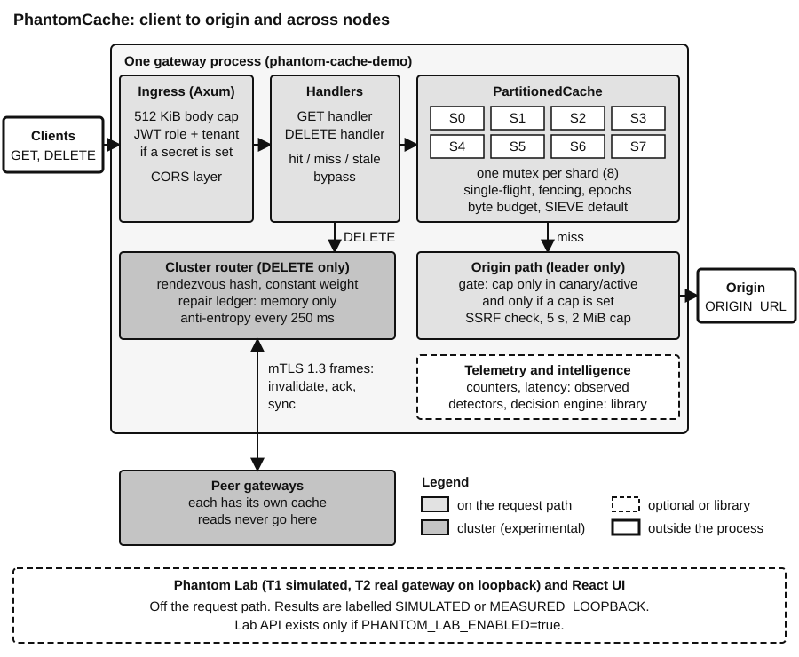
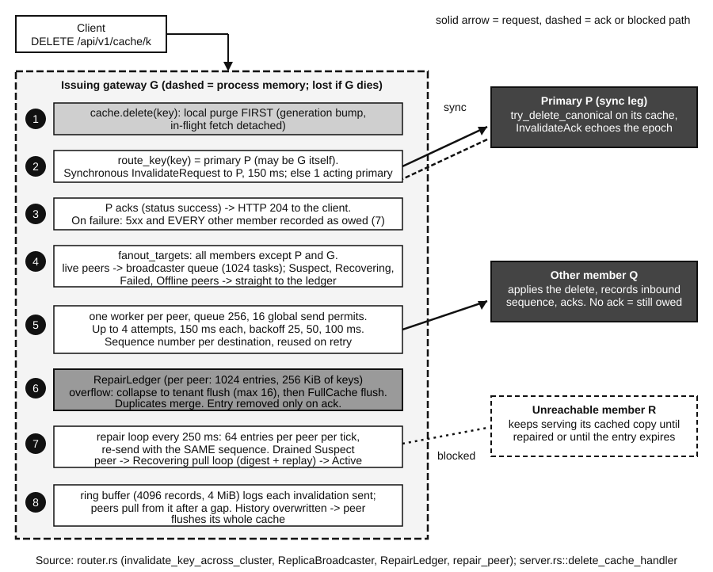

**Contents.** 1 The problem and the three pillars. 2 Architecture and a request's life. 3 The cache engine. 4 Distributed behaviour. 5 Workload intelligence. 6 Security and reliability. 7 Phantom Lab, evidence and the innovation argument. 8 Implemented versus roadmap, and claims not to make. 9 Ten judge questions and a self-test.

# 1. What PhantomCache is, and the problem

PhantomCache is an in-memory HTTP caching gateway written in Rust. It is a research prototype, not a production system. It sits between clients and one origin (the operator's own data service, named by `ORIGIN_URL`). Clients call `GET /api/v1/cache/<path>` and `DELETE /api/v1/cache/<path>`. There is no write route: to change data you change the origin and then `DELETE` the key, or wait for the entry to expire. Several gateways can run as an experimental cluster.

**Why a cache exists.** An origin is slow or fragile. Keeping a copy in memory turns many requests into few origin requests. Four things go wrong, and every part of the project answers one of them.

1. **Stampede.** A popular item expires and many clients miss at once. All of them hit the origin together, which can then collapse. The answer is *single-flight coalescing*: the first miss fetches, the rest wait and share the result.
2. **Stale data.** A copy can be older than the truth. The answer is a *freshness lifetime* (taken from the origin's headers) and a *hard cap* on how long expired data may still be served.
3. **Invalidation.** A deleted item must not come back, even if a slow fetch that started before the delete finishes after it. The answer is *fencing* with generation and epoch numbers.
4. **Origin overload.** Retries and misses can crush a struggling origin. The answer is an optional *concurrency gate* on origin fetches.

::: concept
**The three pillars and their honest status.** (1) Distributed systems engineering: the single-node engine is IMPLEMENTED and TESTED, with epoch fencing PARTIAL (the G4A-01 race is open); the cluster layer is IMPLEMENTED and TESTED on loopback only, labelled EXPERIMENTAL, with effectiveness UNVERIFIED. (2) Workload intelligence: a static or AIMD origin cap is IMPLEMENTED and TESTED but on the serving path only when configured; the rest is PROTOTYPE ONLY. (3) Product, observability and demonstrability: health and metrics routes, Phantom Lab and a React dashboard are IMPLEMENTED and TESTED by automated checks only; visual acceptance is UNVERIFIED.
:::

::: caution
**What it is not.** It is not a distributed cache (each gateway has its own cache; `GET` is local), not linearizable, not AI, not independently verified, and it makes no speed or superiority claim against any other product. The setting `PHANTOM_DEFAULT_TTL_MS` is NOT WIRED: the default lifetime is a literal 60 s.
:::

::: example
**A 60-second opening you can say.** "PhantomCache is a Rust HTTP caching gateway, a research prototype. On one node it coalesces concurrent misses, fences stores with generation and epoch numbers so a delete cannot be undone by a slow fetch, serves stale data only under a hard cap, and can limit origin concurrency. A small cluster layer propagates deletes over mutual TLS, but reads are local, and the evidence is loopback only. Our own sealed experiment found that an adaptive controller did not beat a tuned static cap, and we report that. Open findings are listed, and no human has reviewed it yet."
:::

*Handbook: Ch 1, 1.3 to 1.5; Appendix A.*

# 2. Architecture and a request's life

{ width=92% }

One OS process runs a Tokio runtime and an Axum router. Inside it live the ingress (CORS, a 512 KiB body limit, JWT checks), the handlers, one `PartitionedCache` of 8 shards, an optional cluster router, and background tasks (a sweeper every 100 ms, a metrics sampler). The React UI is a separate dev server; the gateway does not serve it.

**Front door.** If `PHANTOM_JWT_SECRET` is set, callers need an HS256 token with a role (`cache:read` or `cache:invalidate`) and a non-empty `tenant_id`; in secure mode the tenant comes only from the token. The cache key is tenant plus path plus raw query, so `?a=1&b=2` and `?b=2&a=1` are two keys.

**A hit.** If the entry exists, is within its lifetime and carries the current epochs, the gateway returns it with `X-Cache-Status: HIT` and an `Age` header. Nothing leaves the process. Other status values are MISS, COALESCED, STALE, BYPASS and BYPASS-AUTH.

**A miss.** Under the shard lock, `begin_fetch_atomic` has three outcomes: join an in-flight fetch as a waiter (at most 1,000 per key, else 503), make room by evicting (at most 32 victims, else a capacity error), or register a new fetch. The registering request is the *leader*. It runs the origin call in its own spawned task, so a client that disconnects does not cancel the fetch for the others. Only the leader takes an origin permit; waiters never do.

**The origin fetch.** The origin is checked against an upstream policy, its name is resolved, every returned address is filtered (no loopback, private or metadata ranges), the validated address is pinned and the connection made. Timeouts are 5 s per phase, the body cap is 2 MiB, redirects are not followed, and each fetch opens a new connection. Errors are not stored, so recovery is immediate when the origin returns.

**Store, then answer.** `finalize_fetch` stores the body only if the key's generation and epochs are unchanged since the fetch began (section 3). Otherwise the waiters still get the body, but the cache does not keep it.

**Origin protection.** The optional gate limits distinct origin fetches. It is enforced only when `PHANTOM_INTELLIGENCE` is `canary` or `active` and `PHANTOM_ORIGIN_CAP_MAX` is set; the default mode `off` is uncapped. When it refuses, the caller gets an eligible stale copy, else 503 with `Retry-After: 1`.

**Numbers worth knowing** (all verified in the code or its configuration; defaults, not measurements).

| Item | Value | Item | Value |
|---|---|---|---|
| Shards | 8, fixed | Waiters per key | 1,000 |
| Eviction victims per miss | at most 32 | Default total budget | 256 MiB |
| Default lifetime (not wired) | 60 s literal | Stale-serving cap | 24 h |
| Request body limit | 512 KiB | Origin body cap | 2 MiB |
| Origin timeout | 5 s per phase | `DELETE` primary wait | 150 ms |
| Sweeper tick | 100 ms | Anti-entropy tick | 250 ms |
| AIMD decrease factor | x 0.70, else +1 | Tenant epoch map | 10,000 |

**A caution about the word "node".** In the standalone gateway there is one real cache plus three placeholder `VirtualNode` objects used for dashboard demos; they are synthetic and PROTOTYPE ONLY. In the mTLS cluster configuration the local member shares the gateway's serving cache, and remote members are address-only descriptors with no cache in this process.

*Handbook: Ch 2, 2.3 to 2.6; Appendix B.*

# 3. The cache engine

**Eight shards.** Production code builds `PartitionedCache::new(8)` and no setting changes it. Each shard is one `std::sync::Mutex` around a key map, an in-flight map, byte counters and an eviction policy. The shard of a key is its hash masked by 7. Keys on different shards never wait for each other. One hot key always lands on one shard, so sharding cannot spread it. A hit locks its shard twice, and the response body is copied. The rule that holds the design together: never hold a `std::sync::Mutex` across `.await`. No model checker has been run, so "no deadlock" is argued from reading. No reason for the number 8 is recorded, and contention is unmeasured on a release build.

**Single-flight (TESTED).** `test_m1_t13_barrier_stampede_100_clients` asserts one MISS, 99 COALESCED and one origin call, on loopback in a debug build. It proves the mechanism for one scenario, not behaviour under all cancellations. Coalescing is per gateway: N gateways can send N fetches for one key.

**Freshness (PARTIAL).** An entry's lifetime comes from `s-maxage`, `max-age`, or `Expires` minus `Date`. If the origin says nothing, the gateway uses 60,000 ms, a literal in `src/api/server.rs` at two call sites. Expired data may be served stale only if the origin allowed it (`stale-while-revalidate` or `stale-if-error`) and always inside `PHANTOM_MAX_STALE_MS` (24 h by default). `must-revalidate` forbids stale serving. This is an RFC 9111 subset with open conformance findings.

::: caution
**The 24-hour cap is not a staleness bound.** It limits only the stale-serving window after expiry. A fresh entry can live as long as the origin says, and the gateway sets no ceiling on an origin-set lifetime. Never say "staleness is at most 24 hours".
:::

**Eviction.** The default policy is SIEVE. Think of entries in a queue with a pointer called the hand. A hit sets a visited flag. When room is needed, the hand moves from the oldest end: a visited entry is cleared and spared, the first unvisited entry is evicted. LRU and S3-FIFO are selectable. All skip keys with active operations. They are not worst-case O(1) when keys are pinned, S3-FIFO carries an open defect (G4A-02, tombstones; not selected by default), and no hit-ratio or release-profile comparison exists. SIEVE and LRU are TESTED only weakly.

**Byte accounting (TESTED).** Each shard counts logical bytes (key, body, headers and a fixed overhead). `audit_bytes()` recomputes the total so tests can compare. This shows consistent bookkeeping, not the operating system's memory figure. The default budget is 256 MiB split across shards.

**Fencing, with a worked example.** A fetch takes time, and meanwhile the key can be deleted. So a fetch records the key's *generation* (a counter) when it starts. `delete` bumps the generation. `finalize_fetch` stores only if the generation and the tenant and global *epochs* still match. A tenant invalidation raises that tenant's epoch, so older entries count as absent.

::: example
**Delete during a fetch.** Key K is at generation 4. A client misses and the leader starts a fetch, recording `op_gen = 4`. An operator sends `DELETE K`: the local entry goes and the generation becomes 5. The origin then returns the old body. `finalize_fetch` compares 5 with 4, so it does not store the body. The waiters still receive it, `stale_writes_prevented` increases, and the next request misses cleanly. `test_delete_fences_in_flight_fill_race` checks this one interleaving.
:::

**The known race (G4A-01, UNDER-INVESTIGATION).** `finalize_fetch` reads the tenant and global epochs twice. If a tenant invalidation lands between the two reads, an old body could be stored with the new epoch stamp. It was reproduced only in a sandbox with an injected yield point; a 20-second unhooked stress run (about 3.2 million fills) found nothing, which does not bound the probability. A small fix exists as a patch in `docs/research/g4a01_race/proposal.patch` and is NOT integrated. A related open finding (G4A-08): a request that joins an older in-flight fetch after an epoch change can receive the older body once. The generation fence catches `DELETE`; only epoch equality catches tenant or global invalidation, which is why epoch fencing is PARTIAL.

**Other limits.** The tenant epoch map is capped at 10,000; a new tenant arriving when it is full raises the global epoch, invalidating everything on that node, and a peer can trigger this (G4A-12). The sweeper scans each shard in full under its lock (G4A-03).

*Handbook: Ch 4, 4.2 to 4.9 (4.7 for the race); Appendix H.3 to H.5.*

# 4. Distributed behaviour

{ width=94% }

**GET is local only.** `get_cache_handler` never touches the router. The function that would forward a read to a key's owner, `forward_key_over_tcp`, has no production caller (only tests call it). The peer-side `GetRequest` handler in `src/dist/node.rs` is a stub that fabricates `val_node_<id>`, a recorded defect (DR-029). So N gateways are N independent read caches kept coherent by invalidation, not a partitioned cache. Coordinated reads are DESIGNED BUT NOT IMPLEMENTED.

**Rendezvous hashing.** Each node gets a score from the key and the node id; the highest score wins, so every gateway computes the same winner without talking. In this code the hash is `DefaultHasher` and the weight factor is the constant 1.0, so it is plain rendezvous hashing, not weighted, and the hash is not stable across builds (G4B-27). It is used only to choose which node must acknowledge a `DELETE`. It does not decide where data lives. For about one key in N the primary is the issuing gateway itself, and then the 204 says nothing about any other node.

**DELETE, step by step.** (1) The gateway purges its own cache. (2) With a router, it sends one invalidate request to the primary over mutual TLS and waits at most 150 ms (`PHANTOM_CLUSTER_TIMEOUT_MS`). (3) If the primary is silent it is marked Suspect and the first healthy replica acts as primary (`X-Cache-Warning: PrimaryFailover`); if that also fails the client gets 504. (4) After the acknowledgement every other member is told in the background: a per-peer queue of 256 with up to four attempts, then a bounded in-memory repair ledger, re-sent in bounded batches by the same background worker that runs every 250 ms (`start_anti_entropy_worker`; each tick calls `repair_all_peers` and the pull-based anti-entropy reconcile, which repairs sequence gaps from a ring of 4,096 sent records or flushes the receiver's cache).

::: caution
**What 204 means.** The local purge happened, and the routed primary acknowledged within 150 ms. It does not mean the object is gone everywhere.
:::

**Failure model and what is NOT guaranteed.** A guarantee needs a stated failure model, a bound and a test that could prove it wrong.

| Situation | What the evidence says | Status |
|---|---|---|
| One gateway, read after a completed `DELETE` | Deleted entry not returned, subject to G4A-01 and G4A-08 | TESTED, with open races |
| Message loss, receiver crash, brief partition (issuer alive) | Retry, ledger and pull repair converged within milliseconds on loopback | TESTED, debug build, one host |
| Issuer crashes with owed invalidations | Owed entries live only in the issuer's memory and are lost; only the entry's own lifetime bounds staleness | NOT covered; durable log is PROTOTYPE ONLY |
| Permanent partition, malicious member, multi-host | No bound; any pinned member can flush any tenant (G4B-05); no physical multi-host run | UNVERIFIED / BLOCKED |

Membership is a static file read at startup. Transport is TLS 1.3 with a cluster CA as the only trust root and a pinned per-node identity; an invalidate frame whose originator differs from the TLS identity closes the connection. Heartbeats are keepalive: no code lets a heartbeat change a node's state (G4B-12). The honest consistency statement: per-node ordering, best-effort eventual convergence under the tested failure model, no linearizability, and no cross-node staleness bound.

*Handbook: Ch 5, 5.2 to 5.9; Ch 8, 8.11; Appendix H.6 to H.8.*

# 5. Workload intelligence, honestly

"Intelligence" here means small, readable control rules. It is **not AI and not machine learning**; no ML ships.

**On the serving path.** Only the origin concurrency gate. It can be a fixed cap, or the cap can move by AIMD (additive increase, multiplicative decrease): multiply by 0.70 when the window's p99 or error rate is bad, otherwise add 1. It is off by default and enforced only with a configured cap in `canary` or `active` mode. The arithmetic and permit accounting are TESTED. Its benefit is NOT established (below). `canary` mode applies the cap to all fetches; there is no canary bucket or rollback in serving.

| Component | On the serving path? | Status |
|---|---|---|
| Origin concurrency gate (static cap, AIMD) | Only with a configured cap in `canary` or `active` mode; default off | TESTED; benefit NOT SUPPORTED |
| Hard caps (stale cap, byte budget, fencing) | Yes, always | TESTED |
| Latency histogram | Written on every `GET`; no production reader | TESTED (arithmetic only) |
| Signals, shadow evaluator, decision engine, canary, watchdog | No caller | PROTOTYPE ONLY |
| Legacy PIE (`src/control/pie.rs`) | No (`pie: None`) | PROTOTYPE ONLY |
| Hot-key detection, pre-warming, forecasting, ML selector | No | PROTOTYPE ONLY / DESIGNED BUT NOT IMPLEMENTED / DEFERRED |

**Not on the serving path (PROTOTYPE ONLY).** The signal pipeline (Count-Min plus Space-Saving heavy hitters, EWMA, CUSUM), the shadow evaluator, the decision engine with its confidence interval, canary routing and the watchdog are library code that no request calls; the statistics in the evaluator and engine have recorded flaws (F12, F13). The older `CountMinSketch` is used only by a unit test. The legacy `src/control/pie.rs` is a threshold stub (`pie: None` in `main.rs`) with a hard-coded utility; never present it as a working controller. The hot-keys field of `/api/v1/metrics` reports "unavailable"; in practice hot keys are protected by coalescing. Event tap, pre-warming and forecasting are DESIGNED BUT NOT IMPLEMENTED; an ML selector is DEFERRED behind an unmet gate.

**Telemetry.** A latency histogram (`AtomicLogLinearHistogram`, 2,688 buckets, designed error at most 0.39 percent) is written on every `GET`, but no production endpoint reads it; percentiles on `/api/v1/metrics` come from a sorted 10,000-sample window. Hard caps (stale cap, origin cap, byte budget, fencing) are enforced by the execution layer regardless of any intelligence decision.

**What the evidence says.** The sealed M6 evaluation (simulated, preregistered) gave hypothesis H1 the verdict NOT_SUPPORTED: a forced-adaptive controller did not beat the best tuned static cap, and the best tuned adaptive setting was itself a static cap. On a real gateway (Scenario B, loopback) the adaptive arm fell from 32 to about 12 and stayed there, acting as a static cap. The defensible feature is a configurable static origin cap.

*Handbook: Ch 5, 5.10 to 5.14.*

# 6. Security and reliability

**Five trust zones:** clients, the gateway process, the operator-fixed origin, cluster peers, and the local host. At each boundary there is a named check: JWT roles and tenant claims at ingress; the upstream policy, DNS pinning and address filter at the origin; certificate pinning and originator matching on the cluster link; a loopback-only rule with Host and Origin checks on the Lab API. A host-level attacker who can read the environment (it holds the JWT secret) is out of scope. There has been no penetration test, no fuzzing, no dependency advisory scan; the system is not security-certified.

**The G4 review.** Three AI reviews, read-only with no tests run, produced 99 findings: 75 OPEN (6 owner-named), 20 RECORDED-LIMITATION, 2 IN-SANDBOX-REMEDIATION, 1 UNDER-INVESTIGATION (G4A-01), 1 REFUTED. There is no Critical finding; 4 are High. "Confirmed" there means confirmed by reading code.

| Area | Protection that exists | Open finding or gap | Status |
|---|---|---|---|
| Authentication | HS256 JWT: signature, expiry, issuer, audience, role, tenant claim | No `nbf` check, no revocation, no rate limit (G4B-13, SEC-M7-11) | TESTED, gaps open |
| Ingress | 512 KiB body limit, CORS | **G4B-01 (High, owner-named):** request body read before authentication; no body timeout or connection cap | PARTIAL, OPEN |
| Origin access (SSRF) | Fixed origin, DNS pinning, address filter, 5 s timeouts, 2 MiB cap | Range gaps (G4B-15) | TESTED, gaps open |
| Cluster identity | mTLS 1.3, pinned identity, originator match | Any active member can send tenant-wide or full flush (G4B-05); no membership-epoch check on frames (G4B-06); static membership | TESTED on loopback |
| Control endpoint | Loopback rule for Lab API | `/api/control` mutates the live router; a missing event sets every node Active (G4B-03, owner-named) | OPEN |
| Fencing | Generation and epoch checks | **G4A-01 (High):** stale-body race, UNDER-INVESTIGATION; G4A-08, G4A-12 | PARTIAL |
| Eviction | SIEVE default; pinned-key skip | **G4A-02 (High, conditional):** S3-FIFO tombstone growth, not selected by default; G4A-03 sweeper scan | OPEN |
| Lab verdict | Preregistered mechanical verdict | **F01 / U-01 (High):** a verdict labelling defect; backend fix integration in progress, not accepted | IN-SANDBOX |
| Tenancy | Tenant-keyed entries and epochs | No quotas, no fair eviction | DESIGNED BUT NOT IMPLEMENTED |
| Invalidation durability | In-memory ledger and repair | Owed invalidations lost if the issuer dies | PROTOTYPE ONLY (fix) |
| Dependencies | Locked versions | 288 locked packages, two TLS stacks, no advisory scan | DEFERRED |
| Telemetry honesty | Provenance labels in API and UI | Hit-rate function returns 1.0 with no data (G4A-11) | PARTIAL |

**Reliability.** Resource bounds exist for bytes, waiters per key (1,000), the epoch map (10,000), response size, frame size (1 MiB payload, 4,096-byte keys), per-peer queues (256) and the ledger. Bounds that do not exist: inbound connection count, `/api/events` streams, origin concurrency by default, per-tenant rates. The suite passed as 851 recorded debug tests on a Windows host; several tests assert stub behaviour, and passing is not correctness. No release-profile suite and no Linux or container run exist (UNVERIFIED).

*Handbook: Ch 6, 6.1 to 6.11; Ch 8, 8.4.*

# 7. Phantom Lab, evidence and the innovation argument

**Two tiers, kept apart.** T1 is a deterministic discrete-event simulation with a virtual clock and seeded random streams. It drives the real cache, coalescing, fencing and origin-gate code but simulates clients and the origin, and runs no HTTP, TLS or cluster. Its results are labelled SIMULATED. T2 starts the real gateway binary on loopback against a scripted raw-TCP origin, with an open-loop load generator; results are labelled MEASURED_LOOPBACK, from one host, and are not multi-host or production figures. No T1 versus T2 agreement study has been run (UNVERIFIED).

**Method.** Experiments compare arms paired by seed, with a BCa bootstrap interval, a sign-flip permutation test and Holm correction. The verdict rule was preregistered and applied by code, and the sealed seed set was committed by hash before the run. M6 used 30 sealed seeds and 8 scenarios and ran once. It has not been reviewed by a human.

### What the evidence supports, and what it does not

| Claim | Evidence | Status |
|---|---|---|
| T1 replay is deterministic | Same-input runs give identical bytes; one machine | TESTED |
| A static cap lowers peak origin concurrency against no cap | Exploratory simulation; Scenario B static arm peaked at exactly 24 in all 10 runs (loopback, one host; the handbook records a release build) | TESTED; MEASURED_LOOPBACK; cost is refused requests |
| A forced-adaptive AIMD controller beats a tuned static cap | Sealed M6: NOT_SUPPORTED | REFUTED in this simulation, for this controller |
| Controller overhead; T1 predicts T2 | No release benchmark; no agreement study | UNVERIFIED |
| Hit-rate or latency against Redis, Varnish, nginx; multi-host behaviour; novelty | None run; the prior-art check is OPEN | NOT CLAIMED, NOT EVIDENCED |

::: concept
**The innovation argument, stated narrowly.** A working, tested HTTP caching gateway core that combines single-flight coalescing, generation-fenced fills, epoch invalidation, stale serving under a hard cap and a bounded origin gate, plus a deterministic, preregistered experiment harness that drove the real cache code through eight degradation scenarios and reported, mechanically, that a forced-adaptive controller did not beat a tuned static cap. The project makes no "first", "novel" or "better than" claim: the prior-art check (RT-0) is OPEN.
:::

**Weaknesses a judge will find, which you should name first.** Each mechanism has precedent elsewhere, and whether the combination beats assembling established tools with a limiter is not demonstrated. The simulator's predictive power is UNVERIFIED. Established products are more mature in operability, cross-node duplicate suppression, durable purge networks, relative-signal adaptive controllers and published eviction evaluations. The honest value is the method and the negative result, and a static cap that works.

**The UI.** The React dashboard shows telemetry and the Lab, with every value labelled measured, simulated, inferred or unavailable; its Cluster and Intelligence screens are placeholders. Automated checks only: visual and usability acceptance is UNVERIFIED, with no human review.

*Handbook: Ch 7, 7.1 to 7.8; Appendix H.9 and H.10.*

# 8. Implemented versus roadmap, and the claims not to make

| Capability | Status | Note |
|---|---|---|
| Coalescing, generation fencing, byte accounting (I1 to I8), stale serving under the hard cap | TESTED | One interleaving for fencing; G4A-13 byte drift on a rare path; stale-cap gate is weak (G4A-18) |
| Tenant and global epoch fencing | PARTIAL | G4A-01 race; fix not integrated |
| Freshness (RFC 9111 subset) and default TTL setting | PARTIAL | G4A-04 to -06 gaps; TTL setting validated but NOT WIRED (60 s literal) |
| SIEVE and LRU eviction | TESTED | Weakly; no release benchmark |
| S3-FIFO eviction | PARTIAL | Defect G4A-02; not default |
| JWT roles, mTLS identity, SSRF filter | TESTED | Lifecycle and range gaps open |
| HTTP ingress hardening | PARTIAL | G4B-01, -02, -04, -11 open |
| Rate limiting, graceful drain, metrics export | DEFERRED | Queued |
| Tenant quotas, fair eviction | DESIGNED BUT NOT IMPLEMENTED | Frozen core |
| Cluster fan-out, repair, anti-entropy | TESTED | Loopback, debug, at most four nodes; EXPERIMENTAL; effectiveness UNVERIFIED |
| Durable invalidation | PROTOTYPE ONLY | Sandbox patch |
| Rendezvous routing for DELETE primary | IMPLEMENTED | Unweighted, unstable hash |
| Peer-fill, coordinated reads, weighted placement | DESIGNED BUT NOT IMPLEMENTED | Stub handler is a defect |
| Static and AIMD origin cap | TESTED | Serving path only when configured; benefit NOT SUPPORTED |
| Signals, shadow evaluator, decision engine, PIE | PROTOTYPE ONLY | Not wired |
| ML selector; pre-warming, forecasting | DEFERRED / DESIGNED BUT NOT IMPLEMENTED | Gate unmet |
| Lab, Scenario B, sealed M6 | TESTED | Simulated or loopback; no human review |
| T1 to T2 agreement; Linux and container run | UNVERIFIED | Never run |
| Release-profile performance numbers | DEFERRED | Needs a quiet machine |
| Multi-host operation; human and external review | BLOCKED | No devices, no reviewer |

### Claims you must NOT make

| Tempting overclaim | Accurate statement |
|---|---|
| "Production-ready" | A research prototype with an experimental cluster; no release-profile suite, open High findings, Windows only |
| "A distributed cache" | N local caches plus an authenticated invalidation bus; `GET` is local |
| "204 means gone everywhere" | The routed primary acknowledged within 150 ms; owed invalidations are lost if the issuer dies |
| "Bounded staleness" or "zero stale after 50 ms" | Not supported; the only bound is the origin lifetime or 60 s; the stale cap bounds stale serving only |
| "Linearizable" or "strongly consistent" | No: per-node ordering and eventual convergence under the tested loopback failure model |
| "Adaptive or intelligent caching improves performance"; "uses ML" | Not established (H1 NOT_SUPPORTED); no ML ships; the PIE is a stub |
| "Fast" or "faster than Redis, Nginx, Varnish" | No release-profile or comparative measurement exists |
| "Independently audited" or "secure by design" | AI second looks only; open pre-auth body read, member flush, no rate limit, no scan |

*Handbook: Ch 8, 8.11 and 8.12; Appendix G.*

# 9. The ten judge questions, and a self-test

Practise each answer aloud in under a minute.

1. **How fast is it, and what hit rate do you get?** There is no release-profile, head-to-head or multi-host measurement. The few micro-benchmark and loopback numbers come with strict limits and I do not quote them as product figures. I can show the mechanism and the tests, not a performance claim.
2. **Does coalescing work across gateways, and what if the origin fails?** Coalescing is per gateway, so N gateways can send N concurrent fetches for one key. When the leader fails, all its waiters fail together. Errors are not cached, so the next request tries again.
3. **Why 8 shards, and what about one hot key?** I found no recorded reason for 8. A hot key always lands on one shard, so sharding cannot help it. Contention has not been measured on a release build and no model checker has been run on the locking.
4. **Is staleness at most 24 hours?** No. The 24-hour cap bounds only the stale-serving window after expiry. A fresh entry lasts as long as the origin says, with no gateway ceiling, and the 60 s default is a literal because `PHANTOM_DEFAULT_TTL_MS` is not wired.
5. **Is there a race in the fence?** Yes: G4A-01, a gap between two epoch reads in `finalize_fetch`, is UNDER-INVESTIGATION. It was reproduced only in a sandbox with an injected yield point, and the small fix is not integrated. The generation fence for `DELETE` is separate and tested for one interleaving.
6. **Does a 204 mean the object is gone everywhere?** No. It means the local purge happened and the routed primary acknowledged within 150 ms. Other members are told asynchronously with retry and repair, and owed invalidations are lost if the issuer crashes.
7. **Is this a distributed cache?** It is N independent caches joined by an authenticated invalidation bus. `GET` is local; rendezvous hashing only picks the `DELETE` acknowledger; coordinated reads and weighted placement are DESIGNED BUT NOT IMPLEMENTED.
8. **Is it linearizable, with bounded staleness?** No to both. Reads are local, and after an issuer crash or permanent partition the only bound is the entry's own lifetime. All cluster evidence is single-host loopback in a debug build; multi-host behaviour is UNVERIFIED.
9. **Does adaptive control improve anything?** Not on current evidence. Sealed M6 found H1 NOT_SUPPORTED in simulation, and on a real gateway the adaptive arm acted as a static cap near 12. A static cap is the defensible feature, and it is not AI.
10. **Who has verified this, and what is still open?** No human has; every review is an AI second look. G4 found 99 findings (75 open, no Critical); the High ones are G4A-01, G4A-02, G4B-01 (body read before auth) and F01 (U-01). A human review, external security review and physical multi-host run are blocked.

### Self-test: answer aloud, then check the section

1. Name the six `X-Cache-Status` values and what a miss triggers. (2)
2. A hundred clients ask for one missing key: what does the origin see, and what does that not prove? (2, 3)
3. What does one hot key do to the 8 shards, and how often does a hit lock its shard? (3)
4. Which setting is NOT WIRED, and what does `PHANTOM_MAX_STALE_MS` bound? (3)
5. Walk through a `DELETE` arriving during a fetch: which numbers are compared, and where is the open race? (3)
6. What exactly does a 204 tell the client in cluster mode? (4)
7. Why is `GET` local-only, and what does the hash decide? (4)
8. State the failure model, the honest consistency statement and one test that would falsify a staleness bound. (4)
9. When is the origin gate enforced, what does AIMD do, and what did Scenario B show? (2, 5)
10. What is the difference between T1 and T2, what did M6 conclude, and what may the project not claim from it? (7)

### More questions to rehearse (short answers)

- *How do you know the simulator reflects reality, and why report a failure?* I do not claim it does: it tests policy logic and cache semantics against a modelled origin, and its predictive power is UNVERIFIED. I report the negative result because the rule was fixed before the data.
- *What does TESTED mean here?* A named test exercises the feature. Passing shows an author's expectation held in one build on one host; several tests assert stub behaviour.
- *Was the cluster run on real machines?* No: loopback, one host, a debug build, at most four nodes. Multi-host operation is BLOCKED for lack of devices.
- *What happens if the origin is down?* Errors are not cached. An eligible stale copy is served under `stale-if-error` inside the cap; otherwise the client gets an error. There is no circuit breaker, no negative caching and no retry loop.
- *Can one tenant read another's data?* Keys include the tenant, and in secure mode the tenant comes only from the verified token. Isolation is by key only: there are no quotas, and any pinned cluster member can flush any tenant.
- *What would you do next?* In order of cost: a relative-signal controller as a newly registered arm; a load-dependent scripted origin; a T1 versus T2 agreement study; a release-profile overhead benchmark; an independent human review; a multi-host run with baselines.

### Defending under pressure: six habits

1. Say the limit before the judge does. "Reads are local, and the evidence is loopback" costs you nothing when you volunteer it.
2. Separate the status words. "IMPLEMENTED" means code exists; "TESTED" means a named test ran; neither means correct.
3. Never use a number without its conditions (build profile, host, workload, seed, repetitions). If you cannot give them, do not quote it.
4. When you do not know, say "UNVERIFIED, and here is what would check it". Do not guess.
5. Point to a mechanism and a file, not to a claim. Every section above names the function or test that holds the fact.
6. Treat the negative result (H1 NOT_SUPPORTED) as your strongest honesty evidence, and do not soften it.

**Key terms in one line each.** *Single-flight*: one fetch per missing key, others wait. *Generation*: a per-key counter bumped by `DELETE`. *Epoch*: a per-tenant or global counter bumped by bulk invalidation. *Stale cap*: the longest expired data may still be served. *Rendezvous hashing*: highest score of (key, node) wins. *AIMD*: add a little when healthy, cut sharply when not. *Loopback*: all processes on one machine, so no real network. *Preregistration*: the verdict rule is fixed before the data is seen. *Provenance label*: measured, simulated, inferred or unavailable.

*Handbook: Appendix E (full judge bank), Appendix D (glossary) and Appendix H.*
