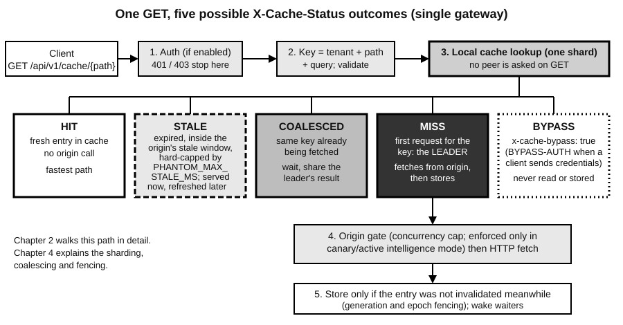
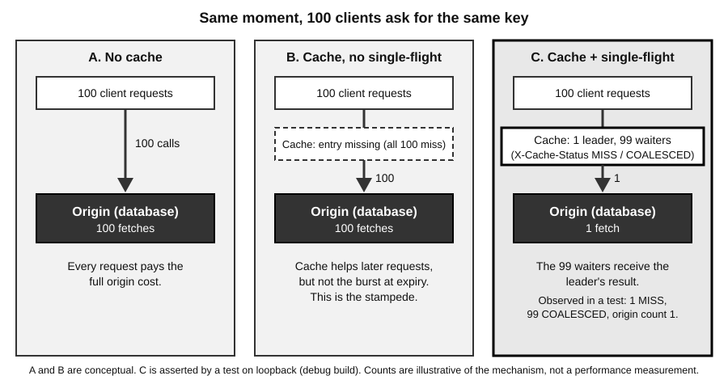
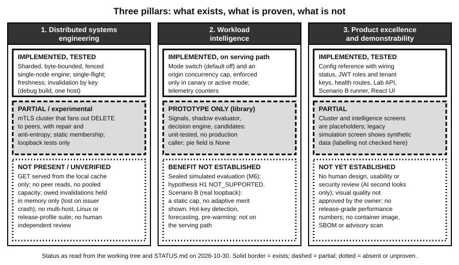

# Chapter 1: The Problem and the Vision

**Status of this chapter:** written 2026-10-30 against the working tree. At the time of writing HEAD is `df68eaa` (branch `feat/publish-phantomcache-core`); most of the work described is uncommitted. Every capability claim carries a status label from the handbook vocabulary (IMPLEMENTED, TESTED, PARTIAL, PROTOTYPE ONLY, DESIGNED BUT NOT IMPLEMENTED, DEFERRED, BLOCKED, UNVERIFIED). Nothing in the repository is INDEPENDENTLY VERIFIED by a human reviewer; every review so far is an AI second look. The evidence behind each claim is in `docs/learning/evidence/ch01_evidence.md`.

## What you will learn

- What a cache is, and how to talk about hits, misses, latency, throughput and origin load with exact words.
- Why applications need caching, and the four problems caching introduces: stampedes, hot keys, stale data and invalidation.
- Why one cache node eventually stops being enough, and what a distributed cache costs in return.
- What PhantomCache is, in one minute, and which parts of that description are true today.
- The three pillars (distributed systems engineering, workload intelligence, product excellence), each with an honest status tied to real files and tests.

---

## 1.1 What a cache is

**Simple explanation.** A cache is a small, fast shelf that holds copies of answers you have already worked hard to get. A librarian who fetches a book from the basement stack walks down once, then keeps the book on the desk for the next reader. The desk is the cache. The basement is slower, but it is the only place that has the real, authoritative copy.

**The correct terms.**

- **Origin** (also "backend" or "source of truth"): the system that owns the real data and can always produce it, usually a database or an upstream web service. In PhantomCache the origin is whatever HTTP server `ORIGIN_URL` points to (`src/main.rs`, read with `cfg.get("ORIGIN_URL")`).
- **Cache**: a store of copies, keyed so that a later request for the same thing can be answered without calling the origin.
- **Key**: the identity of one cached item. In PhantomCache a key is the tenant plus the request path plus the query string (`src/core/cache.rs::CacheKey`, built in `src/api/server.rs::get_cache_handler`). Two query strings mean two keys.
- **Hit**: the cache has a usable copy and answers from it. **Miss**: it has none, so the origin must be asked.
- **Hit ratio** (or hit rate): hits divided by total lookups.
- **Latency**: how long one request takes, from the caller's point of view. **Throughput**: how many requests per second the system completes. **Origin load**: how many requests per second reach the origin.
- **TTL** (time to live) and **freshness lifetime**: how long a copy may be treated as correct. After that the copy is **stale** (expired).
- **Invalidation**: removing or marking a copy as no longer valid before it would expire naturally, usually because the origin data changed.

**How it works.** Every cache runs the same loop:

```
on request(key):
    if cache has a fresh copy of key:      # HIT
        return the copy
    copy = ask the origin for key          # MISS
    store copy in cache (with a lifetime)
    return copy
```

**Where it lives in PhantomCache.** PhantomCache is an HTTP caching gateway. A client sends `GET /api/v1/cache/<path>` to the gateway. The route is registered in `src/api/server.rs` (the router function adds `"/api/v1/cache/*key"` with `get(get_cache_handler).delete(delete_cache_handler)`). The gateway answers from its in-memory cache or fetches from the origin and stores the reply. Every reply to a cache GET carries an `X-Cache-Status` header whose value says what happened. The values set in the code are `HIT`, `MISS`, `COALESCED`, `STALE`, `BYPASS` and `BYPASS-AUTH`. Status: IMPLEMENTED, TESTED (for example `tests/integration/m1_http_tests.rs::test_m1_t13_barrier_stampede_100_clients` checks `MISS` and `COALESCED` values; it does not prove behaviour on a release build or across hosts).



Source: `src/api/server.rs::get_cache_handler` (authentication, key construction, stale check, bypass branch, single-flight leader and waiter branches), `src/core/cache.rs::PartitionedCache::begin_fetch_atomic`. Chapter 2 walks this path step by step. Chapter 4 explains the machinery.

**Trade-offs and what can go wrong.** A cache trades memory and correctness risk for speed. Copies use memory, so a full cache needs an eviction rule. Copies can also become wrong, and a cache that returns wrong data is worse than none, because callers trust it. Section 1.3 is about how that happens.

---

## 1.2 Why applications need caching

**Simple explanation.** Asking the origin is expensive, and many people ask for the same thing. Answering from a nearby copy is cheap. If most questions repeat, most work disappears.

**Why the origin is the bottleneck.** An origin such as a relational database has limited connections and a limited query rate. When requests arrive faster than it can answer, they queue; callers hold threads and connections longer, and their callers queue in turn. This is a **queue collapse** or **cascading failure**: one slow component slows everything above it. The README and the handoff name this as the motivating problem ("database queue collapse, thundering herds, cache stampedes"). It is motivation, not a measurement taken by this project.

**Three quantities to keep apart.**

| Quantity | Meaning | A cache changes it by |
|---|---|---|
| Latency | Time for one request | Replacing a slow origin trip with a fast memory lookup on a hit |
| Throughput | Completed requests per second | Letting the gateway finish many requests without waiting on the origin |
| Origin load | Requests per second that reach the origin | Absorbing the repeated requests |

**Worked example (illustrative numbers, not measurements).** Suppose a service receives 10,000 requests per second. A hit costs 1 ms. A miss costs 50 ms because it includes the origin trip. Suppose the hit ratio is 95%.

```
average latency = h * t_hit + (1 - h) * t_miss
                = 0.95 * 1 ms + 0.05 * 50 ms
                = 0.95 + 2.50 = 3.45 ms

origin load     = (1 - h) * request rate
                = 0.05 * 10,000 = 500 requests per second
```

Without the cache the average latency is 50 ms and the origin sees 10,000 requests per second; with it, the origin sees 20 times fewer. Two points. The 5% of misses still dominate the average (2.50 of 3.45 ms). And origin load is sensitive to the hit ratio: at 90% instead of 95% it doubles to 1,000 requests per second. So caches are judged by what they do to the origin, not only by how fast a hit is.

::: concept
**Hit ratio, latency, origin load.** Average latency is a weighted mix of hit and miss times. Origin load is the miss rate times the request rate. Because misses are rare but expensive, the tail of the latency distribution (the slowest few percent, written P99 for the 99th percentile) is set mostly by misses. A cache protects the origin only as well as its hit ratio holds under stress.
:::

**Where it lives in PhantomCache.** Requests and outcomes are counted in `PartitionedCache::counters` (`requests_total` is incremented in `get_cache_handler`) and exposed at `GET /api/v1/metrics`. Status: IMPLEMENTED. There is no release-grade measurement of hit ratio, latency or throughput: `docs/user/limitations.md` says "No performance numbers are published with this release", and `docs/STATUS.md` says there is no release-profile general suite. Chapter 6, section 6.13 lists every measurement the repository contains.

::: judge
**JUDGE MAY ASK**

Question: Why is caching necessary at all? Why not just make the database faster?

**Suggested answer** (about 30 to 60 seconds spoken, plain English):

Making the database faster helps, but it does not remove the basic problem. Most real traffic repeats: many users ask for the same few items. A database answers every repeat from scratch, which costs a query, a connection and often disk or network time. A cache answers the repeat from memory in a fraction of the time and, more importantly, the repeat never reaches the database. The database load then drops by roughly the miss rate. If the hit ratio is 95%, the database sees one request in twenty. That headroom is what keeps the database alive during a traffic surge. A faster database is still worth having, but it is a one-off multiplier. A cache changes the shape of the load.

**If the judge asks further:**

Caching only works when requests repeat and when a slightly old answer is acceptable. If every request is unique, or if every answer must be perfectly current, a cache gives little or nothing. I would not claim a specific speed-up for PhantomCache: this repository contains no release-build performance measurement. The numbers I use to explain the idea are illustrative.

**Evidence to know:** `docs/user/limitations.md` (no published performance numbers); `docs/STATUS.md` section 3 (no release-profile suite); counters in `src/core/cache.rs::PartitionedCache` and `GET /api/v1/metrics`. Status: IMPLEMENTED (counters); performance benefit UNVERIFIED on a release build.
:::

::: judge
**JUDGE MAY ASK**

Question: Why not let the application query the database directly and keep the architecture simple?

**Suggested answer** (about 30 to 60 seconds spoken, plain English):

For a low-traffic service that is the right answer. A cache is an extra moving part with its own failure modes, so you should add one only when you need it. You need it when many callers repeat the same reads, when the database is the scarce resource, or when traffic arrives in sudden surges. In those cases direct access means the database load equals the full request rate, and any surge goes straight through. A gateway in front of the database turns a thousand identical simultaneous requests into one database query, and keeps working reads going when the database is slow. The cost is that you now own a second system that can be stale, so you must be able to say how stale and how it is corrected.

**If the judge asks further:**

PhantomCache is an HTTP gateway, not a database client library. The origin is any HTTP server reached through `ORIGIN_URL`, so the "database" in this project is really whatever sits behind that URL. I should also say that the project's tests use scripted origins and a mock origin. They show the gateway coalesces and caches correctly. They do not show how a real production database behaves behind it.

**Evidence to know:** `src/main.rs` (`ORIGIN_URL`), `tests/integration/m1_http_tests.rs` (mock origin), `docs/demo/scenario_b_interpretation_notice.md` item 4 (scripted origin has no load-dependent latency). Status: IMPLEMENTED, TESTED against scripted origins only.
:::

---

## 1.3 Where caching goes wrong

A cache solves one problem and creates four. A good engineer can name all four and say what each looks like in a running system.

### 1.3.1 Cache stampede (thundering herd)

**Simple explanation.** A popular item expires. In the instant before anyone has refilled it, a thousand customers walk up and ask for it. The cache has nothing, so all thousand go to the basement. The basement was only ever staffed for the occasional trip.

**Terms.** A **cache stampede** or **thundering herd** is a burst of simultaneous misses for the same key, each of which independently goes to the origin. A **flash crowd** is the sudden surge of real traffic that often triggers one. **Request coalescing** (also **single-flight**) is the defence: when several requests miss on the same key at the same moment, only one, the **leader**, fetches from the origin. The others, the **waiters**, wait for the leader's result and share it.

**How it works.**

```
on miss(key):
    if a fetch for key is already in flight:
        register as a waiter; sleep until the leader finishes   # COALESCED
    else:
        mark "fetch in flight" for key; become the leader        # MISS
        fetch from origin
        store the result (if still valid)
        wake every waiter with the same result
```



Source: `tests/integration/m1_http_tests.rs::test_m1_t13_barrier_stampede_100_clients` (panel C is what this test asserts). Panels A and B are conceptual and not measured.

**Worked example.** The test above releases 100 clients at a barrier against a mock origin that delays 150 ms. It asserts exactly one `MISS`, 99 `COALESCED`, and an origin request count of 1. A second test, `tests/integration/serving_contract_tests.rs::test_ct9_expiry_herd_coalescing`, expires an entry (100 ms lifetime, checked at +150 ms) and checks that exactly one request initiates the refetch while a concurrent request for the same key waits. (Chapter 4, section 4.4 uses a different, smaller test, `coalesce_tradeoffs_tests::test_negative_effect_head_of_line_blocking` with 10 clients, to show the cost to waiters.)

**Where it lives.** `src/core/cache.rs::PartitionedCache::begin_fetch_atomic` registers the leader or returns a waiter receiver. The shared in-flight state is the struct `SharedOp` in `src/core/coalesce.rs` (waiters are Tokio `oneshot` senders). The HTTP leader and waiter paths are in `src/api/server.rs::get_cache_handler`. A cap on waiters per key exists (`max_waiters_per_key`, default 1,000). Status: IMPLEMENTED, TESTED (loopback, debug build, mock origin). Chapter 4 section on coalescing owns the mechanism in detail.

**Note on a README discrepancy.** The README names a `Coalescer` in `coalesce.rs`. That type is kept for backward compatibility and is created as `_coalescer` (unused) in `src/main.rs`; the serving path uses `SharedOp` and `begin_fetch_atomic`. See the table in section 1.10.

**Trade-offs and limits.** Coalescing is per key: one hundred requests for one key cost one fetch, but one hundred different cold keys still cost one hundred. Waiters inherit the leader's fate: if its fetch fails, every waiter gets the failure. `tests/integration/coalesce_tradeoffs_tests.rs` is named for these trade-offs (head-of-line blocking, error fan-out, waiter fairness).

### 1.3.2 Hot keys

**Simple explanation.** Popularity is lopsided. A few items receive most of the requests, and a cache that is fast on average can still be overwhelmed at one spot.

**Terms.** A **hot key** is a key that receives a disproportionate share of requests. Key popularity in real workloads is often described as **Zipfian**: the most popular key is requested about twice as often as the second, three times as often as the third, and so on. The traffic simulator in `src/sim/traffic.rs` uses a Zipfian key popularity model (stated in the README; the simulator is synthetic).

**How it goes wrong.** PhantomCache splits its map into **shards**, each guarded by its own mutex, so that unrelated keys rarely wait on the same lock (`PartitionedCache::shards: Vec<Mutex<CacheShard>>`; `get_shard_index` hashes the key and masks the result). Sharding spreads many keys across locks. It does not spread one key: all requests for a hot key hash to the same shard and contend for the same mutex. The serving cache is built with 8 shards (`PartitionedCache::new(8)` in `src/main.rs`). See Chapter 4, section 4.2.

**What PhantomCache does about it.** Very little that is specific. The defences are indirect: a hit on a hot key is a cheap lookup, and coalescing stops a hot expired key from producing a herd. Detection is not on the serving path: the metrics response reports `"hot_keys": {"src": "unavailable", "reason": "not_implemented"}` (`src/api/server.rs`, verified). The hot-key emergence detector in `src/intelligence/signals.rs` is PROTOTYPE ONLY (unit-tested, not called by the gateway). `CountMinSketch` in `src/intel/sketch.rs` is referenced only by its own file and `tests/unit/wp2_tests.rs` (grep of `src/`, `tests/`, `benches/`), so it is unused when serving.

### 1.3.3 Stale data

**Simple explanation.** A copy is only a copy. If the original changes, the copy is out of date until someone notices.

**Terms.** **Staleness** is the age or amount by which a served copy lags the origin. A **stale-serving window** is a deliberate choice to serve an expired copy for a limited time, for example while a fresh copy is fetched in the background (**stale-while-revalidate**) or when the origin is failing (**stale-if-error**). **Revalidation** asks the origin "is my copy still current?" cheaply, using a validator such as an `ETag`, and the origin may answer `304 Not Modified`.

**How it works in PhantomCache.** When a client requests a key whose copy has expired, `get_cache_handler` calls `cache.check_stale_serving(&cache_key, now_ms, hard_cap_ms, false)`. If the result is `Eligible`, the gateway serves the expired copy with `X-Cache-Status: STALE`, and may start one bounded background revalidation. `PHANTOM_MAX_STALE_MS` (default 86,400,000 ms, 24 hours) is the hard cap on how long past expiry a copy may be served stale; the code records a counter `stale_cap_violations` that must stay at zero. Status: IMPLEMENTED, TESTED.

::: caution
**Three limits on staleness that are easy to overstate.**

1. The stale cap bounds stale-serving after expiry, not the freshness lifetime. Lifetimes the origin sets through `s-maxage`, `max-age` or `Expires` have no gateway ceiling (`docs/user/limitations.md`).
2. With no freshness headers the default lifetime is a literal 60 seconds. `PHANTOM_DEFAULT_TTL_MS` is validated but NotWired (`src/config.rs`); `src/api/server.rs` passes the literal `60_000` to `evaluate_response_freshness` at two call sites. Setting the variable changes nothing.
3. There is no linearizability or bounded-staleness guarantee across the system. A comment in `delete_cache_handler` says the local-first delete "Guarantees linearizability". That is stronger than anything the project may claim (CLAUDE.md section 4); do not repeat it as a guarantee.
:::

### 1.3.4 Invalidation

**Simple explanation.** When the original changes, someone has to tell every copy. Invalidation is hard because you must reach every copy, in the right order, even when messages are lost, delayed, duplicated or arrive late.

**Terms.** **Invalidation** removes or marks copies as invalid. **Fencing** (in PhantomCache, "generation fencing") makes sure an in-progress fetch that started before an invalidation cannot store its now-outdated result afterwards. **Epoch** is a counter bumped to invalidate many keys at once (all of a tenant's keys, or every key) without visiting each one.

**The race that makes it hard.** Picture this sequence on one gateway:

```
t0  leader starts fetching key K from the origin (origin returns old value V1)
t1  the origin owner changes K to V2 and calls DELETE K on the gateway
t2  DELETE removes K from the cache (nothing to remove yet)
t3  the leader's fetch returns V1 and stores it
    -> K is now stale in the cache although the DELETE already happened
```

The engine is built to prevent this ordering. A fetch records the key's generation when it starts, `delete` bumps it, and `PartitionedCache::finalize_fetch` stores the result only if `state.generation == op_gen` and the tenant and global epochs still match; otherwise it increments `stale_writes_prevented` (verified by reading `finalize_fetch`). Status: IMPLEMENTED, TESTED (`tests/integration/invalidation_contract_tests.rs`, `serving_contract_tests.rs`; not re-run here). Chapter 4, section 4.5 owns the mechanism and records that a stale-body race (G4A-01) is UNDER-INVESTIGATION, with a sandbox proposal that is not integrated.

**Where invalidation becomes a distributed problem.** With one gateway, `DELETE /api/v1/cache/<path>` purges one cache. With several gateways, each has its own copy, so a delete must reach all of them. That is the next section.

::: judge
**JUDGE MAY ASK**

Question: What does caching introduce that you did not have before? What are the costs?

**Suggested answer** (about 30 to 60 seconds spoken, plain English):

A cache gives speed and origin protection, and in return it introduces four problems. Stale data: a copy can lag the origin, so you must decide how stale is acceptable and enforce it. Invalidation: when the origin changes, every copy must be corrected, and that is a race against in-flight fetches. Stampedes: when a popular copy expires, many requests miss together and hit the origin at once. And hot keys: a few popular keys concentrate load on one lock or one node. PhantomCache addresses stampedes with request coalescing and addresses the invalidation race with generation fencing. It bounds stale serving with a configurable cap. It does not eliminate any of these: staleness is still bounded only by the origin's lifetime or a 60-second default, and the cluster invalidation path is experimental.

**If the judge asks further:**

I can add memory pressure as a fifth cost: the cache must evict, and PhantomCache keeps a logical byte budget (`PHANTOM_MAX_CACHE_BYTES`, default 256 MiB) with accounting invariants audited by `audit_bytes()`. A sixth is operational: one more component to run, monitor and secure. Finally, the cache can hide origin problems or amplify an origin failure if a leader's error is shared with many waiters, which the project tests as a trade-off.

**Evidence to know:** `src/core/cache.rs::begin_fetch_atomic`, `::finalize_fetch`, `::delete`; `src/core/coalesce.rs::SharedOp`; `src/config.rs` (`PHANTOM_MAX_STALE_MS`, `PHANTOM_DEFAULT_TTL_MS` NotWired, `PHANTOM_MAX_CACHE_BYTES`); `tests/integration/coalesce_tradeoffs_tests.rs`. Status: IMPLEMENTED, TESTED (loopback, debug); G4A-01 UNDER-INVESTIGATION.
:::

---

## 1.4 Why one cache is not enough: the case for distribution

**Simple explanation.** One shelf in one room has a limit. If the shop grows, you add rooms and shelves. But now two rooms can hold different versions of the same book, and a customer who walks into the wrong room gets the wrong edition.

**Why a single cache node stops being enough.**

1. **Capacity.** One machine has finite memory; a larger working set cannot all be held.
2. **Throughput.** One process has finite CPU cores and network bandwidth.
3. **Availability.** One process is a **single point of failure**: if it stops, the origin takes the whole load at once.
4. **Locality.** Callers far away are served faster by a nearby cache.

**What "distributed" means here.** A **distributed cache** is a cache made of several cooperating nodes (processes, often on different machines). Two designs are worth separating, because the difference decides what the product can honestly claim.

| Design | Reads | Writes and invalidation | What it gives |
|---|---|---|---|
| **Independent caches with a shared invalidation bus** | Each node serves from its own copies | A purge is sent to every node | Availability and throughput scale with nodes. Capacity does not pool: every node may hold the same hot items. Origin load can multiply with the number of nodes. |
| **Partitioned (sharded) cache with coordinated reads** | A key has an owner node. A read for key K is routed to its owner (or a peer fetches from it). | Only the owner (and any replicas) must be invalidated | Capacity pools. Each key is fetched from the origin once cluster-wide, in the best case. Needs a read protocol and a consistency contract. |

**The honest position of PhantomCache.** PhantomCache is **N independent caches with an invalidation bus**, in an experimental form. It has some pieces needed for the second design but not the second design itself. Verified in the current tree (Chapter 5 owns the detail):

- **GET is served from the local cache only.** `get_cache_handler` looks only at its own `PartitionedCache` and never asks a peer. The router (`state.router`) is used only in `delete_cache_handler`. Status: IMPLEMENTED as described. Peer reads: NOT IMPLEMENTED. The cluster `GetRequest` handler in `src/dist/node.rs` is a stub (DR-029), and `src/dist/router.rs::forward_key_over_tcp` has no caller in `src/`.
- **DELETE does fan out.** The gateway purges its own cache first, then calls `router.invalidate_key_across_cluster(&canonical_key, InvalidationScope::ExactKey)`. The primary chosen by rendezvous hashing must acknowledge within a short leg (default 150 ms, `PHANTOM_CLUSTER_TIMEOUT_MS`). Every other active member is told asynchronously; a repair worker and an anti-entropy worker (250 ms period, started in `src/main.rs`) re-deliver. So a `204` means the local purge plus the routed primary's acknowledgement, nothing more. Status: IMPLEMENTED, TESTED on loopback, debug build, Windows.
- **Rendezvous weights are constant.** In `route_key` the weight is `hash_val as f64 * capacity_weight` with `capacity_weight = 1.0`, so this is plain rendezvous hashing, used only for DELETE. The hash is `DefaultHasher`, which is not guaranteed stable across Rust versions. Status: IMPLEMENTED, weights unused.
- **Membership is static.** Nodes are read once from a members file at start-up. No join, leave or gossip. Dynamic membership: NOT IMPLEMENTED.
- **Owed invalidations live only in memory** of the issuing gateway and are lost if it crashes before delivery. Reproduced (see `docs/research/m3_durability/`); the patch exists only in a sandbox. Durability: NOT IMPLEMENTED; patch PROTOTYPE ONLY, not integrated, needs independent review and owner approval.
- **Each node has its own byte budget and origin cap.** Capacity does not pool.
- **No physical multi-host run exists.** Cluster tests run on loopback, debug, Windows, mostly three nodes. UNVERIFIED beyond that.

::: example
**A concrete cost of independent caches.** Suppose three gateways each cache `/price/42` and the origin changes. A client calls `DELETE /api/v1/cache/price/42` on gateway 1. Gateway 1 purges its own copy and gets the primary's acknowledgement, then returns 204. If gateway 3 was unreachable at that moment, it still holds the old copy. The repair worker retries while gateway 1 stays alive. If gateway 1 crashes first, gateway 3 keeps serving the old value until the entry expires (the origin's lifetime, or 60 seconds if none was given). So a 204 does not prove the object is gone everywhere. `docs/user/limitations.md` ("Cluster invalidation durability") says exactly this, and tells operators to use a short `s-maxage` for deletion-critical content.
:::



Source: `docs/STATUS.md`, `docs/research/vision/product_vision_vs_implementation_audit.md`, `docs/user/limitations.md`, `src/main.rs`, `src/api/server.rs`, `src/dist/router.rs`, `src/intelligence/executor.rs`, `docs/research/m6_sealed_results.md`, `ui/src/App.jsx`.

**Trade-offs and alternatives.** The repository records an owner preference for "a trustworthy single-node foundation first" and "do not delete or discard existing distributed code" (quoted in `product_vision_vs_implementation_audit.md`; I read the quotation there, not the session transcript). The partitioned design with coordinated reads was deferred. The original rationale for "distributed" is unrecoverable. So the reasons in this section are our reasoning, not a recorded decision, except where the audit quotes the owner.

**What can go wrong with distribution.** Messages are lost or delayed; nodes crash or are partitioned; two nodes can briefly hold different values for one key; an operator may mistake "a 204 came back" for "the object is gone everywhere". Chapter 5, section 5.6 gives the failure model.

::: judge
**JUDGE MAY ASK**

Question: Why do you need a distributed cache rather than one big cache node?

**Suggested answer** (about 30 to 60 seconds spoken, plain English):

One node has a ceiling on memory, on CPU and on network, and it is a single point of failure. If it dies, the origin takes the full load at once. Running several gateways raises throughput and keeps the service up when one fails. The price is that you now need a way to keep their copies consistent. In PhantomCache today the main distributed feature is reliable invalidation: when a key is deleted, the delete is sent to every node, with retries and anti-entropy. Reads are not distributed: each gateway serves from its own cache. So I would describe it honestly as a set of independent gateways with a shared invalidation bus, not as a pooled cache. Capacity does not add up across nodes, and the origin can see up to N times the load of one node.

**If the judge asks further:**

The stronger design, a partitioned cache where each key has one owner and reads are routed to it, is a gated goal, not a delivered feature. The routing hash exists but weights are constant and it is used only for deletes. The cluster is static in membership, tested on loopback only, and owed invalidations are lost if the issuing node crashes. I would not claim the cluster is production-ready. It is labelled experimental in `README.md` and in the startup message in `src/main.rs`.

**Evidence to know:** `src/api/server.rs::get_cache_handler` (local only) and `::delete_cache_handler` (`invalidate_key_across_cluster`); `src/dist/router.rs::route_key` (weight `1.0`); `src/main.rs` (static members file, `start_anti_entropy_worker`, "[EXPERIMENTAL] Cluster mode" message); `docs/user/limitations.md`; `docs/research/vision/product_vision_vs_implementation_audit.md` section 5. Status: invalidation fan-out IMPLEMENTED, TESTED (loopback, debug); peer reads NOT IMPLEMENTED; durability NOT IMPLEMENTED.
:::

---

## 1.5 What PhantomCache is, in one minute

::: judge
**JUDGE MAY ASK**

Question: In one minute, what is PhantomCache?

**Suggested answer** (about 30 to 60 seconds spoken, plain English):

PhantomCache is an in-memory HTTP caching gateway written in Rust. It sits between clients and an origin server, answers repeat requests from memory, and sends only one request to the origin when many clients ask for the same missing item at once. That single-flight coalescing is the core protection against cache stampedes. It also bounds how long expired data can be served, tracks bytes against a memory budget, keeps tenants' keys separate, and supports authenticated delete. It can run as several gateways that send each other invalidations over mutually authenticated TLS. On top there is an experimental layer that observes traffic and can cap origin concurrency, and a lab for running reproducible experiments. It is a research prototype. I can show tests for the cache engine and the invalidation path. I cannot show release-grade performance numbers, a multi-host run, or a measured benefit from the adaptive layer; the one controlled evaluation we ran found no benefit from it.

**If the judge asks further:**

The three goals are distributed systems engineering, workload intelligence, and a product that can demonstrate and explain itself. The first is partly delivered (a correct single-node engine, an experimental invalidation cluster). The second is mostly a library plus an origin cap, with a negative evaluation result kept on the record. The third is a lab and dashboard with honest labels, but without human design or security review.

**Evidence to know:** `README.md` opening and section 2; `docs/STATUS.md` sections 1 to 4; `docs/user/limitations.md`; `docs/research/m6_sealed_results.md`. Status: summary of IMPLEMENTED/TESTED engine, PARTIAL cluster, PROTOTYPE ONLY intelligence. Nothing is INDEPENDENTLY VERIFIED by a human.
:::

The README's first paragraph now reads: "An in-memory caching gateway and request coalescing engine (research prototype) ... Distributed operation is experimental." Section 1.10 explains how the wording changed.

---

## 1.6 Pillar 1: Distributed systems engineering

**What the pillar aims at.** A deterministic, memory-bounded, correctness-first cache engine, plus a cluster whose failure behaviour is written down with a failure model, a bound, and a test that could prove it wrong. Reliable invalidation comes first; coordinated reads and cluster-wide capacity are later, evidence-gated goals. Source: `docs/research/vision/phantomcache_three_pillar_product_direction.md`, itself a PROPOSAL, not an approved definition.

**What exists, by level.**

| Level | Capability | Status | Where | What the evidence does and does not show |
|---|---|---|---|---|
| A. Single node | Sharded map, per-shard mutex, byte budget, eviction behind a trait (SIEVE default, LRU, S3-FIFO selectable) | IMPLEMENTED, TESTED | `src/core/cache.rs::PartitionedCache`, `CacheShard::new` (Sieve), `src/core/eviction.rs` | Unit and integration tests pass in a debug build. Not measured on a release build; no soak run. |
| A. Single node | Single-flight coalescing | IMPLEMENTED, TESTED | `begin_fetch_atomic`, `SharedOp` | 100-client barrier test, one origin fetch. Loopback only. |
| A. Single node | Generation and epoch fencing, byte-accounting invariants | IMPLEMENTED, TESTED | `finalize_fetch`, `delete`, `audit_bytes()` | Code-reading reviews by AI only. G4A-01 (a stale-body race) UNDER-INVESTIGATION. |
| A. Single node | HTTP freshness (RFC 9111 subset), stale cap | IMPLEMENTED, TESTED | `src/core/freshness.rs` | Default TTL setting NOT WIRED; no ceiling on origin-set lifetimes. |
| B. Multi-node foundation | mTLS identity, framing, pooled connections, static membership | IMPLEMENTED, TESTED | `src/security/cluster.rs`, `src/dist/frame.rs`, `pool.rs`, `src/main.rs` | Loopback, debug, Windows. Identity-only authorisation. No certificate rotation. |
| B. Multi-node foundation | Key invalidation fan-out, repair ledger, anti-entropy worker | IMPLEMENTED, TESTED (loopback, debug build, at most four nodes); labelled EXPERIMENTAL in `main.rs`; effectiveness UNVERIFIED | `src/dist/router.rs`, `anti_entropy.rs`, `node.rs` | Claim of zero stale after 50 ms is recorded as unsupported (claims ledger C6). |
| B. Multi-node foundation | Durable invalidation (survives issuer crash) | NOT IMPLEMENTED in the tree; patch PROTOTYPE ONLY in `docs/research/m3_durability/` | n/a | Defect reproduced by the patch author, not independently. |
| C. Coordinated reads | Peer reads, pooled capacity, stable placement | NOT IMPLEMENTED (DESIGNED BUT NOT IMPLEMENTED as a goal) | cluster `GetRequest` handler is a stub | `docs/research/vision/` marks this a gated goal. |
| D. Intelligent distribution | Cluster-aware intelligence, coordinated pre-warming | NOT IMPLEMENTED | no file under `src/intelligence/` or `src/intel/` mentions a router or peer (reported by the audit) | n/a |

**Not yet proven for this pillar.** Release-profile behaviour; Linux; any run on more than one physical machine; any staleness bound across nodes; effectiveness of anti-entropy; durability of owed invalidations; human or external review.

**Tests that matter, and what they do not prove.** The last recorded full run (`docs/STATUS.md` section 3, reported, not re-run here; why 242, 851 and the grep counts differ is explained once in Chapter 8, section 8.2.2) is `cargo test --tests -j 1 --no-fail-fast`, debug profile: 75 targets, 851 passed, 0 failed, 8 ignored, on 2026-10-30. `CLAUDE.md` and `README.md` still quote an older 242 tests in 19 targets. A passing test shows that an author's expectation held in that build on that host, not that the expectation was right. Several tests assert the behaviour of known stubs (`tests/integration/known_gaps.rs`).

---

## 1.7 Pillar 2: Workload intelligence

**What the pillar aims at.** A layer that observes traffic, explains it, and adapts policy only where it measurably beats strong static settings. The hard caps (staleness cap, origin cap, byte budget, fencing) stay authoritative: intelligence may propose, the engine disposes. A negative result stays on the record. Same proposal document; `CLAUDE.md` section 6b makes "Phantom Intelligence" a required milestone (M5).

**A caution about the word "intelligence".** Here it does not mean machine learning. It means measured signals and simple control rules (for example additive-increase multiplicative-decrease, the family of rule TCP uses to adjust its sending rate). Chapter 5 explains the algorithms; this chapter asks only how much of it runs when a request arrives.

**What runs on the serving path today (IMPLEMENTED).**

- The mode switch `PHANTOM_INTELLIGENCE` with five values: off, observe, advisory, canary, active. The default is `off` (`src/config.rs`; `IntelligenceMode` derives `Default` with `Off` in `src/intelligence/mod.rs`).
- An **origin concurrency gate**: a counter that limits how many origin fetches may be in flight at once. It is a static cap or, optionally, an adaptive cap. It is **enforced only in canary or active mode and only when a cap is configured** (`src/intelligence/executor.rs::origin_cap_enforcing`: "In Off, Observe and Advisory the origin path is uncapped"). Callers that cannot get a permit receive HTTP 503 with `X-Cache-Error: CapacityExceeded` (`map_origin_error_to_response`). Coalesced waiters do not consume permits (`tests/integration/origin_cap_tests.rs::coalesced_waiters_do_not_consume_permits`).
- Telemetry counters and a latency histogram under `src/intel/`, and two read routes, `/api/v1/intelligence/status` and `/api/v1/intelligence/audit`. The audit store has no producer in the serving path, so it serves an empty store (reported by the proposal document; I confirmed the routes exist in `create_app_with_lab` but did not trace the producer search).

**What is only a library (PROTOTYPE ONLY).** The signal pipeline, the shadow evaluator, the decision engine `PieDecisionEngine` and the candidate policies in `src/intelligence/`. They are unit-tested, used by the lab, and not called by the gateway. In `src/main.rs` the field `pie` of the shared state is `None`. The older `src/control/pie.rs` is a threshold stub that `CLAUDE.md` says not to extend or present as a working controller.

**What has been tested about its benefit, and the result.**

- **Sealed M6 evaluation (Tier 1, SIMULATED).** Hypothesis H1 (an origin-aware adaptive controller beats the best static configuration) was recorded as NOT_SUPPORTED on 30 sealed seeds. The adaptive arm was credibly worse on peak origin concurrency in 7 of 8 scenarios, and the unconstrained tuning optimum was itself a static cap. Source: `docs/research/m6_sealed_results.md`. This is a simulation driving the real cache code. It is not a measurement of any host.
- **Scenario B (Tier T2, real gateway process on loopback).** Both capped arms were mechanically labelled `TRADE_OFF_FAILURE`. The binding notice `docs/demo/scenario_b_interpretation_notice.md` states that the nominal adaptive arm fell to roughly a static cap of 12 and so "does not demonstrate adaptive-controller effectiveness or ineffectiveness". It also lists what is not established (multi-host behaviour, origin-p99 benefit, served-client latency improvement and more). The retained run is `lab-results/scenario_b/20261030T003932Z/`; the raw files were not opened for this chapter. Chapter 7 owns both results.

**What this means.** `docs/STATUS.md`: the result "does not show that intelligent caching is not viable; it shows that this controller, on these plants, gave no benefit over a static cap." The research lead's provisional decision (`m6_sealed_results.md`, MVP-B) is that the most defensible product is the static gateway with a configurable static origin cap. The rest of this pillar is research direction.

**Not yet proven for this pillar.** Any benefit of adaptation over a strong static baseline; accuracy of the signal detectors; any hot-key detection, forecasting or pre-warming on the serving path; any real multi-host intelligence.

::: judge
**JUDGE MAY ASK**

Question: What is the actual intelligence in PhantomCache? Is it AI?

**Suggested answer** (about 30 to 60 seconds spoken, plain English):

It is not machine learning, and I would not call it AI. The word covers three things. First, telemetry: counters and a latency histogram. Second, a library of statistical signals and a decision engine that can compare a candidate policy against a baseline in a shadow evaluation, written for experiments. Third, one control rule on the live path: an origin-concurrency cap that is off unless you turn on the canary or active mode and configure a cap. The cap can be fixed or adjust itself with an additive-increase, multiplicative-decrease rule. When we tested whether the adaptive version beats the best fixed cap, in a pre-registered, sealed simulation, it did not: the hypothesis was not supported. So the honest answer is that the useful, working part today is a static origin cap, and the adaptive research is a prepared lab, not a proven feature.

**If the judge asks further:**

The decision to publish a negative result rather than tune until it passed is deliberate. The sealed run was executed once. Its limits are stated: it is a simulation, it covers one workload set, and the performance endpoint is quantised. It does not show adaptation can never help. The project's rules also require that intelligence never override the hard caps: the staleness cap, the origin cap, the byte budget and the fencing rules are enforced in the execution layer regardless of any decision.

**Evidence to know:** `src/intelligence/mod.rs::IntelligenceMode`, `src/intelligence/executor.rs::origin_cap_enforcing`, `src/main.rs` (`pie: None`), `docs/research/m6_sealed_results.md`, `docs/demo/scenario_b_interpretation_notice.md`, `CLAUDE.md` section 6b. Status: origin gate IMPLEMENTED, TESTED; decision engine PROTOTYPE ONLY; adaptive benefit NOT ESTABLISHED (H1 NOT_SUPPORTED, simulated).
:::

---

## 1.8 Pillar 3: Product excellence, observability and demonstrability

**What the pillar aims at.** A product that can be operated, shown and checked by someone who does not trust the author. Every value on screen should be labelled as measured, simulated, inferred or unavailable (CLAUDE.md section 4). The Phantom Lab should let a reviewer re-run an experiment. Security should be a visible capability, not a footnote.

**What exists (IMPLEMENTED unless noted).**

- A **configuration reference** with a wiring status per key (`src/config.rs`) and a `--check-config` mode (`docs/user/run.md`); it marks `PHANTOM_DEFAULT_TTL_MS` as `NotWired`. Status: IMPLEMENTED, TESTED (`tests/integration/m7_config_tests.rs`).
- **Authentication and tenant keys.** JWT role checks (`cache:read`, `cache:invalidate`, `telemetry:read`, `scenario:operate`, `admin`) and a tenant claim that namespaces keys; in secure mode a client-supplied `x-tenant-id` is ignored. Status: IMPLEMENTED, TESTED; SEC-M7-09/10/11 are open in `docs/STATUS.md`. Chapter 6 owns this.
- **Health routes** (`src/health.rs`, merged in `create_app_with_lab`) and **metrics and diagnostics routes**. No Prometheus `/metrics` export (`limitations.md`).
- **The Phantom Lab.** A deterministic simulator driving the real cache (`src/lab/`, run by `src/bin/phantom-lab.rs`, tier SIMULATED), a real-gateway loopback runner for Scenario B (`src/lab_live/`, tier `MEASURED_LOOPBACK`), and a Lab HTTP API (`src/api/lab_api.rs`, schema `lab-1`). Chapter 7 owns this.
- **A React dashboard** (`ui/src/`). `ui/src/App.jsx` routes to Traffic, Cache and Memory, Freshness, Origin, Lab and Simulation screens; the Cluster and Intelligence screens are placeholders (`renderScreen` returns `<Placeholder />`). `docs/STATUS.md` recorded 298 UI tests earlier on 2026-10-30; the current count and its source are in Chapter 8, section 8.2.2 (483 on the last run). Contrast and accessibility lint checks and a Vite build were recorded as passing. Status: IMPLEMENTED, TESTED (static and server-render checks).

**Truth about demo data.** With `PHANTOM_SIMULATION=true`, parts of the live event stream are synthetic; the configuration check warns that "dashboard values it generates are SIMULATED, not measured" (`src/config.rs`). The three demo `VirtualNode` objects in `src/main.rs` and the `/api/control` `NODE_FAILURE` flag are logical simulation, not a failed process. The honest-label rule exists because an earlier dashboard mixed real and synthetic values.

**Not yet proven for this pillar.** Human design review, usability testing, accessibility review by people or screen readers; visual quality is not approved by the owner (O8-2 OPEN in STATUS); no container image, SBOM, dependency advisory scan or code signing (`limitations.md` "Not provided"); no evidence-bundle signing; the G3 gate verdict (UI plus browser verification) is not recorded; every "independent" review so far is an AI second look.

---

## 1.9 Intended users and practical use cases

The following are use cases the design is aimed at, with what the evidence supports. They are not customer claims: the repository does not record any production user.

| Use case | Why a gateway cache helps | What is true today |
|---|---|---|
| Read-heavy API in front of a database that is the scarce resource | Repeats are answered from memory; misses are coalesced | Core behaviour IMPLEMENTED, TESTED against mock and scripted origins |
| Flash crowd on a few popular items (a product launch, a news item) | One fetch per key instead of N | Coalescing TESTED (100 clients, one origin fetch). Per key only. |
| Multi-tenant API where tenants must not read each other's cached data | Tenant is part of the cache key | IMPLEMENTED in secure mode; development mode trusts a header. Quotas and fairness between tenants NOT IMPLEMENTED. |
| Several gateways behind a load balancer, where deletes must reach all | Authenticated invalidation fan-out | PARTIAL: experimental, loopback only; no load-balancer integration in the repository |
| Operators who want to protect an origin during overload | Static origin concurrency cap | IMPLEMENTED, TESTED; effect measured only on loopback with a scripted origin |
| Researchers comparing caching policies reproducibly | Deterministic lab, sealed evaluation | IMPLEMENTED; results are simulated and negative for the adaptive controller |

**Who it is not for (today).** Anyone needing a distributed key-value store with shared capacity, strong consistency, persistence, or a managed production service. The project says it is "not a distributed database" (`docs/handoff/01_PROJECT_MASTER_CONTEXT.md`, agent-authored; quoted via the audit).

---

## 1.10 How the vision and the code relate (and where documents disagree)

The vision documents describe more than the code does, and some older documents describe things the code no longer does. A judge may probe this. Know the shape of it.

1. **The original idea was a distributed cache.** The first published README called it "an intelligent in-memory distributed cache", but the cluster was a modelled three-node simulation (about 117 lines in `src/dist` at that commit, per the audit). The reasoning behind "distributed" is not recoverable from the repository.
2. **Sequencing was an owner decision:** single-node first, keep the distributed code (audit section 4).
3. **Positioning drifted.** Agent-written definitions (MVP as a "single-binary gateway", a conditional distributed gate, an accepted ADR with no recorded owner ratification) narrowed the story. The audit concludes this was mostly unintended dilution and says there is no evidence of abandonment: "evidence gaps, not conclusions".
4. **Older handoff documents overstate.** `docs/handoff/00_START_HERE.md` still says "Phase 4 Remediated, Verified, and Formally Accepted (242/242 tests passing)" and describes "64-Partition Lock Striping". The notice at the top points to `docs/handoff/CORRECTIONS.md`, and `CLAUDE.md` section 6 says the "Phase 4 accepted / zero P0" claim is not supported. In the code the serving cache is built with 8 shards (`src/main.rs`).

**Discrepancies between documents and the current code, collected.**

| Document says | Code or later record says | Source of the correction |
|---|---|---|
| README: single-flight is the `Coalescer` in `coalesce.rs` | Serving path uses `SharedOp` plus `PartitionedCache::begin_fetch_atomic`; `_coalescer` in `main.rs` is unused | `src/main.rs`, `src/core/cache.rs` |
| README mermaid: requests go through the rendezvous router to a primary node, then to the coalescer | GET never uses the router; it is used for DELETE | `src/api/server.rs::get_cache_handler`, `::delete_cache_handler` |
| README table: "Cluster Topology & Nodes: Modeled / Simulated" | Partly outdated: with mTLS config the local node shares the serving cache and peers are real addresses; the three demo nodes remain simulation | `src/main.rs` cluster branch |
| Handoff: 64 partitions | 8 shards in `main.rs` | `PartitionedCache::new(8)` |
| Handoff and CLAUDE.md/README: 242 tests, 19 targets | 851 passed, 75 targets (debug, 2026-10-30) | `docs/STATUS.md` section 3 |
| Handoff: "adaptive Policy Inference Engine (PIE) monitoring access skew" | `pie: None`; adaptive benefit not established | `src/main.rs`, `m6_sealed_results.md` |
| CLAUDE.md section 6 (part): peer invalidations purge a side cache | Outdated for mTLS cluster mode: shares the serving cache | CLAUDE.md's own bracketed note; `src/main.rs` |
| CLAUDE.md section 6: "evictors named SIEVE/S3-FIFO/LRU are scans" | Outdated; faithful implementations exist (Chapter 4 verifies complexity) | three-pillar document; `src/core/eviction.rs` |
| Code comment: local-first delete "Guarantees linearizability" | The project must not claim linearizability | `src/api/server.rs::delete_cache_handler`, CLAUDE.md section 4 |
| STATUS.md section 3b/6: HEAD `456bb25` | At the time of writing HEAD is `df68eaa`, after documentation commits | `git rev-parse HEAD` on 2026-10-30 |

---

## 1.11 Where to look for the truth

When two documents disagree, trust in this order: (1) the code and a test you can run; (2) `docs/STATUS.md` and the records it points to (the progress ledger, claims ledger, verification register); (3) `docs/user/limitations.md`; (4) older handoff and README text. `CLAUDE.md` is binding for how agents work, but its section 6 carries bracketed corrections that you should read with it. The G4 Cycle 1 review found 99 findings (26 core, 38 distributed/security/API, 35 lab/intelligence/dependencies). Their dispositions in `docs/release/g4/cycle1_findings_disposition_register.md` are: 75 OPEN (of which 6 are owner-named: G4B-01, -03, -05, -06, -07, -08), 20 RECORDED-LIMITATION, 2 IN-SANDBOX-REMEDIATION, 1 UNDER-INVESTIGATION (G4A-01) and 1 REFUTED. Sandbox patches (U-01, the G4A-01 proposal, M3 durability) are not integrated into the tree. The findings are AI second looks, read-only, with no tests run, so "CONFIRMED" in them means confirmed by reading.

::: judge
**JUDGE MAY ASK**

Question: Your tests pass. Does that mean the system is correct and ready?

**Suggested answer** (about 30 to 60 seconds spoken, plain English):

No. The tests are evidence, not proof. The last full recorded run is 851 passing tests in a debug build on one Windows machine. That tells me the behaviours the authors thought to check hold in that setting. It does not tell me about release builds, Linux, several physical machines, or sustained load. Some tests assert the behaviour of known stubs. Every review so far is an AI second look, not a human review. The project's own status page says that nothing has been formally accepted by the owner, and that a set of review findings are still open. So I describe it as a research prototype with a tested core and an experimental cluster, and I list what is not yet shown.

**If the judge asks further:**

I can point to the specific open items: the reproduced loss of owed invalidations when the issuing node crashes, any member of the cluster being able to send tenant-wide purges, the unwired default TTL, and the absence of a release-profile suite. I can also say what I would test next: a release-profile run with repetitions on a stated host, and a multi-host run.

**Evidence to know:** `docs/STATUS.md` sections 1 to 3b; `docs/release/g4/cycle1_findings_disposition_register.md`; `docs/user/limitations.md`. Status: IMPLEMENTED, TESTED (debug, loopback); INDEPENDENTLY VERIFIED: none.
:::


## Key ideas to remember

- A cache is judged by what it does to the origin: origin load equals the miss rate times the request rate, so small drops in hit ratio are large rises in origin pressure.
- Caching introduces four standing problems: stampedes, hot keys, stale data, invalidation. Name all four and what PhantomCache does about each.
- PhantomCache's strongest real mechanism is per-key single-flight coalescing with generation fencing on a sharded, byte-bounded cache (IMPLEMENTED, TESTED, debug build, loopback).
- The cluster is a set of independent gateway caches with a shared invalidation bus. GET is local only. It is experimental.
- "Intelligence" here means telemetry plus control rules, not machine learning, and the only adaptive controller tested showed no benefit over a static cap.
- Always give the status label and the environment (debug, loopback, simulated) with a claim, and never convert a design document into a delivered capability.

## What you should now understand

- The words hit, miss, hit ratio, latency, throughput, origin load, TTL, stale, invalidation and what each means for PhantomCache.
- Why a stampede happens and how single-flight stops it, including its per-key limit.
- Why sharding helps many keys but not one hot key.
- What `X-Cache-Status` values mean and where in the code each is produced.
- Why one node is not enough, why distribution brings consistency problems, and what a 204 from DELETE does and does not prove in a cluster.
- The status of each pillar, and the evidence (and the lack of it) behind each.
- Which older documents are out of date and where to find the current truth.

## Knowledge check

1. A service gets 8,000 requests per second with a 90% hit ratio. How many requests per second reach the origin? What if the hit ratio drops to 85%?
2. Explain the difference between a cache stampede and a hot key. Which does single-flight address?
3. In PhantomCache, what makes two requests "the same key"? Name two request differences that produce different keys.
4. A DELETE returns 204 in a three-gateway cluster. List what has definitely happened and what has not.
5. What does `PHANTOM_MAX_STALE_MS` bound, and what does it not bound?
6. Why does setting `PHANTOM_DEFAULT_TTL_MS` not change behaviour today?
7. Which pillar-2 component runs on the serving path, in which modes, and what does the sealed evaluation say about the adaptive version?
8. A judge says "your cluster pools memory across nodes". Respond.
9. Why is "851 tests passed" not the same as "the system is correct"? Give three reasons.

::: answers
**Answers.**

1. Origin load = (1 - hit ratio) x rate. At 90%: 0.10 x 8,000 = 800 per second. At 85%: 0.15 x 8,000 = 1,200 per second, a 50% increase from a five-point drop.
2. A stampede is many simultaneous misses on one key (usually at expiry). A hot key is one key receiving a disproportionate share of all requests, which concentrates load on one lock or node. Single-flight addresses the stampede. It helps a hot key only indirectly, by avoiding refetch herds; it does not remove lock contention on the shard.
3. The key is tenant plus path plus query string (`CacheKey`). Different tenant, different path, or different query string gives a different key.
4. Done: the gateway purged its own copy and the canonical primary (or acting primary) acknowledged within about 150 ms. Not guaranteed: that every other node has applied it. The others are updated asynchronously with retries, only while the issuing gateway stays alive. If it crashes first, a peer may serve the old copy until it expires.
5. It bounds how long an expired entry may be served stale. It does not bound the freshness lifetime that the origin sets through `s-maxage`, `max-age` or `Expires`.
6. The key is validated and reported but not read at runtime. `src/api/server.rs` passes a literal `60_000` ms to the freshness engine, so the effective default is always 60 seconds.
7. The origin concurrency gate (a counter with a static or adaptive cap), enforced only in canary or active mode with a cap configured. The sealed simulated evaluation found hypothesis H1 (adaptive beats the best static cap) not supported; Scenario B showed no demonstrated adaptive merit.
8. It does not. Each gateway has its own byte budget and cache, GET is served locally, and peers do not read each other's entries. Capacity does not pool, and the origin may see up to N times the load of one node. Pooled capacity needs coordinated reads, which is a gated goal and not implemented.
9. Any three of: debug build only; one host (Windows, loopback); tests were written by the same project and some assert stub behaviour; no human review; no release-profile suite; open findings remain; passing tests show expected behaviour held, not that the expectation was right.
:::

## Codebase exploration tasks

1. **Trace one GET.** Start at `src/api/server.rs`, function `get_cache_handler`. Find (a) where authentication happens, (b) where the key is built, (c) where `STALE`, `HIT`, `COALESCED` and `MISS` are produced, (d) where the origin permit is acquired. You should learn the order of checks, and that the bypass branch returns before the cache is consulted.
2. **Find the local-only GET.** Open `delete_cache_handler` and search `src/api/server.rs` for `state.router`. Then open `get_cache_handler` and confirm it never touches a router. In `src/dist/router.rs`, read `route_key` and find `capacity_weight`. You should learn why reads are not distributed and why "weighted" rendezvous hashing currently has constant weights.
3. **Check the unwired setting.** In `src/config.rs` find the `PHANTOM_DEFAULT_TTL_MS` entry and its `Wiring` value. Then find the two `60_000` literals in `src/api/server.rs`. You should learn how the config reference exposes documentation drift and why "documented default" and "effective setting" differ.

## Challenge questions

1. **A flash crowd of 5,000 requests per second hits 1,000 different cold keys at once, on three gateways that each serve their own GET. Estimate the worst-case origin load, and say what single-flight does and does not fix.**
   *Model answer.* Single-flight is per key per gateway. In the worst case each gateway fetches each key once, so up to 3 x 1,000 = 3,000 origin fetches, not 1,000, because peers do not share fills and each node has its own cache. Within one gateway, repeats of the same key coalesce. The distinct keys are not coalesced at all. The only live protection for the remainder is the origin concurrency cap (enforced in canary or active mode only), which sheds load by rejecting requests rather than reducing it. A design that routes each key's reads to one owner would cut the worst case to about 1,000, but that is the coordinated-read design, which is not implemented.

2. **You are asked to guarantee that a revoked document disappears from every gateway within one second. What can the current system promise, what can it not, and what would you change first?**
   *Model answer.* It can promise that the issuing gateway has purged its own copy and that the canonical primary acknowledged within the 150 ms leg. It cannot promise delivery to every node: delivery to the rest is asynchronous, and owed invalidations are held only in the memory of the issuer, so a crash loses them. There is no cross-node staleness bound beyond the entry's lifetime (origin-set, with no gateway ceiling, or 60 s by default). The first change I would make is operational: have the origin send a short `s-maxage` for such documents (documented advice in `limitations.md`). Engineering-wise, the durable owed-invalidation log in `docs/research/m3_durability/` addresses the crash case, but it needs independent review and owner approval, and a gateway-side lifetime ceiling would put a hard bound on the remaining case. Any one-second claim would also need a stated failure model, a measured propagation bound with repetitions on more than one host, and a test designed to break it.
