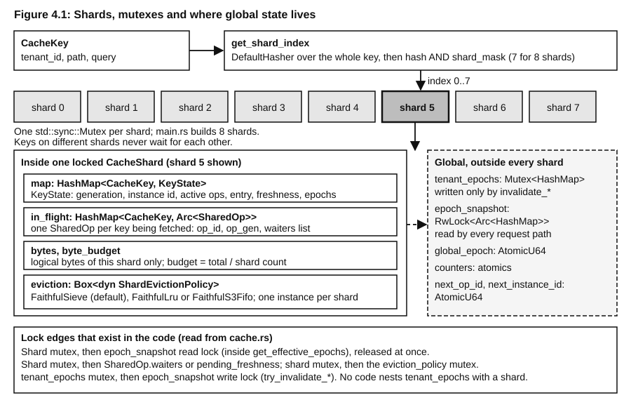
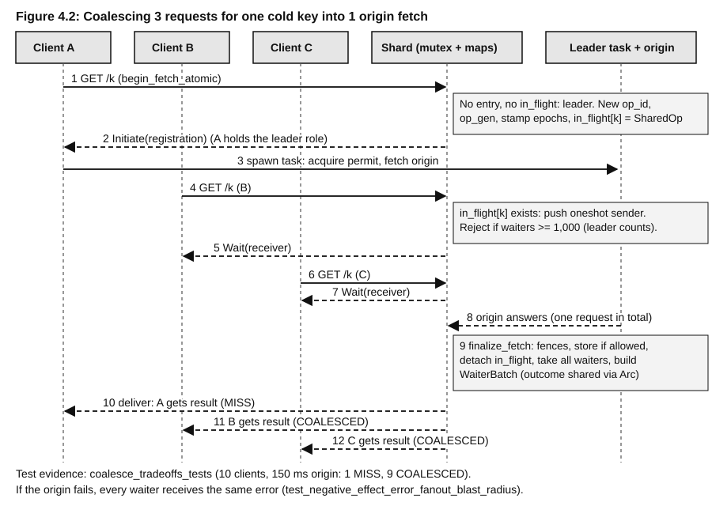
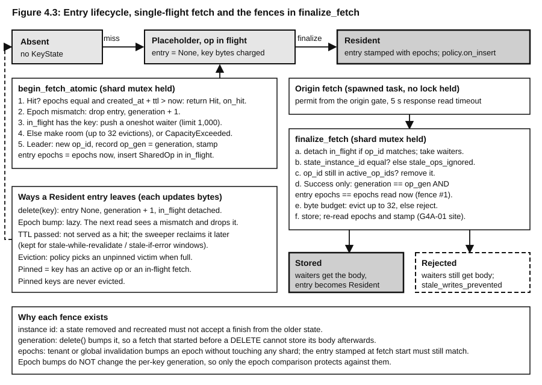
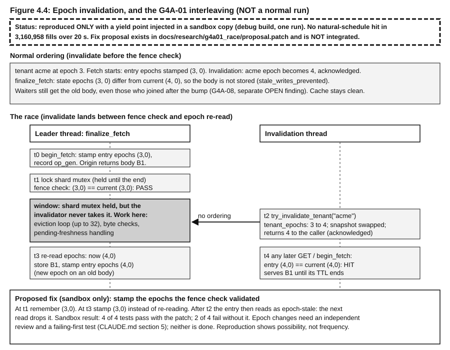
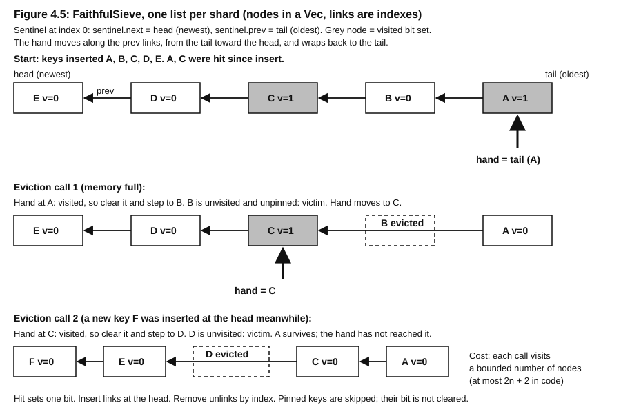

# Chapter 4: Core Cache Engine and Algorithms

This is the deepest technical chapter. It explains the storage engine in `src/core/` (`cache.rs`, `coalesce.rs`, `eviction.rs`, `freshness.rs`) and the algorithms inside it. Every claim carries a status label and, where it matters, a path. Evidence for each claim is in `docs/learning/evidence/ch04_evidence.md`.

Tree state: branch `feat/publish-phantomcache-core`, HEAD `df68eaa` at the time of writing (the `src/core` files were re-read against this tree in the QA pass), large uncommitted working tree. Nothing here was measured; no benchmark was run. "Complexity" means asymptotic cost read from code, not speed.

## What you will learn

- How a cache key becomes a shard, why the cache uses one mutex per shard, and what that does and does not buy under load.
- How concurrent misses for one key become one origin request (single-flight), and how an entry moves from placeholder to resident under generation and epoch fences.
- How invalidation works without scanning the cache (epochs), and exactly where a known race (G4A-01) can defeat it.
- What the freshness engine does with HTTP caching headers, how the stale cap works, and why the default-TTL setting has no effect.
- Which eviction algorithms exist (SIEVE default, LRU, S3-FIFO), what their real complexity is, and why S3-FIFO carries an open High finding (G4A-02).

## 4.0 How to read the status labels

Labels used here: **IMPLEMENTED** (code exists), **TESTED** (a named test exercises it; the text says what it does not prove), **PARTIAL**, **UNVERIFIED**, **OPEN** (a finding in the G4 register that is not closed). Nothing in this chapter is **INDEPENDENTLY VERIFIED**. The G4 reviews quoted here are "AI second look": one AI pass reading code, no human review. See `docs/release/g4/cycle1_core_engine_review.md`, section 0 of that file.

Three kinds of sources disagree at times: `CLAUDE.md` section 5, older reports, and the code. This chapter follows the code and lists differences in section 4.12.

## 4.1 Storage and lookup

### Simple explanation

A cache is a lookup table that sits in front of a slow thing (the origin). Ask for a name, get the saved answer if one exists and is still good. The hard parts are not the table. They are doing it from many threads at once, deciding when a saved answer is no longer good, and not running out of memory.

### Terms

- **Key-value store**: maps a key to a value. Here the key is a `CacheKey` and the value is a `KeyState` that may hold a `CachedResource`.
- **Hash map**: a table that finds a key in expected constant time by computing a number (a hash) from the key and using it as a position. Worst case is slower if many keys collide.
- **Canonical string**: one agreed text form of a key, used on the wire between nodes.

### How it works in PhantomCache

`src/core/cache.rs::CacheKey` has three fields: `tenant_id`, `path`, `query` (optional). `CacheKey::new` fills a missing tenant with the literal `"__default__"`. `CacheKey::validate` rejects keys that are unsafe or ambiguous:

- tenant: 1 to 128 bytes of `[A-Za-z0-9._-]` (no `:`), so the first `:` of the canonical string is always the tenant separator;
- path at most 2,048 bytes, query at most 4,096 bytes, whole canonical string at most 4,096 bytes (`MAX_CANONICAL_KEY_BYTES`, kept equal to the cluster frame key limit);
- no control bytes, no space, no `.` or `..` path segments, no `:?` inside a path (that is the path/query separator).

`to_canonical_string` gives `tenant:path` or `tenant:path:?query`; `from_canonical_string` reverses it. Round-trip is tested in `tests/integration/canonical_key_roundtrip_tests.rs` (a property test; TESTED for generated keys, not for all strings).

A stored entry is a `CachedResource`: status, content type, body (`Arc<Vec<u8>>`), optional ETag, `created_at_ms`, `ttl_ms`. Only those headers are stored. Other origin headers are dropped (G4A-07, OPEN: a cached 301 loses its `Location`).

Around each entry is a `KeyState`:

| Field | Meaning |
|---|---|
| `state_instance_id` | identity of this state object; changes if the state is removed and recreated |
| `generation` | counter bumped by DELETE and by epoch-stale drops (the delete fence) |
| `active_op_ids` | ids of fetch operations currently running for this key |
| `entry` | the stored body, or `None` for a placeholder |
| `entry_tenant_epoch`, `entry_global_epoch` | epochs when the fetch started or the entry was stored |
| `freshness` | stale-while-revalidate, stale-if-error, must-revalidate, last-modified |
| `revalidation_backoff_ms`, `last_revalidation_failure_ms` | retry pacing for revalidation |
| `visited`, `last_accessed_ms`, `access_count` | bookkeeping; `visited` is written but no eviction policy reads it (G4A-20; verified by grep, section 4.9) |

Status: **IMPLEMENTED**. **TESTED** by `tests/integration/m1_http_tests.rs`, `serving_contract_tests.rs` and the byte-accounting tests (not all read by this author; see the evidence file).

### Complexity

Lookup hashes the whole key, so it costs O(length of key) plus expected O(1) for the table probe. With keys capped at 4,096 bytes that is bounded. A hit also clones the `CachedResource` (two small strings and an `Arc` pointer), and the HTTP layer then clones the body bytes again (G4A-26: `(*resource.body).clone()` in `src/api/server.rs`), so a hit costs O(body size) in copying. The `Arc` is not saving the second copy.

## 4.2 Sharded mutexes (partitioned buckets)

### Simple explanation

One lock around the whole table means one request at a time. Cut the table into N independent pieces, each with its own lock, and requests for different pieces can run side by side. A key always goes to the same piece, found by arithmetic on its hash.

### Terms

- **Mutex** (mutual exclusion lock): only one thread holds it at a time; others wait.
- **Shard / partition / bucket**: one independent piece of the table with its own lock.
- **Lock contention**: threads waiting for a lock that another thread holds.
- **Concurrency** is many tasks making progress in overlapping time. **Parallelism** is many tasks running at the same instant on different CPU cores. Sharding creates the chance for parallelism; it does not create cores.

### How it works



Source: `src/core/cache.rs::PartitionedCache`, `CacheShard`, `get_shard_index`; `src/main.rs` (`PartitionedCache::new(8)`).

```
shard_index(key):
    h = DefaultHasher::new(); key.hash(&mut h)       // hashes tenant, path, query
    return (h.finish() as usize) & shard_mask         // mask = shard_count - 1
```

`PartitionedCache::new` asserts the shard count is a power of two, so `& mask` equals `% count` and costs one instruction. Production builds 8 shards (`src/main.rs`, literal `8`; no configuration key sets it; verified by grep of `src/config.rs`). Each shard is `Mutex<CacheShard>`; a `CacheShard` holds the key map, the in-flight map, byte counters and one eviction policy instance.

::: example
**Worked example: how often do requests collide?**

Take 8 shards and 4 requests running at the same moment on 4 worker threads, with keys spread evenly. The chance that all 4 land on different shards is 8 x 7 x 6 x 5 / 8^4 = 1,680 / 4,096 = 41.0%. So in 59.0% of such moments at least two requests want the same shard mutex. That sounds bad, but a collision only costs a wait of one short critical section (a map lookup and a small clone), not of the origin fetch, because the origin fetch runs outside the lock. Compare one global mutex: collision chance 100%. The numbers are arithmetic from the model "uniform keys, 4 simultaneous requests", not a measurement.
:::

Why a power of two and a mask: speed and simplicity. Why 8: no recorded decision found (our reasoning, not a recorded decision: a small fixed number that keeps memory per shard modest). Status: **IMPLEMENTED**, fixed at 8 in production.

### What the shard lock protects, and what it does not

Everything touching one key's `KeyState`, its `in_flight` operation, the shard byte counter and the shard's eviction policy happens under that shard's mutex. The origin fetch itself does not: the leader task releases the mutex before it talks to the origin and takes it again only to finalize (section 4.5).

The epoch state (`tenant_epochs`, `epoch_snapshot`, `global_epoch`) is outside the shards (section 4.7). That choice is what makes tenant invalidation cheap and what makes the G4A-01 race possible.

### Contention and its limits

- **Different keys on different shards**: no waiting.
- **Different keys on the same shard**: they queue. At most 8 shards means at most 8-way lock parallelism for the cache state, however many cores exist.
- **One hot key**: all its traffic goes to one shard, so sharding cannot help. A hit on a hot key takes the shard mutex twice in the HTTP GET path: `check_stale_serving` (which finds a fresh entry and answers `Ineligible`) and then `begin_fetch_atomic` (`src/api/server.rs` around the `check_stale_serving` and `begin_fetch_atomic` calls). Status: verified in code; the cost was not measured.
- **Long critical sections hurt every key on the shard.** Examples read in the code: the sweeper scans the whole shard under the lock every tick (G4A-03), `set_eviction_policy` rebuilds each shard's policy under its lock (O(entries) per shard), and `finalize_fetch` may run up to 32 evictions inside its lock.
- **Per-shard budgets, not a global one**: `set_byte_budget` divides the total by the shard count (`PHANTOM_MAX_CACHE_BYTES` default 256 MiB gives 32 MiB per shard in config terms). A skewed key distribution can fill one shard while others have room. The entry limit is also per shard (`max_entries_per_shard`, default 10,000, so 80,000 entries in production).
- **Shard choice is deterministic**: `DefaultHasher::new()` uses fixed keys (recalled from the standard library documentation, not re-fetched). Anyone who can choose paths inside their own tenant can choose which shard they load; with 8 shards this is a weak lever, but the hash gives no protection against deliberate skew. Hypothesis: low impact; not tested.

::: caution
**Poisoned mutexes.** A Rust `std::sync::Mutex` becomes "poisoned" if a thread panics while holding it. Most `cache.rs` paths recover with `into_inner()` and count `lock_poison_recovered`, but recovery can expose a half-applied update (see G4A-13). Some other locks (`get_eviction_policy`, the shard locks inside `set_eviction_policy`, legacy shards, telemetry mutexes) call `unwrap()` and would panic on a poisoned lock (G4A-21, OPEN).
:::

### Lock order and the "no mutex across await" rule

The rule in `CLAUDE.md` section 5 says: lock the shard mutex first, then the `tenant_epochs` mutex, never the reverse; and never hold a `std::sync::Mutex` across `.await`. What the code actually does (read in `cache.rs`):

- A request path locks a shard, then takes only a **read** lock on `epoch_snapshot` (inside `get_effective_epochs`), then releases that read lock. It also takes, while holding the shard: `SharedOp.waiters`, `SharedOp.pending_freshness`, and the `eviction_policy` mutex (via `get_eviction_policy`).
- `try_invalidate_tenant` and `try_invalidate_all` lock `tenant_epochs`, then the `epoch_snapshot` **write** lock. They never lock a shard.
- No function takes both a shard and `tenant_epochs`. So the documented order "shard then tenant_epochs" is never exercised, and there is no inverse edge either. The G4A reviewer's hypothesis R3 (lock-order inversion) was REFUTED for this reason (an AI second look, which this author re-checked by reading), and the RACE agent's analysis agrees (`docs/research/g4a01_race/analysis.md`).
- `set_eviction_policy` takes the `eviction_policy` mutex in a temporary that is released at the end of the statement, before it locks any shard, so the edge shard to `eviction_policy` has no inverse.
- Deadlock between shards is impossible by construction because no function holds two shard mutexes at once (verified by reading `cache.rs`; `set_capacity_limits`, `set_byte_budget`, `bytes_resident` and `audit_bytes` take shards one at a time).

Status: **IMPLEMENTED** and, for "no deadlock", **UNVERIFIED by a model checker** (no loom or shuttle run exists). The `async` rule: the leader runs in a spawned task that holds no shard lock while awaiting the origin; the reviewer found no guard held across `.await` in the ranges it read (R4), which is not an exhaustive proof.

::: judge
**JUDGE MAY ASK**

Question: Why partitioned mutexes? Why not one lock, a lock-free map, or a concurrent hash map crate?

**Suggested answer** (about 30 to 60 seconds spoken, plain English):

One lock serializes every request. Splitting the table into 8 shards, each with its own lock, lets requests for different keys proceed in parallel, and a key always maps to the same shard by a hash and a bit mask, so there is no cross-shard coordination. The critical sections are short because the slow origin fetch happens outside the lock. I do not claim this is the fastest design. A lock-free or lock-striped concurrent map would scale further, and I have no benchmark in this repository that compares them. The reason for plain mutexes is that the cache needs several things to change together under one lock: the entry, the byte count, the in-flight record and the eviction list. That is simple to reason about with one mutex per shard and much harder lock-free.

**If the judge asks further:**

"Eight is small." Yes: at most 8-way parallelism for cache state, and the count is hard-coded in `main.rs`. One hot key lives in one shard, so sharding does not help it. The decision record for the number 8 was not found; I would say it is our reasoning, not a recorded decision.

**Evidence to know:** `src/core/cache.rs::PartitionedCache`, `get_shard_index`; `src/main.rs` (`PartitionedCache::new(8)`); IMPLEMENTED; contention not measured.
:::

::: judge
**JUDGE MAY ASK**

Question: What about lock contention? How do you know it is not a bottleneck?

**Suggested answer** (about 30 to 60 seconds spoken, plain English):

I do not know that it is not a bottleneck, because I have no contention measurement on a physical host to quote. What I can say from the code: lock hold times are short on the hit path (a map lookup, an epoch read, a small clone); the origin fetch is outside the lock; epoch checks use a read lock that does not block other readers. What I can also say is where contention would appear: one hot key, which is always one shard; and the sweeper, which scans a whole shard under its lock each tick, which a reviewer flagged as G4A-03 and is still open.

**If the judge asks further:**

"What would you measure?" Lock hold time and wait time per shard under a skewed workload on a release build, on a named host, with repetitions and confidence intervals. The repository's performance data is discussed in Chapter 6; none of it isolates shard lock contention (UNVERIFIED for that purpose).

**Evidence to know:** `docs/release/g4/cycle1_core_engine_review.md` G4A-03; `tests/integration/epoch_contention_tests.rs` (checks epoch reads and monotonicity, not shard mutex contention); status IMPLEMENTED, performance UNVERIFIED.
:::

## 4.3 Concurrency in this engine: what runs where

The gateway runs on a Tokio multi-thread runtime (`src/main.rs` builds `Builder::new_multi_thread()`): several worker threads run request tasks at the same time (parallelism) and each interleaves many tasks (concurrency). At each `.await` a task may pause, which is why no `std::sync::Mutex` guard may be held across one. The cache API is synchronous (`begin_fetch_atomic`, `finalize_fetch` and friends take a lock, do bounded work and return), so no shard guard is alive at an `.await`.

The origin fetch is the only long wait. It runs in a `tokio::spawn`ed leader task (`src/api/server.rs`), which owns an `OriginFetchGuard` (RAII: if the task is cancelled or panics, `Drop` finalizes the operation with an `Aborted` error so waiters are not left hanging; the reviewer's hypothesis R5 was REFUTED, and the permit-release behaviour is TESTED in `tests/integration/origin_cap_tests.rs`).

## 4.4 Request coalescing, single-flight and stampedes

### Simple explanation

Imagine a popular page expires. A thousand users ask for it in the same second. Without care, the cache sends a thousand identical requests to the origin, which may fall over. Coalescing makes the first request go to the origin and tells the other 999 to wait for that one answer.

### Terms

- **Cache stampede / thundering herd**: many requests miss the same key at once and all go to the origin.
- **Single-flight**: at most one in-flight fetch per key. The Go library `singleflight` uses the same idea; PhantomCache's implementation is its own (literature comparison is Chapter 7's job).
- **Leader**: the request that starts the fetch. **Waiters**: requests that join it.

### How it works



Source: `src/core/cache.rs::begin_fetch_atomic`, `finalize_fetch`; `src/core/coalesce.rs::SharedOp`, `WaiterBatch`, `OriginFetchGuard`; `src/api/server.rs` (leader task); `tests/integration/coalesce_tradeoffs_tests.rs`.

```
begin_fetch_atomic(key, now):                      // under the shard mutex
    (te, ge) = get_effective_epochs(key.tenant)
    if resident entry has epochs == (te, ge) and created+ttl > now:  return Hit
    if resident entry has epochs != (te, ge):  drop entry; generation += 1
    if in_flight has key:
        if waiters.len() >= max_waiters_per_key:  return Rejected(WaiterLimitExceeded)
        make oneshot (tx, rx); waiters.push(tx);  return Wait(rx)
    make room: up to 32 evictions while over entry limit or byte budget
    if still no room:  return Rejected(CapacityExceeded)
    op_id = next_op_id++ ; charge placeholder bytes if the key is new
    state = map.entry(key) (create if absent)
    state.entry epochs = (te, ge) ; state.active_op_ids.insert(op_id)
    op_gen = state.generation
    in_flight[key] = SharedOp{op_id, op_gen, state_instance_id, waiters=[], pending_freshness}
    return Initiate(registration)
```

The HTTP handler turns `Initiate` into a leader: it registers itself as the first waiter on the `SharedOp`, converts the registration into an `OriginFetchGuard` (`into_guard`) and spawns the origin task. `Wait(rx)` callers `await` their receiver. When the leader finishes, `finalize_fetch` builds one `WaiterBatch` with the outcome behind an `Arc` and `deliver()` sends it to every waiting `oneshot` sender. Delivery happens after the shard mutex is dropped, so slow receivers cannot hold the lock. If a `WaiterBatch` is dropped without `deliver()`, its `Drop` delivers.

::: example
**Worked example: stampede arithmetic.**

A cold key, origin latency 150 ms, 10 simultaneous clients. Without coalescing: 10 origin requests. With it: 1 origin request, 9 waiters, and each client waits about 150 ms. `test_negative_effect_head_of_line_blocking` runs exactly this and asserts 1 `MISS`, 9 `COALESCED`, `coalesced_waiters == 9`, and total time at least 140 ms. TESTED (loopback, in-process origin; it proves the count and that waiters are held for the origin duration; it does not prove behaviour under thousands of waiters). The 100-client barrier test of Chapters 1 and 2 (`test_m1_t13_barrier_stampede_100_clients`, HTTP level, 1 MISS and 99 COALESCED) is a different test: that one proves the count at larger fan-in, this one proves the count and the cost to waiters at small fan-in.

Now 1,200 simultaneous requests with `max_waiters_per_key` 1,000 (the default). The leader registers itself as a waiter, so about 1,000 requests are admitted (1 leader + 999 followers) and about 200 are rejected with `WaiterLimitExceeded`. Origin load stays at 1 request. The rejected 200 get an error rather than waiting forever. This is arithmetic from the code, not a test result. The limit itself is TESTED at small values: `serving_contract_tests.rs` (a third joiner is rejected with `WaiterLimitExceeded` when the limit is 2) and `m1_http_tests.rs` (limit 3, HTTP error header `WaiterLimitExceeded`, counter `waiter_limit_rejections`). The soak test named `test_waiter_capacity_bound` adds 100 waiters and asserts nothing about the limit, so it does not count as evidence.
:::

### Trade-offs, honestly

- **Head-of-line blocking**: every waiter waits for the leader, however slow. The origin read has a 5 s timeout (`src/api/server.rs`, `read_to_end` under `tokio::time::timeout(5000 ms)`), so the worst-case wait is bounded by about that. TESTED as a "negative effect" by `test_negative_effect_head_of_line_blocking`.
- **Error fan-out**: if the origin fails, all waiters get the same error at once. TESTED: `test_negative_effect_error_fanout_blast_radius` (8 clients, origin 504, all 8 get 504). Errors are not stored (finalize with `Error` stores nothing), so the next request becomes a new leader. There is no negative caching and no backoff for ordinary misses. Backoff exists only for revalidation (section 4.8).
- **Post-invalidation joiners (G4A-08, OPEN)**: a request arriving after `invalidate_tenant` can still join an in-flight fetch that started before it and receive the pre-invalidation body. The result is not stored in the cache, so the exposure is limited to the waiters of that one operation. DELETE avoids this by detaching `in_flight`; epoch invalidation does not. The code carries a comment ("L3, documented, NOT fixed").
- **Fairness**: `test_concurrency_waiter_fairness_and_starvation_freedom` and `test_concurrency_fairness_competing_keys_and_tenants` exist (names read; bodies not analysed).
- **Memory**: each waiter holds a `oneshot` channel; the per-key limit bounds it. There is no global waiter limit across keys (our reading; not tested).

### Origin protection: the concurrency gate

Coalescing limits identical requests. A second mechanism limits *distinct* origin requests: `src/intelligence/executor.rs::OriginGate`. Verified behaviour:

- Only the party that actually dispatches to the origin takes a permit: the single-flight leader, a bypass request and a background revalidation leader. Waiters never do (`src/api/server.rs::acquire_origin_permit`, comment and code; TESTED by `origin_cap_tests::coalesced_waiters_do_not_consume_permits`).
- The permit is RAII (`OriginPermit`): it is released on success, error, timeout and future cancellation (TESTED: `permit_released_after_origin_error`, `..._timeout`, `..._client_disconnect`, `permit_is_released_on_future_cancellation`).
- The cap is **enforced only when the intelligence mode is Canary or Active and a cap is configured** (`DefaultPolicyExecutor::origin_cap_enforcing`). In Off, Observe and Advisory the gate counts in-flight requests but never refuses (TESTED: `off_mode_is_uncapped`). The default mode is `off` (`PHANTOM_INTELLIGENCE` default in `src/config.rs`), and the cap is unset unless `PHANTOM_ORIGIN_CAP_MAX` is set (`src/main.rs` configures it only then). So **by default the origin path is uncapped**.
- The AIMD controller (`OriginConcurrencyCapController::step`; algorithm, parameters and worked example in Chapter 5, section 5.13) runs on every full observation window whenever a cap is configured, in any mode. Observations are recorded in every mode, so the cap value may move even when it is not enforced (verified by reading `record_observation`, which has no mode check). That the cap improves any outcome is not established; see Chapters 5 and 7.
- When the gate refuses, the request fails with its own reason code; if a stale entry is eligible it is served instead, else 503 (test name `saturation_serves_stale_if_eligible_else_503`; body not analysed beyond its name).

::: judge
**JUDGE MAY ASK**

Question: What stops a cache stampede? What happens to the origin when a hot key expires?

**Suggested answer** (about 30 to 60 seconds spoken, plain English):

Single-flight per key. Under the shard lock the first miss registers an in-flight operation; later misses for the same key find it and wait on a channel. When the one origin fetch returns, its result goes to everyone. A test (`test_negative_effect_head_of_line_blocking`) fires 10 simultaneous requests at a slow origin and gets 1 miss and 9 coalesced answers. Waiters per key are capped at 1,000, and the origin read times out after 5 seconds. Two limits to state: if the origin fails, all waiters fail together, and there is no negative caching, so the next request tries again. And across many different keys there is no protection unless the optional origin concurrency cap is switched on, which it is not by default.

**If the judge asks further:**

"Does the expired entry cause a herd?" If the response carried stale-while-revalidate, expired entries inside that window are served immediately and refreshed in the background by one leader (bounded to 128 background refreshes by default). Without it, an expired entry is a miss and coalescing applies.

**Evidence to know:** `src/core/coalesce.rs`; `cache.rs::begin_fetch_atomic`; `coalesce_tradeoffs_tests.rs`; `origin_cap_tests.rs`; G4A-08 (OPEN); status IMPLEMENTED and TESTED on loopback.
:::

::: judge
**JUDGE MAY ASK**

Question: What happens with a hot-key overload? Say one key gets most of the traffic.

**Suggested answer** (about 30 to 60 seconds spoken, plain English):

Two different problems. If the hot key is a miss, coalescing turns the burst into one origin request. If the hot key is a hit, every request still takes the same shard mutex, twice in the GET path, and the HTTP layer copies the body for each response. The hot key lives in one shard, so the cache cannot spread it over cores, and it is not replicated to other nodes: GET is served from the local cache only. I would expect the shard mutex and the body copy to be the limit, but I have not measured it. What exists is detection and policy research in the intelligence modules (Chapter 5), which is not a serving-path fix for hit-path hot keys.

**If the judge asks further:**

"How would you fix it?" Options I would test, none implemented: store the body once as `Arc` and stream it without cloning; take the hit path with a read lock; replicate hot entries per core. Those are proposals, not design decisions in the repository.

**Evidence to know:** `src/api/server.rs` (HIT branch clones the body); G4A-26; `cache.rs::check_stale_serving` and `begin_fetch_atomic`; status IMPLEMENTED, hot-hit behaviour UNVERIFIED.
:::

## 4.5 Entry lifecycle and fencing (generation, instance, epoch)

### Simple explanation

Fetching from the origin takes time. While a fetch is running, the world can change: someone deletes the key, or the whole tenant is invalidated. When the fetch returns, the cache must ask "is my answer still allowed to be stored?" Fencing is that question, answered by comparing numbers recorded at the start with numbers read at the end.

### Terms

- **Fencing token**: a number recorded when work starts and compared when it ends. If it changed, the work is stale.
- **Generation**: a per-key counter bumped by DELETE. Defends against "delete during fetch".
- **State instance id**: an identity for the `KeyState` object. Defends against "state removed and recreated during fetch".
- **Epoch**: a counter per tenant (and one global). Defends against "tenant or everything invalidated during fetch" without touching any shard. Section 4.7.
- **Placeholder**: a `KeyState` with `entry = None` created at the start of a fetch so the key can be tracked and pinned.
- **Pinned**: has an active operation or an in-flight fetch; may not be evicted.

### How it works



Source: `src/core/cache.rs::begin_fetch_atomic`, `finalize_fetch`, `delete_impl`, `get_resource`; `src/core/coalesce.rs`.

```
finalize_fetch(key, op_id, op_gen, inst_id, shared_op, outcome):   // lock shard
    if in_flight[key].op_id == op_id:  remove in_flight[key]          // commit boundary 1
    waiters = take(shared_op.waiters); batch = WaiterBatch(waiters, outcome)
    state = map[key]
    if state.instance_id != inst_id:   stale_ops_ignored++            // old state object
    else if state.active_op_ids.remove(op_id):
        if outcome is Success:
            (te, ge) = get_effective_epochs(key.tenant)
            if state.generation == op_gen and state.entry_epochs == (te, ge):   // fence #1
                candidate = resource
            else: stale_writes_prevented++
        if state.entry is None and no other active op:  reclaim placeholder
    if candidate:                                                     // commit boundary 2
        if size > shard byte_budget:                oversize reject
        else evict up to 32 victims (not this key) until it fits;  reject if still too big
        else:  bytes += new - old
               (te, ge) = get_effective_epochs(key.tenant)           // second read (G4A-01 site)
               state.entry = candidate ; state.entry_epochs = (te, ge)
               policy.on_insert(key)
    drop parked freshness metadata if not installed
    shrink_shard()          // up to 256 evictions if bytes > budget
    unlock; return batch    // caller delivers outside the lock
```

Two rules in that code make the design hold together:

1. **Waiters get the answer even when the store is refused.** The `WaiterBatch` is built from the outcome before any fence is checked. A fence only decides whether the *cache* keeps the body. So a request that waited during a DELETE may still receive the pre-DELETE body once; the cache does not keep it.
2. **Freshness metadata is installed together with the entry.** The leader parks metadata on the `SharedOp` (`pending_freshness`) and `finalize_fetch` installs it only if the store succeeds (M1 in the code comments). Without this, a rejected store could leave new directives attached to an old body.

::: example
**Worked example: DELETE during a fetch.**

Key K has generation 0 and no entry. A request becomes leader: `op_id = 41`, `op_gen = 0`, `state_instance_id = 7`. While the origin is slow, an admin calls DELETE on K: `generation` becomes 1, the in-flight record is detached (so later GETs start a fresh fetch rather than joining the doomed one). The old body arrives. `finalize_fetch` sees `state.generation (1) != op_gen (0)`, increments `stale_writes_prevented`, stores nothing. The next GET misses and becomes a new leader with `op_gen = 1`. `tests/integration/invalidation_contract_tests.rs::test_delete_fences_in_flight_fill_race` runs this and asserts the counter rose by one and `get_resource` returns none. TESTED (deterministic order, one thread; it does not explore interleavings).
:::

### Cancellation and panics: the RAII guards

- `FetchRegistration` (returned by `begin_fetch_atomic`) finalizes with `Aborted` if dropped without `into_guard()`.
- `OriginFetchGuard` has a three-state phase (`PENDING`, `FINALIZING`, `COMPLETED`, an `AtomicU8` compare-and-swap). Dropping in `PENDING` finalizes with `Aborted`. Dropping in `FINALIZING` (only possible if `finalize_fetch` panicked) runs a clean-up that removes the op and the in-flight record and fails the waiters.
- Gap, OPEN as G4A-13: that panic clean-up removes a placeholder from the map but does not subtract its bytes or call `eviction.on_remove`, so `audit_bytes` would show a permanent mismatch. The only trigger found is the test flag `test_panic_after_waiter_extraction`; no production panic source was identified.

### Pinning protects in-flight work

Eviction asks `is_pinned(key)`: true if the key is the excluded key, has an `in_flight` record, has a non-empty `active_op_ids`, or is missing from the map. All three policies check it before choosing a victim (`eviction.rs`). The G4A reviewer's hypothesis R7 (eviction of in-flight keys) was REFUTED, and `tests/integration/eviction_contract_tests.rs::test_invariant_i5_pinned_never_evicted` is TESTED for the property. The cost: a slow origin plus many distinct keys can pin so many entries that a shard cannot make room and returns `CapacityExceeded` (G4A-23, availability only).

::: judge
**JUDGE MAY ASK**

Question: How do you stop a stale response overwriting a newer one, for instance after a DELETE?

**Suggested answer** (about 30 to 60 seconds spoken, plain English):

Each key carries a generation number. A fetch records the generation when it starts. DELETE bumps it. When the fetch finishes, it stores its body only if the generation, the state identity and the tenant and global epochs still match what it recorded. All of that runs under the shard mutex, so the check and the store are one atomic step for that shard. If anything changed, the body is dropped and a counter, `stale_writes_prevented`, goes up. The waiters still get the response they asked for; the cache just does not keep it. I have to add one honest limit: for tenant-wide invalidation there is a known race in the epoch part of this check, which I cover in the next section.

**If the judge asks further:**

"Is that linearizable?" I would not use that word. A DELETE that has returned makes later reads on that node miss, which `test_linearizable_delete_prevents_read` checks in a single-threaded order. I have no schedule-exploring proof, no model-checker run, and for tenant-wide invalidation there are two open findings (G4A-01, G4A-08). The failure model is one process; cross-node behaviour is Chapter 5.

**Evidence to know:** `cache.rs::finalize_fetch`, `delete_impl`; `invalidation_contract_tests.rs`; `concurrency_verification_tests.rs` (an exhaustive 9-action, 5-step model of delete/fill/evict, 59,049 sequences; the model has no invariant about fills after tenant invalidation, so it cannot find G4A-01); status IMPLEMENTED, TESTED for DELETE.
:::

## 4.6 Memory management and byte accounting

### Simple explanation

A cache that never forgets runs out of memory. The cache keeps a running total of how many bytes it believes it stores, per shard, and refuses or evicts when the total would pass the budget. The total must stay correct through every path: insert, replace, delete, expire, evict, epoch purge.

### Terms

- **Logical bytes**: the cache's own bookkeeping of sizes (key length + body capacity + content type + ETag + a fixed overhead). It is not the operating system's memory figure.
- **Audit**: recompute the total from scratch and compare with the running total.

### How it works

`calculate_state_bytes(key, state)` = key bytes (tenant + path + query lengths) + resource bytes (`body.capacity()` + content-type length + ETag length) + `fixed_entry_overhead()` (`size_of::<CacheKey>() + size_of::<KeyState>() + 64`). `PartitionedCache::audit_bytes()` returns `(accounted, recorded)`: the sum of `calculate_state_bytes` over every `KeyState`, and the sum of every shard's running `bytes`. The invariant tests check they are equal. The specification calls these invariants I1 to I8; this author found where they are named (`docs/research/adr/ADR-002-serving-path-contract.md`, `docs/glossary.md`) but did not find a document listing all eight individually (UNVERIFIED which eight).

::: example
**Worked example: one key's life, in bytes.**

Let F be `fixed_entry_overhead()` (a platform-dependent constant). Key tenant `acme` (4 bytes), path `/a` (2 bytes): key bytes 6. Body with capacity 100, content type `application/json` (16), ETag `"v1"` including quotes (4): resource bytes 120.

1. Miss, placeholder created: `bytes += 6 + F`.
2. Fill stored: `bytes += 120`, total 126 + F.
3. Replace with a body of capacity 150: resource bytes become 170; `bytes = bytes - 120 + 170`, total 176 + F.
4. DELETE: entry removed, `bytes -= 170`; the state has no active op so it is removed, `bytes -= 6 + F`. Total 0.

At every step `audit_bytes()` should return equal numbers. `byte_accounting_tests.rs` tests each lifecycle step (`test_lifecycle_*`), contraction under load (`test_t_c1` to `test_t_c6`) and an adversarial large body. TESTED (consistency of the bookkeeping against real call sequences; it does not measure process memory).
:::

Controls that bound memory (all **IMPLEMENTED**):

- Per-shard byte budget (production total `PHANTOM_MAX_CACHE_BYTES`, default 268,435,456, divided by the shard count).
- Per-shard entry limit (`max_entries_per_shard`, default 10,000).
- Waiter limit per key (1,000), background-refresh limit (128), origin response body limit (`MAX_BODY_BYTES` 2 MiB in `src/api/server.rs`, applied while parsing the origin response; the ingress request body limit is separate, 512 KiB via `DefaultBodyLimit`).
- At most 32 evictions per miss registration and per store, and `shrink_shard` of up to 256 evictions to recover from over-budget (the "I8 recovery" in code comments).
- `set_byte_budget` and `set_capacity_limits` evict immediately down to a new bound (contraction), skipping pinned keys.

What the accounting does **not** cover (G4A-23, OPEN, Info): freshness metadata strings, the hash-set and hash-map allocations, `Arc` headers, and the eviction structures themselves (S3-FIFO queues grow outside the accounting, G4A-02). Also `PartitionedCache::new` alone sets the byte budget to `usize::MAX`; only `main.rs` sets a finite one, so tests and embedders that skip that call are unbounded in bytes. And there is no maximum TTL: a huge `max-age` makes an entry effectively permanent until evicted.

::: judge
**JUDGE MAY ASK**

Question: How do you know the cache does not leak memory? Is the byte count the real memory use?

**Suggested answer** (about 30 to 60 seconds spoken, plain English):

The byte count is a logical count, not the process memory. It adds up key size, body capacity, header strings and a fixed per-entry overhead, and the code can recompute it from the maps and compare. The tests drive every path that changes an entry and assert the recomputed and running totals match, including a concurrent stress run. That shows the bookkeeping is consistent. It does not show the operating system sees the same number, because some structures are not counted: freshness strings, hash-table slack, and the S3-FIFO queues. And there is one known path where the totals drift, a panic in the middle of finalizing, which is open as G4A-13.

**If the judge asks further:**

"What bounds the real memory?" The byte budget, the entry limit, the waiter limit and the 2 MiB origin response body limit bound the counted part. A soak test (`memory_bound_soak_tests.rs`) runs churn with accounting checks. I have no measured resident-memory figure for a release build to quote.

**Evidence to know:** `cache.rs::audit_bytes`, `calculate_state_bytes`; `byte_accounting_tests.rs`; G4A-13, G4A-23; status IMPLEMENTED, TESTED (consistency only).
:::

## 4.7 Invalidation and epochs

### Simple explanation

Invalidation means "forget what you saved". Forgetting one key is easy. Forgetting everything for a tenant, without walking the whole table, is the hard case. The trick is a version number: stamp every saved entry with the tenant's current version, and to invalidate, just raise the version. An entry stamped with an old version is treated as absent the next time anyone looks.

### Terms

- **Epoch**: the version number. There is one per tenant (in a map) and one global.
- **Lazy invalidation**: do not remove entries when invalidating; remove them when next touched or when a background sweeper finds them.
- **Snapshot**: an immutable copy that readers can use without blocking writers for long.

### How it works

Three invalidation levels exist in `cache.rs`:

| Operation | What changes | Cost |
|---|---|---|
| `delete(key)` / `try_delete_with_status` | that key's entry dropped, `generation += 1`, in-flight detached | O(1) under that shard's lock |
| `try_invalidate_tenant(t)` | `tenant_epochs[t] += 1`, then a fresh snapshot | O(T), T = tenants with a recorded epoch (at most 10,000) |
| `try_invalidate_all()` | `global_epoch += 1`, tenant map cleared, snapshot replaced by an empty map | O(T) to clear |

An entry is current only if `entry_tenant_epoch == tenant epoch now` and `entry_global_epoch == global epoch now`. `get_effective_epochs(tenant)` reads the tenant epoch from `epoch_snapshot: RwLock<Arc<HashMap<String,u64>>>` (a shared read lock, no exclusive mutex) and the global epoch from an atomic. Writers (invalidations) take the `tenant_epochs` mutex, update the map, then replace the snapshot under the `RwLock` write lock. Reading never takes the `tenant_epochs` mutex, which is what `CLAUDE.md` calls the zero-contention read path. It is not zero contention on the shard mutex: every request still takes that.

::: example
**Worked example: lazy purge.**

Tenant `acme` is at epoch 3, global 0. Keys `/a` and `/b` were stored with stamps (3, 0). `invalidate_tenant("acme")` makes the tenant epoch 4. Nothing is deleted yet and the bytes are still counted. A GET on `/a` calls `begin_fetch_atomic`: stamp (3, 0) differs from current (4, 0), so it drops the entry, subtracts its resource bytes, bumps the key's `generation`, and treats the request as a miss. `/b` stays resident, occupying memory, until it is touched or the sweeper reclaims it. Another tenant `beta` is unaffected: its epoch lookup is separate. `test_tenant_flush_ordering_and_lazy_invalidation` checks this (and asserts the bump takes under 5 ms, a host-dependent threshold). Its comment says "O(1)"; the bump is O(T) because of the map snapshot copy (below).
:::

**The overflow fallback (SEC-4A-01).** The tenant map is capped at `MAX_TENANT_EPOCHS = 10,000`. A new tenant arriving when the map is full raises `global_epoch` by one, clears the map, and starts the new tenant at 1. Every entry already stored has an older `entry_global_epoch`, so every entry on this process becomes stale. That is a full flush of this node's cache, chosen as the safe option over refusing the invalidation. The code comment says "cluster-wide"; the counter is per process, so the effect is on this node (a documentation discrepancy, section 4.12). Tenant strings can come from peers (G4A-12, OPEN): a peer sending 10,001 distinct tenant strings can force the flush. TESTED: `test_epoch_saturation_fallback_sec4a_preserved`.

**Costs and sharp edges read in the code:**

- `*snap = Arc::new(guard.clone())` runs inside the snapshot write-lock scope, so the clone of up to 10,000 `String` keys happens while readers are blocked on the read lock, and those readers hold shard mutexes. This is this author's reading; the G4A-12 text says the clone happens under the `tenant_epochs` mutex and does not mention the write lock. Impact not measured.
- `get_effective_epochs` reads the tenant epoch and the global epoch separately, not as one snapshot. G4A-17 (OPEN, PLAUSIBLE, Low) describes a theoretical resurrection in the window of `invalidate_all`.
- Invalidation does not bump any per-key `generation`. So the generation fence cannot catch an epoch bump. Only epoch equality does.

### The sweeper

`spawn_sweeper_task` runs `sweep_lazy_reclamation(batch, now)` every `PHANTOM_SWEEPER_INTERVAL_MS` (default 100). For each shard, under its lock, it walks the map, skips keys with active ops or in-flight fetches, and collects keys that are epoch-stale or expired. "Expired" means past `created_at + ttl + stale window`, where the window is the larger of stale-while-revalidate and stale-if-error, capped by the stale cap, and zero when `must-revalidate` is set. It stops collecting at `batch` candidates, then removes them and fixes the bytes and the policy.

Two facts differ from the documentation:

- The batch size bounds *candidates collected per shard*, not keys inspected: when few entries qualify, the loop walks the entire shard under the lock every tick. `src/config.rs` describes `PHANTOM_SWEEPER_BATCH_SIZE` as "shards per tick" and `CLAUDE.md` as a "shard inspection limit"; neither is what the code does (G4A-03, OPEN; `test_sweeper_lock_hold_time_bounded` does not catch it because its entries are all stale).
- An expired entry carrying a validator (ETag) is dropped within about one tick unless a stale window is declared, so conditional revalidation (304) mostly applies to requests that arrive within about 100 ms of expiry (G4A-16, OPEN).

### The known race: G4A-01 (read this honestly)



Source: `src/core/cache.rs::finalize_fetch` (the fence check, the eviction loop, the second `get_effective_epochs`, the stamp); `docs/research/g4a01_race/analysis.md`, `status.md`, `repro_attempts.md`, `proposal.patch`; `docs/release/g4/cycle1_core_engine_review.md` G4A-01.

**What it is.** `finalize_fetch` checks the fence once by reading the epochs, then does more work (budget checks, up to 32 evictions), then reads the epochs again and stamps the stored entry with the second reading. Invalidation does not take the shard mutex, so an epoch bump can land between the two reads. The old body is then stored with the new epoch and looks current. Every later read serves it until its TTL passes. The code lines were opened in this tree: the fence check, the second read and the stamp are as the analysis describes.

**What was shown.** CONFIRMED by a deterministic interleaving: in a sandbox copy with a test hook placed between the check and the re-read, an acknowledged `invalidate_tenant` (and `invalidate_all`) left the pre-invalidation body readable (two failing tests; a control test in which the bump comes before the check is correctly fenced). With the small proposed fix the sandbox tests pass.

**What was not shown.** No natural-schedule reproduction: a 20 s, 3-thread unhooked stress (3,160,958 fills) found 0 violations. The window is nanoseconds to microseconds wide, but zero hits do not bound the probability. Debug build, one run per configuration, no confidence intervals, no model checker (no loom or shuttle). Reachability is argued from the code, not measured.

**Status today.** The disposition register lists G4A-01 as UNDER-INVESTIGATION and blocking (owner decision ODR-4). The fix proposal (stamp the epochs the fence check validated) lives in `docs/research/g4a01_race/proposal.patch` and is **NOT integrated**; the main tree still contains the second read. Under `CLAUDE.md` a change to fencing or epochs also needs an independent review and a test that fails without the change.

**Impact if it happens.** An invalidation the caller was told succeeded leaves one stale entry on that node, until its TTL ends (60 s by default when the origin gives no freshness headers; longer if the origin says so). It needs a precisely timed invalidation on a key that is being filled at that instant.

**Related, different findings.** G4A-08 (joiners after invalidation receive the old body; not stored) and G4A-17 (epoch pair read not atomic). Together they say: tenant-wide invalidation on one node is eventually effective with documented edge cases, not an atomic cut.

::: judge
**JUDGE MAY ASK**

Question: Explain epochs. Why not just delete the keys? What does invalidation guarantee?

**Suggested answer** (about 30 to 60 seconds spoken, plain English):

Deleting every key of a tenant means walking the table under locks, which is slow and blocks requests. Instead each tenant has a version number. Every entry is stamped with the version when stored. To invalidate, we increase the number. Any entry with an older stamp is treated as missing the next time anyone touches it, and a background sweeper reclaims the rest. A fetch that started before the bump also cannot store its answer, because its stamp no longer matches. The guarantee is local to one node and it is lazy: after the call returns, reads on that node do not serve the old entries, with two documented exceptions and one open race. The bump itself is not free either: it copies the tenant-version map, up to 10,000 entries.

**If the judge asks further:**

"What if the tenant list overflows?" Past 10,000 tenants the node raises a global epoch instead, which invalidates everything on that node. That is safe but heavy, and a peer can trigger it by sending many tenant names (G4A-12, open).

"Is it atomic across nodes?" No. That is Chapter 5; here the guarantee is single process.

**Evidence to know:** `cache.rs::try_invalidate_tenant`, `get_effective_epochs`; `epoch_contention_tests.rs`, `invalidation_contract_tests.rs`; G4A-08, G4A-12, G4A-17; status IMPLEMENTED, TESTED for the basic and overflow paths.
:::

::: judge
**JUDGE MAY ASK**

Question: You say fencing prevents stale writes. Is there a race? Has it been reproduced? Is it fixed?

**Suggested answer** (about 30 to 60 seconds spoken, plain English):

Yes, one known race, and I will state exactly what is established. In the final step of a fetch, the cache checks the tenant epochs, does some more work, then reads the epochs again and stamps the entry with the second reading. Tenant invalidation does not take the shard lock, so a bump in that gap makes an old body look current. It was reproduced only in a sandbox with a test hook placed in the gap. A twenty-second stress without the hook found nothing, and that does not prove it cannot happen. A small fix was written and passes in the sandbox, but it is not integrated, because changes to fencing need an independent review and a test that fails first. The disposition register keeps it open and blocking. So: the DELETE fence is tested; the tenant-epoch fence has this known gap.

**If the judge asks further:**

"How likely?" I cannot say; the window is tiny and nobody has measured it. "Why not just fix it?" The change is to a protected file with a required review gate, and the owner has not yet decided. That is a process answer, and I would not hide it.

**Evidence to know:** `docs/research/g4a01_race/` (analysis, status, repro_attempts, proposal.patch); G4A-01 in `cycle1_findings_disposition_register.md` (UNDER-INVESTIGATION); status: defect CONFIRMED in sandbox, fix NOT integrated.
:::

## 4.8 Freshness, TTL, stale serving and revalidation

### Simple explanation

A saved answer is good for a while. After that it is "stale". HTTP lets the origin say how long, and also allows a cache to keep serving a stale answer briefly while it fetches a fresh one (stale-while-revalidate), or when the origin is broken (stale-if-error). PhantomCache adds its own hard ceiling on how long it will serve stale.

### Terms (RFC 9111 vocabulary)

- **Freshness lifetime / TTL**: how long a response counts as fresh. Here `ttl_ms`.
- **Age**: how old the stored response is.
- **Stale**: age beyond the lifetime. Not automatically unusable.
- **Revalidation**: ask the origin "is my copy still good?" with a conditional request (`If-None-Match` with the stored ETag). The origin may answer `304 Not Modified` (keep the body, refresh the clock) or send a new body.
- **stale-while-revalidate (SWR)**, **stale-if-error (SIE)**, **must-revalidate**: `Cache-Control` directives (RFC 5861 and RFC 9111) described below.

### How the lifetime is chosen

`src/core/freshness.rs::evaluate_response_freshness` is a pure function: status, headers, time, flags in; a `FreshnessDecision` out. In order:

1. Body present without explicit framing (`Content-Length` or `Transfer-Encoding`): uncacheable.
2. `Cache-Control: no-store` or `private`, or any malformed directive value: uncacheable.
3. Status: 200 is cacheable; 301, 404, 410 only when explicit freshness exists (`max-age`, `s-maxage` or an `Expires` header); every other status is uncacheable.
4. A request that carried `Authorization`, or a response with `Set-Cookie`, is cacheable only if the response says `public`, `s-maxage` or `must-revalidate`.
5. `Vary: *`, or any `Vary` other than `Accept-Encoding`: uncacheable.
6. Lifetime, first match wins: `no-cache` gives 0 and sets must-revalidate; else `s-maxage`; else `max-age`; else `Expires` minus `Date` (or minus now if `Date` is missing); else the **default TTL**.

`stale-while-revalidate` and `stale-if-error` values are read in seconds and stored in milliseconds in `FreshnessMetadata` next to the entry. Lifetimes use `saturating` arithmetic and there is no upper bound on `max-age` (G4A-23).

### The default TTL setting is not wired

`PHANTOM_DEFAULT_TTL_MS` is documented with default 60,000 ms and is validated and reported by `src/config.rs`, but the registry marks it `Wiring::NotWired` and says why. It is read nowhere else in `src/` (grep for `DEFAULT_TTL` and `default_ttl` finds only `config.rs` and the parameter names inside `freshness.rs`). `src/api/server.rs` passes the literal `60_000` to `evaluate_response_freshness` at two call sites (lines 1405 and 1688 in this tree). So: **the effective default lifetime is always 60 seconds and setting the variable changes nothing** (verified in code; the G4A-25 finding records the same, OPEN). It only matters for responses with no freshness headers at all. `CLAUDE.md` quotes lines 1077 and 1352; those line numbers have drifted but the fact has not.

### Serving stale, and the hard cap

Fresh means `created_at_ms + ttl_ms > now`. Past that, the GET path calls `check_stale_serving(key, now, hard_cap_ms, is_error_context)`:

```
check_stale_serving(key, now, cap, error_ctx):                  // under the shard mutex
    entry missing or epochs stale          -> Ineligible        // delete wins
    entry still fresh                      -> Ineligible        // normal HIT path
    meta.must_revalidate                   -> Ineligible        // never serve stale
    window = error_ctx ? (SIE or SWR or 0) : (SWR or 0)
    window == 0                            -> Ineligible
    age = now - created_at
    if age > ttl + cap                     -> CapExceeded       // hard cap
    if age <= ttl + min(window, cap)       -> Eligible(entry)   // serve stale
    else                                   -> Ineligible
```

The cap is `PHANTOM_MAX_STALE_MS` (default 86,400,000 ms = 24 h; `Wiring::Main`; `src/main.rs` calls `cache.set_max_stale_ms`). The intelligence executor can change it at run time only when a stale-serving candidate is applied, clamped to a hard maximum.

::: example
**Worked example: stale window and cap.**

An origin sends `max-age=60, stale-while-revalidate=300`. TTL 60 s, window 300 s, cap 86,400 s.

- Age 30 s: fresh. HIT.
- Age 200 s: expired, but 200 <= 60 + min(300, 86,400) = 360. Eligible: the old body is served marked STALE, and one background refresh is started (single-flight, at most 128 background refreshes at once).
- Age 400 s: 400 > 360. Ineligible: this request is a miss and fetches from the origin.

Now `stale-if-error=604800` (7 days) and the origin is down. Error-context window = min(604,800, 86,400) s = 86,400 s. Eligible while age <= 60 + 86,400 = 86,460 s. At age 90,000 s: 90,000 > 86,460, so `CapExceeded` and the request fails instead of serving a day-old-plus answer. TESTED: `stale_serving_tests.rs::test_hard_staleness_cap_enforced_strictly`, `test_stale_if_error_on_origin_outage`, `test_must_revalidate_strictly_forbids_stale_serving`.
:::

What the cap is **not**: it bounds the *stale* window, not the *fresh* lifetime. An origin that sends `max-age=10000000` has a fresh entry for 115 days; the cap does not touch it. `stale_cap_violations` (a counter) is described in `CLAUDE.md` as "must be 0"; it is near-tautological, because an `Eligible` decision already implies the age is within the cap, so zero is true by construction (G4A-18, OPEN). Treat "stale_cap_violations == 0" as weak evidence.

### Revalidation and 304

A stale entry that has an ETag is revalidated by sending `If-None-Match` from the *resident* entry read after single-flight registration (not from a copy captured earlier). A `304` goes through `complete_not_modified`:

- merge the 304's headers into the stored lifetime and metadata (`merge_not_modified`);
- if the 304 carries a different validator, delete the entry and fail the leader and waiters with 502;
- if nothing resident (purged or invalidated meanwhile), fail with 502 and store nothing: a purged entry is never resurrected;
- if the 304 is uncacheable, record a failure and hand out the resident body only if the normal serving policy allows it now.

Failure backoff for background revalidation: `record_revalidation_failure` sets 1,000 ms, then doubles per consecutive failure up to 60,000 ms; `is_revalidation_due` gates new attempts (TESTED: `test_failure_backoff_schedule`). Background refreshes are limited by an atomic compare-and-increment (`try_reserve_background_slot`) and an RAII `BackgroundSlot` that releases on panic or cancellation (TESTED: `test_bounded_background_refresh_under_concurrent_stale_requests`; `revalidation_304_tests.rs` has one `#[ignore]`d non-deterministic test).

### Known conformance gaps (all OPEN in the G4 register, each reported by one AI reviewer)

- **G4A-04**: upstream `Age`/`Date` is parsed into `initial_age_ms` but not applied; freshness restarts at the full lifetime when stored, and the emitted `Age` ignores it. An origin behind a CDN that says `max-age=60, Age: 59` is served as fresh for another 60 s.
- **G4A-05**: `Expires: 0` or an unparseable `Expires` gets the 60 s default instead of "already expired".
- **G4A-06**: stale-if-error is applied to any non-200/304 status (404, 403, 429, 3xx), not only 5xx. A deleted or forbidden resource can be masked by a stale body inside the SIE window.
- **G4A-10** (PLAUSIBLE): all time comes from the wall clock (`SystemTime`, `intel/diagnostics.rs`). A clock stepped backwards extends fresh and stale windows. The hard cap holds only relative to that clock. No monotonic clock is used.
- **G4A-16**: the sweeper drops validator-bearing expired entries within about one tick unless a stale window exists, so most 304 revalidation chances are lost.
- **G4A-09**: in the default secure configuration the client `Authorization` header is treated as "forwarded", so responses without `public`/`s-maxage`/`must-revalidate` are never cached; the cache is mostly idle for ordinary origins (fail-closed, safe, surprising).

::: judge
**JUDGE MAY ASK**

Question: How does expiry work? What stops the cache from serving very old data? Is the default TTL configurable?

**Suggested answer** (about 30 to 60 seconds spoken, plain English):

The origin's `Cache-Control` decides the lifetime: shared-cache max-age first, then max-age, then `Expires`; with no information we use 60 seconds. Be careful with the last point: there is a setting called `PHANTOM_DEFAULT_TTL_MS`, but it is not wired. The code passes a fixed 60,000 to the freshness function, so changing the setting does nothing today. For stale data, the cache serves an expired entry only if the origin allowed it with stale-while-revalidate or stale-if-error, never if must-revalidate is set, and never beyond a hard cap of 24 hours by default, which is `PHANTOM_MAX_STALE_MS` and is wired. The cap limits stale serving, not fresh lifetime. Known gaps: the upstream Age header is ignored, time comes from the wall clock, and stale-if-error is applied to more status codes than the RFC allows.

**If the judge asks further:**

"Is it RFC 9111 compliant?" It implements a subset, with the gaps above. I would say "RFC 9111-style", not "compliant". No conformance suite was run (UNVERIFIED).

**Evidence to know:** `src/config.rs` (`PHANTOM_DEFAULT_TTL_MS`, `Wiring::NotWired`); `src/api/server.rs` literal `60_000`; `cache.rs::check_stale_serving`; `freshness.rs::evaluate_response_freshness`; G4A-04, -05, -06, -10, -18, -25; status IMPLEMENTED (subset), TESTED for cap and SIE paths.
:::

## 4.9 Eviction

### Simple explanation

When the cache is full, something must go. A good policy removes entries that will not be asked for again soon. Nobody can see the future, so policies use hints: how recently or how often an entry was used.

### Terms

- **Eviction policy**: the rule that picks the victim.
- **Hit ratio**: the share of requests answered from the cache.
- **Recency / frequency**: how recently / how often an entry was used.
- **Scan resistance**: a one-time scan over many keys should not push out popular entries.
- **Amortized O(1)**: some single operations may cost more, but the average over a long run is constant per operation.

### The three algorithms explained

Literature (cited in the file header of `src/core/eviction.rs`; this author did not re-read the primary papers: **literature, not verified from a primary source**):

- **LRU** (Least Recently Used): keep a list ordered by last use. A hit moves the entry to the front; the victim is at the back. Simple and strong, but every hit rewrites the list, which means a write under the shard lock.
- **SIEVE** (Ying et al., NSDI 2024): keep a queue in insertion order and one "visited" bit per entry. A hit only sets the bit. A pointer, the "hand", walks from the oldest entry toward the newest: a visited entry has its bit cleared and is skipped; the first unvisited entry is the victim. Hits are cheap. Entries are not moved on a hit.
- **S3-FIFO** (Yang et al., SOSP 2023): three FIFO queues: a small queue (about 10% of capacity) for new entries, a main queue, and a "ghost" queue of recently evicted keys. A new entry enters small. When small is evicted from, an entry seen again is promoted to main; one never seen again leaves and its key goes to ghost. A key re-requested while in ghost enters main directly. A tiny frequency counter (capped at 3) lets main give popular entries extra turns.

### What is implemented



Source: `src/core/eviction.rs::FaithfulSieve`, `select_victim`; `src/core/cache.rs::evict_with_policy`.

Each shard owns one `Box<dyn ShardEvictionPolicy>` (trait: `on_insert`, `on_hit`, `on_remove`, `select_victim(is_pinned)`, `rebuild_from`, `name`). The factory `create_shard_eviction_policy` builds `FaithfulSieve` (the default), `FaithfulLru` or `FaithfulS3Fifo`. A fourth type, `ClockScan` (an O(n) scan), exists in the file as a "legacy fallback" but the factory never builds it and no other code references it (grep). A separate legacy string-keyed API on `PartitionedCache` (`get`, `insert`, `evict_sieve`, kept for old unit tests) does use a linear scan with its own `visited` flag; it is not on the HTTP serving path. `CLAUDE.md` section 6 says the evictors "are scans": that was true before the faithful implementations (the audit `docs/research/eviction_policy_audit.md` records the old linear scan) and is **outdated** for the current tree.

| Operation | LRU | SIEVE | S3-FIFO |
|---|---|---|---|
| Structure | doubly linked list in a `Vec` arena with sentinel; `HashMap<key, index>` | same arena, plus `visited` bit and `hand` index | `VecDeque` small, main, ghost; `HashSet` ghost set; `HashMap` frequency |
| `on_insert` | O(1) expected, plus hashing the key | O(1) expected | O(1) expected |
| `on_hit` | O(1): unlink and relink at head | O(1): set one bit | O(1): increment counter (max 3) |
| `on_remove` | O(1): unlink | O(1): unlink; moves the hand if needed | O(1) but **leaves the key in its queue** (tombstone) |
| `select_victim`, typical | O(1) | amortized O(1) | amortized O(1) (our reasoning) |
| `select_victim`, worst case | O(p), p = pinned keys at the tail | bounded by 2n + 2 node inspections, each cloning a key | bounded by 2(small + main) + 4 loop iterations |
| Memory | one node per live key; freed nodes reused | same | queue entries can outnumber live keys (G4A-02) |

"Expected O(1)" assumes the hash map works as usual and keys are short (a key is at most 4,096 bytes; hashing and cloning are O(key length)).

::: example
**Worked example: why SIEVE is amortized O(1).**

Look at the Figure 4.5 trace. Call 1 clears A's bit and evicts B: 2 node inspections. Call 2 clears C's bit and evicts D: 2 inspections. Each bit that a hit set can be cleared once by the hand, so over a long run the total clearing work is at most the number of hits, and each eviction ends the scan with a victim. Total work is roughly hits + evictions, so the average per operation is constant. This is our reasoning, in the spirit of the published argument, not a proof in the repository. The argument fails for pinned entries: the hand steps past a pinned node without clearing anything, so a long run of pinned nodes costs time on every eviction, up to the whole list (G4A-20, OPEN). A slow origin makes many keys in flight, so an attacker who can make origin requests slow can raise the eviction cost.
:::

### Where the policy is told about hits

`begin_fetch_atomic` calls `shard.eviction.on_hit(key)` on a fresh hit. Three other places that serve data do not: stale serving (`check_stale_serving` sets `state.visited` only), `get_resource` and `get_resource_with_metadata`. And `KeyState.visited`, set in several places in `cache.rs`, is never read by any eviction policy: the policies keep their own bits. A hot entry served stale therefore gains no recency (G4A-20). Verified by grep for `.visited` reads.

### Switching policy at run time

`set_eviction_policy` rebuilds each shard's policy from the map's keys in hash-map order under the shard lock, so recency and visited information are lost; `set_capacity_limits` does the same and then evicts down to the new bound. `evict_with_policy` rebuilds with capacity hint 1024 if the installed policy's name does not match (G4A-26). Calls to `set_eviction_policy` exist in `src/intelligence/executor.rs` (`apply_policy` in Canary or Active mode, and `revert_to_safe`) and in the legacy `src/control/pie.rs`. No call from `src/main.rs` or `src/api/` was found, so the production default stays SIEVE unless the intelligence executor is driven to apply an S3-FIFO candidate (**UNVERIFIED** whether anything in a normal run does that; the reviewer left the same question open). The default intelligence mode is `off`.

### The S3-FIFO finding (G4A-02, OPEN, High but conditional)

`on_remove` deletes the key from `freq` and `ghost_set` but not from `small_q` or `main_q`. Re-inserting the same key after a removal pushes a *second* queue entry. `select_victim` pops from the front and treats a key as live if `freq` contains it, so a stale duplicate can evict the live entry early. The check `small_q.len() >= small_cap` counts the stale entries too.

::: example
**Worked example: unbounded queue.**

S3-FIFO selected, no eviction pressure (cache below budget). A crawler requests 100,000 distinct URLs; each expires and the sweeper calls `on_remove`. Live keys at the end: 0. `small_q` length: 100,000 (one cloned `CacheKey`, up to three heap strings, per entry), because `select_victim` is the only code that pops the queue and it never ran. That memory is outside `audit_bytes`. Separately, `insert X; remove X; insert X` leaves `small_q = [X, X]` with `freq = {X}`. This is a code-reading trace; no test in the repository reproduces it (the current S3-FIFO test only asserts the victim is not a key that was hit twice).
:::

Exposure: only when S3-FIFO is selected. Default is SIEVE. The disposition register lists G4A-02 as OPEN, blocking, with an owner decision pending (fix, withdraw S3-FIFO from the selectable set, or accept). The code in this tree still has the tombstone behaviour (opened and confirmed).

Other S3-FIFO notes (this author's reading): capacity at construction is a hint (1024 in `CacheShard::new`, `max_entries_per_shard` in `set_eviction_policy`), so `small_cap` can differ from the real per-shard entry limit; and a key inserted twice without a removal is counted as a hit (frequency + 1).

### Tests: what they show

- `eviction_contract_tests.rs`: LRU golden trace (real ordering check); SIEVE and S3-FIFO "golden trace" tests assert only that the victim is not a key that was hit (weak: no comparison to a reference or published trace); pinned keys survive (LRU only); a timing test asserts average SIEVE eviction under 10 microseconds at 10,000 entries in whatever build runs it (host-dependent, no pinned keys, no visited bits, so it shows a timing, not a complexity); accounting holds under eviction; an HTTP end-to-end eviction test.
- `src/lab/eviction_baselines.rs` imports the same policy types for simulation (Chapter 7); `lab_eviction_tests.rs` exists but was not analysed here.
- **No test measures hit ratio of these implementations against the literature.** The audit file quotes miss-ratio figures for an earlier phase; their provenance was not checked here and they are not quoted.

::: judge
**JUDGE MAY ASK**

Question: Why SIEVE as the default? Is eviction really O(1)? You also have S3-FIFO; is it safe?

**Suggested answer** (about 30 to 60 seconds spoken, plain English):

SIEVE keeps a queue and one visited bit per entry. A hit only sets a bit, so the hit path does not rewrite a list under the shard lock, which matters in a design where a lock protects everything. Eviction advances a hand that clears bits until it finds an unvisited entry, and over a long run that is constant work per operation. I cannot cite a recorded decision for making it the default; the published design is the motivation, and no test in the repository measures its hit ratio against LRU on a real workload. On "O(1)": expected O(1) for hit, insert and remove, amortized O(1) for eviction when nothing is pinned. A worst-case single eviction can walk the whole list, and pinned entries, which are keys with a fetch in flight, make the walk longer, so I would not say worst-case O(1). S3-FIFO is implemented but has an open High finding: removing a key leaves it in the queue, so queues can grow without bound and early evictions can happen. It is only used if someone selects it; the default is SIEVE.

**If the judge asks further:**

"Is it faithful to the paper?" It follows the structure of the papers. The tests do not compare it against a reference implementation, and the S3-FIFO bug shows it does not preserve the algorithm's behaviour on remove and re-insert. "Faithful" is the code's own name for it, not a verified property.

**Evidence to know:** `src/core/eviction.rs` (`FaithfulSieve`, `FaithfulLru`, `FaithfulS3Fifo`); `eviction_contract_tests.rs`; G4A-02, G4A-20 (OPEN); `docs/research/eviction_policy_audit.md`; status IMPLEMENTED, TESTED (weakly), literature UNVERIFIED.
:::

::: judge
**JUDGE MAY ASK**

Question: State the time and space complexity of the cache operations.

**Suggested answer** (about 30 to 60 seconds spoken, plain English):

Let n be the entries in a shard and k the key length, at most 4,096 bytes. Lookup: hash the key, O(k), then expected O(1) in the hash map. Insert and delete: expected O(1) plus the eviction policy bookkeeping, also O(1). Eviction: amortized O(1) with no pinned keys. Coalescing a request: O(1). Memory is O(entries x entry size), bounded by the byte budget and the entry limit. Three honest exceptions: tenant invalidation is O(T) in the number of tenants with a recorded epoch, up to 10,000; the sweeper scans O(n) of a shard under its lock every tick; and switching policy is O(n) per shard. Also a hit copies the body, so it costs O(body size) as well.

**If the judge asks further:**

"Space beyond the cache?" Per-key state with a set of active ops, a waiter list per in-flight key (up to 1,000), the eviction structures, and for S3-FIFO possibly unbounded queues.

**Evidence to know:** `cache.rs` (`get_shard_index`, `try_invalidate_tenant`, `sweep_lazy_reclamation`, `set_eviction_policy`); G4A-03, G4A-12, G4A-20, G4A-26; status: asymptotics from reading code, none measured here.
:::

## 4.10 What happens when the origin fails

This section collects behaviour described in sections 4.4, 4.5 and 4.8; each line is read from code or a named test there.

| Situation | What happens |
|---|---|
| Miss, origin errors or refuses | One error to every waiter; nothing stored; the next request is a new leader (no negative caching, no ordinary-miss backoff). TESTED: `test_negative_effect_error_fanout_blast_radius` |
| Origin slow | Read times out after 5 s (`OriginError::Timeout`); waiters held up to about that long. TESTED: `test_negative_effect_head_of_line_blocking` |
| Origin down, stale-if-error window open | Served as STALE if `check_stale_serving(.., true)` is Eligible (window not zero, not must-revalidate, age within the cap); scope gap G4A-06. TESTED: `test_stale_if_error_on_origin_outage` |
| Origin down, beyond the 24 h cap, or `must-revalidate` | `CapExceeded` or Ineligible: not served; the request fails. TESTED: `test_hard_staleness_cap_enforced_strictly`, `test_must_revalidate_strictly_forbids_stale_serving` |
| Client disconnects during fetch | Leader task keeps running; the guard finalizes; dead receivers ignored; permit released. TESTED: `permit_released_after_client_disconnect`; R5 REFUTED |
| Origin cap saturated (only if enforcing) | Request shed with its own reason code; stale served if eligible, else 503 (`saturation_serves_stale_if_eligible_else_503`, name only) |
| Shard full of pinned keys | `CapacityExceeded` for that shard (G4A-23) |
| Revalidation failures | Backoff 1 s doubling to 60 s; stale body served while the window allows. TESTED: `test_failure_backoff_schedule` |

What is **not** there: negative caching of errors, retry budgets for ordinary misses, circuit breaking beyond the optional cap, and a distributed answer (a second node does not know the first node's origin is failing). The origin connection layer and its SSRF and TLS rules are Chapter 6.

::: judge
**JUDGE MAY ASK**

Question: The origin goes down. What does the user see, and what protects the origin when it comes back?

**Suggested answer** (about 30 to 60 seconds spoken, plain English):

It depends on what is cached. A fresh entry is still served; the origin is not involved. An expired entry that the origin marked with stale-if-error is served as stale up to the 24-hour hard cap, unless it is marked must-revalidate. A key with nothing usable fails for every request that was waiting on that one fetch, with the same error, and the next request tries again, since errors are not cached. When the origin returns, a returning stampede is limited by single-flight to one request per key. Across many keys there is no limit by default; there is an optional concurrency cap for the origin that only enforces in canary or active intelligence mode. Two caveats: stale-if-error is applied to more status codes than the standard allows (G4A-06), and there is no negative caching or circuit breaker.

**If the judge asks further:**

"Does the AIMD cap help?" Its effect is not established in this chapter: it starts at its maximum and reduces only if observed p99 latency or errors cross a threshold. The evidence discussion is in Chapters 5 and 7.

**Evidence to know:** `stale_serving_tests.rs`, `coalesce_tradeoffs_tests.rs`, `origin_cap_tests.rs`; G4A-06; status IMPLEMENTED, TESTED on loopback with in-process mock origins.
:::

## 4.11 Capability status table

| Capability | Status | Evidence and limits |
|---|---|---|
| Sharded key map, 8 shards in production | IMPLEMENTED, TESTED | `cache.rs`; many tests; contention not measured |
| Single-flight and coalescing, waiter limit | IMPLEMENTED, TESTED | `coalesce_tradeoffs_tests`, `serving_contract_tests`, `m1_http_tests`; loopback only |
| Generation fencing against DELETE | IMPLEMENTED, TESTED | `test_delete_fences_in_flight_fill_race`; single interleaving |
| Tenant and global epoch fencing | IMPLEMENTED, PARTIAL | known race G4A-01 (sandbox-reproduced, fix not integrated); G4A-08, G4A-17 open |
| Epoch overflow fallback to global epoch | IMPLEMENTED, TESTED | `test_epoch_saturation_fallback_sec4a_preserved`; peer-triggerable (G4A-12) |
| Lazy sweeper | IMPLEMENTED, PARTIAL | G4A-03 (full scan), G4A-16 (validators dropped) |
| Freshness engine (RFC 9111 subset) | IMPLEMENTED, PARTIAL | `freshness_matrix_tests` (not analysed here); G4A-04, -05, -06, -10 |
| `PHANTOM_DEFAULT_TTL_MS` | NOT WIRED (setting has no effect) | `config.rs` `Wiring::NotWired`; literal 60,000 in `server.rs` |
| `PHANTOM_MAX_STALE_MS` hard cap | IMPLEMENTED, TESTED | cap tests; counter weak (G4A-18); wall clock (G4A-10) |
| Revalidation with 304, backoff, bounded background refresh | IMPLEMENTED, TESTED | `revalidation_304_tests`, `stale_serving_tests`; one test `#[ignore]`d |
| SIEVE (default) and LRU eviction | IMPLEMENTED, TESTED (weakly) | pinned scans not O(1) (G4A-20); no hit-ratio check against literature |
| S3-FIFO eviction | IMPLEMENTED, PARTIAL | defect G4A-02 OPEN (tombstones); not selected by default |
| Byte accounting I1 to I8 | IMPLEMENTED, TESTED (consistency) | `byte_accounting_tests`; G4A-13, G4A-23 |
| Origin concurrency gate (AIMD) | IMPLEMENTED, TESTED (arithmetic and cap unit tests) | on the serving path only when a cap is set in canary or active mode; default off; `executor.rs`, `origin_cap_tests`; benefit not established |
| Hot-hit scalability (read lock, replication) | DESIGNED BUT NOT IMPLEMENTED | no code found; not claimed |
| Loom or model-checker verification of locking | NOT DONE | only an abstract model test exists |
| Independent human review of this engine | NOT DONE | G4A is an AI second look |

## 4.12 Where this chapter disagrees with other documents

These are differences between sources, recorded rather than fixed. Details and file references are in the evidence file.

1. **`CLAUDE.md` "O(1)-amortized eviction"**: true for SIEVE and LRU only when nothing is pinned; per-call worst case is O(n); S3-FIFO carries G4A-02. `CLAUDE.md` section 6 "evictors are scans" is outdated.
2. **`CLAUDE.md` "lock order: shard, then `tenant_epochs`"**: no code path nests them. The real nesting edges are shard to `epoch_snapshot` (read), `waiters`, `pending_freshness` and the `eviction_policy` mutex.
3. **"Per-tick shard inspection limit" for `PHANTOM_SWEEPER_BATCH_SIZE`** (`CLAUDE.md`, and "shards per tick" in `src/config.rs`): the code bounds candidates reclaimed per shard, and scans the whole shard (G4A-03).
4. **"O(1) tenant flush"** (test comment, `invalidation_contract_tests.rs`): the bump copies the tenant epoch map, O(T) up to 10,000.
5. **SEC-4A-01 comment "cluster-wide"**: the global epoch is per process.
6. **"Read-path zero contention"**: true for the epoch read; the shard mutex is still taken by every request, twice on a hit.
7. **"`stale_cap_violations` must be 0"**: true, but near-tautological (G4A-18).
8. **`CLAUDE.md` line numbers for the `60_000` literal** (1077, 1352) are stale; the fact holds (lines 1405 and 1688 in this tree).
9. **The `test_waiter_capacity_bound` soak test** is named as if it tests the bound but asserts nothing about it; the bound is covered elsewhere.
10. **`KeyState.visited`** looks like an eviction input but no policy reads it.

## Key ideas to remember

::: concept
- One mutex per shard (8 in production) lets different keys run in parallel; one hot key is still one shard.
- A miss registers an in-flight operation; later misses wait for it. One origin fetch serves many clients, and an origin failure fails them all together.
- A fetch stores its result only if the instance, generation and epochs recorded at the start still match. DELETE bumps the generation; tenant invalidation bumps an epoch without touching a shard.
- Invalidation by epoch is lazy and local to one node. G4A-01 is a real, sandbox-reproduced race in the epoch step; the fix is not integrated.
- Freshness comes from origin headers; the default of 60 s is a literal and `PHANTOM_DEFAULT_TTL_MS` has no effect. The stale cap bounds stale serving only.
- SIEVE is default; S3-FIFO has an open High defect; "O(1)" holds only without pinned keys.
:::

## What you should now understand

- How a key becomes a shard index and why `& mask` needs a power of two.
- Why sharding does not help a single hot key, and what in the GET path takes the shard lock.
- The step-by-step life of one entry from miss to resident, and what each of instance id, generation and epochs defends against.
- Why waiters receive the origin's answer even when the cache refuses to store it.
- How an epoch bump invalidates without a scan, what the sweeper does, and what the overflow fallback does.
- Exactly what G4A-01 is, what has been shown about it, what has not, and its integration status.
- How `check_stale_serving` decides between fresh, stale-eligible, cap-exceeded and ineligible.
- How SIEVE, LRU and S3-FIFO differ, which are implemented, and why O(1) is a qualified claim.
- What the byte accounting covers and what it leaves out.

## Knowledge check

1. A key hashes to 0x2F3B (hex) in a cache with 8 shards. Which shard? (Use the code's rule.)
2. Why must the shard count be a power of two in `PartitionedCache::new`?
3. A DELETE arrives while a fetch for the same key is running. Walk through what `finalize_fetch` does with the fetched body and what the waiters receive.
4. Name the three fences in `finalize_fetch` and the event each one detects.
5. Tenant `acme` is at epoch 6 and an entry was stamped (6, 0). `invalidate_tenant("acme")` runs. Is the entry freed immediately? What happens on the next GET for it?
6. An origin sends `max-age=30, stale-while-revalidate=120`. At age 100 s with the default cap, is the entry served? At age 200 s?
7. Someone sets `PHANTOM_DEFAULT_TTL_MS=5000`. What changes at runtime? Why?
8. Which eviction algorithm is the default, and what is the open defect with S3-FIFO?
9. State the G4A-01 interleaving in three steps and say how it was reproduced.
10. Give two reasons the byte count from `audit_bytes` is not the process's memory use.


## Codebase exploration tasks

1. **Trace a miss and a fill.** Start at `src/core/cache.rs::begin_fetch_atomic`. Follow `Initiate` into `src/core/coalesce.rs::FetchRegistration::into_guard` and then to `finalize_fetch`. Find every place the shard mutex is taken and released. You should learn where a `WaiterBatch` is delivered relative to the lock, and which counters change on each branch.
2. **Find the G4A-01 window.** Open `finalize_fetch` and locate the first `get_effective_epochs` call, the eviction loop, the second call and the line that stamps `entry_tenant_epoch`. Then open `docs/research/g4a01_race/proposal.patch`. You should learn how a change of four lines (three added, one replaced) would close the gap and why the repository does not apply it yet.
3. **Check the SIEVE trace.** Open `src/core/eviction.rs::FaithfulSieve::select_victim` and replay Figure 4.5 by hand with `on_insert` x5 and `on_hit` on A and C. Then look at what `is_pinned` does inside the loop. You should learn why pinned entries break the amortized argument.

## Challenge questions

1. **Design a fix for G4A-08 and G4A-01 together, then say what test would fail without it.** Constraints from `CLAUDE.md`: the read path must not take an exclusive epoch mutex; changes to fencing need an independent review and a failing-first test.

   *Model answer.* Capture `(tenant_epoch, global_epoch)` once, ideally from a single immutable `EpochView` snapshot (this also addresses G4A-17). In `finalize_fetch` stamp exactly the captured pair (the G4A-01 fix). For G4A-08, store the epoch pair on `SharedOp` at registration and, on a join, compare it with the current pair; if different, detach the stale in-flight record and start a new fetch, as DELETE does. Failing-first tests: (a) a test hook between the fence check and the stamp (as the sandbox did), then `invalidate_tenant`, then assert `get_resource` is `None`; (b) `begin_fetch_atomic` (Initiate), `invalidate_tenant`, `begin_fetch_atomic` again must return `Initiate`, not `Wait`. Residual risk: still needs a schedule-exploring check (loom or shuttle) and an independent reviewer.

2. **A tenant sends 100,000 distinct URLs through a slow origin. Which resource limits bind first in this engine, and which mechanism would you add?**

   *Model answer.* Entries become pinned while in flight, so the per-shard entry limit (10,000 in production, per shard) binds; further misses on a full shard return `CapacityExceeded` while pinned keys cannot be evicted (G4A-23). Origin load is not limited by coalescing because the URLs are distinct; only the optional origin cap (canary or active mode with a cap set) would limit it. Add a per-tenant quota on in-flight fetches and entries, and enable a fixed origin concurrency cap. These are proposals; tenant quotas are not implemented here (Chapter 8 lists future work).

## Answers to the knowledge check

::: answers
1. Low three bits of the hash: 0x2F3B ends in 0xB = 1011 binary; `& 7` gives 0b011 = 3. (The real hash is SipHash output, not a chosen number; the exercise tests the mask rule.)
2. So that `hash & (count - 1)` equals `hash % count`; `new` asserts it. A non-power of two would make the mask skip shards.
3. DELETE sets `entry = None`, bumps `generation`, detaches `in_flight`. On finish, `state.generation != op_gen`, so `stale_writes_prevented` increases and nothing is stored. The waiters batch was built from the fetch outcome, so waiters still receive the fetched body once.
4. State instance id (the `KeyState` was removed and recreated: `stale_ops_ignored`); generation (a DELETE happened: `stale_writes_prevented`); tenant and global epochs (invalidation happened: `stale_writes_prevented`). The epoch check is the one with the G4A-01 gap.
5. No; the bytes stay counted. On the next GET, `begin_fetch_atomic` sees stamp 6 != 7, drops the entry, subtracts its resource bytes, bumps the key's generation and treats it as a miss. The sweeper may reclaim it earlier.
6. Lifetime 30 s, window 120 s: eligible while age <= 150 s. At 100 s: served stale (and refreshed in the background). At 200 s: not eligible, so a miss.
7. Nothing. The setting is validated and reported but `Wiring::NotWired`; `server.rs` passes the literal 60,000 to the freshness engine.
8. SIEVE. S3-FIFO's `on_remove` leaves keys in its queues (tombstones), so the queues can grow without bound and duplicates can cause early eviction (G4A-02, OPEN, High but only when S3-FIFO is selected).
9. \(1) Leader passes the epoch fence check. (2) `invalidate_tenant` bumps the epoch without taking the shard mutex. (3) Leader re-reads epochs and stamps the old body with the new epoch, so it looks current. Reproduced only in a sandbox with an injected pause between the check and the re-read; no natural reproduction in a 20 s stress; fix proposal not integrated.
10. Any two of: it omits freshness metadata strings, hash-table slack and `Arc` headers; it omits eviction structures (S3-FIFO queues); it uses `body.capacity()` and a fixed overhead estimate rather than allocator reality; the panic path in finalize can drift it (G4A-13).
:::
