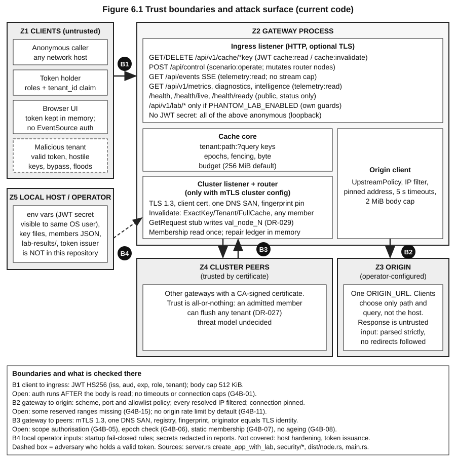

# Package 05: external security review

**Status:** Draft for owner review. **Audience:** the owner (decides scope, rules and recipient), and the outside security reviewer who receives it. **Last reviewed:** 2026-10-30 18:17 IST (machine clock, from `date`). **Index and rules:** `00_README.md`. **Read this first:** PhantomCache is a research prototype. No human or external security review, penetration test, fuzzing run of the HTTP surface, TLS configuration scan or dependency advisory scan has ever been done (`docs/security/m7_security_review.md` "Not done"; handbook section 6.1; `cargo audit` not run, G4C-DEP). Everything in "known findings" comes from AI second-look code reviews (reading only, no tests run by the reviewers). Severities are as those AI reviewers reported them.

**Engagement details (owner fills before sending):** reviewer or firm `[FILL]`; contact for questions `[FILL]`; agreed scope version `[FILL]`; start and end dates `[FILL]`; budget or time box `[FILL]`; confidentiality terms `[FILL: owner and legal]`; code snapshot given (commit hash or archive hash) `[FILL]`; how the snapshot is delivered `[FILL]`.

## 1. Purpose and what a result can say
Purpose: an independent human assessment of whether the gateway and its cluster and Lab surfaces can be attacked in ways the project has not found, and an independent view on the known findings.

A result can say: what the reviewer found, tried, and did not find, in the agreed scope and time. It cannot say the system is secure. "No findings" means "none found by this reviewer in this time using these methods".

## 2. Scope
**In scope (PROPOSED; owner confirms):**
1. The gateway process: the HTTP ingress (`src/api/server.rs`), cache engine (`src/core`), freshness, upstream/origin client (`src/api/upstream.rs` and related), security modules (`src/security/*`: JWT, TLS, cluster identity, upstream policy).
2. The Lab API (`/api/v1/lab/*`, `src/api/lab_api.rs`) and the experiment runner it starts.
3. The cluster layer: mTLS peer listener, framing, membership, invalidation fan-out, anti-entropy (`src/dist/*`).
4. The configuration and start-up checks (`src/config.rs`, `--check-config`, the fail-closed rules).
5. The dashboard UI's handling of the gateway address and the token (`ui/src/lib/gatewayConfig.js`, `labToken.js`, `labApi.js`).
6. Build and release artifacts: `Cargo.toml`, `Cargo.lock`, packaging scripts, checksums.

**Out of scope (PROPOSED):** anything not run by the reviewer on their own machines from the provided snapshot; third-party services; the token issuer (it is **not in this repository**; the project cannot promise anything about who mints tokens or with what lifetime); physical access; social engineering; denial of service against shared or third-party infrastructure (local resource-exhaustion testing against the reviewer's own instance is in scope); the research claims in the Lab results (those are a research-methods question, not a security question).

**Frozen and protected files:** some files (`src/core`, `src/lab`, `src/intelligence`, `src/lib.rs`, `Cargo.toml`) are frozen or protected by project rules. The reviewer may read and test everything, but the project will not necessarily change them in response; findings there are recorded as known limitations first (see section 8). `[FILL: owner confirms how to handle fixes in frozen files]`

## 3. Assets
What is worth protecting (from handbook section 6.1):
| Asset | Why it matters |
|---|---|
| Cached response bodies, per tenant | Confidentiality across tenants; integrity of what users see |
| Correctness of invalidation | A deleted item must not come back (integrity of the cache) |
| The origin's capacity | The cache exists to protect the origin |
| The JWT signing secret (HS256) | Anyone holding it can mint tokens with any role and tenant. It is an environment variable; a host-level attacker who can read process memory or environment is out of what the design protects |
| Cluster private keys and the membership file | They decide who can send invalidations and flushes |
| The gateway's own CPU, memory, file descriptors | Availability |
| The Lab: run artifacts, sealed evaluation seeds, process-spawning ability | The Lab can spawn gateway child processes and read/write a folder |
| Telemetry and diagnostics | Can reveal internal addresses or error text |

## 4. Trust boundaries (use the handbook chapter 6 figure and matrix)
The primary description is handbook chapter 6, section 6.1 and Figure 6.1: five zones.

(If the image does not render, open `docs/learning/assets/ch06_trust_boundaries.svg`. Related figures: `ch06_request_path_protections.svg` (Figure 6.2, the request path of a GET in secure mode with protections numbered and gaps marked) and `ch06_lost_invalidation_flow.svg` (Figure 6.3, one DELETE when a peer is unreachable).)

| Zone | What it is | Who can reach it |
|---|---|---|
| Z1 Clients | Anyone who can send HTTP to the ingress listener | Anonymous in development loopback mode; token holders otherwise |
| Z2 The gateway process | Ingress and cache core in one process | Z1 through the listener; Z4 through the peer listener; Z5 through files and environment |
| Z3 The origin | One operator-configured URL (`ORIGIN_URL`); a client chooses only the path and query, never the host | The gateway only |
| Z4 Cluster peers | Reach a separate mTLS listener, started only when cluster certificates and a membership file are configured | Members whose certificate matches the membership file |
| Z5 The local host | Configuration, keys, files, environment, other local processes | Local users and processes |

The handbook's own adversary framing (our framing, not a recorded threat model): an anonymous network caller; a caller with a valid token for tenant A who wants tenant B's data or to exhaust shared resources; a compromised or buggy cluster member; a malicious or misbehaving origin response; a local user on the same host. **Whether a cluster member should be trusted to flush other tenants' caches is an owner decision still open** (G4B-05, DR-027).

**The threat matrix:** handbook section 6.11 has Tables 6.11a and 6.11b with 32 rows (S01 to S32): what could go wrong, the protection that exists (verified by reading the symbol), the tests, and what is unresolved. The reviewer should treat it as a map of claims to check, not as evidence. `docs/learning/src/ch06_security_reliability_performance.md` lines around the heading "6.11 The security and failure-scenario matrix". Selected rows with no protection today: S23 (invalidation lost on issuer crash), S31 (wall-clock jump extends freshness).

**Older framing:** `docs/security/trust-boundary-map.md` describes six boundaries (client ingress, upstream origin, inter-node mesh, management, observability, supply chain) and a "Target Zero-Trust Architecture" per boundary. The target describes intent, not what is implemented; only its "Current State" lines describe the code, and some may be out of date. Prefer the handbook chapter.

## 5. Attack surface list
| # | Surface | Where | Reached by | Notes |
|---|---|---|---|---|
| A1 | `GET /api/v1/cache/*key` | server | Z1 | Path and query validated and re-encoded; tenant from token only in secure mode; coalescing; cache poisoning questions |
| A2 | `DELETE /api/v1/cache/*key` | server | Z1 with `cache:invalidate` | Exact-key; fan-out to peers; `204` means the routed primary acknowledged (G4B-09) |
| A3 | `GET /api/v1/metrics`, `/api/v1/diagnostics/*`, `/api/v1/intelligence/*` | server | token with `telemetry:read` in secure mode; anonymous otherwise | Diagnostics may leak internal error text (G4B-21); some intelligence endpoints unauthenticated (docs/user/security.md) |
| A4 | `GET /api/events` (SSE) | server | Z1 | No stream cap, per-stream work every 100 ms, token expiry not enforced mid-stream (G4B-02); browsers cannot send an Authorization header on it |
| A5 | `POST /api/control` | server | Z1 with `scenario:operate` | Mutates live router node state in a cluster process (G4B-03); event string logged unescaped (G4B-19) |
| A6 | `/health`, `/health/live`, `/health/ready` | server | Z1 | Unauthenticated |
| A7 | Request bodies, slow clients, connection counts | server | Z1 | 512 KiB cap; no body timeout or connection limit before auth (G4B-01, High) |
| A8 | Lab API `/api/v1/lab/*` (capabilities, runs create/cancel/stream, evidence, artifacts) | `lab_api.rs` | Z1 | Observer reads, Operator posts; anonymous loopback-only dev mode with Host/Origin guard; spawns child gateway processes; artifact/evidence file serving (G4B-25 open/race, G4B-26 no pruning) |
| A9 | Cluster peer listener (mTLS) | `src/dist/node.rs`, `frame.rs`, `pool.rs`, `session.rs` | Z4 | Handshake permits 64 x 1 s (G4B-10); frame cap 1 MiB; no connection age/NotAfter recheck after handshake (G4B-08); static membership (G4B-07); scope of invalidation frames (G4B-05, G4B-06); `GetRequest` stub (DR-029, G4B-30) |
| A10 | Upstream/origin client | `upstream.rs`, `server.rs::fetch_origin_raw` | Z3 | SSRF filter with known range gaps (G4B-15); redirects not followed; response parser strictness; origin header handling (G4B-16) |
| A11 | Configuration and secrets | `config.rs`, environment, config file | Z5 | Secret redaction; fail-closed rules; JWT secret length not enforced on loopback dev (G4B-18) |
| A12 | JWT validation | `src/security/jwt.rs` | Z1 | HS256 only; no `nbf`, `jti`, lifetime cap, revocation, or configured rotation key (G4B-13); role aliases (G4B-14); 10 s leeway |
| A13 | TLS for ingress | `src/security/tls.rs` | Z1 | Startup message says TLS 1.3 but it is not 1.3-only (G4B-20) |
| A14 | Dashboard UI | `ui/src` | a browser | `?gateway=` can point the UI at another host and a token typed there goes there (a noted proposal to warn: `06_functional_ux_work_breakdown.md` section 5); token memory-only |
| A15 | Local files and processes | Lab folder, sealed-seed handling, artifacts | Z5 | Absolute paths and log tails in artifacts (F17); sealed-seed leak scan limits (F19, F32) |
| A16 | Supply chain | `Cargo.lock` (288 locked packages), packaging, `ui/package-lock.json` | build time | Two TLS crypto stacks; broad features (G4B-34, G4C-DEP); no signing of bundles (checksums only) |
| A17 | Time | wall clock used for TTL, staleness, cap | Z5 | Clock stepped backwards extends freshness (G4A-10, S31) |

## 6. Build and run instructions
The project's own documents are `docs/user/install.md`, `docs/user/run.md`, `docs/user/configuration.md`, `docs/user/operate.md`, `docs/release/reproduction_guide.md`. The commands below are condensed from them and were **not re-run** when this package was written. The reviewer should report any step that fails. On the Windows development machine every Cargo command needs `-j 1`.

**Prerequisites:** Rust toolchain (the reference build used rustc 1.98.0; the README says 1.75+ but only 1.98.0 has been used, and the locked crates appear to need about 1.88, G4C F28); on Windows the MSVC linker; several GB of disk. Node.js 18+ only for the UI. Platform exercised by the project: Windows x86-64 only; Linux and macOS build from the same source but are untested by the project.

**Build:** `cargo build --release --locked -j 1`. The binary is `target/release/phantom-cache-demo`. Check it: `phantom-cache-demo --version` and `phantom-cache-demo --config <file> --check-config` (prints the effective configuration with the source of each value and secrets redacted; exit 0 or 2).

**Run tests (optional, to see the baseline):** `cargo test --all-targets -j 1`. Reported baseline (reproduced once, debug profile, 2026-10-28): 242 tests, 19 targets, all passing. Passing tests do not establish correctness; several assert stub behaviour.

**Origin.** A miss needs an origin. Run your own simple HTTP origin on a port you choose and set `ORIGIN_URL` to it. Reviewers will want origins that misbehave (slow, huge, malformed, redirecting, slow-body); write your own; none is provided for this purpose. `[FILL: engineers may add a provided hostile-origin test harness if one exists]`

### 6.1 Configuration A: anonymous development gateway (fastest; the weakest security posture on purpose)
`ORIGIN_URL=http://127.0.0.1:<origin port>`, default bind `127.0.0.1:8085`, no authentication. Add `PHANTOM_LAB_ENABLED=true` and `PHANTOM_LAB_DIR=<folder>` to test the Lab API (needs loopback bind when there is no JWT secret). In this mode the Lab API requires a loopback Host header and a matching or allow-listed Origin (HTTP 421 / 403 otherwise). The main API has no such guard (G4B-04).

### 6.2 Configuration B: secure single node (JWT, TLS, production profile)
1. Generate a JWT secret of at least 32 random bytes **yourself** (section 7) and provide it through the environment: `PHANTOM_JWT_SECRET`. Not on the command line, not in a file in the repository.
2. `PHANTOM_REQUIRE_AUTH=true`, `PHANTOM_TLS_CERT` and `PHANTOM_TLS_KEY` (PEM), a non-loopback `PHANTOM_BIND_ADDR` if you want network access, `PHANTOM_MODE=production`. Production mode forbids the insecure flags (`PHANTOM_ALLOW_INSECURE_HTTP`, `PHANTOM_ALLOW_INSECURE_UPSTREAM`, `PHANTOM_ALLOW_INSECURE_CLUSTER`, `PHANTOM_FORWARD_UPSTREAM_AUTH`) and requires simulation off. Start from `packaging/phantom.production.example.conf`.
3. Ingress TLS certificates: `scripts/gen-demo-certs.sh` (or `.ps1`) generates a demo CA and a server certificate for ingress (default host name `cache.lab.internal`, address `127.0.0.1`). Trust the generated CA in your test client only.
4. Token issuer and validation settings: `PHANTOM_JWT_ISSUER` (default `phantom-cache-auth`), `PHANTOM_JWT_AUDIENCE` (default `phantom-cache-api`).

### 6.3 Configuration C: cluster (mutual TLS)
Cluster mode starts only when cluster material is configured. Settings (names from `docs/user/configuration.md`): `PHANTOM_CLUSTER_ID` (label that must equal the certificate SAN cluster label), `PHANTOM_CLUSTER_MEMBERS_FILE` (JSON; authoritative membership and fingerprints), `PHANTOM_CLUSTER_CA`, `PHANTOM_NODE_CERT`, `PHANTOM_NODE_KEY`, `PHANTOM_NODE_ID` (integer 1 to 255), `PHANTOM_CLUSTER_LISTEN_ADDR`, `PHANTOM_CLUSTER_PEER_ADDRS` (`id=ip:port,...`), `PHANTOM_CLUSTER_TIMEOUT_MS`. Run at least two gateway processes with different node ids, bind addresses and cluster listen addresses, each with its own node certificate.
**Gap the project must close before sending this package:** the documents do not contain a verified recipe for generating the **node** certificates (SAN format carrying the node identity and cluster label) and the members file. `scripts/gen-demo-certs.*` produces an ingress certificate. The test suite generates certificates in code (the `rcgen` crate in `Cargo.toml`). `[FILL: engineers supply a tested recipe or a pre-generated throwaway test cluster bundle; mark it as test-only material]`
A plaintext loopback cluster (`PHANTOM_ALLOW_INSECURE_CLUSTER=true`) exists for development; it skips the originator check on its listener (G4B-17) and does not represent the mTLS posture, so use it only for protocol-level questions.
Known limits of cluster behaviour: `docs/user/limitations.md` ("Cluster invalidation durability"); GET is served from the local cache only; a `204` on DELETE does not mean removal on every gateway.

## 7. Test accounts and tokens, handled safely
There are no accounts. The gateway verifies **HS256 JWTs** that the reviewer mints with a secret the reviewer generates. No secret, token or key is in this package, and none should ever be sent to the reviewer by the project.

**How to mint (describe-only; no secret here):**
1. Generate the secret yourself on your machine with a cryptographically secure generator (at least 32 random bytes). Keep it in your shell environment or a password manager, not in the repository, not in chat or email.
2. Start the gateway with that value in `PHANTOM_JWT_SECRET`.
3. Create tokens with any HS256 JWT tool or library. Claims: `iss` (default `phantom-cache-auth`), `aud` (default `phantom-cache-api`), `exp` (a short lifetime, for example one hour), optional `tenant_id`, and `roles` (an array).
4. Create tokens for at least: two different tenants (so cross-tenant tests are possible); each role separately; an expired token; a wrong-audience token; a token with no tenant; a token with the reserved tenant `__default__`; an Operator-only token (an Operator-only token cannot read the Lab; Observer is a separate role); and algorithm-confusion variants (`alg: none`, wrong algorithm).
5. Delete the secret and tokens when the review ends.

| Role claim | Allows |
|---|---|
| `cache:read` | `GET /api/v1/cache/*` |
| `cache:invalidate` | `DELETE /api/v1/cache/*` |
| `telemetry:read` | `/api/v1/metrics`, `/api/v1/diagnostics/*`, `/api/events` |
| `scenario:operate` | `POST /api/control` |
| `admin` | all of the above |
Aliases `requester` (read and invalidate), `observer`, `operator` are also accepted. For the Lab API, reads need Observer (`telemetry:read`), run create and cancel need Operator (`scenario:operate`); `admin` satisfies both. The tenant of a request comes from the token, never from the `x-tenant-id` header in secure mode.

An earlier agent wrote a test helper that mints tokens for browser tests (`docs/demo/browser_verification/20261030T041006Z/logs/mint.mjs`, secret redacted). It shows the claim shape; read it before using and do not rely on it. The project must never put a real production secret into any test environment.

Do **not** put a token in a URL, a log, a screenshot or a report; the UI keeps the token in memory only, and the Lab API reads it only from the `Authorization` header.

## 8. The 99 known findings, by theme, with dispositions
Source: `docs/release/g4/cycle1_findings_disposition_register.md` (read it in full; it lists every finding with file and line, report status, and next action) and the three source reports `cycle1_core_engine_review.md` (G4A, 26 findings), `cycle1_dist_security_api_review.md` (G4B, 38) and `cycle1_lab_intelligence_deps_review.md` (G4C, 35, IDs F01 to F34 plus an unnumbered dependency item `G4C-DEP`). 26 + 38 + 35 = 99.

**How to read the numbers:** these are AI single-pass reviews that read code and ran no tests. "CONFIRMED" means confirmed by reading. Severity counts as reported: 0 Critical, 4 High, 37 Medium, 42 Low, 16 Info. Dispositions (owner-stated only; nothing is closed): OPEN 75 (including 6 owner-named "must not be dismissed"), RECORDED-LIMITATION 20 (frozen `src/lab` and `src/intelligence` scope, owner decision ODR-1 and DEC-009; not fixed), IN-SANDBOX-REMEDIATION 2 (F01, F02: the U-01 backend patch, owner approved integration with conditions on 2026-10-30, integration in progress, commit not authorised), UNDER-INVESTIGATION 1 (G4A-01), REFUTED 1 (F34). The register was last reviewed 2026-10-30 15:42; check it for later updates. The owner may have changed dispositions since this package was written: `[FILL: owner confirms the register state to send, with date]`.

**The High items (4):**
| ID | What | Disposition | Reviewer note |
|---|---|---|---|
| G4B-01 | Unauthenticated slow-body read before authentication; no body timeout, connection or concurrency limits on the HTTP ingress | OPEN, owner-named | Runtime verification of the hyper/axum defaults still needed; fix would be to authenticate before reading the body plus timeouts, or document a mandatory fronting proxy |
| G4A-01 | `finalize_fetch` re-reads tenant/global epochs after the fence check, so a pre-invalidation body can survive an acknowledged invalidation (TOCTOU race) | UNDER-INVESTIGATION | A later sandbox reproduction reached it only with an injected yield point; 20 s of 3-thread stress (about 3.16 million fills) found 0 violations; natural frequency not measured. A fix touches protected code and needs a failing-first test and an independent review |
| G4A-02 | S3-FIFO eviction leaves tombstones; unbounded queue growth (High only if S3-FIFO is selected; default is SIEVE) | OPEN | The handbook matrix row S25 says S3-FIFO is selectable only through paths with no live caller (by grep) |
| G4C F01 | A cancelled run, or a capped arm with no data, receives a "mechanism failed / hypothesis falsified" result (the U-01 defect, backend half) | IN-SANDBOX-REMEDIATION | Research-integrity issue rather than a classic vulnerability, but it makes the product make a false claim |

**By theme (every finding appears once, under its main theme):**
| Theme | Count | Finding IDs | Disposition summary |
|---|---:|---|---|
| 1. Ingress resource exhaustion and denial of service | 7 | G4B-01, 02, 10, 11, 22, 36, 37 | All OPEN; G4B-01 owner-named and High |
| 2. Authentication, authorisation and the management API | 9 | G4B-03, 04, 13, 14, 18, 19, 20, 21, 31 | All OPEN; G4B-03 owner-named |
| 3. Cluster trust, membership and invalidation fan-out | 13 | G4B-05, 06, 07, 08, 09, 12, 17, 23, 27, 29, 30, 38, G4A-12 | All OPEN; G4B-05, 06, 07, 08 owner-named; G4B-30 gated on DR-029 |
| 4. Cache fencing and races | 3 | G4A-01, 08, 17 | G4A-01 under investigation; others OPEN |
| 5. Eviction and sweeper | 4 | G4A-02, 03, 16, 20 | All OPEN; G4A-02 High (conditional) |
| 6. HTTP caching semantics and stale serving | 7 | G4A-04, 05, 06, 07, 09, 18, 22 | All OPEN |
| 7. Clock, statistics and honesty of metrics | 5 | G4A-10, 11, 24, F24, F34 | OPEN except F34 REFUTED |
| 8. Accounting, bounds and robustness | 7 | G4A-13, 14, 15, 21, 23, 26, G4B-28 | All OPEN |
| 9. Tenant isolation (keyspace) | 1 | G4A-19 | OPEN; unreconciled with a G4B statement (register section 2, discrepancy 1) |
| 10. Origin, SSRF and response handling | 4 | G4B-15, 16, 24, 35 | All OPEN |
| 11. Lab server and tooling | 12 | G4B-25, 26, 33, F07, F08, F17, F18, F19, F21, F22, F29, F32 | F18, F19, F21, F22, F32 RECORDED-LIMITATION; the rest OPEN |
| 12. Experiment and evidence integrity (research, not classic security) | 12 | F01, F02, F03, F04, F05, F06, F13, F16, F20, F30, F31, F33 | F01, F02 in sandbox remediation; F03, F04, F05, F13, F16, F20 RECORDED-LIMITATION; F06, F30, F31, F33 OPEN |
| 13. Intelligence code (latent; no live caller) | 9 | F09, F10, F11, F12, F14, F15, F23, F25, F26 | All RECORDED-LIMITATION |
| 14. Release, supply chain and documentation | 6 | G4B-32, 34, G4C-DEP, F27, F28, G4A-25 | All OPEN |
| **Total** | **99** | | |

Theme counts were derived by the package author from the register's one-line summaries; the grouping is a reading aid, not an owner-approved classification. A count check: 7+9+13+3+4+7+5+7+1+4+12+12+9+6 = 99.

**Important overlaps:** G4B-05 and G4A-12 are the same mechanism rated differently (CONFIRMED vs PLAUSIBLE); G4B-24 duplicates part of G4A-26; G4B-34 duplicates G4C-DEP; G4A-24 and F24 are the same percentile inconsistency. See register section 8.

**What to ask the reviewer to do with them:** (1) try to confirm or refute each of the six owner-named findings and the four High items by running them, and state whether each is exploitable in a realistic deployment (secure mode, TLS, authenticated); (2) say which Medium findings combine into a worse path; (3) report any known finding they believe is rated too high or too low, with reasons. `[FILL: owner decides whether the reviewer first works blind and sees the known list only afterwards, to avoid anchoring]`

## 9. What the reviewer may and may not do (rules of engagement: PLACEHOLDER)
The owner and, where needed, legal advice must write these. Nothing below is approved.
- Permitted targets: `[FILL]` (suggested: only instances the reviewer builds and runs from the supplied snapshot, on their own machines, with their own origin and keys).
- Permitted methods: `[FILL]` (suggested: code review; running the build and tests; black-box and grey-box testing against own instances; fuzzing own instances; load and resource-exhaustion tests against own instances; static analysis and `cargo audit`/`cargo deny` style checks the reviewer runs themselves).
- Not permitted: `[FILL]` (suggested: testing any system the project or third parties operate; contacting the project's users; social engineering; publishing findings before the agreed disclosure date).
- Data: no real personal or production data is provided or should be used. `[FILL]`
- Safe-harbour and legal terms: `[FILL: owner and legal; not drafted here]`.
- Disclosure timeline and who may be told: `[FILL]`.
- Tooling the reviewer needs that this machine does not have (for example the Rust tool chain, a fuzzer, a TLS scanner): `[FILL]`. This package does not authorise installing software on the owner's machine.
- Communication channel for urgent findings: `[FILL]`.

## 10. Expected deliverable
A report in the format below, in a file format the owner chooses `[FILL]`, delivered by `[FILL date]` to `[FILL]`.
1. **Summary:** scope reviewed, snapshot identifier, dates, time spent, the reviewer's overall confidence and the main risks in plain language. No overall "secure/insecure" verdict without the basis.
2. **Method:** what was read, what was run, tools and versions, test configurations used (A, B, C of section 6), what was not done and why.
3. **Coverage statement:** which surfaces in section 5 were examined, to what depth (read only, black-box tested, fuzzed, exploited), and which were not.
4. **Findings,** one entry each, with: ID (`SECX-001...`); title; severity and the scale used (CVSS vector optional, plus plain-language impact); affected component with file and line or route; preconditions (configuration, role, network position); description; step-by-step reproduction with exact commands and inputs; evidence (logs, captures, scripts, as attachments); impact; recommended fix; confidence (reproduced, partly, by reading only); and the matching known finding ID or "new".
5. **Known findings review:** for each of the 99 known findings, or at least the High items and six owner-named ones: confirmed, not reproduced, rated too high or low, or not examined, with a reason.
6. **Things that held up:** attacks tried that failed (handbook section 6.11 lists claims; say which rows you tested). Negative results carry the same weight as positive ones.
7. **Retest guidance:** what must be re-tested after fixes.
8. **Attachments:** scripts and test inputs, with any secrets removed.

**Acceptance of the deliverable (owner):** received on `[FILL]`; read by `[FILL]`; dispositions assigned by finding ID `[FILL]`; status stays **TESTED/AI second look only** until the report is received and recorded in the log in `00_README.md` section 6. Even then, only the reviewed scope and snapshot count as externally reviewed.

## 11. Limits of this package
It was written from documents, not by running the product. The configuration recipes were not executed. The cluster certificate recipe is missing. The finding counts and themes come from a register last reviewed 2026-10-30 15:42 and may have changed. The multi-host behaviour is outside the current evidence (see `07_multi_host_review_note.md`).
