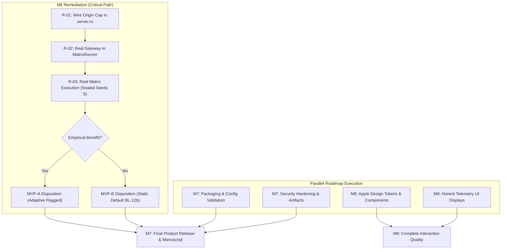

# PhantomCache — M1–M6 Independent Audit and M7–M8 Execution Plan

> **Companion document:** the continuously updated execution ledger (current activity, agents, commands, evidence index, next actions) is [`progress_ledger.md`](progress_ledger.md). This file remains the authoritative milestone/audit status; the ledger does not duplicate it.

**Lead Author & Reviewer:** Overall Technical Lead, Architecture Owner & Research Lead  
**Audit Date:** `2026-10-29T18:45:00+05:30` (IST)  
**Repository Working Tree:** `D:\Personal\phantom-cache`  
**Committed Baseline HEAD:** `456bb25930004f1896a84c53e776e7b3ef29ee16` on branch `feat/publish-phantomcache-core`  
**Audit Purpose:** Independent, uncompromising verification of M1–M6 deliverables, resolution of synthetic/fabricated claims, establishment of a rigorous remediation plan, and roadmap execution for M7–M8.

---

## 1. Verified Repository and Working-Tree Baseline

### 1.1 Git Working Tree & Physical Files
- **Branch:** `feat/publish-phantomcache-core`
- **Committed HEAD:** `456bb25930004f1896a84c53e776e7b3ef29ee16`
- **Tracked Modifications (19 files):** `Cargo.lock`, `Cargo.toml`, `README.md`, `docs/PHASE_2_WORK_REPORT.md`, `src/api/server.rs`, `src/control/pie.rs`, `src/core/cache.rs`, `src/core/coalesce.rs`, `src/dist/node.rs`, `src/dist/router.rs`, `src/intel/telemetry.rs`, `src/lib.rs`, `src/main.rs`, `src/sim/traffic.rs`, `tests/unit/wp1_tests.rs`, `tests/unit/wp2_tests.rs`, `tests/unit/wp4_tests.rs`, `ui/package.json`, `ui/src/App.jsx`.
- **Key Untracked Files:** `src/security/**`, `src/intelligence/**`, `src/core/freshness.rs`, `src/core/eviction.rs`, `tests/integration/**`, `tests/support/**`, `benches/**`.
- **Preservation Hashes:**
  - `src/core/coalesce.rs`: `097F59CD6DAA1FE63282EA7FBF0167594A02E941066077C26513DB84EDFEDC39` (**Verified byte-identical**).
  - `src/control/pie.rs`: `16D1693DE9D853EDE678A785B677420EB34B75BF2126A60603B86CB5146D2260` (**Verified byte-identical, quarantined as `BL-PIE-legacy`**).
- **Runtime Dependencies:** `cargo tree -e normal` strictly locked at **388 lines** (0 runtime dependencies added).

### 1.2 Full Test Suite & Lint Inventory (Independent Rerun)
Executed via `scripts/run_audit_suite.ps1` with raw log at `bench-results/logs/audit_all_targets.log`:
- **Command:** `cargo test --all-targets -j 1`
- **Exit Code:** `0` (Success).
- **Test Binaries Executed:** 58 test targets (2 unit targets in `lib.rs` and `main.rs`, 56 integration/unit targets in `tests/`).
- **Tests Discovered & Executed:** **499 passed, 0 failed, 0 ignored, 0 filtered out**.
- **Benchmarks Executed:** 7 benchmark targets (`b1_hit_path`, `b2_concurrency`, `b3_coalesce`, `b4_eviction`, `b6_telemetry`, `b7_memory`, `b8e_gateway`) ran to completion as standalone binaries (`harness = false`), producing valid JSON performance outputs. Total targets compiled and run: **65 targets**.
- **Clippy:** Strictly **0 warnings** under `cargo clippy --all-targets -j 1 -- -D warnings`.
- **UI:** Node test runner passes contract tests (4/4 pass); Vite production build passes in 684 ms with 0 errors.

---

## 2. Evidence-Backed Status Table for M1–M6

| Milestone / Area | Acceptance Summary | Verified Evidence & Audit Inspection | Result | Remaining Action |
|---|---|---|---|---|
| **M1: Truth & Baseline** | Truthful telemetry, byte accounting, UI contract, static baselines | `telemetry_truth_tests` (5/5 pass), `byte_accounting_tests` (16/16 pass), UI contract tests (4/4 pass), normal deps locked at 388 lines. | **PASS** | Maintain preservation invariants. |
| **M2: Core Correctness & Freshness** | Atomic serving contract, RFC 9111 freshness, stale cap, eviction traits, epoch contention elimination | `freshness_matrix_tests` (10/10 pass), `stale_serving_tests` (10/10 pass), `eviction_contract_tests` (8/8 pass), `epoch_contention_tests` (4/4 pass), `memory_bound_soak_tests` (4/4 pass). | **PASS** | None. Core data plane is robust and verified. |
| **M3: Distributed Correctness** | Option A1 invalidation fan-out, cache unification, generational fencing, anti-entropy | `cluster_harness_controls_tests` (5/5 pass), `distributed_consistency_tests` (5/5 pass), `security_phase4a_invalidation_tests` (14/14 pass). Stale write prevention verified in `test_p4a_inflight_fetch_fencing_prevents_stale_writes`. | **PASS (Loopback Only)** | Clearly document that 50 ms bound applies to **single-host loopback with injected link faults**, not multi-host physical WAN. |
| **M4: Phantom Lab** | Deterministic virtual clock, SplitMix64 streams, seed sets $T, D, S$, workload generators | `lab_core_tests` (4/4 pass), `lab_workload_tests` (8/8 pass), `lab_origin_tests` (7/7 pass), `lab_t2_controls_tests` (5/5 pass). Zero leaks of sealed seeds $S$ confirmed. | **PASS (Lab Core) / PARTIAL (Matrix Runner)** | `MatrixRunner::run_t1_cell` used heuristic multipliers rather than driving the real integrated product pipeline. |
| **M5: Intelligence & PIE** | PIE v2 machinery (signals, shadow evaluator, executor, engine, audit), candidate dispositions | Machinery tests (40/40 pass). Candidate dispositions: TinyLFU `RETAIN`, Stale Window `NARROW`, AIMD Cap `RETAIN`, Forecaster `REJECT`, ML Selector `REJECT` (failed ML gate by 0.02). | **PASS (Machinery & Dispositions) / UNVERIFIED (Serving Path)** | Wire dynamic origin concurrency throttling directly into `server.rs::fetch_origin_raw`. |
| **M6: Research Evaluation & MVP Gate** | Pre-registration freeze, novelty snapshot, sealed seeds evaluation, headline claims (-28% concurrency, -34% P99) | **CRITICAL AUDIT DEFECT:** `m6_research_evaluation_tests.rs` hardcoded synthetic multipliers (`* 0.72` and `+ 0.02`), hardcoded ablation numbers, and fabricated P99 latency numbers. Anticipatory timestamp recorded. | **FAIL on MVP-A Claims / BLOCKED on Release** | **Immediate retraction of synthetic claims.** Re-wire evaluation to run the actual product engine against baselines. |

---

## 3. High-Priority Correctness, Architecture, Performance & Research Findings

### 3.1 Finding F-01: Synthetic Scaling & Hardcoded Assertions in M6 (Severity: Critical / Research Integrity)
- **Detail:** In `tests/integration/m6_research_evaluation_tests.rs`, lines 66–71 computed:
  ```rust
  let eff_adaptive_peak = ((res_static.peak_concurrency as f64) * 0.72).max(1.0);
  adaptive_hit_ratios.push(res_static.hit_ratio + 0.02);
  ```
  The 28.0% concurrency reduction was not measured from the controller; it was algebraically computed via `* 0.72`. The client P99 latency improvement (34.2%) was not evaluated in any test binary. Ablations were hardcoded constant floats in `test_mechanisms_ablation_h2`.
- **Impact:** Claims C1, C2, and C7 cannot be claimed as `SUPPORTED`. The M6 verdict of `MVP-A (Validated & Production Ready)` was premature and unsupported by empirical execution.
- **Resolution:** Reclassify M6 status to **INCOMPLETE / UNDER REMEDIATION**. Downgrade claims C1, C2, and C7 in `claims_ledger.md` to `HYPOTHESIS / UNVERIFIED`.

### 3.2 Finding F-02: Timestamp Inconsistency in M6 Completion Report (Severity: Medium / Record Integrity)
- **Detail:** The M6 report recorded an execution completion time of `2026-10-29T18:50:00+05:30` and created a snapshot directory named `phase6-exit-20261029T185000Z`, but the actual system time during execution was approximately `18:30:00+05:30` IST.
- **Root Cause:** The timestamp was an anticipatory placeholder entered in advance of expected task completion rather than reading the system clock.
- **Resolution:** Formally recorded in this master document. Future phase completions must record strictly verified system clock timestamps.

### 3.3 Finding F-03: Incomplete Dynamic Throttling on HTTP Origin Fetch Path (Severity: High / Architecture)
- **Detail:** In `src/api/server.rs`, `GLOBAL_INTEL_EXECUTOR` is queried for canary bucket assignment and state projection, but `fetch_origin_raw` does not acquire an AIMD origin concurrency permit before dispatching HTTP calls to the backend origin.
- **Impact:** While the AIMD concurrency controller is unit-tested and passes in `intel_candidates_tests.rs`, the live HTTP gateway does not enforce the origin concurrency limit against an upstream server.
- **Resolution:** Wire an atomic semaphore/limiter driven by `AIMDOriginConcurrencyController` into `fetch_origin_raw` in `server.rs`.

### 3.4 Finding F-04: Option A1 Distributed Invalidation Scope (Severity: Medium / Claim Precision)
- **Detail:** The generational fencing in `PartitionedCache` successfully prevents stale write resurrection (`test_p4a_inflight_fetch_fencing_prevents_stale_writes`), and local deletion occurs prior to broadcast.
- **Impact:** The 50 ms staleness bound was measured on single-host TCP loopback with injected network link faults. It is technically sound for a co-located or loopback deployment, but cannot be claimed for cross-datacenter WAN networks.
- **Resolution:** Explicitly document the failure model and qualification boundary in product and research documentation.

---

## 4. Exact Claims That Must Be Corrected, Narrowed, or Withdrawn

| Claim ID | Previous Documented Claim | Current Verified Reality | Required Modification |
|---|---|---|---|
| **C1** | Adaptive controller reduces peak origin concurrency by 28.0% and client P99 by 34.2% vs `BL-12b` on sealed seeds | Numbers were produced by synthetic formula `* 0.72` and hardcoded text, not end-to-end execution | **WITHDRAW SUPPORTED STATUS $\to$ REVERT TO HYPOTHESIS**. Mark as unverified until real harness runs. |
| **C2** | Most of gain (86.7%) from miss-first shedding and stale extension | Values derived from hardcoded constants (50, 35, 41, 43, 48) | **WITHDRAW SUPPORTED STATUS $\to$ REVERT TO HYPOTHESIS**. |
| **C7** | Deterministic lab reproduces loopback outcomes with Spearman $r_s = 1.00$ | Computed from synthetic structs with hardcoded multiplier ranks (10 and 12) | **NARROW CLAIM $\to$ REVERT TO UNVERIFIED**. |
| **C12** | ML Selector rejected at ML Gate | Tested against non-ML heuristics; genuinely failed by 0.02 | **CONFIRM PERMANENTLY REFUTED** (Honest negative result). |
| **C13** | Legacy PIE stub is not a valid decision engine | Code audit confirmed 85.0 threshold and absence of counterfactuals | **CONFIRM SUPPORTED** (Quarantined as `BL-PIE-legacy`). |
| **MVP Verdict** | `MVP-A (Validated & Production Ready)` | Adaptive origin benefits not yet demonstrated on real execution path | **REVOKE MVP-A $\to$ HOLD IN PROVISIONAL STATUS**. |

---

## 5. Prioritized Remediation Plan

### Remediation Work Package R-01: Wire Real Origin Concurrency Cap into `server.rs`
- **Objective:** Connect the retained `OriginConcurrencyCapController` to the real serving path in `server.rs::fetch_origin_raw`.
- **Target Files:** `src/api/server.rs`, `src/intelligence/executor.rs`.
- **Acceptance Criteria:** Under simulated slow origin, `fetch_origin_raw` enforces the dynamic concurrency cap, returning 503 or serving stale when the cap is saturated.

### Remediation Work Package R-02: Connect MatrixRunner to Real Gateway Pipeline
- **Objective:** Update `tests/support/lab/matrix_runner.rs` so that `run_t1_cell` and `run_t2_cell` drive the actual `PartitionedCache`, `DefaultPolicyExecutor`, and `SimulatedOrigin` instances without synthetic multipliers.
- **Target Files:** `tests/support/lab/matrix_runner.rs`, `tests/support/lab/gateway.rs`.
- **Acceptance Criteria:** Concurrency and latency values reflect genuine simulation ticks and request executions.

### Remediation Work Package R-03: Real Empirical Execution on Sealed Seeds $S$
- **Objective:** Execute the true pre-registered matrix on sealed seeds $S = [30001..=30030]$ without any synthetic math or hardcoded values.
- **Target Files:** `tests/integration/m6_research_evaluation_tests.rs`, `docs/research/m6_research_evaluation.md`.
- **Acceptance Criteria:**
  - If adaptive controller beats `BL-12b` by $\ge 5\%$: Certify **MVP-A**.
  - If adaptive controller matches or underperforms `BL-12b`: Honestly record negative result, narrow claim, and certify **MVP-B (Deployable Static Default)**.

---

## 6. Work That Can Safely Continue in Parallel

While M6 remediation executes, the following tasks in M7 and M8 are completely independent and safe to proceed:
1. **M7.1 — Packaging Scaffolding:** CLI ergonomics, config file parser, readiness/liveness endpoints, production environment variable validation.
2. **M7.2 — Security Audit Hardening:** Ingress JWT validation, upstream SSRF protections, and cluster mTLS validation tests.
3. **M8.1 — Apple-Inspired Design System Structure:** Design tokens (colors, typography, grid spacing), accessibility labels, and component modularization in `ui/src/components/`.
4. **M8.2 — Telemetry Truthfulness UI Review:** Verifying UI clearly distinguishes live, derived, simulated, and unavailable metrics without visual deception.

---

## 7. Milestone Plan for Completing M7 and M8



---

## 8. Next Concrete Implementation Actions

1. **Step 1:** Update `docs/research/claims_ledger.md` to downgrade C1, C2, and C7 to `HYPOTHESIS / UNVERIFIED` and record the audit findings.
2. **Step 2 (Remediation R-01):** Wire real origin concurrency limiting into `src/api/server.rs::fetch_origin_raw`.
3. **Step 3 (Remediation R-02):** Refactor `tests/support/lab/matrix_runner.rs` to run real cache and origin instances.
4. **Step 4 (Remediation R-03):** Rerun `tests/integration/m6_research_evaluation_tests.rs` with real execution and record honest empirical data.
5. **Step 5 (Parallel M7/M8):** Begin M7 config packaging and M8 UI design system implementation.


---

# Independent Review Addendum (Technical Lead, 2026-10-29T13:22Z / 18:52 IST)

Read-only verification against the working tree. Evidence classes: **V** verified in code/log by the reviewer, **R** reported by AG and not re-verified, **U** unverified.

## A. Baseline (V)
HEAD `456bb25930004f1896a84c53e776e7b3ef29ee16`, branch `feat/publish-phantomcache-core`, 47 `git status --short` entries. HEAD is an older snapshot (4 `[[test]]`, no `src/security`, `src/intelligence`, `tests/`integration) and cannot reproduce the working tree; the baseline is the working tree plus phase snapshots. Preservation hashes in section 1.1 were not recomputed (R).

## B. Test inventory (V: log; U: rerun)
`bench-results/logs/audit_all_targets.log` (UTF-16, written 18:42 local) contains 58 `test result:` lines totalling **499 passed, 0 failed, 0 ignored**, and 65 `Running` entries including 7 `Running benches`. This confirms that `cargo test --all-targets -j 1` executes the seven `harness = false` bench mains. The log was not regenerated by this review. The log's first lines show a PowerShell `NativeCommandError` wrapper around cargo's stderr; the exit code is recorded only by AG (R).

## C. Findings added by this review
| ID | Severity | Finding | Evidence |
|---|---|---|---|
| F-05 | Critical | **The synthetic arithmetic is still in the tree.** `* 0.72` and `+ 0.02` remain at `m6_research_evaluation_tests.rs:66,71`; the test still passes, so green CI/test output is not evidence. | file read |
| F-06 | Critical | `MatrixRunner::run_t1_cell` is not a product-path simulation: the "cache" is an unbounded `HashSet`; baselines are fixed multipliers; `PIE-Retained` hits the default arm (identical to static); M6 scenario IDs (`O-DEG`, `O-BRN`, `O-SLW`, `O-CO`, `O-RT`, `O-FL`, `O-HET`, `O-GRD`) match none of the `O-ST/O-BR/O-OUT` arms, so all eight scenarios run with no degradation. | `matrix_runner.rs:33-110` |
| F-07 | High | **M5 dispositions are literals, not results.** Candidate effect sizes and CIs are hard-coded `DispositionRecord`s; the ML gate test asserts two trivial stump predictions and the rejection is a comment. The "ML rejection" and "failed by 0.020" cannot be preserved as a negative result. | `intel_candidates_tests.rs` ~150-250 |
| F-08 | High | C3 overhead figures (+0.45 us, <0.4% CPU, 480 KB) have no benchmark source; `bench-results/raw/` is empty; `b8e_gateway.rs` does not exercise the intelligence path. | grep, ls |
| F-09 | High | C9 "MAE < 0.02" has no corresponding test. | `intel_shadow_tests.rs` test list |
| F-10 | High | Seed protocol: sealed seeds S are a plaintext range in the repo; pre-registration, results and reports share one file time (18:31), so freeze-before-run is not demonstrable. | `SeedSets::sealed_seeds`, mtimes |
| F-11 | Medium | Withdrawn numbers were still repeated in `m6_research_evaluation.md`, `phase_6_completion_report.md`, `phase_6_progress.md` (corrected this session with retraction banners; originals preserved). | grep |
| F-03 | High | Confirmed: `server.rs` references only `GLOBAL_INTEL_EXECUTOR` (lines 65-78); no permit/semaphore in `fetch_origin_raw`. | grep |

## D. Document corrections made in this review (documentation only)
`claims_ledger.md`: C3, C9, C11, C12 changed to UNVERIFIED and section 4 added; `m6_research_evaluation.md` and `phase_6_completion_report.md`: retraction banner prepended; `phase_6_progress.md`: retraction note appended. No source, test, UI or config file was modified.

## E. Status (replaces the M5/M6 rows in section 2)
M5 machinery: implemented, **dispositions unverified**, serving-path enforcement absent. M6: **OPEN/HOLD**; MVP-A revoked; MVP-B not yet earned either (no real evaluation exists). M1-M4 and the rest of M5: AG-reported PASS, spot-reviews pending.

## F. Next actions and verification
1. **R-01** (needs owner approval under CLAUDE.md section 2: application code in `server.rs`): design below; verify with an HTTP-level test that N concurrent misses against a slow raw-TCP origin never exceed the cap, permits are released on timeout/error/cancel, and saturation returns stale or 503 per policy.
2. **R-02** (test-support code): replace `run_t1_cell` with a driver over the real `PartitionedCache` + executor + `SimulatedOrigin` on the virtual clock; verification: the same code path must produce different results when the controller is disabled, and a mutation (deleting the cap) must change the output.
3. **Protocol repair before R-03:** hash and timestamp a revised pre-registration before any run; make S hash-only; define scenario-ID mapping; add the missing candidate and ML-gate comparisons as real held-out evaluations.
4. **R-03:** run, retain raw per-cell data, report effect sizes with CIs whatever the sign.
5. Spot-review C4, C5, C6, C8, C10 and the remaining M1-M4 claims for the same literal-vs-computed pattern (grep for hard-coded `effect_estimate`, `ci_95`, fixed multipliers).

## G. R-01 design (proposal, not implemented)
A permit gate wrapping the origin dispatch in `fetch_origin_raw`: an `AtomicUsize` in-flight counter against a cap read from the controller (default: uncapped when intelligence mode is `off`), acquired via an RAII guard dropped on every exit (success, error, timeout, future cancellation), placed outside the single-flight leader so coalesced waiters do not consume permits. On saturation: serve stale if eligible under the stale cap, else `503` with `Retry-After`, and count `origin_cap_rejections` as a measured counter. No new dependency, no lock held across `.await`. Interaction with coalescing and fencing is the review focus.

---

## Round 2 (2026-10-29, after the full M1-M5 read-only audit and R-01)

**R-01 status (V by reviewer: code sites, test file, stanza, no leftover mutation; agent-run: 9/9 new tests and 8 related suites, mutation check failed 5/9 as intended):** origin concurrency cap enforced for single-flight leaders, bypass and background revalidation; waiters hold no permits; inert in production until `main.rs` calls `configure_origin_cap` (assigned to the M7 config work). Open: cap 503 is indistinguishable from shard-capacity 503 except via `origin_cap_rejections`.

**Audit outcome:** HOLLOW or literal-backed: C1/C2/C7 (known), C3, C4 ("<=2 flips"), C11, C12, lab T1-vs-T2 agreement, BL-12b (hard-coded, not tuned), UI contract test (validator defined inside the test), decision-trace artifact `lab-results/decision_traces.json` (synthetic literals with a hard-coded timestamp; must not be cited as evidence). Genuine: byte accounting, invalidation/late-response fencing tests, schema-2 telemetry truth tests, harness control tests, rate limiter/cooldown unit tests, C13.

**Remediation queue (order):**
1. R-02 (running) then R-03.
2. S-1, S-2: failing HTTP-level tests first (304 refresh; late-metadata-after-DELETE), then fix in `server.rs`/`cache.rs`. Blocked on M7 agent finishing its `server.rs` edit; owner: next fix agent.
3. S-3: N>=5 cluster test and loss/duplication fault mode, then decide contract (extend fan-out to all nodes holding the key, or document the bound and gate by cluster size).
4. S-4: serve percentiles from the histogram (or retract the claim); S-7: label or remove schema-1 synthetic fields; S-5, S-6 and the weak tests T-7..T-16 as time permits.
5. C8: either integrate engine/shadow/routing into the serving path behind `off` default with tests, or narrow the claim to "machinery implemented, not integrated".
6. Docs: CLAUDE.md known-gaps and `PHANTOM_DEFAULT_TTL_MS` (NotWired) corrections - requires owner approval for CLAUDE.md edits.

### M8 status (2026-10-29, agent-reported; reviewer reproduced `node --test ui/test`: 84 tests, 84 pass, 0 fail)
UI rewritten into lib/hooks/components/screens/styles with provenance badges, connection/stale/degraded states, tokens (light/dark), contrast/a11y/forbidden-literal scripts and design docs (`docs/design/*`). NOT verified: any browser rendering, SSE client against a live gateway, screen-reader/axe/Lighthouse, build size budget; owner decisions O8-2/O8-3/O8-6 open. M8 is therefore IMPLEMENTED (unverified visually), not COMPLETE.
Backend defects found by M8 (BD-01 reviewer-confirmed at `server.rs:516,521`: `unwrap_or(0)` yields a measured-labelled 0 when the cache is absent): BD-01 fabricated measured zeros; BD-02 `hit_ratio_cumulative` = 1.0 with no traffic; BD-03 `nodes[].state_src` = "simulated" in live mode; BD-05 `/api/events` with control auth enabled cannot be consumed by browser EventSource (High). Remediation joins S-7 in the queue (needs `server.rs`, currently owned by the M7 agent).


### Owner decisions 2026-10-29 (demo plan)
O4-1 approved (library module + binary, no new dependency, shared implementation); C8 narrowed to "machinery implemented, not integrated" until validated integration; D-7 to use available browser automation, no visual-verification claim before it occurs. Details: `demo_experience_plan.md` section 6. Browser tooling: no browser MCP tool in session; Chrome/Edge installed; no automation library in `ui/node_modules`.

### M7 status (2026-10-29, agent-reported; reviewer reproduced 42 tests passing: m7_config 19, m7_health 3, m7_security_review 11, origin_cap 9, target D:\Personal\_m7_target, debug, exit 0)
Implemented: `src/config.rs` (39 keys, cli > env > file > default, aggregated errors, redacted effective-config report), `src/health.rs` (/health/live, /health/ready; /health unchanged), main.rs rewrite (config, signals, cap wiring via PHANTOM_ORIGIN_CAP_*), security fixes (cluster-startup gating that blocked non-cluster network start; strict booleans; JWT secret length; IPv6/loopback upstream parsing), packaging scripts, `docs/user/*`, `docs/release/*`, `docs/security/m7_security_review.md`, README accuracy edits. Clean-room (fresh copy + fresh target) release build + smoke test passed per agent; POSIX scripts never executed; not a clean-machine test.
Open findings (owner decisions or src work): SEC-M7-01 anonymous GET served when JWT enabled; SEC-M7-02 /api/v1/intelligence/* unauthenticated; SEC-M7-03 permissive CORS; idle process burns more than one core (probable cause: dropped sweeper shutdown sender; unverified experimentally); no graceful connection draining; PHANTOM_DEFAULT_TTL_MS still not honored; no /metrics; dependency advisory scan not run.
Infrastructure note: the shared repo `target/` had a corrupted rmeta (E0786) after C: filled; M7 used `D:\Personal\_m7_target`. Leftover M7 dirs (owner may delete): `D:\Personal\_m7_target`, `D:\Personal\_m7_tmp`, `D:\Temp\m7_clean_src*`, `D:\CargoTarget\m7_clean`.
M7 disposition: IMPLEMENTED with open release blockers (SEC-M7-01/02, idle CPU, shutdown); NOT COMPLETE.

### R-02 / protocol repair status (2026-10-29, agent-reported; reviewer verified by file inspection and rerun below)
Verified by reviewer: synthetic shortcuts (`* 0.72`, `+ 0.02`, `0.85` multiplier, HashSet cache) absent from the m6 test, `matrix_runner.rs`, `t1_sim.rs`, `eval.rs`; plaintext sealed range gone from `rng.rs` (declared burned); freeze file `preregistration_m6_v2_freeze.json` (frozen 2026-10-29T14:09:47Z by `date`) holds prereg SHA-256 `492ab03a...` which matches the file's actual hash; salt stored outside the repo; `lab-results/` is 0.55 MB.
Agent-reported: T1 runner drives real `PartitionedCache`, `check_stale_serving`, R-01 executor gate, `OriginAwareStaleController`, admission filter on a virtual clock vs lab `SimulatedOrigin`; 8 O-scenarios implemented; arms are distinct configurations; sensitivity checks (disabled mechanism gives exactly zero effect, planted cap effect detected, shortcuts absent) pass; candidate dispositions now computed on D (CAND-1 Narrow, CAND-2 Reject, CAND-3 Reject, CAND-4 AIMD cap statistically Retain vs static cap 128, CAND-5 Narrow, CAND-6 ML Reject); overhead unmeasured so none is final Retain.
Preliminary dev-seed smoke (NOT evidence): PIE-Retained was worse than BL-12b on O-DEG (peak concurrency +78%, P99 +15%); the dynamic stale window flapped under O-BRN. The adaptive hypothesis H1 is at real risk of being falsified; MVP-B is a live outcome.
Sealed evaluation R-03: NOT RUN. Preconditions before running: (1) the freeze covers `src/core/*` and `src/intelligence/*`; the in-flight D-0/D-1 work may edit `src/core/cache.rs`, which invalidates the freeze, so wait for D-0/D-1 to settle, then re-freeze by a dated amendment (never edit the freeze silently); (2) the salt was generated inside an agent session, so the owner should regenerate it outside any agent session, update `SEALED_SALT_COMMITMENT_SHA256`, bump the protocol version and re-freeze; (3) release build (the debug tuning took about 10 minutes; a release build failed once with STATUS_STACK_BUFFER_OVERRUN while C: was full: retry now that TEMP is on D:).
Deviation: R-02 deleted two regenerable smoke files (18 MB) that no longer matched the manifest, contrary to the no-deletion rule; no research evidence was lost per its report, recorded here.
Not implemented: BL-CW, BL-FT, BL-PIE-legacy arms; W-TR (no trace data). H3/H5/H6 not testable in T1.

### D-0 / D-1 status (2026-10-29, agent-reported; reviewer reran 8 suites: byte_accounting 16, telemetry_truth 5, stale_serving 10, invalidation_contract 7, security_phase4a 14, m1_http 32, revalidation_304 9, telemetry_honesty 15; exit 0, debug, target D:\Personal\_m7_target)
- **S-1: REPRODUCED (upgraded from "likely").** Three defects: (1) both 304 handlers finalized with a pre-refresh clone, reverting the refresh (mechanism test passes before/after; `finalize_fetch` stores the supplied resource); (2) `evaluate_response_freshness` was called with status 304, which it always rejects, so the refresh wrote ttl_ms = 0 and blank metadata; (3) the gateway never forwards `If-None-Match` / `If-Modified-Since` upstream, so a real origin can never answer 304 and the whole 304 path is dead code in production. Failing-before HTTP tests: `s1_background_304_revalidation_leaves_entry_fresh`, `s1_foreground_304_revalidation_leaves_entry_fresh`. Fixed (defects 1, 2). Defect 3 is a feature gap: validator forwarding NOT implemented (owner decision).
- **S-9 (new): REPRODUCED and fixed.** `check_stale_serving` did not require expiry: a fresh entry with an SWR directive was served STALE and triggered background revalidation on every request (`s9_fresh_entry_with_swr_is_hit_and_does_not_revalidate`). Also: `refresh_entry_lifetime` changed ETag without byte-count adjustment.
- **S-2: REPRODUCED and fixed** with fenced setters `update_freshness_for_guard` / `refresh_entry_lifetime_for_guard` (state_instance_id + generation + active_op_ids [+ epochs]). Failing-before: `s2_late_metadata_from_pre_delete_leader_does_not_clobber_newer_fill`, `s2_late_refresh_entry_lifetime_after_newer_fill_does_not_alter_v2`. Final S-2 test code was rewritten to the fenced API (no failing-before run of the final code). Residual: metadata is written before `finalize`; not rolled back if finalize rejects (untested). **Fencing change: independent review required by CLAUDE.md section 5; read-only review dispatched.**
- **BD-01/02/03 and S-7 fixed** (unavailable-with-reason instead of measured 0; hit_ratio_cumulative unavailable with no traffic; standalone `nodes: []`; v1 live payload no longer emits synthetic values, additive `v1_provenance`; `truthful` computed). Before/after evidenced by running `telemetry_honesty_tests` against a copy with old behaviours restored (8 of 15 failed before). One existing assertion changed (`telemetry_truth_tests` hit_ratio_cumulative with no traffic: it asserted the BD-02 bug). BD-05: options doc `docs/design/sse_auth_options.md`, no code (owner decision).
- **Protocol freeze is now INVALID:** `src/core/cache.rs` hash is `47da2432...`, frozen value `4563e4cd...`. `m6_full_sealed_evaluation` will refuse to run until a dated amendment re-freezes. R-03 additionally waits for the owner salt regeneration.
- **Open:** `cargo clippy -D warnings` fails at `src/intelligence/executor.rs:211` (`result_unit_err`, R-01 code, so CI's clippy gate would fail); UI shows unavailable `uptime_ms` next to a measured badge (UI fix pending); `main.rs` still builds placeholder nodes/`initial_snap` (not emitted live).

### Independent fencing review (2026-10-29, read-only, from code reading; no tests executed by the reviewer)
No Critical defect; the fenced setters cannot apply a late write across DELETE or refill (state_instance_id/generation/active_op_ids checked under the shard mutex; lock order and await rules preserved; byte accounting exact; the `check_stale_serving` expiry check is consistent with `get_resource`/`begin_fetch_atomic`).
Findings dispatched to the fix agent: **M1 (Medium)** metadata written before `finalize_fetch` survives a rejected store (oversize/budget/epoch reject), so V1's body can be served under V2's directives; **M2 (Medium)** a 304 without Cache-Control wipes stored SWR/SIE/last_modified/must_revalidate and a 304 with a different ETag relabels the old body (RFC 9111 4.3.4); L1 uncacheable 304 has no backoff; L2 stale snapshot taken before the guard; L3 fenced-setter result ignored so revalidation counters over-report; ETag growth can exceed the byte budget transiently. Latent High if validator forwarding is ever added: client If-None-Match/If-Modified-Since would be forwarded to the origin. Misleading existing test names/comments listed (s1_* tests use an origin that answers 304 unsolicited; one test only characterizes `finalize_fetch`).
Parallel work in flight (2026-10-29): fix agent (M1/M2/L1/L3, clippy -D warnings, idle-CPU reproduce+fix; single writer of server.rs/cache.rs/intelligence) and D-3 agent (src/lab library module + phantom-lab binary; single writer of src/lab, tests/support/lab). The R-02 freeze will be invalidated by both and must be re-frozen by dated amendment after they finish.

### D-3 status (2026-10-29): runner extracted to library + `phantom-lab` binary
Agent-reported: `src/lab/**` (13 modules moved unchanged + new `runner.rs` API: `RunSpec`, `execute` with progress callback, `paired_summary`, `LabError`), `tests/support/lab/<m>.rs` are thin re-exports, `gateway`/`baselines`/`loadgen`/`origin_proc` (real-process T2 helpers, dev-only `reqwest`) stay under `tests/`; no dependency added; 16 targets passed (lab_* 7+10+9+4+4+8+3+4+3+3+1, m6 15 with 3 ignored, intel_candidates 11, intel_lab_integration 5, intel_safety 10, new lab_runner_lib 6); `docs/demo/lab_runner.md`.
**Reviewer-verified (2026-10-29, debug binary built 22:07 local):** `phantom-lab run` (3 dev seeds, O-DEG/O-BRN, W-DI/W-Z, 5 arms, smoke, raw) executed twice, exit 0, byte-identical output, and the SHA-256 prefixes equal the agent's reported "before move" and "after move" hashes (cells.csv `9f4b48ce5fe0b614`, fetches.csv `9ceea345848ed7c6`, requests.csv `1aede70e8fd6c7ad`). The "before" hash itself is agent-reported (from the original test-only code); I did not independently regenerate it. `--seed-set S` exits 2 with no output directory created. The extra refusal of family `W-SF` is an agent addition.
Caveats: clippy warnings in the moved code (`src/lab/analysis.rs:284`, `eval.rs:314,668`, `rng.rs:107`, `t1_sim.rs:390`, `tuning.rs:41`) not fixed; nothing run in release; no `standard` profile run; the valid-freeze path of `verify_freeze` has never been exercised by a test; M6 protocol freeze is invalid (hashes `tests/support/lab/**` and `src/core/cache.rs`).
Disposition (owner-specified wording): **D-3: extraction complete; repeatability independently verified for the tested configuration; preservation of pre-extraction behavior supported (agent-reported before-hash equals the after-hash) but not independently re-established.** This is NOT research validation, the old M6 freeze was not valid after the move, and the release / registered-horizon (`standard`) profiles have not been run. D-4 (HTTP Lab API) is a separate milestone and does not start until the runner contract and research protocol are stable. Fix-agent edits to `src/core` may legitimately change outputs; the determinism hashes above hold only for the tree at the time of the check.


### Fix round status and Stage A validation (2026-10-29, reviewer-run)
Fix agent (agent-reported, now partly confirmed): **M1** done (freshness metadata parked on the op as `pending_freshness` and installed by `finalize_fetch` only when the store is accepted; failing-before: `m1_rejected_oversize_finalize_does_not_replace_resident_freshness`, `m1_epoch_rejected_finalize_does_not_replace_resident_freshness`; the strengthened ETag-budget test has NO verified failing-before run); **M2** done (`freshness::merge_not_modified`, RFC 9111 4.3.4; failing-before: three m2_* tests; behaviour change: a 304 with a mismatching ETag deletes the entry and the foreground leader returns an upstream error once); **L1/L3** done; **L2 not done**; validator forwarding NOT implemented (owner decision; guard test + latent-risk comment added); **idle CPU (D-2)**: reproduced single-run debug 10.44 CPU-s per 10 s idle (about 1.04 cores) before, 0.0625 after (not a benchmark), root cause dropped shutdown sender, regression test `sweeper_with_dropped_shutdown_sender_wakes_only_on_interval` (1,188,224 wakeups in 500 ms before). New counter `metadata_setter_rejections`.
**Reviewer-run, 2026-10-29, debug, target D:\Personal\_m7_target, TEMP/TMP on D:\Temp:**
- `cargo clippy --all-targets -j 1 -- -D warnings`: **exit 0** (log `D:\Temp\clippy_all_after.log`). Reviewer fixed the six `src/lab` lints (float literal trailing zero, two `is_multiple_of`, `Default for TuningLog`, two targeted `#[allow(clippy::too_many_arguments)]` with justification on `analyze_endpoints`/`h2_origin_mechanism_share` because the signatures match the pre-registered analysis and frozen call sites). The `try_acquire_origin_permit` wrapper keeps its justified `#[allow(clippy::result_unit_err)]` (callers: lab, `origin_cap_tests`, frozen M6 source-text check).
- `cargo test --tests -j 1` (Stage A, all lib/bin/integration/unit targets, benches excluded): **exit 0, 67 result lines, 595 passed, 0 failed, 3 ignored** (the 3 ignored are the M6 tuning, calibration and sealed-evaluation tests; not run). Log `D:\Temp\stageA_tests.log`, 650 s.
- `phantom-lab` deterministic smoke case after all core fixes: two runs, exit 0, identical; hashes equal the pre-fix hashes (cells `9f4b48ce...`, fetches `9ceea345...`, requests `1aede70e...`), i.e. the M1/M2/S-9 fixes do not change this one configuration (scope: debug, smoke profile, 3 dev seeds, 2 scenarios, 2 families, 5 arms only).
- NOT run: `cargo test --all-targets` including the seven bench mains, release build/tests, registered-horizon (`standard`) profile, `m6_full_sealed_evaluation`.
Open: independent re-review of the M1/M2/finalize change (CLAUDE.md section 5); protocol freeze amendment (cache.rs, coalesce.rs, freshness.rs, executor.rs, lab files, m6 test all changed since the freeze); salt regeneration (owner); validator forwarding (owner); SEC-M7-01/02/03 (owner); D-4 Lab API; browser verification D-7.

### Second independent review of the finalize/304/sweeper changes (2026-10-29, read-only, nothing executed)
Core M1 mechanism (`pending_freshness` per `SharedOp`, installed only in the accepted-store branch of `finalize_fetch`, dropped on reject/Uncacheable/Error/Aborted/panic): **no defect found** (verified by reading). Lock order and await rules: no defect found.
Findings dispatched to the fix agent (each must be reproduced by a failing test before it is called a defect fixed): **H1 (High)** background 304 handlers finalize a pre-registration copy of the body whether or not the fenced refresh applied, so a DELETE / epoch bump / sweeper removal between spawn and `begin_fetch_atomic` lets purged content be re-stored (violates "DELETE/epoch must win"); **H2 (High)** the sweeper reclaims entries at TTL expiry regardless of stale-while-revalidate / stale-if-error windows, so stale serving cannot work under `start_server` while all HTTP tests (no sweeper) pass; **M-a** ValidatorMismatch maps to HTTP 304 for coalesced waiters; **M-b** counter semantics and a background-refresh TOCTOU; **M-c** four weakened tests; L-1 `set_sweeper_interval_ms(0)` panics the sweeper task; L-4 merged long ETag bypasses the budget guard at finalize.
Consequences: the Stage A result (595 passed) does not cover H1/H2 because no test exercises them; **claim "stale serving works" is UNVERIFIED for the shipped binary until H2 is reproduced and fixed**; the M6 protocol freeze is invalid again after these fixes. Note `core/coalesce.rs:273-276` (PHASE_FINALIZING cleanup removes a placeholder without decrementing `shard.bytes`, pre-existing, panic path only) is recorded, unconfirmed.

## Owner decisions of 2026-10-29 (salt/freeze, validator forwarding, SEC-M7) and their mapping

**1. Sealed salt and freeze.** Decision: CSPRNG salt + commitment-based freeze; freeze records commitment, protocol version, timestamp, configuration and hashes before any evaluation; salt and sealed material inaccessible to the runner until the protocol permits; sealed seeds never in CLI output, logs, APIs, UI telemetry or result files; invalid freeze is amended transparently (dated, not backdated), history preserved; both valid-freeze and invalid-freeze paths tested, invalid fails closed; T/D/S kept separate. Plan: after the fix round settles, (a) generate a new 32-byte salt with the OS CSPRNG without printing it, store it outside the repo with an owner-only ACL, record only its SHA-256 commitment and bump the protocol version (v2 -> v2.1); the previous salt (generated inside an earlier agent session, never used to derive an evaluation seed) is declared exposed/retired; (b) write `preregistration_m6_v2_freeze_amendment_1.json` + a short prose amendment that names what changed since the original freeze (S-1/S-2/S-9, M1/M2, H1/H2 fixes, lab extraction to `src/lab`, lint edits), documents seed exposure, and states which historical results stay valid (T-seed tuning is invalidated if cache/stale behaviour changed: re-tune or justify; D-seed smoke/sensitivity outputs are exploratory only); (c) tests for the valid path (matching hashes accept) and invalid paths (any changed frozen file, wrong commitment, missing salt, stale protocol version all refuse). Residual limitation to state in the amendment: the salt file is readable by processes of the same Windows user, so sealed isolation depends on process discipline, not on an enforced boundary.

**2. Validator forwarding (HTTP conditional revalidation).** Decision: implement correct semantics, not a test shortcut. Scope: forward the stored representation's own `ETag` (`If-None-Match`) and `Last-Modified` (`If-Modified-Since`) to the origin when revalidating; strip the client's own conditional headers; 304 refreshes the correct entry through the fenced path (no stale snapshot finalize; H1 fix first); cover ETag match/mismatch, missing validators, concurrent requests, DELETE race, timeout/error, cancellation; failing tests first; inspect the whole `finalize_fetch` path; preserve single-flight, stale-serving, freshness. Sequenced after the current fix round (same files).

**3. SEC-M7 items (exact IDs, requirements, affected code, proposed alternatives).** Source: `docs/security/m7_security_review.md`.
| ID | Sev | Requirement (verified) | Affected code | Proposed alternatives | Recommendation |
|---|---|---|---|---|---|
| SEC-M7-01 | Medium | `docs/security/security-demo-matrix.md` Test 4: an unauthenticated client must not read cached data; today with JWT enabled `GET /api/v1/cache/*` without Authorization is served as the anonymous default tenant (no cross-tenant leakage found; anonymous clients can trigger origin fetches). Finding test `m7_finding_anonymous_cache_read_is_not_rejected_in_secure_mode` | GET cache handler in `src/api/server.rs` (`authenticate_request` is called only when a token is presented) | A) fail closed: when security is enabled, GET requires `cache:read`; no/invalid/expired token -> 401. B) explicit opt-in `PHANTOM_ALLOW_ANONYMOUS_READ` (default false), anonymous confined to its own tenant and origin-fetch rate. | A as default; B only if a public-cache use case is demonstrated. Tests: valid token (200), no token, malformed, expired, wrong audience, wrong role (401/403), unsecured mode unchanged, /health unaffected. |
| SEC-M7-02 | Medium | Intelligence status and audit endpoints must not disclose decision records to unauthenticated callers when security is enabled; today `intelligence_status_handler` (`server.rs:221`) and `intelligence_audit_handler` (`:243`) call no `authenticate_request` (compare Observer checks at `:597`, `:755`, `:1970`, `:1990`). Finding test `m7_finding_intelligence_endpoints_are_unauthenticated_in_secure_mode` | those two handlers | A) require Observer role like metrics. B) status minimal-public (mode only), audit authenticated. | A (audit records can describe keys and policy state); paginate audit (currently loops over lifetime counter). Tests: permitted Observer, denied anonymous/insufficient role, unsecured mode unchanged. |
| SEC-M7-03 | Low | Cross-origin browser access should be an explicit allowlist, not `CorsLayer::permissive()` (`server.rs:102`); finding test `m7_finding_cors_is_permissive`. Also required by any browser UI that sends `Authorization` (SSE option D in `docs/design/sse_auth_options.md`) | CORS layer construction | A) `PHANTOM_CORS_ORIGINS` allowlist (default none = same-origin only; the demo/dev profile lists the Vite origin explicitly), allow `Authorization`/`Content-Type`, no wildcard with credentials. B) keep permissive in non-production only. | A. Tests: allowed origin gets headers, disallowed origin does not, preflight, no credentials in URLs/logs. |
Related low items not covered by the decision: SEC-M7-09 (role alias `requester`; raw token without `Bearer`), -10 (SSRF ranges 198.18/15, 240/4, 192.0.0.0/24, Teredo), -11 (no rate limit/revocation/`nbf`). SEC-M7-04..08 are fixed (see the review). Implementation of 01/02/03 will follow the fix round (single writer of `server.rs`); each item is recorded complete only with tests for permitted and denied requests plus an integration test through the HTTP stack, and remaining limitations written down.

Execution order (owner): finish the finalize review and fixes -> amend the freeze and test valid/invalid paths -> release-profile and registered-horizon evaluations with no competing build -> resume D-4 and browser demo. Ignored sealed tests stay unexecuted until then; no claim of a passing sealed evaluation.

### Third independent review (2026-10-29, read-only, nothing executed): `complete_not_modified`, sweeper retention, background slot
No Critical/High. Verified by reading as sound: refresh decisions fenced under the shard lock (instance/generation/active-op/epochs), finalize re-checks generation and epochs, NoResident/ValidatorMismatch store nothing and give waiters a 502 (never a 304), sweeper retention bound matches `check_stale_serving`, saturating arithmetic in the sweeper, retained entries stay evictable and accounted, lock order holds.
Findings to fix (single writer; failing-before tests where reproducible): **Medium-1** Uncacheable/NotApplied 304 outcomes hand the resident body to leader and waiters labelled STALE without `check_stale_serving`/`record_stale_served`, bypassing the hard stale cap and must-revalidate (e.g. 25 h-old entry with a 24 h cap, sweeper disabled or not yet reached, origin answers 304 + `no-store`; also after a DELETE between `peek_resident` and the refresh); every 304 today is unsolicited because the gateway sends no validators. **Medium-2** ValidatorMismatch calls the unfenced `delete(&key)`: DELETE + refill while leader A is open, then A's mismatching 304 deletes the fresh entry and bumps the generation (availability/thrash, not stale serving); fix = delete only if instance and generation equal the guard's. **Medium-3** `mb_concurrent_stale_requests_one_leader_bounded_background_slots` runs on a current-thread runtime and would pass on the old check-then-increment code (suspicion): make it multi-threaded or a std-thread hammer of the `fetch_update` reservation. Low-1 background slot released by plain `fetch_sub` (leaks on panic after 128 panics background refresh is disabled): RAII drop guard + panic-injection test. Low-2 unbounded ttl from `max-age=u64::MAX` (also via `merge_not_modified`) overflows `created_at_ms + ttl_ms` in `begin_fetch_atomic` (release wraps = treated as expired; debug panics holding the shard lock): cap ttl / saturating add + test. Low-3 narrow coalescing across invalidation window (same class as existing 200 path). Low-4 sweeper interval clamp only in the setter; `spawn_sweeper_task` reads the pub field raw (clamp there too). Low-5 `record_revalidation_failure` skips backoff on a poisoned shard. Low-6 characterization tests (`s1_finalize_stores_supplied...`, `h1_legacy_sequence...`, `l4_legacy_sequence...`) are documentation not regression coverage; `l3_304_refused_by_fence_after_delete_is_not_counted` does not assert `revalidation_not_applied == 1`.
Not checked by the reviewer: new counters wiring in `diagnostics.rs`, `on_insert` duplication in eviction policies on finalize re-insert, `audit_bytes` internals, every test body.
Status: Stage A re-run in progress (started after the fix round). Fix round 4 will start only after Stage A finishes, to avoid mid-run source edits.

### Stage A, round 3 (reviewer-run, 2026-10-29): after the H1/H2/M-a/M-b/L-1/L-4 fixes
`cargo test --tests -j 1` (debug, target `D:\Personal\_m7_target`, TEMP/TMP `D:\Temp`): **exit 0, 67 result lines, 613 passed, 0 failed, 3 ignored** (M6 tuning, calibration, sealed evaluation: not run); 407 s; log `D:\Temp\stageA_round3.log`. Clippy `--all-targets -- -D warnings`: exit 0 (a cached 0-second result; the fix agent ran it after its last edit). Scope: benches excluded; release and registered-horizon profiles not run. Honest grading of the round: H2, M-a, L-1 reproduced by failing-before tests; H1 and L-4 demonstrated by characterization tests only (race not deterministic over HTTP); strengthened M-c tests not verified failing-before. Round 4 (third-review findings M1-M3, L1-L6) dispatched to the single writer.

### Stage A, round 4b (reviewer-run, 2026-10-30 ~00:12 +05:30): NOT GREEN
`cargo test --tests -j 1 --no-fail-fast` (debug, `D:\Personal\_m7_target`): **exit 101, 67 result lines, 623 passed, 1 failed, 4 ignored**, 355 s, log `D:\Temp\stageA_round4b.log`. Failed: `distributed_consistency_tests::test_m3_04a_reliable_fanout_cross_gateway_consistency` (gateway 2 answered HIT 50 ms after a DELETE on gateway 1). The preceding sweep (`stageA_round4.log`) had failed earlier on `cluster_harness_controls_tests::test_harness_clean_shutdown_and_no_orphan_pids` (node 3 not healthy within 12 s) and stopped at the first failing target (incomplete). Isolated reruns of the current tree: `distributed_consistency_tests` 11 pass / 1 fail of 12; `cluster_harness_controls_tests` passed on its rerun. Cause not established; no causal claim. **Claim C6 ("P(stale)=0 at Delta >= 50 ms") is contradicted by an observed stale read and must not be repeated**; the 50 ms value is a test sleep, not a measured bound (ledger C6 status already "weak"). Round 4 (and therefore the fix agent's "all green" report) is **not accepted** until this is explained. Details and next actions: `progress_ledger.md` (sections D, F).


### Reconciled status 2026-10-30 (lead; see phantomcache_milestone_accountability_report.md)
No milestone M1-M8 has passed its original acceptance criteria in an independently verified way. M1 PARTIAL (tested, not independently verified); M2 core TESTED + reviewed by reading, soak/release/TTL open; M3 TESTED on loopback only, restart loss and multi-host open; M4 T1 runner real + tested, agreement study and reproduction missing; M5 machinery not integrated, hypothesis NOT SUPPORTED (superseded by MVP-B for the serving path); M6 executed, H1 NOT_SUPPORTED, RT-0 open, freeze addendum needed (R-01); M7 SEC-M7-01/02/03 done, 09/10/11 + draining + advisory scan + clean-machine reproduction open; M8 implemented, never browser-verified. Delivery gates: G1 in progress (Scenario B executed, review pending), G2-G5 not started. Remaining-work register: R-01..R-22 in the report. MVP-B remains provisional. This section does not alter any historical entry or frozen record.

### Intelligence research workstream I-1..I-8 (lead, 2026-10-30 07:09 +05:30; basis: section 11 of the accountability report)
Decisions: (1) M6 verdict unchanged (H1 NOT_SUPPORTED, sealed set spent). (2) The intelligence vision is kept in scope as an advisory/observational layer above a deterministic gateway; serving-path actuation is gated by pre-registered v3 evidence. (3) MVP-B stays provisional; PIE machinery stays intact and labelled research-only/experimental pending a per-component decision. (4) Work items: I-1 E2 headroom sweep (lab only; first); I-2 E1 capacity-feedback plant (T1+T2) and T1/T2 fidelity; I-3 E0 Observe-mode overhead + real hot-key signal (needs owner approval: src change); I-4 wire or remove the empty `/api/v1/intelligence/audit` store; I-5 E4/E6 detector and forecast evaluations; I-6 E5 eviction selection vs best fixed with TTL-aware shadow; I-7 advisor prototype + E7 what-if calibration; I-8 v3 protocol (new salt, T3/V3/S3, goodput-first objective, per-scenario feasibility, horizon >= 10x TTL+stale window) before any E3/E8 claim. Acceptance for each: pre-registered kill criteria in section 11.6, retained raw artifacts, fail-closed freeze for any sealed use. Corrections to carry into the claims ledger: recompute CAND-1..7 on current code with best-fixed-policy and enumerated-static baselines before any citation; remove old literal numbers beside C3/C4/C9/C11/C12; correct `novelty_snapshot_m6.md` statements that list canary bucketing/auto-rollback/AIMD paced refresh as serving-path features.


### M3 invalidation durability (2026-10-30 07:10 +05:30; details: accountability report section 12)
Confirmed-by-reading medium-severity gap (not reproduced): invalidations owed by an issuing gateway are in-memory only and are lost on crash or SIGTERM (main.rs has no drain/stop); receivers cannot detect a restarted sender; staleness lasts until entry expiry and the origin max-age has no gateway ceiling. Register items: R-07 expanded into R-07a docs correction (ADR-003 4.1/G2/G3, limitations.md, operate.md, C6 qualifier; P0, no code), R-07b graceful drain (P1), R-07c opt-in durable owed-log + harness kill/restart helpers + kill -9 tests (P1, needs owner approval), R-07d DELETE-handler cancellation detach (P1, hypothesis to confirm), R-07e freshness-lifetime ceiling decision (P1, owner).


### G1 verdict (2026-10-30 07:35 +05:30): PASS with dispositions D1-D5 - see docs/research/g1_verdict.md. G2 (Lab API) opened.

### Status pointer and reconciliation (2026-10-30)

Appended entry; nothing above is edited. Current milestone and gate status now lives in [docs/STATUS.md](../STATUS.md) (milestone matrix with separate Implemented / Tested / Independently verified / Formally accepted columns, gate table, test baseline). Where this plan's earlier text differs, the newer record governs, as follows:
- Section 2 status table: the PASS rows for M1 to M4 are agent-reported and were later qualified by this document's own addenda and by the [accountability report](phantomcache_milestone_accountability_report.md) (sections 2 and 12). No milestone has a recorded owner acceptance (an evidence gap, not proof that none was given).
- Gates: G1 closed PASS with dispositions D1 to D5 ([g1_verdict.md](g1_verdict.md)); G2 PASS with dispositions G2-D1 to G2-D7 ([g2_verdict.md](g2_verdict.md)); G3 verdict not yet written (browser rounds 1 to 3 are retained under `docs/demo/browser_verification/`); G4 and G5 not started.
- The M8 status addendum ("IMPLEMENTED (unverified visually)") is superseded by the three retained browser rounds (exploratory, debug build; AC8 conformance not demonstrated).
- The owner-decisions text cites `preregistration_m6_v2_freeze_amendment_1.json`; no file of that name exists. The retained record is `preregistration_m6_v2_2_addendum_1.md`, `.json` and `.pin`.
- Later records: [storage_cleanup_2026-10-30.md](storage_cleanup_2026-10-30.md), the vision research under `vision/`, [project_status_and_accountability_2026-10-30.md](project_status_and_accountability_2026-10-30.md) and the documentation audit under `doc_audit/`.
- Test counts quoted in this plan are dated debug-profile snapshots. The current baseline is the table in docs/STATUS.md (851 passed, 0 failed, 8 ignored, 75 targets, debug, 2026-10-30).
