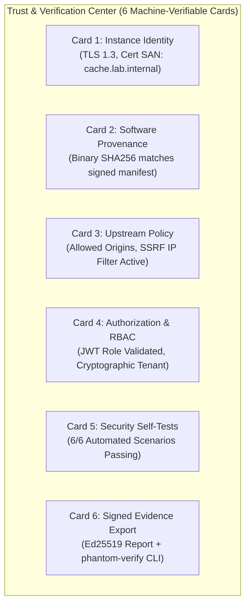

# PhantomCache — Authenticity & Cryptographic Verification Design

## 1. Investigation of Core Security Questions (A through I)

### Question A — Proxy Authenticity: Preventing Rogue Intermediaries
* **The Question:** How can an application client verify that it connected to the intended PhantomCache instance rather than an unauthorized rogue proxy on the LAN?
* **Investigation & Architectural Solution:**
  1. In a LAN environment, attackers can use ARP spoofing, DHCP poisoning, or rogue mDNS to intercept traffic directed at PhantomCache.
  2. If PhantomCache operates over plaintext HTTP, the client has **zero cryptographic proof** of endpoint identity.
  3. **Solution:** Ingress TLS 1.3 termination using X.509 server certificates. The client connects to `https://cache.lab.internal:8443`. The client validates the server certificate against an explicit trust anchor (the offline `Demo CA Root` or an enterprise PKI root).
  4. Any rogue proxy presenting an untrusted, self-signed, or mismatched certificate triggers an immediate TLS handshake failure (`CERT_UNTRUSTED` / `HOSTNAME_MISMATCH`). The client drops the connection before sending application request bytes.

---

### Question B — TLS Semantics: HTTPS Inspection vs. Forward Tunneling
* **The Question:** Can PhantomCache inspect HTTPS today? If not, what architecture would be needed, and what trust assumptions would that introduce?
* **Investigation & RFC Standards Analysis:**
  1. **Current Code Reality:** PhantomCache does not support TLS at all ([src/api/server.rs#L87](file:///d:/Personal/phantom-cache/src/api/server.rs#L87), [L704](file:///d:/Personal/phantom-cache/src/api/server.rs#L704)). It cannot inspect HTTPS traffic.
  2. **The Forward Proxy Dilemma (RFC 9110 §9.3.6):** Under a standard forward proxy model, an HTTPS client issues `CONNECT origin.com:443 HTTP/1.1`. The proxy establishes an opaque TCP tunnel. Because the payload is encrypted end-to-end between the client and origin, **a forward proxy cannot decrypt, inspect, coalesce, or cache HTTP responses without Man-in-the-Middle (MITM) certificate forging**.
  3. **The MITM Liability:** To inspect HTTPS forward traffic, PhantomCache would need to dynamically forge certificates for external domains and force clients to install a private CA root into their OS trust stores. This breaks Web PKI guarantees, triggers security warnings on modern operating systems, and fails with Certificate Transparency and HPKP/pinning.
  4. **Architectural Decision (Strict Rule):** **We explicitly reject MITM forward proxying.** Never propose or implement disabling certificate verification.
  5. **Recommended Architecture:** **Mode B (Reverse Proxy / Application Gateway, RFC 9110 §7.2).** The application domain (e.g., `api.example.com` or `cache.lab.internal`) points directly to PhantomCache. PhantomCache terminates TLS legitimately using authentic certificates issued for that domain, inspects the request, serves cache hits, and creates independent, authenticated upstream TLS connections to the origin.

---

### Question C — Origin Authentication, SSRF & Network Restrictions
* **The Question:** Does PhantomCache validate the origin's TLS certificate and restrict permitted upstream destinations?
* **Investigation & Current Gaps:**
  1. In [src/api/server.rs#L703-L720](file:///d:/Personal/phantom-cache/src/api/server.rs#L703-L720), `fetch_origin_raw` strips `https://` and opens plaintext TCP. Zero origin certificates are validated.
  2. Destination is read directly from `ORIGIN_URL`. If this variable is misconfigured or attacker-controlled, PhantomCache can be coerced into making arbitrary internal network connections (SSRF).
* **Defensive Architecture:**
  1. **Strict Upstream TLS:** PhantomCache must use a modern TLS client (Tokio-Rustls) when `origin_url` specifies `https://`. Origin server certificates must validate against a configurable CA trust store with strict SNI verification.
  2. **Destination Allowlist:** Configuration must enforce:
     ```toml
     [upstream]
     allowed_origins = ["https://origin.lab.internal:9000"]
     enforce_tls = true
     allow_redirects = false
     ```
  3. **SSRF IP Range Blacklist (OWASP A10:2021):** Outbound connections are blocked to:
     - Loopback: `127.0.0.0/8`, `::1`
     - Link-Local: `169.254.0.0/16`, `fe80::/10`
     - Cloud Metadata Services: `169.254.169.254` (AWS/GCP/Azure IMDS)
     - Private RFC 1918 CIDRs (in production public proxy mode; allowlisted explicitly in isolated lab environments).
  4. **DNS Rebinding Defense:** The TCP socket connects directly to the exact IP address validated by the filter, preventing TOCTOU DNS rebinding.

---

### Question D — Client Authentication and Authorization
* **The Question:** Can unauthorized clients use the cache or invoke control endpoints? Is client identity separate from tenant identification?
* **Investigation & Current Gaps:**
  1. `/api/control` is unauthenticated ([src/api/server.rs#L163](file:///d:/Personal/phantom-cache/src/api/server.rs#L163)). Anyone can mutate cluster state.
  2. Tenant identification currently relies on untrusted client header `x-tenant-id` ([src/api/server.rs#L224](file:///d:/Personal/phantom-cache/src/api/server.rs#L224)).
* **Defensive Architecture:**
  1. **Separation of Client Identity from Tenant Identity:**
     - **Client Identity:** "Who is connecting?" Authenticated via mTLS client certificate SAN or signed Bearer JWT `sub` claim.
     - **Tenant Identity:** "Which data partition does this operation belong to?" Extracted from the validated client credential's `tenant_id` claim. Untrusted ingress headers (`x-tenant-id`) are stripped or overwritten.
  2. **Role-Based Access Control (RBAC):**
     - `role: requester`: Read/write access to `/api/v1/cache/*`.
     - `role: observer`: Read-only access to `/api/events` and `/api/v1/diagnostics/*`.
     - `role: operator` / `admin`: Authorized to invoke `/api/control`.

---

### Question E — Cache Isolation & RFC 9111 Compliance
* **The Question:** Can a cache hit bypass application authorization? Can responses leak across tenants or users? Are `Authorization`, `Cookie`, `Set-Cookie`, `Vary`, and cache-control semantics handled correctly?
* **Investigation & RFC 9111 Analysis:**
  1. **Cross-Tenant Isolation:** [src/core/cache.rs](file:///d:/Personal/phantom-cache/src/core/cache.rs#L50-L55) keys entries as `{tenant_id}:{path}:?{query}`. Verified safe in `tests/integration/m1_http_tests.rs::test_m1_t18_cross_tenant_isolation`, provided tenant identity is authenticated (Question D).
  2. **`Authorization` Header Bypass (RFC 9111 §3.5 Violation):** Currently, incoming requests with an `Authorization` header are cached if the origin returns 200 OK without `private` or `no-store`. An unauthenticated client requesting the same URL receives a cache hit!
     *Remediation:* Under RFC 9111 §3.5, responses to requests with an `Authorization` header must **never be stored** in a shared cache unless the response explicitly contains `Cache-Control: public`, `must-revalidate`, or `s-maxage`.
  3. **`Set-Cookie` Handling:** Verified safe. [src/api/server.rs#L381](file:///d:/Personal/phantom-cache/src/api/server.rs#L381) detects `Set-Cookie` and marks the response `FinalizeOutcome::Uncacheable`.
  4. **`Vary` Header Support (RFC 9111 §4.1):** Currently ignored. If an origin specifies `Vary: Accept-Encoding`, PhantomCache must incorporate the client's `Accept-Encoding` header into the secondary cache key.

---

### Question F — Distributed Identity: Authenticating Peer Nodes
* **The Question:** Can one PhantomCache node authenticate another? How are node membership, routing, and failure recovery trusted?
* **Investigation & Current Gaps:**
  1. `src/dist/node.rs` and `src/dist/router.rs` implement raw TCP line-based socket communication without authentication.
  2. A rogue node on the LAN could connect to a peer port and inject bogus responses.
* **Defensive Architecture:**
  1. **Cluster Mutual TLS (mTLS):** All inter-node TCP sockets must establish TLS 1.3 using certificates issued by a private `Phantom Cluster CA`.
  2. **Node SAN Verification:** Connecting peers must present an X.509 certificate with Subject Alternative Name: `DNS:node-{id}.cluster.phantom.internal`.
  3. **Deterministic Rendezvous Hashing:** Node membership is configured statically or via signed cluster membership manifests, preventing unauthorized nodes from participating in key routing.

---

### Question G — Software Provenance & Supply Chain Verification
* **The Question:** Can an independent party verify the release version, binary/image digest, and release signature?
* **Architecture:**
  1. **Signed Release Manifest (`release-manifest.json`):**
     Contains binary SHA256 digest, Git commit SHA, compiler version, build timestamp, and SLSA Level 2/3 provenance metadata.
  2. **Ed25519 Detached Signature:** Manifest is signed by the release authority key.
  3. **Offline CLI Verifier (`phantom-verify`):** Reviewers verify the binary without network access:
     ```bash
     phantom-verify --binary target/release/phantom-cache --manifest release-manifest.json --pubkey release.pub
     ```

---

### Question H — Audit Integrity & Tamper-Evident Reporting
* **The Question:** Can an observer detect altered or missing evidence? What guarantees do event IDs, bounded buffers, reconnects, and signed reports actually provide?
* **Architecture:**
  1. **Monotonic Sequence Identifiers:** Every diagnostic event receives a strictly increasing 64-bit integer (`seq_id: 1, 2, 3...`).
  2. **SHA256 Hash Chaining:** Each event incorporates the hash of the preceding event:
     $$\text{Hash}_N = \text{SHA256}(\text{Hash}_{N-1} \parallel \text{EventPayload}_N)$$
  3. **Explicit Gap Markers:** If high throughput causes ring buffer eviction before an observer reads it, PhantomCache emits an explicit `{ "type": "EVENT_GAP", "from_seq": X, "to_seq": Y }` marker. Gaps are displayed in the UI, never hidden.
  4. **Signed Demonstration Evidence:** At the end of a test run, the daemon generates an `evidence-report.json` containing summary metrics, Merkle root of all event hashes, and an Ed25519 signature. Altering a single byte invalidates the signature.

---

### Question I — Deployment Assurance: Cryptographic Limits
* **The Question:** What can be proven by ordinary TLS and signed artifacts, and what would require hardware-backed remote attestation?
* **Clear Conceptual Boundaries:**

| Claim | Proven by Ordinary TLS & Signatures | Requires Hardware Attestation (TPM / Confidential VM) |
| :--- | :---: | :---: |
| **Endpoint Authenticity** | **Yes** (Valid TLS cert matching private key) | No |
| **Data In-Transit Integrity** | **Yes** (TLS AEAD cipher suite) | No |
| **Software Provenance** | **Yes** (Binary matches signed release manifest) | No |
| **Demonstration Non-Repudiation** | **Yes** (Signed evidence report) | No |
| **Runtime Memory Protection** | **No** (Host OS root can read process RAM) | **Yes** (AMD SEV-SNP / Intel SGX/TDX) |
| **Zero Host-Level Tampering** | **No** (Kernel-level rootkit could patch RAM) | **Yes** (Measured boot / TPM quote) |

* **Audit Conclusion:** Ordinary TLS and signed manifests prove identity in transit and build provenance. They **do not prove runtime memory integrity** against a compromised host OS. We document this limitation honestly rather than claiming "total end-to-end security."

---

## 2. Minimal Design for Proposed Trust & Verification Feature

The Demo Control Center dashboard will integrate a **Trust & Verification Center** replacing the generic "Healthy" badge with six evidence-backed security cards:



### Distinction of Claims
1. **Key Possession != Identity:** Possessing a private key only proves ownership of the key; identity requires a certificate linking the key to a domain validated by a trusted CA.
2. **Identity != Authorization:** Presenting a valid certificate proves identity; authorization requires checking the identity's role against access control policies.
3. **Software Provenance != Runtime Integrity:** Provenance proves the binary came from approved source code; runtime integrity (unattested without TPM) acknowledges that host memory could theoretically be inspected by root.
4. **Behavioral Correctness:** Proved through reproducible, automated security self-tests (Scenarios 1–8).

