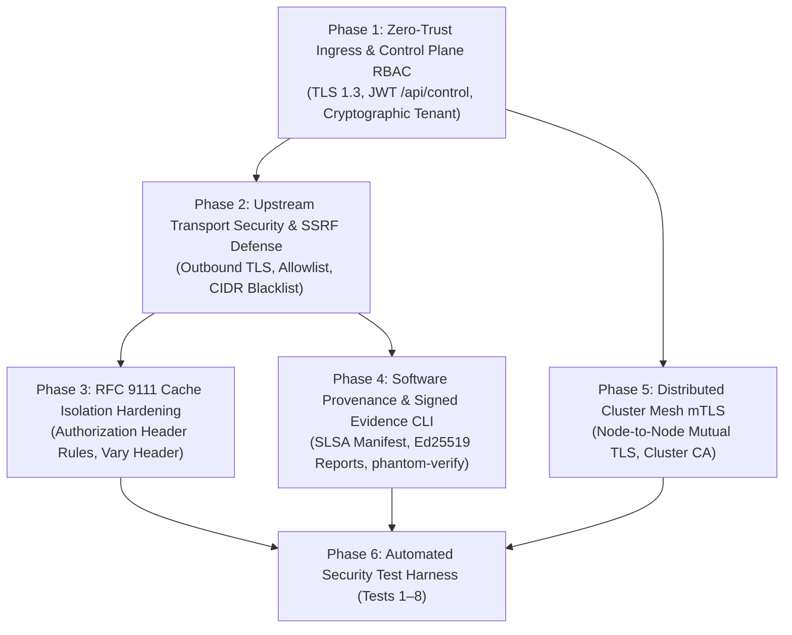

# PhantomCache — Security & Trust Implementation Roadmap

## 1. Phased Security Roadmap Overview

The security hardening, zero-trust cryptographic foundations, and authenticity verification mechanisms are organized into five dependency-ordered phases:



---

## 2. Phase-by-Phase Technical Specifications

### Phase 1 — Zero-Trust Ingress & Control Plane RBAC
* **Objective:** Eliminate plaintext ingress vulnerabilities and restrict administrative control plane.
* **Key Tasks:**
  1. Add Rustls TLS 1.3 ingress termination on configurable port (default 8443) using PEM certificates (`PHANTOM_TLS_CERT`, `PHANTOM_TLS_KEY`).
  2. Implement JWT token validation middleware in Axum using `jsonwebtoken`.
  3. Secure `/api/control`: Require valid Bearer token with `role: operator` or `role: admin`.
  4. Cryptographic Tenant Binding: Extract tenant identifier from verified JWT claim `tenant_id` or mTLS client certificate SAN. Completely strip or override untrusted client-supplied `x-tenant-id` headers.
* **Effort:** 4 Engineer-Days.
* **Acceptance Criteria:**
  - Ingress HTTPS connection verified over TLS 1.3 via cURL with strict certificate validation.
  - Unauthenticated `POST /api/control` returns HTTP 401 Unauthorized.
  - Forged `x-tenant-id` header is ignored; tenant isolation derives strictly from token claims.

---

### Phase 2 — Upstream Transport Security & SSRF Defense
* **Objective:** Remediate `fetch_origin_raw` to support outbound HTTPS and block Server-Side Request Forgery.
* **Key Tasks:**
  1. Integrate Tokio-Rustls client into `fetch_origin_raw`. When `origin_url` specifies `https://`, establish TLS 1.3 with strict SNI matching origin hostname.
  2. Implement configuration allowlist:
     ```toml
     [upstream]
     allowed_origins = ["https://origin.lab.internal:9000"]
     enforce_tls = true
     allow_redirects = false
     ```
  3. Implement pre-connect IP filter blocking loopback (`127.0.0.0/8`), link-local (`169.254.0.0/16`), cloud metadata (`169.254.169.254`), and private RFC 1918 CIDRs (in production public proxy mode).
  4. Pin resolved IP addresses across the handshake to prevent DNS rebinding.
* **Effort:** 3 Engineer-Days.
* **Acceptance Criteria:**
  - Upstream HTTPS connection to mock origin verified with SNI certificate validation.
  - Request to `http://169.254.169.254/latest/meta-data/` rejected with HTTP 403 Forbidden before socket creation.

---

### Phase 3 — RFC 9111 Cache Isolation Hardening
* **Objective:** Align cache keying and storage rules with RFC 9111 shared cache requirements.
* **Key Tasks:**
  1. **Authorization Header Handling (RFC 9111 §3.5):** Requests containing an `Authorization` header must not be stored in shared cache shards unless the origin response explicitly specifies `Cache-Control: public`, `must-revalidate`, or `s-maxage`.
  2. **`Vary` Header Keying (RFC 9111 §4.1):** When an origin response contains `Vary`, record the required request header values in a secondary cache key entry.
  3. **Preserve Set-Cookie Rejection:** Verify that responses with `Set-Cookie` continue to be marked `FinalizeOutcome::Uncacheable`.
* **Effort:** 3 Engineer-Days.
* **Acceptance Criteria:**
  - Response to request with `Authorization: Bearer alice` is never served as a cache hit to an unauthenticated request.
  - Automated tests verify RFC 9111 compliance.

---

### Phase 4 — Software Provenance & Signed Evidence CLI
* **Objective:** Provide independent cryptographic verification of software artifacts and demonstration evidence.
* **Key Tasks:**
  1. Build pipeline generates `release-manifest.json` containing binary SHA256 digest, Git commit SHA, and compiler version, signed with Ed25519.
  2. Implement demonstration evidence export: `POST /api/v1/evidence/export` generating hash-chained event logs signed with the node's key.
  3. Build standalone verification CLI `phantom-verify` (`cargo run --bin phantom-verify`) that validates manifests and report signatures without network dependencies.
* **Effort:** 4 Engineer-Days.
* **Acceptance Criteria:**
  - `phantom-verify` successfully validates official release binaries and evidence reports.
  - Modifying 1 byte in a report JSON triggers immediate signature verification failure.

---

### Phase 5 — Distributed Cluster Mesh mTLS
* **Objective:** Secure node-to-node TCP communication in distributed deployments.
* **Key Tasks:**
  1. Upgrade inter-node TCP sockets in `src/dist/node.rs` and `src/dist/router.rs` to mutual TLS (mTLS) using a shared private `Phantom Cluster CA`.
  2. Verify peer node certificates require SAN: `DNS:node-{id}.cluster.phantom.internal`.
  3. Reject unauthorized nodes during TLS handshake.
* **Effort:** 4 Engineer-Days.
* **Acceptance Criteria:**
  - Node 1 connects to Node 2 over mTLS; rogue node presenting invalid certificate is rejected during handshake.
  - Socket disconnect failover to secondary replica preserves zero client errors.

---

### Phase 6 — Automated Security Test Harness (Tests 1–8)
* **Objective:** Implement automated integration tests for all 8 security demonstration scenarios.
* **Key Tasks:**
  1. Implement automated test harness for Tests 1 through 8 in `tests/security/`.
  2. Integrate with mock origin fixtures (`tests/common/mock_origin.rs`).
* **Effort:** 4 Engineer-Days.
* **Acceptance Criteria:**
  - `cargo test --test security_tests` passes 100% in CI without manual intervention.

---

## 3. Work Breakdown Structure & Resource Summary

| Phase | Description | Engineer-Days | Dependencies | Primary Risk |
| :--- | :--- | :--- | :--- | :--- |
| **Phase 1** | Ingress TLS & RBAC Control | 4 Days | None | Lab certificate setup friction |
| **Phase 2** | Upstream TLS & SSRF Defense | 3 Days | Phase 1 | Upstream mock origin cert validity |
| **Phase 3** | RFC 9111 Cache Isolation | 3 Days | Phase 1 | Unintended cache miss rate increase |
| **Phase 4** | Software Provenance & CLI | 4 Days | None | Signature formatting standards |
| **Phase 5** | Cluster Mesh mTLS | 4 Days | Phase 1 | Handshake latency in test runner |
| **Phase 6** | Automated Security Tests 1–8 | 4 Days | Phases 1–5 | Flaky timing in CI |
| **TOTAL** | **Full Security Package** | **22 Engineer-Days** | | |

---

## 4. Decision Gates Requiring User Approval

Before beginning code implementation, the following architectural decisions require approval:

1. **Operating Mode Approval:** Approve establishing **Mode B (Reverse Proxy / Application Gateway)** as the target architecture, rejecting MITM forward proxying.
2. **Access Control Enforcement:** Approve requiring signed JWT tokens for `/api/control` (blocking unauthenticated access).
3. **Tenant Binding Policy:** Approve deriving tenant identity strictly from authenticated token claims, ignoring untrusted client headers.
4. **RFC 9111 Authorization Policy:** Approve refusing to cache responses to requests containing `Authorization` headers unless explicitly marked `public` by the origin.
5. **Phase 1 Authorization:** Authorize beginning implementation of Phase 1 (Ingress TLS 1.3 and RBAC on `/api/control`).

