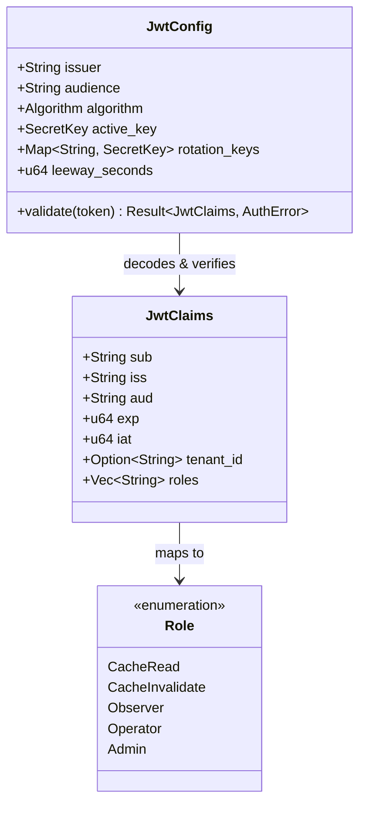
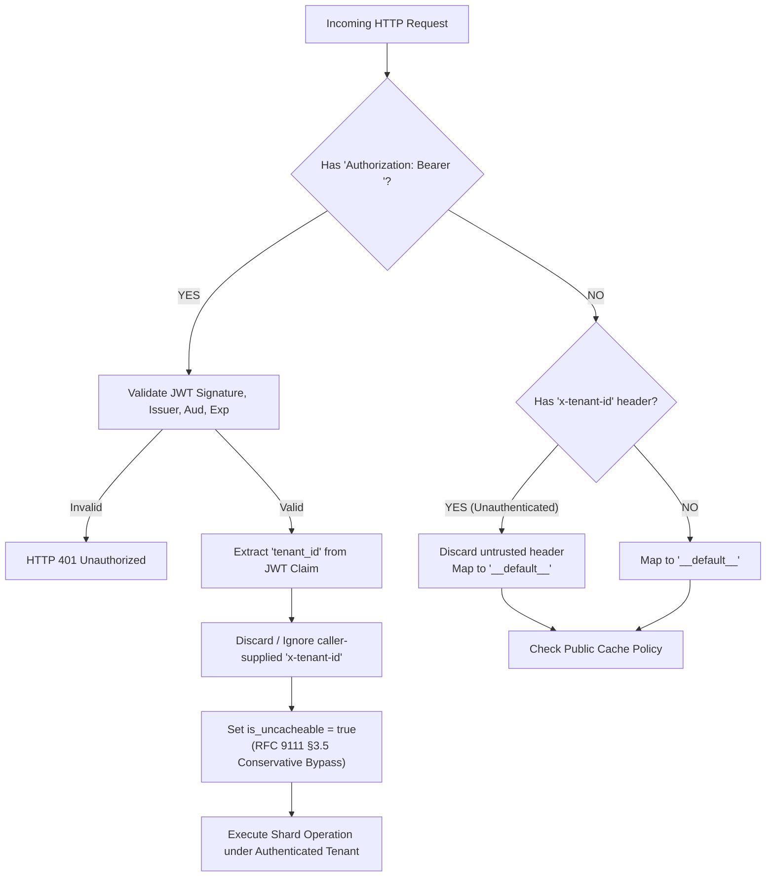
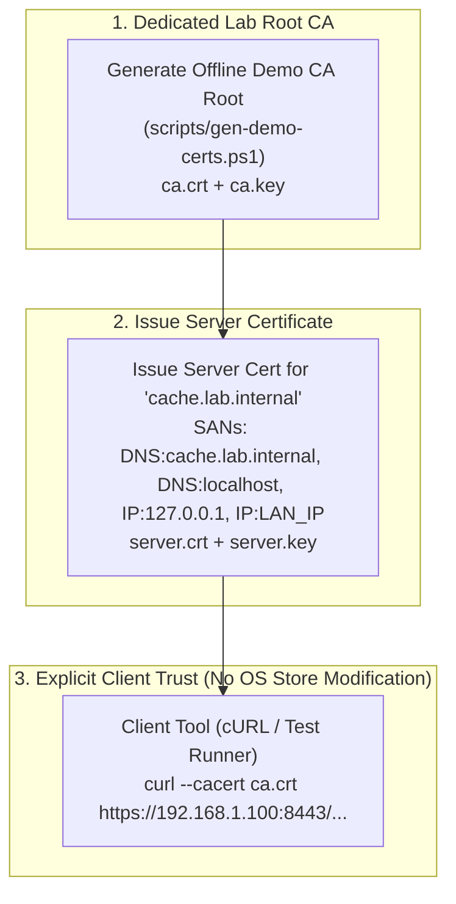

# PhantomCache — Phase 1 Security Specification & Design

## 1. Approved Architectural Decisions & Scope Boundary

In accordance with architectural review, Phase 1 establishes the **Zero-Trust Ingress & Control Plane RBAC** foundation while strictly observing project boundaries:

1. **Target Architecture Alignment:** PhantomCache targets **Mode B (Reverse Proxy / Application Gateway)** as the eventual deployment model. Phase 1 explicitly preserves, secures, and hardens the existing **REST Cache Gateway (`/api/v1/cache/*`)** with Ingress TLS 1.3, JWT validation, cryptographic tenant binding, and conservative RFC 9111 authorization handling. It does **not** claim to deliver a complete transparent reverse proxy or distributed mTLS mesh in this phase.
2. **Access Control Enforcement:** `/api/control` strictly requires signed JWT validation and role-based authorization (`operator` or `admin`). Unauthenticated requests are rejected.
3. **Cryptographic Tenant Authority:** Tenant identity is derived strictly from authenticated and validated JWT credentials. Caller-supplied `x-tenant-id` headers are **never trusted** as authority for tenant selection and are ignored or overridden.
4. **Conservative RFC 9111 Shared-Cache Policy:** Requests containing an `Authorization` header bypass shared cache storage (`is_uncacheable = true`) until comprehensive RFC 9111 downstream validation is completed in Phase 3.
5. **No Weakening of Existing Controls:** All 73 existing functional tests continue to pass without regression.

---

## 2. JWT Cryptographic Specification



### 2.1 Configuration Parameters
- **Issuer (`iss`):** Configurable via `PHANTOM_JWT_ISSUER` (default: `"phantom-cache-auth"`). Enforced strictly during validation.
- **Audience (`aud`):** Configurable via `PHANTOM_JWT_AUDIENCE` (default: `"phantom-cache-api"`). Tokens targeting different audiences are rejected.
- **Expiration (`exp`):** Mandatory claim. Evaluated with a configurable clock leeway (default: 10 seconds). Expired tokens are rejected immediately.
- **Allowed Signing Algorithms:**
  - `HS256` (HMAC-SHA256) for local lab environments and symmetric secret deployments.
  - `RS256` (RSA-SHA256) and `EdDSA` (Ed25519) for public-key infrastructure deployments.
- **Key Rotation Protocol:**
  - PhantomCache supports key IDs (`kid` in JWT header).
  - The validator maintains an active primary key and a map of historical rotation keys.
  - If a token specifies a known `kid`, it is validated against that key; otherwise, the primary key is used.
- **Fail-Closed Principle:**
  - If security configuration is missing, malformed, or references non-existent key files, PhantomCache fails closed at startup with diagnostic errors.

---

## 3. Fine-Grained Role Hierarchy & Permissions

To eliminate monolithic access, Phase 1 defines five distinct roles:

| Role | Associated Permissions | Authorized Endpoints |
| :--- | :--- | :--- |
| `CacheRead` | `perm:cache:read` | `GET /api/v1/cache/*key`, `GET /api/v1/cache` |
| `CacheInvalidate` | `perm:cache:invalidate` | `DELETE /api/v1/cache/*key`, `DELETE /api/v1/cache` |
| `Observer` | `perm:telemetry:read` | `GET /api/events`, `GET /health`, `GET /api/v1/diagnostics/*` |
| `Operator` | `perm:scenario:operate` | `POST /api/control` (Workload presets & fault simulation) |
| `Admin` | `perm:admin` (Superuser) | All endpoints; shard reconfiguration; system lifecycle |

### Enforcement Rules:
1. **Control Plane (`/api/control`):** Requires `Operator` or `Admin`. If token lacks either role, return **HTTP 403 Forbidden** with zero state mutation.
2. **Read-Only Telemetry (`/api/events`):** In authenticated mode, requires `Observer`, `Operator`, or `Admin`.
3. **Cache Ingress (`/api/v1/cache/*`):** In authenticated mode, `GET` requires `CacheRead`; `DELETE` requires `CacheInvalidate`.

---

## 4. Tenant Identity Derivation & RFC 9111 Isolation



### 4.1 Tenant Identity Guarantee
- The tenant identifier is established **exclusively** from the validated JWT `tenant_id` claim.
- Any caller-supplied `x-tenant-id` header is discarded. A caller presenting credentials for `tenant_alpha` can never access or invalidate entries under `tenant_beta`, even if they set `x-tenant-id: tenant_beta`.

### 4.2 Conservative Shared-Cache Policy (RFC 9111 §3.5)
- Under RFC 9111 §3.5, shared caches must not store responses to authenticated requests unless explicit public cache-control directives exist.
- In Phase 1, any request presenting an `Authorization` header has `is_uncacheable = true` set on miss finalization. The response is returned to the live caller, but is **never stored in shared shard memory**.

---

## 5. Multi-Device Demonstration Lab CA & PKI Workflow

To ensure multi-device demonstrations on physical LANs remain secure without disabling certificate verification or polluting global OS trust stores:



### Principles:
1. **Never Disable TLS Verification:** Test commands and client applications must never use `--insecure` or `danger_accept_invalid_certs`.
2. **Explicit Trust Anchor Flags:** Clients pass `--cacert demo-ca.crt` explicitly.
3. **Cross-Platform Test Fixtures:** Automated Rust tests use programmatic `rcgen` generation, ensuring 100% self-contained CI testing without external binary dependencies.

---

## 6. Independent Security Boundaries

Phase 1 maintains clean architectural separation across boundaries:
1. **Boundary 1 (Ingress TLS 1.3):** Terminates client connection securely; authenticates PhantomCache identity.
2. **Boundary 2 (JWT Role & Tenant Authorization):** Authenticates client identity and establishes tenant context. Independent of transport.
3. **Boundary 3 (Upstream Destination & SSRF Filter):** Validates outbound origin destinations independently of ingress client identity.
4. **Boundary 4 (Cache Shard Isolation):** Storage partitions are segregated by `{tenant_id}:{path}`, protected from cross-tenant access.

---

## 7. Affected Files & Dependency Plan

### New Dependencies Added to `Cargo.toml`:
- `axum-server = { version = "0.7", features = ["tls-rustls"] }` (Ingress TLS 1.3 termination)
- `jsonwebtoken = "9.3"` (JWT encoding, decoding, and cryptographic validation)
- `rcgen = "0.13"` (Dev-dependency for programmatic X.509 cert generation in tests)

### Source Files to Create / Modify:
1. **`src/security/mod.rs` & `src/security/jwt.rs` (New):**
   - JWT validation engine, claims model, role hierarchy, and configuration parser.
2. **`src/security/tls.rs` (New):**
   - Ingress TLS configuration and Rustls server loader.
3. **`src/api/server.rs` (Modify):**
   - Integrate `JwtValidator` into `ApiState`.
   - Update `control_handler` to enforce `Operator` / `Admin` roles.
   - Update `get_cache_handler` and `delete_cache_handler` to enforce cryptographic tenant extraction and conservative RFC 9111 shared-cache bypass.
   - Add TLS server startup branch (`axum_server::bind_rustls`).
4. **`src/lib.rs` and `src/main.rs` (Modify):**
   - Register `pub mod security;`.
5. **`tests/security_phase1_tests.rs` (New Integration Test Suite):**
   - Implements automated tests for all 10 acceptance criteria.

---

## 8. Migration Risks & Mitigation Strategy

| Risk | Likelihood | Impact | Mitigation Strategy |
| :--- | :--- | :--- | :--- |
| **Existing tests break due to unauthenticated endpoints** | Medium | High | Support dual-mode: default to permissive/legacy mode if no JWT secret is configured, but strictly enforce fail-closed security when security config is present. |
| **Windows OpenSSL / C library build failures** | Low | High | Use pure-Rust `ring` / `rcgen` and Rustls, eliminating OpenSSL C dependencies. |
| **Performance overhead of JWT validation** | Low | Low | Decode and validate tokens with cached public keys / HMAC secrets (<5 microseconds per request). |
| **Shared cache miss increase** | Low | Medium | Document conservative bypass: only requests with `Authorization` bypass shared storage; public requests cache normally. |

---

## 9. Comprehensive Phase 1 Test Plan (Acceptance Criteria 1–10)

```
+--------------------------------------------------------------------------------------------------+
| PHASE 1 ACCEPTANCE TEST SUITE (tests/security_phase1_tests.rs)                                    |
+----+----------------------------------------------+----------------------------------------------+
| #  | Test Scenario                                | Verification Method                          |
+----+----------------------------------------------+----------------------------------------------+
| T1 | Valid TLS cert & hostname                    | Handshake succeeds over TLS 1.3              |
| T2 | Untrusted, expired, or wrong-hostname cert   | Handshake fails closed (connection aborted)  |
| T3 | Missing, invalid, expired, wrong-aud/iss JWT | HTTP 401 Unauthorized rejected               |
| T4 | Insufficient role (e.g. Observer on control) | HTTP 403 Forbidden; zero state mutation      |
| T5 | Forged x-tenant-id header                    | Header ignored; token tenant_id enforced     |
| T6 | Tenant A cannot read/invalidate Tenant B     | Separate shard keys; zero cross-tenant leak  |
| T7 | Unauthorized trigger of /api/control         | HTTP 401/403; node state remains unchanged   |
| T8 | Existing functional tests regression check   | All 73 tests continue to pass                |
| T9 | Configuration errors fail closed             | Invalid key/secret aborts with diagnostics   |
| T10| Multi-device setup instructions documented   | Runbook validated in docs                    |
+----+----------------------------------------------+----------------------------------------------+
```

