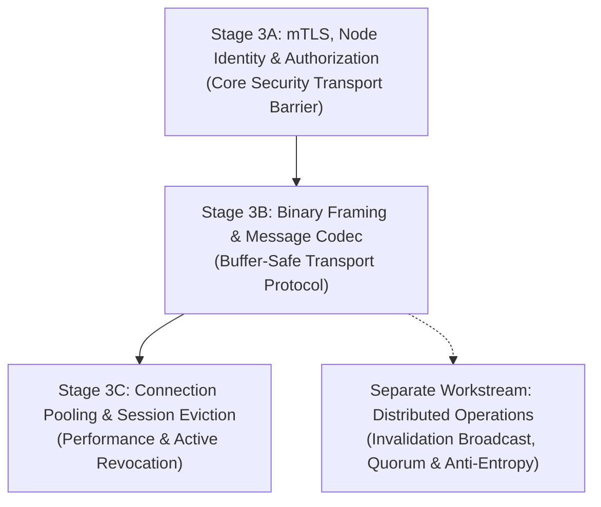

# PhantomCache — Phase 3 Design Specification (Final Revision)
## Distributed Node-to-Node Security, Identity, and Mutual Trust

**Status:** Approved Architectural Specification (Pre-Implementation Baseline)  
**Target Phase:** Phase 3 — Cluster Inter-Node Security  
**Review Type:** Final Security Architecture & Staged Implementation Plan  
**Scope:** Strictly documentation and design specification. Preserves all existing runtime code, dependencies, and test baselines.  

---

## 1. Executive Summary & Problem Statement

Phase 1 established zero-trust ingress and control-plane RBAC (TLS 1.3, JWT validation, cryptographic tenant derivation). Phase 2 secured the upstream transport boundary (outbound TLS with custom CA anchoring, anti-SSRF pre-connect filters, destination allowlisting, and strict HTTP framing).

Phase 3 addresses the internal cluster trust boundary between distributed PhantomCache nodes. The core engineering problem is:

> **How does a PhantomCache node cryptographically establish that another node is an authorized member of the same cluster, and how does it prevent an unauthorized or compromised node from manipulating distributed cache behavior?**

### Core Architecture & Final Clarifications
This specification decouples transport security from distributed cache feature expansion and establishes:
1. **Five-Layer Security Verification:** Separates (1) X.509 certificate chain validation, (2) SAN identity extraction and syntax validation, (3) cluster identity verification, (4) membership admission authorization, and (5) existing-session revocation.
2. **Authenticated Membership & Realistic Partition Model:** Eliminates claims of magic "instantaneous cluster-wide revocation." Formally specifies authenticated control-plane pushes (JWT Operator RBAC), monotonic registry epochs, local active session termination, and explicit documentation of eventual consistency during network partitions.
3. **Explicit Multi-Layer Replay Defense:** Demonstrates why TLS record protection secures active sockets but cannot stop application-level replay across socket reconnects or retries. Specifies per-session sequence numbers, volatile bounded deduplication rings, and persistent restart epochs.
4. **Staged Implementation Plan:** Strictly separates transport security (**Stage 3A: mTLS & Identity**, **Stage 3B: Binary Framing**, **Stage 3C: Connection Pooling**) from complex distributed cache mechanics (**Separate Workstream: Distributed Invalidation & Anti-Entropy**).
5. **Exact Transition Boundaries:** States clearly that Stage 3A establishes the mTLS boundary while retaining the legacy ASCII parser until Stage 3B, mitigating DoS via handshake timeouts and bounded handshake concurrency.
6. **Per-Node CA Rollover & Quarantined Recovery:** Formally specifies per-node rollout and acknowledgement, how unreachable or partitioned nodes are quarantined/isolated, how old sessions are confirmed terminated, and how emergency CA compromise recovery causes a controlled outage until required nodes are migrated or quarantined.

---

## 2. Current Repository Implementation & Trust Boundary Gaps

A thorough code audit of the current distributed networking implementation in `src/dist/` and `src/api/` reveals seven concrete findings:

### 2.1 Trace of Distributed Execution Paths

#### Path 1: Node Startup and Identity Assignment
- **Code Reference:** [`src/dist/node.rs:20-47`](file:///d:/Personal/phantom-cache/src/dist/node.rs#L20-L47), [`src/main.rs:63-95`](file:///d:/Personal/phantom-cache/src/main.rs#L63-L95)
- **Implemented Behavior:** Nodes are instantiated as `VirtualNode::new(node_id: u8)` with an arbitrary 8-bit integer. `start_tcp_service` binds a `tokio::net::TcpListener` to a socket address and sets `self.state = NodeState::Active`.
- **Finding:** No cryptographic identity, no keypair, no certificate, no cluster identifier, and no persistent GUID exists. Any local process can claim any node identity.

#### Path 2: Node-to-Node Connection Establishment
- **Code Reference:** [`src/dist/router.rs:79-117`](file:///d:/Personal/phantom-cache/src/dist/router.rs#L79-L117)
- **Implemented Behavior:** `forward_key_over_tcp` resolves `node.get_addr()` and connects via unencrypted plaintext TCP (`tokio::net::TcpStream::connect(addr)`). Connections are established **per-request** and immediately closed.
- **Finding:** Traffic is transmitted in cleartext on the local network without encryption, peer verification, or transport authentication.

#### Path 3: Node Discovery, Registration, and Removal
- **Code Reference:** [`src/dist/router.rs:13-20`](file:///d:/Personal/phantom-cache/src/dist/router.rs#L13-L20), [`src/api/server.rs:314-317`](file:///d:/Personal/phantom-cache/src/api/server.rs#L314-L317)
- **Implemented Behavior:** `RendezvousRouter` maintains a static, in-memory `Vec<Arc<VirtualNode>>`. Node failure is simulated via in-memory state flags (`primary.set_state(NodeState::Failed)`) or via the `/api/control` endpoint.
- **Finding:** There is no cryptographic membership attestation, no dynamic discovery, and no verifiable admission control.

#### Path 4: Distributed Cache Routing & Forwarding
- **Code Reference:** [`src/dist/router.rs:22-51`](file:///d:/Personal/phantom-cache/src/dist/router.rs#L22-L51), [`src/dist/node.rs:124-171`](file:///d:/Personal/phantom-cache/src/dist/node.rs#L124-L171)
- **Implemented Behavior:** Routing uses Highest Random Weight (Rendezvous) hashing. The receiving node parses a raw ASCII string from a fixed 1024-byte buffer:
  ```rust
  let req_str = String::from_utf8_lossy(&buf[..n]);
  if let Some(key) = req_str.strip_prefix("GET ").and_then(|s| s.lines().next()) { ... }
  ```
- **Finding:** The ASCII line protocol cannot handle binary payloads, is vulnerable to line-injection and buffer truncation, and provides no multiplexing.

#### Path 5: Distributed Cache Invalidation Broadcasts
- **Code Reference:** [`src/api/server.rs:809-815`](file:///d:/Personal/phantom-cache/src/api/server.rs#L809-L815)
- **Implemented Behavior:** `delete_cache_handler` calls `cache.delete(&cache_key)` exclusively on the local gateway's in-memory `PartitionedCache`.
- **Finding:** **Distributed cache invalidation does not exist.** If Node A caches key `K` and Node B receives an invalidation, Node B deletes its local entry while Node A continues serving stale data until TTL expiry.

#### Path 6: Partition Detection, Recovery, and State Reconciliation
- **Code Reference:** [`src/dist/router.rs:107-116`](file:///d:/Personal/phantom-cache/src/dist/router.rs#L107-L116)
- **Implemented Behavior:** Socket connect errors or read timeouts transition the node to `NodeState::Suspect`, and the router fails over to secondary replicas.
- **Finding:** State reconciliation (anti-entropy / read repair) does not exist. Replicas independently fetch from origin on miss. Recovered nodes resume traffic without synchronizing data accumulated on replicas during the outage.

#### Path 7: Connection Loss, Reconnection, and Peer Replacement
- **Implemented Behavior:** Because each request creates an ephemeral socket, connection loss drops the socket. Reconnecting peers undergo zero identity verification.
- **Finding:** Rogue peer replacement is trivial on unsegmented local networks.

---

## 3. Threat Model & Vulnerability Analysis

| Scenario ID | Threat Description | Attack Preconditions | Current System Exposure | Required Phase 3 Protection |
| :---: | :--- | :--- | :--- | :--- |
| **TM-01** | **Rogue Node Injection** | Attacker connects to node TCP port on LAN. | Sockets accept unauthenticated cleartext connections. | Mutual TLS 1.3 with Private Cluster CA verification. |
| **TM-02** | **Identity Spoofing** | Attacker claims `node_id = 1` or sends spoofed traffic. | Node ID is an unverified in-memory integer. | Cryptographic binding between node ID and certificate SAN. |
| **TM-03** | **Untrusted / Public CA Bypass** | Attacker presents a valid WebPKI certificate. | No TLS certificate validation exists. | Custom trust store containing **only** the private Cluster CA. |
| **TM-04** | **Stale / Revoked Node Access** | Node decommissioned, but certificate unexpired. | No revocation or membership check. | Membership registry validation; active session eviction. |
| **TM-05** | **Cross-Cluster Bleed** | Staging node connects to Production cluster node. | No cluster identifier scoping. | Cluster ID embedded in SAN; strict string equality check. |
| **TM-06** | **Credential Reuse After Key Theft**| Compromised private key used after operator rotates cert. | No key tracking or pinning. | Registry pins Certificate DER SHA-256 fingerprint. |
| **TM-07** | **Wire Tampering & Packet Injection**| Attacker on LAN injects malicious TCP bytes. | Plaintext ASCII protocol without checksums. | TLS 1.3 AEAD encryption (`AES-256-GCM` / `CHACHA20-POLY1305`). |
| **TM-08** | **Replay Across Sockets / Mutations** | Attacker replays valid frames across socket reconnects or retries. | TLS record layer only protects within a single session. | Active transport: TLS 1.3 sequence numbers (Stage 3A). Mutations: in-memory ring (Stage 3B/3C); durable cross-restart replay defense deferred to Distributed Operations. |
| **TM-09** | **Mid-Session Identity Mutation**| Peer drops socket and reconnects under different identity. | Fresh socket per query with no session tracking. | Authenticated connection pool bound to verified session state. |
| **TM-10** | **Clock Skew / Expiration Lockout**| Node system clock drifts past certificate expiration. | No certificate expiration handling. | 60-second skew tolerance + automated renewal at 50% lifetime. |
| **TM-11** | **Cluster CA Compromise** | Private key of the Cluster CA is stolen. | Single trust anchor without rotation procedure. | Per-node trust-store rollover and quarantine of un-migrated nodes. |

---

## 4. Trust, Identity, and Revocation Architecture

### 4.1 The Five-Layer Trust Verification Model

To ensure security invariants fail closed, every inbound connection must pass five distinct, sequentially evaluated layers:

```
+---------------------------------------------------------------------------------------------------+
|                                  INBOUND CONNECTION VERIFICATION                                  |
+---------------------------------------------------------------------------------------------------+
                                                  |
  [Layer 1: Certificate-Chain Validation]         v
  - Validate X.509 chain against PHANTOM_CLUSTER_CA.
  - Reject expired certs, untrusted roots, self-signed certs.
                                                  | (Pass)
                                                  v
  [Layer 2: Peer Identity & Syntax Validation]
  - Extract DNS SAN from peer leaf certificate.
  - Enforce RFC 1035/1123 DNS syntax: node-{node_id}.{cluster_id}.phantom.internal
  - Assert node_id in 1..=255; cluster_id in ^[a-z0-9]([a-z0-9-]{1,30}[a-z0-9])?$
                                                  | (Pass)
                                                  v
  [Layer 3: Cluster Identity Verification]
  - Compare extracted cluster_id with local PHANTOM_CLUSTER_ID.
  - Reject cross-cluster or multi-tenant bleed immediately.
                                                  | (Pass)
                                                  v
  [Layer 4: Membership Authorization (Admission Control)]
  - Lookup node_id in local ClusterMembershipRegistry.
  - Assert node_id exists and active == true.
  - Assert peer Certificate DER SHA-256 matches pinned registry fingerprint.
                                                  | (Pass)
                                                  v
  [Layer 5: Existing-Session Revocation]
  - Register active session in local SessionTracker.
  - Event loop tears down open sockets immediately if registry marks node inactive.
```

### 4.2 Membership Registry Authenticity, Freshness, and Partition Behavior

A central vulnerability in distributed registries is confusing **sequence order** with **authenticity**:
- **Why a Monotonic Version Alone Is Insufficient:**
  An unauthenticated version counter (`version: u64`) provides zero authenticity or freshness guarantees. A malicious or rogue peer could forge a frame claiming `version = u64::MAX`. Versioning only establishes relative ordering **after** the update payload has been cryptographically authenticated as originating from an authorized operator. Furthermore, versioning cannot prove wall-clock freshness; an isolated node with version 5 cannot determine whether version 5 was published 5 minutes ago or if version 6 was published elsewhere while it was partitioned.
- **Authenticity & Authorization of Registry Updates:**
  1. **Control-Plane REST API (`POST /api/v1/cluster/members`):** Must be authenticated using a Phase 1 Bearer JWT token signed with `PHANTOM_JWT_SECRET` carrying `role: operator` or `role: admin`. Unauthenticated or unauthorized update requests return HTTP 401/403.
  2. **Static Configuration File (`cluster-members.json`):** Must be protected by host OS filesystem access controls (read/write restricted strictly to the PhantomCache service account or root).
- **Behavior When Current Membership State Cannot Be Confirmed:**
  - If the registry file is corrupt, unreadable, or missing required fields at startup, the node **fails closed** with `StartupSecurityError::CorruptClusterRegistry` and aborts initialization.
  - If a registry update received at runtime fails schema validation or signature checks, it is discarded, a high-severity diagnostic alert is logged, and the node **continues running with its last authenticated registry version**.
- **Preserved Network Partition Limitation (No "Instantaneous" Revocation):**
  - If a network partition isolates Node 3 from the operator control plane, an eviction of Node 3 performed in Partition A **cannot reach Partition B**.
  - Nodes in Partition B will continue to accept Node 3 until connectivity is restored and the authenticated registry update propagates.
  - This is an explicit, documented system property: **Membership revocation is eventually consistent across partitions.**

### 4.3 Revocation of Already-Established Sessions

Validating credentials only at handshake time leaves open connections vulnerable if a node is revoked mid-session.
- **Implementation:** Nodes maintain a `SessionTracker` mapping active socket handles/tasks to their authenticated `node_id`.
- **Active Eviction:** When an authenticated registry update arrives:
  1. The node commits the new registry version.
  2. The node scans `SessionTracker`.
  3. If an open session belongs to a node marked `active = false` or removed from the registry, the socket is immediately closed (`shutdown(Both)`), in-flight futures are cancelled, and pending operations return `DistError::PeerRevoked`.

---

## 5. Precise Replay Protection & Framing Specification

### 5.1 Transport Integrity vs. Application-Level Replay

- **Current Transport Scope in Stage 3A (TLS 1.3):** TLS record sequence numbers prevent frame replay, insertion, or reordering **strictly within an active TLS connection**. This guarantees that an eavesdropper on the wire cannot capture and re-inject packets on that established stream.
- **Application Scope Limitations:** Transport-level TLS 1.3 record protection does not, by itself, solve application-level replay across connection boundaries. Specifically, it cannot prevent:
  - A peer or adversary with valid TLS credentials disconnecting and replaying an identical mutation frame over a new TLS connection.
  - Duplicate mutations caused by network retries or connection failovers.
  - Replay of old mutations after a node restart where volatile state has been cleared.
- **Explicit Implementation Boundary:** Durable originator-epoch tracking, persistent mutation journals, and cross-reconnect/cross-restart replay guarantees are proposed for the **deferred Distributed Operations workstream** and are **not provided by Stage 3A**. Stage 3A provides transport-layer stream integrity only.

### 5.2 Application-Level Invalidation Deduplication & Monotonic Epochs

```rust
#[derive(Debug, Serialize, Deserialize)]
pub struct InvalidatePayload {
    pub invalidation_id: [u8; 16], // Unique UUIDv4
    pub tenant_id: Option<String>,
    pub key_path: String,
    pub generation: u64,
    pub node_epoch: u64,           // Monotonic restart counter of originator
    pub origin_timestamp_ms: u64,
    pub originator_node_id: u8,
}
```

#### Monotonic Generation Rules across Edge Cases
1. **Key is Absent:** If a node receives an invalidation for a key not in cache, it creates a tombstone entry in `PartitionedCache` recording `(node_epoch, generation)`. Subsequent fetches for that generation are treated as cold misses.
2. **Duplicate Invalidation:** Nodes maintain an in-memory bounded LRU ring buffer of the last 10,000 processed `invalidation_id` values. If an ID matches, the frame is acknowledged as a no-op without mutating cache state.
3. **Volatile vs. Persistent State & Restart Epoch Limitation:**
   - The 10,000-entry `invalidation_id` deduplication ring is **strictly volatile and bounded in RAM**. It is cleared if the node process restarts.
   - **Originator Freshness vs. Receiver Persistence:** Receiver-side persistence of a local `node_epoch: u64` alone **cannot establish the freshness of a remote originator's messages**. If Node A restarts and resets its generation, Node B persisting its own restart count cannot detect Node A's reset. Conversely, if Node B restarts and its volatile deduplication ring is empty, Node B cannot detect replayed invalidations sent by Node A unless Node B durably tracks Node A's originator epoch: `(originator_node_id, originator_epoch, max_observed_generation)`.
   - **Prerequisite for Distributed Operations:** Durable originator-epoch tracking and persistent mutation journals are an explicit prerequisite for the **deferred Distributed Operations workstream**. Stage 3A does **not** implement durable invalidation deduplication.
4. **Replicas Observe Different Generations:** Replicas resolve conflicts via Last-Write-Wins (LWW) ordered by `(node_epoch, generation, origin_timestamp_ms)`.

#### Reconciled Freshness Window
- The freshness check is formulated as:
  $$\text{skew} = |\text{now\_ms} - \text{origin\_timestamp\_ms}|$$
  $$\text{Assert: } \text{skew} \le (\text{FRESHNESS\_WINDOW\_MS} + \text{CLOCK\_SKEW\_TOLERANCE\_MS}) = 30\text{s} + 60\text{s} = 90\text{s}$$
- Timestamps serve as an expiration boundary for the deduplication ring; primary idempotency is enforced by `invalidation_id` and monotonic epochs.

### 5.3 `PhantomMeshFrame` Binary Protocol Specification

To replace the fragile 1024-byte ASCII line parser, inter-node traffic uses length-prefixed binary framing:

```text
 0                   1                   2                   3
 0 1 2 3 4 5 6 7 8 9 0 1 2 3 4 5 6 7 8 9 0 1 2 3 4 5 6 7 8 9 0 1
+-+-+-+-+-+-+-+-+-+-+-+-+-+-+-+-+-+-+-+-+-+-+-+-+-+-+-+-+-+-+-+-+
|       Magic: 'P' 'H' 'A' 'N' (0x50 0x48 0x41 0x4E)            |
+-+-+-+-+-+-+-+-+-+-+-+-+-+-+-+-+-+-+-+-+-+-+-+-+-+-+-+-+-+-+-+-+
|  Version (1)  | Msg Type (u8) |        Flags (u16 BE)         |
+-+-+-+-+-+-+-+-+-+-+-+-+-+-+-+-+-+-+-+-+-+-+-+-+-+-+-+-+-+-+-+-+
|                        Request ID (u64 BE)                    |
|                                                               |
+-+-+-+-+-+-+-+-+-+-+-+-+-+-+-+-+-+-+-+-+-+-+-+-+-+-+-+-+-+-+-+-+
|                     Sequence Number (u64 BE)                  |
|                                                               |
+-+-+-+-+-+-+-+-+-+-+-+-+-+-+-+-+-+-+-+-+-+-+-+-+-+-+-+-+-+-+-+-+
|                      Payload Length (u32 BE)                  |
+-+-+-+-+-+-+-+-+-+-+-+-+-+-+-+-+-+-+-+-+-+-+-+-+-+-+-+-+-+-+-+-+
|                         Payload Bytes                         |
|                              ...                              |
+-+-+-+-+-+-+-+-+-+-+-+-+-+-+-+-+-+-+-+-+-+-+-+-+-+-+-+-+-+-+-+-+
```

#### Field Specifications
- **Header Length:** Exactly 28 bytes.
- **Byte Order:** Network byte order (Big-Endian).
- **Magic:** Exactly `0x50 0x48 0x41 0x4E`. Non-matching magic aborts connection (`FrameError::BadMagic`).
- **Version:** `0x01`. Versions $\ne 1$ abort connection (`FrameError::UnsupportedVersion`).
- **Message Types:**
  - `0x01` — `GetRequest`
  - `0x02` — `GetResponse`
  - `0x03` — `InvalidateRequest`
  - `0x04` — `InvalidateAck`
  - `0x05` — `HeartbeatRequest`
  - `0x06` — `HeartbeatResponse`
  - Unknown types abort connection (`FrameError::UnknownMessageType`).
- **Payload Length:** Unsigned 32-bit integer. Hard ceiling: `MAX_FRAME_PAYLOAD_BYTES = 1,048,576` (1 MB). Lengths exceeding this limit abort connection (`FrameError::PayloadTooLarge`).

---

## 6. Staged Implementation Plan & Security Boundaries

To prevent scope creep and eliminate the risk of destabilizing the working system, Phase 3 is divided into three incremental security stages, with complex distributed features deferred to a separate workstream:



### Stage 3A: mTLS & Cryptographic Node Identity (Core Security Barrier)
- **Objective:** Secure the raw TCP socket boundary. Ensure no unauthenticated process can communicate with cluster nodes.
- **Explicit Transition Boundary & Remaining Limitations:**
  - Stage 3A **retains the legacy ASCII message parser** (`GET <key>\r\n`) within the encrypted TLS stream. Binary framing is introduced in Stage 3B.
  - **Remaining Stage 3A Limitations:**
    - 1024-byte fixed buffer size (`buf = [0u8; 1024]`).
    - Inability to handle binary cache values or keys containing newline characters (`\r\n`).
    - Ephemeral connection per request (connection pooling deferred to Stage 3C).
  - **Stage 3A Mitigations:**
    - Mandatory handshake timeouts (1000ms).
    - Bounded concurrent unauthenticated handshakes (semaphore permit limits) to prevent resource exhaustion against the mTLS listener.
    - Immediate safe socket closure upon TLS alert or registry admission failure.
- **Scope:**
  - `src/security/cluster.rs`: Implement `ClusterTlsConfig`, `ClusterMembershipRegistry`, and startup validation.
  - Upgrade `VirtualNode::start_tcp_service` to accept connections via `tokio_rustls::TlsAcceptor`.
  - Upgrade `RendezvousRouter::forward_key_over_tcp` to connect via `tokio_rustls::TlsConnector`.
  - Enforce Layers 1–4 of the trust model (chain, SAN, cluster ID, registry).
  - Enforce fail-closed startup: `PHANTOM_CLUSTER_CA` mandatory on non-loopback binds.
- **Acceptance Criteria:** Tests AT-P3-01 through AT-P3-10, AT-P3-16, AT-P3-21, AT-P3-22, AT-P3-23 pass. Existing 111 tests preserved.

### Stage 3B: Binary Framing & Message Codec (Robust Transport)
- **Objective:** Eliminate the vulnerable 1024-byte ASCII parser.
- **Scope:**
  - Implement `PhantomMeshFrame` encoder and decoder over `TlsStream`.
  - Integrate request ID correlation and per-session sequence numbers.
  - Enforce payload size limits (1 MB) and frame validation.
- **Acceptance Criteria:** Test AT-P3-11 passes. Full regression test suite passes.

### Stage 3C: Connection Pooling & Active Session Eviction (Performance & Hardening)
- **Objective:** Eliminate per-request TLS handshake overhead and enforce Layer 5 active session revocation.
- **Scope:**
  - Implement `TlsConnectionPool` in `RendezvousRouter`.
  - Implement 5-second keepalive heartbeats.
  - Implement `SessionTracker` and socket eviction on registry updates.
- **Acceptance Criteria:** Tests AT-P3-15, AT-P3-17, AT-P3-20 pass.

### Separate Workstream: Distributed Operations (Out of Phase 3 Scope)
- **Deferred Features:**
  - Distributed cache invalidation broadcast and retry queues.
  - Quorum acknowledgements ($W = \lfloor N/2 \rfloor + 1$).
  - Durable cross-restart invalidation persistence.
  - Background anti-entropy hash exchanges.
- **Rationale:** These are distributed systems data-consistency features, not transport security controls. They will build on top of Stage 3B's secure frame transport in a subsequent milestone.

---

## 7. Certificate & CA Lifecycle Procedures

### 7.1 SAN Naming & Certificate Fingerprint Standards

- **SAN Format:** Strictly conforms to RFC 1035 / RFC 5280 DNS syntax:
  ```text
  DNS:node-{node_id}.{cluster_id}.phantom.internal
  ```
  - `node_id`: Decimal integer `1..=255`.
  - `cluster_id`: Alphanumeric lowercase string matching `^[a-z0-9]([a-z0-9-]{1,30}[a-z0-9])?$`. Hyphens allowed; underscores **strictly prohibited** by DNS standards.
- **Fingerprint Format:** Lowercase hex-encoded SHA-256 digest of the raw Certificate DER bytes (`sha256(cert_der)`). Pins the specific certificate issued by the CA.

### 7.2 Routine Certificate Rotation (Dual-Fingerprint Window)

Zero-downtime rotation cannot be assumed without explicit trust-overlap handling:
1. Operator issues new certificate `node-1-v2.crt` for Node 1.
2. Operator updates cluster membership registry to allow both fingerprints during transition:
   ```json
   "node_1": { "fingerprints": ["<hash_v1>", "<hash_v2>"], "active": true }
   ```
3. Node 1 reloads certificate and key via in-memory atomic swap (`ArcSwap<ServerConfig>`).
4. Existing open connections continue on v1; new connections establish on v2.
5. Once all connections transition, operator removes `<hash_v1>` from registry.

### 7.3 Realistic Per-Node CA Rollover & Quarantined Emergency Recovery

Updating a CA configuration does **not instantaneously propagate** across all cluster nodes. The lifecycle explicitly defines rollout, confirmation, and quarantine:

#### Staged Routine CA Rollover Sequence
1. **Per-Node Trust Store Expansion:** Operator distributes a dual-CA trust store containing both `[ca-v1.crt, ca-v2.crt]` node-by-node. Each node reloads its trust store and reports acknowledgment via its authenticated control plane.
2. **Per-Node Certificate Re-issuance:** New node certificates signed by `ca-v2.crt` are deployed node-by-node. Nodes reload certificates gracefully.
3. **Session Retirement & Confirmation:** When a node reloads its certificate, existing mTLS sessions anchored to `ca-v1` are closed upon idle timeout or drained. Nodes confirm 0 remaining `ca-v1` sessions via `/api/v1/diagnostics/cluster/ca-status`.
4. **Old CA Removal:** Once all nodes acknowledge migration to `ca-v2`, the operator removes `ca-v1.crt` from `PHANTOM_CLUSTER_CA` across all nodes.
5. **Rollback Recovery:** If certificate issuance or handshake failures occur during rollout, the operator rolls back by retaining the dual-CA bundle in `PHANTOM_CLUSTER_CA`.

#### Emergency CA Compromise Rollover Procedure
If the Cluster CA private key is suspected compromised, zero downtime **cannot be guaranteed** because the old trust anchor must be invalidated immediately:
1. **Per-Node Emergency Rollout & Quarantine:**
   - Operator pushes `PHANTOM_CLUSTER_CA = ca-v2.crt` to reachable nodes.
   - Any node that is unreachable or partitioned **is quarantined**: the operator updates `ClusterMembershipRegistry` on all reachable nodes, setting `active = false` for the un-migrated nodes.
   - Consequently, migrated nodes immediately reject any handshakes from nodes presenting certificates signed by the compromised `ca-v1`.
2. **Session Termination Confirmation:** Nodes reload the single-CA trust store, immediately terminate all active mTLS connections anchored to `ca-v1`, and confirm zero active `ca-v1` sessions.
3. **Re-Enrollment & Dual-Condition Recovery Gate:** New node certificates signed by `ca-v2` are deployed. Cluster recovery is declared complete if and only if two independent conditions are satisfied: (a) the intended service quorum is healthy and communicating on the new trust configuration (`ca-v2`), **AND** (b) every non-migrated, unreachable, or partitioned node is confirmed isolated and actively quarantined in the membership registry of all healthy nodes. Quorum health alone must not imply that an unreachable or potentially compromised node is isolated; isolation must be independently confirmed to prevent split-brain or rogue-peer exploitation.
4. **Documented Reality:** This causes an intentional, controlled cluster outage during re-keying to prevent man-in-the-middle exploitation by the compromised CA key.

---

## 8. Requirements-to-Tests Traceability Matrix

The Phase 3 test suite expands to 23 tests, mapped directly to implementation stages:

| Test ID | Security Requirement | Scope Stage | Expected Verification Result |
| :---: | :--- | :---: | :--- |
| **AT-P3-01** | **Authorized Node mTLS Connection** | Stage 3A | Handshake succeeds; cache request delivered over TLS 1.3. |
| **AT-P3-02** | **Untrusted CA Rejection** | Stage 3A | Handshake fails (`TlsUntrustedRoot`); zero application bytes read. |
| **AT-P3-03** | **Expired Certificate Rejection** | Stage 3A | Handshake fails (`CertificateExpired`). |
| **AT-P3-04** | **SAN Identity Target Mismatch** | Stage 3A | Client connecting to candidate Node 2 rejects server presenting SAN `node-3`. Server extracts client SAN and rejects if not in registry. |
| **AT-P3-05** | **Cross-Cluster Connection Rejection** | Stage 3A | Handshake fails (`ClusterMismatch`) if SAN cluster ID $\ne$ local cluster ID. |
| **AT-P3-06** | **Revoked / Inactive Node Rejection** | Stage 3A | Handshake fails (`RevokedNode`) if SAN node ID marked `active = false` in registry. |
| **AT-P3-07** | **Unknown Node ID Rejection** | Stage 3A | Handshake fails (`UnknownNode`) if SAN node ID not in registry. |
| **AT-P3-08** | **Certificate Fingerprint Mismatch** | Stage 3A | Handshake fails (`FingerprintMismatch`) if cert DER hash $\ne$ pinned hash in registry. |
| **AT-P3-09** | **Plaintext TCP Connect Rejection** | Stage 3A | Raw TCP bytes to mTLS port aborted immediately; no response sent. |
| **AT-P3-10** | **TLS Handshake Timeout** | Stage 3A | Stalled handshake closed after 1000ms; listener unblocked. |
| **AT-P3-11** | **Malformed & Oversized Frames** | Stage 3B | Frames with bad magic or payload > 1 MB terminate socket. |
| **AT-P3-12** | **Distributed Invalidation Broadcast** | Deferred | Invalidation delivered to all active peers and replicas. |
| **AT-P3-13** | **Unauthorized Invalidation Role** | Deferred | Invalidation from `Observer` node rejected with `Forbidden`. |
| **AT-P3-14** | **Volatile Ring Mutation Deduplication**| Deferred | Duplicate invalidation frame rejected via in-memory deduplication ring. |
| **AT-P3-15** | **Connection Pool Keepalive** | Stage 3C | Idle connection preserved via 5-second heartbeat frames. |
| **AT-P3-16** | **Stale / Partitioned Registry Isolation**| Stage 3A | Node with lower registry epoch cannot overwrite newer membership. |
| **AT-P3-17** | **Active Socket Eviction on Revocation** | Stage 3C | Active socket immediately terminated when registry evicts peer. |
| **AT-P3-18** | **Replayed Mutation across Reconnects** | Deferred | Frame replayed on a fresh socket rejected via `invalidation_id`. |
| **AT-P3-19** | **Generation Conflict Idempotency** | Deferred | Invalidation for absent key creates tombstone; duplicates are no-ops. |
| **AT-P3-20** | **Dual-Fingerprint Rotation Window** | Stage 3C | Node accepts connections under both old and new fingerprints. |
| **AT-P3-21** | **CA Rollover Sequence & Quarantine** | Stage 3A | Verifies trust-store update, dual-CA window, quarantine of un-migrated peers, and session drop on CA retirement. |
| **AT-P3-22** | **Malformed Identity & Illegal SAN** | Stage 3A | SANs with underscores or non-RFC 1035 syntax rejected at handshake. |
| **AT-P3-23** | **Baseline Regression Integrity** | Stage 3A | All 111 existing unit and integration tests pass without failure. |

---

## 9. Assumptions and Out-of-Scope Items

### Explicit Assumptions
- Node clocks are synchronized via NTP within $\pm 60$ seconds.
- Node IDs are statically assigned integers in the range `1..=255`.
- Cluster membership updates are operator-authorized events, not autonomous gossip.

### Out-of-Scope for Phase 3
- Dynamic leader election (Raft/Paxos).
- Hardware Security Module (HSM) integration.
- Distributed transaction protocols (Two-Phase Commit).

## Amendment 2026-10-30 07:26 +05:30 - invalidation durability and staleness bound

Historical record: the text above is unchanged. This amendment qualifies the Phase 3 statements about restart and volatile state (including "Durable cross-restart invalidation persistence" being out of scope, which remains true) with the following consequence for DELETE fan-out: persistence of invalidation intent across an issuer restart is not provided, so an accepted DELETE can fail to reach a peer if the issuer dies before delivery.

**Correct qualified guarantee (verified by code reading on this date; not reproduced by a test).**
- `204 No Content` on `DELETE` means: the local cache was purged first (`src/api/server.rs:1952`), and the canonical primary, or the acting primary on failover, acknowledged synchronously within the 150 ms leg (`src/api/server.rs:1957`, `src/dist/router.rs:1781-1789`). All other cluster members are invalidated asynchronously (bounded retry, then re-delivery by the repair worker) and that is guaranteed only while the issuing gateway process stays alive and within the ledger bounds (the source comment at `src/dist/router.rs:1786-1789` states this).
- Invalidations owed to peers that have not yet acknowledged live only in the issuing process's memory (broadcaster channel, per-peer queues, repair ledger, stream sequencers, replay ring). A crash, kill or SIGTERM of the issuer loses them: the shutdown path in `src/main.rs:484-490` drops the server and exits ("cache is in-memory, nothing to flush") and `src/main.rs` contains no call to the router `stop()`/drain functions. A restarted issuer starts with an empty ledger. A peer that had not applied the invalidation then keeps serving the stale entry until it expires, or until a later `DELETE` of the same key reaches it.
- The staleness bound in G3, "Staleness <= TTL_eff <= PHANTOM_MAX_STALE_MS", is **not true as written**. The origin's `s-maxage`, `max-age` or `Expires` sets the freshness lifetime with no gateway ceiling (`src/core/freshness.rs:263-276`), and `PHANTOM_MAX_STALE_MS` caps only the stale-serving window (`src/api/server.rs:1280`, `:1738`, `:1788`), not the freshness lifetime. The 60 s default applies only when the origin gives no freshness information; it is a literal `60_000` at `src/api/server.rs:1367` and `:1650` (`PHANTOM_DEFAULT_TTL_MS` is validated but not wired: `src/config.rs:116-117`).
- No test kills or restarts an issuer with a non-empty ledger. Evidence and remediation options: `docs/research/phantomcache_milestone_accountability_report.md` section 12.
