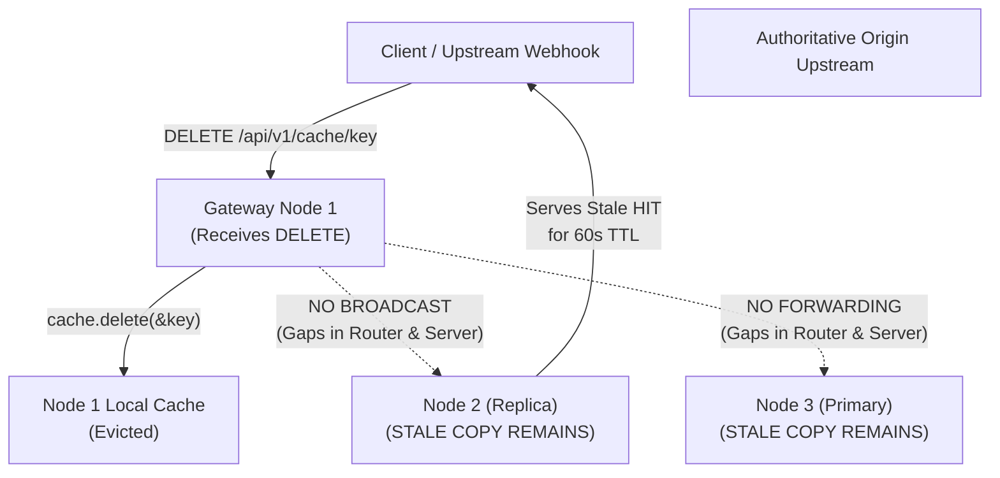
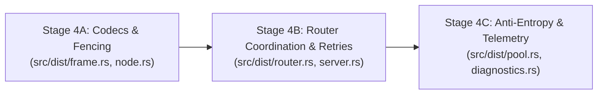

# PhantomCache — Phase 4 Design Specification
## Distributed Invalidation, Monotonic Consistency, and Anti-Entropy Reconciliation (Post-Review Remediation)

**Status:** Implemented, Remediated, and Independently Audited (Stages 4A, 4B, and 4C Complete)  
**Target Phase:** Phase 4 — Distributed Cache Invalidation & Consistency  
**Review Type:** Security, Concurrency, and Distributed Protocol Architecture  
**Scope:** Architecture and design specification only. Preserves all existing runtime code, dependencies, and test baselines.  

---

## 1. Executive Summary & Problem Statement

Phase 1 established zero-trust ingress and JWT role-based access control. Phase 2 secured the upstream egress boundary (custom CA anchoring, anti-SSRF filters, allowlist enforcement, and strict HTTP parsing). Phase 3 secured the inter-node transport boundary across three verified stages:
- **Stage 3A:** Mutual TLS 1.3 with private cluster CA anchoring, RFC 1035 SAN identity validation, and cluster membership admission control.
- **Stage 3B:** Bounded, length-prefixed binary framing ([`PhantomMeshFrame`](file:///d:/Personal/phantom-cache/src/dist/frame.rs#L186-L189)) eliminating buffer overruns and line-injection vulnerabilities.
- **Stage 3C:** Bounded, mutually authenticated connection pooling ([`TlsConnectionPool`](file:///d:/Personal/phantom-cache/src/dist/pool.rs#L103-L113)), keepalive heartbeats, and active session eviction ([`SessionTracker`](file:///d:/Personal/phantom-cache/src/dist/session.rs#L14-L18)).

With transport security, binary framing, and connection pooling verified and accepted, Phase 4 addresses distributed data consistency:

> **How does PhantomCache ensure that when a cached resource is mutated, expired, or purged at one node or origin, stale copies distributed across other cluster nodes are reliably invalidated without sacrificing high-throughput read availability or destabilizing under network partitions?**

### 1.1 Core Engineering Principles of Phase 4
1. **Cache Invalidation is Not Database Replication:**
   PhantomCache is an ephemeral caching tier in front of an authoritative upstream origin, not a primary distributed datastore. The goal of distributed invalidation is to **destroy stale cached data** to force subsequent reads back to the authoritative origin. Multi-round consensus protocols (e.g., Raft, Paxos, or distributed 2PC write locks) introduce unacceptable latency overhead, vulnerability to write-side deadlocks, and severe availability degradation during partitions.
2. **Two-Tier Invalidation Architecture:**
   - **Tier 1 (Synchronous Canonical Invalidation):** The ingress gateway invalidates its local cache and synchronously executes an authenticated invalidation against the Highest Random Weight (Rendezvous) primary owner node. This guarantees that subsequent reads routed through the canonical rendezvous path immediately observe the eviction ($T_{\text{stale}} = 0$).
   - **Tier 2 (Asynchronous Bounded Broadcast & Acknowledged Retries):** The primary owner asynchronously broadcasts invalidations to all other cluster members over pooled mTLS connections with bounded retries and a bounded in-memory ring buffer.
3. **Generational Fencing Against In-Flight Races:**
   Invalidation messages trigger atomic key generation increments in [`PartitionedCache`](file:///d:/Personal/phantom-cache/src/core/cache.rs#L105-L117). Generational fencing ensures that origin fetches initiated *prior* to an invalidation cannot commit stale data *after* the invalidation executes.
4. **Bounded Anti-Entropy Digest Reconciliation:**
   To recover from transient packet loss, exhausted retry queues, or temporary network partitions without persistent WAL overhead, nodes exchange compact invalidation epoch digests during Stage 3C periodic keepalive heartbeats. A 32-byte digest detects divergence, and missing records are replayed from a bounded circular buffer (capped at 4,096 entries, 4.0 MiB payload bytes, and $\le 4.25\text{ MiB}$ resident heap memory). If history has been overwritten, the lagging node performs a safe partition flush.
5. **Fail-Safe Bounded Memory & Backpressure:**
   All buffers, retry rings, and frame allocations have strict dual bounds (entry count and byte ceiling). Invalidation processing cannot cause unbounded heap growth under slow or partitioned peers.

---

## 2. Current Architecture & Stale-Data Vulnerability Audit

A comprehensive code inspection of [`src/core/cache.rs`](file:///d:/Personal/phantom-cache/src/core/cache.rs), [`src/dist/`](file:///d:/Personal/phantom-cache/src/dist/), and [`src/api/server.rs`](file:///d:/Personal/phantom-cache/src/api/server.rs) reveals why stale data currently persists across nodes:



### 2.1 Trace of Distributed Execution Paths

#### Path 1: Client DELETE Invalidation Path
- **Source:** [`src/api/server.rs:770-843`](file:///d:/Personal/phantom-cache/src/api/server.rs#L770-L843)
- **Current Behavior:** `delete_cache_handler` validates RBAC (`Role::CacheInvalidate`), constructs [`CacheKey`](file:///d:/Personal/phantom-cache/src/core/cache.rs#L20-L56), and invokes `cache.delete(&cache_key)`.
- **Finding:** Invalidation occurs exclusively on the local gateway's in-memory [`PartitionedCache`](file:///d:/Personal/phantom-cache/src/core/cache.rs#L105-L117). The handler does not consult [`RendezvousRouter`](file:///d:/Personal/phantom-cache/src/dist/router.rs#L13-L17) and does not transmit any inter-node message.

#### Path 2: Rendezvous Routing and Replica Cache Distribution
- **Source:** [`src/dist/router.rs:58-103`](file:///d:/Personal/phantom-cache/src/dist/router.rs#L58-L103)
- **Current Behavior:** [`route_key`](file:///d:/Personal/phantom-cache/src/dist/router.rs#L58-L79) identifies the primary node using Highest Random Weight hashing. [`get_replicas`](file:///d:/Personal/phantom-cache/src/dist/router.rs#L81-L103) ranks secondary replica nodes.
- **Finding:** If Node 1 experiences latency or temporary failure, [`forward_key_over_tcp`](file:///d:/Personal/phantom-cache/src/dist/router.rs#L107-L297) fails over to secondary Node 2. When Node 2 fetches from the origin, both Node 1 and Node 2 hold cached copies of the same key. A subsequent `DELETE` sent to Node 1 purges Node 1, while Node 2 serves stale cached data indefinitely until its 60-second TTL expires.

#### Path 3: TCP Listener Frame Dispatching
- **Source:** [`src/dist/node.rs:277-405`](file:///d:/Personal/phantom-cache/src/dist/node.rs#L277-L405)
- **Current Behavior:** `process_binary_cache_stream` decodes [`PhantomMeshFrame`](file:///d:/Personal/phantom-cache/src/dist/frame.rs#L186-L189) frames over pooled TLS streams. It matches on `MessageType::GetRequest` and `MessageType::HeartbeatRequest`.
- **Finding:** The dispatch loop routes all other message types to `_ => break;`, immediately severing the connection. While `MessageType::InvalidateRequest (0x03)` and `MessageType::InvalidateAck (0x04)` are defined in [`src/dist/frame.rs:25-26`](file:///d:/Personal/phantom-cache/src/dist/frame.rs#L25-L26), the node listener treats them as fatal unknown frames and drops the socket.

#### Path 4: Generation Accounting and In-Flight Origin Fetches
- **Source:** [`src/core/cache.rs:485-576`](file:///d:/Personal/phantom-cache/src/core/cache.rs#L485-L576), [`src/core/cache.rs:578-606`](file:///d:/Personal/phantom-cache/src/core/cache.rs#L578-L606)
- **Current Behavior:** [`delete`](file:///d:/Personal/phantom-cache/src/core/cache.rs#L578-L606) increments `state.generation` and detaches `shard.in_flight`. When an in-flight fetch completes, [`finalize_fetch`](file:///d:/Personal/phantom-cache/src/core/cache.rs#L485-L576) verifies `state.generation == op_gen`. If unequal, it increments `counters.stale_writes_prevented` and drops the result.
- **Finding:** This generational protection is purely local. If Node 1 receives an invalidation while Node 2 is executing an origin fetch for the same key, Node 2's local generation is unaffected. Node 2 commits the stale response to its cache, reintroducing the stale value to the cluster immediately after Node 1 invalidated it.

#### Path 5: Lack of Invalidation Persistence and Anti-Entropy
- **Source:** [`src/dist/node.rs:88-93`](file:///d:/Personal/phantom-cache/src/dist/node.rs#L88-L93)
- **Current Behavior:** Nodes stop and restart in-memory.
- **Finding:** There is no invalidation history log or anti-entropy sync. If a node is restarted or disconnected during an invalidation storm, it has no mechanism to determine which keys were invalidated while it was offline.

---

## 3. Distributed Consistency Contract & HTTP Response Semantics

### 3.1 Caching Semantics vs Database Replication
PhantomCache is a read-through and cache-aside accelerator. It is not an authoritative store:
1. **Origin Authority:** The upstream origin remains the single source of truth.
2. **Safe Eviction:** Removing an entry from the cache is always safe and cannot corrupt data integrity.
3. **Staleness Elimination:** The primary goal is reducing the window of stale reads ($T_{\text{stale}}$) to zero on canonical routing paths, and bounded by network propagation latency ($\le 20\text{ ms}$) on replica paths.

### 3.2 Precise Semantics of `204 No Content`
The HTTP API response `204 No Content` returned by `DELETE /api/v1/cache/*key` provides a formal consistency contract:

```
                       [ Client DELETE Request ]
                                   |
                                   v
             [ Gateway: Local PartitionedCache Invalidation ]
                                   |
                        (Synchronous Step 1)
                                   v
             [ Rendezvous Primary Node Invalidation (mTLS) ]
                     |                           |
            (ACK Received)             (Timeout / Unreachable)
                     |                           |
                     v                           v
         [ Return 204 No Content ]      [ Designate Acting Primary ]
               to Client                         |
                     |                 (Sync Invalidate Acting Primary)
                     |                   /                          \
                     v             (Success)                      (Failure)
         [ Async Replica Broadcast]     v                              v
                                [ 204 No Content ]            [ 504 Gateway Timeout ]
                              (X-Cache-Warning: Failover)    (X-Cache-Error: Timeout)
```

1. **What `204 No Content` Guarantees:**
   - **Local Invalidation:** The receiving gateway's local [`PartitionedCache`](file:///d:/Personal/phantom-cache/src/core/cache.rs#L105-L117) has executed `cache.delete(&key)`.
   - **Canonical Primary Invalidation:** The Highest Random Weight (Rendezvous) primary owner node for `key` has committed the deletion under its shard lock, incremented its key generation counter, and returned `InvalidateAck(Status::SuccessEvicted | Status::SuccessNotPresent)`.
   - **Read-Your-Own-Writes Guarantee:** Any subsequent read routed to either the local gateway or the primary owner node is guaranteed to observe a cache miss and fetch fresh data from origin ($T_{\text{stale}} = 0$).
2. **What `204 No Content` Does NOT Guarantee:**
   - It does **not** guarantee that all secondary replicas across the cluster have completed invalidation at the moment the client receives the 204 response.
   - Secondary replica convergence is an **eventual consistency guarantee** bounded by the asynchronous propagation SLO (target $P_{99} \le 20\text{ ms}$; $\le 250\text{ ms}$ on single retry under normal operation).
   - **Partition Boundary Semantics:** Under an asymmetric network partition isolating a secondary replica from the cluster, the partitioned secondary replica may continue serving stale cached hits until its 15-second heartbeat timeout lapses and transitions the node into `NodeState::Suspect` or `NodeState::Recovering` (where cached reads are bypassed directly to origin), or until anti-entropy reconciles missing invalidations upon reconnection. Linearizable reads during partitions require routing through canonical rendezvous primaries or explicit cache bypass.

### 3.3 Primary Timeout, Failover, and Error Responses
If the rendezvous primary node does not acknowledge within `PRIMARY_INVAL_TIMEOUT_MS = 150ms`:
1. **Acting Primary Failover:** The gateway marks the unresponsive primary as `NodeState::Suspect`. The rendezvous algorithm promotes the top healthy replica to **Acting Primary**.
2. **Synchronous Acting Primary Invalidation:** The gateway immediately attempts a synchronous `InvalidateRequest` to the Acting Primary (timeout $150\text{ ms}$).
3. **Failover Success:** If the Acting Primary acknowledges:
   - The gateway returns `204 No Content` with header `X-Cache-Warning: PrimaryFailover(suspect_node_id)`.
   - Subsequent reads routed under the suspect state will route to this Acting Primary and immediately observe the miss.
4. **Fail-Closed Abort (Zero Misleading 204s):** If neither the primary nor any healthy replica can be reached and acknowledged:
   - The gateway **aborts and returns `504 Gateway Timeout`** with header `X-Cache-Error: PrimaryInvalidationTimeout`.
   - The gateway's local cache remains evicted (local hygiene), but the client is informed that canonical cluster invalidation failed.
   - **Invariant:** The gateway will **never** return `204 No Content` if it cannot cryptographically confirm that the canonical routing authority has purged the key.

### 3.4 Invalidation Response Status Matrix
| Condition | HTTP Status | Response Headers | Guarantee Provided |
| :--- | :---: | :--- | :--- |
| **Primary ACK Received** | `204 No Content` | None | Gateway + Primary guaranteed purged ($T_{\text{stale}} = 0$). |
| **Primary Timeout, Acting Primary ACK** | `204 No Content` | `X-Cache-Warning: PrimaryFailover` | Gateway + Acting Primary guaranteed purged; suspect primary queued for retry. |
| **Primary Rate Limited** | `503 Service Unavailable` | `X-Cache-Error: PrimaryRateLimited` | Authoritative primary rejected due to rate limits; never falsely returned as 204. |
| **Primary Internal Error / Counter Overflow** | `500 Internal Server Error` | `X-Cache-Error: PrimaryInternalError` | Authoritative node encountered unexpected error; never falsely returned as 204. |
| **Obsolete Invalidation Epoch** | `500 Internal Server Error` | `X-Cache-Error: ObsoleteInvalidation` | Epoch mismatch detected; rejected without corrupting cluster state. |
| **All Primary Candidates Timeout / Unreachable** | `504 Gateway Timeout` | `X-Cache-Error: PrimaryInvalidationTimeout` | Local cache purged; cluster state uncertain. Client must retry. |
| **RBAC Authorization Failure** | `403 Forbidden` | `X-Auth-Error: InsufficientPermissions` | Invalidation aborted. No state changed. |
| **Malformed Key / Validation Error** | `400 Bad Request` | `X-Cache-Error: InvalidKey` | Key rejected before execution. |

---

## 4. Ordering, Ownership, and Epoch Semantics

### 4.1 Separation of Stream Sequences and Key Versions
A major flaw in naive distributed invalidation is evaluating sequence numbers globally across all keys. If node-wide sequences were used to discard "older" invalidations, an invalidation for `key_B` with sequence 15 arriving after an invalidation for `key_A` with sequence 20 would be falsely rejected as obsolete.

Phase 4 defines two distinct, strictly decoupled sequence domains:

```
[ Domain 1: Invalidation Stream Log ]                 [ Domain 2: Cache Key Fencing ]
  - Monotonic per-peer sequence (stream_seq)            - Key-level generation (u64) in KeyState
  - Scoped to (membership_epoch, sender_node_id)        - Scoped to individual CacheKey
  - Detects stream gaps & triggers anti-entropy         - Discards stale in-flight origin fetches
  - DOES NOT suppress different keys                    - DOES NOT suppress out-of-order keys
```

1. **Outbound Stream Sequence (`stream_seq: u64`):**
   - Monotonically increasing counter maintained by each node for its outbound invalidation stream.
   - Replicas track `last_applied_stream_seq` per sending peer.
   - If a replica receives `stream_seq = 22` when expecting `21`, it processes `stream_seq = 22` immediately (invalidation is safe to execute early), but records a **stream gap** (`missing: 21`) to request via anti-entropy.
   - **Crucial Rule:** An invalidation for `key_B` is **never suppressed** just because a higher sequence arrived for `key_A`.
2. **Key-Level Generational Fencing (`generation: u64`):**
   - Managed locally inside [`KeyState`](file:///d:/Personal/phantom-cache/src/core/cache.rs#L75-L83) under shard lock.
   - Every invalidation for key $K$ atomically increments $K$'s `generation`.
   - Origin fetches compare `op_gen` against `state.generation` at commit time.
3. **Invalidation Idempotency:**
   - Invalidation is an idempotent state transition: setting `state.entry = None`, detaching `in_flight`, and bumping `generation`.
   - If an invalidation for key $K$ is processed twice (e.g., on retry), the second execution finds `state.entry == None` and returns `InvalidateAck(Status::SuccessNotPresent, 0)`.

### 4.2 Membership Epochs and Primary Ownership Transitions
- **Membership Epoch (`membership_epoch: u64`):** Bound directly to [`ClusterMembershipRegistry::version`](file:///d:/Personal/phantom-cache/src/security/cluster.rs#L95-L100).
- **Ownership Shifts:**
  - When nodes join or leave the cluster, `ClusterMembershipRegistry.version` increments.
  - The rendezvous hash distribution shifts accordingly.
  - When a node becomes the primary owner for a key partition under epoch $E_{n+1}$, it re-anchors its outbound `stream_seq = 1`.
  - Receiving nodes reset their expected peer sequence tracking upon detecting a `membership_epoch` change.
- **Request Correlation vs Invalidation Idempotency:**
  - `request_id (u64)` in [`FrameHeader`](file:///d:/Personal/phantom-cache/src/dist/frame.rs#L119-L127) is an ephemeral transport token used exclusively by [`TlsConnectionPool`](file:///d:/Personal/phantom-cache/src/dist/pool.rs#L103-L113) to match replies to awaiting socket callers.
  - Invalidation deduplication uses the tuple `(membership_epoch, originator_node_id, stream_seq)`.

---

## 5. Bounded Anti-Entropy and Exact Memory Calculation

### 5.1 Exact Worst-Case Memory Calculation
A rigorous memory budget must account for maximum-size keys and all structural overhead:
- **Maximum Key Size:** `MAX_KEY_LENGTH_BYTES = 4,096` bytes ([`src/dist/frame.rs:17`](file:///d:/Personal/phantom-cache/src/dist/frame.rs#L17)).
- **Record Overhead:**
  - `membership_epoch: u64` (8 bytes)
  - `stream_seq: u64` (8 bytes)
  - `timestamp_ms: u64` (8 bytes)
  - `originator_id: u8` (1 byte)
  - `scope: u8` (1 byte)
  - `canonical_key: String` (24 bytes struct header on 64-bit architecture)
  - Heap key buffer: `key.len()` bytes ($\le 4,096$ bytes) + 16 bytes allocator header
  - Queue node pointer overhead: 16 bytes
  - **Fixed metadata per entry:** $8 + 8 + 8 + 1 + 1 + 24 + 16 + 16 = 82\text{ bytes}$.
  - **Worst-case entry size:** $82 + 4,096 = 4,178\text{ bytes}$.

$$\text{Worst-case for 4,096 full-size keys} = 4,096 \times 4,178\text{ bytes} = 17,113,088\text{ bytes} \approx 16.32\text{ MB}$$

Claiming that 4,096 entries consumes 256 KB is only true for small keys ($\le 16\text{ bytes}$). Without an explicit byte ceiling, adversarial traffic using 4 KB keys would consume $> 17\text{ MB}$ per node.

### 5.2 Dual-Bounded Ring Buffer & Hard Byte Ceiling
Phase 4 enforces strict dual limits in `InvalidationRingBuffer`:

```rust
pub struct InvalidationRingBuffer {
    records: VecDeque<InvalidationRecord>,
    current_bytes: usize,
    max_entries: usize,     // Hard limit: 4,096 entries
    max_bytes: usize,       // Hard limit: 4,194,304 bytes (4.0 MiB payload)
    oldest_seq: u64,
    newest_seq: u64,
}
```

1. **Hard Wire Payload Byte Ceiling:** `max_bytes = 4,194,304` (4.0 MiB payload data bytes).
2. **Hard Entry Ceiling:** `max_entries = 4,096` records.
3. **Exact Resident Heap Memory Ceiling:**
   - In addition to payload bytes tracked in `current_bytes`, heap collection accounting includes `VecDeque` slot overhead (`VecDeque::capacity() * 40 bytes`, up to $163,840\text{ bytes}$) and string allocator rounding chunk overhead ($\approx 16\text{ bytes}$ per record, up to $65,536\text{ bytes}$).
   - Total resident heap overhead is computed via `estimated_resident_memory_bytes()` and is strictly bounded to $\le 4.25\text{ MiB}$ ($4,456,448\text{ bytes}$).
   - Transient peak memory during replay batching serialization is bounded to $\le 6.5\text{ MiB}$.
4. **Eviction Invariant:** Before pushing a new record, while `current_bytes + new_entry_size > max_bytes` OR `records.len() >= max_entries`:
   - Pop the oldest record from the front.
   - Subtract its byte size from `current_bytes`.
   - Advance `oldest_seq`.
5. **Retry Queue Ceiling:** Maximum 256 pending retry descriptors per node. If saturated, the sender discards retry descriptors and flags the peer as `Desynchronized`.

### 5.3 Anti-Entropy Digest vs Missing Record Reconstruction
> [!IMPORTANT]
> **Fundamental Theorem:** A 32-byte cryptographic digest (e.g., BLAKE3/SHA-256) **cannot** reconstruct missing data. It is exclusively an equality comparator.

#### The Anti-Entropy Synchronization Protocol
1. **Periodic Digest Exchange (Every 5s Heartbeat):**
   - Node A sends `AntiEntropySyncRequest` to Node B containing:
     - `membership_epoch (u64)`
     - `highest_acked_seq (u64)`
     - `digest: [u8; 32]` — Hash of the current ring buffer sequence window `[oldest_seq..=newest_seq]`.
2. **Digest Matching:**
   - Node B computes its local digest for that sequence window.
   - If digests match: Node B replies with `AntiEntropySyncResponse(Status::InSync)`. Zero data transferred.
3. **Digest Mismatch & Reconciliation:**
   - If digests mismatch, Node B determines the missing sequence range `[seq_start..=seq_end]`.
   - **Case A (Recoverable Gap — `seq_start >= oldest_seq`):**
     - Node A extracts the exact missing `InvalidationRecord` descriptors from its ring buffer.
     - Node A transmits them in `AntiEntropySyncResponse(Status::ReplayBatch, records)`.
     - Node B replays the invalidations locally, advancing its sequence.
   - **Case B (Unrecoverable Overwrite — `seq_start < oldest_seq`):**
     - The missing sequences were already overwritten in Node A's ring buffer due to the 4 MB limit or a prolonged partition.
     - Node A replies with `AntiEntropySyncResponse(Status::HistoryOverwritten)`.
     - **Deterministic Partition Flush:** Node B cannot reconstruct the missing keys. To prevent serving stale data, Node B **immediately executes a full local cache flush** (`cache.clear()`), resets its sequence tracker to Node A's `newest_seq`, and resumes operation.

---

## 6. Fetch Fencing, Partition Behavior, and Service Objectives

### 6.1 Exact Ordering Boundary for Invalidation
The exact atomic boundary where an invalidation becomes effective is inside [`PartitionedCache::delete`](file:///d:/Personal/phantom-cache/src/core/cache.rs#L578-L606):

```rust
// Exact atomic commit boundary inside shard mutex lock:
let mut shard = self.shards[idx].lock().unwrap();
if let Some(state) = shard.map.get_mut(key) {
    state.entry = None;
    state.generation = state.generation.checked_add(1).expect("overflow");
    if state.active_op_ids.is_empty() {
        shard.map.remove(key);
    }
}
shard.in_flight.remove(key);
// Shard mutex drops here. Invalidation is now committed.
```

- **Pre-Invalidation Fetches:** Any origin fetch initiated *prior* to this boundary recorded `op_gen = old_generation`. When its background task invokes [`finalize_fetch`](file:///d:/Personal/phantom-cache/src/core/cache.rs#L485-L576), it observes `state.generation != op_gen`. The fetched payload is dropped immediately, and `counters.stale_writes_prevented` increments.
- **Post-Invalidation Fetches:** Any read arriving *after* this boundary observes `state.entry == None` and `in_flight` empty. If it triggers an origin fetch, it captures `op_gen = new_generation`, safely committing fresh origin data upon completion.

### 6.2 Separation of Correctness Guarantees from Service Level Objectives (SLOs)
To prevent confusion during testing and auditing, safety invariants are strictly separated from performance targets:

| Invariant / Objective | Category | Guarantee / Target | Failure Semantics |
| :--- | :--- | :--- | :--- |
| **Canonical Freshness** | **Safety Invariant** | Reads to Gateway or Primary after `204` return $T_{\text{stale}} = 0$. | Absolute invariant. System never violates this. |
| **Generational Fencing** | **Safety Invariant** | In-flight origin fetches started before delete never commit. | Absolute invariant. Dropped in `finalize_fetch`. |
| **Replica Propagation SLO** | **Operational SLO** | $P_{99} \le 20\text{ ms}$ under normal network conditions. | Target objective. Temporary spikes under network load do not violate safety. |
| **Retry Recovery SLO** | **Operational SLO** | $P_{99} \le 250\text{ ms}$ under single packet loss retry. | Target objective. Handled by background retry ring. |
| **Partition Staleness Bound** | **Liveness Boundary**| Isolated nodes serve stale data for $\le 15\text{ seconds}$ maximum. | After 15s without heartbeats, node enters `Suspect` and bypasses cache to origin. |

> [!NOTE]
> Latency metrics ($P_{99} \le 20\text{ ms}$) in operational SLOs and integration tests reflect in-process loopback micro-benchmarks on local sockets. In physical distributed multi-rack deployments, end-to-end propagation latency additionally includes network switch hops, MTU framing, TLS record serialization, and operating system NIC buffer scheduling.

---

## 7. Tenant Isolation & Invalidation Scopes

### 7.1 Invalidation Scopes
Phase 4 supports three explicit invalidation scopes via `Scope` enum:
- `Scope::ExactKey (0x00)`: Purges a single canonical key `tenant_id:path:?query`.
- `Scope::Tenant (0x01)`: Purges all keys belonging to a specific tenant.
- `Scope::FullCache (0x02)`: Operator-only emergency cluster cache flush.

### 7.2 $O(1)$ Tenant-Wide Invalidation via Tenant Epochs & Bounded Capacity Policy
Scanning a sharded cache containing $10^6$ entries to purge a single tenant's keys requires hundreds of milliseconds and locks shards sequentially. Phase 4 introduces **Tenant Generational Epochs**:

```rust
pub struct PartitionedCache {
    // ... existing fields ...
    pub tenant_epochs: Mutex<HashMap<String, u64>>,
    pub global_epoch: AtomicU64,
}
```

1. **Resource Tagging:** When [`CachedResource`](file:///d:/Personal/phantom-cache/src/core/cache.rs#L59-L67) is stored, it records `tenant_epoch: u64` and `global_epoch: u64`.
2. **$O(1)$ Invalidation:**
   - When `DELETE /api/v1/cache` with `Scope::Tenant` arrives for `tenant_A`:
   - The gateway/primary atomically increments `tenant_epochs["tenant_A"]`.
   - **Zero table scanning is performed.**
3. **Lookup Validation & Atomic Snapshot:**
   - In [`get_resource`](file:///d:/Personal/phantom-cache/src/core/cache.rs#L261-L293) and [`begin_fetch_atomic`](file:///d:/Personal/phantom-cache/src/core/cache.rs#L445-L545):
   ```rust
   let (current_tenant_epoch, current_global_epoch) = cache.get_effective_epochs(&key.tenant_id);
   if entry.entry_tenant_epoch != current_tenant_epoch || entry.entry_global_epoch != current_global_epoch {
       // Stale due to tenant or global purge: treat as cache miss
       return None;
   }
   ```
4. **In-Flight Fencing:**
   - [`FetchRegistration`](file:///d:/Personal/phantom-cache/src/core/cache.rs#L470-L480) records `tenant_epoch` and `global_epoch` at initiation.
   - [`finalize_fetch`](file:///d:/Personal/phantom-cache/src/core/cache.rs#L615-L665) verifies that `state.entry_tenant_epoch == current_tenant_epoch && state.entry_global_epoch == current_global_epoch`. If either advanced while the fetch was in flight, the fetched value is discarded.

### 7.3 Bounded Tenant Capacity Policy & Synchronized Global Fallback (SEC-4A-01 Remediation)
To prevent unbounded memory growth under adversarial tenant creation while eliminating stale entry resurrection:
1. **Strict Map Bound (`MAX_TENANT_EPOCHS = 10_000`):**
   - The `tenant_epochs` tracking map is strictly capped at 10,000 entries ($\approx 1\text{ MB}$ memory footprint).
2. **Why Pure Fail-Closed is Inappropriate:**
   - A pure fail-closed policy (rejecting invalidations when 10,000 tenants are reached) would refuse to invalidate cached data for new tenants, leaving stale entries active in cache and enabling denial-of-service against the invalidation subsystem.
3. **Synchronized Global-Epoch Fallback:**
   - When `guard.len() >= MAX_TENANT_EPOCHS` and a new tenant invalidation arrives:
     1. `global_epoch` is atomically incremented using checked arithmetic: `current_global.checked_add(1).expect("Global epoch counter overflow")`.
     2. `tenant_epochs.clear()` empties the tracking map.
     3. The incoming tenant is inserted into the empty map with epoch 1.
   - **Correctness & Anti-Resurrection Invariant:** Every pre-existing cache entry across all shards was committed with `entry_global_epoch = old_global_epoch`. Because $old\_global\_epoch < new\_global\_epoch$, **every pre-existing cache entry cluster-wide is immediately invalidated**. Evicting tenant epoch records cannot resurrect pre-invalidation entries because all prior entries fail the global epoch match ($old \ne new$).
4. **Concurrency & Race Freedom:**
   - `get_effective_epochs(&self, tenant_id: &str) -> (u64, u64)` captures both `tenant_epoch` and `global_epoch` under the `tenant_epochs.lock()`, preventing split-snapshot races between tenant resets and global increments.
5. **Checked Overflow:**
   - All epoch counters (`tenant_epoch`, `global_epoch`, and key `generation`) use checked addition. Overflowing $2^{64}-1$ safely panics/aborts rather than silently wrapping to $0$.

### 7.4 Cryptographic Tenant Scoping
- Ingress gateway strictly validates caller identity via Phase 1 JWT validation ([`authenticate_request`](file:///d:/Personal/phantom-cache/src/api/server.rs#L787)).
- `tenant_id` is extracted **exclusively** from cryptographically signed claims (`claims.tenant_id`).
- Caller-supplied `x-tenant-id` headers are ignored in secure mode.
- A tenant can **never** invalidate keys belonging to another tenant. Wildcard and tenant purges are strictly restricted to the caller's authenticated `tenant_id`.
- `Scope::FullCache` requires `Role::Operator` or `Role::Admin`; tenant tokens cannot trigger global cache flushes.

---

## 8. Wire Protocol Specification & Compatibility

### 8.1 Binary Framing Integration
Phase 4 frames use the exact 28-byte [`FrameHeader`](file:///d:/Personal/phantom-cache/src/dist/frame.rs#L119-L127) defined in Stage 3B:

```text
 0                   1                   2                   3
 0 1 2 3 4 5 6 7 8 9 0 1 2 3 4 5 6 7 8 9 0 1 2 3 4 5 6 7 8 9 0 1
+-+-+-+-+-+-+-+-+-+-+-+-+-+-+-+-+-+-+-+-+-+-+-+-+-+-+-+-+-+-+-+-+
|       Magic: 'P' 'H' 'A' 'N' (0x50 0x48 0x41 0x4E)            |
+-+-+-+-+-+-+-+-+-+-+-+-+-+-+-+-+-+-+-+-+-+-+-+-+-+-+-+-+-+-+-+-+
|  Version (1)  | Msg Type (u8) |        Flags (u16 BE)         |
+-+-+-+-+-+-+-+-+-+-+-+-+-+-+-+-+-+-+-+-+-+-+-+-+-+-+-+-+-+-+-+-+
|                        Request ID (u64 BE)                    |
+-+-+-+-+-+-+-+-+-+-+-+-+-+-+-+-+-+-+-+-+-+-+-+-+-+-+-+-+-+-+-+-+
|                     Sequence Number (u64 BE)                  |
+-+-+-+-+-+-+-+-+-+-+-+-+-+-+-+-+-+-+-+-+-+-+-+-+-+-+-+-+-+-+-+-+
|                      Payload Length (u32 BE)                  |
+-+-+-+-+-+-+-+-+-+-+-+-+-+-+-+-+-+-+-+-+-+-+-+-+-+-+-+-+-+-+-+-+
```

### 8.2 Message Types
- `0x01`: `GetRequest` (Stage 3B)
- `0x02`: `GetResponse` (Stage 3B)
- `0x03`: `InvalidateRequest` (Phase 4)
- `0x04`: `InvalidateAck` (Phase 4)
- `0x05`: `HeartbeatRequest` (Stage 3C)
- `0x06`: `HeartbeatResponse` (Stage 3C)
- `0x07`: `AntiEntropySyncRequest` (Phase 4)
- `0x08`: `AntiEntropySyncResponse` (Phase 4)

### 8.3 Exact Payload Binary Layouts & Size Limits

#### `InvalidateRequest` (`0x03`)
```text
+-+-+-+-+-+-+-+-+-+-+-+-+-+-+-+-+-+-+-+-+-+-+-+-+-+-+-+-+-+-+-+-+
|                   Membership Epoch (u64 BE)                   |
+-+-+-+-+-+-+-+-+-+-+-+-+-+-+-+-+-+-+-+-+-+-+-+-+-+-+-+-+-+-+-+-+
|                    Stream Sequence (u64 BE)                   |
+-+-+-+-+-+-+-+-+-+-+-+-+-+-+-+-+-+-+-+-+-+-+-+-+-+-+-+-+-+-+-+-+
| Orig Node(u8) | Scope (u8)    |       Key Length (u16 BE)     |
+-+-+-+-+-+-+-+-+-+-+-+-+-+-+-+-+-+-+-+-+-+-+-+-+-+-+-+-+-+-+-+-+
|                         Key Bytes...                          |
+-+-+-+-+-+-+-+-+-+-+-+-+-+-+-+-+-+-+-+-+-+-+-+-+-+-+-+-+-+-+-+-+
```
- **Size Bounds:** Minimum payload is 20 bytes (empty key for FullCache). Maximum payload is $20 + 4,096 = 4,116\text{ bytes}$.
- **Validation:** If `payload_length < 20` or `payload_length > 4116` or `key_len != payload_length - 20`, receiver immediately aborts stream (`FrameError::PayloadTooLarge` / `FrameError::TruncatedPayload`).

#### `InvalidateAck` (`0x04`)
```text
+-+-+-+-+-+-+-+-+-+-+-+-+-+-+-+-+-+-+-+-+-+-+-+-+-+-+-+-+-+-+-+-+
|                   Membership Epoch (u64 BE)                   |
+-+-+-+-+-+-+-+-+-+-+-+-+-+-+-+-+-+-+-+-+-+-+-+-+-+-+-+-+-+-+-+-+
|                    Stream Sequence (u64 BE)                   |
+-+-+-+-+-+-+-+-+-+-+-+-+-+-+-+-+-+-+-+-+-+-+-+-+-+-+-+-+-+-+-+-+
| Resp Node(u8) | Status (u8)   |        Reserved (u16)         |
+-+-+-+-+-+-+-+-+-+-+-+-+-+-+-+-+-+-+-+-+-+-+-+-+-+-+-+-+-+-+-+-+
|                    Reclaimed Bytes (u32 BE)                   |
+-+-+-+-+-+-+-+-+-+-+-+-+-+-+-+-+-+-+-+-+-+-+-+-+-+-+-+-+-+-+-+-+
```
- **Size:** Exactly 24 bytes. Any other length terminates connection.
- **Status Codes:**
  - `0x00`: `SuccessEvicted`
  - `0x01`: `SuccessNotPresent`
  - `0x02`: `IgnoredObsolete`
  - `0x03`: `RejectedRateLimit`

#### `AntiEntropySyncRequest` (`0x07`)
- Fields: `membership_epoch (u64)`, `highest_acked_seq (u64)`, `sender_node_id (u8)`, `reserved (u8)`, `ring_digest ([u8; 32])`.
- **Size:** Exactly 50 bytes.

#### `AntiEntropySyncResponse` (`0x08`)
- Fields: `status (u8)` (0=InSync, 1=ReplayBatch, 2=HistoryOverwritten), `range_start (u64)`, `range_end (u64)`, `record_count (u16)`, followed by serialized `InvalidateRecord` batch.
- **Maximum Payload:** Bounded to `MAX_FRAME_PAYLOAD_BYTES = 1,048,576` (1 MB). If replay exceeds 1 MB, it is split into chunks or triggers a safe partition flush.

### 8.4 Compatibility with Stage 3C Subsystems
- **Connection Pool:** Invalidation frames are dispatched over existing [`TlsConnectionPool`](file:///d:/Personal/phantom-cache/src/dist/pool.rs#L103-L113) connections. Capacity limits (`max_total_per_node = 8`) are strictly preserved.
- **Heartbeat Worker:** Anti-entropy digest exchange piggybacks directly on [`PoolConfig::heartbeat_interval = 5s`](file:///d:/Personal/phantom-cache/src/dist/pool.rs#L97). No additional background timer threads are created.
- **Session Revocation:** Layer 5 active session revocation via [`SessionTracker`](file:///d:/Personal/phantom-cache/src/dist/session.rs#L14-L18) severs sockets if a node is revoked from the membership registry.

---

## 9. Failure Modes, Partition Behavior, and Security Boundary Matrix

| Scenario ID | Failure Event | System Exposure Without Phase 4 | Phase 4 Engineered Behavior | Safety Invariant |
| :---: | :--- | :--- | :--- | :--- |
| **FM-01** | **Dropped InvalidateAck** | Gateway hangs or assumes primary failed. | Gateway retries with identical `request_id`. Primary recognizes duplicate sequence, re-emits cached ACK without double-evicting. | Request-ID idempotency; no duplicate generation bumps. |
| **FM-02** | **Primary Node Unreachable** | Gateway cannot complete purge. | Gateway promotes acting primary. If acting primary ACKs, returns 204 with warning header. If all fail, returns `504 Gateway Timeout`. | Zero misleading 204s; client knows purge failed canonically. |
| **FM-03** | **Secondary Replica Unreachable** | Invalidation lost; replica serves stale cache forever. | Primary retries up to 3 times ($250\text{ ms}$, $500\text{ ms}$, $1000\text{ ms}$). If unacked, marks node for anti-entropy sync. | Bounded staleness; guaranteed catchup via digest exchange. |
| **FM-04** | **Network Partition (Split-Brain)** | Partitioned nodes serve stale data while origin updates. | Isolated partition misses keepalive heartbeats. After 15s without primary quorum, nodes enter `Suspect` mode and bypass local cache to origin. | Fail-safe read pass-through; zero stale reads during long partitions. |
| **FM-05** | **Node Crash & Instant Restart** | Node starts with unrecorded invalidation state. | Node restarts with empty cache. Invalidation epoch increments on boot; pre-crash cached responses cannot be loaded. | Ephemeral cold start eliminates cross-restart replay. |
| **FM-06** | **In-Flight Origin Fetch Race** | Origin fetch completes immediately after invalidation, overwriting deletion. | Generational fencing in `finalize_fetch`: `op_gen` check fails. Value dropped; `stale_writes_prevented` incremented. | Monotonic freshness; old origin responses cannot resurrect deleted keys. |
| **FM-07** | **Anti-Entropy Ring Overflow** | Partitioned replica disconnected for $> 4\text{ MB}$ of invalidations. | Overwrite detected (`seq_start < oldest_seq`). Primary returns `HistoryOverwritten`. Replica executes safe full cache flush (`cache.clear()`). | Zero stale reads survive buffer wrap-around. |
| **FM-08** | **Memory Exhaustion Under Flood** | Unbounded retry queues cause Out-Of-Memory panic. | Bounded ring buffer (4,096 items / 4 MB hard cap). Excess entries drop oldest and apply backpressure (`RejectedRateLimit`). | Hard memory ceiling ($\le 4\text{ MB}$ queue footprint). |
| **FM-09** | **Rogue Invalidation Injection** | Malicious LAN actor sends spoofed `InvalidateRequest`. | Rejected at Layer 1–4 of Stage 3A transport: requires verified cluster mTLS certificate, valid SAN, and active membership. | Zero unauthenticated cache manipulation. |
| **FM-10** | **Unauthorized User Purge** | Client without privileges purges cluster cache. | Ingress gateway requires JWT signed with `PHANTOM_JWT_SECRET` carrying `Role::CacheInvalidate` (Phase 1 RBAC). | Cryptographic control-plane authorization. |
| **FM-11** | **Tenant Cross-Contamination** | Tenant A attempts to invalidate Tenant B's keys. | Gateway derives `tenant_id` exclusively from cryptographically validated JWT claims; prepends to canonical key before routing. | Strict tenant cryptographic scoping. |
| **FM-12** | **Poison Frame / Malformed UTF-8** | Malformed key payload crashes listener thread. | Binary frame parser validates `payload_length \le 4116` and checks UTF-8 before allocating or passing to cache engine. | Buffer-safe parser; connection terminated on bad frame. |

---

## 10. Deterministic Verification & Acceptance Test Suite

Phase 4 defines 10 deterministic integration test scenarios with explicit observable criteria:

| Test ID | Scenario Name | Test Setup & Injected Condition | Expected Observable Result | Verification Metrics & Telemetry |
| :---: | :--- | :--- | :--- | :--- |
| **AT-P4-01** | **Multi-Node Invalidation Propagation** | Nodes 1, 2, 3 all hold cached copy of `key_A`. Client sends `DELETE /api/v1/cache/key_A` to Node 1. | Node 1 returns HTTP 204. Subsequent `GET` requests to Node 1, Node 2, and Node 3 all result in `MISS` and re-fetch from origin. | `invalidations_broadcast_total == 1`<br/>`invalidations_acked_total == 2`<br/>`cache_hits == 0` |
| **AT-P4-02** | **Generational In-Flight Fetch Fencing** | Origin fetch initiated on Node 2 with 100ms artificial delay. `InvalidateRequest` received on Node 2 at $t = 30\text{ ms}$. Fetch finishes at $t = 100\text{ ms}$. | Node 2 discards fetched response. Shard does not store entry. Subsequent `GET` at $t = 110\text{ ms}$ does not hit stale value. | `stale_writes_prevented += 1`<br/>`cache_misses += 2` |
| **AT-P4-03** | **Duplicate Invalidation Idempotency** | Inject duplicate `InvalidateRequest` frame with identical `request_id` and `stream_seq`. | Receiver responds with `InvalidateAck(SuccessNotPresent)` or `SuccessEvicted` without double-incrementing counters. | `stale_invalidation_rejections += 1`<br/>No panics or socket drops. |
| **AT-P4-04** | **Stream Sequence Gap Detection** | Transmit `InvalidateRequest(seq=20)` followed by `InvalidateRequest(seq=22)` to Node 2. | Node 2 executes both invalidations; records missing sequence 21 in anti-entropy gap list. | `anti_entropy_gaps_detected == 1`<br/>Both keys evicted cleanly. |
| **AT-P4-05** | **Lost ACK & Bounded Retry Ring** | Mock Node 3 to drop the first `InvalidateAck`. Primary re-transmits frame at $t = 250\text{ ms}$. Node 3 ACKs second frame. | Invalidation successfully completes. Primary stops retrying. Connection returned to pool. | `invalidations_retried_total == 1`<br/>Connection pool active count stable. |
| **AT-P4-06** | **Offline Node Anti-Entropy Catchup** | Node 3 stopped. Invalidation for `key_B` broadcast by Node 1. Node 3 restarts. Heartbeat triggers anti-entropy digest exchange. | Node 3 detects missing sequence, requests missing invalidations, and evicts `key_B` before serving traffic. | `anti_entropy_sync_total += 1`<br/>`anti_entropy_keys_evicted += 1` |
| **AT-P4-07** | **Ring Buffer Overflow Full Cache Flush** | Node 3 disconnected. Node 1 broadcasts 5,000 invalidations (exceeding 4,096 / 4 MB limit). Node 3 reconnects. | Node 3 detects sequence gap $> 4,096$ with overwritten history. Executes full cache purge (`cache.clear()`). | `reclamations_total == pre_existing_entries`<br/>`anti_entropy_full_flushes += 1` |
| **AT-P4-08** | **Partition Suspect Read Pass-Through** | Isolate Node 3 from cluster (sever TCP heartbeats for $> 15\text{s}$). Query Node 3 for cached key. | Node 3 enters `NodeState::Suspect`. Does not serve cached entry; bypasses cache and forwards query directly to origin. | `cache_bypasses += 1`<br/>Zero stale reads served during partition. |
| **AT-P4-09** | **Primary Timeout Fail-Closed Response** | Sever mTLS connection between gateway and primary. Client sends `DELETE`. All acting primary replicas also mocked unreachable. | Gateway returns `504 Gateway Timeout` with `X-Cache-Error: PrimaryInvalidationTimeout`. Does not claim success. | `primary_invalidation_timeouts += 1`<br/>No misleading 204 returned. |
| **AT-P4-10** | **$O(1)$ Tenant-Wide Invalidation** | Tenant A has 10,000 cached keys. Client issues `DELETE /api/v1/cache` with `Scope::Tenant`. | Tenant A's tenant epoch increments atomically ($O(1)$). All subsequent reads for Tenant A miss immediately. Tenant B unaffected. | `tenant_epoch_purges += 1`<br/>Purge latency $\le 2\text{ ms}$. |

---

## 11. Staged Implementation Work Packages & Roadmap



- **Stage 4A (Wire Codecs, Dispatching, and Tenant Epochs):**
  - Implement `InvalidateRequest` (`0x03`) and `InvalidateAck` (`0x04`) encoders/decoders in [`src/dist/frame.rs`](file:///d:/Personal/phantom-cache/src/dist/frame.rs).
  - Add dispatch arm in [`src/dist/node.rs:process_binary_cache_stream`](file:///d:/Personal/phantom-cache/src/dist/node.rs#L277-L405).
  - Implement `tenant_epochs` and generational in-flight fetch fencing in [`src/core/cache.rs`](file:///d:/Personal/phantom-cache/src/core/cache.rs).
- **Stage 4B (Router Invalidation, Failover, and Retry Ring):**
  - Add `invalidate_key_across_cluster` to [`RendezvousRouter`](file:///d:/Personal/phantom-cache/src/dist/router.rs#L13-L17).
  - Wire `delete_cache_handler` in [`src/api/server.rs`](file:///d:/Personal/phantom-cache/src/api/server.rs) to execute synchronous primary invalidation with acting-primary failover.
  - Implement background replica broadcast worker with bounded retry queue.
- **Stage 4C (Bounded Anti-Entropy & Telemetry):**
  - Implement dual-bounded `InvalidationRingBuffer` (4,096 entries / 4 MB limit) in `VirtualNode`.
  - Extend keepalive heartbeat worker in [`src/dist/pool.rs`](file:///d:/Personal/phantom-cache/src/dist/pool.rs) with anti-entropy digest exchange (`0x07`/`0x08`).
  - Implement sequence reconciliation and partition cache flushing.
  - Expose invalidation counters in [`src/intel/diagnostics.rs`](file:///d:/Personal/phantom-cache/src/intel/diagnostics.rs).

---

## 12. Residual Risks, Deferred Work, and Explicit Limitations

### 12.1 Explicit Architectural Limitations
1. **In-Memory Ephemeral Storage:**
   PhantomCache remains an entirely in-memory cache engine. Total cluster-wide power failure or concurrent crash of all nodes drops in-memory invalidation history. Because nodes restart with cold (empty) caches, this is safe and cannot cause stale reads, but does not provide durable disk-backed audit journaling.
2. **WAN / Multi-Region Replication:**
   Phase 4 is engineered for low-latency LAN cluster topologies ($\le 5\text{ ms}$ round-trip time). Cross-datacenter asynchronous replication across high-latency WAN links is intentionally deferred to Phase 5.
3. **Partition Liveness Trade-Off:**
   During the 15-second partition detection window before a node enters `Suspect` mode, partitioned secondary replicas may serve stale reads up to the key's TTL. Applications requiring strict linearizability must set shorter TTLs or route reads exclusively to canonical rendezvous primary nodes.

## Amendment 2026-10-30 07:26 +05:30 - invalidation durability and staleness bound

Historical record: the text above is unchanged. Statements qualified:

- FM-05 (Node Crash & Instant Restart): "Node restarts with empty cache. Invalidation epoch increments on boot; pre-crash cached responses cannot be loaded. ... Ephemeral cold start eliminates cross-restart replay." and the limitation text "Because nodes restart with cold (empty) caches, this is safe and cannot cause stale reads". Qualification: the empty cache protects only the restarted node's own reads. It does not protect other gateways: invalidations the restarted node owed to its peers were held only in its memory and are lost, so a peer can keep serving a stale entry until it expires. The restarted node is not the one serving stale data; its peers are.
- "Staleness Elimination ... bounded by network propagation latency (<= 20 ms) on replica paths" and the 15 s partition-window text ("may serve stale reads up to the key's TTL"): the TTL is the origin-supplied freshness lifetime with no gateway ceiling whenever the origin sends `s-maxage`, `max-age` or `Expires`; it is not the 60 s default.

**Correct qualified guarantee (verified by code reading on this date; not reproduced by a test).**
- `204 No Content` on `DELETE` means: the local cache was purged first (`src/api/server.rs:1952`), and the canonical primary, or the acting primary on failover, acknowledged synchronously within the 150 ms leg (`src/api/server.rs:1957`, `src/dist/router.rs:1781-1789`). All other cluster members are invalidated asynchronously (bounded retry, then re-delivery by the repair worker) and that is guaranteed only while the issuing gateway process stays alive and within the ledger bounds (the source comment at `src/dist/router.rs:1786-1789` states this).
- Invalidations owed to peers that have not yet acknowledged live only in the issuing process's memory (broadcaster channel, per-peer queues, repair ledger, stream sequencers, replay ring). A crash, kill or SIGTERM of the issuer loses them: the shutdown path in `src/main.rs:484-490` drops the server and exits ("cache is in-memory, nothing to flush") and `src/main.rs` contains no call to the router `stop()`/drain functions. A restarted issuer starts with an empty ledger. A peer that had not applied the invalidation then keeps serving the stale entry until it expires, or until a later `DELETE` of the same key reaches it.
- The staleness bound in G3, "Staleness <= TTL_eff <= PHANTOM_MAX_STALE_MS", is **not true as written**. The origin's `s-maxage`, `max-age` or `Expires` sets the freshness lifetime with no gateway ceiling (`src/core/freshness.rs:263-276`), and `PHANTOM_MAX_STALE_MS` caps only the stale-serving window (`src/api/server.rs:1280`, `:1738`, `:1788`), not the freshness lifetime. The 60 s default applies only when the origin gives no freshness information; it is a literal `60_000` at `src/api/server.rs:1367` and `:1650` (`PHANTOM_DEFAULT_TTL_MS` is validated but not wired: `src/config.rs:116-117`).
- No test kills or restarts an issuer with a non-empty ledger. Evidence and remediation options: `docs/research/phantomcache_milestone_accountability_report.md` section 12.
