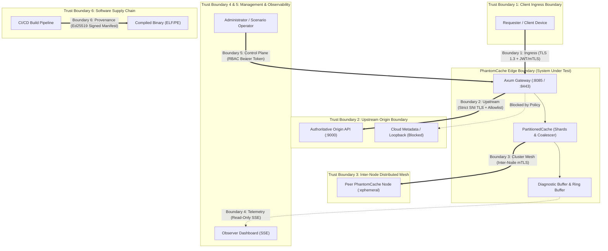
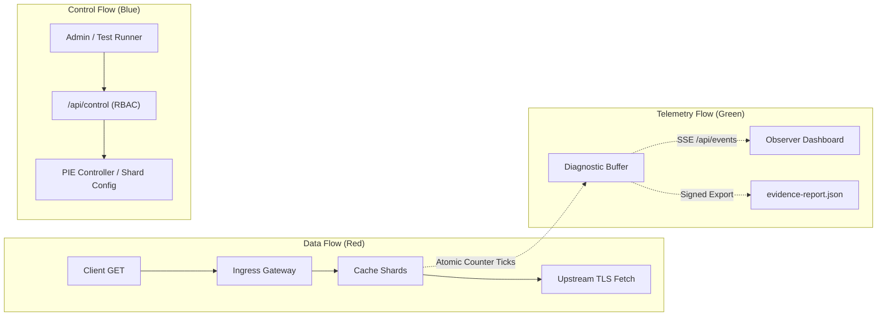

# PhantomCache — Trust-Boundary Map & Identity Architecture

## 1. Global Trust Boundary Map

In zero-trust architecture, physical co-location or LAN membership does not confer authority. PhantomCache operates across six explicit trust boundaries:

---

## 2. Boundary-by-Boundary Technical Analysis

### Boundary 1 — Client to PhantomCache Gateway
* **Description:** The ingress boundary where application clients submit HTTP requests to fetch or invalidate cached resources.
* **Current State:** Plaintext HTTP/1.1; server binds to `127.0.0.1:8085`. Unauthenticated.
* **Target Zero-Trust Architecture:**

| Element | Specification |
| :--- | :--- |
| **Identity Being Verified** | 1. PhantomCache identity verified by the client. 2. Client identity and tenant context verified by PhantomCache. |
| **Authentication Method** | **Server:** Rustls TLS 1.3 presenting certificate for `cache.lab.internal`. **Client:** Signed Bearer JWT or mTLS client certificate. |
| **Authorization Policy** | Role `requester`: Permitted to invoke `GET` and `DELETE` on `/api/v1/cache/*`. Access scoped strictly to the authenticated `tenant_id`. |
| **Trust Anchor** | **Server Cert:** `Demo CA Root` (or enterprise PKI root) trusted by client. **Client Token:** Public verification key of the Identity Provider / Demo Controller. |
| **Failure Behavior** | - TLS handshake abort if certificate is invalid. - HTTP 401 Unauthorized if JWT token is missing/expired. - HTTP 403 Forbidden if token lacks `requester` role. |
| **Remaining Risks** | Compromise of client private key or token theft on client host. |

---

### Boundary 2 — PhantomCache Gateway to Upstream Origin
* **Description:** Outbound transport connection established when a cold miss or cache bypass occurs.
* **Current State:** Plaintext raw TCP; strips `https://`; connects to static `ORIGIN_URL`. No IP allowlist.
* **Target Zero-Trust Architecture:**

| Element | Specification |
| :--- | :--- |
| **Identity Being Verified** | Origin identity verified by PhantomCache. |
| **Authentication Method** | Outbound TLS 1.3 with strict Server Name Indication (SNI) matching origin hostname. Optional mTLS presenting PhantomCache client certificate to origin. |
| **Authorization Policy** | Strict destination allowlist (`allowed_origins = ["https://origin.lab.internal:9000"]`). Automated IP blacklisting blocking `127.0.0.0/8`, `169.254.0.0/16`, RFC 1918 private CIDRs (in production), and cloud metadata (`169.254.169.254`). |
| **Trust Anchor** | Upstream CA bundle loaded into PhantomCache configuration. |
| **Failure Behavior** | - Handshake failure if origin certificate is expired, self-signed, or hostname mismatched. - HTTP 403 Forbidden (`UpstreamDestinationDisallowed`) if URL not allowlisted. - Immediate socket abort if resolved IP falls in blacklisted CIDR. |
| **Remaining Risks** | Origin backend database compromise (origin serves authentic TLS, but application content is corrupted). |

---

### Boundary 3 — PhantomCache Node to Peer Cache Nodes (Cluster Mesh)
* **Description:** Inter-node TCP connections used for Rendezvous (HRW) key routing, replica failover, and invalidation gossip.
* **Current State:** Raw TCP line protocol (`GET <key>\r\n`); tested in `tests/integration/p2_dist_network_tests.rs`, but disconnected from Axum HTTP gateway. Unauthenticated.
* **Target Zero-Trust Architecture:**

| Element | Specification |
| :--- | :--- |
| **Identity Being Verified** | Peer node membership and node identifier (`node_id: u8`). |
| **Authentication Method** | Mutual TLS (mTLS) over TCP. Peer node must present certificate with Subject Alternative Name: `DNS:node-{id}.cluster.phantom.internal`. |
| **Authorization Policy** | Only authenticated cluster peers permitted to forward cache misses or broadcast invalidation events. |
| **Trust Anchor** | Dedicated private `Phantom Cluster CA Root`. |
| **Failure Behavior** | - Socket dropped immediately during TLS handshake if peer certificate is untrusted. - Connecting node marks peer `NodeState::Suspect` upon socket failure and fails over to secondary replica. |
| **Remaining Risks** | A compromised node possessing a valid cluster certificate can serve poisoned cache entries to peers. |

---

### Boundary 4 — Observer Dashboard to Telemetry API (`/api/events`)
* **Description:** Continuous Server-Sent Events (SSE) telemetry stream consumed by read-only monitoring dashboards and log collectors.
* **Current State:** Plaintext HTTP SSE; unauthenticated; hybrid of real counters and simulated throughput.
* **Target Zero-Trust Architecture:**

| Element | Specification |
| :--- | :--- |
| **Identity Being Verified** | Observer client identity. |
| **Authentication Method** | Bearer JWT token with `role: observer` passed as query parameter (`?token=...`) or `Authorization` header during SSE handshake. |
| **Authorization Policy** | Read-only access to `/api/events`, `/health`, and `/api/v1/diagnostics/*`. Zero access to `/api/control`. |
| **Trust Anchor** | Identity Provider public key. |
| **Failure Behavior** | HTTP 401 Unauthorized; connection terminated before streaming SSE events. |
| **Remaining Risks** | Read-only telemetry disclosure (an observer can inspect request counts and latency percentiles, but sensitive headers/bodies are redacted). |

---

### Boundary 5 — Administrator to Privileged Control Endpoints (`/api/control`)
* **Description:** Administrative REST APIs that mutate system state, trigger workload presets (e.g., Flash Crowd), inject node failures, or reconfigure capacity limits.
* **Current State:** Completely unauthenticated `POST /api/control`. Anyone with network reachability can alter server state.
* **Target Zero-Trust Architecture:**

| Element | Specification |
| :--- | :--- |
| **Identity Being Verified** | Scenario Operator or Cluster Administrator identity. |
| **Authentication Method** | Cryptographically signed Bearer JWT token with short expiration (`exp` <= 1 hour) and explicit claim `role: operator` or `role: admin`. |
| **Authorization Policy** | - `role: operator`: Permitted to trigger predefined scenarios and workload presets. - `role: admin`: Permitted to reconfigure cache shard limits, rotate keys, and shut down nodes. |
| **Trust Anchor** | Identity Provider public key. |
| **Failure Behavior** | HTTP 401 Unauthorized (missing/invalid token) or HTTP 403 Forbidden (insufficient role). Security audit event logged to diagnostic ring buffer. |
| **Remaining Risks** | Stolen administrator credentials allow authorized triggering of disruptive scenarios. |

---

### Boundary 6 — Build/Release Pipeline to Deployed Binaries
* **Description:** The software supply chain boundary ensuring that the binary executing on the host corresponds to approved source code and has not been maliciously modified.
* **Current State:** Ad-hoc local compilation (`cargo build --release`). No signatures or provenance manifests.
* **Target Zero-Trust Architecture:**

| Element | Specification |
| :--- | :--- |
| **Identity Being Verified** | Build authority and software release version. |
| **Authentication Method** | Cryptographic release manifest (`release-manifest.json`) containing binary SHA256 digest, Git commit SHA, and compiler metadata, signed with an Ed25519 release key (or Sigstore/Cosign). |
| **Authorization Policy** | Evaluator runs standalone `phantom-verify` CLI before deployment. Execution proceeds only if binary hash matches the signed manifest. |
| **Trust Anchor** | Public release verification key (`release-signing.pub`) distributed through trusted out-of-band channel. |
| **Failure Behavior** | `phantom-verify` exits with non-zero error code: `[ALERT] Binary hash does not match signed release manifest! Execution rejected.` |
| **Remaining Risks** | Compromise of the developer's release signing key or compromise of the compiler toolchain. |

---

## 3. Data Flow, Control Flow, and Telemetry Flow Separation

To prevent cross-plane contamination, the architecture establishes strict separation between three distinct operational flows:

1. **Data Plane:** Handles high-throughput ingress and upstream HTTP requests. Bound strictly by resource caps (512 KB request limit, 2 MB response limit, 200,000 unique-key capacity rejection).
2. **Control Plane:** Low-frequency, authenticated administrative plane. Strictly isolated from data path; mutations require administrative tokens and are logged to audit records.
3. **Telemetry Plane:** Read-only observation stream. Consumes atomic counters and percentiles without locking cache shards, without inflating request counters, and without permitting reverse control.

